# 2015年河南省公务员录用考试《行测》题

<!-- gwy:overview:start -->
> **河南 · 2015 · 行测 · 统考** ｜ 120 题 · 图片 109 处 · 答案随题折叠

| 题型模块 | 题量 | 题号 |
| --- | ---: | ---: |
| 言语理解与表达 | 30 | 1–30 |
| 数量关系 | 15 | 31–45 |
| 判断推理 | 35 | 46–80 |
| 常识判断 | 20 | 81–100 |
| 资料分析 | 20 | 101–120 |
| **合计** | **120** | |

导航：[题型与作答说明](#题型与作答说明) · [题目](#题目) · [材料 1](#材料-1)
<!-- gwy:overview:end -->

> 候选采集稿。参考答案及解析来自粉笔页面，不代表官方答案或真实高分答卷；来源使用许可与原卷对应关系仍需人工核实。

## 题型与作答说明

言语理解与表达

（30题）

本部分包括表达与理解两方面的内容。请根据题目要求，在四个选项中选出一个最恰当的答案。

数量关系

（15题）

在这部分试题中，每道题呈现一段表述数字关系的文字，要求你迅速、准确地计算出答案。

判断推理

（35题）

本部分包括图形推理、定义判断、类比推理与逻辑判断四种类型的试题。

常识判断

（20题）

根据题目要求，在四个选项中选出一个最恰当的答案。

资料分析

（20题）

所给出的图、表、文字或综合性资料均有若干个问题要你回答。你应根据资料提供的信息进行分析、比较、计算和判断处理。

## 题目

### 第 1 题

上世纪二三十年代，娱乐方式少，评弹和电影是＿＿＿＿的，目前电影能够带来各种感官刺激，评弹就做不到了。那么，既然没有土壤，评弹演员的水平怎能提高？

填入画横线部分最恰当的一项是：

A. 旗鼓相当

B. 求同存异

C. 一脉相连

D. 相映成趣

第 1 题 · 答案与解析

**参考答案（粉笔题库参考内容）**

A

**解析**

根据前后文表意可知，目前电影能够带来各种感官刺激，而评弹做不到，即两者出现了差距，所以二三十年代两者应该是实力相当的。A项的“旗鼓相当”比喻双方力量不相上下，能很好体现文意，当选。

B项“求同存异”指找出共同点，保留不同意见；C项“一脉相连”指事物之间互相关联，犹如一条脉络贯穿下来，可以互通；D项“相映成趣”指相互衬托着，显得很有趣味，很有意思。三项均体现不出两者实力相当之意，排除。

故正确答案为A。

【文段出处】《要送别的不只是书场》

**考点**：对应关系-前后呼应、成语填空

**来源**：2015年河南省公务员录用考试《行测》题第1题

### 第 2 题

当公众把税和预算的治理权交给公共权力的代理者——政府的时候，并没有放弃自己对这个国家财政资源的所有权和统治权，政府只能在人民授予的范围之内行使权力，否则就是＿＿＿＿。市场经济中政府所拥有的权力，只是政府履行社会责任和提供公共服务的＿＿＿＿，政府是一个服务于全体纳税人的载体。

依次填入画横线部分最恰当的一项是：

A. 渎职 结果

B. 垄断 基础

C. 僭越 条件

D. 侵权 核心

第 2 题 · 答案与解析

**参考答案（粉笔题库参考内容）**

C

**解析**

文段表明“政府只能在人民授予的范围之内行使权力”，即不能超出范围之外，故第一空应选择“僭越”，表示一旦跨出范围，就是超越本分或者无权冒用，语义语境合适，保留C项；“渎职”表示玩忽职守、滥用职权或者徇私舞弊，导致伤害或损失，“侵权”指侵害他人权利的行为，均并不能对应文段强调的超出权力范围，而“垄断”是一个经济学概念，不能用来形容政府与人民的关系，也无法体现超出范围之意，排除A、B、D三项。

第二空，代入验证，C项“条件”能体现出市场经济中政府拥有的权力只是保障政府能够履行责任提供服务的一个影响因素，表意准确，当选。

故正确答案为C。

【文段出处】《李炜光说财税》

**考点**：实词填空、对应关系-前后呼应

**来源**：2015年河南省公务员录用考试《行测》题第2题

### 第 3 题

德国职业教育体系一直被认为是实现低失业率的一个重要原因，并享有极高的国际声誉。德国职业培训在时间＿＿＿＿上采取每周3～4天在企业，1～2天在职业学校的方式，教学工作一般由公司经验丰富的高级技师和学校教师＿＿＿＿。国家的通用考核标准保证了各种资格和职称的可比性，这些标准都是由业界负责制定的。

依次填入画横线部分最恰当的一项是：

A. 安排 胜任

B. 分配 承担

C. 调配 担任

D. 计划 担当

第 3 题 · 答案与解析

**参考答案（粉笔题库参考内容）**

B

**解析**

第一空，文段在介绍与科普德国职业教育体系，其培训机制均是已经实现并客观存在的，故而D项“计划”是对于未来发展的设计，不合时态，排除；C项“调配”一词之后往往搭配实物，如“调配物资”“调配人员”，与“时间”搭配不当，排除。

第二空，“由······承担”为较常见搭配，“胜任”表示足以承受或担任，“由······胜任”存在语法错误，搭配不当，如用胜任，可表述为“教师胜任教学工作”，A项排除。

故正确答案为B。

【文段出处】《德国的职业技术教育与大都市发展》

**考点**：实词填空、对应关系-前后呼应、词的辨析-搭配对象

**来源**：2015年河南省公务员录用考试《行测》题第3题

### 第 4 题

所谓城市文化，说到底是一个城市的灵魂，它可以体现为＿＿＿＿＿＿的城市建筑，也可以体现为传统遗存的保护和文化产业的生长，但归根结底，它体现的应是一个城市的价值和精神。如此，城市才可宜居，不同社会阶层之间的关系才可＿＿＿＿，一代又一代的居民才可扎根，经济发展才可能藉此获得自己的文化面孔。

依次填入画横线部分最恰当的一项是：

A. 气势恢宏 平衡

B. 千姿百态 亲密

C. 别具一格 和睦

D. 美轮美奂 和谐

第 4 题 · 答案与解析

**参考答案（粉笔题库参考内容）**

D

**解析**

第一空，与“建筑”搭配，“千姿百态”形容姿势形态多种多样，与“建筑”搭配不当，排除B项。

第二空，根据语境提示，由城市宜居可知，文段的意思为，不同阶层人们的关系是融洽和谐的，共同生活在这座城市里，D项“和谐”用在此处形容不同社会阶层之间的关系较为恰当。A项“平衡”体现不出关系融洽的语意，排除；C项“和睦”通常用于修饰家庭关系、邻里关系，不能搭配社会阶层这一范围较大的概念，排除。

故正确答案为D。

【文段出处】《城镇化应直面文化命题》

**考点**：对应关系-前后呼应、混搭填空、词的辨析-搭配对象

**来源**：2015年河南省公务员录用考试《行测》题第4题

### 第 5 题

如今，恶意卸载或屏蔽竞争对手软件、未经告知就修改用户默认设置、上传用户数据等类似事件的不断出现，已经在＿＿＿＿，如果互联网没有规则，互联网竞争不遵守规则，那必然是＿＿＿＿＿＿，将不断消耗中国互联网的创新力量，损害网民利益，阻碍互联网的发展。

依次填入画横线部分最恰当的一项是：

A. 警示   竭泽而渔

B. 预示   鹬蚌相争

C. 证明   寅吃卯粮

D. 昭告   作茧自缚

第 5 题 · 答案与解析

**参考答案（粉笔题库参考内容）**

A

**解析**

第一空，由横线后的“如果”一词可知，作者是通过现在互联网的一些恶性事件在设想与推断持续如此给整个互联网发展带来的消极后果。D项“昭告”意为明白的告知，有公开的含义，与文意不符，且一般后文应有搭配对象，排除。

第二空，横线处所填内容指互联网没有规则、竞争不规则的后果。B项中的“鹬蚌相争” 比喻双方相持不下，而使第三者从中得利，文中并无得利的第三者，排除；C项的“寅吃卯粮”意为寅年吃了卯年的粮食。形容入不敷出，预先借支，文段强调规则的重要性，并未体现入不敷出之意，排除。A项的“竭泽而渔” 比喻目光短浅，只顾眼前利益，不顾长远打算，置于此处符合语义，且与横线后所表达的阻碍互联网的发展含义相匹配，当选。

故正确答案为A。

【文段出处】《互联网竞争不守规则必将“竭泽而渔”》

**考点**：对应关系-前后呼应、混搭填空、词的辨析-搭配对象

**来源**：2015年河南省公务员录用考试《行测》题第5题

### 第 6 题

英国数学家和哲学家罗素从欧几里德的《几何原本》中“读出音乐般的美妙”，德国生物学家海克尔从达尔文的《物种起源》中“见出生物世界无与伦比的统一之美”。尽管科学家们对科学美的＿＿＿＿大多是零散的，但不难看出他们对科学之美的肯定和重视。在这些大科学家眼里，科学美是自然和谐之美的＿＿＿＿，是人们发现自然之秘而产生的自我超越感。

依次填入画横线部分最恰当的一项是：

A. 解释 升华

B. 阐述 映射

C. 感受 解读

D. 概括 延伸

第 6 题 · 答案与解析

**参考答案（粉笔题库参考内容）**

B

**解析**

第一空，根据前文科学家对著作的评价语句可知，空格处并非一种抽象的“感受”，排除C项。D项“概括”往往是全面的、精炼的，与后文“零散”一词相矛盾，排除。

第二空，“升华”意为事物经过提炼加工上升到新的层次，往往指境界的提升，而“科学美”与“自然美”并无此种关系，故排除A项。B项“映射”意为反射、反映，代入原文能表达出科学之美反映了自然之美的含义，符合语境，当选。

故正确答案为B。

**考点**：实词填空、对应关系-前后呼应

**来源**：2015年河南省公务员录用考试《行测》题第6题

### 第 7 题

我们的生活不断“提速”，凡事追求＿＿＿＿＿＿，生活不自觉地迈入“加急时代”。“时间就是金钱，效率就是生命”演变为―种普世的价值观。出差是飞机高铁，上网是极速体验，吃饭要争分夺秒，就连蹒跚学步的孩子，都不能输在起跑线上。这份急，夹杂着对结果的狂热、对过程的忽视，进而衍生出对规则的＿＿＿＿，同时催生出各种问题。

依次填入画横线部分最恰当的一项是：

A. 立竿见影   漠视

B. 当机立断   解构

C. 风风火火   亵渎

D. 一步到位   歪曲

第 7 题 · 答案与解析

**参考答案（粉笔题库参考内容）**

A

**解析**

第一空考查成语的辨析。根据前文“提速”及后文“加急”的对应可知空格处需要填入表示快速之意的成语。“出差是飞机高铁，上网是极速体验······”表明文段强调速度快。B项中的“当机立断”侧重于强调抓住时机，立刻果断地作出决定；C项中的“风风火火”则侧重于形容冒冒失失的样子，无法体现出“急”这一特征，故排除B、C两项。

第二空考查词语的搭配。搭配的是规则，A项中的“漠视"体现出因为对结果狂热、对过程的忽视导致对规则轻视、不放在心上，符合文意，当选。D项中的“歪曲”指故意改变事物的本来面目或对事物作不正确的反映，往往搭配事实或者原意，搭配不当，排除。

故正确答案为A。

**考点**：对应关系-前后呼应、混搭填空、词的辨析-搭配对象

**来源**：2015年河南省公务员录用考试《行测》题第7题

### 第 8 题

成功摘掉“雾都”帽子的伦敦，是许多人心目中治理空气知耻而后勇的＿＿＿＿。但60年后，伦敦的境况并不乐观，空气难达标，欧盟屡警告，这似乎也昭示着空气治理从来不是＿＿＿＿＿＿的事情，也提醒着我国治理之路的漫长。

依次填入画横线部分最恰当的一项是：

A. 标志   易如反掌

B. 象征   按图索骥

C. 榜样   闭门造车

D. 典范   一劳永逸

第 8 题 · 答案与解析

**参考答案（粉笔题库参考内容）**

D

**解析**

第一空，根据前文“成功摘掉‘雾都’帽子”可知，伦敦的空气治理十分成功，故横线处应该填入感情色彩积极的词语，C项“榜样”指值得学习、效法的好人好事、D项“典范”指可以作为学习、仿效标准的人或事物，均为褒义词，符合语境，保留。A项“标志”引申为表明某种特征的行为、B项“象征”指通过具体事物表现抽象意义，均为中性词，不如C、D两项更加契合文段语境，排除。

第二空，根据“提醒着我国治理之路的漫长”可知，横线处所填词语应该表达空气治理不容易、不是短期可以搞定的事情。D项“一劳永逸”指辛苦一次，把事情处理好，就能得到永久的安闲，符合文意，当选。C项“闭门造车”比喻不顾客观实际，只凭想当然办事，与文意不符，排除。

故正确答案为D。

【文段出处】《“雾都”治理童话：奢侈的烦恼》

**考点**：对应关系-前后呼应、混搭填空、词的辨析-感情色彩

**来源**：2015年河南省公务员录用考试《行测》题第8题

### 第 9 题

从目前市场上微电影项目的特征来看，微电影产业势必更为专业化，将经历内容整理与规范化生产的过程。在盈利模式逐渐明确之后，作为产品的主要组成部分，微电影商业片将会形成一个＿＿＿＿＿＿的内容区间与制作标准，相关专家强调：“目前网络微电影的内容＿＿＿＿＿＿，一些功利性较强的影片＿＿＿＿＿＿，以出位怪异获取关注，缺乏社会责任感，急需相关部门出台相应的法律法规进行规范，而制作标准则是每―个产业都必须做到的原则。”

依次填入画横线部分最恰当的一项是：

A. 成熟完备   真假难辨   趁虚而入

B. 合情合理   五花八门   大行其道

C. 清晰明确   良莠不齐   哗众取宠

D. 规范稳定   鱼龙混杂   滥竽充数

第 9 题 · 答案与解析

**参考答案（粉笔题库参考内容）**

C

**解析**

本题可将第三空作为突破口入手。第三空后阐述一些网络微电影“以出位怪异获取关注”，是对第三空横线处成语的解释说明，与之对应可知，C项“哗众取宠”中“哗众”对应“出位怪异”的方式，“取宠”对应“获取关注”，符合文意，保留。A项“趁虚而入”指趁力量虚弱时侵入，文段并未体现敌人力量虚弱了，排除；B项“大行其道”指某种观点或某种事物盛行，文段并未体现出这些影片在当时是特别流行的，排除；D项“滥竽充数”比喻没有本事的人混在有真才实学的人里边充数，或以次充好，文段并非侧重以次充好，而是侧重影片以出位怪异获取关注，缺乏社会责任感，排除。

前两空代入验证，第一空用来修饰“区间与标准”，“清晰”对应区间、“明确”对应“标准”，十分准确，第二空填入“良莠不齐”，意在表达网络微电影内容质量及水平的参差不齐，好的坏的都混在一起，符合文意，C项当选。

故正确答案为C。

【文段出处】《微电影发展之路迈向何方？》

**考点**：对应关系-前后呼应、成语填空、词的辨析-搭配对象

**来源**：2015年河南省公务员录用考试《行测》题第9题

### 第 10 题

畅销书已经深入我们的阅读生活，它与当代社会生活最为＿＿＿＿，与时代的变化联系最为密切，我们无法＿＿＿＿畅销书，只期望有越来越多像霍金的《时间简史》那样的书成为畅销书，也期望畅销书的文化品位与其销量＿＿＿＿。

依次填入画横线部分最恰当的一项是：

A. 贴近 拒绝 得而兼之

B. 契合 忽视 两全其美

C. 紧密 排斥 双管齐下

D. 一致 抵触 并行不悖

第 10 题 · 答案与解析

**参考答案（粉笔题库参考内容）**

A

**解析**

第一空，填入“紧密”“一致”用法均不得当，“紧密”应搭配“关系”“联系”等，“一致”应搭配“步调”“观点”等，故排除C、D两项。

第二空，根据文意可知，我们对待畅销书的态度是接受，故空格处填入“拒绝”更为准确，排除B项。

第三空验证，A项“得而兼之”即“兼而得之”之意，意在表明畅销书既能保有文化品位，又能获得很高的销量，符合语境，当选。

故正确答案为A。

【文段出处】《郭敬明成“霸主”，我们该拒绝畅销书吗？》

**考点**：对应关系-前后呼应、混搭填空、词的辨析-搭配对象

**来源**：2015年河南省公务员录用考试《行测》题第10题

### 第 11 题

在一线城市，过去一派田园风光的郊区，如今也已高楼林立，无“农”可学正成为不少学校农学专业面临的窘境。再加上时间、场地和内容的限制，学农对农学专业学生的吸引力逐渐减弱，学农的必要性也遭受质疑。这段文字意在说明（  )。

A. 吸引学生学农迫在眉睫

B. 农学专业面临双重困境

C. 农学专业应适应城市化发展趋势

D. 国家应为农学发展提供必要条件

第 11 题 · 答案与解析

**参考答案（粉笔题库参考内容）**

B

**解析**

文段为并列结构，首先指出城市郊区的高楼林立使农学专业面临窘境，接下来以“再加上”做并列连接，指出由于各方面的限制，农学专业的吸引力下降，故文段重在强调农学专业面临既无“农”可学，又没有吸引力的双重困境。B项符合文意，当选；A项：“ 迫在眉睫”表述错误，虽然“吸引学生学农”是对策，但文段并没有体现出学农的紧迫性，排除；C项：“ 适应城市化发展趋势”为无中生有的表述，排除；D项：将“农学专业”偷换为“农学发展”， 主题不一致，排除。

故正确答案为B。

【文段出处】 《田园课堂，乡土味能否更浓些》

**考点**：关联词-并列

**来源**：2015年河南省公务员录用考试《行测》题第11题

### 第 12 题

风俗既然是历史的产物，就不可避免地随着历史的发展而变化，但凡能够存在的，都有其依存的自然条件和社会环境。沧海桑田的变化，经济的发展，制度的更迭，都会促使风俗变迁，有些旧风俗的衰亡犹如新风俗的兴起一样，是自然和社会的新陈代谢，是合理的现象。衰亡的不一定都要复兴，有的不妨任其自生自灭。例如，新中国成立初期有的少数民族文字已经消亡，中国社会科学院少数民族语言研究所曾经帮助这些民族恢复文字，但事与愿违，不受当地人的欢迎，因为他们认为学会本民族的文字，走不出家乡，宁可选择学汉字。但是，这种文字既然在历史上存在过，就是一份值得珍视的文化遗产，需要作为文物保存在历史记忆中，让现代人感知先人的智慧，使其“亡而不忘”。

这段文字意在强调：

A. 应该从历史发展的角度对待风俗

B. 风俗是一种无法复制的非物质遗产

C. 风俗的变迁是多种因素耦合的结果

D. 风俗作为一种文化遗产应大力保护

第 12 题 · 答案与解析

**参考答案（粉笔题库参考内容）**

A

**解析**

文段开篇指出风俗是历史产物，会随历史发展而变化，其存在有依存的自然和社会条件，接着说明沧海桑田、经济发展、制度更迭等都会促使风俗变迁，衰亡与兴起都是自然和社会的新陈代谢，衰亡的不一定复兴。随后以少数民族文字消亡为例，说明有的风俗不妨任其自生自灭，但消亡的风俗作为文化遗产需要保存，让现代人感知先人的智慧。故文段围绕风俗的变迁和如何对待风俗展开论述，强调应从历史发展的角度看待风俗的变化与留存，对应A项。

B项，未提及文段主题词“历史发展”，文段重点强调应从历史发展角度对待风俗，该项偏离重点，排除；

C项，“风俗的变迁是多种因素耦合的结果”对应文段中关于风俗变迁原因的解释说明部分，非重点，文段重点是强调要从历史发展角度看待风俗，排除；

D项，文段强调对于有些风俗可任其自生自灭，并非所有风俗都要大力保护，该项与文段中对待风俗的态度表达不一致，排除。

故正确答案为A。

【文段出处】《对民俗的历史解读与开发》

**考点**：关联词-对策、分述句特征-其他

**来源**：2015年河南省公务员录用考试《行测》题第12题

### 第 13 题

电影、电视会强有力地抑制读者对文本的自由想象。与电影相比，小说更像是漫画。一方面漫画能教人怎样用寥寥数笔定义人物和物体；另一方面，漫画场景之间的方格，代表着漫画家省略了的内容，同时又让我们注意到创作者构思取景的能力。而在阅读小说时，这些场景（方格）会由读者自行串联起来，合成了一整篇说得通的故事。

这段文字意在说明：

A. 小说与漫画有很多相似之处

B. 小说多注重故事情节的完整性

C. 小说为读者留下自由想象的空间

D. 漫画比电影和小说的表现力更强

第 13 题 · 答案与解析

**参考答案（粉笔题库参考内容）**

C

**解析**

文段开头以电影、电视作对比，引出“小说”这一主题词，接着通过用漫画对小说的比拟，根据漫画的特点，突出说明阅读小说时，场景（方格）会由读者自行串联起来，即不会像电视电影那样抑制读者对文本的自由想象，能给读者自由想象的空间的特点，对应C项。

A项，文段只是将小说比作漫画，突出小说能激发人的自由想象，而并不是将两者进行对比，排除。B项，文段并未提及情节的完整性，属于无中生有，排除。D项，文段强调的是小说而不是漫画，主题词错误，排除。

故正确答案为C。

【文段出处】《当我们阅读时，我们看到了什么?》

**考点**：主题词、关联词-因果

**来源**：2015年河南省公务员录用考试《行测》题第13题

### 第 14 题

一个寒冷的冬天，纽约一条繁华的大街上，有一个双目失明的乞丐，那乞丐的脖子上挂着一块牌子，上面写着：“自幼失明”。有一天，一个诗人走近他身旁，他便向诗人乞讨。诗人说：“我也很穷，不过我给你点别的吧。”说完，他便随手在乞丐的牌子上写了一句话。那一天，乞丐得到很多人的同情和施舍。后来，他又碰到那诗人，很奇怪地问：“你给我写了什么呢？”那诗人笑笑，念那牌子上他所写的句子道：“春天就要来了，可我不能见到它。”

最适合这段文字标题的是：

A. 幸运的乞丐

B. 温暖的冬天

C. 春天的收获

D. 诗歌的妙用

第 14 题 · 答案与解析

**参考答案（粉笔题库参考内容）**

D

**解析**

整个文段通过这个小故事旨在强调的是，诗人虽然没有给钱，但他用诗意的语言和诗的内涵，真真切切地帮助了盲人乞丐，进而突出了诗歌的作用，即人们看到诗句后都被感染了，纷纷来帮助盲人乞丐，对应D项。

A、B、C三项均未包含“诗歌”这一主题词，错误。

故正确答案为D。

【文段出处】未找到原文

**考点**：标题填入题

**来源**：2015年河南省公务员录用考试《行测》题第14题

### 第 15 题

近年来，众多电商长期耕耘数字阅读市场，造就了全民阅读热潮，政府的支持、数字出版产业经济的迅速发展、手机网民网络文学服务使用率的提高以及针对多媒体信息的科技的进步，都为移动阅读提供了良好的环境支持。据第十二次全国国民阅读调查成果显示，近三年我国成年国民数字化阅读方式的接触率逐年提高，数字化阅读率首次超过传统图书阅读率。

这段文字意在强调：

A. 全民阅读热潮方兴未艾

B. 数字出版产业大规模兴起

C. 电商造就了数字化阅读热潮

D. 国民数字阅读已超越传统阅读

第 15 题 · 答案与解析

**参考答案（粉笔题库参考内容）**

C

**解析**

文段为“观点+解释说明”结构，首先指出文段重点，即电商使数字阅读火热发展，然后指出政府、出版产业等多方面对这一现状给予了良好支持，最后通过调查结果进一步详细说明，结合选项可知，C项为首句中心句的同义替换。

A项全民阅读是数字阅读概念的扩大；B项主题词错误，数字出版产业只是支持移动阅读众多条件之一，并非文段重点；D项只是调查结果的解释说明部分，是在论证数字化阅读的热潮，不是重点内容。

故正确答案为C。

【文段出处】《手机阅读人群涨至五成 碎片化阅读渐成主流》

**考点**：分述句特征-其他

**来源**：2015年河南省公务员录用考试《行测》题第15题

### 第 16 题

在促使近代科学产生的外部原因中，清教主义的兴盛是一个相当重要的因素。学者们认为，近代科学的一个前提性的假设就是一种广泛传播、出自本能的信念，相信存在事物的秩序，特别是自然的秩序。科学史专家以具体资料表明：在17世纪英国皇家学会会员中，十个当中就有七个是清教徒，这一比例大大高于清教徒在总人口中所占的比例；大多数科学家都是活跃的教士，而很多教士也鼓励或亲自投身科学事业；清教学校在其课程中也会设置自然科学科目。

这段文字意在说明：

A. 清教主义在十七世纪盛行的原因

B. 宗教与科学之间并非是绝对对立的

C. 宗教对近代科学具有催生及促进作用

D. 近代科学的前提性假设与宗教的渊源

第 16 题 · 答案与解析

**参考答案（粉笔题库参考内容）**

C

**解析**

文段结构为“观点+解释说明”结构，第一句提出了文段的中心，即清教主义对近代科学的产生有着很重要的作用，接下来从学者和科学史专家的角度详细解释说明了清教主义对近代科学的促进作用，C项是文段中心句的同义替换，当选。

A项是文段中科学史专家资料中的内容，不是文段重点，排除；B项表述不明确，文段意思为宗教对科学的产生有促进作用，排除；D项，前提性假设是学者们认为中的内容，是解释说明的部分，不是文段重点，且“渊源”一词表述不明确，准确的意思为，宗教促进了近代科学的产生，排除。

故正确答案为C。

【文段出处】《近代科学的诞生》

**考点**：分述句特征-多角度论述

**来源**：2015年河南省公务员录用考试《行测》题第16题

### 第 17 题

文化从来都包括物质，同时文化也从来都具有非物质的一面。然而，自从近代“物质”兴起之后，我们的思维和想象都已经相当的物质化。由于近代中国曾经悲惨地示人以积贫积弱之相，故追求富强也就成了理所当然的主流。如今的中国虽然看似已经变得富强，却也确实逐渐淡忘了物质财富之外的天地，对于各类“非物质”的事物久已生疏，以至于视而不见。把“非物质文化”视为招商的选项，就是一种典型的物质化思路。

这段文字表达的主要观点是：

A. 文化是物质层面和非物质层面的综合体

B. 中国在实现物质富强之后更应注重非物质层面的富强

C. 中国在逐渐变为物质巨人的同时却沦为了精神上的贫困者

D. 当今人们片面追求物质财富而忽视了非物质性文化建设

第 17 题 · 答案与解析

**参考答案（粉笔题库参考内容）**

D

**解析**

文段首先指出文化应包含物质与非物质，接着通过转折关联词“然而”引出文段重点，即我们过分地追求物质而忘记了非物质文化，并且分析了其原因，文段尾部再次强调了现在我们只注重物质而淡忘了非物质，呼应文段中心。D项为文段中心意思的同义替换，当选。

A项：为转折前内容，不是文段重点，排除。

B项：表述有误，并非在中国物质富强之后才注重非物质层面，而是由始至终都应该同时注重物质与非物质，排除。

C项：“精神上的贫困者”概念过于宽泛，文段只是说没有重视非物质，排除。

故正确答案为D。

**考点**：关联词-转折、分述句特征-举例子

**来源**：2015年河南省公务员录用考试《行测》题第17题

### 第 18 题

虽然人们总是这样假定：只要不断提升人类的理性，并使信息透明化，就能消弭谣言产生的土壤。但迄今为止这一直只是个理想，而且很可能永远也无法实现。没有哪个社会的人所传播的信息都完全正确，在很多情况下，人们为了尽快获知自己所关心的“真相”，常常在不知不觉中传播那些未经证实的说法。因为在很大程度上，谣言折射的正是群体心理：他们的希望、恐惧、焦虑。这段文字意在说明：

A. 没有谣言的社会是不存在的

B. 人们往往无意识地传播着谣言

C. 谣言折射出社会部分群体的心理

D. 人们往往为了获取真相而轻信谣言

第 18 题 · 答案与解析

**参考答案（粉笔题库参考内容）**

A

**解析**

这是一道中心理解题。文段第一句话给出一个理想假设满足一定条件就能消灭谣言。紧接着第二句话用转折关联词“但”又说那个理想在现实中无法实现，也就是谣言是无法消灭的。接下来用两句话对第二句话的重点进行了解释说明。可见整个文段重点是在说谣言是一定会存在任何社会中。A选项是对文段中心思想的概括。

B、C、D三项都是原因解释部分的内容，不是观点。

故正确答案为A。

【文段出处】《这一代人的恐惧与焦虑》

**考点**：关联词-转折

**来源**：2015年河南省公务员录用考试《行测》题第18题

### 第 19 题

就在“古典音乐注定是―种小众艺术”成为―种基本共识时，这个艺术门类的门槛却被新技术撬动了。之前，古典音乐使尽浑身解数，试图吸引新受众而不得，新技术却展现了另一种可能性，如果有适当的机会，人们其实渴望了解古典音乐。

以这段文字作为开头，文章接下来最可能论述什么？

A. 古典音乐的新魅力

B. 古典音乐的受众群体

C. 新技术促进古典音乐传播的方式

D. 新技术在古典音乐传播中的作用

第 19 题 · 答案与解析

**参考答案（粉笔题库参考内容）**

C

**解析**

本题为接语选择题，应通读全文，重点关注文段最后谈论的核心话题。文段首先指出古典音乐这一艺术门类的门槛被新技术撬动了，接着指出新技术能有效地帮助古典音乐吸引新的受众。故后文应该就此话题展开详细论述，即描述新技术如何帮助古典音乐扩大受众群，对应C项。

A、B两项没有提到新技术这一核心概念，故与下文衔接不当，均排除；

D项为文段中已经论述过的内容，新技术对古典音乐的作用就是能帮助它的传播，帮助它吸引很多的受众，故后文不可能再重复论述，排除。

故正确答案为C。

【文段出处】《新技术拯救古典音乐？》

**考点**：接语选择题

**来源**：2015年河南省公务员录用考试《行测》题第19题

### 第 20 题

天文探索是为了揭示宇宙的奥秘，而占星术则忙于为某个具体的人卜算吉凶；化学揭示了水是由分子构成的，而厂商炮制出的所谓“小分子水”的概念，则成为了典型的商业骗局；在苏联时代，经不起严格推敲的“李森科遗传学”之所以能红极一时，正是“李森科试图消除学术竞争对手”与“苏联当局试图以科学证明意识形态的胜利”二者―拍即合的结果，而并不是它本身正确得无以复加。

这段文字意在说明伪科学：

A. 会对科学发展有消极或负面的影响

B. 经不起科学所必须接受的严格检验

C. 披着科学的外衣示人，非常有蒙蔽性

D. 带有功利性，其传播是有特殊目的的

第 20 题 · 答案与解析

**参考答案（粉笔题库参考内容）**

D

**解析**

文段由两个分号连接三个并列结构的分句，提取共性可知，三个部分都提到了伪科学，分别为占星术、“小分子水”、“李森科遗传学”。通过总结可知，伪科学均带有特殊目的，占星术为了占卜、“小分子水”为了挣钱、“李森科遗传学”则带有极强的政治目的。结合选项，D项全面准确地体现了这一含义，当选。

A项的“对科学发展有消极或负面的影响”为无中生有，排除；B项的“经不起科学所必须接受的严格检验”与经不起严格推敲的“李森科遗传学”对应，C项中的“蒙蔽性”与“小分子水”的商业骗局对应，二者都只是并列分句中的其中一个方面，表述片面，均排除。

故正确答案为D。

**考点**：关联词-并列

**来源**：2015年河南省公务员录用考试《行测》题第20题

### 第 21 题

在20世纪，失望于西方文明的一代求索者，面对着东西日趋频繁的交流和接触，不满足前辈间接认知中国精神的方式，便纷纷踏上了东来“朝圣”的征途，开辟出直面对话的新途径。他们都梦想用中国哲学精神来根治西方社会弊病，期盼着从那里寻回疗救自身的灵药和补正自家文化的方略。这就决定了他们在接受中国文化价值、分享中国思想精髓时，也难以回避前辈惯常的实用取向。

下列说法与原文相符的是：

A. 部分西方学者在理解中国文化时存在实用主义倾向

B. 中国学者认为中国哲学思想可以剜除西方社会弊病

C. 20世纪是东西方文明相互碰撞融合的重要历史时期

D. 东西交流的日趋频繁使西方学者接受中国思想文化

第 21 题 · 答案与解析

**参考答案（粉笔题库参考内容）**

A

**解析**

A项，根据“这就决定了他们在接受中国文化价值、分享中国思想精髓时，也难以回避前辈惯常的实用取向。”可知， “他们”指代上文的部分西方学者，“接受中国文化价值、分享中国思想精髓”对应理解中国文化。“难以回避前辈惯常的实用取向”说明存在实用主义倾向。因此A项符合原文表述，当选。

B项，根据“他们都梦想用中国哲学精神来根治西方社会弊病”可知，中国哲学精神对于根治西方社会弊病，只是个梦想，是否能够真正根治未知，“可以剜除”语气过于绝对。且原文的主语是西方学者，中国学者是否这样认为未知，概念偷换，排除。

C项，根据“面对着东西日趋频繁的交流和接触”可知，20世纪东西方交流只是日趋频繁，“重要历史时期”无中生有，排除。

D项，“使”表明选项为因果关系，选项中因是“东西交流的日趋频繁”，果是“西方学者接受中国思想文化”，而原文不存在这种因果关系，排除。

故正确答案为A。

【文段出处】中华读书报《外国作家与中国文化：交往与相互启迪》

**考点**：细节判断题

**来源**：2015年河南省公务员录用考试《行测》题第21题

### 第 22 题

生态环境是为全人类提供公共服务的一种特殊资产，传统消费主义最大的问题也许是，在它使资本主义体系运转起来的经济平衡等式中，并没有对大自然的“资本”进行过正确的评估。生态经济学家们反对消费主义最根本的论点之一，就是消费经济学将地球不可替代的资本（自然资源）视为了收入，这是理论上的致命错误。

这段文字意在强调：

A. 应当重视生态环境的公共属性

B. 人们不应无节制地消费生态环境

C. 传统消费主义难以维持经济平衡和持续发展

D. 对自然资源的错误认识是传统消费主义的主要问题

第 22 题 · 答案与解析

**参考答案（粉笔题库参考内容）**

D

**解析**

文段首先指出，生态环境是全人类的特殊资产。随后通过程度词“最”，强调传统消费主义的最大问题也许在于未对大自然的“资本”进行正确评估。最后通过程度词“最根本”“致命”，进一步强调传统消费主义的错误是将地球不可替代的资本（自然资源）视为了收入，即对自然资源的认识错误。故文段中心为“传统消费主义的问题在于对自然资源的认识存在错误”，对应D项。

A项未包括消费主义这一主题词，排除；B项中“不应”说明问题为无节制地消费生态环境，原文的问题是未对自然资源进行正确的评估，与文意不一致，排除；C项中“维持经济平衡和持续发展”无中生有，排除。

故正确答案为D。

【文段出处】蒲实《消费社会之后？》

**来源**：2015年河南省公务员录用考试《行测》题第22题

### 第 23 题

①这些河谷高山群，北连亚洲腹地和青藏高原，南接亚洲南部热带地区，成为动植物南北扩散通道和东西交汇之地

②学界认为横断山脉是古老物种的庇护所和物种的演化中心

③在喜马拉雅山脉以东，有一系列南北走向的高山峻岭，这就是中外闻名的横断山地区

④因此，这里的动植物不仅种类多，而且特有种所占比例很高，亚种分化复杂，还有不少古老原始的种类

⑤当地民谣“一山有四季，几里不同天，隔山能说话，相见要一天”便是对这里地貌和气候的生动描述

⑥高山深谷纵列，海拔高差巨大，形成垂直多变的立体气候

将以上6个句子重新排列，语序正确的是：

A. ③⑥⑤①④②

B. ③⑥⑤④①②

C. ②③⑤④⑥①

D. ②③⑥⑤④①

第 23 题 · 答案与解析

**参考答案（粉笔题库参考内容）**

A

**解析**

对比选项，②和③充当首句，②句对横断山脉下定义，③句引出横断山地区的话题，首句不好判断。

观察文段④句出现关联词“因此”，结合选项判断④前接①还是⑤，①句论述“该地区成为动植物南北扩散通道和东西交汇之地”与④句“动植物不仅种类多，而且特有种所占比例很高”话题一致，构成因果关系，⑤句论述地貌和气候，与④句话题无关，故①④关联词捆绑，对应A项，B、C、D三项均排除。

验证A项，⑥⑤均论述气候，进行捆绑，逻辑正确，当选。

故正确答案为A。

【文段出处】《桃花之旅，2019相约西藏》

**考点**：确定捆绑

**来源**：2015年河南省公务员录用考试《行测》题第23题

### 第 24 题

①对于所有希望中国成功转型的知识分子来说，承认这一点也许十分痛苦，但却远比抱着精英心态、充满登高一呼应者云集的幻觉更有价值

②知识阶层需正视自己的影响力但不必悲观，知识分子的特性就在于外界因素很难消磨其与生俱来的使命感

③知识阶层倡导的符合世界潮流的观念在社会上未必具有压倒优势，这与其解读为是对知识阶层所谓“脱离群众”的嘲讽，不如当作传统深厚的国度里常识扎根之难的一个证明

④先贤有云：“士不可以不弘毅，任重而道远”，勉乎哉！

⑤如果说中国的改革开放是对世界潮流的一种靠拢，那么这样一个过程并非顺风顺水，其中还有反复乃至回流

⑥因此，尽管经过看似深刻而剧烈的全方位变革，中国的变化还远远没到知识阶层可以乐观的地步，更没到根据这种乐观的估计而进行规划的时候

将以上6个句子重新排列，语序正确的是：

A. ③⑥①②⑤④

B. ⑤⑥①③②④

C. ②④⑥①③⑤

D. ④⑤⑥②①③

第 24 题 · 答案与解析

**参考答案（粉笔题库参考内容）**

B

**解析**

对比选项，确定首句。③对知识阶层倡导的符合世界潮流的观念未必具有压倒优势话题的解读分析，⑤描述了中国改革开放过程中存在的问题，②为以“需”为标志的对策性表述，④为引用先贤说的话，即得出的道理。根据行文逻辑，对策通常在问题后，故②在⑤后，排除A、C项。

接着观察选项。①中出现了指代词“这一点”，根据指代词捆绑，可去前文寻找指代内容，①前面是⑥和②，分析内容可知，⑥中关于中国变化还未到知识阶层乐观地步的描述，正好能与①“这一点”所指代的内容相契合，即让知识分子承认中国的这种现状，所以①应与⑥相连，排除D项。

故正确答案为B。

【文段出处】南都短评《知识阶层需正视影响力但不必悲观》

**考点**：确定捆绑、确定顺序

**来源**：2015年河南省公务员录用考试《行测》题第24题

### 第 25 题

①新诗口语化大众化方向是正确的，但旧体诗的优点不能被全部抛弃

②诗之形式美在于顺应自然取法适中，音乐性则古今中外好诗皆同

③主张新诗形式上绝对自由者，在摒弃旧体诗格律化之同时矫枉过正了，将诗的形式美和音乐性一股脑儿抛弃了

④20世纪初，胡适等人提倡白话文，新诗随之而兴起，挣脱了旧体诗束缚思想之清规戒律，涌现出《雨巷》《再别康桥》等名篇

⑤诗是最美的文体，形式美和音乐性不可或缺。不过，旧体诗死板的格律化固然不对，新诗在形式上绝对自由也未必妥当

⑥看来，新诗要能流传千古，还得在形式美和音乐性方面下功夫，把矫枉过正的过正部分回归原位

将以上6个句子重新排列，语序正确的是：

A. ④⑤②①⑥③

B. ④①⑤②③⑥

C. ④③②①⑥⑤

D. ④⑥⑤②③①

第 25 题 · 答案与解析

**参考答案（粉笔题库参考内容）**

B

**解析**

首句相同，寻找其他线索。观察发现，四个选项尾句不同，分别是①③⑤⑥四句。①句指出新诗的问题，即不能全部抛弃旧体诗的优点，③句指出主张新诗形式上绝对自由者，将诗的形式美和音乐性一股脑儿抛弃的问题，⑤句指出新诗在形式上绝对自由是不太妥当的，⑥句通过“看来”总结，并通过“要”提出对策，指出新诗要能流传千古，要把矫枉过正的过正部分回归原位。分析可知，①③⑤强调新诗矫枉过正的问题，⑥句针对这一问题提出对策，按照行文逻辑应该是先提出问题再给出对策，因此①③⑤应该⑥句之前，故⑥句适合做尾句，基本锁定B项。

验证B项逻辑：④句交代新诗兴起的背景，①⑤②③句介绍新诗矫枉过正的问题，⑥句总结并提出对策，即要把把矫枉过正的过正部分回归原位，逻辑连贯，衔接顺畅。

故正确答案为B。

【文段出处】沈致远《矫枉不必过正》

**考点**：确定尾句

**来源**：2015年河南省公务员录用考试《行测》题第25题

### 第 26 题

我们总以为真理掌握在多数人手里，事实是这样的吗？不是，多数人掌握的是舆论，当真理被发现之前，公众有谁会掌握呢？而一旦被有识之士发现了，又有几个人能很快接受呢？伽利略在比萨斜塔证明自由落体速度与质量无关前，谁又不是认为重的物体比轻的落得快呢？一旦大家接受了伽利略的观点，就形成了公众的舆论。所以，舆论包含有真理和谬论的双重成分。真理总是在不断地被少数有识之士发现，进而推广为公众舆论，从而掌握到多数人手里。因此，＿＿＿＿＿＿＿＿＿＿。

填入画横线部分最恰当的一句是：

A. 公众舆论是真理生根发芽的土壤

B. 真理演变为舆论的过程是曲折而又漫长的

C. 社会公众只是真理的被动接受者和推广者

D. “少数服从多数”的原则阻碍了真理的诞生

第 26 题 · 答案与解析

**参考答案（粉笔题库参考内容）**

C

**解析**

文段首先提出大部分人所持有的观点，即真理掌握在多数人的手里，接着通过一系列的反问句和伽利略的例子质疑了这个观点，认为真理在诞生之初只是掌握在少数人手中，继而才被广大公众接受。全文围绕真理由少数人掌握到公众认可的过程，强调多数人并不是发现真理的有识之士，仅仅是受众和传播者。横线前的“因此”说明所填句子为全文的结论，可见C项提出的公众对于真理的作用符合文意，且与文段首句呼应。

A项，强调舆论催生真理，该因果关系为无中生有，排除；

B项，“曲折而又漫长”并非文段论述重点，重点在于正确认识公众在真理产生过程中的作用，排除；

D项，“阻碍”词义过重，且“少数服从多数”“阻碍真理诞生”均为无中生有，排除。

故正确答案为C。

**考点**：横线在结尾

**来源**：2015年河南省公务员录用考试《行测》题第26题

### 第 27 题

协同共享是一种新的经济模式，甚至有学者预言其会在21世纪下半叶取代资本主义，成为人类社会主导的经济形态之一。届时，生产率将大幅提高，发达的物联网将使边际成本趋近于零，数十亿人既是生产者也是消费者，在互联网上共享能源、信息和实物，所有权被使用权代替，“交换价值”也将被“共享价值”取代。这个结论看似耸人听闻，理论上却符合社会发展的趋势。“共享经济”在金融和经济危机中被接受和广泛传播，最初的功能是给身陷困顿的人们提供了赚钱和省钱的方法。它继而飞得更高，被赋予了更多的意义。

下列说法与原文相符的是：

A. 经济危机促使了共享经济的产生

B. 共享经济是物联网迅猛发展的基础

C. 共享经济可以避免边际成本的产生

D. 共享经济促使生产者和消费者角色统一

第 27 题 · 答案与解析

**参考答案（粉笔题库参考内容）**

D

**解析**

由文段第二句中的“数十亿人既是生产者也是消费者”可知，D项正确，当选；由文段末句“‘共享经济’在金融和经济危机中被接受和广泛传播”可知，金融和经济危机只是让人们接受和广泛传播了“共享经济”，不代表其催生了“共享经济”，A项错误，排除；由文段第二句可知，发达的物联网使得“共享经济”成为可能，B项因果倒置，排除；由文段第二句中的“发达的物联网将使边际成本趋近于零”可知，C项中的“避免”过于绝对，排除。

故正确答案为D。

【文段出处】《共享经济，一个时代来临》

**考点**：细节判断题

**来源**：2015年河南省公务员录用考试《行测》题第27题

### 第 28 题

史学是一门实证的学问，凡事能证实即可。但实证的基础是史料，而实际遗留下来的史料，可能不过是原初材料的千百万分之一。古代史不用说，研究近现代史的人，常觉史料汗牛充栋，但真到了论证具体问题时，立刻产生“书到用时方恨少”之感，因此史料不足是史家始终面临的常态，然而我们不能因为史无明文，便以为实无其事。胡适曾说：“历史家需要有两种必不可少的能力：一是精密的功力，一是高远的想象力。”前者用以严格地评判史料，近于科学；后者则偏于艺术，史料空缺，＿＿＿＿＿＿＿＿＿＿＿。作曲者可以于无声处表意，画家可以不着笔墨而传神，史家亦然。

填入划横线部分最恰当的一句是：

A. 就靠史家的想象力来填补

B. 史家穿凿附会之言比比皆是

C. 只能在已知历史事实里驰骋

D. 历史的真相就只能靠读者去猜测

第 28 题 · 答案与解析

**参考答案（粉笔题库参考内容）**

A

**解析**

文段首先论述了史料是史学研究的基础，但史学家常常面临史料不足的窘境。接着由“然而”引出转折，强调没有史料也应该继续史学研究，然后顺水推舟引用胡适的话阐明史学家既要有功力也要有想象力，并对此进一步论述，前者对应的是胡适所谈的功力，后者即为史学家的想象力，横线后以作曲者和画家作比，依然在论证没有史料时史学家要运用想象力，结合上下文，A项最恰当，当选。

B项，“穿凿附会”为贬义词，显然不适合用于此处，排除；

C项，违背文段中要求研究史学要有想象力的原意，排除；

D项，探讨的主体为读者而非史学家，与文段主体不符，排除。

故正确答案为A。

【文段出处】《史学更需想象力》

**考点**：横线在中间

**来源**：2015年河南省公务员录用考试《行测》题第28题

### 第 29 题

莫高窟是古代先民聪明智慧的结晶。莫高窟选址在戈壁荒漠的绿洲之中，体现了佛教与世俗隔离、与自然融合的思想。洞窟依山面水，河水滋润着莫高窟周围的绿树，形成了独特的清幽风光。莫高窟呈蜂窝状排列的洞窟最高处不超过40米。冬季，从西边刮来的风沙经窟顶而过，吹不到洞窟；夏季，对面的三危山又成了天然屏障，使东边刮来的风沙无法威胁到洞窟。这样，莫高窟便成了干燥区域里一个最安全的地带。正因如此，莫高窟虽经千年，仍完好保存了11个朝代的492个洞窟及大量的壁画和雕塑，为世界留下了珍贵的文化艺术遗产。

这段文字主要说明了：

A. 莫高窟设计建造中的天人合一思想

B. 莫高窟在世界文化史上的重要价值

C. 莫高窟及其中壁画完好保存的原因

D. 莫高窟的自然环境和独特清幽的风光

第 29 题 · 答案与解析

**参考答案（粉笔题库参考内容）**

C

**解析**

文段开篇介绍莫高窟的选址理念与周边环境，接着说明洞窟的高度特点，再分别从冬夏两方面阐述风沙被阻挡的情况，指出莫高窟是干燥区域最安全的地带。最后通过因果关联词“正因如此”引出结论，强调莫高窟历经千年仍完好保存大量洞窟、壁画与雕塑。文段重点在于前文所述的各类条件是莫高窟及其中文物得以完好保存的原因，对应C项。

A项：“天人合一思想”对应文段开篇选址体现的理念，属于结论前的铺垫内容，非重点，排除；

B项：“重要价值”是莫高窟完好保存带来的结果，并非文段重点论述的核心，排除；

D项：“自然环境和独特清幽的风光”仅对应文段前半部分内容，属于结论前的非重点表述，排除。

故正确答案为C。

**考点**：关联词-因果

**来源**：2015年河南省公务员录用考试《行测》题第29题

### 第 30 题

儒道互补是中国士阶层的文化传统，从积极意义上讲，士阶层中的优秀分子秉持了儒家忧天下、哀民生的社会责任心，也涵养了道家亲自然、轻功利的超脱情怀；从消极意义上讲，士阶层中的平庸之辈以儒家为做官的敲门砖，以道家为归隐的安慰剂。不论何种情形，中国士人的内心都是纠结的。在皇权至上的专制体制下，即使是优秀分子，其社会责任心也被限制在忠君意识的范围内，其超脱情怀也往往成为仕途失意时的自我安慰。

这段文字主要说明了：

A. 儒道思想是中国知识分子的立身之本

B. 中国知识分子秉承了儒道两家之所长

C. 中国知识分子长期受儒道思想的影响

D. 皇权体制造就了儒道互补的士人传统

第 30 题 · 答案与解析

**参考答案（粉笔题库参考内容）**

D

**解析**

文段首先引出了儒道互补的话题，从积极和消极两方面阐述了儒道互补的表现。接着，作者强调无论从哪个角度看，士阶层的儒道互补思想都是在皇权至上的专制体制下，在官场仕途中体现出来的。文段围绕“儒道互补”展开，点出其为皇权体制服务的本质，故D项为其中心的同义替换，当选。A、B、C三项均未提到主题词“儒道互补”，排除。

故正确答案为D。

【文段出处】《知识分子要摆脱“忠君意识”的束缚》

**考点**：主题词、分述句特征-引入铺垫

**来源**：2015年河南省公务员录用考试《行测》题第30题

### 第 31 题

甲、乙两人从环形跑道的A点同时出发背向而行，6分钟后两人第一次相遇，相遇后两人的速度各增加10米每分钟，5分钟后两人第二次相遇。问环形跑道的长度为多少米？

A. 600

B. 500

C. 400

D. 300

第 31 题 · 答案与解析

**参考答案（粉笔题库参考内容）**

A

**解析**

从环形跑道同一点背向出发，每次相遇两人合走的路程均为跑道的全长S，两次相遇所用的时间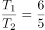，则两次的速度和之比为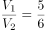①，第一次相遇后两人速度各增加10米/分钟，即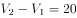②，联立方程①②求得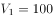米/分钟，米。

故正确答案为A。

**考点**：相遇追及

**来源**：2015年河南省公务员录用考试《行测》题第31题

### 第 32 题

四个烧杯甲、乙、丙、丁的容量比为3：4：8：10，用甲烧杯装满与水比重相同的A溶液倒入丙烧杯后，用水兑满，然后将混合的溶液倒入乙烧杯至满后，将剩下的部分倒入丁烧杯并用水将丁烧杯注满。问此时乙烧杯中A溶液的浓度是丁烧杯中的多少倍？

A. 2

B. 2.5

C. 4

D. 6

第 32 题 · 答案与解析

**参考答案（粉笔题库参考内容）**

B

**解析**

丙烧杯用水兑满后倒入乙烧杯4份，倒入丁烧杯也为4份，假设倒入乙烧杯溶液的浓度为x，则剩下的部分倒入丁烧杯的溶液浓度也为x，再用水注满后，浓度变为 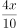 ，则乙烧杯A溶液浓度是丁的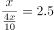倍。

故正确答案为B。

**来源**：2015年河南省公务员录用考试《行测》题第32题

### 第 33 题

车间共有50名工人，年底进行考核，有12人业务能力为优，10人政治表现为优，没有一项考核成绩为优的有34人，车间要向上级单位推荐2名两项考核均为优的工人作为先进个人的候选人。问有多少种推荐方案？

A. 12

B. 15

C. 18

D. 21

第 33 题 · 答案与解析

**参考答案（粉笔题库参考内容）**

B

**解析**

总人数为50人，没有一项为优的为34人，则至少一项考核为优的有50-34=16人，12人业务能力为优，10人政治表现为优，则两项全部为优的人数为10+12-16=6人。从中任选两人，则共有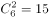种方案。

故正确答案为B。

**考点**：两集合、基础排列组合

**来源**：2015年河南省公务员录用考试《行测》题第33题

### 第 34 题

甲、乙两个小分队的人数之和在90到110之间，如果从甲队调―定人数给乙队，则乙队的人数就是甲队的2倍；如果乙队调同样的人数给甲队，则甲队的人数就是乙队的3倍。问甲队调多少人给乙队之后，乙队的人数是甲队5倍？

A. 18

B. 24

C. 30

D. 36

第 34 题 · 答案与解析

**参考答案（粉笔题库参考内容）**

D

**解析**

由于互调人数不影响甲、乙人数的总量，第一种情况乙队人数为甲队人数2倍，可知总人数能够被3整除，同理结合第二种情况，可知总人数能够被4整除，人数取值范围为90-110，可知总人数为96或者108。

方法一：若总人数为96，将选项一一代入。

A项：调人之前甲的人数为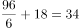，则乙为62人，满足甲调2人去乙，乙是甲的2倍，但不满足乙调2人去甲，甲是乙的3倍，排除。

B项：调人之前甲的人数为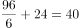，则乙为56人，满足甲调8人去乙，乙是甲的2倍，但不满足乙调8人去甲，甲是乙的3倍，排除。

C项：调人之前甲的人数为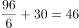，则乙为50人，满足甲调14人去乙，乙是甲的2倍，但不满足乙调14人去甲，甲是乙的3倍，排除。

D项：调人之前甲的人数为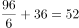，则乙为44人，满足甲调20人去乙，乙是甲的2倍，也满足乙调20人去甲，甲是乙的3倍，D项正确。

方法二：假设总人数是96人，根据题干已知条件，设第一次甲、乙队之间调动m人，可知：甲-m=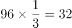①；甲+m=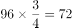②，结合①②算出甲=52人，乙=96-甲=96-52=44人；要满足乙是甲的5倍，则甲只有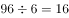人，则甲需要调52-16=36人给乙。

故正确答案为D。

**考点**：和差倍比问题

**来源**：2015年河南省公务员录用考试《行测》题第34题

### 第 35 题

箱子里有标号1至10共10个球，小张随机取了三个球并记下号码后将球放回，小李也随机取了三个并记下号码。这时发现两人取的球的号数之积都恰好是144。已知小张的号数之和比小李的大，那么小张取的球的号数之和是多少？

A. 19

B. 17

C. 16

D. 14

第 35 题 · 答案与解析

**参考答案（粉笔题库参考内容）**

A

**解析**

三个小球的编号乘积均为144，对144进行因式分解可得，144=2×2×2×2×3×3。因小球编号各不相等，对上式合并可得144=9×8×2=8×6×3。小张的号码数之和较大，则之和应为9+8+2=19。

故正确答案为A。

**考点**：公倍数与公约数问题、和差倍比问题

**来源**：2015年河南省公务员录用考试《行测》题第35题

### 第 36 题

车间里要加工的手套副数是口罩个数的2倍，如果每位工人加工3个口罩，则还需额外生产2个口罩；如果每位工人加工7副手套，则会超额完成6副手套。如每位工人每5分钟可生产1副手套或1个口罩，且车间内的工人数减少一半。问至少需要多少分钟才能完成全部生产任务？

A. 85

B. 90

C. 95

D. 100

第 36 题 · 答案与解析

**参考答案（粉笔题库参考内容）**

D

**解析**

设车间内原有工人x人，根据题干条件可得：7x-6=2（3x+2），解得x=10人。则可推知需要加工口罩个，手套副。现人数减少一半，即只剩5人，共需生产96件商品。因每人5分钟可以加工1件商品（手套与口罩加工效率相等），加工95件商品需要：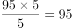分钟，剩余一件商品还需5分钟才可完成，故至少需要100分钟才可完成全部任务。

故正确答案为D。

**考点**：给具体单位型

**来源**：2015年河南省公务员录用考试《行测》题第36题

### 第 37 题

工地仓库里有水泥若干，第一天用掉了前一天剩余库存的1/3后又补充了500袋，第二天用掉了第一天剩余库存的1/9后又补充了400袋，此时仓库的水泥库存是原有水泥的2倍，则仓库原有水泥多少袋？

A. 480

B. 540

C. 600

D. 660

第 37 题 · 答案与解析

**参考答案（粉笔题库参考内容）**

C

**解析**

方法一：设仓库原有水泥x袋，则根据题干条件可列方程：（x+500）×+400=2x，方程化简后得：x+4000+3600=18x，解得x=600。

方法二：因第二天用掉了第一天剩余库存的1/9，则第一天后的库存量应为9的倍数。

A项：代入可得第一天后的库存量=480×+500=820，不能够被9整除，排除；

B项：代入可得第一天后的库存量=540×+500=860，不能够被9整除，排除；

C项：代入可得第一天后的库存量=600×+500=900，可以被9整除，当选；

D项：代入可得第一天后的库存量=660×+500=940，不能够被9整除，排除。

故正确答案为C。

**考点**：和差倍比问题

**来源**：2015年河南省公务员录用考试《行测》题第37题

### 第 38 题

甲、乙两名实力相当（即每一局两人中任意一人获胜的概率相同）的棋手进行7局4胜制的比赛，前3局赛完后，甲以2:1领先于乙，那么甲获得最后胜利的概率是多少？

A. 2/3

B. 3/4

C. 5/8

D. 11/16

第 38 题 · 答案与解析

**参考答案（粉笔题库参考内容）**

D

**解析**

甲乙两人实力相当，则每局比赛获胜的概率都为。甲最终获胜的概率=1-乙最终获胜的概率。乙若想取得最终的胜利，则需在剩下的四场比赛中至少赢得3场。可分为以下4种情况：

（1）剩下4局比赛乙赢得前3局，其概率=；

（2）剩下4局比赛乙输掉第1局，剩下的3局获胜，其概率=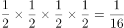；

（3）剩下4局比赛乙输掉第2局，剩下的3局获胜，其概率=；

（4）剩下4局比赛乙输掉第3局，剩下的3局获胜，其概率=；

故乙获胜的概率=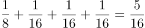，

甲获胜的概率=1 -\=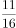。

故正确答案为D。

**考点**：给概率求概率

**来源**：2015年河南省公务员录用考试《行测》题第38题

### 第 39 题

有一批规格为1吨的钢锭，计划安排用8辆载重9吨的汽车运送，要求不得对钢锭进行切割，预计每辆车运送25次正好运完，每辆车运送了13次之后，甲方要求增派若干辆载重24吨的汽车，以能够一次将剩下的钢锭全部运完。问需要增派多少辆汽车？

A. 33

B. 34

C. 35

D. 36

第 39 题 · 答案与解析

**参考答案（粉笔题库参考内容）**

A

**解析**

总钢锭量用8辆载重9吨的汽车25次刚好运完，则可得总钢锭量=8×9×25吨。前13次所运输的钢锭共计=8×9×13吨。剩余钢锭需一次性运输完毕，设需增加载重24吨的汽车x辆，则可得方程：（8×9×25）-（8×9×13）=8×9+24x，方程化简后得：11×72=24x，解得x=33，即需要增派33辆。

故正确答案为A。

**考点**：给具体单位型

**来源**：2015年河南省公务员录用考试《行测》题第39题

### 第 40 题

论文集中收录了一篇十多页的论文，其所在各页的所有页码之和为1023，问这篇论文之后的一篇论文是从第几页开始的？

A. 94

B. 99

C. 102

D. 109

第 40 题 · 答案与解析

**参考答案（粉笔题库参考内容）**

B

**解析**

方法一：已知有十多页，取极端考虑10页的情况，代入选项进行排除。

若A项正确，前十页页码为84—93，各页之和为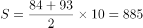，向前递推进行加和验证，885+83+82=1050>1023不满足，故A项错误。

若B项正确，前十页页码为89—98，各页之和为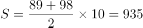，向前递推进行加和验证，935+88=1023，总页数为11页，满足条件。

方法二：假设这篇论文的第一页页码为x，这篇论文共有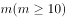页，则该篇论文最后一页页码为x+m-1，已知页码为连续的自然数，根据等差数列求和公式可得该论文页码之和s=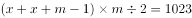，即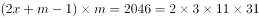，因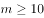，代入m=11进行验证算出，m=11，x=88，本题所求答案为99，选B。

故正确答案为B。

**考点**：数列问题

**来源**：2015年河南省公务员录用考试《行测》题第40题

### 第 41 题

小明买了7本书共花去100元，后发现有―本书质量有问题，故补了若干元换了另外一本书。回来后发现，退换后7本书的价格成等差数列且均为整数元，而最贵的书价格为26元。问最便宜的书多少钱？

A. 2元

B. 6元

C. 8元

D. 14元

第 41 题 · 答案与解析

**参考答案（粉笔题库参考内容）**

C

**解析**

原书的总价款为100元，加钱补换后应超过100元。因退换后所有书的价格呈等差数列，代入选项验证：

A项：当最便宜的书为2元时，可以构成等差数列，但所有书的总价款=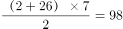元，低于100元，排除；

B项：当最便宜的书为6元时，最贵的书为26元，无法构成公差为整数的等差数列，排除；

C项：当最便宜的书为8元时，可以构成等差数列，所有书的总价款=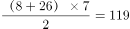元，高于100，满足条件，当选；

D项：当最便宜的书为14元时，可以构成等差数列，所有书的总价款=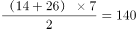元。即换书需补40元，因最贵书的价格仅为26元，故无法满足补换条件，排除。

故正确答案为C。

**考点**：数列问题

**来源**：2015年河南省公务员录用考试《行测》题第41题

### 第 42 题

甲、乙两人共同投资一件收藏品，约定好费用支出均分，利润也均分。某次甲给了乙500元用于支付专家鉴定费，结果专家只向乙收取了300元鉴定费，但乙忘记将余下的钱给甲。后收藏品以20000元的价格转手，问此时甲乙应该各拿走多少钱？

A. 甲10050元，乙9950元

B. 甲10200元，乙9800元

C. 甲10150元，乙9850元

D. 甲10350元，乙9650元

第 42 题 · 答案与解析

**参考答案（粉笔题库参考内容）**

D

**解析**

费用支出均分，则300元鉴定费甲支出一半，应为150元。甲给了乙500元，乙应该还给甲500-150=350元，最后乙没有还，相当于乙从自己的利润中预支了350元。
藏品以20000元卖出，按照均分原则，每人原本是10000元，由于乙提前预支了350元，所以乙最终应拿10000-350=9650元。
故正确答案为D。

**考点**：和差倍比问题

**来源**：2015年河南省公务员录用考试《行测》题第42题

### 第 43 题

某旅游公司有能载4名乘客的轿车和能载7名乘客的面包车若干辆，某日该公司将所有车辆分成车辆数相等的两个车队运送两支旅行团。已知两支旅行团共有79人，且每支车队都满载，问该公司轿车数量比面包车多多少辆？

A. 5

B. 6

C. 7

D. 8

第 43 题 · 答案与解析

**参考答案（粉笔题库参考内容）**

B

**解析**

将所有车辆分成数量相等的两个车队，可知车辆总数应为偶数，则轿车、面包车数同奇同偶，根据奇偶特性，两车的差也应该是偶数，排除A、C两项。

假设轿车是x辆，面包车是y辆，代入B项条件，则可列方程组4x+7y=79，x=y+6。解得x=11，y=5，满足题意。

故正确答案为B。

**考点**：和差倍比问题

**来源**：2015年河南省公务员录用考试《行测》题第43题

### 第 44 题

编号为1—50的选手参加一个爬楼比赛，楼高为60层。所有选手在第1层均获得一个特别的号牌，此后每经过一个楼层，如果选手的编号正好是楼层数的整数倍，就将得到一个特别的号牌。所有选手都到达终点后，正好持有3个特别号牌的选手有多少人？

A. 1

B. 4

C. 7

D. 10

第 44 题 · 答案与解析

**参考答案（粉笔题库参考内容）**

B

**解析**

由题意可得，编号是楼层的整数倍就可以拿到特别的号牌，而到达终点后只有三个特别的号牌。说明编号除了1与其本身，只有一个约数，那么该编号只能是一个平方数，50以内的满足3个约数的平方数分别为4、9、25、49，共4个数。

故正确答案为B。

**考点**：公倍数与公约数问题

**来源**：2015年河南省公务员录用考试《行测》题第44题

### 第 45 题

晚上21点整，甲、乙两车同时从A地出发匀速开往B地，同一时间丙、丁两车从B地出发匀速开往A地。甲车时速是乙车的3倍，乙车行驶3小时后首先与丙相遇，再行驶1小时之后与丁相遇，若4辆车到达目的地的时间正好都是第二天内的整点时间，问甲车和丙车是在几点相遇的？

A. 0点整

B. 23点30分

C. 23点整

D. 22点30分

第 45 题 · 答案与解析

**参考答案（粉笔题库参考内容）**

C

**解析**

乙车行驶3小时后与丙相遇，再行驶1小时后与丁相遇，根据相遇问题公式可得：

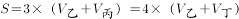。路程一定，速度与时间成反比，则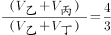。设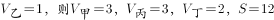。因四辆车均在第二天整点到达，则甲乙丙丁四车的速度应均可被路程整除，且所用时间应不小于3小时，所设情况满足情形。则此时甲丙两车相遇需要：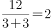小时。

从晚上21点开始出发，相遇时应为21+2=23点。

故正确答案为C。

**考点**：相遇追及

**来源**：2015年河南省公务员录用考试《行测》题第45题

### 第 46 题

从所给的四个选项中，选择最合适的一个填入问号处，使之呈现一定规律性：

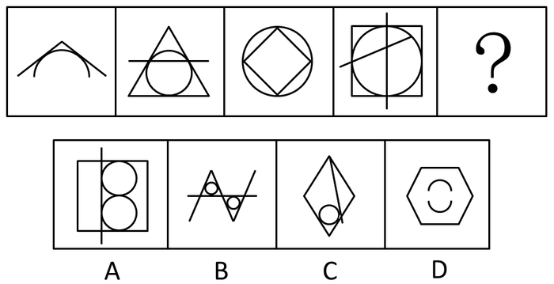

A. A

B. B

C. C

D. D

第 46 题 · 答案与解析

**参考答案（粉笔题库参考内容）**

B

**解析**

元素组成凌乱，观察图形均由直线和曲线构成，且曲线和直线都有交点。

观察发现，题干中图形直线与曲线的交点数目依次为2、3、4、5、?，问号处应该填入直线与曲线有6个交点的选项，只有B项满足。

故正确答案为B。

**考点**：数量规律-点

**来源**：2015年河南省公务员录用考试《行测》题第46题

### 第 47 题

从所给的四个选项中，选择最合适的一个填入问号处，使之呈现一定规律性：

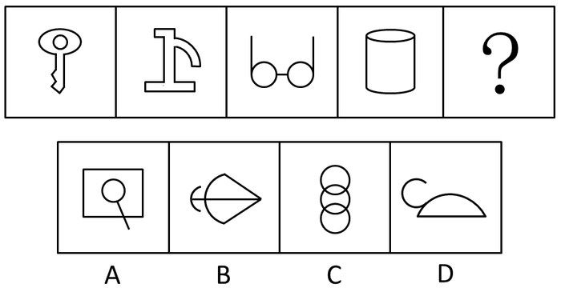

A. A

B. B

C. C

D. D

第 47 题 · 答案与解析

**参考答案（粉笔题库参考内容）**

B

**解析**

元素组成凌乱，考虑数数。

题干中图形均由直线和曲线构成，且题干图形中都存在两条曲线，且两条曲线不相交不存在公共点。观察选项，符合此规律的只有B选项。

故正确答案为B。

**考点**：数量规律-点、数量规律-线

**来源**：2015年河南省公务员录用考试《行测》题第47题

### 第 48 题

从所给的四个选项中，选择最合适的一个填入问号处，使之呈现一定规律性：

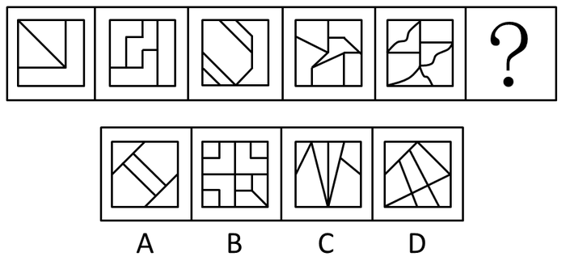

A. A

B. B

C. C

D. D

第 48 题 · 答案与解析

**参考答案（粉笔题库参考内容）**

D

**解析**

元素组成凌乱，观察图形均被分割成许多封闭空间，封闭空间多，考虑数面。

观察发现，题干中的面数分别为3，4，5，6，7，？，问号处应该填入有8个面的选项，四个选项的面数分别为5，9，6，8，只有D项满足。

故正确答案为D。

**考点**：数量规律-面

**来源**：2015年河南省公务员录用考试《行测》题第48题

### 第 49 题

从所给的四个选项中，选择最合适的一个填入问号处，使之呈现一定规律性：

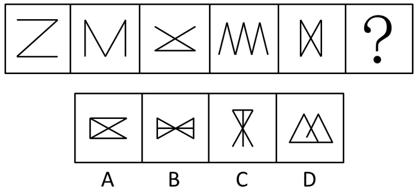

A. A

B. B

C. C

D. D

第 49 题 · 答案与解析

**参考答案（粉笔题库参考内容）**

D

**解析**

图形中都由简单直线构成，出现的角较多，且D选项出现了改造图形，考虑数角。

观察发现，题干中角数量分别为2、3、6、5、8，不存在规律，但观察发现图1、图2、图4的角都是锐角，尝试数锐角，发现题干锐角数量分别为2、3、4、5、6，则下一个图形应该有7个锐角，选项中锐角数量分别为8、8、6、7个，只有D选项符合。

故正确答案为D。

**考点**：数量规律-角

**来源**：2015年河南省公务员录用考试《行测》题第49题

### 第 50 题

从所给的四个选项中，选择最合适的一个填入问号处，使之呈现一定规律性：

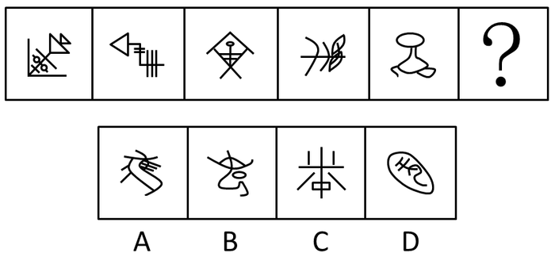

A. A

B. B

C. C

D. D

第 50 题 · 答案与解析

**参考答案（粉笔题库参考内容）**

A

**解析**

元素组成凌乱，考虑数数。

题干中的各个图形均只由一个部分组成，观察四个选项，可发现组成部分分别是1,2,5,2。

故正确答案为A。

**考点**：数量规律-素

**来源**：2015年河南省公务员录用考试《行测》题第50题

### 第 51 题

从所给的四个选项中，选择最合适的一个填入问号处，使之呈现一定规律性：

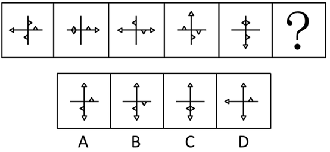

A. A

B. B

C. C

D. D

第 51 题 · 答案与解析

**参考答案（粉笔题库参考内容）**

A

**解析**

解法一：元素组成相同，优先考虑位置规律，经观察，题干中的小三角形出现在坐标轴的两侧和顶点共12个位置上，如下图所示。

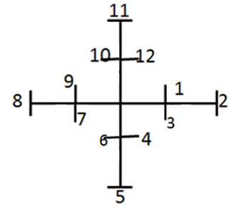

每个小三角形均按照1-12这样的顺序顺时针旋转，以第一幅图最左边的小三角形为例，第一幅图它出现在8的位置，到第二幅图移动到9的位置，第三幅出现在10的位置，第四幅图出现在11的位置，第五幅图出现在12的位置，故下一次应该出现在1的位置，可排除B、C两项；而第一幅图出现在位置1的小三角形，在第二至五图中，分别出现在了位置2-5，故下一次应该出现在6的位置。

解法二：题干图1与图4元素组成相同，考虑位置规律。图1经过顺时针旋转得到图4；图2经过顺时针选项得到图5，故图6应由图3顺时针旋转得到，对应A项。

故正确答案为A。

**考点**：位置规律-旋转

**来源**：2015年河南省公务员录用考试《行测》题第51题

### 第 52 题

从所给的四个选项中，选择最合适的一个填入问号处，使之呈现一定规律性：

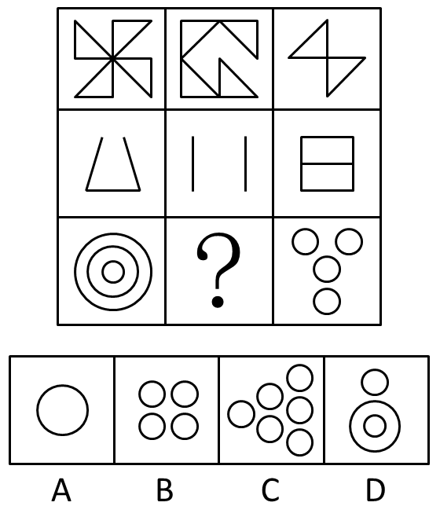

A. A

B. B

C. C

D. D

第 52 题 · 答案与解析

**参考答案（粉笔题库参考内容）**

D

**解析**

九宫格，每一行元素组成相似，但是并不满足元素叠加规律。观察选项发现选项的差别主要在于圆圈的数量，再观察发现每一行都由一种元素组成：第一行都是三角形，数量分别是4、4、2；第二行都是直线，数量分别是3、2、5；第三行都是圆圈，数量分别是3、？、4，前两行的数字之和均为10，要保持相同规律，问号处应补充的数字为3。

故正确答案为D。

**考点**：数量规律-素

**来源**：2015年河南省公务员录用考试《行测》题第52题

### 第 53 题

从所给的四个选项中，选择最合适的一个填入问号处，使之呈现一定规律性：

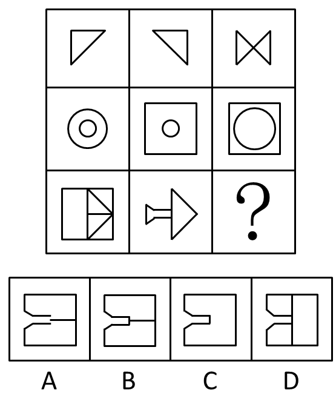

A. A

B. B

C. C

D. D

第 53 题 · 答案与解析

**参考答案（粉笔题库参考内容）**

A

**解析**

九宫格，元素组成相似，考虑元素叠加。观察发现，每行的第一个图和第二个图叠加，去同存异得到第三个图，只有A项满足此规律。

故正确答案为A。

**考点**：样式规律-加减同异

**来源**：2015年河南省公务员录用考试《行测》题第53题

### 第 54 题

左边平面图折叠后可得到右边的哪一立体图？

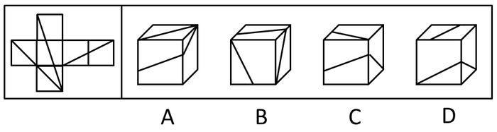

A. A

B. B

C. C

D. D

第 54 题 · 答案与解析

**参考答案（粉笔题库参考内容）**

A

**解析**

本题考查空间折纸盒。为了描述清楚，我们对正方体展开图进行标注，如下图所示。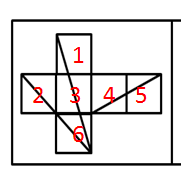

可知1-6为相对面，2-4为相对面，3-5为相对面，不可能出现在同一个立体图中。面3和面1的公共边上要有两条斜线的公共点。

根据这个标注，对选项进行标注，如下图所示：

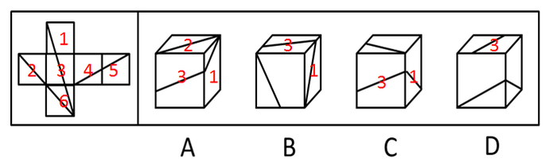

A选项面1，2，3的位置关系，与原图相符，当选；

B、C选项：运用画边法，从面1和面3的公共边a开始，顺时针对面1画边，如下图所示：

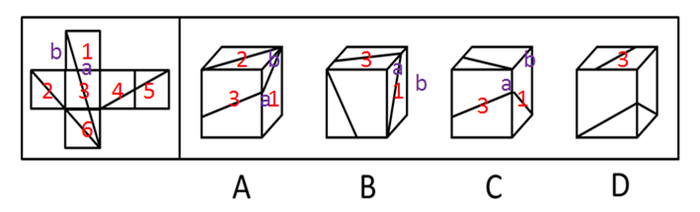

顺时针画出的第二条边b在立体图上是面1直角三角形的长直角边，而在B、C选项中均不是，故排除；

D选项，除了面3以外，剩下的两个面明显不是面2和面6，故只能是面1和面4，但面3和任何一个面的公共边都没有斜线相交点，故排除。

故正确答案为A。

**考点**：空间类-空间重构-六面体

**来源**：2015年河南省公务员录用考试《行测》题第54题

### 第 55 题

以下哪一项不可能是左边立体图形的切面？

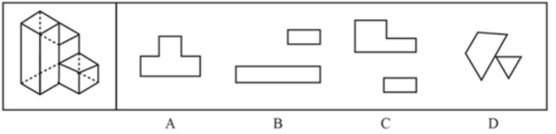

A. A

B. B

C. C

D. D

第 55 题 · 答案与解析

**参考答案（粉笔题库参考内容）**

C

**解析**

如下图，A、B、D都可以从题干图形中切出。如果要切出来C项，需要最左侧柱体与中间柱体的高度差足够大。但是，从立体图上的比例看不出来，不明确，也就是想切C是有限制的，不一定能切出来的，而A、B、D都是一定能切出来的。

本题为选非题，故正确答案为C。

注：本题题干有些不严谨，该用虚线的部分画成了实线，给观察带来了困扰，不用过于纠结。

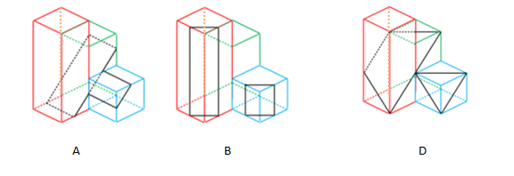

**考点**：空间类-截面图

**来源**：2015年河南省公务员录用考试《行测》题第55题

### 第 56 题

广度经济是一种多样化生产经营商品或服务的经济，当同时生产X和Y的成本低于单独生产两种商品或服务的时候，就存在广度经济。

根据上述定义，下列不存在广度经济的是：

A. 巧克力工厂生产巧克力的生产线也用于生产巧克力花生豆

B. 干洗店在干洗业务之外，同时提供皮衣保养等服务

C. “扬名”饮料公司的工业园同时有生产“扬名”牌童装的车间

D. 旅行社销售各种旅游产品的同时有偿提供导游和伴游服务

第 56 题 · 答案与解析

**参考答案（粉笔题库参考内容）**

C

**解析**

第一步：找到定义关键词。

“同时生产X和Y的成本低于单独生产”。

第二步：逐一分析选项。

A项：同时生产巧克力和巧克力花生豆，用同一条生产线明显降低成本，符合“同时生产X和Y的成本低于单独生产”，符合定义，排除；

B项：干洗业务与保养服务属于两种服务，同时服务时降低门店成本，符合“同时生产X和Y的成本低于单独生产”，符合定义，排除；

C项：饮料和童装无生产关联性，无法降低单独生产成本，不符合“同时生产X和Y的成本低于单独生产”，不符合定义，当选；

D项：销售旅游产品与提供导游和伴游服务属于两种服务，同一个旅行社提供服务能够节省运营成本，符合“同时生产X和Y的成本低于单独生产”，符合定义，排除。

本题为选非题，故正确答案为C。

**考点**：大前提

**来源**：2015年河南省公务员录用考试《行测》题第56题

### 第 57 题

反对关系指的是两个概念所反映的对象类互不相同，没有交叉，并且有些对象均不属于这两个概念。

根据上述定义，以下哪项中涉及的两个下划线词语所表达的概念之间属于反对关系？

A. 实数包括<u>有理数</u>和<u>非有理数</u>

B. <u>蝴蝶</u>、<u>蜜蜂</u>等都是昆虫

C. 组织既有<u>国际组织</u>又有<u>非国际组织</u>

D. 植物包括<u>观赏性植物</u>和非观赏性植物，挂果植物和<u>非挂果植物</u>

第 57 题 · 答案与解析

**参考答案（粉笔题库参考内容）**

B

**解析**

第一步：找到定义关键词。

关键词为“两个概念所反映的对象类互不相同，没有交叉”、“有些对象均不属于这两个概念”

第二步：逐一分析选项。

A项：有理数和非有理数属于矛盾关系，没有其他实数均不属于这两个概念，排除；

B项：蝴蝶与蜜蜂属于两种不同的昆虫，互不相同，且还有其他昆虫均不属于蝴蝶和蜜蜂，符合定义，当选；

C项：国际组织与非国际组织属于矛盾关系，没有其他组织均不属于这两个概念，排除；

D项：观赏性植物与非挂果植物不存在互不相同，这两个对象之间有交叉，排除。

故正确答案为B。

**考点**：单定义-其他句式

**来源**：2015年河南省公务员录用考试《行测》题第57题

### 第 58 题

病毒式网络营销是通过用户的口碑宣传网络，信息像病毒一样传播和扩散，利用快速复制的方式传向数以千计、数以百万计的受众。

根据上述定义，下列选项中没有应用病毒式网络营销手段的是：

A. 某些网站在帖子下面设置“转发”或“告诉朋友”按钮，使网站信息可以迅速被转发到上网者的个人网页

B. 某些即时通讯工具开发了“发红包”功能，让使用者争先恐后地互发红包，同时增加了该通讯工具的安装量

C. 某体育品牌邀请体育明星拍摄精彩视频，并在视频中承诺，若该视频的转发次数超过一定数量，就会请更多明星来继续拍摄新的视频

D. 某在线购物网站向所有注册会员推送促销信息的邮件，为即将到来的大减价活动做广告

第 58 题 · 答案与解析

**参考答案（粉笔题库参考内容）**

D

**解析**

第一步：找到定义关键词。

关键词为方式：“通过用户的口碑宣传”、“利用快速复制的方式传向受众”；目的：“信息像病毒一样传播和扩散”。

第二步：逐一分析选项。

A项：设置“转发”按钮，能够使网站信息迅速转发到上网者个人网页，符合“通过用户的口碑宣传”，“快速复制传向受众”，符合定义；

B项：使用者争先恐后发红包符合“通过用户宣传”，增加安装量符合“传播和扩散”，符合定义；

C项：视频转发符合“通过用户宣传”，目的是为了让更多受众看到含有该品牌的视频，符合“信息像病毒一样传播和扩散”，符合定义；

D项：网站直接向会员推送促销信息，不符合“通过用户的口碑宣传”，不符合定义。

本题为选非题，故正确答案为D。

**考点**：方式目的

**来源**：2015年河南省公务员录用考试《行测》题第58题

### 第 59 题

间接融资是指拥有暂时闲置货币资金的单位或个人通过存款的形式，或者购买银行、信托、保险等金融机构发行的有价证券，将其暂时闲置的资金先行提供给这些金融中介机构，然后再由这些金融机构以贷款、贴现、购买证券等方式，把资金提供给一些单位使用，获取资金的这些单位就实现了间接融资。

根据上述定义，下列属于间接融资的是：

A. 银行吸收储蓄资金，贷款给私营企业

B. 金融投资人将个人财产投资于新型产业

C. 国家发行债券，获得资金用于教育产业

D. 上市公司向社会发行股票进行融资，促进发展

第 59 题 · 答案与解析

**参考答案（粉笔题库参考内容）**

A

**解析**

第一步：找到定义关键词。

关键词为“单位或个人通过存款的形式或购买金融机构发行的有价证券”“将暂时闲置的资金提供给金融中介机构”“由金融中介机构把资金提供给单位使用”。

第二步：逐一分析选项。

A项：银行吸收储蓄资金属于存款的形式，贷款给私营企业符合金融机构“把资金提供给单位使用”，当选。

B项：金融投资人将个人财产投资于新型产业属于直接融资，没有涉及金融机构，排除。

C项：国家不属于金融机构，排除。

D项：上市公司发行股票融资属于直接融资，没有涉及金融机构，排除。

故正确答案为A。

**考点**：主客体

**来源**：2015年河南省公务员录用考试《行测》题第59题

### 第 60 题

双避冲突又称负负冲突，是动机冲突的一种，指同时有两个可能对个体具有威胁性、不利的事发生，两种都想躲避，但受条件限制，只能避开一种，接受一种，个体在作抉择时内心产生矛盾和痛苦。

根据上述定义，下列面临的情境中属于双避冲突的是：

A. 高不成，低不就

B. 狡兔死，良犬烹

C. 士可杀，不可辱

D. 前有狼，后有虎

第 60 题 · 答案与解析

**参考答案（粉笔题库参考内容）**

D

**解析**

第一步：找出定义关键词。

“同时有两个可能对个体具有威胁性、不利的事发生”“只能避开一种，接受一种”“作抉择时内心产生矛盾和痛苦”。

第二步：逐一分析选项。

A项：“高不成，低不就”，是说高者无力得到，低者又不屑迁就，形容求职或婚姻上的两难处境。不涉及作抉择，排除；

B项：“狡兔死，良犬烹”，指狡兔死了，猎狗就没用了，也泛指人在用完一个人后立刻抛弃他。不涉及作抉择，排除；

C项：“士可杀，不可辱”，指士子宁可死，也不愿受侮辱，没有体现出两者都想躲避，在作抉择时的矛盾和痛苦，排除；

D项：“前有狼，后有虎”，指前面有狼，后面有老虎，进退两难，属于同时有两个对个体具有威胁性的事，要突破困境必须作抉择，避开一个，面对一个，符合定义，当选。

故正确答案为D。

**考点**：单定义-其他句式

**来源**：2015年河南省公务员录用考试《行测》题第60题

### 第 61 题

行政许可，是指在法律一般禁止的情况下，行政主体根据行政相对方的申请，经依法审查，通过颁发许可证、执照等形式，赋予或确认行政相对方从事某种活动的法律资格或法律权利的一种具体行政行为。

根据上述定义，下列不涉及行政许可的是：

A. 伦理审查委员会在详细查阅王教授进行人体试验的研究计划之后，认为符合伦理规范，批准该项研究

B. 临近春节，小李向安全生产监督管理局申请生产经营烟花爆竹并获得批准

C. 小张从医学院本科毕业之后，参加卫生部医师资格考试，获得医师资格证书之后开始行医

D. 国家工商总局在对某进口企业的资质进行了审核之后，给予其进口认证

第 61 题 · 答案与解析

**参考答案（粉笔题库参考内容）**

A

**解析**

第一步：找到定义关键词。

关键词为主体：“行政主体”，方式：“根据行政相对方的申请”“通过颁发许可证、执照等形式，赋予或确认行政相对方的资格或权利”。

第二步：逐一分析选项。

A项：伦理审查委员会不属于行政主体，不符合定义，错误；

B项：安全生产监督管理局属于行政主体，小李向其申请生产经营烟花爆竹资格获得批准符合通过颁发许可证、执照等形式，赋予或确认行政相对方的资格或权利，正确；

C项：卫生部属于行政主体，参加医师资格考试符合行政相对方申请，获得医师资格证书符合通过颁发许可证的形式赋予小张行医资格，正确；

D项：国家工商总局属于行政主体，对企业资质进行审核并给予进口认证符合通过颁发许可证形式，赋予其资格，正确；

本题为选非题，故正确答案为A。

**考点**：主客体

**来源**：2015年河南省公务员录用考试《行测》题第61题

### 第 62 题

知觉的整体性是指在直接作用于感觉器官的外界刺激不完备的情况下，人们根据自己的经验，对刺激进行加工处理，使知觉保持完备的一种性质。

根据上述定义，下列选项中不属于“知觉的整体性”的是：

A. 在浓雾中,人们看不清前方的物体,但通过对轮廓的大致观察,知道那是一辆自行车

B. 人们在观看有缺口的圆环时,通常会在心里将缺少的部分补足,形成一个整体圆环的形象

C. 小王听到了切瓜果的声音,同时又闻到了香瓜的香味,他觉得隔壁的同事正在切香瓜

D. 一张红纸一半有阳光照射,一半没有阳光照射,从远处看颜色差异很大,人们仍然可以判断出这是一张红纸

第 62 题 · 答案与解析

**参考答案（粉笔题库参考内容）**

D

**解析**

第一步：找出定义关键词。

关键词为“直接作用于感觉器官的外界刺激不完备”、“对刺激进行加工处理,使知觉保持完备”。

第二步：逐一分析选项。

A项:看不清物体符合“外界刺激不完备”,通过轮廓观察判断是自行车符合“对刺激进行加工处理,使知觉保持完备”，符合定义;

B项:看有缺口的圆环符合“外界刺激不完备”,将缺少部分补足形成整体圆环的形象属于“对刺激进行加工处理,使知觉保持完备”，符合定义;

C项:听到了声音闻到了香味属于直接刺激,在并没有看到的情况之下觉得隔壁的同事在切香瓜符合“对刺激进行加工处理,使知觉保持完备”，符合定义;

D项:虽然一张红纸一半有阳光照射一半没有，但是我们观察到的还是一张纸，虽然造成颜色差异大,但并不能说明“外界刺激不完备”,不符合定义。

知觉的特性包括选择性、理解性、整体性和恒常性。

知觉的选择性，是指人所处的环境复杂多样。在某一瞬间，人不可能对众多事物进行感知，而总是有选择地把某一事物作为知觉对象，与此同时把其他事物作为知觉背景，这就是选择性。

知觉的理解性，是指在知觉过程中，人用过去所获得的有关知识经验，对感知对象进行加工理解，并以概念的形式标示出来。其实质是在旧经验与新刺激之间建立多维度、多层次的联系，以保证理解的全面和深刻。在理解过程中，知识经验是关键。例如，面对一张X光片，不懂医学的人很难知觉到有用的信息，而放射科的医师却能获知病变与否。

知觉的恒常性：当客观条件在一定范围内改变时，我们的知觉映象在相当程度上却保持着它的稳定性，即知觉恒常性。恒常性的种类：形状恒常性，大小恒常性（例如远处的一个人向你走近时，他在你视网膜中的图像会越来越大，但你感知到他的身材却没有什么变化）, 明度（或视亮度）恒常性，颜色恒常性（例如绿色的东西无论在红光条件下还是绿光条件下或者白光条件下，你眼中的它都是绿色的）。

所以本题目中的D选项属于知觉的恒常性而非整体性。

本题为选非题,故正确答案为D。

**考点**：大前提

**来源**：2015年河南省公务员录用考试《行测》题第62题

### 第 63 题

巴纳姆效应指的是人们常常认为一种笼统的、一般性的人格描述十分准确地揭示了自己的特点。这种心理倾向的出现是因为每个人的思维都有选择性，会优先选择和自己相符的信息，或者选择―些自己能够接受的信息。

根据上述定义，下列现象符合巴纳姆效应的是：

A. 小方听到同学跟别人说“这个人人品有问题”，小方认为同学很可能在说自己

B. 王先生外出不慎摔伤，后来看到黄历上写着那天“不宜出行”，觉得黄历真的很准确

C. 小张看到网上的性格分析说“金牛座的男人个性实际、勤勉”，认为很符合自己

D. 老师在毕业鉴定上给小黄同学的评价是“尊敬师长、待人诚恳”，小黄看到后非常高兴

第 63 题 · 答案与解析

**参考答案（粉笔题库参考内容）**

C

**解析**

第一步：找到定义关键词。

关键词为“认为一种笼统的、一般性的人格描述十分准确地揭示了自己的特点”、“优先选择和自己相符的信息或能够接受的信息”。

第二步：逐一分析选项。

A项：“这个人人品有问题”不属于一种笼统的人格描述，排除；

B项：“不宜出行”不属于人格描述，排除；

C项：“金牛座的男人个性实际、勤勉”属于一种笼统的人格描述，小张觉得符合自己属于认为准确地揭示了自己的特点，当选；

D项：“尊敬师长、待人诚恳”是老师对小黄的个人评价，不属于一种笼统的人格描述，排除。

故正确答案为C。

**考点**：单定义-其他句式

**来源**：2015年河南省公务员录用考试《行测》题第63题

### 第 64 题

皮格马利翁效应是指个体基于对某种情境的知觉，其情感和观念受到他人的影响和暗示而形成某种期望，并由该期望对情境产生实际效果的现象，亦称期待效应。

根据上述定义，下列选项中不符合皮格马利翁效应的是：

A. 从小顽劣的罗尔斯在一次调皮捣蛋后出乎意料地听到老师对他说“我一看就知道你将来是纽约州的州长”，从此以此为信念，长大后成为纽约州州长

B. 玛莎从小学习刻苦努力但成绩平平，面对老师和同学们不认可的目光，她不予理睬奋起直追，用实际行动证明自己是可塑之材，并最终取得优异成绩

C. 韦尔奇告诉每个团队成员最宝贵的东西就是构想，并激励他们完成构想，实现目标，最终他们共同推动了企业经营的巨大发展

D. 助手贝特因经营失误导致公司损失巨大，总裁却对他说“全靠你处置有方，保全了部分投资”，贝特后来成为公司屡创佳绩的中坚人物

第 64 题 · 答案与解析

**参考答案（粉笔题库参考内容）**

B

**解析**

第一步：找到定义关键词。

关键词为“个体基于对某种情境的知觉”、“情感和观念受到他人的影响和暗示”、“形成某种期望，并由该期望对情境产生实际效果”。

第二步：逐一分析选项。

A项：听到老师对他说以后是州长符合观念受到他人的影响和暗示，以此为信念符合形成某种期望，最后成为了州长符合由该期望对情境产生实际效果，符合定义，排除；

B项：玛莎不受到老师和同学们的认可，而最终却取得了优异的成绩，不符合该期望对情境产生实际效果，不符合定义，当选；

C项：韦尔奇告诉团队成员最宝贵的构想，体现了团队成员观念受到韦尔奇的影响和暗示，实现目标符合形成某种期望，最终共同推动了企业经营的巨大发展符合由该期望对情境产生实际效果，符合定义，排除；

D项：总裁对助手的鼓励体现了助手受到了总裁的影响和暗示，后来成为了公司屡创佳绩的中坚人物符合产生实际效果，符合定义，排除。

本题为选非题，故正确答案为B。

**考点**：单定义-其他句式

**来源**：2015年河南省公务员录用考试《行测》题第64题

### 第 65 题

结果犯，指由危害行为和危害结果共同构成犯罪客观方面的犯罪，结果犯的既遂，不仅要求有犯罪行为，而且必须发生法定的犯罪结果，缺少危害结果，犯罪的客观方面就不具有完整性或者说犯罪客观方面的要件就不齐备，结果犯的结果，是指有形的、可以计量的具体危害结果，是与犯罪的性质相一致的结果。

根据上述定义，以下不属于结果犯的是：

A. 诈骗

B. 抢劫

C. 故意杀人

D. 诬告陷害

第 65 题 · 答案与解析

**参考答案（粉笔题库参考内容）**

D

**解析**

第一步：找到定义关键词。

关键词为“由危害行为和危害结果共同构成犯罪客观方面的犯罪”。

第二步：逐一分析选项。

A项：诈骗必须是产生危害结果（即受害人被欺诈成功）出现后才算诈骗罪，危害结果没有实现属于诈骗未遂，符合定义，排除；

B项：抢劫必须是危害结果（即受害人被抢劫了才算抢劫）出现后才算抢劫罪，危害结果没有实现属于抢劫未遂，符合定义，排除；

C项：故意杀人罪必须是危害结果（即受害人死亡）出现后才算故意杀人，危害结果没有实现为杀人未遂，符合定义，排除；

D项：诬告陷害属于一旦付诸行动即构成犯罪，无论危害结果到底如何，属于行为犯，不符合定义，当选。

本题为选非题，故正确答案为D。

**考点**：单定义-其他句式

**来源**：2015年河南省公务员录用考试《行测》题第65题

### 第 66 题

资料：文件

A. 质量：砝码

B. 飞艇：航空器

C. 护卫舰：补给舰

D. 自然现象：极光

第 66 题 · 答案与解析

**参考答案（粉笔题库参考内容）**

D

**解析**

第一步：判断题干词语间逻辑关系。

资料和文件是种属关系，即文件是资料的一种。

第二步：判断选项词语间逻辑关系。

A项砝码是衡量质量的一种工具，排除；

B项飞艇是一种航空器，但是两词顺序反了，排除；

C项护卫舰和补给舰是并列关系，排除；

D项极光是一种自然现象，与题干逻辑关系相同，当选。

故正确答案为D。

**考点**：逻辑关系-包容关系

**来源**：2015年河南省公务员录用考试《行测》题第66题

### 第 67 题

开：关

A. 小麦：水稻

B. 痛苦：快乐

C. 盈利：非盈利

D. 工作：休息

第 67 题 · 答案与解析

**参考答案（粉笔题库参考内容）**

C

**解析**

第一步：判断题干两个字之间的逻辑关系。

开和关是矛盾关系，即非“开”即“关”。

第二步：判断选项词语之间的逻辑关系。

A项：小麦和水稻是反对关系，还有小米、大豆等，排除；

B项：痛苦和快乐反对，还有忧伤、幸福等，排除；

C项：盈利和非盈利属于A与-A的关系，因此是矛盾关系，当选；

D项：工作和休息是反对关系，还存在休闲、社交等，排除。

故正确答案为C。

**考点**：逻辑关系-并列关系

**来源**：2015年河南省公务员录用考试《行测》题第67题

### 第 68 题

拍卖公告：拍卖：交付

A. 起诉：应诉：庭审

B. 感冒：服药：发热

C. 泡茶：加水：饮用

D. 开机：关机：重启

第 68 题 · 答案与解析

**参考答案（粉笔题库参考内容）**

A

**解析**

题干中的三个词是按照时间顺序排列的，即先有拍卖公告，再进行拍卖，最后交付。A项满足时间顺序，当选；B项感冒和发热可能同时出现，排除；C项加水是泡茶的一个步骤，排除；D项开机和关机有时间顺序，开机与重启也有时间顺序，但是重启与关机没有，排除。

故正确答案为A。

**考点**：逻辑关系-对应关系

**来源**：2015年河南省公务员录用考试《行测》题第68题

### 第 69 题

药物：手术：治疗

A. 火车：公路：运输

B. 现金：信用卡：金融

C. 物质：精神：文明

D. 电子邮件：短信：通讯

第 69 题 · 答案与解析

**参考答案（粉笔题库参考内容）**

D

**解析**

药物和手术二者是并列关系，都是治疗手段，并且二者都具有治疗的功能，且治疗是动词。

A项，火车和公路不是并列关系，铁路和公路才是并列关系，排除；

B项，现金和信用卡二者是并列关系，都是金融工具，但二者的功能不是金融，排除；

C项，物质和精神是并列关系，都属于文明的两种具体形式，但二者的功能不是文明，并且文明也不是动词，排除；

D项，电子邮件和短信是并列关系，都是通讯手段，并且二者都具有通讯的功能，且通讯是动词，当选。

故正确答案为D。

**考点**：逻辑关系-对应关系、逻辑关系-并列关系

**来源**：2015年河南省公务员录用考试《行测》题第69题

### 第 70 题

航空母舰 对于 （    ） 相当于 潜艇 对于 （    ）

A. 巡洋舰 导弹

B. 舰载机 鱼雷

C. 常规动力 核动力

D. 远程偷袭 协同攻击

第 70 题 · 答案与解析

**参考答案（粉笔题库参考内容）**

B

**解析**

A项，航空母舰和巡洋舰是并列关系，但是潜艇和导弹并不是并列关系，排除；B项，舰载机是航空母舰的一种攻击工具，鱼雷是潜艇的一种攻击工具，当选；C项，航空母舰不一定是常规动力的，潜艇也不一定是核动力的，排除；D项，航空母舰不一定用于远程偷袭，潜艇也不一定用于协同攻击，排除。

故正确答案为B。

**考点**：逻辑关系-对应关系

**来源**：2015年河南省公务员录用考试《行测》题第70题

### 第 71 题

某品牌的新型插座产品中包含防雷击部件，在电路遭到雷击后能保证所连接电器不受损害。有人提出，应将这种部件作为标准配件安装到该品牌所有的插座产品中；另有人认为这么做会提高产品成本，降低其在行业内的价格竞争优势，且国内行业标准并没有强制要求产品加入防雷部件，故没有必要加装防雷击部件。

以下哪项如果为真，最能削弱上述反对意见？

A. 越来越多的其它品牌的插座也开始加入了防雷部件

B. 调查显示大多数消费者对其电路遭受雷击并不感到担忧

C. 在家电遭受雷击的已知案例中，使用了该新型插座的家电都没有受损

D. 在即将发布的国家标准中，强制要求所有插座产品都包含防雷击部件

第 71 题 · 答案与解析

**参考答案（粉笔题库参考内容）**

D

**解析**

第一步，找到论点和论据。

论点：反对意见——没有必要加装防雷部件。

论据：认为这么做会提高产品成本，降低其在行业内的价格竞争优势，且国内行业标准并没有强制要求产品加入防雷部件。

第二步，逐一分析选项。

A项：主体为越来越多的其他品牌，与该品牌无关，属无关选项，排除；

B项：消费者对此不担心说明没有必要加装防雷击部件，补充新论据，属于加强选项，排除；

C项：说明使用了该新型插座不会使家电受损，但没有受损并不一定说明要在之后的产品中加装防雷部件，属于不明确选项，排除；

D项：说明即将发布的国家标准强制要求安装防雷部件，否定题干中的论据，能够削弱反对者的意见，当选。

故正确答案为D。

**考点**：削弱论据

**来源**：2015年河南省公务员录用考试《行测》题第71题

### 第 72 题

研究人员对平均年龄为66岁的648名痴呆症患者进行研究。发现掌握两种语言的患者罹患痴呆的时间比只掌握一种语言的患者晚大约四年半，研究人员因此认为掌握两种语言可以延缓痴呆的发生。

以下哪项如果为真，最能质疑上述结论？

A. 很多人患上痴呆之后大脑的言语功能均出现显著下降

B. 大脑认知功能好的人才会说双语，认知功能好可延缓痴呆

C. 相当多的人只掌握一种语言，但一生都未出现痴呆的症状

D. 掌握三种或以上语言的人，痴呆发生时间比掌握两种语言的稍晚

第 72 题 · 答案与解析

**参考答案（粉笔题库参考内容）**

B

**解析**

第一步：找出论点和论据。

论点：研究人员因此认为掌握两种语言可以延缓痴呆的发生。

论据：研究人员对平均年龄为66岁的648名痴呆症患者进行研究，发现掌握两种语言的患者罹患痴呆的时间比只掌握一种语言的患者晚大约四年半。

第二步：逐一分析选项。

A项：论点讨论的是如何延缓痴呆，而选项说的是患上痴呆之后的坏处，与论点无关，排除；

B项：认知功能好可延缓痴呆，在原来掌握两种语言这个原因的基础上，增加了认知功能好这个也可以导致延缓痴呆的原因，属于他因削弱，当选；

C项：说明只掌握一种语言的没有出现痴呆症状，但题干实验是在会患痴呆的人群范围内讨论时间早晚的问题，并没有说掌握一种语言的一定患病，属于无关选项，排除；

D项：题干研究论述的为掌握一种语言和两种语言的患者比较，并未涉及到掌握三种语言或者更多语言的比较，属无关选项，排除。

故正确答案为B。

**考点**：他因削弱

**来源**：2015年河南省公务员录用考试《行测》题第72题

### 第 73 题

某研究员认为，人类语言最初直接来源于鸟类和灵长类。因为如果重新审视现代人类语言，我们可以看到人类的相互交流是如何从鸟类和其他灵长类古老的交流模式系统演化而来的。他宣称，从鸟类身上，我们获得了语言的旋律部分；从其他灵长类身上，我们获得了语言的实用性内容部分。在过去10万年里的某个时候，这些能力最终演化成我们今天所知的人类语言。

上述结论还需基于以下哪一前提？

A. 人类的交流与其他动物的交流之间的相似度比我们一般认为的要多

B. 人类语言包含两个不同层面：与句子可变结构相关的表达层面以及表达句子核心内容的词汇层面

C. 人类语言的交流在过去和现在变化不大

D. 鸟类和除人类以外的其他哺乳动物有自己的交流语言

第 73 题 · 答案与解析

**参考答案（粉笔题库参考内容）**

B

**解析**

第一步，找到论点和论据。

论点：人类语言最初直接来源于鸟类和灵长类。

论据：人类的相互交流从鸟类和其他灵长类古老的交流模式系统演化而来。从鸟类身上，我们获得了语言的旋律部分；从其他灵长类身上，我们获得了语言的实用性内容部分。

题干通过两个方面来论述人类语言的演化史，则要在这两个方面和人类的语言之间搭桥。

第二步，逐一分析选项。

A项：人类的交流和其他动物的交流的相似与题干讨论的人的语言是否直接来源于鸟类和灵长类无关，无关选项，排除；

B项：强调人类的语言包含两个层面，一个是表达层面，即对应到鸟类的旋律，另一个是词汇层面，对应到灵长类的内容，在题干中所给的两个方面和人类的语言之间搭桥，加强论证，当选；

C项：人类语言交流在过去和现在变化不大，并没有涉及到题干中人类语言最初的来源，无关选项，排除；

D项：鸟类和除人类以外的其他哺乳动物有自己的交流语言，题干中说人类的语言来源与鸟类的交流模式，而交流模式不必然一定是语言，可以是其他方式，偷换概念，无法支持，排除。

故正确答案为B。

**考点**：搭桥

**来源**：2015年河南省公务员录用考试《行测》题第73题

### 第 74 题

当前，市中心小区车位十分紧张。某天傍晚，某小区仅剩甲、乙、丙3个车位，正好只剩3辆车要停进来，车子的品牌分别是吉利、奇瑞和大众。已知：每个车位只能停―辆车，先到先停；若吉利车停在乙车位，则奇瑞车无法停到丙车位；大众车只能停到甲或乙车位；如果甲车位被吉利或奇瑞停占，大众车就会找不到车位，三辆车最后刚好把3个车位停满。

如果最后吉利车停在丙车位上，则可以得出以下哪项？

A. 奇瑞车比大众车先找到车位

B. 大众车比奇瑞车先找到车位

C. 奇瑞车停在乙车位上

D. 大众车停在乙车位上

第 74 题 · 答案与解析

**参考答案（粉笔题库参考内容）**

C

**解析**

先翻译题干信息：①吉利（乙）奇瑞（-丙）；②大众（甲 或 乙）；③吉利或者奇瑞（甲）大众没有车位。三辆车最后把车位停满，所以③否后件，可得甲车位非吉利且非奇瑞，即甲车位停大众。题干给定吉利停在丙车位上，所以奇瑞停在乙车位上。

故正确答案为C。

**考点**：从确定信息开始推

**来源**：2015年河南省公务员录用考试《行测》题第74题

### 第 75 题

一项新的研究认为，如果孕妇在怀孕头三个月接受日光照射过少，所生的孩子日后患多发性硬化症的几率可能会增加，这是因为人体维生素D含量较低与多发性硬化症患病风险增加有关。

以下哪项如果为真，最能削弱上述研究结论？

A. 除了日光照射以外，也可以通过多种食物提高人体维生素D的含量

B. 若新生儿体内维生素D的含量较低，他们更易患多发性硬化症

C. 孕妇接受日光照射不足，其胎儿的中枢神经系统可能会受到影响

D. 胎儿体内维生素D的含量取决于母亲体内维生素D的含量

第 75 题 · 答案与解析

**参考答案（粉笔题库参考内容）**

A

**解析**

第一步，找到论点和论据。

论点：如果孕妇在怀孕的头三个月接受日光照射过少，所生的孩子日后患多发性硬化症的几率可能会增加。

论据：因为人体维生素D含量较低与多发性硬化症患病风险增加有关。

第二步，逐一分析选项。

A项：说明维生素D的提高方式有多种，论点只说到了日光照射会影响维生素D的含量，而维生素D的来源还有其他方式，切断了日照和多发性硬化症之间的联系，能够削弱题干研究结论，当选；

B项：维生素D含量低了，更易患病，重复了题干的论据，能加强，排除；

C项：论述的是中枢神经系统，与多发性硬化症无关，属于无关选项，排除；

D项：在胎儿体内维生素D含量和母亲体内维生素D含量之间建立关系，属于搭桥，母亲接受日光照射过少，导致母亲体内维生素D含量低，进而导致胎儿体内维生素D含量低，属加强选项，排除。

故正确答案为A。

**考点**：拆桥

**来源**：2015年河南省公务员录用考试《行测》题第75题

### 第 76 题

2013年末，一家公司为鼓励员工按时上班，对于2013年从未迟到的员工，公司为其免费办理公司旗下电影院2014年实名制的年卡，该公司员工张明拥有该电影院的2014年的年卡。

据此，可以推出：

A. 张明在2013年上班从未迟到

B. 2014年全年张明可在该影院免费观影

C. 2013年没有迟到的员工有2014年年卡

D. 拥有实名制年卡的员工在2013年从未迟到过

第 76 题 · 答案与解析

**参考答案（粉笔题库参考内容）**

C

**解析**

2013年从未迟到有2014年卡，张明有2014年卡，属于肯定后件，无法得出关于张明的确定结论，排除A项；同理，排除D项；B项，题干中没有说使用年卡可在该影院免费观影，排除；C项，与题干相同，当选。

故正确答案为C。

**考点**：常规翻译

**来源**：2015年河南省公务员录用考试《行测》题第76题

### 第 77 题

某景点制定新的门票优惠政策，据此政策，并非有些学生在本景点享受门票优惠，所有在本景点享受门票优惠者年龄都超过12岁。

由此可以推出：

A. 有些年龄超过12岁的学生在本景点享受了门票优惠

B. 该景点的门票优惠政策仅面向不超过12岁的学生

C. 所有年龄超过12岁的学生都没在本景点享受门票优惠

D. 所有年龄不超过12岁的学生都在本景点享受门票优惠

第 77 题 · 答案与解析

**参考答案（粉笔题库参考内容）**

C

**解析**

第一步：翻译题干。

①并非有些学生在本景点享受门票优惠=所有学生在本景点不享受门票优惠，即学生不优惠；

②所有在本景点享受门票优惠者年龄都超过12岁，即：优惠大于12岁。

第二步：逐一分析选项。

A、B、D三项都说学生能享有优惠，与①矛盾，排除；

C项：超过12岁，肯定②后件，不能得出是否享有优惠，但身份是学生，不享有优惠，符合条件①，当选。

故正确答案为C。

**考点**：集合推理

**来源**：2015年河南省公务员录用考试《行测》题第77题

### 第 78 题

据一项小规模研究显示，身材偏瘦的人并不一定比其他人吃得更少或锻炼更多，他们只是早起多晒了一会儿太阳。曙光对体重指数的影响约为20%，起床晒太阳的时间越早，体重指数就越低。反之亦然。因此，研究人员提出，想要降低体重，只需早起晒一会儿太阳。

以下哪项如果为真，最能说明上述研究结果不成立？

A. 有些地区的农民每天起早摸黑的辛苦劳动，一直都很瘦

B. 某海滩度假区光照十分充足，但当地人都很胖

C. 与坚持室内健身者相比，迎着曙光慢跑者体重变化相对较小

D. 某大学号召学生晨练，坚持下来的同学晒黑不少，体重却没有减轻

第 78 题 · 答案与解析

**参考答案（粉笔题库参考内容）**

D

**解析**

第一步：找到论点和论据。

论点：想要降低体重，只需早起晒一会儿太阳。

论据：曙光对体重指数的影响约为20%，起床晒太阳的时间越早，体重指数就越低。

第二步：逐一分析选项。

A项：起早摸黑工作没有提到阳光，属于无关选项，排除；

B项：偷换概念，不是晒太阳，而是早起晒太阳，排除；

C项：体重变化相对较小，表述的不够明确，变化可以是降低也可以是增加，与题干所说降低体重不一致，不能削弱题干论点，排除；

D项，晨练并且晒黑，说明一定是早起并且晒到太阳，却没有降低体重，直接削弱了题干论点，当选。

故正确答案为D。

**考点**：削弱论点

**来源**：2015年河南省公务员录用考试《行测》题第78题

### 第 79 题

研究人员通过基因工程技术将特定基因引入作物，使其能够编码合成Bt毒蛋白，该蛋白能杀死侵袭的害虫。某地广泛种植转基因Bt棉花，有效控制了棉铃虫的危害，但与此同时，另外一种害虫——盲椿象却泛滥成灾。对此，研究人员认为，盲椿象泛滥并非是转基因Bt棉花导致的，而是由于当地气候比较适合盲椿象生长。

以下哪项如果为真，最能削弱研究人员的观点？

A. 盲椿象一般于6月上中旬从其他寄主迁入棉田，而这段时间正是二代棉铃虫的防治期

B. 转基因Bt棉花大面积种植后，由于棉花本身抗棉铃虫，农药喷洒次数和用量都明显减少，间接导致盲椿象种群获得生存空间

C. 随着盲椿象从棉田继续向其他寄主迁移，盲椿象也威胁到了当地葡萄、苹果树、桃树和梨树的生长，成为多种作物的新虫害

D. 棉花生长期间该地的气候条件同时也有利于棉蚜、地老虎和红蜘蛛等害虫的生长

第 79 题 · 答案与解析

**参考答案（粉笔题库参考内容）**

B

**解析**

第一步：找出论点和论据。

论点：盲椿象泛滥并非是转基因Bt棉花导致的，而是由于当地气候比较适合盲椿象生长。

论据：无。

第二步：逐一分析选项。

A项：说的是盲椿象的迁移时间与棉铃虫防治期重合，没有体现与转基因Bt棉花的因果关系，属于无关选项，排除；

B项：解释了盲椿象与转基因Bt棉花之间的关系，说明盲椿象泛滥确是转基因Bt棉花导致的，可以削弱，当选；

C项：说的是盲蝽象危害的生物，属于无关选项，排除；

D项：说的是棉花生长期有利于什么害虫，属于无关选项，排除。

故正确答案为B。

**考点**：削弱论点

**来源**：2015年河南省公务员录用考试《行测》题第79题

### 第 80 题

某书店有10个书架按序号1、2、3······、10依次摆放，其中只放置儿童书籍的书架有1个；只放置科技书籍的书架有2个，并且连号排列；只放置历史书籍的书架有3个，并且不与放置儿童书籍的书架连号排列；只放置文学书籍的书架有4个，并且不与放置科技书籍的书架连号排列。如果第1、3、10号书架放置历史书籍，4号书架放置科技书籍，那么儿童书籍一定放置在几号书架上？

A. 2号书架

B. 5号书架

C. 6号书架

D. 7号书架

第 80 题 · 答案与解析

**参考答案（粉笔题库参考内容）**

C

**解析**

本题属于排列组合题型。先将已知条件列出，如下图：

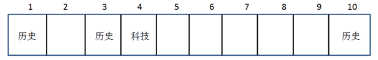

根据条件“只放置科技书籍的书架有2个，并且连号排列”可知5号为科技书架。

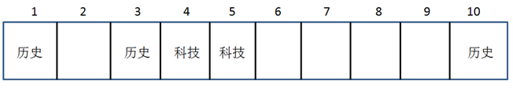

根据条件“只放置文学书籍的书架有4个，并且不与放置科技书籍的书架连号排列”可知文学书架不在6号，那么只能占据2、7、8、9四个位置，剩下的位置6就是儿童书架。

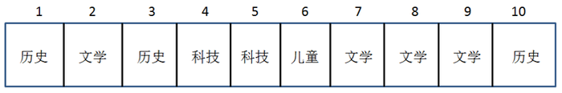

故正确答案为C。

**考点**：从确定信息开始推

**来源**：2015年河南省公务员录用考试《行测》题第80题

### 第 81 题

物候就是植物的萌发、开花、结果、凋谢和某些动物的迁徙、冬眠等活动，反映了气候和节令的变化。下列诗词不反映物候知识的是：

A. 远上寒山石径斜，白云深处有人家

B. 清明时节雨纷纷，路上行人欲断魂

C. 一川烟草，满城风絮，梅子黄时雨

D. 红藕香残玉簟秋，轻解罗裳，独上兰舟

第 81 题 · 答案与解析

**参考答案（粉笔题库参考内容）**

A

**解析**

A项错误，表述的是季节，没有体现物候的相关变化。

B项正确，该项关键词是“清明”，清明是表征物候的节气，含有天气晴朗、草木繁茂的意思。常言道：“清明断雪，谷雨断霜。”时至清明，华南气候温暖，春意正浓。

C项正确，该项关键词是“梅子黄时”，很明显符合题目中植物结果，说的是果子成熟。

D项正确，该项关键词是“红藕香残”，也符合植物凋谢相关特征。

本题为选非题，故正确答案为A。

**考点**：自然地理

**来源**：2015年河南省公务员录用考试《行测》题第81题

### 第 82 题

下列行为中，行政机关的做法构成滥用职权的是：

A. 工商部门对一批疑似走私的物品进行了查扣

B. 质量技术监督局作出处罚决定所适用的标准反复无常

C. 规划局为了公共利益的需要撤回了发给S企业的规划许可证

D. 公安局对小钱处以拘留十日的处罚，未告知其事实、理由和依据

第 82 题 · 答案与解析

**参考答案（粉笔题库参考内容）**

B

**解析**

滥用职权的行为主要表现为以下几种情况：一是超越职权，擅自决定或处理没有具体决定、处理权限的事项；二是玩弄职权，随心所欲地对事项作出决定或者处理；三是故意不履行应当履行的职责，或者说任意放弃职责；四是以权谋私、假公济私，不正确地履行职责。

A项错误，工商部门有权力对疑似走私物品进行查扣。

B项正确，“反复无常”属于“玩弄职权”，属于滥用职权的一种。

C项错误，规划局作出撤回决定是由于“公共利益的需要”，这种情形下可以撤回许可证。

D项错误，该项是“处罚程序”上出了问题，职权上并没有体现出“滥用”。

故正确答案为B。

本题有认为选D的，D属于行政处罚中未履行《行政处罚法》规定的“告知义务”，即不履行应当履行的职责。但是“滥用职权”必须是主观“故意”，而选项中未明确公安局的未告知是主观上的故意，还是过失，还是客观原因。所以D项是表述不严谨，而B项错误明显，所以粉笔题库倾向选B。

**考点**：行政法

**来源**：2015年河南省公务员录用考试《行测》题第82题

### 第 83 题

下列关于国家政治制度的说法正确的是：

A. 秦始皇统一全国后实行了宗法制

B. 明朝在地方实行的行省制度是中国省制的开端

C. 清朝雍正帝时设置军机处以加强君主专制

D. 三公九卿制始于汉武帝时期

第 83 题 · 答案与解析

**参考答案（粉笔题库参考内容）**

C

**解析**

A项：秦始皇统一中国后实行郡县制，错误。

B项：行省制度是在元朝的时候开始实行的，错误。

C项：雍正七年（1729），因用兵西北，以内阁在太和门外，恐漏泄机密，始于隆宗门内设置军机房，选内阁中谨密者入值缮写，以为处理紧急军务之用，辅佐皇帝处理政务。雍正十年（1732），改称“办理军机处”，简称“军机处”。设军机大臣、军机章京等，均为兼职。乾隆帝时期复设军机处，从此成为清朝的中枢权力机关，一直到清末，正确。

D项：三公九卿制始于秦朝，错误。

故正确答案为C。

**考点**：中国历史

**来源**：2015年河南省公务员录用考试《行测》题第83题

### 第 84 题

关于中国陶瓷业的发展，下面说法不正确的是：

A. 明代最早烧出了青花瓷

B. “唐三彩”以青、绿、黄三色为主

C. 汝、官、哥、钧、定是宋代五大名窑

D. 仰韶文化中出现了绘有彩绘花纹的陶器

第 84 题 · 答案与解析

**参考答案（粉笔题库参考内容）**

A

**解析**

A项错误，原始青花瓷于唐宋已见端倪，成熟的青花瓷则出现在元代景德镇的湖田窑。明代青花成为瓷器的主流。清康熙时发展到了顶峰。经常可以听到元青花，即元代的青花瓷。

B项正确，唐三彩中的“三彩”指的是黄、白、绿为主，兼有褐色（不是红色、是介于红色和黄色之间的一种颜色）、蓝色、黑色等颜色。该选项表述并不严谨。

C项正确，宋代五大名窑之说，始见于明代皇室收藏目录《宣德鼎彝谱》：“内库所藏柴、汝、官、哥、钧、定名窑器皿，款式典雅者，写图进呈。”由于柴窑至今未发现窑址，又无实物，因此汝、官、哥、钧、定并称宋代五大名窑。

D项正确，彩陶器造型优美，表面用红彩或黑彩画出绚丽多彩的几何形图案和动物形花纹，其中人面形纹、鱼纹、鹿纹、蛙纹与鸟纹等形象逼真生动。仰韶文化不少出土的彩陶器为艺术珍品，如水鸟啄鱼纹船形壶、人面纹彩陶盆、鱼蛙纹彩陶盆、鹤衔鱼纹彩陶缸等。

比较A和B，虽然B选项表述并非严谨，其中A项错的更为明显，也更符合出题人对生活中常识考查的基调，基于常识总题干要求选择最佳的表述，A项入选更为合适。

本题为选非题，故正确答案为A。

**考点**：中国历史

**来源**：2015年河南省公务员录用考试《行测》题第84题

### 第 85 题

下列关于中医著作的说法，错误的是：

A. 《黄帝内经》开创了中医学独特的理论体系，标志着我国医学由单纯积累经验的阶段发展到了系统的理论总结阶段

B. 《伤寒杂病论》在世界上首次记载了人工呼吸的治疗方法

C. 《神农本草经》是一本药物学著作，它改进了中国传统的药物分类方法

D. 《难经》中的“难”是“问难”之义，该书是以问难的形式，即假设问题、解释疑难的体例进行编纂的

第 85 题 · 答案与解析

**参考答案（粉笔题库参考内容）**

C

**解析**

A项正确，《黄帝内经》简称《内经》，是我国现存医书中最早的典籍之一，奠定了中医学理论的基础。成书于战国至秦汉时期，是我国劳动人民长期与疾病做斗争的经验总结。它的问世，开创了中医学独特的理论体系，标志着我国医学由单纯积累经验的阶段发展到了系统的理论总结阶段。

B项正确，张仲景是舌下给药、胸外心脏挤压和人工呼吸法的发明者，记载在其著作《伤寒杂病论》中。

C项错误，《神农本草经》是中医药物学理论发展的源头，是我国药物学最早分类法，为历代沿用，而非改进。

D项正确，《难经》是中医现存较早的经典著作，作者不详。本书以问答解释疑难的形式编撰而成，共讨论了81个问题，故又称《八十一难》。

本题为选非题，故正确答案为C。

**考点**：文学常识

**来源**：2015年河南省公务员录用考试《行测》题第85题

### 第 86 题

宗教不是下列哪一战争的原因？

A. 两伊战争

B. 巴以冲突

C. 十字军东征

D. 伊拉克战争

第 86 题 · 答案与解析

**参考答案（粉笔题库参考内容）**

D

**解析**

A项正确，两伊战争（伊朗、伊拉克）的原因总的来说最重要的三个因素是：边境纠纷、宗教矛盾、民族仇恨。所以宗教是起因之一，主要是什叶派穆斯林和逊尼派穆斯林之间的冲突。

B项正确，巴以（巴勒斯坦、以色列）冲突原因之一就是伊斯兰教和犹太教之间的冲突，尤其是争夺圣城耶路撒冷。

C项正确，十字军东征是一系列在罗马天主教教皇的准许下进行的有名的宗教性军事行动，由西欧的封建领主和骑士对地中海东岸的国家以收复阿拉伯入侵占领的土地名义发动的战争。

D项错误，伊拉克战争，是以英美军队为主的联合部队在2003年3月20日对伊拉克发动的军事行动，美国以伊拉克藏有大规模杀伤性武器并暗中支持恐怖分子为由，绕开联合国安理会，单方面对伊拉克实施军事打击。实质上是借反恐时机，以伊拉克拒绝交出子虚乌有的生化武器为借口，趁机清除反美政权的战争。由于这次战争实际上是1990年海湾战争的继续，所以，这次战争也被称为“第二次海湾战争”。

本题为选非题，故正确答案为D。

**来源**：2015年河南省公务员录用考试《行测》题第86题

### 第 87 题

马基雅维利的法律思想颇有几分中国古代儒家的民本主义色彩。在《君主论》一书中，他强调说“君主统治稳固的基本条件就是他的臣民不憎恨他”，“君主最坚固的堡垒就是人民的支持”，“人民的支持是挫败阴谋的保障”。关于君主如何赢得人民的支持，马基雅维利言简意赅地指出：“只要不对公民或臣民的财产妻女打主意就行了。至关重要的是，不要妄动别人的财产。”

从材料可看出，马基雅维利思想与下列儒家思想表述最接近的一项是：

A. 君之视臣如手足，则臣之视君如腹心；君之视臣如土芥，则臣之视君如寇仇

B. 鸡豚狗彘之畜，无失其时，七十者可以食肉矣。百亩之田，勿夺其时，数口之家，可以无饥也

C. 得天下有道，得其民，斯得天下也。得其民有道，得其心，斯得民矣。得其心有道，所欲与之聚之，所恶勿施尔也

D. 王如好货，与百姓同之，于王何有？王如好色，与百姓同之，于王何有

第 87 题 · 答案与解析

**参考答案（粉笔题库参考内容）**

C

**解析**

本题考查人文常识。

A项：该项说的是君臣关系，不符合题目人民和君主的范围界定，排除。

B项：该项大致意思是鸡狗与猪这类家畜，不去打乱它的繁殖期，那么，七十岁以上的人就都有肉可吃了。一家给他一百亩土地，并且不去打乱它季节生长的规律，那么数口人的家庭便都可以吃得饱饱的了，排除。

C项：该项意思是要得天下的办法就是去获得民众的支持，做到了就能得到天下；要获得支持的办法就是获得他们的认可，做到了就能得到；要获得民众认可的办法就是做民众期望的，不要做他们反感的。此项与材料中马基雅维利的思想最接近，当选。

D项错误，该项意思是王如喜好财货（女色），能和百姓共同享用它。

对比题干中的逻辑关系只有C项最为合适。

故正确答案为C。

**考点**：文化常识

**来源**：2015年河南省公务员录用考试《行测》题第87题

### 第 88 题

在民族大团结邮票中，下列图案和民族对应正确的是：

A. 

  朝鲜族

B. 

  藏族

C. 

  回族

D. 

  蒙古族

第 88 题 · 答案与解析

**参考答案（粉笔题库参考内容）**

D

**解析**

A项错误，不是朝鲜族而是傣族。图中出现了象脚鼓，该乐器是傣族的重要民间乐器。

B项错误，不是藏族而是满族。图中有明显的满族头饰。

C项错误，不是回族而是维吾尔族。从图中女孩子的小皮靴和帽子就可以看出来明显具有维吾尔族的特点。回族男的一般戴小白帽子。

D项正确，该项为蒙古族。

故正确答案为D。

**考点**：中国地理

**来源**：2015年河南省公务员录用考试《行测》题第88题

### 第 89 题

下列文学流派、主要代表人物及其作品对应完全正确的是：

A. 语丝派—鲁迅—《野草》

B. 新月诗派—郭沫若—《死水》

C. 京派小说—钱钟书—《围城》

D. 山药蛋派—赵树理—《吕梁英雄传》

第 89 题 · 答案与解析

**参考答案（粉笔题库参考内容）**

A

**解析**

本题考查人文常识。

A项正确，语丝派是中国现当代文学史上非常重要的文学流派。以鲁迅、周作人、林语堂等为代表的语丝派作家，以散文创作为特色，在中国思想文化革命、新文学创造上做出了重要建树。该派以“语丝社”为阵地。《野草》写于“五四”后期，是鲁迅先生唯一的一本散文诗集。

B项错误，《死水》为闻一多所写。

C项错误，钱钟书不是京派小说的代表人物，代表人物主要是沈从文，著有小说《边城》。

D项错误，《吕梁英雄传》是当代著名作家马烽、西戎合著的我国第一部反映中国共产党领导的全民族抵御日本侵略者，并在抗日战争时期就发表的长篇小说，是吕梁革命史的真实写照，而非赵树理所写。

故正确答案为A。

**考点**：文学常识

**来源**：2015年河南省公务员录用考试《行测》题第89题

### 第 90 题

关于《自由引导人民》这幅名画，下列说法正确的是：

A. 是达·芬奇的名作

B. 是一幅布面水粉画

C. 是以历史事件为题材的

D. 鼓舞了英国资产阶级革命

第 90 题 · 答案与解析

**参考答案（粉笔题库参考内容）**

C

**解析**

《自由引导人民》是法国浪漫主义画家欧仁·德拉克罗瓦为纪念1830年法国七月革命的作品，是一幅布面油画，据此可知A、B、D三项错误，C正确。

故正确答案为C。

**来源**：2015年河南省公务员录用考试《行测》题第90题

### 第 91 题

不少作家的书名是从前人的佳辞名句化用而来的。下列对应不正确的是：

A. 袁枚《子不语》—《论语》

B. 琼瑶《在水一方》—屈原《离骚》

C. 茅盾《霜叶红于二月花》—杜牧《山行》

D. 安意如《人生若只如初见》一纳兰性德《木兰花令·拟古决绝词》

第 91 题 · 答案与解析

**参考答案（粉笔题库参考内容）**

B

**解析**

A项正确，《子不语》一书专记鬼神怪异之事，其得名源于《论语·述而》“子不语怪力乱神”。

B项错误，《在水一方》书名出自《诗经·蒹葭》：“蒹葭苍苍，白露为霜。所谓伊人，在水一方。”

C项正确，《霜叶红于二月花》书名出自杜牧的《山行》：“停车坐爱枫林晚，霜叶红于二月花。”

D项正确，“人生若只如初见”这句话出自清代著名词人纳兰性德（纳兰容若）的《木兰花令·拟古决绝词》。

本题为选非题，故正确答案为B。

**考点**：文学常识

**来源**：2015年河南省公务员录用考试《行测》题第91题

### 第 92 题

稀土有“工业维生素”的美称，广泛应用于军事、石化、轻纺、农业等多个领域。下列关于稀土的说法不正确的是：

A. 稀土可大幅度提高用于制造飞机、坦克、导弹的钢材和铝合金的性能

B. 稀土可促进种子萌发，提高种子发芽率，促进幼苗生长

C. 轻纺工业中，稀土可用于染色、降低织物的白度等方面

D. 复合稀土氧化物可以用作内燃机尾气净化催化剂

第 92 题 · 答案与解析

**参考答案（粉笔题库参考内容）**

C

**解析**

A项正确，稀土有工业“黄金”之称，由于其具有优良的光、电、磁等物理特性，能与其他材料组成性能各异、品种繁多的新型材料，其最显著的功能就是大幅度提高其他产品的质量和性能。比如大幅度提高用于制造坦克、飞机、导弹的钢材、铝合金、镁合金、钛合金的战术性能。

B项正确，稀土元素可以提高植物的叶绿素含量，增强光合作用，促进根系发育，增加根系对养分吸收。还能促进种子萌发，提高种子发芽率，促进幼苗生长。

C项错误，稀土添加在酸性染料中，可以起到助染作用，从而提高上染率和改善纤维的色泽，现已应用在羊毛和纯棉等各种天然纤维、化纤及其混纺染色助染。稀土元素在织物上的处理效果表现在织物的白度增加、毛效提高和强力提高等方面，而非降低织物的白度。

D项正确，用稀土制成的分子筛催化剂，具有活性高、选择性好、抗重金属中毒能力强的优点，因而取代了硅酸铝催化剂用于石油催化裂化过程，复合稀土氧化物还可以用作内燃机尾气净化催化剂。

本题为选非题，故正确答案为C。

**考点**：化学常识

**来源**：2015年河南省公务员录用考试《行测》题第92题

### 第 93 题

关于我国各省区，下列说法不正确的是：

A. 西藏是我国湖泊最多的省区

B. 浙江是我国岛屿最多的省区

C. 新疆是我国毗邻国家最多的省区

D. 福建是我国海岸线最长、海疆最广的省区

第 93 题 · 答案与解析

**参考答案（粉笔题库参考内容）**

D

**解析**

A项正确，西藏是我国湖泊最多的地区，共有1500多个大小不一、景致各异的湖泊，总面积约2.38万平方公里，约占全国湖泊总面积的30%。

B项正确，浙江是我国岛屿最多的省，数目众多，各具特点。

C项正确，新疆是我国陆上邻国最多的省级行政单位，分别是：蒙古、俄罗斯、哈萨克斯坦、吉尔吉斯斯坦、塔吉克斯坦、阿富汗、巴基斯坦、印度8个邻国。

D项错误，广东省是我国海岸线最长、海疆最广的省区。全省海岸线长达8500公里，占全国海岸线的三分之一以上。

本题为选非题，故正确答案为D。

**考点**：中国地理

**来源**：2015年河南省公务员录用考试《行测》题第93题

### 第 94 题

下列诗句描绘了某个地方的风光，与之对应的现代城市错误的是：

A. 山围故国周遭在，潮打空城寂寞回——南京

B. 飞流直下三千尺，疑是银河落九天——南昌

C. 昔人已乘黄鹤去，此地空余黄鹤楼——武汉

D. 接天莲叶无穷碧，映日荷花别样红——杭州

第 94 题 · 答案与解析

**参考答案（粉笔题库参考内容）**

B

**解析**

A项正确，“山围故国周遭在，潮打空城寂寞回”出自唐代诗人刘禹锡《石头城》，石头城是今南京的别称。

B项错误，“飞流直下三千尺，疑是银河落九天”出自唐代诗人李白《望庐山瀑布》，庐山位于今江西九江，并非南昌。

C项正确，“昔人已乘黄鹤去，此地空余黄鹤楼”出自唐代诗人崔颢《黄鹤楼》，黄鹤楼故址在今武汉市。

D项正确，“接天莲叶无穷碧，映日荷花别样红”出自南宋诗人杨万里的《晓出净慈寺送林子方》，描写的是六月杭州西湖的美丽景色。

本题为选非题，故正确答案为B。

**考点**：文学常识

**来源**：2015年河南省公务员录用考试《行测》题第94题

### 第 95 题

关于紫外线，下列说法错误的是：

A. 沙滩和水面对阳光的高反射率导致紫外线辐射更强

B. 多云的天气，人也会受到紫外线辐射伤害

C. 紫外线照射影响人体内维生素C的合成

D. 紫外线属于不可见光

第 95 题 · 答案与解析

**参考答案（粉笔题库参考内容）**

C

**解析**

A项正确，许多物体表面反射阳光，增加了紫外线总体暴露水平，使得辐射更强。例如：草、土壤和水反射约10%的紫外线辐射；新鲜的雪反射多达80%；干沙滩反射15%，海水泡沫反射25%。

B项正确，近紫外线(UVA)，波长介于315~400纳米，可穿透云层、玻璃进入室内及车内。因此，即使在多云的天气里，人也会受到紫外线辐射的伤害。

C项错误，紫外线照射会影响人体内维生素D合成。维生素C有抵御紫外线照射的作用。

D项正确，不可见光是个比较笼统的概念，是指除可见光外其他所有人眼所不能感知的波长的电磁波，包括无线电波、微波、红外光、紫外光、x射线、γ射线、远红外线等。

本题为选非题，故正确答案为C。

**考点**：其他

**来源**：2015年河南省公务员录用考试《行测》题第95题

### 第 96 题

关于世界上的四个国中之国，下列说法错误的是：

A. 莱索托位于非洲

B. 梵蒂冈是政教合一的国家

C. 摩纳哥是世界上最小的国家

D. 圣马力诺的官方语言为意大利语

第 96 题 · 答案与解析

**参考答案（粉笔题库参考内容）**

C

**解析**

A项正确，莱索托全名莱索托王国，非洲南部国家之一，四周为南非所环抱。

B项正确，梵蒂冈四面都与意大利接壤，是全世界天主教的中心——以教宗为首的教廷的所在地，接受圣座的直接统治，实施政教合一的政治体制。

C项错误，摩纳哥是位于欧洲的一个城邦国家，是世界第二小的国家，仅次于梵蒂冈，总面积为1.98平方公里，全境北、西、东三面皆由法国包围，南靠地中海。

D项正确，圣马力诺共和国位于欧洲南部，意大利半岛东部，整个国家被意大利包围，是一个国中国，官方语言是意大利语。

本题为选非题，故正确答案为C。

**考点**：文化常识

**来源**：2015年河南省公务员录用考试《行测》题第96题

### 第 97 题

关于地震，下列表述不正确的是：

A. 地球上主要有五大地震带

B. 南北两极不容易发生地震

C. 从成因角度说，构造地震破坏力最大

D. 由于太阳和月亮引力作用，绝大多数的地震发生在夜间

第 97 题 · 答案与解析

**参考答案（粉笔题库参考内容）**

A

**解析**

A项错误，全球主要地震带有三个：环太平洋地震带，欧亚地震带和海岭地震带。

B项正确，南北两极地区不容易发生地震，主要是因为巨大的冰层。由于巨大冰层的压力，冰层下部的岩石几乎处于“熔融”状态，岩石的断层无从谈起。同时，由于冰层面积广且质量大，那些地方的岩石在垂直方向上受到强烈的压缩，这种巨大的垂直压力与地壳板块构造带来的水平挤压力相互作用，正好达到平衡。作为平衡的结果，那些地方的岩层不会发生倾斜和弯曲，地壳的形变得以分散和减弱，地震也就不易发生。

C项正确，天然地震按成因不同主要有三种类型：构造地震，火山地震和陷落地震。其中构造地震是由地下深处岩层错动、破裂所造成的地震。这类地震发生的次数最多，约占全球地震数的90％以上，破坏力也最大。

D项正确，地震多发生在夜间，据统计，1985年我国境内发生了25次五级以上的地震，其中有20次发生在19时至次日凌晨6时之间。由于引力的作用，太阳和月亮可以使地壳涨落。到了晚上，特别是农历月初和月中，月亮对地球的引力最大，使地球表面上升得最厉害，从而使这个地区蓄势待发的地震产生了。

本题为选非题，故正确答案为A。

**考点**：自然地理

**来源**：2015年河南省公务员录用考试《行测》题第97题

### 第 98 题

在晴朗的夜晚，偶尔抬头仰望星空，我们可能发现星星在“眨眼睛”，星星“眨眼睛”的原因是：

A. 星星在不同时刻释放的能量不同

B. 亮度不同的星星发射的光线相互影响的结果

C. 人们的眼睛要不停地眨，所以看起来星星是在眨眼睛了

D. 星星发射的光线穿过大气层时产生折射的结果

第 98 题 · 答案与解析

**参考答案（粉笔题库参考内容）**

D

**解析**

本题考查科技常识。

星星眨眼的原因是因为地球上大气温度的变化，会使大气层上层冷空气下沉，下层暖空气上升，冷空气的密度大，而暖空气的密度小，密度大的空气不断流向密度小的空气，这就是风，这厚厚的一层温度和密度不断改变的空气层会使光可透过的程度也不一样，使通过它的光线发生多次折射，这样星星发射的光在传到我们眼睛的过程中就会忽前忽后、忽左忽右、忽明忽暗，总在不断的变化，会造成在我们眼里看起来，星星是一闪一闪的。A、B、C三项的观点均不是星星眨眼睛的原因，排除。

故正确答案为D。

**考点**：物理常识

**来源**：2015年河南省公务员录用考试《行测》题第98题

### 第 99 题

下列说法错误的是：

A. 在太阳系中，太阳是中心天体，其他天体都在太阳的引力下，绕太阳公转。其它的主要成员是水星、金星、地球、火星、木星、土星、天王星、海王星等

B. 光年是天文学中常用的距离单位，光在真空中一年所走的距离叫光年

C. 生物具有遗传和变异，既能保持物种相对稳定，又能促使生物不断演化

D. 染色体是细胞核中载有遗传信息（基因）的物质，由核酸和蛋白质组成。哺乳动物雄性个体细胞的性染色体对为XX，雌性则为XY

第 99 题 · 答案与解析

**参考答案（粉笔题库参考内容）**

D

**解析**

D项错误，哺乳动物雄性个体细胞的性染色体对为XY，雌性则为XX。

本题为选非题，故正确答案为D。

**考点**：其他

**来源**：2015年河南省公务员录用考试《行测》题第99题

### 第 100 题

航天员在太空行走需要穿舱外航天服，不出舱、在加压舱内穿的航天服称为舱内航天服。下列不属于舱内航天服功能的是：

A. 提供一定的温度保障和通信功能

B. 防辐射、隔热、防微陨石、防紫外线

C. 在座舱减压和氧气丧失时提供压力和氧气

D. 飞行中或着陆后遇到空气污染时，能防止吸入有毒气体

第 100 题 · 答案与解析

**参考答案（粉笔题库参考内容）**

B

**解析**

航天服按用途可分为舱内航天服和舱外航天服两大类。防辐射、隔热、防微陨石、防紫外线等是舱外航天服具有的功能。故B项错误。

本题为选非题，故正确答案为B。

**考点**：科技理论与成就

**来源**：2015年河南省公务员录用考试《行测》题第100题

## 材料 1

一、根据所给材料，回答101～105题。

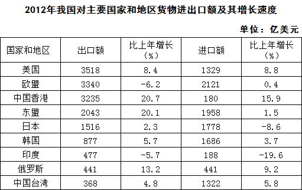

### 第 101 题

2012年对华货物进出口额相差最大的国家或地区是：

A. 美国

B. 欧盟

C. 中国香港

D. 印度

第 101 题 · 答案与解析

**参考答案（粉笔题库参考内容）**

C

**解析**

2012年对华货物进出口额差额大小：

美国对华进口额3518亿美元，出口额1329亿美元，差额为亿美元；

欧盟对华进口额3340亿美元，出口额2121亿美元，差额为亿美元；

中国香港对大陆进口额3235亿美元，出口额180亿美元，差额为亿美元；

印度对华进口额477亿美元，出口额188亿美元，差额为亿美元；

则差额最大的为中国香港。

故正确答案为C。

**考点**：简单加减计算、综合资料

**来源**：2015年河南省公务员录用考试《行测》题第101题

### 第 102 题

表中有几个国家或地区2012年的对华货物进出口贸易总额高于上年水平？

A. 5

B. 6

C. 7

D. 8

第 102 题 · 答案与解析

**参考答案（粉笔题库参考内容）**

B

**解析**

若进出口同比增速均为正值，则2012年的对华货物进出口贸易总额一定高于去年。观察图表，美国、中国香港、东盟、韩国、俄罗斯、中国台湾进出口同比增速均为正值，则一定高于去年；印度均为负值，则一定低于去年；欧盟出口额下降率大于进口额增长率，且基数较大，故欧盟低于去年，同理日本低于去年，故共有6个高于去年。

故正确答案为B。

**考点**：一般增长率、综合资料

**来源**：2015年河南省公务员录用考试《行测》题第102题

### 第 103 题

从2009年到2012年，我国货物出口贸易额平均每年约增加多少亿美元？

A. 2820

B. 2710

C. 2120

D. 2030

第 103 题 · 答案与解析

**参考答案（粉笔题库参考内容）**

A

**解析**

2009年-2012年货物出口额增加20489-12016=8473亿美元，时间间隔为3年，则平均每年约增长8473÷3≈2820亿美元。

故正确答案为A。

**考点**：年均增长量、综合资料

**来源**：2015年河南省公务员录用考试《行测》题第103题

### 第 104 题

2011年我国自日本的货物进口额占当年我国货物贸易进口总额的：

A. 6.4%

B. 7.7%

C. 9.8%

D. 11.2%

第 104 题 · 答案与解析

**参考答案（粉笔题库参考内容）**

D

**解析**

2011年我国自日本的货物进口额为货物总进口额为17435亿美元，则占比为。

故正确答案为D。

**考点**：基期比重、综合资料

**来源**：2015年河南省公务员录用考试《行测》题第104题

### 第 105 题

能够从资料中推断的是：

A. 2008～2012年我国货物进口贸易额逐年递增

B. 2011年我国对俄罗斯的货物贸易出口额高于进口额

C. 2012年我国货物进出口总额比2008年增加超过1万亿美元

D. 2009～2012年我国货物出口贸易额同比增幅最大的年份是2011年

第 105 题 · 答案与解析

**参考答案（粉笔题库参考内容）**

C

**解析**

A项：2009年比2008年进口额下降，不满足逐年递增，错误。

B项：我国对俄罗斯2012年进出口额大小相等，增长率出口大于进口，所以2011年出口额一定小于进口额，错误。

C项：2008年货物进出口总和为25600+亿美元，2012年货物进出口总和为38600+亿美元，差值为13000+亿美元，大于1万亿美元，正确。

D项：根据柱状图可知，2009年出口额下降，2010、2011、2012年的出口额分别增长3700+、3200+、1500+亿美元，可知2010年的增长量最多，且对应基期最小，因此增幅最大应为2010年，错误。

故正确答案为C。

**考点**：综合分析、综合资料

**来源**：2015年河南省公务员录用考试《行测》题第105题

## 材料 2

二、根据所给资料，回答106～110题。

        2011年我国城乡居民人均文化消费比2002年分别增长170.7%和251.1%，增速分别快于人均消费支出19和66个百分点。2011年城乡居民文化消费占消费支出的比重分别为7.3%和3.2%，比2002年分别提高0.5和0.6个百分点。

### 第 106 题

与2006年相比，2011年我国农民人均纯收入约上升了：

A. 95%

B. 166%

C. 195%

D. 266%

第 106 题 · 答案与解析

**参考答案（粉笔题库参考内容）**

A

**解析**

给出现期值与基期值求增长率，，与A项最接近。

故正确答案为A。

**考点**：一般增长率、综合资料

**来源**：2015年河南省公务员录用考试《行测》题第106题

### 第 107 题

表中农村居民人均文化消费支出占消费支出比重高于上年的有几年？

A. 2

B. 3

C. 4

D. 5

第 107 题 · 答案与解析

**参考答案（粉笔题库参考内容）**

C

**解析**

根据题干“······占······比重高于上年的有几年”，可判定本题为两期比重比较问题。当部分增长率（a）大于整体增长率（b）时，比重上升。定位表格资料，可知人均文化消费支出的增速（a）大于人均消费支出的增速（b）的年份有2003年、2009年、2010年和2011年，共四年。

故正确答案为C。

**考点**：两期比重、综合资料

**来源**：2015年河南省公务员录用考试《行测》题第107题

### 第 108 题

表中农民人均纯收入和城镇居民人均可支配收入差距最小的一年，城镇居民和农村居民的人均文化消费之比约为：

A. 7.0:1

B. 7.2:1

C. 7.9:1

D. 8.2:1

第 108 题 · 答案与解析

**参考答案（粉笔题库参考内容）**

C

**解析**

比较城镇居民人均可支配收入和农村居民人均纯收入两列发现，2003年二者差距最小，此时城镇与农村人均文化消费之比为420：53=7.9:1。

故正确答案为C。

**考点**：比值比较、综合资料

**来源**：2015年河南省公务员录用考试《行测》题第108题

### 第 109 题

2002年我国城镇居民人均消费支出约为多少万元？

A. 0.5

B. 0.6

C. 0.8

D. 1.0

第 109 题 · 答案与解析

**参考答案（粉笔题库参考内容）**

B

**解析**

由文字材料“2011年我国城乡居民人均文化消费比2002年分别增长170.7%和251.1%，增速分别快于人均消费支出19和66个百分点”可知，我国城镇人均消费支出2011年同比2002年的增长率应为170.7%-19%=151.7%。2011年人均城镇居民人均消费支出为15161元，则2002年我国城镇居民人均消费支出万元。

故正确答案为B。

**考点**：基期计算、综合资料

**来源**：2015年河南省公务员录用考试《行测》题第109题

### 第 110 题

以下说法正确的是：

A. 表中农村居民人均消费支出增速与人均文化消费增速最低的年份是同一年

B. 表中每年城镇居民人均消费支出均比上一年增长千元以上

C. 2003年城镇居民人均文化消费占人均消费支出的比重接近5%

D. 2004年农村居民人均纯收入的增幅超过10%

第 110 题 · 答案与解析

**参考答案（粉笔题库参考内容）**

D

**解析**

A项：农村居民人均消费支出增速最低的是2003年，农村居民人均文化消费支出增速最低的是2006年，错误。

B项：2004年城镇居民人均消费支出比上年增长不到1000元，故并非每年城镇居民人均消费支出均比上一年增长1000元以上，错误。

C项：2003年城镇居民人均文化消费占人均消费支出的比重为，直除首数为6，错误。

D项：2004年农村居民人均纯收入的增幅为，正确。

故正确答案为D。

**考点**：综合分析、综合资料

**来源**：2015年河南省公务员录用考试《行测》题第110题

## 材料 3

三、根据所给资料，回答111～115题。

        2014年1~2月中国出口简况如下：

        出口额列前五位的省市中，广东、浙江、上海分别出口857亿美元、364亿美元和309亿美元，同比下降11.8％、2.5％和3.5％，去年同期为增长32.4％、26.8％和7.1％；江苏出口465亿美元，同比增长3％，增速同比回落3.6个百分点；山东出口199亿美元，同比增长7.3％，增速同比提高1.9个百分点。

        西部地区出口310亿美元，同比增长26.9％，增速同比回落43.5个百分点。8个省份同比增长，增速较快的宁夏、甘肃分别增长1.6倍和1.4倍。4个省份由去年同期增长转为下降，西藏、贵州分别由增长7.2倍和2.4倍转为下降79.7％和50.2％。

        中部地区出口235亿美元，同比下降3.6％，去年同期为增长50.1％。4个省份同比增长，增速较快的江西、山西分别增长26.9％和8.2％。4个省份由去年同期增长转为下降，安徽、黑龙江分别由去年同期增长1.4倍和19.2％转为下降31.2％和25％。

        东部地区出口2667亿美元，同比下降4％，去年同期为增长18.9％。6个省份同比增长，增速较快的海南、山东分别增长10.6％和7.3％。5个省份由去年同期增长转为下降，广东、福建分别由增长32.4％和32％转为下降11.8％和4.2％。

### 第 111 题

2014年1～2月，广东、浙江，上海三省（市）出口额占东部地区出口额的比重约为：

A. 48％

B. 52％

C. 57％

D. 63％

第 111 题 · 答案与解析

**参考答案（粉笔题库参考内容）**

C

**解析**

由材料第一段与最后一段可得，2014年1～2月广东、浙江、上海三省市的出口额总计=857+364+309=1530亿美元，东部地区出口总额为2667亿美元，则其所占比重。

故正确答案为C。

**考点**：文字资料、现期比重

**来源**：2015年河南省公务员录用考试《行测》题第111题

### 第 112 题

2013年1～2月，以下地区出口额同比增速排序正确的是：

A. 东部地区＜中部地区＜西部地区

B. 东部地区＜西部地区＜中部地区

C. 中部地区＜东部地区＜西部地区

D. 西部地区＜东部地区＜中部地区

第 112 题 · 答案与解析

**参考答案（粉笔题库参考内容）**

A

**解析**

2013年1～2月各地区出口额同比增速：东部地区为18.9%，中部地区为50.1%，西部地区为26.9%+43.5%=70.4%。西部地区最高，中部地区次之，观察选项，A项满足。

故正确答案为A。

**考点**：排序类、文字资料

**来源**：2015年河南省公务员录用考试《行测》题第112题

### 第 113 题

2014年1～2月，西藏自治区出口额约是2012年同期的多少倍：

A. 0.2

B. 0.6

C. 1.7

D. 8.2

第 113 题 · 答案与解析

**参考答案（粉笔题库参考内容）**

C

**解析**

根据隔年增长率计算公式，，则2014年1-2月西藏自治区出口额相对于2012年1-2月的增速约为，则2014年1-2月西藏自治区出口额是2012年1-2月的1+0.64=1.64倍，只有C项与之接近。

故正确答案为C。

**考点**：文字资料、间隔增长率

**来源**：2015年河南省公务员录用考试《行测》题第113题

### 第 114 题

2014年1～2月，全国出口额与上年同期相比：

A. 上升了50多亿美元

B. 上升了200多亿美元

C. 下降了50多亿美元

D. 下降了200多亿美元

第 114 题 · 答案与解析

**参考答案（粉笔题库参考内容）**

C

**解析**

全国共包含东、中、西部三个地区，其中东、中部为下降，下降额共约亿美元；西部地区上升了，上升额为亿美元。

故2014年1-2月全国出口额与上年同期相比应为下降了，下降额约为120-62=58亿美元，只有C项与之接近。

故正确答案为C。

**考点**：增长量计算、文字资料

**来源**：2015年河南省公务员录用考试《行测》题第114题

### 第 115 题

能够从上述资料中推出的是：

A. 2013年1~2月，黑龙江省出口额同比下降了25％

B. 2014年1~2月，海南省的出口额高于山东省

C. 2014年1~2月，山西是出口额同比增速最快的省份

D. 2014年1~2月，全国有18个省（区市）出口额高于上年同期水平

第 115 题 · 答案与解析

**参考答案（粉笔题库参考内容）**

D

**解析**

A项：由“黑龙江由去年同期增长19.2%转为下降25%”，可知2013年1～2月黑龙江省出口额同比增长19.2%，表述错误，排除；

B项：2014年1～2月山东省出口额为199亿美元，为出口额前五位的省市之一；海南省未出现在出口额前五位的名单中，故海南省的出口额不会高于山东省，排除；

C项：2014年1～2月山西省的出口额同比增速为8.2%，而江西省为26.9%，故山西省并非增速最快的省份，排除；

D项：西部地区同比增长有8个省份，中部地区同比增长有4个省份，东部地区同比增长有6个省份，总共18个省份同比增长，表述正确，当选。

故正确答案为D。

**考点**：文字资料、综合分析

**来源**：2015年河南省公务员录用考试《行测》题第115题

## 材料 4

2014年1～2月份，我国房地产业土地购置面积4062万平方米，同比增长6.5％，土地成交价款1000亿元，同比增长8.9％。

### 第 116 题

截至2013年末，我国住宅房屋施工面积约为多少亿平方米？

A. 33.6

B. 37.8

C. 38.4

D. 52.5

第 116 题 · 答案与解析

**参考答案（粉笔题库参考内容）**

B

**解析**

观察表1可以推知，2013年末住宅房屋施工面积=截至2014年2月末房屋施工总面积—2014年1～2月房屋新开工面积+2014年1～2月竣工面积，则所求住宅房屋施工面积约为38.1-1.2+0.9=37.8亿平方米。

故正确答案为B。

**考点**：简单加减计算、综合资料

**来源**：2015年河南省公务员录用考试《行测》题第116题

### 第 117 题

在东部、中部、西部地区中，2014年1～2月商品房平均销售价格高于上年同期水平的地区有几个？

A. 0

B. 1

C. 2

D. 3

第 117 题 · 答案与解析

**参考答案（粉笔题库参考内容）**

B

**解析**

由题干“2014年1～2月…平均销售价格高于上年同期水平的地区有”，可判定为两期平均数比较问题。，根据两期平均数比较结论，分子增速快于分母时平均数上升。因此要想平均销售价格高于上年同期水平，要使商品房销售额同比增长率（a）大于销售面积同比增长率（b）。

结合表中数据，只有西部地区满足。

故正确答案为B。

**考点**：两期平均数比较、综合资料

**来源**：2015年河南省公务员录用考试《行测》题第117题

### 第 118 题

2013年1～2月，我国房地产业土地购置单价约为每平方米多少元？

A. 2300

B. 2400

C. 2500

D. 2600

第 118 题 · 答案与解析

**参考答案（粉笔题库参考内容）**

B

**解析**

由题目所求为2013年1-2月房地产业土地购置单价，可以采用基期比例公式，其中a代表土地成交价款同比增长率，a=8.9%,b代表产业土地购置面积同比增长率，b=6.5%。代入公式，因且与1非常接近。则，与B选项最接近。

故正确答案为B。

**考点**：基期平均数、综合资料

**来源**：2015年河南省公务员录用考试《行测》题第118题

### 第 119 题

2013年1～2月，商业营业用房竣工面积约是办公楼的多少倍？

A. 3

B. 4

C. 5

D. 6

第 119 题 · 答案与解析

**参考答案（粉笔题库参考内容）**

C

**解析**

题目所求为2013年1-2月商业营业用房竣工面积与办公楼的比值，可以采用基期比例公式，其中a代表商业营业用房竣工面积同比增长率（a=-7.9%,）b代表办公楼竣工面积同比增长率（b=14.0%），则比值，与C选项最接近。

故正确答案为C。

**考点**：基期倍数、综合资料

**来源**：2015年河南省公务员录用考试《行测》题第119题

### 第 120 题

关于2014年1～2月房地产开发和销售情况，能够从上述材料中推出的是：

A. 住宅新开工面积占房屋新开工总面积的八成以上

B. 各类房屋竣工面积均低于上年同期水平

C. 东部地区商品房单价是西部地区的两倍以上

D. 中部地区商品房销售额占全国比重高于上年同期水平

第 120 题 · 答案与解析

**参考答案（粉笔题库参考内容）**

D

**解析**

A项：由表中数据可得住宅新开工面积占房屋新开工总面积的比重为，错误。

B项：2014年1-2月办公楼竣工面积同比增长14.0%,高于上年同期水平，错误。

C项：东部地区商品房单价为，西部地区商品房单价为，前者不到后者的两倍，错误。

D项：中部地区商品房销售额同比增长率为14.3%，高于全国销售商品房销售额同比增长率-3.7%，故其所占比重高于上年同期水平，正确。

故正确答案为D。

**考点**：综合分析、综合资料

**来源**：2015年河南省公务员录用考试《行测》题第120题

