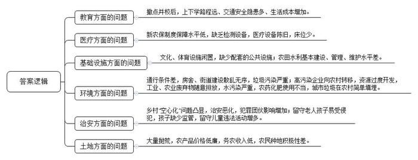
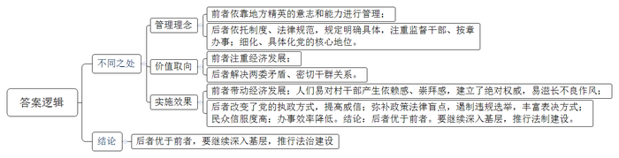
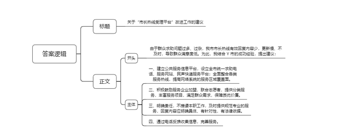
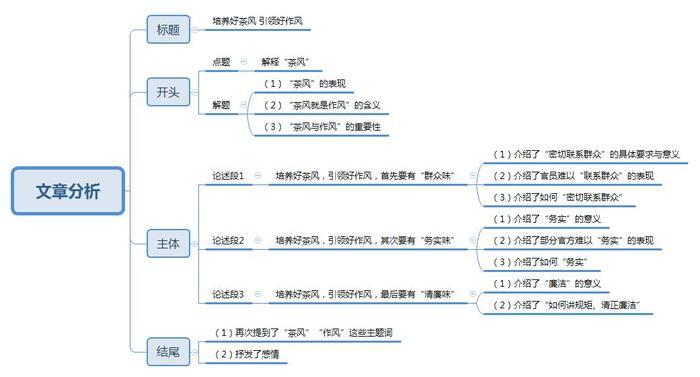
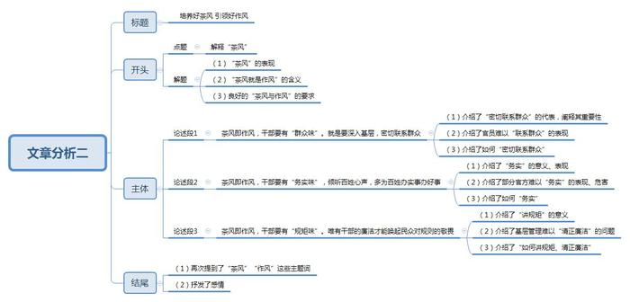

# 2016年河南省公考 《申论》题

<!-- gwy:overview:start -->
> **河南 · 2016 · 申论 · 统考** ｜ 4 题 · 图片 5 处 · 答案随题折叠

导航：[题目](#题目) · [材料 1](#材料-1)
<!-- gwy:overview:end -->

> 候选采集稿。参考答案及解析来自粉笔页面，不代表官方答案或真实高分答卷；来源使用许可与原卷对应关系仍需人工核实。

## 给定材料

### 材料 1

我国已进入改革发展的关键时期，空前的社会变革带来了巨大活力，同时也带来了各种矛盾和挑战。要化解这些矛盾、应对这些挑战，就必须深入推进基层社会治理创新。

在创新基层社会治理的过程中，政府要在原有体系的基础上，不断调整力量架构，建立更具开放性和包容性的治理体系，从控制型政府向服务型政府转变，成为社会需求的收集者、社会服务的遴选者、社会服务资金的提供者、社会秩序的维护者。

十八大以来，以习近平同志为核心的新一届中央领导集体高度关注中国基层发展，围绕基层实践与顶层设计关系、基层改革创新、基层干部培养等重要问题提出了许多新论断。习总书记指出，全面深化改革任务越重，越要重视基层探索实践，中央通过的改革方案落地生根，必须鼓励和允许不同地方进行差别化探索。习总书记强调，党的工作最坚实的力量支撑在基层，经济社会发展和民生最突出的矛盾和问题也在基层，基层是一切工作的落脚点，社会治理的重心必须落实到城乡、社区。必须把抓基层打基础作为长远之计和固定之策，丝毫不能放松。

### 材料 2

A市政协会同市委、市政府多个部门，以“加强农村基层治理现代化建设，改善农民生产生活条件”为题，先后赶赴7个郊县，通过听取汇报、实地调查、问卷调查、座谈讨论等形式，进行了深入调研。

调研发现，A市在加强农村基层治理现代化建设、改善农民生产生活条件、建设社会主义新农村、促进城乡一体化工作等方面已迈出了坚实的步伐，并取得了一定的成绩。

同时，调研中还发现，A市部分农村地区在发展过程中还存在着一些问题。以下材料是调研情况的摘编。

近些年来，一些地方施行撤点并校。撤点并校在改善乡村学校办学条件、提高办学效益和质量的同时，也带来了部分学生上下学路程远、交通安全隐患多、生活成本增加等新问题。

新农保制度已实施多年，但保障水平低。据估算，即便按每年500元的档次缴费，农民每月能领取的养老金数额也仅有129元。基层卫生院缺乏必要的检测设备，部分医疗设备陈旧、老化，不能满足人民群众的需要。病房床位少，一般乡镇卫生院的床位都在100个以内，每300～500个农民才能有一个医疗床位，而村级卫生室基本没有医疗床位。

通过福利彩票、体育彩票基金，有条件的地方建设了一些文化、体育设施，但平时基本处于闲置状态。最有进步的活动就是广场舞，从城镇发展到农村，成为农村文化事业发展的极少数亮点之一。农村书屋、农村电影基本都是为完成任务所进行的例行工作，花了钱，却没有效果。

农村的房舍、街道建设散乱无序，农民迫切希望整治村庄环境。农村通行条件差，给农民的生产生活带来诸多不便，农民迫切希望加强乡村道路建设，提高管理水平，实现公交村村通。此外，由于缺少配套的公共设施，导致垃圾污染严重，农民迫切希望提高饮水质量，喝上清洁卫生的自来水，用上清洁能源。

当问到“您对你们村的发展有何期待和建议”时，83.7%的农民最希望政府加强用水、道路、住宅、生态、绿化等建设。尤其是条件落后的偏僻村组，希望继续完成农村道路硬化和改善农村环境。71.3%的受访农民期望解决好农田水利基本建设，并加强管理和维护，为农田正常灌溉保驾护航。

乡村“空心化”问题日益凸显。乡村“空心化”使乡村治安情况出现了一些新特点，包括盗窃侵财类案件发案率高、由邻里纠纷和家庭矛盾引发的治安案件增加、村霸乡霸活动抬头等。一位农民对实地调研人员这样总结农村治安状况的恶化：“如果养猪，就要每天晚上守在猪圈旁；如果养牛，也要每晚守在牛棚旁，根本想都不敢想在家睡觉。”调查还发现，犯罪团伙在农村地区的影响增加。有些犯罪团伙在村子之间流窜作案，有些则长期驻留。一些地方团伙制造假货、非法开设枪支制造工厂，甚至制造毒品，以此来快速脱贫。一些城市犯罪团伙在遭到公安部门的打击后，转入农村活动，因为农村地区地域广，更容易隐匿违法活动。此外，许多村庄的劳动力全部外出打工，留下老人和孩子，而他们很容易受到不法人员的侵害。由于没有父母的有效监管，农村留守儿童的违法活动增多。

伴随城镇化进程的推进，许多高污染企业不断向乡村和山区转移。在一些经济发展比较好的郊县，乡村已变成“大工厂”，工业废气、废水、固体废弃物随意排放，乡村水污染十分严重，并且因此引发了多起群体性事件。此外，还存在农村资源过度开发、禽畜养殖污染物随意排放、生活垃圾大幅增加、农药化肥使用不合理、城市垃圾在郊区农村简单填埋等环境问题。

B县作为一个典型的丘陵地区，农民人均耕地少。但大片的良田长满荒草，耕作的土地和抛荒的土地相当，有些地方抛荒的土地甚至比耕作的土地还多。通过走访，发现其主要原因是农产品价格低廉，导致农民种地积极性不高。以水稻为例，100斤的水稻收购价为120～140元，亩产水稻900斤，一亩地收入不超过1200元，除去化肥、农药成本，加上国家各种补贴，一户农户种一亩水稻也只有几百元的收入，如果要算劳动力成本的话，在家种水稻一天收入不超过10元。而在外打工一个月的收入远远超过在家种一年水稻的纯收入。由此可见，在家种田最多只能解决自家温饱问题，谈不上改善生活，更谈不上发家致富。

### 材料 3

C省近年来推行乡村治理现代化试验区建设，取得了显著的效果，归结起来大体上有两种模式：一种是“能人治理”模式；一种是“乡村典章”模式。

模式一：“能人治理”模式

村民自治制度改变了传统任命干部的做法，干部由村民选举产生，这就为一些有能力、有才干的地方乡村精英成为基层组织的当家人提供了机会。据调查，D市大多数村委会主任来自村办企业管理者、私营企业主和个体户。由于这些地方乡村精英往往个人能力突出，在经济或社会活动方面具有突出的才干，使得个人的主要意志和能力在处理农村事务和村民自治组织建设中起到了主导作用，甚至个别能人在村级治理实际过程中居支配性地位。

从实践来看，经济能人在自身发展经济能力比较强的情况下，能够带动村民发展经济、走向致富，一旦这个人在带领村民发展经济方面取得了一定的成绩，人们对他便产生了一种依赖感、崇拜感，许多人甚至把发展经济作为评价村干部的唯一标准，认为只要村干部能够带领村民致富、发展经济，其他的问题可以不管。在村民们这样的心态下，经济能人在村一级事务中有着绝对的权威，有些能人村干部的不良作风开始滋长。

能人治理村庄相对于以前的道德权威治理村庄，两者的相似之处在于，无论是道德权威还是经济能人，人们之所以认同他们，把治理村庄的大权交到他们手上，是因为人们认为这些人值得大家尊重。对道德权威来说，人们尊重的是他们的道德品质和优良的个人品性；对经济能人来说，人们尊重的是他们发展经济、发家致富的能力。

模式二：“乡村典章”模式

村两委是村中国共产党支部委员会和村民委员会的简称，习惯上前者简称为村支部，后者简称为村委会。村民委员会组织法中虽明确了村党支部是农村工作的领导核心，但其核心地位如何体现却缺乏明确的实施细则。有的村委会主任上任后自行其是，一人说了算，集体资产随意处理，根本不与村党支部商量。村支书或村主任个人权力过大、村两委权力“一边倒”等现象在E县农村不在少数，在E县以往的400多个村中，村两委会关系比较协调、党支部战斗力比较强的仅占三四成。

2006年6月，E县决定在村两委矛盾较突出、干群关系较紧张的F村试点，引导、帮助农民制定一套对村级组织和全体村民具有普遍约束力的村务运作机制。经过问卷调查、上门访谈、座谈讨论等程序，历经一个半月形成了《F村典章》初稿，再由村两委会、两委扩大会议、村民代表会议进行梳理分析，随后张榜公布，挨家挨户收集意见，最后由全体村民公决，正式通过C省首部“乡村典章”，并将典章印成小册子发到每家每户。典章内容主要涉及村级组织职责、村务议事及决策、村级财务管理、村务公开制度、村干部违规追究办法等，典章按重要程度及数额大小将村务分为“重大村务”“重要村务”和“一般村务”，哪一级村务须由哪一个组织研究决定、哪一类开支如何审批等，都规定得清清楚楚。典章明确了对村干部的监督机制，村干部如果违反典章，按违章次数予以不同处置，直至被依法罢免。如果违反程序造成集体损失还必须赔偿。典章把党组织的领导核心地位进一步细化和具体化。“乡村典章”的推行改变了党在农村基层的执政方式，由为民做主的“父母官”变成让民做主的“服务员”，党在农村基层的威信大大提高了。

典章中的决策议事规则弥补了政策法律盲点，一方面有效遏制了村民代表会议组成对象针对选举进行拉票、搞宗派势力等现象，规定本村各级人大代表、政协委员、党代表及各片负责人都可通过公决成为村民代表；另一方面丰富了村民代表的表决方式，针对外出务工者众多、村民代表会议难以召开的问题，典章规定，外出村民可采用书面或其他远程通信方式参加表决。

E县至今已有70多个村推出各自的典章。在S村，典章出台之前，一张发票要4个人签字，现在则要经过10个人的手：经手人、证明人、会计、出纳、村经济合作社社长，以及5名村务监督小组成员。有村干部说：“现在章程说了算，都按典章办，大家就没那么多闲话了，但是经常因为一个小小的事情要找那么多人，则会耽误事。”

### 材料 4

刘某是县委宣传部下派到某村的挂点干部，以下内容是刘某的一篇博客文章。

沿着崎岖不平的小路，我来到挂点村重点联系户冯师傅的家门口，见一小姑娘，于是扯开嗓子喊道：“小姑娘，请问这是冯师傅家吗？”

“是的，你有事吗？”

“哦，我是村里的挂点干部，上回没见到你的父母，这一次专门拜访。”

三言两语过后，我和冯师傅便聊开了，并越聊越投机。

“刘干部，还是兄弟你好啊！来了我这儿，会喝我家的茶。”听到冯师傅这句话，我赶紧又喝了一大口茶。

“兄弟，我要向你诉一下苦啊！去年，我们村许多农户买了一个本村苗木种子商贩的杉树种子，结果无一发芽，唉！”

“后来怎样？”

“只赔了我家一千块钱！”

“冯师傅，我认为解决这件事只有两种途径：一是法律途径解决，但要看他的经济状况，如果他的经济状况很差，也没有实际效果。虽然法院判了，但他拿不出这么多钱，也没办法如你所愿。二是协商解决，既不伤和气，又能解决问题。”

“兄弟，你说的我都考虑过，也是按你说的去做的。现在说一说也就是诉诉苦而已。”

不知不觉，已是中午12点30分了。我赶忙起身告辞，冯师傅再三留我吃午饭，我亦再三感谢，表示纪律要求不能到群众家吃饭。最后，冯师傅说：“那你再喝一杯茶。”我又赶紧将一杯茶一饮而尽。

“茶风就是作风！兄弟，从你喝我的茶可以看出你是一个非常好打交道的人。”冯师傅送我到门口时非常真诚地对我说。我一时语塞，只能紧紧地握着冯师傅的手，感觉两人的心很近很近。

“茶风就是作风！”返回的路上，我一直琢磨，越想越觉得很有哲理。是啊，什么时候，我们每一个干部都认识到“**茶风就是作风！**”的含义，我们干部和群众的关系就会越来越和谐，这个社会也会越来越和谐。

### 材料 5

2015年4月，X市市长热线受理平台共受理有效诉求8884件，比上个月增加148件，增长1.7%。其中，电话平台受理热线8214件，市长信箱受理83件，市民留言受理587件。

从诉求类型看，投诉类5170件，占58.2%；咨询类2816件，占31.7%；求助类249件，占2.8%；建议类258件，占2.9%；其他类391件，占4.4%。

从诉求数量看，居前五位的分别是劳动保障、道路交通、环境保护、农林水利、城市管理；诉求增幅居前五位的分别是城市管理、环境保护、水电气讯、城建维护、市场监管。从诉求内容看，4月份因降雨积水，致居民出行不便的诉求明显增多，夜间噪声污染的投诉十分强烈，因路桥建设引起的占用耕地、震损房屋等问题引发的诉求也显著增加。

X市群众对市长热线受理平台的期望值很高，一些并非政府管辖的业务也都希望通过市长热线受理平台得到解决。比如小区物业无人管理、楼下聚众娱乐扰民、宠物丢失、楼道扶梯无人维修，甚至寻人启事、邻里纠纷、家庭矛盾等生活琐事都会拨打热线电话。

由于群众反映、求助的问题过多、过杂，而市长信箱的有效回复内容少，加上平台网页信息更新速度慢导致及时性不强，市长热线受理平台渐渐沦为“摆设”，群众因此很不满意。为此，领导决定派相关人员到Y市学习考察相关做法。

### 材料 6

Y市市民服务中心成立于2002年3月，是市委、市政府为进一步推进公共服务体系建设而建立的一个公共服务信息平台。2009年8月启用全市统一的求助电话号码81890（“拨一拨就灵”的谐音），此外，还有一个求助服务网站和一个民声快递服务平台。2011年12月与市长热线实现全面整合，并与全市41个非紧急公共服务电话实行“一号通”，目前服务区域已覆盖全市六个区，每天可解决市民的求助3000多件。到去年为止，通过这个网络系统，共为社会办理了505万件服务事项。

市民服务中心拥有300多家各类加盟服务企业及100多名81890志愿者，提供家政服务、维修服务等15个便民服务大类、120多个服务项目，以满足广大市民的求助需求。此外，服务中心还设立了“月嫂俱乐部”“加盟商之家”“失物招领中心”等服务项目。

以下是81890公共服务平台的案例集锦。

1.2015-05-08，王女士来电询问：如何脱离母子关系？

81890接线员接到电话，经询问12348法律援助中心，给予回复：不能脱离，除非是拟制血亲关系，也就是基于收养、再婚的法律行为以及事实上的抚养关系而形成的血亲关系，法律认可通过制定协议或双方在子女成年后达成一致解除关系，否则法律不支持，公证处也不予公证。

2.2015-05-10，市民打来电话表扬龚师傅，说龚师傅态度很好，不仅修好了水龙头，而且还不肯收维修费，她十分感谢81890和龚师傅。原来，上午8点多的时候该市民家水龙头坏了，她马上打了81890电话，我们马上帮她联系了龚师傅，龚师傅知道她有爱心服务卡，就只收了工本费。

3.2015-05-22，滨江小区的胡先生来电询问：要在自己家里装一套防盗装置，不知道本地有没有专门装这种设备的人？

81890受理后，即刻联系了下属的金弋家电，它是通过工商注册，正式对外营业的红外线或防盗设备专门服务点，能为企业或个人提供防盗设备装置。第二天，81890回访时，胡先生高兴地说：“防盗设备已经装好，测试了一下，还挺有效果的，这下可放心多了，而且价格还不贵。”

4.2015-05-25，办理护照要带什么资料，如何办理？

工作人员告知：可以拿着身份证、户口本到招宝山街道中山路4号出入境窗口办理。具体可咨询：XXXXXXX

5.2015-06-02，胡女士来电说她的户口在农村，她在城市工作多年，单位也给她交了三金，现在失业了，她想知道像她这种情况能不能申请失业金，若可以的话到哪里领取？

接到求助后，工作人员立即咨询社保中心得知，农村户口的失业金是一次性领取的，为城镇居民的一半。居民可带上单位终止劳动合同证明、户籍证明到企业所在地的就业管理处办理。工作人员将上述信息告知胡女士，胡女士表示非常感谢！

6.2015-06-12，孙女士来电咨询，驾驶证领证不到一年，可以上高速吗？

工作人员回复：我国已经取消了禁止实习驾驶人上高速行驶的规定，实习驾驶人可以上高速公路行驶，但是应遵守如下规定：必须悬挂实习标志。《道路交通安全法实施条例》第22条规定：机动车驾驶证的有效期为6年。机动车驾驶人初次申领机动车驾驶证后的12个月为实习期，在实习期内驾驶机动车的，应当在车身后部粘贴或者悬挂统一式样的实习标志。

## 题目

### 第 1 题

**结合“给定资料2”，对A市部分农村地区发展过程中存在的问题进行梳理概括。（20分）**

关联材料：材料 2

作答要求：

要求：紧扣资料，内容全面；简明扼要，条理清晰；不超过300字。

第 1 题 · 答案与解析

**参考答案（粉笔题库参考内容）**

一、教育：撤点并校后，上下学路程远、交通安全隐患多、生活成本增加。

二、医疗：新农保制度保障水平低，缺乏检测设备，医疗设备陈旧，床位少。

三、基础设施：文化、体育设施闲置，缺少配套的公共设施；农田水利基本建设、管理、维护水平差。

四、环境：通行条件差，房舍、街道建设散乱无序，垃圾污染严重；高污染企业向农村转移，资源过度开发，工业、农业废弃物随意排放，水污染严重，农药化肥使用不当，城市垃圾在农村简单填埋。

五、治安：乡村“空心化”问题凸显，治安恶化，犯罪团伙影响增加；留守老人孩子易受侵犯，孩子缺少监管，留守儿童违法活动增多。

六、土地：大量抛荒，农产品价格低廉，务农收入低，农民种地积极性差。

**解析**

**参考答案说明：**答案按照“教育”“医疗”“基础设施”“环境”“治安”“土地”这六个不同领域进行了分条撰写。且对每条要点提炼出了总括词并前置。

**考点**：问题类

**来源**：2016年河南省公考 《申论》题

### 第 2 题

**请分析“给定资料3”中提及的两种乡村治理模式在管理理念、价值取向和实施效果上的不同之处。（20分）**

关联材料：材料 3

作答要求：

要求：全面，准确，深入；不超过250字。

第 2 题 · 答案与解析

**参考答案（粉笔题库参考内容）**

能人治理和乡村典章模式的不同之处：1.管理理念：前者依靠地方精英的意志和能力进行管理；后者依托制度、法律规范，规定明确具体，注重监督干部、按章办事；细化、具体化党的核心地位。2.价值取向：前者注重经济发展；后者解决两委矛盾、密切干群关系。3.实施效果：前者带动经济发展；人们易对村干部产生依赖感、崇拜感，建立了绝对权威，易滋长不良作风；后者改变了党的执政方式，提高威信；弥补政策法律盲点，遏制违规选举，丰富表决方式；民众信服度高；办事效率降低。

结论：后者优于前者。要继续深入基层，推行法制建设。

**解析**

**参考答案说明：**本参考答案分别从“管理理念”“价值取向”“实施效果”等不同角度入手，对“两种乡村治理模式”的不同点进行了比较，并总结性地给出了结论。

**考点**：对比分析类

**来源**：2016年河南省公考 《申论》题

### 第 3 题

**假如你是被派往Y市考察的X市“市长热线受理平台”的工作人员，请结合“给定资料5”和“给定资料6”，给领导写一份改进工作的建议。（20分）**

关联材料：材料 5、材料 6

作答要求：

要求：条理清晰，有针对性，不考虑格式；不超过300字。

第 3 题 · 答案与解析

**参考答案（粉笔题库参考内容）**

关于“市长热线受理平台”改进工作的建议

由于群众求助问题过多、过杂，我市市长热线有效回复内容少，更新慢、不及时，导致群众满意度低。为此，我结合Y市的成功经验，提出建议：

一、建立公共服务信息平台，设立全市统一求助电话、服务网站、民声快递服务平台；全面整合各类服务热线，提高网络系统的服务区域覆盖面。二、积极鼓励服务企业加盟，联合志愿者，提供分类服务，丰富服务项目，满足群众需求，保障质优价廉。三、明确责任，不推诿本职工作，及时提供规范专业的服务，回复内容应明确具体、有针对性，有法律依据。四、通过电话反馈收集信息，完善服务。

**解析**

**参考答案说明**：（1）格式方面，本题不需要考虑格式，但为了保险起见，本参考答案写到了“标题”。（2）正文部分，本题按照开头（介绍市长热线存在的问题）+主体（改进的相关建议）这一思路展开；主体部分从“建立公共服务信息平台”“鼓励企业、志愿者加入”“提供规范、专业的服务”“电话反馈收集信息”四个方面分别进行了阐释。另一方面，形式上，本参考答案做到了分段、分条撰写，整体上条理较为清晰。

**考点**：方案类

**来源**：2016年河南省公考 《申论》题

### 第 4 题

**请深入理解“给定资料4”中黑体字“茶风就是作风”的含义，并联系实际，自选角度，自拟题目，写一篇议论文。（40分）**

关联材料：材料 1、材料 2、材料 3、材料 4、材料 5、材料 6

作答要求：

要求：观点鲜明，内容充实；结构完整，逻辑合理；语言流畅；1000～1200字。

第 4 题 · 答案与解析

**参考答案（粉笔题库参考内容）**

**参考文章一：**

**培养好茶风 引领好作风**

茶是中国的传统饮品，其香悠扬千年。国人喜茶，常以茶养身、以茶待客、以茶交友、以茶雅志。同志之间、干群之间，常一边喝茶一边了解情况、讨论工作、解决问题。茶风即作风，茶风如何反映了个人作风如何。基层干部是最直接的党的路线的执行者，和群众长期工作生活在一起，其作风好坏，直接影响党和政府在群众心目中的形象和威信，关系民心向背。培养基层干部的好茶风，引领基层干部的好作风，意义重大。

**培养好茶风，引领好作风，首先要有“群众味”。**密切联系群众是我党的三大作风之一，也是我党最大的政治优势，需要直接接触群众，直接和群众打交道，了解群众的生活生产情况。当前仍有少数基层干部，联系群众只是走个过场、走个形式，按照事先安排好的行程在饭店宾馆搞调查研究，即使到了群众生活的现场，也只是走马观花、行程匆匆，连口热茶都不喝，甚至无视群众需求，大搞一言堂、权力一边倒，自然无法得到群众的接纳认可。密切联系群众，一方面要加强思想教育，提高基层干部的思想认识，让他们能切实深入群众工作和生活的现场，了解第一手情况，收集第一手材料，掌握第一手动态，切实感知群众之疾苦、群众之所需；另一方面要不断完善制度建设，强化干部定点联系群众、领导接访、政务公开、干部驻村等制度，推行群众民主评议、群众监督行政行为等活动，开拓联系渠道，及时倾听群众心声、传达政府政策方针。

**培养好茶风，引领好作风，其次要有“务实味”。**基层工作，重点是做事，核心是务实，各项工作必须充满务实味道，切实解决群众的问题和困难。当前，广大基层干部和部门创新服务方式，通过设立市长热线、公共服务信息平台、求助服务网站等方式加强公共服务体系建设，直接倾听群众诉求，满足群众求助需求。基层干部仍需以“务实”为导向，坚持想方设法帮助群众，做到不避讳问题、不遮掩问题，为群众反映的问题和困难提出切实可行的办法。基层部门仍需不断创新公共服务机制，提高办事效率，帮助群众排忧解难，进一步加强基础设施建设，加大环境卫生整治力度，提高社保水平，丰富群众文体生活，提高群众经济收入。

**培养好茶风，引领好作风，最后要有“清廉味”。**“一杯清茶问古今，两袖清风为苍生”，清廉是人民群众对干部的赞许和期待，也是干部的基本品质。广大基层干部要始终保持清醒的头脑，自觉抵制社会不良风气，坚持面对人情不偏心、面对美色不动心、面对金钱不贪心、面对权力不私心，把“为民务实清廉”见诸行动。同时，各级基层政府部门也要坚持从严要求与关心爱护相结合，抓好教育培训，完善考评激励，落实待遇保障，建设一支务实、廉洁的基层干部队伍。

茶风，是折射作风的一面镜子，是透视作风的一个窗口。基层干部的茶风，体现了其作风，影响着民风、党风。培养好茶风，引领好作风，才能真正地落实群众需求，实现群众梦想，建立和谐的干群关系。

**参考范文一文章分析：**

**培养好茶风 引领好作风**

【**标题的优点：**首先，范文的标题“培养好茶风 引领好作风”突出了“茶风”“作风”这两个主题词。其次，形式上，文字简洁明快。】

茶是中国的传统饮品，其香悠扬千年。（1）<u>国人喜茶，常以茶养身、以茶待客、以茶交友、以茶雅志</u>。<u>同志之间、干群之间，常一边喝茶一边了解情况、讨论工作、解决问题</u>。（2）<u>**茶风即作风**，茶风如何反映了个人作风如何</u>。基层干部是最直接的党的路线的执行者，和群众长期工作生活在一起，（3）<u>其作风好坏，直接影响党和政府在群众心目中的形象和威信，关系民心向背</u>。培养基层干部的好茶风，引领基层干部的好作风，意义重大。

【**开头的优点：**★内容方面：范文的开头是紧扣题目给定的“茶风就是作风”这句话展开的。首先，**开头第一句话点出主题，做到了主题明确。其次，对“茶风就是作风”这一主题进行了分析阐述，指出了（1）“茶风”的表现。（2）“茶风就是作风”的含义。（3）“茶风与作风”的重要性。**注意以上3个方面的阐述在逻辑上有先后顺序：先写“茶风的表现”，再写“含义”，最后写“意义”，体现环环相扣的逻辑。★文字表达方面：使用了排比，使文字表达更加形象、有力。】

**培养好茶风，引领好作风，首先要有“群众味”。密切联系群众**是我党的三大作风之一，也是（1）<u>我党最大的政治优势</u>，需要直接接触群众，直接和群众打交道，了解群众的生活生产情况。当前仍有少数基层干部，联系群众（2）<u>只是走个过场、走个形式</u>，按照事先安排好的行程在饭店宾馆搞调查研究，即使到了群众生活的现场，也只是<u>走马观花、行程匆匆</u>，连口热茶都不喝，甚至<u>无视群众需求，大搞一言堂、权力一边倒</u>，自然无法得到群众的接纳认可。密切联系群众，一方面（3）<u>要加强思想教育，提高基层干部的思想认识</u>，让他们能切实<u>深入群众工作和生活的现场，了解第一手情况，收集第一手材料，掌握第一手动态</u>，切实感知群众之疾苦、群众之所需；另一方面要<u>不断完善制度建设，强化干部定点联系群众、领导接访、政务公开、干部驻村等制度</u>，<u>推行</u>群众<u>民主评议</u>、群众<u>监督</u>行政行为等<u>活动</u>，<u>开拓</u>联系<u>渠道</u>，及时倾听群众心声、传达政府政策方针。

【**论述段1的优点：**★观点句：范文的观点句是紧扣“茶风就是作风”这一文章主题提出的。形式上，它在段首处直接写出，位置突出，容易发现。内容上，关键词突出，内容要点明确，可以明显看出它是从“密切联系群众”入手，指出了“培养好茶风，引领好作风，首先要有‘群众味’”。★论述内容：（1）介绍了“密切联系群众”的具体要求与意义；（2）介绍了官员难以“联系群众”的表现；（3）介绍了如何“密切联系群众”。注意：以上几个方面的内容都是紧扣“培养好茶风，引领好作风，首先要有‘群众味’”这个观点句进行分析论述的，论述的针对性强，内容层次丰富。并且这几个方面的论述是有内在逻辑顺序的，先讲重要性，然后讲存在的问题，最后讲如何做。在论述方法和论据的选取上做到了讲道理、举例子相结合，使文章论述更加丰富多样。】

**培养好茶风，引领好作风，其次要有“务实味”。**（1）<u>基层工作，重点是做事，核心是务实</u>，<u>各项工作必须充满务实味道，切实解决群众的问题和困难</u>。当前，广大基层干部和部门创新服务方式，通过（2）<u>设立市长热线、公共服务信息平台、求助服务网站等方式加强公共服务体系建设</u>，直接倾听群众诉求，满足群众求助需求。基层干部仍需以“务实”为导向，坚持想方设法帮助群众，做到不避讳问题、不遮掩问题，为群众反映的问题和困难提出切实可行的办法。基层部门仍需（3）<u>不断创新公共服务机制，提高办事效率</u>，帮助群众排忧解难，进一步<u>加强基础设施建设</u>，<u>加大环境卫生整治力度</u>，提高社保水平，<u>丰富群众文体生活</u>，提高群众经济收入。

【**论述段2的优点：**★观点句：范文的观点句是紧扣“茶风就是作风”这一文章主题提出的。形式上，它在段首处直接写出，位置突出，容易发现。内容上，关键词突出，内容要点明确，可以明显看出它是从“求真务实”入手，指出了“培养好茶风，引领好作风，其次要有‘务实味’”。★论述内容：（1）介绍了“务实”的意义；（2）介绍了当前基层干部务实的表现；（3）介绍了如何“务实”。注意：以上几个方面的内容都是紧扣“培养好茶风，引领好作风，其次要有‘务实味’”这个观点句进行分析论述的，论述的针对性强，内容层次丰富。并且这几个方面的论述是有内在逻辑顺序的，先讲重要性，然后讲存在的问题，最后讲如何做。在论述方法和论据的选取上做到了讲道理、举例子相结合，使文章论述更加丰富多样。】

**培养好茶风，引领好作风，最后要有“清廉味”。**“一杯清茶问古今，两袖清风为苍生”，清廉是（1）<u>人民群众对干部的赞许和期待</u>，也<u>是干部的基本品质</u>。广大基层干部（2）<u>要始终保持清醒的头脑</u>，自觉<u>抵制社会不良风气</u>，坚持面对人情不偏心、面对美色不动心、面对金钱不贪心、面对权力不私心，把“为民务实清廉”见诸行动。同时，各级基层政府部门也要<u>坚持从严要求与关心爱护相结合</u>，抓好<u>教育培训</u>，<u>完善考评激励</u>，<u>落实待遇保障</u>，建设一支务实、廉洁的基层干部队伍。

【**论述段3的优点：**★观点句：范文的观点句是紧扣“茶风就是作风”这一文章主题提出的。形式上，它在段首处直接写出，位置突出，容易发现。内容上，关键词突出，内容要点明确，可以明显看出它是从“廉洁自律”入手，指出了“培养好茶风，引领好作风，最后要有‘清廉味’”。★论述内容：（1）介绍了“廉洁”的意义；（2）介绍了“如何讲规矩、清正廉洁”。注意：以上几个方面的内容都是紧扣“培养好茶风，引领好作风，最后要有‘清廉味’”这个观点句进行分析论述的，论述的针对性强，内容层次丰富。并且这几个方面的论述是有内在逻辑顺序的，先讲意义，然后讲对策。最后，在论述方法和论据的选取上做到了讲道理、摆事实相结合，使文章论述丰富多样。】

【**论述段之间的关系**：★内容的内在逻辑：范文的论述段之间是依照“并列”的逻辑展开的。论述段1先写了“培养好茶风，引领好作风，首先要有‘群众味’”，论述段2接着写了“培养好茶风，引领好作风，其次要有‘务实味’”，论述段3最后写了“培养好茶风，引领好作风，最后要有‘清廉味’”。★段与段的外在衔接：论述段1观点句中的“首先”，论述段2观点句中的“其次”，论述段3观点句中的“最后”，起到了承接论述段的作用。】

（1）<u>茶风</u>，是折射<u>作风的一面镜子</u>，是透视作风的一个窗口。基层干部的<u>茶风</u>，<u>体现了其作风</u>，<u>影响着民风、党风</u>。培养好茶风，引领好作风，才能真正地（2）<u>落实群众需求，实现群众梦想，建立和谐的干群关系</u>。

【**结尾的优点**：范文的结尾回扣了“茶风就是作风”这一主题。（1）再次提到了“茶风”“作风”这些主题词；（2）抒发了感情。】

**参考文章二：**

**培养好茶风 引领好作风**

茶是中国的传统饮品，其香悠扬千年。国人喜茶，常以茶养身、以茶待客、以茶交友、以茶雅志。同志之间、干群之间，常一边喝茶一边了解情况、讨论工作、解决问题。茶风即作风，在喝茶品茶之时，一个人的言谈举止、做事风格都会有所体现，对公职人员、领导干部亦是如此。不言而喻，好的茶风亦是优良作风。这种茶风，不仅体现在党员干部亲民爱民，深入群众，深入基层，密切联系群众之风，也反映在干部愿意倾听百姓心声，为百姓办实事办好事的踏实务实之风，更能看出党员干部严守纪律、讲规矩，按章办事之风。

**茶风即作风，干部要有“群众味”。**如何获得这种“群众味”，**一言以蔽之，就是要深入基层，密切联系群众**。无论是过去的孔繁森、焦裕禄，还是当今的谷文昌、廖俊波，不难发现，这些官员之所以受到民众爱戴，就是因为他们脚下有土，心中有民，身上有着一股浓厚的“群众味”。但反观当下，当前仍有少数基层干部，联系群众只是走个过场，按照“规定路线”在搞调查研究，即使到了基层，也只是走马观花。因此，必须加强作风建设，密切联系群众，一方面要提高基层干部的思想认识，树立起“但愿苍生俱饱暖，不辞辛苦出山林”的理念，深入基层，了解第一手情况，收集第一手材料，掌握第一手动态；同时，也要不断完善制度建设，强化干部定点联系群众、干部驻村等制度，及时倾听群众心声、传达政府政策方针。

**茶风即作风，干部要有“务实味”，倾听百姓心声，多为百姓办实事办好事。**李克强总理曾说：“民之所望，施政所向。”基层群众所呼唤的，往往不是多么远大的愿景，而是身边“小事”的切实解决。所以，基层工作，重点是做事，核心是务实，各项工作必须充满务实味道，才能真正解决群众困难。但反观当下，在基层中却出现用文件“传达”文件，用会议“解决”会议的不良之风。“办公室”与“街头巷尾”的距离决定着人心向背……长此以往，执政根基令人堪忧。毋庸赘言，多听听百姓呼声，多为百姓办实事，才显得尤为重要。为民办事，我们既要呼唤多一些“陈岩石”式的政府官员，又要重视体制机制的作用，建立并完善各类“市长服务热线”、“乡村规章制度”，用每一份汗水，赢得民众的掌声。

**茶风即作风，干部要有“规矩味”。**如人云：“公生明，廉生威。”只有**干部的廉洁**才能唤起民众对规则的敬畏。但在当下，我国基层管理却频频出现问题。一方面，基层管理的工作看似“琐碎”，但抓的都是实际工作，很容易产生“寻租空间”。另一方面，党在基层领导的核心地位缺乏细化的规则，导致基层管理组织性不强，又何谈监管？因此，基层管理既要细化规则，突出党在基层管理的核心地位，进而完善基层监管机制；也要基层干部守住廉洁底线，遵守党纪法规，做到“先禁其身而后人”。

茶风，是折射作风的一面镜子,是透视作风的一个窗口。基层干部的茶风，体现了其作风，影响了民风、党风，培养好茶风，引领好作风，才能真正的落实群众需求，实现群众梦想，建立和谐的干群关系！

**参考范文二文章分析：**

**培养好茶风 引领好作风**

【**标题的优点：**首先，范文的标题“培养好茶风 引领好作风”突出了“茶风”“作风”这两个主题词。其次，形式上，文字简洁明快。】

茶是中国的传统饮品，其香悠扬千年。（1）<u>国人喜茶，常以茶养身、以茶待客、以茶交友、以茶雅志</u>。<u>同志之间、干群之间，常一边喝茶一边了解情况、讨论工作、解决问题</u>。（2）<u>茶风即作风</u>，在喝茶品茶之时，一个人的<u>言谈举止、做事风格都会有所体现</u>，对公职人员、领导干部亦是如此。不言而喻，<u>好的茶风亦是优良作风</u>。这种茶风，不仅体现在（3）党员干部<u>亲民爱民</u>，<u>深入群众，深入基层，密切联系群众之风</u>，也反映在<u>干部愿意倾听百姓心声，为百姓办实事办好事的踏实务实之风</u>，更能看出<u>党员干部严守纪律、讲规矩，按章办事之风</u>。

【**开头的优点：**★内容方面：范文的开头是紧扣题目给定的“茶风就是作风”这句话展开的。首先，**开头第一句话点出主题，做到了主题明确。其次，对“茶风就是作风”这一主题进行了分析阐述，指出了（1）“茶风”的表现。（2）“茶风就是作风”的含义。（3）良好的“茶风与作风”的要求。**注意以上3个方面的阐述在逻辑上有先后顺序：先写“茶风的表现”，再写“含义”，最后写“要求”，体现环环相扣的逻辑。★文字表达方面：使用了“不仅……也……”的关联词，使语言表达有逻辑性，使语言表达有节奏感。】

**茶风即作风，干部要有“群众味”。**如何获得这种“群众味”，一言以蔽之，就是**要深入基层，密切联系群众**。（1）<u>无论是过去的孔繁森、焦裕禄</u>，还是当今的<u>谷文昌、廖俊波</u>，不难发现，这些官员之所以<u>受到民众爱戴</u>，就是因为他们<u>脚下有土，心中有民</u>，身上有着一股浓厚的“群众味”。但反观当下，当前仍有少数基层干部，联系群众只是（2）<u>走个过场</u>，按照“规定路线”在搞调查研究，即使到了基层，也只是<u>走马观花</u>。因此，必须加强作风建设，密切联系群众，一方面要（3）<u>提高基层干部的思想认识</u>，<u>树立</u>起“但愿苍生俱饱暖，不辞辛苦出山林”的<u>理念</u>，深入基层，<u>了解第一手情况，收集第一手材料，掌握第一手动态</u>；同时，也要<u>不断完善制度建设</u>，<u>强化干部定点联系群众、干部驻村等制度</u>，及时倾听群众心声、传达政府政策方针。

【**论述段1的优点：**★观点句：范文的观点句是紧扣“茶风就是作风”这一文章主题提出的。形式上，它在段首处直接写出，位置突出，容易发现。内容上，关键词突出，内容要点明确，可以明显看出它是从“密切联系群众”入手，指出了“茶风即作风，干部要有‘群众味’”。★论述内容：（1）介绍了“密切联系群众”的代表；（2）介绍了官员难以“联系群众”的表现；（3）介绍了如何“密切联系群众”。注意：以上几个方面的内容都是紧扣“茶风即作风，干部要有‘群众味’”这个观点句进行分析论述的，论述的针对性强，内容层次丰富。并且这几个方面的论述是有内在逻辑顺序的，先讲重要性，然后讲存在的问题，最后讲如何做。在论述方法和论据的选取上做到了讲道理、举例子相结合，使文章论述更加丰富多样。】

**茶风即作风，干部要有“务实味”，倾听百姓心声，多为百姓办实事办好事。**李克强总理曾说：“民之所望，施政所向。”基层群众所呼唤的，往往不是多么远大的愿景，而是（1）<u>身边“小事”的切实解决</u>。所以，基层工作，重点是做事，核心是务实，<u>各项工作必须充满务实味道</u>，才能真正解决群众困难。但反观当下，在基层中却出现（2）<u>用文件“传达”文件，用会议“解决”会议的不良之风</u>。“办公室”与“街头巷尾”的距离决定着人心向背……长此以往，<u>执政根基令人堪忧</u>。毋庸赘言，多听听百姓呼声，多为百姓办实事，才显得尤为重要。为民办事，我们既要（3）<u>呼唤多一些“陈岩石”式的政府官员</u>，又要<u>重视体制机制的作用</u>，<u>建立并完善各类“市长服务热线”、“乡村规章制度”</u>，用每一份汗水，赢得民众的掌声。

【**论述段2的优点：**★观点句：范文的观点句是紧扣“茶风就是作风”这一文章主题提出的。形式上，它在段首处直接写出，位置突出，容易发现。关键词突出，内容上，关键词突出，内容要点明确，可以明显看出它是从“求真务实”入手，指出了“茶风即作风，干部要有‘务实味’”。★论述内容：（1）介绍了“务实”的意义、表现；（2）介绍了部分官方难以“务实”的表现、危害；（3）介绍了如何“务实”。注意：以上几个方面的内容都是紧扣“茶风即作风，干部要有‘务实味’”这个观点句进行分析论述的，论述的针对性强，内容层次丰富。并且这几个方面的论述是有内在逻辑顺序的，先讲重要性，然后讲存在的问题，最后讲如何做。在论述方法和论据的选取上做到了讲道理、举例子相结合，使文章论述更加丰富多样。】

**茶风即作风，干部要有“规矩味”。**如人云：“公生明，廉生威。”只有**干部的廉洁**才能（1）<u>唤起民众对规则的敬畏</u>。但在当下，我国基层管理却频频出现问题。一方面，基层管理的工作看似“琐碎”，但抓的都是实际工作，很容易（2）<u>产生“寻租空间”</u>。另一方面，党在基层领导的核心地位<u>缺乏细化的规则</u>，导致基层管理组织性不强，又何谈监管？因此，基层管理既要（3）<u>细化规则</u>，突出党在基层管理的核心地位，进而<u>完善基层监管机制</u>；也要基层干部<u>守住廉洁底线，遵守党纪法规</u>，做到“先禁其身而后人”。

【**论述段3的优点：**★观点句：范文的观点句是紧扣“茶风就是作风”这一文章主题提出的。形式上，它在段首处直接写出，位置突出，容易发现。关键词突出，内容上，关键词突出，内容要点明确，可以明显看出它是从“廉洁自律”入手，指出了“茶风即作风，干部要有‘规矩味’”。★论述内容：（1）介绍了“讲规矩”的意义；（2）介绍了基层管理难以“清正廉洁”的问题；（3）介绍了“如何讲规矩、清正廉洁”。注意：以上几个方面的内容都是紧扣“茶风即作风，干部要有‘规矩味’”这个观点句进行分析论述的，论述的针对性强，内容层次丰富。并且这几个方面的论述是有内在逻辑顺序的，先讲问题然后讲对策。最后，在论述方法和论据的选取上做到了讲道理、摆事实相结合，使文章论述丰富多样。】

【**论述段之间的关系**：★内容的内在逻辑：范文的论述段之间是依照“并列”的逻辑展开的。论述段1先写了“茶风即作风，干部要有‘群众味’”，论述段2接着写了“茶风即作风，干部要有要有‘务实味’”，论述段3最后写了“茶风即作风，干部要有‘规矩味’”。★段与段的外在衔接：论述段1尾处的过渡句“及时倾听群众心声、传达政府政策方针”，起到了承接论述段2、引出了论述段3的作用。】

（1）<u>茶风，是折射作风的一面镜子，</u>是透视作风的一个窗口。<u>基层干部的茶风，体现了其作风，影响了民风、党风</u>，培养好茶风，引领好作风，才能真正的（2）<u>落实群众需求，实现群众梦想，建立和谐的干群关系</u>！

【**结尾的优点**：范文的结尾回扣了“茶风就是作风”这一主题。（1）再次提到了“茶风”“作风”这些主题词；（2）抒发了感情。】

**考点**：文章写作题

**来源**：2016年河南省公考 《申论》题

