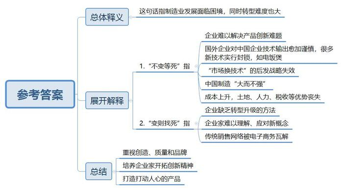
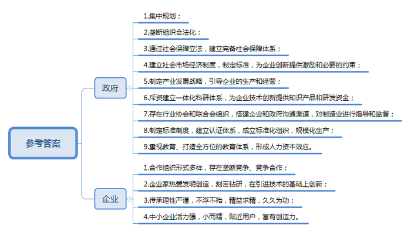
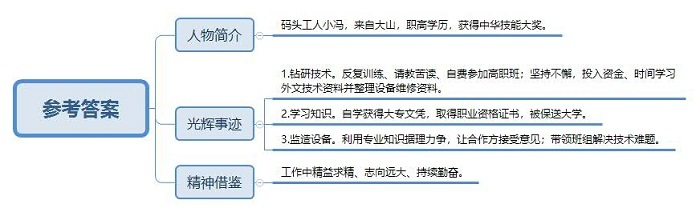
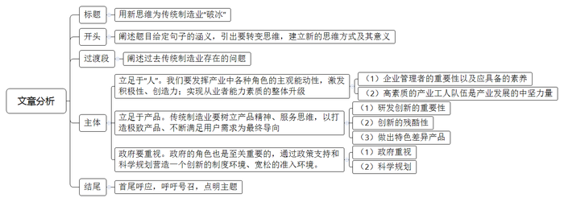

# 2017年河南省公考 《申论》题

> 候选采集稿。参考答案及解析来自粉笔页面，不代表官方答案或真实高分答卷；来源使用许可与原卷对应关系仍需人工核实。

## 给定材料

### 材料 material-58b3676b8f0b7954

2017年春节期间，615万中国出境游客境外消费额达1000多亿元人民币，人均消费是其他国家游客的3.5倍，从奢侈品到电饭煲，无所不买。

前些年在东京的秋叶原，满大街都是拎着电饭煲的中国游客。日本的电饭煲真的有那么神奇吗？有关专业人士介绍到，日本电饭煲的内胆在材料上有很大的创新，煮出来的米饭粒粒晶莹，不会黏糊，真的不错，而中国目前还解决不了这个问题。美的从1993年开始生产电饭煲，它与日本三洋合作，引进模糊逻辑电脑电饭煲项目，逐渐成为国内市场的领先者。近些年来，随着市场占比的反转，竞合关系发生改变，日本公司对中国企业的技术输出变得越来越谨慎，很多新技术对中国企业实行封锁，比如电饭煲就是这样。

也就是说，多年来一些领域的“中国制造”所推行的用“市场换技术”的后发战略已经失效。类似情况还发生在纳米水离子吹风机、比普通钢菜刀耐磨60倍的陶瓷菜刀、LED超声波电动牙刷等产品上。

中国是名副其实的制造业大国，有约220种工业品产量居世界第一。但曾经旺盛了二十多年的“中国制造”，如今却陷入了彷徨。千亿元购买力“肥水外流”，反映了我国一些领域的中国制造“大而不强”的尴尬。无论是国内市场还是国际市场，随着各项成本的抬升，“中国制造”的土地、人力、税收等优势逐渐丧失。虽然“转型升级”的危机警报，已在制造业拉响了很多年，但绝大多数的局中人都束手无策。近年来，智能硬件、3D打印、机器人、“第四次工业革命”等新概念让几乎所有50后、60后企业家半懂不懂、惊慌失措。多年来，中国企业采取各种策略，构筑了多层级、金字塔式的销售网络。可面对阿里巴巴、京东等电子商务平台把信息流和物流全数再造，渠道优势已被瓦解……

有专家判断，若再不改变，照此发展下去，一代制造业者实已踏在生死攸关的深渊边缘，正面临着“不变等死，变则找死”的发展困境。

### 材料 material-0fdb2ff544261269

德国只有8000多万人口，却创造出2300多个世界品牌。德国的机械、化工、电器、光学产品，乃至厨房用具、体育用品等几乎都是世界上质量过硬的产品，“德国制造”成为了精品的代名词。

居于世界领先地位的“德国制造”几乎涉及所有的制造部门，包括传统制造业、新兴能源、绿色环保产业等，1990年之前，德国近40%的就业岗位与制造业有关。汽车制造业被誉为德国“工业中的工业”，德国是欧洲最大的乘用车生产商。德国化学品制造业几乎垄断了全球化学制品的生产和销售。

德国创造的世界精品，最为熟悉的莫过于“德系汽车”众多闻名遐迩的经典品牌：奔驰、迈巴赫、宝马、大众、奥迪和保时捷等。几乎是行行出状元，业业有经典。

德国制造业主要集中规划在莱茵河流域、斯图加特等地。北莱茵——威斯特法利亚地区集中了汽车、生物科技、化学、能源、环境技术、电子、机器设备制造等15个产业，且聚集了众多的中小型企业；巴伐利亚地区集中了宝马集团、西门子公司、奥迪公司、阿迪达斯公司等；许多著名企业则把总部设在了巴登——符腾堡地区，如戴姆勒·奔驰集团、保时捷公司以及欧洲最大的软件企业思爱普公司等。

到上世纪90年代，德国合法存在的垄断组织形式之一卡特尔有200多个。共同利益集团的合作组织形式也同时存在，它们主要存在于化学和药品行业，主要有染料利益共同集团（I.G.）和I·G·法本公司。各种行业协会，如德国机械设备制造业联合会（VDMA）、德国汽车工业协会（VDA）等，也被视为机器设备、汽车制造业等的产业合作形式。产业内部采取卡特尔和共同利益集团的合作组织形式，是德国制造业领域应对国际竞争对手的有效办法。垄断竞争的市场结构存在于化学品和药品制造、电气和电信、汽车制造等部门，而竞争合作存在于机器设备制造、信息、服务产业等。

### 材料 material-f6c9025b9d17a535

小冯是一名“80后”的码头工人，十几年前从大山里走出来，只有职高学历的他，通过自身的努力，从X市“技术状元”到全国劳模，他头顶着无数的荣誉，但从未停下脚步，始终认真钻研，一举摘取我国技能界最高奖——中华技能大奖。

1997年，小冯来到X市港务集团。看到宽阔的大海，高耸的龙门吊，他既震撼又兴奋，但当他看到师傅手中的工具时又沮丧了，因为他对龙门吊、桥吊这些码头巨型设备几乎一窍不通。

“不知道可以学，通过学习我一定能做好！”小冯坚信。为了尽快掌握技术，他刻苦钻研，反复训练，成了工作上的“拼命三郎”。工作之余，别的工友在打扑克、侃大山、玩网游，他不是在向老师傅请教，就是在狭小宿舍内苦读。他还用半年的工资自费报名参加高级技工学校高职班，每天下班骑1个小时的自行车赶到学校学习。

“你只是个打工的，混混日子就好啦。”看着小冯的认真劲，有人揶揄他，但小冯却坚持不懈。

为了弄懂外文技术资料，小冯一咬牙，拿出半个月工资买了一个“文曲星”，对着图纸一字一句注释，花了半年时间，把一大堆外文资料整理成一套完整的设备维修资料，连一些复杂的专业技术参数也都清清楚楚。

“知识是一辈子都学不完的。我虽然是个打工的，但不能混日子。我要在以后几十年里，把该掌握的知识钻透学精。”小冯通过自学，拿到了大专文凭，取得高级钳工、计算机操作员等数十个职业资格证书。他还被保送到中国劳动关系学院劳模本科班脱产学习两年，圆了大学梦。

一次，公司派小冯到一家德企在华投资的设备制造厂监造8台总价值6000万元的龙门吊。由于德方的偏见，一开始，小冯提出的意见得不到落实。小冯利用自己扎实的专业知识据理力争，在调试工程师面前，他自己动手调试设备，动作规范到位，纯熟精湛。两位德国工程师大为折服，根据他提出的意见全部做了整改。设备交货之前，德国工程师拍着他的肩膀，用不太流利的中文说：“小伙子，好样的，看来中国不仅有现代化的港口，更有掌握现代化港口技术的工人。”

小冯带领班组解决了传统的龙门吊作业噪音大、耗能高的问题；完成设备远程监控系统的改造，解决了生产设备实时监控、故障报警、设备维护等难题；领衔革新理货模式，减少了传统人工理货模式存在的人为差错和遗漏。

行源于心，心源于志。我国最古老的典籍《尚书》中就有“功崇惟志，业广惟勤”之语。要取得崇高的功勋，在于有远大的志向；要完成宏大的事业，在于有持续的勤奋。“为者常成，行者常至”，精益求精，尽善尽美，千百年来，这种精神激励着无数仁人志士取得了一个又一个骄人的成就，也是无数成功人士人生的鲜明写照。有位哲人说：“一个人追求的目标越高，他的才力就发展得越快，对社会就越有益。”无论何人，概莫能外。一个人是如此，一个团队也是如此。

## 题目

### 第 1 题

**“给定资料**1**”中提到，一代制造业者正面临“****不变等死，变则找死****”的发展困境。请谈谈你对划线句子的理解。（20分）**

关联材料：material-58b3676b8f0b7954

作答要求：

要求：全面、准确、深入；不超过250字。

### 第 2 题

**“德国制造”成为精品的代名词，离不开政府和企业的共同努力。请根据“给定资料**2**～**3**”，对此进行概括。（25分）**

关联材料：material-0fdb2ff544261269

作答要求：

要求：紧扣材料，全面准确，条理清晰；不超过350字。

### 第 3 题

**X市港务集团准备宣传小冯的先进事迹，请结合“给定资料**5**”，拟写一份宣传提纲。（15分）**

关联材料：material-f6c9025b9d17a535

作答要求：

要求：层次分明，简明扼要，有逻辑性；不要求格式；不超过200字。

### 第 4 题

**“给定资料**6**”中提到“****一旦新的思维方式建立起来，许多旧问题就会自动消失。****”请结合你对这句话的思考，参考“给定资料”，联系实际，自拟题目，写一篇文章。（40分）**

关联材料：material-58b3676b8f0b7954

作答要求：

要求：观点明确，内容充实，结构完整，语言流畅；总字数1000～1200字。

## 答案与解析

第 1 题

**参考答案（粉笔题库参考内容）**

这句话指制造业发展面临困境，同时转型难度也大。

1.“不变等死”指：企业难以解决产品创新难题，国外企业对中国企业技术输出愈加谨慎，很多新技术实行封锁，如电饭煲。“市场换技术”的后发战略失效，中国制造“大而不强”；成本上升，土地、人力、税收等优势丧失。

2.“变则找死”指：企业缺乏转型升级的方法；企业家难以理解、应对新概念，传统销售网络被电子商务瓦解。

因此，重视创造、质量和品牌。培养企业家开拓创新精神，打造打动人心的产品。

**解析**

**参考答案说明：**按照词句解释题的内在逻辑，本题除了要写对“不变等死，变则找死”的解释，再展开解释，最后进行总结之外，还需要加上“一代制造业者面临诸多发展困境：”“一方面”“另一方面”“因此”等连接词承接上下文。

**考点**：考点词句解释类

**来源**：来源2017年河南省公考 《申论》题

第 2 题

**参考答案（粉笔题库参考内容）**

政府：一、集中规划；二、垄断组织合法化；三、通过社会保障立法，建立完备社会保障体系；四、建立社会市场经济制度，制定标准，为企业创新提供激励和必要的约束；五、制定产业发展战略，引导企业的生产和经营；六、斥资建立一体化科研体系，为企业技术创新提供知识产品和研发资金；七、存在行业协会和联合会组织，搭建企业和政府沟通渠道，对制造业进行指导和监督；八、制定标准制度，建立认证体系，成立标准化组织，规模化生产；九、重视教育、打造全方位的教育体系，形成人力资本效应。

企业：一、合作组织形式多样，存在垄断竞争、竞争合作；二、企业家热爱发明创造，刻苦钻研，在引进技术的基础上创新；三、传承理性严谨，不浮不殆，精益求精，久久为功；四、中小企业活力强，小而精，贴近用户，富有创造力。

**解析**

**参考答案说明：**答案根据“政府”“企业”这两个不同主体进行了分条撰写。且每条要点内容上没有交叉。

  

**考点**：考点概括措施类

**来源**：来源2017年河南省公考 《申论》题

粉笔申论页面对本题只提供「解析视频」入口，该入口是会员推广位，页面无视频地址与文字解析。

第 3 题

**参考答案（粉笔题库参考内容）**

一、人物简介：码头工人小冯，来自大山，职高学历，获得中华技能大奖。

二、光辉事迹：1.钻研技术。反复训练、请教苦读、自费参加高职班；坚持不懈，投入资金、时间学习外文技术资料并整理设备维修资料。2.学习知识。自学获得大专文凭，取得职业资格证书，被保送大学。3.监造设备。利用专业知识据理力争，让合作方接受意见；带领班组解决技术难题。

三、精神借鉴：工作中精益求精、志向远大、持续勤奋。

**解析**

**参考答案说明：**本题只写了正文。其中正文分别按照开头（主要对小冯的背景进行介绍）、主体（主要写到了小冯的具体做法）、结尾（主要写到了小冯的事迹中值得我们借鉴的精神）的结构展开。并对同类要点进行了合并，精简了字数。

**考点**：考点宣传类

**来源**：来源2017年河南省公考 《申论》题

粉笔申论页面对本题只提供「解析视频」入口，该入口是会员推广位，页面无视频地址与文字解析。

第 4 题

**参考答案（粉笔题库参考内容）**

**用新思维为传统制造业“破冰”**

哲学家维特根斯坦说过：“一旦新的思维方式建立起来，许多旧问题就会自动消失。”这句话说明了面临复杂问题时，要抛开表象、转变思维、解放思想，回归到“人”的层面，转换分析问题的角度，从而更好地解决问题。这句话对处于瓶颈期的中国传统制造业而言具有重大的指导意义。

当前，很多人对于传统制造业“唱衰”，认为其是夕阳产业。的确，我国传统制造业目前正处于发展的瓶颈期，产业整体大而不强，面临着成本上升、技术落后、经营策略陈旧等尴尬状况，低端失守、高端乏力；国外对我们实施的技术封锁更是让现实雪上加霜。但是，我们要看到，传统制造业产品的市场需求始终存在。在我国制造业面临困境时，德国、日本等国家的同类产品始终热销。所以，问题并非在于产业上。中国传统制造业要发展，需要重新审视自身的问题，建立新思维，清除发展障碍。

我们要认识到，产业发展的真正动力在于其背后的“人”，所以，**我们要发挥产业中各种角色的主观能动性，激发积极性、创造力。实现从业者能力素质的整体升级，是破解制造业落后的前提**。

企业的管理者对于企业的影响是最为深刻的，管理者的思想往往就是企业的发展方向，管理者的眼光决定企业发展的战略部署和企业的未来。现代企业家只有具备企业管理知识、改革创新精神，方能让企业在发展的轨道上越走越远。因此，培养出一批现代企业家，是目前制造业发展的重中之重。除此之外，高素质的产业工人队伍更是产业发展的中坚力量，这种高素质，既表现在过硬的职业技能，更表现在爱岗敬业、严谨细致、肯于钻研等职业精神。德国制造的成功，很大程度上归功于匠人对产品品质的卓越追求，以及行业中严谨理性、精益求精的文化。

当然，传统制造业是否能够在惨烈的现实中成功突围，终究还是要用产品说话。产品中蕴含的先进科技、更加优质的用户体验以及差异化的产品内涵，会直接影响消费者“用脚投票”的消费行为。**因此，传统制造业要树立产品精神、服务思维，以打造极致产品、不断满足用户需求为最终导向**。

对于以技术为驱动的科技企业而言，研发创新就是它们生存发展的根基。科技产品领域的创新是残酷的，因为所有的差距都会在信息化的今天直接呈现给所有用户。以手机这种最为大众化的产品为例，每一款手机产品推出后，随手可下载的测评软件和众多数码测评媒体，会以一种“赤裸”的方式，将它的参数、性能、体验等开放给所有人。在这样的情况下，不创新就意味着死亡。即使是“传统”的产品，也还是可以做出特色、做出差异。同样是居家必备的菜刀，“双立人”就与其他产品做出了差异，可能只是一处处看似小小的调整，就能让用户获得更好的握持感、更美观的造型、更稳定的质量，而这背后可能就有无数次的尝试。对产品技术、服务等方方面面进行用心的打磨，才是让消费者认可的“迂回的捷径”。

**在制造业发展新思维、新路径的构建过程中，政府的角色也是至关重要的**。在市场经济的条件下，虽然政府不宜直接干涉经济的运行，但可以通过其他方式来引领制造业转型升级。**政府一方面要充分重视制造业升级和技术创新的价值**，通过对相关领域的支持来促进制造业发展，如在教育事业中加强对科技创新人才与职业工人的培养力度；**另一方面，还可以进行科学规划，健全法律法规，以完善的顶层设计来引领制造业的发展**。同时，在建设“服务型政府”的背景下，**更应当做好对制造业的相关服务工作**，为企业发展提供宽松、友善的环境。

即使认清传统制造业发展的“症结”，它的升级改造也不能一蹴而就，而是需要努力、沉淀、厚积薄发。但是，只要我们坚定方向，相信制造业的春天必将来临！

**解析**

**文章分析**

**用新思维为传统制造业“破冰”**

【**标题的优点**：标题突出了文章主题，即“新的思维方式”并且点明了对“传统制造业的积极作用”，使文章主题清晰。】

（1）哲学家维特根斯坦说过：“一旦新的思维方式建立起来，许多旧问题就会自动消失。”这句话说明了面临复杂问题时，要抛开表象、转变思维、解放思想，回归到“人”的层面，转换分析问题的角度，从而更好地解决问题。（2）这句话对处于瓶颈期的中国传统制造业而言具有重大的指导意义。

【**开头的优点：**★内容方面。范文的开头是紧扣“新的思维方式”这一主题展开的。开头第一句话点出题干给定句子，并进行解释，做到了紧扣主题。其次，对“新的思维方式”这一主题进行了分析阐述：（1）先解释了“新的思维方式”及题干句子的具体含义；（2）点明这句话对制造业发展的作用。】

当前，很多人对于传统制造业“唱衰”，认为其是夕阳产业。的确，我国传统制造业目前正处于发展的瓶颈期，产业整体大而不强，面临着成本上升、技术落后、经营策略陈旧等尴尬状况，低端失守、高端乏力；国外对我们实施的技术封锁更是让现实雪上加霜。但是，我们要看到，传统制造业产品的市场需求始终存在。在我国制造业面临困境时，德国、日本等国家的同类产品始终热销。所以，问题并非在于产业上。中国传统制造业要发展，需要重新审视自身的问题，建立新思维，清除发展障碍。

【**过渡段****的优点：**本段阐述过去传统制造业存在的问题以及未来制造业发展方向，起到承上启下的作用。】

我们要认识到，产业发展的真正动力在于其背后的“人”，所以，**我们要发挥产业中各种角色的主观能动性，激发积极性、创造力。实现从业者能力素质的整体升级，是破解制造业落后的前提**。

（1）企业的管理者对于企业的影响是最为深刻的，管理者的思想往往就是企业的发展方向，管理者的眼光决定企业发展的战略部署和企业的未来。现代企业家只有具备企业管理知识、改革创新精神，方能让企业在发展的轨道上越走越远。（2）因此，培养出一批现代企业家，是目前制造业发展的重中之重。除此之外，高素质的产业工人队伍更是产业发展的中坚力量，这种高素质，既表现在过硬的职业技能，更表现在爱岗敬业、严谨细致、肯于钻研等职业精神。德国制造的成功，很大程度上归功于匠人对产品品质的卓越追求，以及行业中严谨理性、精益求精的文化。

【**论述段****1****的优点**：★观点句：范文的观点句是紧扣“新的思维方式”这一文章主题提出的。形式上，它在段首处直接写出，位置突出，容易被发现；内容上，关键词突出，内容要点明确，可以明显看出它是从“人”的角度入手，指出如何运用新的思维方式促进传统制造业发展。★论述内容：本段主要围绕“用新的思维方式促进制造业发展，真正动力在于人”，介绍了：（1）企业管理者的重要性以及应具备的素养；（2）高素质的产业工人队伍是产业发展的中坚力量。注意：以上两个方面的内容都是紧扣观点句“要发挥产业中各种角色的主观能动性，激发积极性、创造力。实现从业者能力素质的整体升级，是破解制造业落后的前提”进行分析论述的，针对性强、内容层次丰富。】

当然，传统制造业是否能够在惨烈的现实中成功突围，终究还是要用产品说话。产品中蕴含的先进科技、更加优质的用户体验以及差异化的产品内涵，会直接影响消费者“用脚投票”的消费行为。**因此，传统制造业要树立产品精神、服务思维，以打造极致产品、不断满足用户需求为最终导向**。

（1）对于以技术为驱动的科技企业而言，研发创新就是它们生存发展的根基。（2）科技产品领域的创新是残酷的，因为所有的差距都会在信息化的今天直接呈现给所有用户。以手机这种最为大众化的产品为例，每一款手机产品推出后，随手可下载的测评软件和众多数码测评媒体，会以一种“赤裸”的方式，将它的参数、性能、体验等开放给所有人。在这样的情况下，不创新就意味着死亡。即使是“传统”的产品，（3）也还是可以做出特色、做出差异。同样是居家必备的菜刀，“双立人”就与其他产品做出了差异，可能只是一处处看似小小的调整，就能让用户获得更好的握持感、更美观的造型、更稳定的质量，而这背后可能就有无数次的尝试。对产品技术、服务等方方面面进行用心的打磨，才是让消费者认可的“迂回的捷径”。

【**论述段****2****的优点**：★观点句：范文的观点句是紧扣“新的思维方式”这一文章主题提出的。形式上，位置突出，容易被发现；内容上，关键词突出，内容要点明确，可以明显看出它是从“产品”的角度入手，指出如何运用新的思维方式促进传统制造业发展。★论述内容：本段主要围绕“用新的思维方式促进制造业发展，需要在产品上下功夫”，介绍了：（1）研发创新的重要性；（2）创新的残酷性；（3）做出特色差异产品。注意：以上三个方面的内容都是紧扣观点句“传统制造业要树立产品精神、服务思维，以打造极致产品、不断满足用户需求为最终导向”进行分析论述的，针对性强、内容层次丰富。】

**在制造业发展新思维、新路径的构建过程中，政府的角色也是至关重要的**。在市场经济的条件下，虽然政府不宜直接干涉经济的运行，但可以通过其他方式来引领制造业转型升级。（1）**政府一方面要****充分重视制造业升级和技术创新的价值**，通过对相关领域的支持来促进制造业发展，如在教育事业中加强对科技创新人才与职业工人的培养力度；（2）**另一方面，****还可以进行科学规划，健全法律法规，以完善的顶层设计来引领制造业的发展**。同时，在建设“服务型政府”的背景下，**更应当做好对制造业的相关服务工作**，为企业发展提供宽松、友善的环境。

【**论述段****3****的优点**：★观点句：范文的观点句是紧扣“新的思维方式”这一文章主题提出的。形式上，位置突出，容易被发现；内容上，关键词突出，内容要点明确，可以明显看出它是从“政府”的角度入手，指出如何运用新的思维方式促进传统制造业发展。★论述内容：本段主要围绕“用新的思维方式促进制造业发展，需要政府发力”，介绍了：（1）政府重视；（2）科学规划。注意：以上两个方面的内容都是紧扣观点句“在制造业发展新思维、新路径的构建过程中，政府的角色也是至关重要的”进行分析论述的，针对性强、内容层次丰富。】

即使认清传统制造业发展的“症结”，它的升级改造也不能一蹴而就，而是需要努力、沉淀、厚积薄发。但是，只要我们坚定方向，相信制造业的春天必将来临！

【**结尾的优点：**范文的结尾回扣了“新的思维方式”这一主题，再次重申了新的思维方式对制造业发展的重要性。】

**考点**：考点文章写作题

**来源**：来源2017年河南省公考 《申论》题

粉笔申论页面对本题只提供「解析视频」入口，该入口是会员推广位，页面无视频地址与文字解析。

