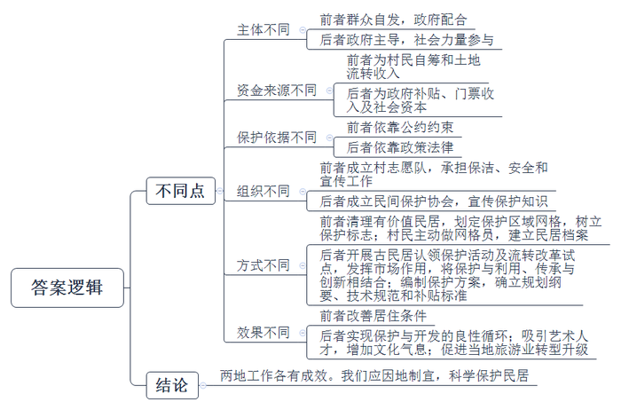
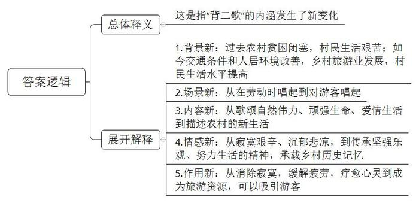
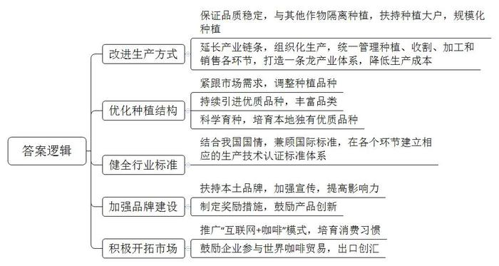
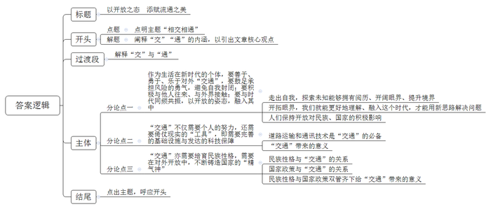

# 2019年公务员多省联考《申论》题（河南县级、普通选调卷）

> 候选采集稿。参考答案及解析来自粉笔页面，不代表官方答案或真实高分答卷；来源使用许可与原卷对应关系仍需人工核实。

## 给定材料

### 材料 material-b9bf663314345e64

“以前啊，这里很多老房子被废弃，濒临倒塌。屋顶残破，梁柱上出现斑斑点点的虫眼……像奄奄一息的病人。”XN村支书老王对从省里来调研的小姚介绍着，“屋里不亮堂，杂草丛生，墙体垮塌，有的连横梁都断裂了。”

“那时候，这儿的老房子基本没人住。我也跟着儿子去了县城。时不时回来一趟，可村子都空了。”村民吴大妈回忆起也不无叹息，“修得再漂亮，没人住也就是个屋子，没有人味儿！”

作家阿敏是XN村的租客，她已在村里住了些年头了。“我曾经离开过一段时间，因为那时候这里人越来越少，没有种田、犁地、收谷、摘果等生产活动，没有欢歌，没有笑语。这里成了‘空心村’，没有真正的生活气息，没有我想要的乡村民居的味道。”

“再不行动起来，要不了几年，我们村就将不复存在了！”当时，这样的警告在老王脑袋里响起。“我们的房子大部分不属于文物级别，没有办法申请经费修葺。但我们自己也得想办法，赶紧行动起来啊。”

2010年春，在老王和本村热心村民老冯的牵头下，全村人合力捐款捐物，自筹4万多元，对村里最具特色和保护价值的Y堂大宅院正屋破损部位进行了集中修缮，制定了以“保护环境、不准私占、清理整洁、损坏赔偿”等为基本内容的大宅院保护公约。此后，村民们成立了村志愿队，不仅承担了公共区域的保洁工作，更常常挨家挨户地排查危房安全隐患，宣传自用民屋的日常修葺维护常识。“房子嘛，最怕水和火。没有人住就容易坏掉。人住着，房子有点啥问题也能及时察觉。本来随便弄弄就能解决的小问题，因为没人，几年下来，就成了大问题了。”

XN村请相关部门对全村有文物保护、旅游等方面价值的民居进行了清理，并划定了保护区域网格，树立了保护标志。而村民们更是主动地当起了网格员，协助建立各栋民居的档案。

这几年，返乡的人越来越多，村里又有了生气。人回来了，自然是要居住的，这时候再不行动就没有道理了。

“现在村里用土地流转办联合社赚到的钱给大家改善了供水供电和通讯条件，住起来确实比以前舒服多啦。”吴大妈说道，“能住得舒服，谁不爱自己的老家呢？”

### 材料 material-35271da54f51b3a1

“这儿要是高速公路修通了，我们可怎么办？”十几年前，年近六旬的“背二哥”（山区的力夫）老秦问记者小李，他的脸上写满疲惫和沧桑。老秦的家在地处川鄂茶盐古道上的CX村，该村的人祖祖辈辈都是“背二哥”，都是靠背背篼卖力气吃饭。因为深度贫困和交通的闭塞，CX村在该地区非常“有名”。是啊，公路一通，车轮一转，“背二哥”们靠什么吃饭？老秦看小李没有回答，深叹了一口气，用嘶哑的喉咙唱起了歌：“长江呃，河来哟，三峡哦，峡来哟，我是三峡哟，‘背二哥’罗哈，太阳送我哟上巫山，月亮陪我哟下江河……”这就是“背二歌”。原来，三峡两岸，山高路陡，行走艰难，“背二哥”一声吼起，“背二歌”高亢激昂，以翻山越岭、穿云破雾之势，响彻川鄂茶盐古道。“背二歌”不是刻意唱给谁听的，它本身就是“背二哥”劳动的一部分。它是他们为了消除寂寞，缓解疲劳而唱的，是寂寞和艰辛之中自然升华出的歌。“背二歌”调子是豪迈、高亢、激越的。但是不得不承认，在这调子背后，它却有着沉郁、悲凉的本质：“背二歌”承载着“背二哥”的哀怨与艰辛，承载着三峡两岸的陡峭与苍凉，承载着道路的漫长和寂寞；它充满着无奈、心酸和苦涩，也包含着他们对幸福生活的希冀。在抬头见天、低头见峡的山谷里，“背二歌”和三峡古韵中的民歌、情歌、哭嫁歌、花轿歌一起，在日子里飘扬，成为包括“背二哥”在内的三峡人们心中疗伤与养心的良药。那是对自然伟力的祭歌，对顽强生命的赞歌，对爱情和生活的颂歌。

到了2018年，高速公路也延伸到这儿了，曾经害怕路通地平影响生计的“背二哥”们，如今又是何般模样？走进CX村，记者小李发现它和三峡两岸所有村一样公路纵横；更为惊讶的是，一条条水泥板铺就的人行便道从公路两边伸向每一户村民家中，除了上坡下田的路，村里几乎看不到一条土路。见到老秦时，他正在家里教儿子和一群年轻人唱“背二歌”。“调子是老样子，但歌词被儿子他们这些年轻人改啦。”老秦告诉我，村里通了公路，河上修起了水库，老家改天换地了。儿子不再外出打工，而是回到老家买了一艘小游艇，搞起了农家乐，日子过得红红火火。生活好起来了，但关于“背二哥”的记忆不能淡漠。那种在如苦水般的日子里依旧坚强乐观、努力生活的精神不能丢。为了让更多的人来到这方古道，为了留住关于古道的深刻记忆，儿子还专门要他们这些老“背二哥”教他们唱“背二歌”。他们学会了，要唱给游客们听，让新的欢快的“背二歌”飞扬到更远的远方。

“小小游艇荡碧波，我是年轻‘背二哥’，背山背水背太阳，古道春风唱新歌……”

时代向前，老人谢幕，新人上场。在新时代，“背二歌”正以新的方式被新的“背二哥”们唱响。

### 材料 material-05a1b40a487d5ce1

“Y省的咖啡豆是天赐的礼物。”这是一位外国友人对Y省咖啡豆的评价。据统计，Y省大部分咖啡豆种植区的海拔都在1000米以上，肥沃的土壤，充足的光照和降雨，明显的昼夜温差，让其所产咖啡豆颗粒饱满，口味醇厚，堪称天地厚养。

“Y省的咖啡豆，可以是高品质的。但这看运气。”咖啡爱好者小李说，“我喝到过有顶级口感的，也喝到过如炒糊的黄豆的。而它们都来自Y省同一产地。”的确，就拿Y省咖啡种植大户B市、P市来说，其仍然以散户种植为主。这些咖啡树的“邻居”可能是烟草、水果、玉米等等。咖啡果本身是水果，风一吹，各种植物的花粉漫天，以这样简单粗暴的方式种植，咖啡豆的品质怎么可能稳定呢？

Y省某著名的咖啡烘焙师对记者说：“我们的咖啡产业，主要还是在做咖啡豆供给，这属于产业链底端。种植的搞种植，烘培的搞烘培，各自为政，还要相互挤压利润空间。”

Y省的咖啡豆在国际上确实有些名气，但这种名气并不属于当地品牌，它只是在Y省生长出来的产品的属性。很多著名连锁咖啡店使用的咖啡豆就是产自Y省的，但大部分人并不认为自己在喝Y省的咖啡，而是在喝咖啡店的咖啡。

现阶段中国人均咖啡消费量远落后于世界的平均水平。不过，近几年“互联网+咖啡”模式进一步发展，一部分人有了喝现磨咖啡的习惯。同时，即饮咖啡市场也在兴起。较之速溶咖啡，现磨、即饮对口感要求高，更倾向于使用阿拉比卡豆（咖啡豆的一种），而Y省种植的主要就是阿拉比卡豆。

“我们不想种咖啡豆了。”Y省咖农老王对记者抱怨着，“我们的咖啡豆价格低，但采摘成本却高很多。所以，我们不赚钱，有时还赔本。我在电视上看到，有的地方的农产品是一个村，甚至几个村一起统一种植、统一收割、统一标准加工，再‘组团进城’销售。我们要是也能那样就好了。”

当然也有好消息：2015年，两条中欧国际货运班列开通，这促进了Y省咖啡出口贸易井喷式增长。当年，Y省咖啡创汇逾4亿美元，比上年翻了将近一番。可不少咖农还是担心：“我们隔壁可是世界速溶咖啡产量最大的国家啊，会不会它们顺着国际货运列车，来抢我们的生意？”

“我们咖啡单产高，这应是优势，而不是我们产能过剩的原因。但在很早之前，我们就已有低端产品产能过剩问题。”Y省政策研究室的工作人员说，“我们并没有从‘中国咖啡市场高速增长’中得到多少利润。举个例子，我们供给某外国品牌咖啡店的咖啡豆价格是25元一公斤；而他们在中国卖一杯咖啡就要价30元。其实，我们已建成了国内最大的焙炒咖啡生产线，还有几十个咖啡品牌以及大量的满怀热情的咖啡产业人才，这些都是我们咖啡业发展的条件。”

据统计，世界咖啡的消费增长速度大致维持在2.5%，而中国消费增长速度高达25～30%。考虑到人口基数，这个市场潜力大到无法想象。

“我们有非常难得的微环境、微气候，它适宜种植利润丰厚的微批次精品咖啡豆。”某咖啡品牌主理人小雯感叹道，“可什么是精品，怎样才算微批次？我们用的是国外的概念和标准。而从种植到加工生产经营企业，有执行国际咖啡组织认证标准的，有执行欧盟认证标准的，有执行美国、日本认证标准的，可谓五花八门。为什么我们不制定符合我们国情，又兼容于国际的标准呢？不行动起来，我们还是会一直被牵着鼻子走。”

标准多等于无标准，品牌杂导致无名牌。目前，因咖啡产品生产技术认证标准不成体系，Y省咖啡产业从农业生产到工业加工，各个企业处于“八仙过海，各显神通”的境地。“一些浑水摸鱼、以次充好的经营者忽悠了消费者，也伤害了我们这些老老实实做咖啡的人。”小雯不无痛心地说。

其实，对于咖啡产业，Y省政府是高度重视和支持的。政府协助一些咖啡种植庄园从全球主产区引进瑰夏等优质咖啡品种，建起了世界咖啡博览园和Y省咖啡种子基因库，专注改善Y省咖啡品种单一的现状。经过近五年的种植培育，Y省某庄园已经产出了对当地环境、气候更加适应，风味更佳的二代品种。“这些成功的行动说明我们的地理环境和技术是很棒的，说明中国有好咖啡，就在我们这儿。”一位当地的咖啡庄园主人说道。

小陈是Y省某咖啡品牌创始人，他所经营的咖啡网店的年营收已破千万元，是国内最著名、最成功的咖啡电商之一。“曾经有个记者朋友用‘三杯咖啡’形容我的咖啡电商创业历程。第一杯是苦后回甘，第二杯是保持原味本色，第三杯是着力花式调配。其实，在我心中就一个字——动。”自称“咖啡创业青年”的小陈轻松地笑着，“千百万次地想‘要让全国都喜欢我们Y省的咖啡’，不如勇敢地迈出第一步，再踏踏实实地走下去。我们有得天独厚的资源禀赋，也有诸多后发劣势……所以，一切的一切都需要行动起来。

## 题目

### 第 1 题

**请结合****“给定资料**1**”和“给定资料**2**”，对比分析概括两地民居保护工作的不同之处。（25 分）**

关联材料：material-b9bf663314345e64

作答要求：

要求：概括全面，分析深入，条理清晰。字数不超过350字。

### 第 2 题

**请分析理解****“给定资料**4**”中划线部分“****新的方式****”的内涵。（15分）**

关联材料：material-35271da54f51b3a1

作答要求：

要求：全面、准确、深入；层次分明。字数不超过200字。

### 第 3 题

**为了促进咖啡产业的发展，****Y****省政府拟出台指导意见。请结合****“给定资料**5**”，提出可行性建议。（20 分）**

关联材料：material-05a1b40a487d5ce1

作答要求：

要求：有针对性，可行性强，不考虑格式。字数不超过300字。

### 第 4 题

**“给定资料**6**”中提到“****我们与世界相交，与时代相通，才能让一切保值增值，更添赋流通的美****”，请结合你对这句话的思考，参考“给定资料”，联系实际，自拟题目，写一篇文章。（40分）**

关联材料：material-b9bf663314345e64

作答要求：

要求：观点明确，内容充实，结构完整，语言流畅。总字数1000~1200字。

## 答案与解析

第 1 题

**参考答案（粉笔题库参考内容）**

不同点：

一、主体不同：前者群众自发，政府配合。后者政府主导，社会力量参与。

二、资金来源不同：前者为村民自筹和土地流转收入。后者为政府补贴、门票收入及社会资本。

三、保护依据不同：前者依靠公约约束。后者依靠政策法律。

四、组织不同：前者成立村志愿队，承担保洁、安全和宣传工作。后者成立民间保护协会，宣传保护知识。

五、方式不同：前者清理有价值民居，划定保护区域网格，树立保护标志；村民主动做网格员，建立民居档案。后者开展古民居认领保护活动及流转改革试点，发挥市场作用，将保护与利用、传承与创新相结合；编制保护方案，确立规划纲要、技术规范和补贴标准。

六、效果不同：前者改善居住条件。后者实现保护与开发的良性循环；吸引艺术人才，增加文化气息；促进当地旅游业转型升级。

两地工作各有成效。我们应因地制宜，科学保护民居。

**解析**

**参考答案说明：**本参考答案分别从“主体”“资金来源”“保护依据”“组织”“方式”“效果”等不同角度入手，对“民居保护工作”的不同点进行了比较，并总结性地给出了结论。

**考点**：考点对比分析类

**来源**：来源2019年河南省选调生考试《申论》题

粉笔申论页面对本题只提供「解析视频」入口，该入口是会员推广位，页面无视频地址与文字解析。

第 2 题

**参考答案（粉笔题库参考内容）**

这是指“背二歌”的内涵发生了新变化。

1.背景新：过去农村贫困闭塞，村民生活艰苦；如今交通条件和人居环境改善，乡村旅游业发展，村民生活水平提高。

2.场景新：从在劳动时唱起到对游客唱起。

3.内容新：从歌颂自然伟力、顽强生命、爱情生活到描述农村的新生活。

4.情感新：从寂寞艰辛、沉郁悲凉，到传承坚强乐观、努力生活的精神，承载乡村历史记忆。

5.作用新：从消除寂寞，缓解疲劳，疗愈心灵到成为旅游资源，可以吸引游客。

**解析**

**参考答案说明：**（1）思路方面，本参考答案按照词句解释题“总体释义+展开解释”的答题思路展开。（2）内容方面，一方面，本参考答案首先整体解释了“新的方式”具体的含义；接着从“背景”“场景”“内容”“情感”“作用”这五个方面对“背二歌”发生的新变化进行了分条撰写。另一方面，从形式上，为了体现答案的逻辑性，还加上了“过去……如今……”“从……到……”等连接词，使语句表达更流畅、自然。

**考点**：考点词句解释类

**来源**：来源2019年河南省选调生考试《申论》题

粉笔申论页面对本题只提供「解析视频」入口，该入口是会员推广位，页面无视频地址与文字解析。

第 3 题

**参考答案（粉笔题库参考内容）**

一、改进生产方式。保证品质稳定，与其他作物隔离种植，扶持种植大户，规模化种植；延长产业链条，组织化生产，统一管理种植、收割、加工和销售各环节，打造一条龙产业体系，降低生产成本。

二、优化种植结构。紧跟市场需求，调整种植品种；持续引进优质品种，丰富品类；科学育种，培育本地独有优质品种。

三、健全行业标准。结合我国国情，兼顾国际标准，在各个环节建立相应的生产技术认证标准体系。

四、加强品牌建设。扶持本土品牌，加强宣传，提高影响力；制定奖励措施，鼓励产品创新。

五、积极开拓市场。推广“互联网+咖啡”模式，培育消费习惯；鼓励企业参与世界咖啡贸易，出口创汇。

**解析**

**参考答案说明：**本参考答案从“改进生产方式”“优化种植结构”“健全行业标准”“加强品牌建设”“积极开拓市场”等五个不同的方面进行了分条撰写。各条要点之间在内容上是并列关系。

**考点**：考点提出对策类

**来源**：来源2019年河南省选调生考试《申论》题

粉笔申论页面对本题只提供「解析视频」入口，该入口是会员推广位，页面无视频地址与文字解析。

第 4 题

**参考答案（粉笔题库参考内容）**

**以开放之态** **添赋流通之美**

如今是个开放的、变化的时代，万物之间的联系深刻而广泛，事物的变化快速且凶猛。有人说，我们与世界相交，与时代相通，才能让一切保值增值，更添赋流通的美。的确，在这样一个时代，**封闭孤立、不思进取会注定走向没落。无论是一人一集体，还是一国一社会，都需要对外****“交****”“****通****”，**这样才能实现持续的发展。

**所谓的****“交”与“通”，****本义指对外交往的渠道，以及与他人的沟通。实质指空间上****保持开放的姿态，走出一人、一地、一国****，****与世界相连****；****时间上****紧跟时代的****发展、****与时俱进**、**突破自我、革旧维新。**

**作为生活在新时代的个体，要善于、勇于、乐于对外****“交通”，要鼓足承担风险的勇气，避免自我封闭；要积极与他人往来、与外界接触；要与时代同频共振，以开****放****的姿态，融入其中。**

**走出****自我时间与空间****，向未知和可能进军，****让人拥有阅历、沉淀与气质，让人****眼界****开阔****，境界****提升，变的开明、包容****。**任何人的认知都有局限，尤其是在这个变化的时代，新的知识、研究领域不断出现，封闭会让我们错过整个时代、整个世界。只有开拓眼界，才能**理解****、****适应、融入这个时代****，****破解乡村发展困局，****才能用新思路解决****旧****问题。**比如说，在城镇化、工业化浪潮的裹挟下，很多村庄日渐“空心化”，衰退着、凋零着，隐有“垂暮之态”。此时，多地通过现代化改造，改善人居环境，发展乡村旅游业……在传承中创新、在保护中开发，乡村也可以有人气、有活力、有效益。**只有****人人保持开放****的姿态****、学习的状态****、****进步的心态****，****才能与世界和谐共生，共建人类命运共同体****。**

**“****交通****”****不仅需要个人的努力，还需要倚仗现实的****“工具”，即需要完善的基础设施与发达的科技保障****。**道路运输工程能实现人员、物资的交流输送，通讯技术能实现信息的交互往来，这都是“交通”的必备利器。山头的基站、陆上的高铁、跨海的大桥、云上的飞机、太空中的卫星……这些道路运输工程和通信通讯技术，能跨越空间距离，快速勾连世界，提高“交通”效率；更能打通偏远断点，形成商品和信息的流通渠道，畅通经济血脉，让落后地区有发展机遇，让各地的资源优势转变为经济优势，还能重塑经济地理标志，形成国家经济发展的全新格局。

**“交通”亦需要培育民族性格，需要在对外开放中，不断铸造国家的“精气神”**。自信、谦逊、乐于分享的民族性格，是我们与世界同呼吸、共命运的“软实力”，是我国“交通”发展更为顺畅的“润滑剂”；敞开国门、对外开放的国家政策是适应全球化发展的“硬保障”，是应对闭关锁国、固步自封的“高压线”。“软硬兼施”能让斑斓文化、优质产品和细致服务走向世界，能让我们引入先进的发展模式、理念、技术，充分汲取其发展养分，为我所用。唯有此，才能让流动、个性的中国充满繁荣发展的活力，在世界舞台展现“中国性格”。

流通的美是奔涌向前、不断攀升的美，是生机勃勃、充满活力的美，是互联互通、相扶相助的美。下一个40年，我们将会在更加开放、融通中，走出独具特色的步伐。

**解析**

**文章分析**

**以开放之态** **添赋流通之美**

【**标题的优点：**首先，范文的标题“以开放之态 添赋流通之美”突出了“相交相通”这一主题。其次，形式上，文字简洁明快。】

（1）如今是个开放的、变化的时代，万物之间的联系深刻而广泛，事物的变化快速且凶猛。有人说，我们与世界相交，与时代相通，（2）才能让一切保值增值，更添赋流通的美。的确，在这样一个时代，（3）**封闭孤立、不思进取会注定走向没落****。无论是一人一集体，还是一国一社会，都需要对外****“交****”“****通****”，**这样才能实现持续的发展。

【**开头的优点：**★内容方面。范文的开头是紧扣题目给定的“相交相通”这一主题展开的。首先，开头开门见山点出主题，做到了主题明确。其次，对“相交相通”这一主题进行了分析阐述，指出了（1）介绍了当前的时代背景；（2）介绍了“相交相通”的意义；（3）介绍了事物封闭孤立的危害。★文字表达方面。长短句配合使用，使语言表达有节奏感；使用了“无论……，还是……”关联词，使语言表达有逻辑性。】

（1）所谓的“交”与“通”，本义指对外交往的渠道，以及与他人的沟通。（2）实质指空间上保持开放的姿态，走出一人、一地、一国，与世界相连；时间上紧跟时代的发展、与时俱进、突破自我、革旧维新。

【**过渡段的优点：**范文过渡段分析了“交”与“通”的含义等方面的内容，分别阐释了（1）“交”与“通”的本义；（2）“交”与“通”的实质含义。】

**作为生活在新时代的个体，要善于、勇于、乐于对外****“交通”，要鼓足承担风险的勇气，避免自我封闭；要积极与他人往来、与外界接触；要与时代同频共振，以开放的姿态，融入其中**。

（1）**走出自我时间与空间，向未知和可能进军****，****让人拥有阅历、沉淀与气质****，****让人眼界开阔，境界提升****，****变的开明、包容****。**任何人的认知都有局限，尤其是在这个变化的时代，新的知识、研究领域不断出现，封闭会让我们错过整个时代、整个世界。（2）**只有开拓眼界****，****才能理解、适应、融入这个时代****，****破解乡村发展困局****，****才能用新思路解决旧问题****。**比如说，在城镇化、工业化浪潮的裹挟下，很多村庄日渐“空心化”，衰退着、凋零着，隐有“垂暮之态”。此时，多地通过现代化改造，改善人居环境，发展乡村旅游业……在传承中创新、在保护中开发，乡村也可以有人气、有活力、有效益。（3）**只有人人保持开放的姿态、学习的状态、进步的心态****，****才能与世界和谐共生****，****共建人类命运共同体**。

【**论述段****1****的优点：**★观点句：范文的观点句是紧扣“相交相通”这一文章主题提出的。形式上，它在段首处直接写出，位置突出，容易发现。内容上，关键词突出，可以明显看出它是从“个人角度”入手，指出了“如何实现个人相交相通”的对策。★论述内容：（1）介绍了走出自我，探索未知能够拥有阅历、开阔眼界、提升境界；（2）介绍了开拓眼界，我们就能更好地理解、融入这个时代，才能用新思路解决问题；（3）介绍了人们保持开放对民族、国家的积极影响。注意：以上几个方面的内容都是紧扣“作为生活在新时代的个体，要善于、勇于、乐于对外‘交通’，要鼓足承担风险的勇气，避免自我封闭；要积极与他人往来、与外界接触；要与时代同频共振，以开放的姿态，融入其中”这个观点句进行分析论述的，论述的针对性强，内容层次丰富。最后，在论述方法和论据的选取上做到了讲道理、举例子相结合，做到了丰富多样。】

“交通”不仅需要个人的努力，**还需要倚仗现实的****“工具”，即需要完善的基础设施与发达的科技保障**。（1）道路运输工程能实现人员、物资的交流输送，通讯技术能实现信息的交互往来，这都是“交通”的必备利器。山头的基站、陆上的高铁、跨海的大桥、云上的飞机、太空中的卫星……这些道路运输工程和通信通讯技术，（2）能跨越空间距离，快速勾连世界，提高“交通”效率；更能打通偏远断点，形成商品和信息的流通渠道，畅通经济血脉，让落后地区有发展机遇，让各地的资源优势转变为经济优势，还能重塑经济地理标志，形成国家经济发展的全新格局。

【**论述段****2****的优点：**★观点句：范文的观点句是紧扣“相交相通”这一文章主题提出的。形式上，它在段首处直接写出，位置突出，容易发现。内容上，关键词突出，可以明显看出它是从“倚仗现实‘工具’”入手，指出了“实现相交相通的对策”。★论述内容：（1）介绍了道路运输和通讯技术是“交通”的必备；（2）介绍了“交通”带来的意义。注意：以上几个方面的内容都是紧扣“‘交通’不仅需要个人的努力，还需要倚仗现实的‘工具’，即需要完善的基础设施与发达的科技保障”这个观点句进行分析论述的，论述的针对性强，内容层次丰富。最后，在论述方法和论据的选取上做到了讲道理、举例子相结合，做到了丰富多样。】

**“交通”亦需要培育民族性格，需要在对外开放中，不断铸造国家的“精气神”。**（1）自信、谦逊、乐于分享的民族性格，是我们与世界同呼吸、共命运的“软实力”，是我国“交通”发展更为顺畅的“润滑剂”；（2）敞开国门、对外开放的国家政策是适应全球化发展的“硬保障”，是应对闭关锁国、固步自封的“高压线”。（3）“软硬兼施”能让斑斓文化、优质产品和细致服务走向世界，能让我们引入先进的发展模式、理念、技术，充分汲取其发展养分，为我所用。唯有此，才能让流动、个性的中国充满繁荣发展的活力，在世界舞台展现“中国性格”。

【**论述段****3****的优点：**★观点句：范文的观点句是紧扣“相交相通”这一文章主题提出的。形式上，它在段首处直接写出，位置突出，容易发现。内容上，关键词突出，可以明显看出它是从“培育民族性格”入手，指出了“实现相交相通的对策”。★论述内容：（1）介绍了民族性格与“交通”的关系；（2）介绍了国家政策与“交通”的关系；（3）民族性格与国家政策双管齐下给“交通”带来的意义。注意：以上几个方面的内容都是紧扣“‘交通’亦需要培育民族性格，需要在对外开放中，不断铸造国家的‘精气神’”这个观点句进行分析论述的，论述的针对性强，内容层次丰富。最后，在论述方法和论据的选取上做到了讲道理、举例子相结合，做到了丰富多样。】

【**论述段之间的关系**：★内容的内在逻辑：范文的论述段之间是依照“并列”的逻辑展开的。论述段1先写了“作为生活在新时代的个体，要善于、勇于、乐于对外‘交通’，要鼓足承担风险的勇气，避免自我封闭；要积极与他人往来、与外界接触；要与时代同频共振，以开放的姿态，融入其中”，论述段2写了“‘交通’不仅需要个人的努力，还需要倚仗现实的‘工具’，即需要完善的基础设施与发达的科技保障”，论述段3写了“‘交通’亦需要培育民族性格，需要在对外开放中，不断铸造国家的‘精气神’”。】

（1）流通的美是奔涌向前、不断攀升的美，是生机勃勃、充满活力的美，是互联互通、相扶相助的美。下一个40年，（2）我们将会在更加开放、融通中，走出独具特色的步伐。

【**结尾的优点**：范文的结尾回扣了“相交相通”这一主题。（1）再次提到“相交相通”这一主题；（2）发出了展望。】

**考点**：考点文章写作题

**来源**：来源2019年河南省选调生考试《申论》题

粉笔申论页面对本题只提供「解析视频」入口，该入口是会员推广位，页面无视频地址与文字解析。

