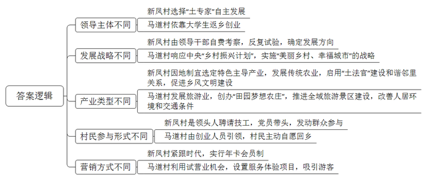
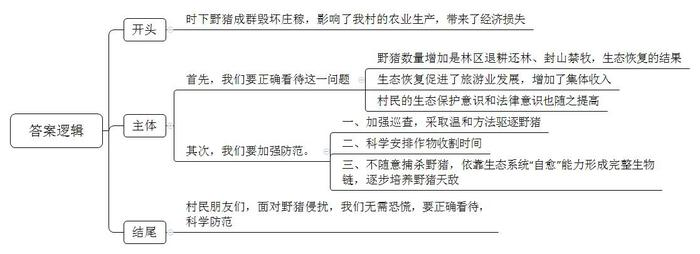
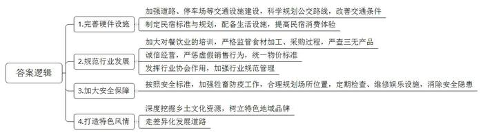
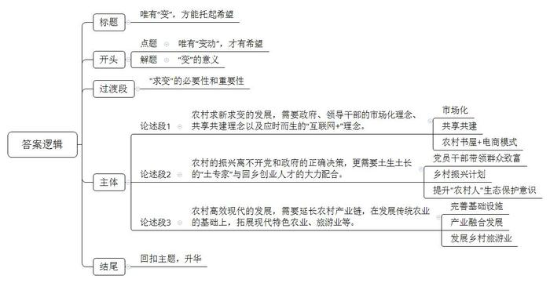

# 2019年公务员多省联考《申论》题（河南乡镇卷）

<!-- gwy:overview:start -->
> **河南 · 2019 · 申论 · 乡镇卷** ｜ 4 题 · 图片 4 处 · 答案随题折叠

导航：[题目](#题目) · [材料 1](#材料-1)
<!-- gwy:overview:end -->

> 候选采集稿。参考答案及解析来自粉笔页面，不代表官方答案或真实高分答卷；来源使用许可与原卷对应关系仍需人工核实。

## 给定材料

### 材料 1

走进新凤村，这里林木环绕、空气清新、道路整洁，民居井然有序。但在四年前，新凤村还是个破败萧条的贫困村。短短两年，这个曾经破败萧条的贫困村，为何会发生这样大的改变？笔者满怀好奇地向当地的同志问到：“新凤村的喜人局面从何而来？”对方笑答：“因为这里有一批‘土专家’。”他们都是土生土长的当地人，对社情民意清楚得很。这些“土专家”在脱贫攻坚中结合新凤村的实际，干了不少专业的事。

新凤村党支部书记老谭，今年51岁，是本村的种粮大户。担任书记后，看到村里的面貌依旧落后，乡亲们的生活依旧贫穷。他心急如焚，总想为乡亲们办点儿事。新凤村作为贫困村，产业发展滞后一直是该村脱贫致富的“绊脚石”。为此，2015年以来，老谭带领村社干部自费考察十余次，选定了适合本村发展的西瓜、二荆条辣椒和脆红李等三个主导产业项目。项目有了，谁来做“第一个吃螃蟹的人”？对此，群众都持观望态度。作为书记，老谭把自家的7.2亩土地作为“试验田”，还以高出市场价的价格承包村民土地300余亩，从外地引进种子、种苗，聘请技术人员指导，分片种上了西瓜、二荆条辣椒和脆红李。老谭为什么敢身先士卒做试验？照他的话说，“自己和泥土打了一辈子交道，虽然没有上过大学，但是喜欢钻研果蔬种植技术，对这方水土的脾性还是很了解。”身先士卒之际，老谭又接连组织召开党员大会，苦口婆心号召党员带头干。一批“党员试验田”很快建成。“党员试验田”里，西瓜、二荆条辣椒种植当年就可以见到效益，最初试种的脆红李三年后就进入丰产期，平均亩产有望达到3000公斤。见到“党员试验田”的效益后，乡亲们竞相种植。老谭不仅亲自当起“技术员”，还自费为村民提供种苗。如今，新凤村西瓜、二荆条辣椒和脆红李“三个一千亩”种植基地初成规模，将带动466户群众实现增收致富。

“我们这的土鸡，可好啦！”老秦是村里养鸡场的主人，一说到鸡，他就滔滔不绝。“在这，鸡全部都是传统养殖的。”他说，“过去由于交通闭塞，我们县的土鸡因为和外界交流少，品种特色保留得好。我们这里水好、土好、品种好，而且这几年，我通过反复试验，摸索出了纯粮饲料配方，饲养出的鸡品相好、口感好。”在老秦眼里，土鸡和其他农产品一样，要土生土养，但是营销必须要现代化，要跟得上时代。“我们有很多年卡会员，客人们年初交费办一张年卡，我们每个月给他们配送土鸡。这样，顾客得到一定折扣，我们也有了更多的现金流。”现在，老秦的养鸡场光年卡会员客户就有上千人，仅此一项，营业额便达四百余万元。生意的兴旺更带动村里十几个村民就业。

在产业发展的同时，新凤村还积极启用“土法官”建设和谐邻里关系，提升美丽乡村的“气质”。该村组建了“土法官”民事纠纷调解小组，“土法官”由熟悉民风习俗，有一定威望，明事理，懂法律的人员担任。“大家乡里乡亲的，之前两家关系也不错，为这点蝇头小利闹翻，值得吗？”“房屋复耕后土地属于集体，你们两家人都没有所有权，你们知道吗？”……就是用这种朴实的语言调解了不少鸡毛蒜皮的矛盾纠纷。自实行“土法官”制度以来，新凤村成功调解民事纠纷20余件，成功率达100%。村民对这种调解方式心服口服，这极大地促进了文明乡风建设。

### 材料 2

马道村是一个典型的传统农耕村落。千百年来，这里的村民以种地务农为生，主要的经济作物有槟榔、荔枝、菠萝蜜和水稻等。于飞7岁那年，父亲复员，带着他和母亲回到马道村。如诗画般美丽的田园风光，亲近自然、充满乐趣的乡村生活，以及热情淳朴的乡邻们，都给童年的于飞留下不可磨灭的记忆。“老家的一切，滋养了我，成就了我。”多年后，于飞这样说道。而那时，乡村贫穷落后的面貌，让小于飞更加向往城市生活的斑斓多彩。为此，于飞从小就用功读书，成了村里第一个大学生。

大学毕业后，于飞被分配到大城市当教师，之后转行进入旅游管理和酒店经营等领域。由于机缘巧合，他开始创业。创业成功后，于飞的眼界愈发开阔，思路也更活跃。但此时，马道村仍是一个贫穷的小村落，全村没有一条像样的马路，细窄的村道让出行的人们“晴天一身土，雨天两脚泥”。于是，有老乡找到于飞，想让他为村子谋划谋划出点力。

随着中央“乡村振兴计划”的提出，马道村所在的县适时提出“美丽乡村、幸福城市”的战略思路，大力推进全域旅游景区建设，村道硬化工程将村村相连，人居环境和交通条件大幅改善。回乡创业的机会来了。

“小时候拼命地读书，就是想要逃离农村，不想回家种田。可是现在，整天在喧嚣的城市里忙碌，又向往乡村的宁静。”于飞说，纵然脑海中仍然留有农村落后面貌的记忆，但乡愁的滋味在心里越酿越醇。“要寻找人们对乡村生活美好的记忆，打造富裕、文明、有序、亲近自然的村落，让村民共享美好的时代。”这是他创办“田园梦想农庄”的初衷。

经过精心打造，马道村“田园梦想农庄”开始对外试营业。碎石子铺成的乡间小路，老水车在池边吱吱作响，坐在槟榔树下，可以一边品尝椰汁的甘甜，一边观赏十里风光怡然的田园……

村子美了，游客来了，曾经外出务工的村民也愿意回来了，他们有的在于飞的农庄帮忙干活，有的在自家门口摆出种养的农产品，向观光旅游的客人售卖。村庄环境越来越优美，村民的钱袋子也渐渐鼓了起来。马道村村民小组长告诉记者，如今，马道村也是省里重点打造的美丽乡村之一，全村200多户农户，在务农和外出打工的基础上，越来越多人吃上了旅游饭，人均年收入达到4万元。

于飞介绍，目前，农庄投入资金约500万元，设有农家园林餐厅、无公害菜园、槟榔鸡园、田园风光农耕体验、田塘垂钓、民间手工艺等服务体验项目，一年接待游客约10万人。家乡更美了，村民变富了，自己的事业和梦想也实现了。

“家乡，不只是乡愁，还有诗和远方。”于飞说，下一步，他将抓住“乡村振兴计划”的机会，打造以田园梦想共享农庄为主体的乡村田园综合体，希望能以点带面带动整个马道村的发展，看到建成富裕、和谐、美丽新农村的可喜景象。

### 材料 3

“野猪成群结队，一晚上能毁几十亩玉米、马铃薯。”时下正值马铃薯、玉米成熟收获的季节，但星月村的村民怎么也高兴不起来。“野猪太多了，防不胜防，村里有几百亩庄稼被毁了。”村民对记者小侯表示，野猪已成为他们最头疼的事。星月村位于LP山生态圈边缘，与小沟林场相邻，村里的庄稼地与林区相接。“上了年纪的村民都知道，那个林场可是野猪的‘老窝’‘大本营’啊。”村民说道。

小侯看到，大部分农田里的玉米已经收割，还有小部分玉米正在收割。“种了5亩玉米，有3亩被野猪毁了。”正在掰玉米的村民大贵说，幸亏他发现及时，否则毁坏的更多。野猪经常光顾玉米地。“这些田里的玉米棒都被吃了，剩下玉米杆。”村民老李指着玉米田说，“去年也有人告诉我们尽量不要种玉米、马铃薯这些野猪特别爱吃的作物了。可是你看看我们这儿的土地，就适合种玉米，种马铃薯这些啊。而且它们是杂食动物，啥都吃。”同时，小侯还看到，在成片的玉米田中间，有几块绿油油的燕麦田，村民马大姐正忙着收割燕麦。“燕麦没有成熟，怎么就收割了？”小侯提出疑问。“野猪毁了玉米，下山没有吃的，就毁坏燕麦、冬小麦。”她说，她要抢在野猪没有毁坏之前，赶紧收割，有了麦穗起码还能当作饲料用。

“十年前，野猪开始在村里出没，当时出现的次数和数量比较少，一个月能见到一两次。”老李介绍，但从此以后，野猪逐年增加。最近几年，野猪成群结队出现，一般三五只，最多十几只，一只野猪一晚上就能毁坏十几亩庄稼，十几只野猪在庄稼地里肆意毁坏的程度就更严重了。小侯行走在小沟林场附近，时不时可以看到野鸡从庄稼地、林间草地惊飞而起。“野鸡、野兔、野猪在这里太常见了。”林场书记老张说，他们巡林时，经常看到成群的野猪。老张是一名老护林员。过去，林场主要是依靠砍伐木材和种植经济林维持发展，生态破坏较为严重，很多野生动物迁徙到其他地方。而如今，经过十几年退耕还林、封山禁牧，林区生态逐渐恢复，空气清新、景色怡人，吸引了不少人来游玩。但生态系统仍然很脆弱，没有达到“自愈”的能力。“野猪等野生动物逐渐迁回，生物链没有完全形成，它们现在没天敌，只能让它们这么‘嚣张’。”老张表示。

小侯了解到，林场职工现在主要任务是巡林，防止发生火灾和不法人员盗伐木材、盗杀野生动物，还有一部分人开办“林场文化特色旅游”“林场旅馆”等增加集体收入。近年来，游客人数不断增加。去年，林场职工人均增收1万余元。附近的村民在农闲时，到林场里来务工，收入也增加不少。林场职工和村民都感受到了生态恢复带来的好处。

“经常有外地人来到村里，希望村民配合捕杀野猪，但均被村民拒绝。”老张说，虽然村民对野猪毁坏庄稼既无奈又“痛恨”，但这些年的普法宣传工作做得扎实，村民们都知道野猪不能随意捕杀，只是采取温和的方法驱逐。

### 材料 4

近二十年来，农家乐在全国各地兴起，成为发展乡村旅游、振兴乡村经济的重要支点。然而，令人吃惊的是，作为我国农家乐发源地之一的P县，近两年的农家乐发展却略现颓势。原因何在？出路何在？下面是P县当地论坛中一些网友的说法：

●交通是永远的痛啊。有的没有公交通达，有的没有停车场，路况差，到处坑坑洼洼的。这么差的交通条件把不少慕名而来的客人赶跑了。有的地方开一条公交，修一条路太不划算，但至少要保证人气旺、农家乐多的地方有条件嘛。

●一些农家乐太老了。建的时候就是以农民自己的宅院为底本，腾出几间空闲屋子当客房，打扫出院坝当活动场所，没有真正按农家乐标准规划……比如洗手池、厕所、浴室等都是一家农家乐就一个，这些很影响消费体验。

●说句实话，都是千篇一律的钓鱼、打牌、吃饭等活动，没有特色，去了其中一家，就等于去了所有农家乐，怎么会有回头客嘛？

●我们当地的农家乐一些店家在餐饮加工时，没有按规定将生食、熟食分区。我还观察了他们用的食材，有的没有商标、生产日期，一问才知道这些东西都是在附近的无证小作坊里买的，我不敢再去了。

●说起这个我就生气，上次去体验捉土鸡、拣土鸡蛋，结果那些鸡比菜市场的饲料鸡都肥，怎么可能是土鸡嘛？一问老板，老板还笑嘻嘻地说：“现在哪去找土鸡？我这土生土长，吃饲料长大的鸡，就算是土鸡了。”他们很多蔬果也是直接在菜市场上买的，根本不是自己种的，却以“农家自种自养”为噱头收费昂贵。

●P县有3000多年历史，有那么丰富的民俗风情、农耕文化、民间技艺资源，可是我在当地的农家乐里完全看不到它们的影子。这里和其他地方的农家乐真的没有什么不同。而且，放养的猫狗等牲畜、临河的地理位置、不符合安全标准的简陋的跷跷板等，都让我为来这里玩的孩子们担心。

●住农家屋，吃农家饭，干农家活，享农家乐。其实，农家乐的优势在“农”字。乡村风光、农家饭菜、农事活动是吸引游客的法宝。农家乐要在深度挖掘民俗风情、农耕文化、民间技艺等乡土文化资源上下功夫，树立独具特色的地域品牌。

●P县农家乐要发展，其协会应该发挥作用。而不是像现在只是给当地农家乐挨家挨户地发一块“P县农家乐协会成员单位”牌子，其他时候却完全隐形。协会本身有规范行业管理，促进有序竞争和可持续发展的义务。

### 材料 5

近日，王家村支部书记老王带领村支两委一行人来到“农家书屋示范村”兴隆村考察学习，以下是考察学习的相关情况：

“我们这个农家书屋占地300多平方米，不仅有9000多册图书，还有8台电脑！设有开放阅读区、老年人沙龙活动区、儿童阅读区、借阅工作区等。”兴隆村支部书记老马介绍道。

“早上有老人下棋，下午有学生看书写作业，周末文化活动很多。”村民颜大妈笑着说：“以前大家业余生活啊就是唠嗑打牌。这儿，给老人和孩子们张罗了一个好去处。这里一周七天都开着门哩，平时能看看书、上上网，多了解下外面的世界是啥样的。到了周末还有‘兴隆故事会’、放电影、科普宣传、讲座，这些活动都挺有意思的。有了这个书屋，我们觉得生活有滋味得很呢。”

“共建共享是我们的理念，这里对全村村民免费开放。”书屋管理员小蔡介绍道，“当初建这个书屋不仅得到县、镇的支持，也受到村里群众的欢迎。这里有4000本图书、2台电脑是村民们自发捐的。这里的近万册图书覆盖了农业生产、农村生活、儿童科教等多个方面，并严格按照《中国图书馆分类法》编码分类，各类图书非常好找。针对儿童阅读速度快，阅读需求量大的特点，我们与邻村的书屋会定期轮换儿童图书，让它们在农村‘转’起来。”

现在，更多的村民成了农家书屋的常客，在病虫害防治、生产技术改良、市场需求变化等问题上，村民都学会了主动从书籍和网络上寻找答案。年过六旬的村民老贾说：“前些年市里有个扶贫项目，免费为我们引进了一批新柿子，价钱能比老品种高几倍哩。就是需要砍了老树嫁接，大家大眼看小眼，谁都不行动。现在想想啊，这都是不晓得村外的世界是啥样。”

“孩子们一到放学就会到书屋来做作业，看看课外书。每到周日，这里就更是孩子们的乐园，看书、画画、练字……”管理员小蔡说，“村民以前最担心的就是一到放学放假，孩子到处乱跑有危险。自从农家书屋开设这个免费的课后托管中心，孩子们放学就可以来这里写作业，我也能稍微辅导下；放假了还有大学生志愿者来支教，这给家长们帮了大忙。毕竟，阅读、作业、课后辅导，都是孩子成长中的大事啊。”

“但我们的农家书屋不仅仅有图书馆的作用，它也是一个微型的农村电商服务中心和培训基地。”老马书记骄傲地介绍到，“我们兴隆村不是家家户户都拉了网线，买了电脑，村民也不是人人都熟悉电脑操作。那为啥不可以利用农家书屋的联网电脑提供农村电商培训和服务呢？这样，我们的柿子、土蜂蜜、杏干等土特产都不差销路啦。”

这种“农家书屋+电商”模式极大地增加了农家书屋的吸引力、使农家书屋人气大增，越来越多的村民一手拿着锄头、一手拿着鼠标，在书屋工作人员的帮助下，开起网店，做起电商。在书屋外墙上，有大字标语写着“让兴隆的优质农产品不再难卖”，各种包装精美的产品排列整齐。管理员小蔡说，书屋不但帮衬村民卖农产品，还为他们代收快递、代缴水电费用等，这极大地方便了大家的生活。

考察结束后，村支书说：“刚开始书屋也避免不了风靡之后又变得冷冷清清，可我们在变上下功夫，丰富图书的种类和书屋的内容。”一个哲学家说：<u>“‘固守’会给予很多‘如果’的假想，可唯有‘变动’能带来‘但是’的希望”。</u>

## 题目

### 第 1 题

**请结合“给定资料1”和“给定资料2”，概括两个村在乡村振兴过程中，路径选择的不同之处。（15分）**

关联材料：材料 1、材料 2

作答要求：

要求：概括全面，条理清晰，字数不超过350字。

第 1 题 · 答案与解析

**参考答案（粉笔题库参考内容）**

1.领导主体不同：新凤村选择“土专家”自主发展；马道村依靠大学生返乡创业。

2.发展战略不同：新凤村由领导干部自费考察，反复试验，确定发展方向；马道村响应中央“乡村振兴计划”，实施“美丽乡村、幸福城市”的战略。

3.产业类型不同：新凤村因地制宜选定特色主导产业，发展传统农业，启用“土法官”建设和谐邻里关系，促进乡风文明建设；马道村发展旅游业，创办“田园梦想农庄”，推进全域旅游景区建设，改善人居环境和交通条件。

4.村民参与形式不同：新凤村是领头人聘请技工，党员带头，发动群众参与；马道村由创业人员引领，村民主动自愿回乡。

5.营销方式不同：新凤村紧跟时代，实行年卡会员制；马道村利用试营业机会，设置服务体验项目，吸引游客。

**解析**

**参考答案说明**：本参考答案从“领导主体”“发展战略”“产业类型”“村民参与形式”“营销方式”五个角度入手，对两个村在乡村振兴过程中路径选择的不同之处进行了比较。

**考点**：对比分析类

**来源**：2019年公务员多省联考《申论》题（河南乡镇卷）

### 第 2 题

**A乡政府拟在星月村开展一次“正确看待和防范野猪侵扰”宣传教育活动，请结合“给定资料3”，代A乡政府起草一份倡议书。（25分）**

关联材料：材料 3

作答要求：

要求：观点明确，全面深入，措施得当、可行，不考虑行文格式。字数不超过250字。

第 2 题 · 答案与解析

**参考答案（粉笔题库参考内容）**

时下野猪成群毁坏庄稼，影响了我村的农业生产，带来了经济损失。

首先，我们要正确看待这一问题。野猪数量增加是林区退耕还林、封山禁牧，生态恢复的结果，而生态恢复促进了旅游业发展，增加了集体收入，村民的生态保护意识和法律意识也随之提高。

其次，我们要加强防范。一、加强巡查，采取温和方法驱逐野猪；二、科学安排作物收割时间；三、不随意捕杀野猪，依靠生态系统“自愈”能力形成完整生物链，逐步培养野猪天敌。

村民朋友们，面对野猪侵扰，我们无需恐慌，要正确看待，科学防范。

**解析**

**参考答案说明：**（1）本题不考虑行文格式，只写正文。（2）正文部分，一方面，从内容上来看，围绕着“野猪侵扰”这一主题，本参考答案的开头先写到了“野猪侵扰的背景”；主体部分从“正确看待”“加强防范”两个方面展开；结尾进行了总结。另一方面，形式上，本参考答案做到了分段、分条撰写，整体上条理较为清晰。

**考点**：宣传类

**来源**：2019年公务员多省联考《申论》题（河南乡镇卷）

### 第 3 题

**为了促进农家乐的发展，P县政府拟出台指导意见。请结合“给定资料4”，提出可行性建议。（20分）**

关联材料：材料 4

作答要求：

要求：

（1）紧扣资料，内容全面；

（2）条理清晰，语言通畅；

（3）字数不超过250字。

第 3 题 · 答案与解析

**参考答案（粉笔题库参考内容）**

1.完善硬件设施。加强道路、停车场等交通设施建设，科学规划公交路线，改善交通条件。制定民宿标准与规划，配备生活设施，提高民宿消费体验。

2.规范行业发展。加大对餐饮业的培训，严格监管食材加工、采购过程，严查三无产品；诚信经营，严惩虚假销售行为，统一物价标准；发挥行业协会作用，加强行业规范管理。

3.加大安全保障。按照安全标准，加强牲畜防疫工作，合理规划场所位置，定期检查、维修娱乐设施，消除安全隐患。

4.打造特色风情。深度挖掘乡土文化资源，树立特色地域品牌；走差异化发展道路。

**解析**

**参考答案说明**：本参考答案从“完善硬件设施”“规范行业发展”“加大安全保障”“打造特色风情”这四个方面进行了分条撰写。各条要点之间在内容上是并列关系，没有交叉。

**考点**：提出对策类

**来源**：2019年公务员多省联考《申论》题（河南乡镇卷）

### 第 4 题

**“给定资料5”中提到，“‘固守’会给予很多‘如果’的假想，可唯有‘变动’能带来‘但是’的希望”。请结合你对这句话的思考，参考“给定资料”，联系实际，自拟题目，写一篇文章。（40分）**

关联材料：材料 1、材料 2、材料 3、材料 4、材料 5

作答要求：

要求：观点明确，内容充实，结构完整，语言流畅。总字数1000-1200字。

第 4 题 · 答案与解析

**参考答案（粉笔题库参考内容）**

**唯有“变”，方能托起希望**

唯有“变动”，才有希望。沉思过往，总结经验教训，憧憬明天，规划未来的蓝图，这本是一件好事，但现实却是，不少人只是囿于在“固守”中寻求“如果”，流于假设，甚至不切实际地假想、空想。千百度地思忖，不如在“变”上下功夫，这才是一切发展的准则。新时代的美好蓝图、幸福愿景，唯有靠“变动”才能实现。

当今中国经济发展进入新常态，各类领域下行压力大，唯有“求变”，才能“通达”，才能让群众的日常生活更加丰富多彩；才能不断拓展“农村人”的视野，获取市场信息，满足生产；才能让农业插上“电商”的翅膀，增加农民收入；才能让农村走上现代化振兴的道路。

**农村求新求变的发展，需要政府、领导干部的市场化理念、共享共建理念以及应时而生的“互联网+”理念**。根据市场导向、变化，不断改善市场经营，摒弃简单粗暴的生产方式，种植符合市场需求的品种，积极加入到规模化生产和经营的大军中，让村民知晓“村外的世界是啥样”；共享美丽乡村、共建美好生活，让农民在农村书屋中免费学习，增加农业知识，不但拥有宜居的环境，也能享受现代化“书香”般的生活；“农村书屋+电商”模式，提供电商培训和服务，拓展线上销售渠道，让人们主动利用大数据，实现产品供给精准对接，满足消费者多变、个性的需求。

**农村的振兴离不开党和政府的正确决策，更需要土生土长的“土专家”与回乡创业人才的大力配合**。党员带头人身先士卒，为持观望态度的群众作出表率，钻研果蔬种植技术，建成“三个一千亩”的种植基地，带领群众增收致富；回乡人才在中央“乡村振兴计划”的引导下，提出适合本村发展的战略思路，不断改善人居环境和交通条件，实现美丽乡村、幸福城市的愿景；另外，提升“农村人”的生态保护意识，注重在“保护”的基础上“求变”，在“爱护”的基础上改造，在“守卫”的基础上挖掘。

**农村高效现代的发展，需要延长农村产业链，在发展传统农业的基础上，拓展现代特色农业、旅游业等**。作为传统农业大国，在稳定粮食产能的基础上，各地都积极探索创新，为农民寻求了更多增收渠道。完善基础设施，实现农村产业兴旺的基础，增加财政拨款，完善道路、停车场、农家书屋等软硬件基础设施，为人们创造丰富多彩的生活；加强农业与加工业、旅游业等产业深度融合因地制宜选定特色主导产业，挖掘乡土文化资源，树立特色地域品牌，实现产业繁荣；适时发展旅游业，创办“田园梦想农庄”，推进全域旅游景区建设。

一叶知秋，见微知著。一间农家书屋“守”与“变”的演绎，引人思考，给人启迪。就此领悟，我们须求变、须创新，方能推动农村在发展中不拖后腿，在竞争中独占鳌头！

**解析**

**文章分析**

**唯有“变”，方能托起希望**

【**标题的优点：**首先，范文的标题“唯有‘变’，方能托起希望”突出了“变”这一主题。其次，文字简洁明快，一目了然。】

唯有“变动”，才有希望。沉思过往，总结经验教训，憧憬明天，规划未来的蓝图，这本是一件好事，（1）<u>但现实却是</u>，<u>不少人只是囿于在“固守”中寻求“如果”</u>，<u>流于假设</u>，<u>甚至不切实际地假想</u>、<u>空想</u>。（2）千百度地思忖，<u>不如在“变”上下功夫</u>，<u>这才是一切发展的准则</u>。新时代的美好蓝图、幸福愿景，唯有靠“变动”才能实现。

【**开头的优点：**★内容方面。范文的开头是紧扣题目给定的“变”这一主题展开的。指出了（1）部分人只在“固守”中假想；（2）“变”是一切发展的准则。★文字表达方面。使用了关联词“但”“却是”，使语言表达有逻辑性。】

（1）<u>当今中国经济发展进入新常态</u>，<u>各类领域下行压力大</u>，<u>唯有“求变”</u>，<u>才能“通达”</u>，<u>才能让群众的日常生活更加丰富多彩</u>；（2）<u>才能不断拓展“农村人”的视野</u>，<u>获取市场信息，满足生产</u>；（3）<u>才能让农业插上“电商”的翅膀</u>，<u>增加农民收入</u>；（4）<u>才能让农村走上现代化振兴的道路</u>。

【**过渡段的优点：**范文过渡段分析了“变”的必要性和重要性等方面的内容，此外，还要注意过渡段末尾的“让农村走上现代化振兴的道路”引起下文，即农村如何实现现代化，以及农村如何求新求变的具体对策。】

**农村求新求变的发展，需要政府、领导干部的市场化理念、共享共建理念以及应时而生的“互联网+”理念**。（1）<u>根据市场导向</u>、<u>变化</u>，<u>不断改善市场经营，摒弃简单粗暴的生产方式</u>，<u>种植符合市场需求的品种</u>，<u>积极加入到规模化生产和经营的大军中</u>，让村民知晓“村外的世界是啥样”；（2）<u>共享美丽乡村</u>、<u>共建美好生活</u>，<u>让农民在农村书屋中免费学习</u>，<u>增加农业知识</u>，<u>不但拥有宜居的环境</u>，<u>也能享受现代化“书香”般的生活</u>；（3）<u>“农村书屋+电商”模式</u>，<u>提供电商培训和服务</u>，<u>拓展线上销售渠道</u>，<u>让人们主动利用大数据</u>，<u>实现产品供给精准对接</u>，<u>满足消费者多变</u>、<u>个性的需求</u>。

【**论述段1的优点**：★观点句：范文的观点句是紧扣“变”这一文章主题提出的。形式上，它在段首处直接写出，位置突出，容易发现。内容上，内容要点明确，可以明显看出它是从“理念”入手，指出了“农村如何求新求变”。★论述内容：（1）介绍了“市场化理念”；（2）介绍了“共享共建理念”；（3）介绍了“‘互联网+’的理念”。注意：以上三个方面的内容都是紧扣“农村求新求变的发展，需要政府、领导干部的市场化理念、共享共建理念以及应时而生的‘互联网+’理念”这个观点句进行分析论述的，论述的针对性强，内容层次丰富。在论述方法上采用了讲道理、举例子相结合，做到了丰富多样。】

**农村的振兴离不开党和政府的正确决策，更需要土生土长的“土专家”与回乡创业人才的大力配合**。（1）<u>党员带头人身先士卒</u>，为持观望态度的群众作出表率，钻研果蔬种植技术，建成“三个一千亩”的种植基地，<u>带领群众增收致富</u>；（2）<u>回乡人才在中央“乡村振兴计划”的引导下</u>，<u>提出适合本村发展的战略思路，不断改善人居环境和交通条件</u>，<u>实现美丽乡村</u>、<u>幸福城市的愿景</u>；（3）另外，<u>提升“农村人”的生态保护意识</u>，<u>注重在“保护”的基础上“求变”</u>，<u>在“爱护”的基础上改造</u>，<u>在“守卫”的基础上挖掘</u>。

【**论述段2的优点**：★观点句：范文的观点句是紧扣“变”这一文章主题提出的。形式上，它在段首处直接写出，位置突出，容易发现。内容上，内容要点明确，可以明显看出它是从“人才”入手，指出了“农村如何求新求变”。★论述内容：（1）介绍了“党员干部带领群众致富”；（2）介绍了“回乡人才如何振兴农村”；（3）介绍了“如何提升‘农村人’的生态保护意识来实现振兴”。注意：以上三个方面的内容都是紧扣“农村的振兴离不开党和政府的正确决策，更需要土生土长的‘土专家’与回乡创业人才的大力配合”这个观点句进行分析论述的，论述的针对性强，内容层次丰富。在论述方法上采用了讲道理、举例子相结合，做到了丰富多样。】

**农村高效现代的发展，需要延长农村产业链，在发展传统农业的基础上，拓展现代特色农业、旅游业等**。作为传统农业大国，在稳定粮食产能的基础上，各地都积极探索创新，为农民寻求了更多增收渠道。（1）<u>完善基础设施</u>，<u>实现农村产业兴旺的基础</u>，<u>增加财政拨款</u>，<u>完善道路</u>、<u>停车场</u>、<u>农家书屋等软硬件基础设施</u>，<u>为人们创造丰富多彩的生活</u>；（2）<u>加强农业与加工业</u>、<u>旅游业等产业深度融合因地制宜选定特色主导产业</u>，<u>挖掘乡土文化资源</u>，<u>树立特色地域品牌</u>，<u>实现产业繁荣</u>；（3）<u>适时发展旅游业</u>，<u>创办“田园梦想农庄”</u>，<u>推进全域旅游景区建设</u>。

【**论述段3的优点**：★观点句：范文的观点句是紧扣“变”这一文章主题提出的。形式上，它在段首处直接写出，位置突出，容易发现。内容上，内容要点明确，可以明显看出它是从“特色农产业”入手，指出了“农村如何求新求变”。★论述内容：（1）介绍了“完善基础设施”；（2）介绍了“产业融合发展”；（3）介绍了“发展乡村旅游业”。注意：以上三个方面的内容都是紧扣“农村高效现代的发展，需要延长农村产业链，在发展传统农业的基础上，拓展现代特色农业、旅游业等”这个观点句进行分析论述的，论述的针对性强，内容层次丰富。在论述方法上采用了讲道理、举例子相结合，做到了丰富多样。】

【**论述段之间的关系：**★内容的内在逻辑：论述段之间是“并列”关系。范文论述段1先写了“新理念”，论述段2紧接着写了“创业人才”，最后论述段3写了“产业发展”。★段与段的外在衔接：论述段2段首“农村的振兴离不开党和政府的正确决策”承接论述段1的内容，引出论述段3的内容。三个论述段先讲“理念”，再讲“人才”，最后讲“产业发展”，段与段之间的衔接紧密，过渡自然、流畅。】

一叶知秋，见微知著。一间农家书屋“守”与“变”的演绎，引人思考，给人启迪。就此领悟，我们须求变、须创新，方能推动农村在发展中不拖后腿，在竞争中独占鳌头！

【**结尾的优点**：范文的结尾回扣了“变”这个主题，再次阐释了求变创新的意义。】

**考点**：文章写作题

**来源**：2019年公务员多省联考《申论》题（河南乡镇卷）

