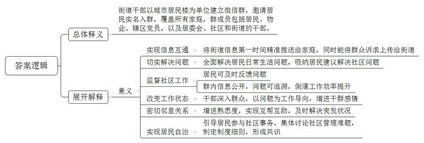
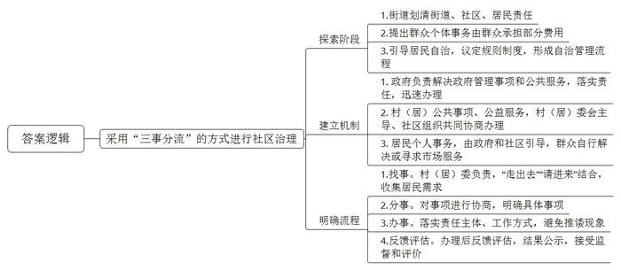
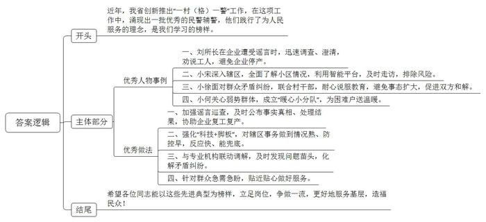
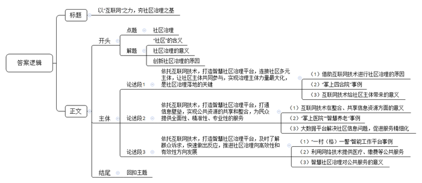

# 2020年0725公务员多省联考《申论》题（河南县级卷）

<!-- gwy:overview:start -->
> **河南 · 2020 · 申论 · 县级卷** ｜ 4 题 · 图片 4 处 · 答案随题折叠

导航：[题目](#题目) · [材料 1](#材料-1)
<!-- gwy:overview:end -->

> 候选采集稿。参考答案及解析来自粉笔页面，不代表官方答案或真实高分答卷；来源使用许可与原卷对应关系仍需人工核实。

## 给定材料

### 材料 1

四合院作为老北京人世代居住的主要建筑形式，是由东、西、南、北四面房子围合起来形成的内院式住宅，关起门来自成天地。四合院院落宽绰疏阔、四面房屋各自独立、又有游廊连接彼此，庭院方阔，尺度合宜，大小空间分而不隔、互相渗透。院内，四面房门都开向院落，交流沟通便利，拉近了人心、增进了情感，生活气息浓厚，起居十分方便，彼此熟悉，相互帮忙，其乐融融。四合院为创造亲切和睦的生活起了很大作用。

Z街道，上个世纪80年代北京市第一个整体开发建设的大型居住社区，常住居民有3万多户、常住人口达8.8万人，下设16个社区，有223栋居民楼。2018年以来，Z街道党员干部跟居民拉家常、交朋友、问需求，添加居民为微信好友、邀请他们进入每栋楼的微信群。加入楼宇微信群的居民数量超过5万，微信群覆盖了四分之三的居民。大家在群里注明了房间号，七成住户实名入群。一个楼宇群基本可以保证所有家庭代表入群。这个群里，不仅有左邻右舍、物业人员、还有居委会的管楼干部，以及书记、主任等，辖区内的党员全部入群，街道干部、社区工作人员全部分片入群。

Z街道办事处代主任说，居民入驻了微信群，让高楼变成了“掌上四合院”。街道有事，信息能在第一时间精准推送到群内的每家每户，居民有诉求，也能在第一时间上达街道层面，日常生活里的大事小情都能在群里解决，社区里的大事小情都通过“掌上四合院”找到了良策。Z街道党工委方书记说，以前，有的同志接到群众诉求，能拖就拖、能混就混。现在就大不一样了，群里的数字不会说谎，群里的问题都能追溯，干部的表现群里居民都在看着。市委组织部挂职干部小王说，街道干部和社区工作者不再是朝九晚五、机关坐班式工作状态，而是走出办公室、走到群众身边，与群众建立了扁平化的直接联系，跟着问题走、带着感情干。Z街道的居民群众说:“在Z街道住了三十年，之前整天抬头不见低头见的邻居，楼上楼下都不知道是谁，这回进了群终于‘对上号’了”。以前是“长住对门不相识”，现在，曾经陌生的居民们在群里开始熟悉，邻里关系紧密了，遇到难事大家互相帮助，有事情大家一起商量，社区真正成了大家的家。

### 材料 2

下面是发生在“掌上四合院”里的几个小故事。

故事1：“想问问谁家在16层，能不能帮我看看家里的老太太，不知道什么原因电话和微信都没有人回复，我现在在赶回去的路上，非常着急……”一天上午9时15分，一条求助消息打破了紫芳园三区2号楼楼门微信群内的平静，这个有着108人的微信群立即紧张了起来。“具体是哪个房间?”“我们马上去看看!”“我在您家门口，有人在屋内按把手，但是不开门!”9时21分，社区居委会的工作人员已经赶到了事主家门口。家里有人但是无法开门，肯定是出现了什么问题。居委会工作人员和热心邻居一边和事主联系，一边拨打了120急救电话。很快，事主赶到打开了门，原来是老人突发脑梗无法行动。大家赶忙一起帮着把老人送上了救护车。

故事2：24号楼是一栋联排高楼，楼内住户很多，发生过高空抛物伤人事件。但因为高空抛物的随意性很大，很难抓现行，多数都成了“无头案”。街道和社区工作人员与24号楼的楼长赵女士建立了一个“楼门微信群”，把楼内的每一户都拉进这个微信群里，大伙儿你一言、我一语，集中讨论如何解决高空抛物的难题。在讨论中，街道和社区工作人员引导大家制定了一份《楼门公约》，“不在阳台和窗台外侧放置物品、以免掉落伤人”“家中垃圾集中收集，并扔到楼下垃圾桶，不从楼上往下扔”等六条细则落在了纸面，得到了楼内住户的一致响应。

故事3：“打12345，不停地投诉!”“承重墙怎么能拆，太过分了，大家一起反映!”这一天凌晨，紫芳园社区1号楼微信群中忽然炸开了锅，多位居民反映“楼底商户拆除承重墙、存在安全隐患”的问题。看到信息，社区工作人员第一时间协调物业公司，并向区建委报告。后经区建委质监站核查，楼底商户拆除的并非承重墙，而是一块楼板。在多方共同监督下，楼底商户将其恢复原貌。同时，社区工作人员就处理情况实时播报，将恢复后的图片发到群中让大家伙儿吃上“定心丸”。

故事4：芳城园第一社区南门垃圾楼周边的违建被拆除后，腾出一块800多平方米的空地。根据“留白增绿”的理念，Z街道办事处和社区准备在这建一座口袋公园。初步规划完成后，街道通过微信群征求居民意见，一条条意见很快反映上来，有建议口袋公园要和垃圾楼协调、多种植吸味儿的植物，有建议不要把资金更多地投放在景观建设上，有建议绿地越简约越好、应该把垃圾楼好好包装一下，有建议在绿地建设中考虑健身功能的引入……工作人员根据征集的意见建议调整了方案。

故事5：一位社区干部在自己包干的楼门群内发了一条微信，向一位80多岁的老志愿者致敬，还发了一张老人戴着志愿者袖标站岗的照片。群里一位居民就发牢骚，说社区和志愿者在作秀，措辞也很不礼貌。负责联系这里的街道干部马上找到社区了解情况。原来那位老人已经在社区志愿服务了十几年，社区已经不再给老人安排“任务”，但一到社区有志愿活动，老人就主动参加。社区干部发微信是想对老人表示感谢。街道干部将情况向居民进行了解释，居民认识到了自己的不理智，向老人道了歉。后来，这位爱吐槽的居民也开始参与社区事务了。

### 材料 3

党的十九大报告提出，要打造共建共治共享的社会治理格局，加强社区治理体系建设，实现政府治理和社会调节、居民自治良性互动。

N区作为Q市的主城核心区，肩负着老城区更新和社区开发的双重职责，80万常住人口中有30万农转非安置人口和进城农民工，还有近30万流动人口。古楼湾片区有55栋20世纪80年代的老建筑，分属两个社区，周围被四条主干道包围，没有围墙。社区人员流动大，管理难度高，治安隐患大，仅2013年就发生多起刑事案件。古楼湾社区的九龙花园是一个老旧小区，基础设施落后，200余户居民来自四面八方，生活习性不一，长期无物业管理，小区内污水横流，垃圾乱堆，群众怨声载道。

社区余主任说，传统行政式的社区管理方式，曾让她疲于奔命还难有效果，曾经一年时间里群众诉求1600件次。街道社区管得越多矛盾似乎越多，管得越细群众意见反而越大。这也是N区近年来基层社会治理中干部们普遍存在的困惑：民生投入越来越多，生活环境越来越好，为什么群众的满意度却没有越来越高？基层管理越来越细，基层干部越来越忙，为什么群众的认同感却没有越来越强？城市建设越来越好，生活水平越来越高，为什么群众的幸福感没有越来越强？

2013年，N区花园街道开始了社会治理中的大事、小事和私事分流处理工作。花园街道党工委李书记说，街道坚持及时划清街道、社区、居民各自责任，不大包大揽，不介入过多具体事务。分解责任、事务，不在于分得多清楚，更重要的是培养居民责任意识，引导居民广泛参与社区事务，该由政府办的公共事务，要全力办好；该由社区处理的事务，要在自治的前提下，依法办得群众满意；属于社区居民自己家的私事，由政府和社区引导，主要由私人办好。政府既不能大包大揽做“物管”，也不能不闻不问不管，简单把责任完全推给居民了事。只强调加大投入和权利赋予，没有相应的责任共担和公平的投入机制，政府投入再多，群众满意度也不会随之提高。只强调自上而下的精细管理，没有自下而上的广泛参与，政府管得再细，群众认同感也不会随之上升。只强调旧城改造和新区开发，没有把群众组织起来同步推进社会建设，城市发展再快，面临的矛盾和问题也不会随之减少。

2013年，N区峡口镇在农村危房改造工作中提出，凡是涉及群众个体的事，群众自己也要承担一部分费用。这样实施下来的结果是，群众对所办的事更加积极，更加用心，对所办的事也更加满意。

九龙花园引导居民自治，组织成立了楼委会、议事委员会等自治组织，引导居民议定出《小区楼规民约》等5个制度规则，形成了“小区事、大家议、协商办、共监督”的自治管理流程。经过居民议事协商，由每户居民出资30元，公益事业发展基金支持2.5万元，街道配套1.8万元，改善了小区的出行等设施，同时组织志愿者对绿化等进行完善，有效地改变了居住环境。古楼湾片区安装摄像头需要28.5万元，社区两个月内召开听证会、协调会30余次，让居民充分表达意愿，最终达成“居民出、社会筹，自己事情自己办”的共识，3327户居民（91%的参与率）出资7.2万元，社会单位支持19.6万元，在重要路口、案件高发区安装摄像头73个，使年均发案率同比下降45%，居民安全感大幅上升。近几年来，N区先后获得了全国文明城区、国家卫生城区等20多项国家级荣誉。

### 材料 4

N区在总结基层社区治理探索实践基础上，建立了一套合理划分大事、小事、私事的机制。“大事”即：政府管理事项及公共服务，由政府部门负责解决；“小事”是村（居）公共事项及公益服务，由村（居）委会为主导，社区自治组织、社区社会组织和社区单位共同协商解决；“私事”是村（居）民个人事务和市场服务，由群众自行解决或寻求市场服务。虽然把事项进行了分流，归根结底是“事”要解决，N区建立了一套快速解决各类事项分类办理的机制和流程。一是落实责任，“大事”快办；二是基层协商，“小事”共办；三是注重引导，“私事”自办。换言之，“大事”是大公事，由政府部门负责解决；“小事”是小公事，由村（居）委会主导，社区自治组织、社区社会组织和社会单位等共同解决；“私事”是居民个人事务，由政府引导居民自行解决或寻求市场服务。

据N区民政局负责人介绍，具体工作流程有找事、分事、办事、反馈评估四步工作。第一步：找事。找事也就是需求收集。找事的第一责任主体是村（居）委会。所找的“事”是以居民的需求为导向，尤其是居民反映需要解决的问题。在收集需求中，通过“走出去”和“请进来”双重方式，收集社区干部、社区公益站、社区民警、社区社工和志愿者、社区社会组织等渠道所反映的有关居民需求的事项。第二步：分事。分事也就是通过协商进行分流，将事情按“大事”“小事”和“私事”，分流到相关的承办部门和人头上。在分事中，由村（居）党组织、村（居）委员会在充分征求意见的基础上，提出协商议题，然后由协商主体开会协商决定哪些事按“大事”来办，哪些事按“小事”来办，哪些事属“私事”引导居民自己办。在分事的同时，明确具体的办理单位和人头、办成事的标准和时间、以及经费等具体事情。第三步：办事。在协商分事后，所有的事便有了具体办事的“主”（包括私事）和具体的办事方法，因而事情办理起来就不会有推诿扯皮的现象出现。第四步：反馈评估。所有分流的事办完后，都要进行反馈评估。反馈就是将项目执行的结果反馈给需求方和项目有关参与方，评估就是对项目实施的过程、效率和经验、群众的满意度等，进行收集总结。在反馈评估中，对所办事项还要在社区进行公示，以接受群众的监督和评价。

### 材料 5

“26床的小框目前是橙色的，代表着滴速过慢，需要立即处理。”见状护士立即调整了流速，小框很快变成了绿色，流速正常。“滴、滴、滴”，护士小杨随身携带的智能挂表响起来，“哦，11床有情况”。“唉呀，现在方便多了。以前挂号、门诊就诊、检查室分诊台预约就诊、排队等候检查……做个检查很麻烦。今天，我做了胸部CT检查和心电图，还不到半天，多亏有掌上医院可以提前预约”。“我们正在进行远程视频治疗，社区医生碰到了一个疑难问题，经过专家指导已得到解决”。原来，K市人民医院建立起了“智慧医疗系统”，通过专业的无线信息平台将患者、医护人员、医疗服务提供商、保险公司等以无缝协同的方式智能互联，让患者体验一站式的医疗、护理和保险服务。通过医疗信息和记录的共享互联，整合并形成一个高度发达的综合医疗网络。使各级医疗机构之间，业务机构之间能够开展统一规划，实现医疗资源的优势互补，达成监管、评价和决策的和谐统一。

日前，F城区文化和旅游局将采购的25套新一代智能的全民健身路径向各社区发放，受到广大社区居民的欢迎。此次配发的新一代智能健身器材包括智能双位划船器、椭圆机、漫步机、腹肌板和扭腰器共5件套。樊城区文化和旅游局工作人员周磊表示，这些设施不仅看起来“高大上”，实际用起来也十分顺手。“每件健身器材上均安装有传感器模块，可对锻炼者的运动时间、次数、里程、热量消耗等进行计算。锻炼结束后，居民还可以通过语音提示播报系统了解相关运动信息，也能通过扫描设备上的二维码，在移动端接收运动参数，纳入个人运动信息管理系统。”据悉，F城区辖区内的董家台社区、朝晋门社区、乔营社区等23个社区作为试点优先安装使用了智能健身器材。F城区文化和旅游局党组书记、局长L表示，F城区安装的第一批智能健身器材旨在打造城区“15分钟健身圈”，以满足广大群众的健身需求。下一步，F城区文化和旅游局将以“智能城区”为骨架，打造智慧健身长廊，进一步拓展广大群众的健身活动空间，激发群众健身运动的积极性，促使全民健身与全民健康深度融合。

随着人口老龄化，空巢独居的老年人越来越多，他们的生活也遇到了各种各样的困难。例如，出行安全无人照看，突然意外或疾病无人救助，甚至连一日三餐都无法自理。面对这样的生活困境，空巢老人亟需一种解决方法，既不对其私人生活带来过多干预，又能在关键时刻获得帮助。然而作为社会的一个群体，空巢老人人口庞大，住所分散，个体差异性大，所需的帮助也各不相同，而且受资金与人力所限，传统的去电随访、上门陪护的服务方式已经不能满足空巢老人的安全、健康与生活的需求。

为了避免传统服务方式的滞后性、片面性、单一性与缺乏专业性的弊端，智慧养老互联生态倡导者爱牵挂经多年调研、研究与实践，试探性地提出了一个可行的解决方案——爱牵挂“连心通”智能腕表。智能硬件是服务的入口。爱牵挂“连心通”腕表具有卫星定位、一键SOS呼救、服务呼叫等实用功能。老人可以通过腕表直接一键拨打社区的服务热线，呼叫上门服务。在遇到危险时，还能通过一键SOS紧急呼救，立即通知服务中心上门救助。将腕表接入“连心通”平台后，社区服务中心还可以随时了解老人的定位与状况，万一发生老人走失的情况，可以立即调取老人的定位与行动轨迹，快速把老人找回。

“多亏了这块表，不然我这命就悬了。”通过爱牵挂“连心通”腕表获得救助的连铁良老人在病床上竖起大拇指。云岗街道镇岗南里社区的关淑清老人说：“在我突发急病时，‘连心通’腕表解决了我的大问题，帮了我的大忙。”家住西罗园黄大爷的老伴说：“‘连心通’腕表还帮我及时找到了走失的老伴。”一块小小的腕表一次次成功抢救一个个“命悬一线”的老人，帮助了一个个生活无助的空巢独居老人。

根据统计，今年以来通过爱牵挂“连心通”腕表，寻找迷路走失老人1名，救助突发急病老人18名，累计为老人提供各类服务46625人次。

### 材料 6

从2014年起，N省创新推出“一村（格）一警”工作，经过6年的发展完善，现已建起覆盖全省各个村庄、城市网格的新型警务模式。N省有8452名社区民警、34756名社区辅警进村（居）“两委”班子，兼任村（居）党组织副书记、村（居）委会副主任，兼任率分别达到100%和98.5%。

案例一

一个谣言，差点儿击垮一家企业。今年2月，N省某地区一大型集团突起传言：公司高层确诊新冠肺炎。数十名技术员、工人不明真相，停下机器。公安局的“村儿警”及时赶到，仅用4小时便查清谣言。“进厂的时候，工人抱着行李，正在往外跑。”2月12日上午11时，接到“微警局”案件通报，刘所长感到事态严重。N集团公司日产上百万只口罩，一旦停产，影响不小。先劝说工人，再寻找信源。两人很快查清：一名外来人员的亲属确诊，与此人无关，更没有传染公司员工。谣言澄清，人心安定。疫情防控期间，“微警局”加强巡查网络谣言，由驻村民警及时公布事实真相、处理结果。同时，协助测控体温、打击制假售假，保障辖区44家口罩、防护服生产企业复工复产。

案例二

在“一村（格）一警”布局基础上，强化“脚板+科技”，做到情况熟、防控早，反应快、能兜底。小宋2018年初到基层时，一头雾水。老民警教他，迈开两条腿，练就“铁脚板”，摸清底数，才能心里有数。小宋用4个多月时间走遍了123个楼栋1803户群众，了解到老旧小区情况后，便着手推动对小区进行封闭管理、技防物防改造。与此同时，他手机上安装了“一村（格）一警”智能工作平台。该平台可以提醒社区民警“今天任务”“走访考察任务清单”，做到信息精细推送、要素智能采集、任务精准派单、矛盾隐患动态清零、档案自动生成、考核实时完成。凡有需要关注人员，平台推送信息，民警及时上门走访。大年三十下午，小宋接到社区通报，有一名疑似患者，需要紧急隔离，可此人情绪激动，拒绝配合。他冒着被感染的危险，赶到疑似患者家门口，讲风险、说政策，终于说服其住进定点医院。

案例三

“村儿警”“片儿警”常年“泡”在基层，与村居法律顾问、人民调解委员会联动调解，还可以及时发现苗头，化解矛盾纠纷、争执。不过80厘米宽的一垄地，可村民荆某和谷某互不相让。今年2月底，两家矛盾升级，荆某脸被划破，住进医院。眼见小纠纷越闹越凶，小徐联合村干部到田间测量地块，到家里耐心说服。最终，当事人各退一步，达成和解协议，不误春季备耕。

案例四

小何不仅是“片儿警”，而且兼任社区党支部副书记，直接参与基层社会治理。党组织设在警务室、警务工作站，针对群众急需急盼，贴近贴心做好服务。社区里的张某腿有残疾，是一名贫困户，独自居住。社区民警小何了解情况后，组织辖区党员、退役军人、志愿者组成“暖心小分队”，及时采购、捐赠生活物资，送给张某等困难户。张某感动不已：“社区不仅‘零疫情’，而且‘最温暖’。”

## 题目

### 第 1 题

**请结合****“给定资料**1**和**2**”，分析理解“掌上四合院”的内涵。（20分）**

关联材料：材料 1、材料 2

作答要求：

要求：全面、准确、深入、有条理，不超过300字。

第 1 题 · 答案与解析

**参考答案（粉笔题库参考内容）**

“掌上四合院”是指街道干部以城市居民楼为单位建立微信群，邀请居民实名入群，覆盖所有家庭，群成员包括居民、物业、辖区党员，以及居委会、社区和街道的干部。

这种工作方式能够：1.实现信息互通。将街道信息第一时间精准推送给家庭，同时能将群众诉求上传给街道。2.切实解决问题。全面解决居民日常生活问题，吸纳居民建议解决社区问题。3.监督社区工作。居民可及时反馈问题；群内信息公开，问题可追溯，倒逼工作效率提升。4.改变工作状态。干部深入群众，以问题为工作导向，增进干群感情。5.密切邻里关系。增进熟悉度，实现互帮互助，及时解决突发状况。6.实现居民自治。引导居民参与社区事务，集体讨论社区管理难题，制定制度细则，形成共识。

**解析**

**参考答案说明：**思路方面，本参考答案按照词句解释题“总体释义+展开解释”的答题思路展开。内容方面，本参考答案首先解释了“掌上四合院”的含义；接着“分析相关要素”部分分析了掌上四合院带来的意义。词句表达方面，本参考答案加上了“是指”“能够”等连接词来承接上下文。

**考点**：词句解释类

**来源**：2020年0725公务员多省联考《申论》题（河南县级卷）

### 第 2 题

**请结合****“给定材料**3**和**4**”，对N区基层社区治理的探索，进行梳理概括。（20分）**

关联材料：材料 3、材料 4

作答要求：

要求：要点明确，层次分明，有概括性，不超过300字。

第 2 题 · 答案与解析

**参考答案（粉笔题库参考内容）**

N区采用“三事分流”的方式进行社区治理：

一、探索阶段。1.街道划清街道、社区、居民责任。2.提出群众个体事务由群众承担部分费用。3.引导居民自治，议定规则制度，形成自治管理流程。

二、建立机制。1.政府负责解决政府管理事项和公共服务，落实责任，迅速办理。2.村（居）公共事项、公益服务，村（居）委会主导、社区组织共同协商办理。3.居民个人事务，由政府和社区引导，群众自行解决或寻求市场服务。

三、明确流程。1.找事。村（居）委负责，“走出去”“请进来”结合，收集居民需求。2.分事。对事项进行协商，明确具体事项。3.办事。落实责任主体、工作方式，避免推诿现象。4.反馈评估。办理后反馈评估，结果公示，接受监督和评价。

**解析**

**参考答案说明：**本参考答案首先总结概括N区探索的宏观做法，再从“探索阶段”“建立机制”“明确流程”三个方面进行了具体展开。其中，在“探索阶段”方面，又从“划清责任”“群众承担费用”“居民自治”三个方面进行了分条撰写；在“建立机制”方面，又从“大事”“小事”“私事”三个方面进行了分条撰写；在“明确流程”方面，又从“找事”“分事”“办事”“反馈评估”四个方面进行了分条撰写。各条要点之间在内容上相互并列，没有交叉。

**考点**：概括措施类

**来源**：2020年0725公务员多省联考《申论》题（河南县级卷）

### 第 3 题

**N省公安厅拟号召全省民警、辅警向“给定资料**6**”案例中的几名优秀民警、辅警学习，请代写起草一份倡议书。（20分）**

关联材料：材料 6

作答要求：

要求：主题突出，层次清晰，不考虑格式，不超过400字。

第 3 题 · 答案与解析

**参考答案（粉笔题库参考内容）**

近年，我省创新推出“一村（格）一警”工作，在这项工作中，涌现出一批优秀的民警辅警，他们践行了为人民服务的理念，是我们学习的榜样。

一、刘所长在企业遭受谣言时，迅速调查、澄清，劝说工人，避免企业停产。二、小宋深入辖区，全面了解小区情况，利用智能平台，及时走访，排除风险。三、小徐面对群众矛盾纠纷，联合村干部，耐心说服教育，避免事态扩大，促进双方和解。四、小何关心弱势群体，成立“暖心小分队”，为困难户送温暖。

在此我们倡议大家向他们学习：一、加强谣言巡查，及时公布事实真相、处理结果，协助企业复工复产。二、强化“科技+脚板”，对辖区事务做到情况熟、防控早，反应快、能兜底。三、与专业机构联动调解，及时发现问题苗头，化解矛盾纠纷。四、针对群众急需急盼，贴近贴心做好服务。

希望各位同志能以这些先进典型为榜样，立足岗位，争做一流，更好地服务基层，造福民众！

**解析**

**参考答案说明：**（1）本题不需要考虑格式，只写正文即可。（2）正文部分，一方面从内容来看，围绕着“向优秀民警、辅警学习”这一主题，本参考答案的开头先写到了“向优秀民警、辅警学习的背景”；主体部分从“民警、辅警的优秀事迹”“向优秀民警、辅警学习的内容”等两个方面展开；结尾部分进行了呼吁号召。另一方面，形式上，本参考答案做到了分段、分条撰写，整体上条理较为清晰。

**考点**：宣传类

**来源**：2020年0725公务员多省联考《申论》题（河南县级卷）

### 第 4 题

**请参考****“给定资料”中提到的“掌上四合院”“掌上医院”“‘一村（格）一警****’****智能工作平台”等举措，围绕社区治理主题，自拟题目，联系实际，写一篇文章。（40分）**

关联材料：材料 1、材料 2、材料 3、材料 4、材料 5、材料 6

作答要求：

要求：

（1）观点明确，内容充实；

（2）结构完整，层次清晰；

（3）逻辑清晰，语言准确；

（4）1000-1200字。

第 4 题 · 答案与解析

**参考答案（粉笔题库参考内容）**

**以“互联网”之力，夯社区治理之基**

社区连着千家万户，是社会的基本单元，是城市运行的底盘。加强社区治理，不仅能提升人民群众满意度、幸福感，还能保障城乡基层的和谐稳定，更能提高城市治理现代化水平。然而，随着我国城镇化进程的不断加快，社区人员来自五湖四海，一方面地方风俗、生活习惯各不相同，另一方面群众诉求复杂多变，这让传统的社区治理模式面临着严峻挑战。**可见，创新****社区****治理已是大势所趋。**

当前，“互联网+”时代来临，互联网的作用越来越重要。而将互联网与社区治理相融合，既会激发社区多元主体力量，又会有效整合社区资源，还会高效处理复杂社区治理问题。可见，**借助互联网技术，让社区治理更智能、更专业、更高效是创新社会治理的必然选择。**

**依托互联网技术，打造智慧社区治理平台，连接社区多元****主体，****让社区主体共同参与，****实现治理主体****力量****最大化****，是社区****治理落地****的关键。**十九大报告提出，要加强社区治理体系建设，实现政府治理和社会调节、居民自治良性互动。而实现社区主体之间的良性互动，就需要借助互联网技术，搭建网络交流平台。“掌上四合院”就是搭建网络平台，激发多元主体力量的典型，通过建立微信群，将居民、物业、辖区党员以及社区干部等纳入其中，其中的居民可及时反馈基层问题，帮助社区干部掌握基层痛点；可反映生活问题，方便其他居民及干部及时提供帮助；可实时监督社区工作，倒逼干部认真履责……可见，通过网络交流平台，不仅可拉近社区主体之间的距离，还能实现互帮互助，最终实现共享共治的局面。

**依托互联网技术，打造智慧社区治理平台，****打通信息壁垒****，实现公共资源的共享和整合****，****为民众提供全面性、精准性、专业性的服务。**“互联网+”将原有条块化、碎片化的信息数据进行网络化整合，健全了公共信息资源库，推动信息的公开和共享，实现了资源的优势互补。“掌上医院”通过专业的无线信息平台将医疗资源以无缝协同的方式智能互联，让患者体验一站式就医服务；“智慧养老”链接社区云平台，即时获取空巢老人信息，为其提供精准的养老服务……大数据的工作平台突破了信息孤岛，解决了困扰基层治理的信息匮乏、协同支撑不足等问题，促进了社区服务的精细化，织就全新的网络化社区服务格局。

**依托互联网技术，打造智慧社区治理平台****，及时了解群众诉求，****快速做出****反应****，推进社区****治理****向高效性和有效性方向发展。**“互联网+”社区治理使服务者可以通过移动终端获取民众相关信息和相应服务，比如“一村（格）一警”智能工作平台，成为了民警疫情排查期间最好的帮手，它能及时的推送信息，辅助工作者在第一时间内为民众提供精细化的服务。不仅如此，云社区的高效性还体现在公共服务的方方面面，利用网络技术提升医疗服务水平，打造医疗服务平台，实现方便、省时、高速就医；利用技术实现即时通讯工具缴纳各项生活费用，足不出户解决问题......政府管理社会的目的是为了给群众提供一个良好的社会环境，而智慧社区治理，必将催生一个高效便捷的多层次新型公共服务体系。

凡益之道，与时偕行。借助互联网的东风，开创社区治理新局面，发挥多元主体力量，整合优质社区资源，实现高效治理，就一定能真正满足群众需求，让群众充分共享时代红利。

**文章分析**

**以“互联网”之力，夯社区治理之基**

【**标题的优点：**标题中含有“互联网”“社区治理”等主题词，使文章主题更突出、清晰。】

（1）<u>社区</u>连着千家万户，<u>是</u>社会的基本单元，<u>是</u>城市运行的底盘。（2）<u>加强社区治理</u>，<u>不仅能</u>提升人民群众满意度、幸福感，<u>还能</u>保障城乡基层的和谐稳定，<u>更能</u>提高城市治理现代化水平。（3）然而，随着我国城镇化进程的不断加快，社区人员来自五湖四海，<u>一方面</u>地方风俗、生活习惯各不相同，<u>另一方面</u>群众诉求复杂多变，<u>这让传统的社区治理模式面临着严峻挑战</u>。**可见，**<u><b>创新</b></u><u><b>社区</b></u><u><b>治理已是大势所趋</b></u>**。**

【**开头的优点：**★内容方面。范文的开头是紧扣“社区治理”这一主题展开的。首先，开头第二句话点出主题，做到了主题明确。其次，对“社区治理”这一主题进行了分析阐述：（1）先指出了“社区”的含义；（2）接着分析了社区治理的意义；（3）最后指出了创新社区治理的原因。★文字表达方面。使用了“不仅……还……更”“然而”“可见”等连接词，使语言表达有逻辑性。】

当前，“互联网+”时代来临，互联网的作用越来越重要。而将互联网与社区治理相融合，<u>既会激发社区多元主体力量</u>，<u>又会有效整合社区资源</u>，<u>还会高效处理复杂社区治理问题</u>。可见，借助互联网技术，让社区治理更智能、更专业、更高效是创新社会治理的必然选择**。**

【**过渡段的优点：**范文过渡段分析了借助互联网进行“社区治理”的意义等方面的内容，此外，还要注意过渡段中“既会激发社区多元主体力量，又会有效整合社区资源，还会高效处理复杂社区治理问题”这句话，是用来引起下文的过渡句。】

**依托互联网技术，打造智慧社区治理平台，连接社区多元****主体，****让社区主体共同参与，****实现治理主体****力量****最大化****，是社区****治理落地****的关键。**（1）<u>十九大报告提出</u>，<u>要加强社区治理体系建设</u>，实现政府治理和社会调节、居民自治良性互动。而<u>实现社区主体之间的良性互动</u>，<u>就需要借助互联网技术</u>，搭建网络交流平台。（2）“<u>掌上四合院</u>”<u>就是</u><u>搭建网络平台</u>，<u>激发多元主体力量的典型</u>，通过建立微信群，将居民、物业、辖区党员以及社区干部等纳入其中，其中的居民可及时反馈基层问题，帮助社区干部掌握基层痛点；可反映生活问题，方便其他居民及干部及时提供帮助；可实时监督社区工作，倒逼干部认真履责……（3）可见，<u>通过网络交流平台</u>，<u>不仅可</u>拉近社区主体之间的距离，<u>还能实现</u>互帮互助，<u>最终实现</u>共享共治的局面。

【**论述段****1的优点：**★观点句：范文的观点句是紧扣“社区治理”这一文章主题提出的。形式上，它在段首处直接写出，位置突出，容易发现。内容上，关键词突出，内容要点明确，可以明显看出它从“多主体参与”入手，打造智慧社区治理平台。★论述内容：（1）介绍了借助互联网技术进行社区治理的原因；（2）列举“掌上四合院”事例；（3）指出了互联网技术给社区主体带来的意义。注意：以上三个方面的内容都是紧扣观点句“依托互联网技术，打造智慧社区治理平台，连接社区多元主体，让社区主体共同参与，实现治理主体力量最大化，是社区治理落地的关键”进行分析论述的，针对性强、内容层次丰富。最后，在论证方法和论据选取方面，讲道理和举例子相结合，做到了丰富多样。】

**依托互联网技术，打造智慧社区治理平台，****打通信息壁垒****，实现公共资源的共享和整合****，****为民众提供全面性、精准性、专业性的服务。**（1）“<u>互联网</u>+”<u>将</u>原有条块化、碎片化的<u>信息数据进行网络化整合</u>，<u>健全了</u>公共信息资源库，<u>推动</u>信息的公开和共享，<u>实现了</u>资源的优势互补。（2）“<u>掌上医院</u>”通过专业的无线信息平台将医疗资源以无缝协同的方式智能互联，让患者体验一站式就医服务；“<u>智慧养老</u>”链接社区云平台，即时获取空巢老人信息，为其提供精准的养老服务……（3）<u>大数据的工作平台</u>突破了信息孤岛，<u>解决了困扰基层治理的信息匮乏</u>、协同支撑不足<u>等问题</u>，<u>促进了</u><u>社区服务的精细化</u>，<u>织就全新的网络化社区服务格局</u>。

【**论述段****2的优点：**★观点句：范文的观点句是紧扣“社区治理”这一文章主题提出的。形式上，它在段首处直接写出，位置突出，容易发现。内容上，关键词突出，内容要点明确，可以明显看出它是从“信息资源共享与整合”入手，打造智慧社区治理平台。★论述内容：（1）介绍了互联网技术在整合、共享信息资源方面的意义；（2）列举“掌上医院”“智慧养老”事例；（3）介绍了大数据平台解决社区信息问题，促进服务精细化。注意：以上三个方面的内容都是紧扣观点句“依托互联网技术，打造智慧社区治理平台，打通信息壁垒，实现公共资源的共享和整合，为民众提供全面性、精准性、专业性的服务”进行分析论述的，针对性强、内容层次丰富。最后，在论证方法和论据选取方面，讲道理和举例子相结合，做到了丰富多样。】

**依托互联网技术，打造智慧社区治理平台****，及时了解群众诉求，****快速做出****反应****，推进社区****治理****向高效性和有效性方向发展。**（1）“互联网+”社区治理使服务者可以通过移动终端获取民众相关信息和相应服务，比如“<u>一村（格）一警</u>”<u>智能工作平台</u>，成为了民警疫情排查期间最好的帮手，它能及时的推送信息，辅助工作者在第一时间内为民众提供精细化的服务。（2）不仅如此，云社区的高效性还体现在公共服务的方方面面，<u>利用网络技术提升医疗服务水平</u>，打造医疗服务平台，实现方便、省时、高速就医；<u>利用技术实现即时通讯工具缴纳各项生活费用</u>，足不出户解决问题......（3）政府管理社会的目的是为了给群众提供一个良好的社会环境，而<u>智慧社区治理</u>，<u>必将催生一个高效便捷的多层次新型公共服务体系</u>。

【**论述段****3的优点：**★观点句：范文的观点句是紧扣“社区治理”这一文章主题提出的。形式上，它在段首处直接写出，位置突出，容易发现。内容上，关键词突出，内容要点明确，可以明显看出它是从“社区治理更加高效和有效”入手，打造智慧社区治理平台。★论述内容：（1）介绍了“一村（格）一警”智能工作平台事例；（2）介绍了利用网络技术提供医疗、缴费等公共服务；（3）介绍了智慧社区治理对公共服务的意义。注意：以上三个方面的内容都是紧扣观点句“依托互联网技术，打造智慧社区治理平台，及时了解群众诉求，快速做出反应，推进社区治理向高效性和有效性方向发展”进行分析论述的，针对性强、内容层次丰富。最后，在论证方法和论据选取方面，讲道理和举例子相结合，做到了丰富多样。】

【**论述段之间的关系：**★内容的内在逻辑：论述段1从参与主体多元化层面论证智慧社区治理，论述段2从整合、共享信息资源层面论证智慧社区治理，论述段3从治理效果的高效性层面论证智慧社区治理。三个论述段相互并列，逻辑清晰。】

凡益之道，与时偕行。<u>借助互联网的东风</u>，<u>开创社区治理新局面</u>，<u>发挥多元主体力量</u>，<u>整合优质社区资源</u>，<u>实现高效治理</u>，就一定能真正满足群众需求，让群众充分共享时代红利。

【**结尾的优点**：范文的结尾回扣了“互联网”“社区治理”等主题词，语言精悍，不拖沓。】

**解析状态：unknown（来源未提供）**

**考点**：文章写作题

**来源**：2020年0725公务员多省联考《申论》题（河南县级卷）

