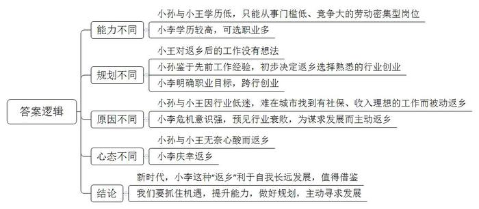
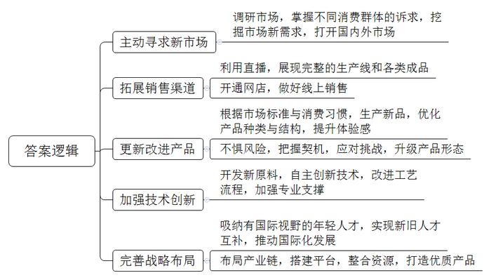
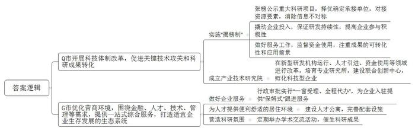

# 2021年公务员多省联考《申论》题（河南县级卷）

> 候选采集稿。参考答案及解析来自粉笔页面，不代表官方答案或真实高分答卷；来源使用许可与原卷对应关系仍需人工核实。

## 给定材料

### 材料 material-aae23a4600f165e0

进工厂曾是一代人的梦想。时移世易。今年33岁的小孙2018年7月到省城当外卖员，他曾是家乡县城一家汽车工厂的喷漆工人，小孙不是科班出身，最早由师傅带入行，工作四年，月工资从3500元涨到了5000元左右。到省城当外卖员，每月到手收入一度维持在8000元到10000元之间，他很满意，“这相当于我们当地一家4S店高级汽修技师的收入了。”当高级汽修技师曾是小孙的梦想，但由于理论知识、技能证书等门槛，初中文化的小孙并未选择这条路。数据显示，2018年，外卖骑手平均月薪为7750元左右，制造业员工平均月薪在6000元左右。几乎无门槛的外卖行业成为吸纳就业的重要蓄水池。不过，今年以来，小孙送外卖的收入再没有回到从前的高峰期。谈及未来，小孙说：“先干着，攒点钱，以后看看能不能返乡开个汽车美容店。”

在23岁的小王看来，工厂工人和外卖员的工作体验是完全不一样的，他曾在一个工厂做过装卸工，“每天都待在厂子里，搬东西很累，还被呼来喝去。”小王坦言，“我们这个年纪的，谁会喜欢这样的工作呢？”转行两个月，作为外卖新手的小王并没有实现传说中“月入过万”，小王很无奈，“5月份订单量刚涨起来，又新来了很多兼职外卖员。”数据显示，56%的外卖骑手有第二职业。“我们没有基本的社会保障，只能多赚点算点，为以后早做打算。”在他看来，返乡是最后一条路，但也是最现实的一条路。“像我这样只有高中文化的人，在互联网时代很难在大城市找到满意的工作了。”言语间，小王的无奈与心酸尽显。

时至今日，机器虽然已经替代了工厂流水线上的基础岗位，但并未能完全替代快递外卖配送线上的基础岗位。在配送线上的“最后一公里”，在面对面的服务环节，依然需要依赖人工。S大学林教授认为，未来中国服务业的增加值比重和就业份额将继续稳步提升。但一个残酷的现实是，“服务业中的高端知识型岗位和低端劳动密集型岗位之间的收入差距将会进一步扩大。”

相比小王和小孙，小李是一所知名大学财经专业的毕业生。2015年，他从深圳一家生产自动取款机的公司离职，返回家乡创业，现在发展得很好。“行业已经要变天了，我必须早做打算。公司当时营业收入、利润增长还不错，但我心里没底。移动支付发展太快了！”小李如此解释自己当时的担忧。

现金时代，一台台自动取款机就是其生产厂商的“印钞机”。上世纪90年代，存取款都只能在固定的储蓄所；2005年前后，自动取款机开始遍布街头巷尾；2015年，中国成为全球最大的自动取款机销售市场。当年年末，全球自动取款机行业协会会长充满激情地预言，盛宴即将开始。但事后回看，这已是盛宴的尾声。

就在2015年，银行纷纷推出互联网金融战略，并开始减少自助银行、自动取款机，用户使用自动取款机的频次也大幅下滑。与此同时，各个银行的网络金融业务占比大幅提升。根据上市公司的财报，2018年多家自动取款机厂商从净利润下滑开始转向大幅度亏损，2019年亏损进一步加剧，小李感叹：“时代在抛弃你时，连一声招呼都不会打。”他也为自己此前的决定感到庆幸。

### 材料 material-b7d085e0c4295809

“刚和老婆谈恋爱时，我打趣说自己家是做罐头的，快结婚的时候才告诉她，家里做的‘罐头’其实是煤气罐。”小李介绍道。他羞于说出口的煤气罐，也有过辉煌的过往。不过，随着天然气管道开始进入千家万户，如果哪个小区还用煤气罐做饭，这个小区就显得不够上档次。

李家30多年前就和煤气罐结缘。上世纪90年代，小李的爷爷收购了一家集体企业，成立了鑫旺能源公司，开始生产煤气罐，一步步把公司做成了市里的知名企业。“2010年，煤气罐热销，爸爸眼红钱太好赚，赶紧扩大产能，但两年后产能扩大了，煤气罐需求和价格却是直线往下掉。”小李说。2010年的超级换瓶潮，成了这个行业最后的疯狂，也让公司“套在了高位”。小李回忆，他2015年大学毕业时，“煤气罐单个成本100多元，卖80元才能出手，做的越多，亏的越多。”

市场艰难，祖辈父辈一筹莫展，大学一毕业，小李不得不回家接手家族产业。“现在你很难找到国内煤气罐市场资料，因为已经没什么价值了。”小李说。跑遍了国内市场，他发现有同行通过网络往国外卖煤气罐。是啊，世界很大，中国市场萎缩，不代表国外也没人用。思考一番，他认定外贸是趋势，海外市场是多层次的，一些欠发达地区，一定需要煤气罐。

2015年10月，小李开通了第一个网上店铺，但忙活了5个月，期待中的滚滚订单并没有出现。国外市场，靠谱吗？小李的父亲对此表示怀疑。小李逐渐发现了门道：国内煤气罐只有4种型号，但全球有200多种型号，很多细节与使用习惯和国内不一样。必须根据国外市场的标准，做生产端的改造。再次摸索后，小李在2016年年底做成了第一笔外贸订单。他清楚地记得：“下单的人都没有询盘，直接打电话问我是不是一个真实的工厂。我打开直播在厂里转了一圈，当国外客户看到我们完整的生产线和各种型号的煤气罐成品后，对方立马签了一集装箱。”

鑫旺能源地处内陆，且长期专注本土加工制造，不像深圳等地的工厂国际视野较好，从建厂开始就做外贸订单。互联网的普及降低了外贸门槛，让鑫旺能源可以依靠优秀的产品，跨越式地拉平了与传统外贸工厂的距离。

小李对自己进军国际市场的决定感到庆幸。如今，他正在复制销售煤气罐的成功，开始通过网店售卖燃气灶等厨房用品。小李说，他很喜欢一句诗：“风后面是风，天空上面是天空，道路的前面还是道路。”

### 材料 material-fc19c722b845c05a

“要把芯片技术领域的十年经验凝练到一场不到半小时的PPT汇报里，还得接受专家提问，这是一场大考，不敢大意。”恒心科技有限公司陈总说。这场“考试”是由Q市科技局组织，共有32家单位“参考”，以“揭榜制”形式择优确定8家单位承担本市的重大科技创新专项。这些揭榜单位需要“有实力——竞争择优；受监督——合规合法；有绝招——取得成效”。其中，恒心科技有限公司提出的“面向5G技术的芯片攻关类”项目，最终“揭榜”成功。陈总说：“这种做法保证了企业持续的研发投入，使成果转化工作不半途而废，毕竟成果转化不是一蹴而就。揭榜制方式，能促进资源要素的对接，消除信息不对称，更好地突破关键技术，从而推动产业发展。”

在Q市科技部门负责人看来，“把需要的关键核心技术项目以及相关技术标准、资助标准、完成时限等张出榜来，英雄不论出处，谁有本事谁揭榜。用1元财政资金撬动企业10元投入，放大作用明显。”作为大赛评委，郑教授深有感触：“无论是科研院所、高新企业，还是一些中小型科技企业，都踊跃参加，这证明了这种揭榜制在Q市得到了大家的认可和欢迎。”

省科技厅张副厅长表示：在主体的选择上，一改过去由政府主导遴选项目实施主体的做法，从过去的“委派制”，改为“揭榜制”，不仅是科技创新理念的重大转变，更是科技项目遴选方式的重大突破；项目实施过程中，政府要做好相关服务和对专项资金使用情况的监管；项目验收结项时，不仅要看专利或奖项，更要看成果的可转化性和应用前景。

在Q市还有一块科技体制改革“试验田”——Q市产业技术研究院。作为产研院的“当家人”，马院长从金属材料工程领域的专业科学研究一路走向了更为广阔、也更为艰难的“科技转化”之路。“科技创新既需要仰望星空，也需要脚踏实地，要让技术成果从实验室研究走向更广阔天地。”马院长说，从科学技术到产业成果，跨越科技成果转化的“死亡之谷”，他们就是“桥梁”，一头连着科研、一头连着市场。目前，Q市产研院已培育建设了35家专业研究所，与细分产业领域的龙头企业合作建设了60余家联合创新中心，衍生孵化科技型企业200多家，转移转化技术成果1500多项，服务的企业超过10000家。

“我们既非政府机构又非事业单位，既非高校院所也非成果转化中心，很多人说我们是‘四不像’。”马院长说，通过这块试验田，产研院在新型研发机构运行、人才引进、资金使用、提炼企业需求等领域进行了大刀阔斧的改革和探索。“不与高校争学术之名，不与企业争产品之利，只为全力以赴打通从‘科技强’到‘产业强’的通道。”

## 题目

### 第 1 题

**请结合****“给定资料**1**”，分析理解三位年轻人“返乡”的不同之处。（20分）**

关联材料：材料 material-aae23a4600f165e0

作答要求：

要求：全面、准确，深入，有条理，不超过250字。

### 第 2 题

**请结合****“给定资料**2**”和“给定资料**4**”，为仙路控股有限公司的发展提出建议。（20分）**

关联材料：材料 material-b7d085e0c4295809

作答要求：

要求：紧扣材料，针对性强，条理清晰，不超过250字。

### 第 3 题

**请根据****“给定资料**5**”和“给定资料**6**”，对Q市和G市通过放管服改革促进企业发展的情况进行梳理概括****。****（****20分）**

关联材料：材料 material-fc19c722b845c05a

作答要求：

要求：全面、准确，有概括性，不超过350字。

### 第 4 题

**请结合你对****“给定资料**7**”中划线句子“是故事者生于虑，成于务，失于傲****”的理解，参考“给定资料”，联系实际，自拟题目，写一篇文章。（40分）**

关联材料：材料 material-aae23a4600f165e0

作答要求：

要求：观点明确，内容充实；思路清晰，语言流畅；参考给定资料，但不拘泥于给定资料；字数1000-1200字。

## 答案与解析

第 1 题

**参考答案（粉笔题库参考内容）**

能力不同：小孙与小王学历低，只能从事门槛低、竞争大的劳动密集型岗位；小李学历较高，可选职业多。

规划不同：小王对返乡后的工作没有想法；小孙鉴于先前工作经验，初步决定返乡选择熟悉的行业创业；小李明确职业目标，跨行创业。

原因不同：小孙与小王因行业低迷，难在城市找到有社保、收入理想的工作而被动返乡；小李危机意识强，预见行业衰败，为谋求发展而主动返乡。

心态不同：小孙与小王无奈心酸而返乡；小李庆幸返乡。

新时代，小李这种“返乡”利于自我长远发展，值得借鉴。我们要抓住机遇，提升能力，做好规划，主动寻求发展。

**解析**

**参考答案说明：**本参考答案分别从工作能力、返乡规划、返乡原因、返乡心态的角度入手，对“三位年轻人‘返乡’”的不同点进行了比较，并总结性地给出了结论。

**考点**：考点对比分析类

**来源**：来源2021年公务员多省联考《申论》题（河南县级卷）

粉笔申论页面对本题只提供「解析视频」入口，该入口是会员推广位，页面无视频地址与文字解析。

第 2 题

**参考答案（粉笔题库参考内容）**

1.主动寻求新市场。调研市场，掌握不同消费群体的诉求，挖掘市场新需求，打开国内外市场。

2.拓展销售渠道。利用直播，展现完整的生产线和各类成品；开通网店，做好线上销售。

3.更新改进产品。根据市场标准与消费习惯，生产新品，优化产品种类与结构，提升体验感；不惧风险，把握契机，应对挑战，升级产品形态。

4.加强技术创新。开发新原料，自主创新技术，改进工艺流程，加强专业支撑。

5.完善战略布局。吸纳有国际视野的年轻人才，实现新旧人才互补，推动国际化发展；布局产业链，搭建平台，整合资源，打造优质产品。

**解析**

**参考答案说明：**答案根据“主动寻求新市场”“拓展销售渠道”“更新改进产品”“加强技术创新”“完善战略布局”这五个方面进行了分条撰写。且对每条要点提炼出了总括词并前置。

**考点**：考点提出对策类

**来源**：来源2021年公务员多省联考《申论》题（河南县级卷）

粉笔申论页面对本题只提供「解析视频」入口，该入口是会员推广位，页面无视频地址与文字解析。

第 3 题

**参考答案（粉笔题库参考内容）**

Q市开展科技体制改革，促进关键技术攻关和科研成果转化。1.实施“揭榜制”。张榜公示重大科研项目，择优确定承接单位，对接资源要素，消除信息不对称；撬动企业投入，保证研发持续性，提高企业参与积极性；做好服务工作，监督资金使用，注重成果的可转化性和应用前景。2.成立产业技术研究院。在新型研发机构运行、人才引进、资金使用等领域进行改革，培育专业研究所，建设联合创新中心，孵化科技型企业。

G市优化营商环境，围绕金融、人才、技术、管理等需求，提供一站式综合服务，打造适宜企业生存发展的生态系统。1.做好企业服务。行政审批实行“一窗受理、全程代办”，为企业入驻提供“保姆式”跟进服务。2.为人才提供便利舒适的居住环境。建设人才公寓，完善配套设施。3.营造科研氛围。定期举办学术交流活动，催生科研成果。

**解析**

**参考答案说明：**本参考答案宏观上先从“Q市”和“G市”两个方面进行分段。Q市方面，又从“实施‘揭榜制’”“成立产业技术研究院”等不同的角度进行了分条撰写。各条要点之间在内容上相互并列，没有交叉。G市方面，又从“做好企业服务”“为人才提供便利舒适的居住环境”“营造科研氛围”等不同的角度进行了分条撰写。各条要点之间在内容上相互并列，没有交叉。另外，撰写每条要点时，都提炼出了概括性强的总括词并前置，满足了题目中规定的“有概括性”这一要求。

**考点**：考点概括措施类

**来源**：来源2021年公务员多省联考《申论》题（河南县级卷）

粉笔申论页面对本题只提供「解析视频」入口，该入口是会员推广位，页面无视频地址与文字解析。

第 4 题

**参考答案（粉笔题库参考内容）**

**事者** **谋定而动** **行且坚毅**

《管子·乘马》言：“是故事者生于虑，成于务，失于傲。不虑则不生，不务则不成，不傲则不失。”在庆祝改革开放40周年大会上，习近平总书记引用了这句古语，强调伟大的梦想与事业都是拼出来、干出来的，告诫我们无论是政府建设、企业突围、个人发展，**想成就一番事业都要用深谋远虑的眼光、真抓实干的行动和自我警醒的意识来干事创业，推动站起来、富起来、强起来的伟大飞跃**。

**成就伟大事业，实现伟大梦想要有规划，要全面性、系统性****地****规划，还要在规划中结合实际，兼具创新性和突破性。**谋定而动方能笃行致远，为了实现国家富强，我们深惟重虑，从对外开放到一带一路、从攻坚脱贫到乡村振兴、从服务型政府到数字化政府建设，在不同时期制定了不同的发展战略，不断突破自我，挑战自我，为国家建设提供指导性的政策规划。国家如此，企业亦如此。企业发展建设也要以市场为基、创新为源、技术为本，如华为在发展中，从生产用户交换机到发展智能移动通信设施，从安卓系统到鸿蒙系统，实现了自我的华丽转身。新时代的发展，需要我们不忘初心，砥砺前行，多一点从长计议、高瞻远瞩。

**成就伟大事业，实现伟大梦想要务实，需躬行实践、深耕细作，还需在过程中善于变通、与时俱进。**“制心一处，无事不办”。从卖油翁到庖丁解牛、再到百步穿杨，众多能工巧匠通过执著实践，实现游刃有余、技进乎道的精妙技艺。如果说秉承匠心的探索能展现格物致知的深刻哲学，那当下随着开放的发展，我们还要顺应需求，主动求变。改革开放初期，邓小平同志创新提出经济特区建设，使得南方小渔村深圳，成为改革开放的试验场；国际餐饮巨头肯德基在发展初期因错估市场情况无奈撤出香港市场，而后耗时5年，打造符合中国人口味特点的系列产品，最终实现发展蝶变。

面对新形势下的挑战，做成一件事的关键不仅在于谋划决策的战略眼光、真抓实干的精气神，还要时刻警惕“傲”这一顽疾，始终保持谦虚谨慎、戒骄戒躁的作风，强化谦逊的血脉传承。

**成就伟大事业，实现伟大梦想不能因傲而失，在功成名遂的时候，既不可满足已有成绩，固步自封，骄傲自满，失去忧患意识，亦不可丧失自我认识，盲目自信，莽撞冒进。**风靡一时的手机巨头诺基亚正是由于躺在过去的功劳簿上，安于现状、坐享其成，最终才会黯然退出手机市场。正所谓“生于忧患，死于安乐”，只有永葆危机意识，不断进行自我革新、挑战未来，才能取得最终的胜利。但是，在突破发展的道路上，也不能头脑发热、急于求成，照抄照搬他人经验，走上另一个极端。而是要明晰自我角色，利用自身优势，结合客观规律，稳扎稳打，积小胜为大胜，积跬步致千里。

“正入万山圈子里，一山放过一山拦。”追求成功的道路上布满荆棘坎坷，不仅要事前放宽视野、精心谋划，事中秉持匠心、抓住机遇，还需要时时小心在意、戒骄戒躁，方能成就伟大事业！

**解析**

**文章分析**

**事者** **谋定而动 行且坚毅**

【**标题****的****优点：**标题中含有“事者”，即指代“成事”这一主题词，文章主题突出、清晰。】

《管子·乘马》言：“是故事者生于虑，成于务，失于傲。不虑则不生，不务则不成，不傲则不失。”在庆祝改革开放40周年大会上，习近平总书记引用了这句古语，（1）强调伟大的梦想与事业都是拼出来、干出来的，告诫我们无论是政府建设、企业突围、个人发展，想成就一番事业都要用深谋远虑的眼光、真抓实干的行动和自我警醒的意识来干事创业，（2）推动站起来、富起来、强起来的伟大飞跃。

【**开头的优点：**★内容方面。范文的开头是紧扣“成事”这一主题展开的。首先，开头在段首处点出主题，做到了主题明确。其次，对“成事”这一主题进行了分析阐述，指出了（1）“如何成事”的对策；（2）“成事”的意义。★文字表达方面。使用了名言警句，增强了文章的说服力。】

**成就伟大事业，实现伟大梦想要有规划，要全面性、系统性地规划，还要在规划中结合实际，兼具创新性和突破性。**（1）谋定而动方能笃行致远，为了实现国家富强，我们深惟重虑，从对外开放到一带一路、从攻坚脱贫到乡村振兴、从服务型政府到数字化政府建设，在不同时期制定了不同的发展战略，不断突破自我，挑战自我，为国家建设提供指导性的政策规划。国家如此，企业亦如此。（2）企业发展建设也要以市场为基、创新为源、技术为本，如华为在发展中，从生产用户交换机到发展智能移动通信设施，从安卓系统到鸿蒙系统，实现了自我的华丽转身。新时代的发展，需要我们不忘初心，砥砺前行，多一点从长计议、高瞻远瞩。

【**论述段****1的优点：**★观点句：范文的观点句是紧扣“成事”这一文章主题提出的。形式上，它在段首处直接写出，位置突出，容易发现。内容上，关键词突出，内容要点明确，可以明显看出它从“成就伟大事业，实现伟大梦想要有规划”入手。★论述内容：（1）指出谋虑本身需要有全局意识；（2）指出谋划过程中还应因地制宜、顺应时机进行创新。注意：以上两个方面层次清晰，论述的针对性强。在论述方法上主要采用了讲道理、举例子相结合的方式。】

**成就伟大事业，实现伟大梦想要务实，需躬行实践、深耕细作，还需在过程中善于变通、与时俱进。**“制心一处，无事不办”。（1）从卖油翁到庖丁解牛、再到百步穿杨，众多能工巧匠通过执著实践，实现游刃有余、技进乎道的精妙技艺。（2）如果说秉承匠心的探索能展现格物致知的深刻哲学，那当下随着开放的发展，我们还要顺应需求，主动求变。改革开放初期，邓小平同志创新提出经济特区建设，使得南方小渔村深圳，成为改革开放的试验场；国际餐饮巨头肯德基在发展初期因错估市场情况无奈撤出香港市场，而后耗时5年，打造符合中国人口味特点的系列产品，最终实现发展蝶变。

【**论述段****2****的优点：**★观点句：范文的观点句是紧扣“成事”这一文章主题提出的。形式上，它在段首处直接写出，位置突出，容易发现。内容上，关键词突出，内容要点明确，可以明显看出它从“躬行实践、深耕细作”入手，指出了“成就伟大事业，实现伟大梦想要务实”。★论述内容：（1）真抓实干应该专注于事物，强调实践；（2）在实践中也应掌握创新的方式方法。注意：以上两个方面“先坚守匠心、再进行方式创新”都是紧扣观点句进行分析论述展开，论述的针对性强，内容层次丰富。】

面对新形势下的挑战，做成一件事的关键不仅在于谋划决策的战略眼光、真抓实干的精气神，还要时刻警惕“傲”这一顽疾，始终保持谦虚谨慎、戒骄戒躁的作风，强化谦逊的血脉传承。

【**过渡段的优点：**★过渡段旨在指出能够成事不仅应当有谋略的眼光、真抓实干的实践，还不能有“傲”，进而引出下文我们应该如何不傲，清晰点明“不傲”就是谦虚谨慎、戒骄戒躁。★文字表达方面。使用了“而”“并”等连接词，使语言表达有逻辑性。】

**成就伟大事业，实现伟大梦想不能因傲而失，在功成名遂的时候，既不可满足已有成绩，固步自封，骄傲自满，失去忧患意识，亦不可丧失自我认识，盲目自信，莽撞冒进。**风靡一时的手机巨头诺基亚正是由于躺在过去的功劳簿上，安于现状、坐享其成，最终才会黯然退出手机市场。正所谓“生于忧患，死于安乐”，（1）只有永葆危机意识，不断进行自我革新、挑战未来，才能取得最终的胜利。但是，（2）在突破发展的道路上，也不能头脑发热、急于求成，照抄照搬他人经验，走上另一个极端。而是要明晰自我角色，利用自身优势，结合客观规律，稳扎稳打，积小胜为大胜，积跬步致千里。

【**论述段****3的优点：**★观点句：范文的观点句是紧扣“成事”这一文章主题提出的。形式上，它在段首处直接写出，位置突出，容易发现。内容上，关键词突出，内容要点明确，可以明显看出它是从“成就伟大事业，实现伟大梦想不能因傲而失”入手。★论述内容：（1）不能满足于当前的成绩；（2）应清醒认知自身优劣势，正确对待下一步发展。注意：以上几个方面的内容都是紧扣观点句进行分析论述的，论述的针对性强，内容层次丰富。在论述方法上采用了讲道理、举例子相结合，做到了丰富多样。】

【**论述段之间的关系：**★内容的内在逻辑：按时间顺序展开，论述段1从谋略论证成事的前提，论述段2从实干层面论证成事的过程，论述段3从戒骄戒躁层面论证成事后的进一步延续。三个论述段相互并列，逻辑清晰。】

“正入万山圈子里，一山放过一山拦。”追求成功的道路上布满荆棘坎坷，不仅要事前放宽视野、精心谋划，事中秉持匠心、抓住机遇，还需要时时小心在意、戒骄戒躁，方能成就伟大事业！

【**结尾的优点：**范文的结尾回扣了“成事”这个主题词，语言精悍富有文采，不拖沓。】

**考点**：考点文章写作题

**来源**：来源2021年公务员多省联考《申论》题（河南县级卷）

粉笔申论页面对本题只提供「解析视频」入口，该入口是会员推广位，页面无视频地址与文字解析。

