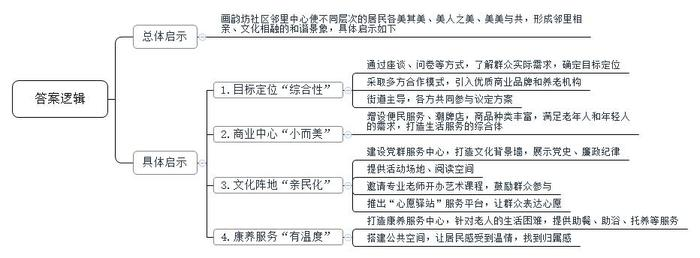
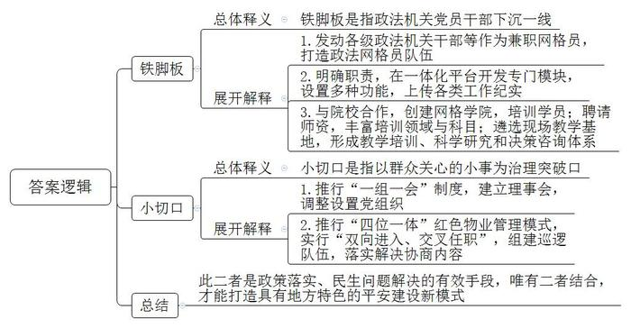
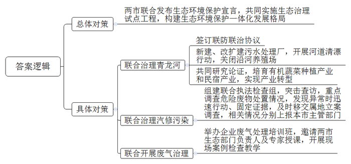
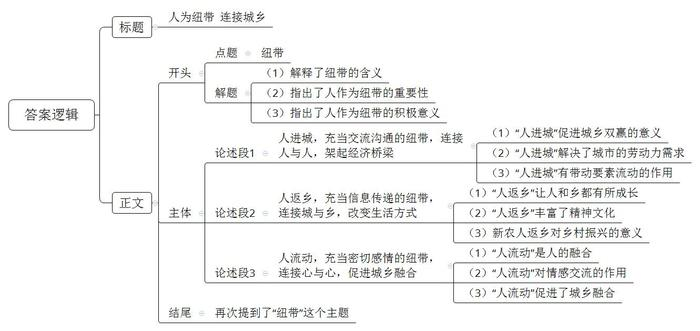

# 2022年公务员多省联考《申论》题（河南乡镇卷）

> 候选采集稿。参考答案及解析来自粉笔页面，不代表官方答案或真实高分答卷；来源使用许可与原卷对应关系仍需人工核实。

## 给定材料

### 材料 material-5202fc0721dffff3

2021年6月30日，Q区钟楼街道画韵坊社区邻里中心正式开业，现场犹如一场大派对，热闹非凡。

2018年，Q区对这里的棚户区原住民进行了拆迁安置，准备投资2500万把这里建设成最美邻里中心。怎么打造才能符合百姓心中的“最美”？钟楼街道办事处胡主任说，一开始他们想打造一个高标准菜市场，但通过走访居民、开座谈会、发放调查问卷，结果显示，八成居民认为“这不是刚需”，小区周边已有两个大菜市场。同时，居民们的一系列实际需求浮出水面：养老助餐、文娱活动、修理缝补……经过综合筛选，最终的方案是，把画韵坊社区邻里中心定位为全龄共享的综合性实体。

钟楼街道摒弃了政府“大包大揽”的传统思路，采取PPP的合作模式，经过多方比较，引进了淮尚家生活商业品牌和华福养老服务机构。在街道主导下，各方参与议定方案。最后，呈现在居民面前的邻里中心，总用地面积约3000平方米。面积不大，功能不少，一楼是社区商业中心，二楼是党群服务中心，三楼是康养服务中心。

走进一楼的商业中心，商品琳琅满目，人们络绎不绝。另一旁的“社区工坊”里，有理发、家政、维修等中老年人钟爱的便民服务，简餐、咖啡、鲜花绿植等小店则是清一色年轻人“心水”的潮牌。这里吃喝玩乐功能齐全、应有尽有。“淮小包”“就是牛”等特色餐饮丰富了“社区主食厨房”的内容，不少居民逛完菜市场，专程来这里排队尝鲜。“食愉食悦”和“we cafe”则是年轻人钟爱的甜品和咖啡。“束心”是一对90后小情侣开的花店，旁边挨着的是“淮小鲜”，供应各种蔬果生鲜……

走进二楼的党群服务中心，首先映入眼帘的是大型文化背景墙，党史应知应会知识、社区党建工作动态、廉政纪律规定等一一陈列其中。一大早，75岁的刘大爷就来预约活动场地。他是社区红叶诗社社长，该诗社由社区的诗词歌赋爱好者自发组成。以前开展活动，场所是个大问题，现在每周六上午诗社会在党群服务中心组织活动。在党群服务中心的左边，是一个宽敞明亮的阅读空间。钟楼街道积极与区图书馆合作，得到区图书馆捐赠的两千册图书，涵盖党建、文史、艺术、少儿等方面。居民可随时到此借阅图书。党群服务中心还邀请专业老师每月开展插画、书法、茶道等艺术课程，鼓励各职业群体、各年龄段的居民参与进来，实现社区资源共享。中心还推出“心愿驿站”服务平台，配备心愿收集箱、心愿墙，鼓励居民表达“微心愿”，让居民从“不愿说”到“掏心窝”。

“天气热的时候，转个弯、不出小区，就可以带孩子到党群服务中心看书；经常和姐妹们跟着老师学保健操、跳舞、话家常。这是以前想都不敢想的事儿！”社区居民杨大妈说。

三楼的华福养老中心提供助餐、助浴、日间照料和托养等服务。年过八十的张大爷夫妇，子女远在外地，老两口手脚不利索。买菜做饭难度很大，更为困难的是洗浴，每次都担心滑倒，邻里中心解决了他们的困难。现在，每天有四五十位老人来到三楼享受由华福养老服务中心提供的服务。

三楼还辟出了380平方米的空间，摆放“曲水流觞”的长条桌椅，抬头可见现代风格的水晶吊灯。这是一个居民共享的公共空间，年轻人在这里喝着咖啡捕捉时尚新奇，老年人在这里品着茗茶找寻久远的“乡愁”。

钟楼街道办事处胡主任说：“画韵坊社区邻里中心使不同层次的居民各美其美、美人之美、美美与共，从而形成邻里相亲、文化相融的和谐景象。”

### 材料 material-d98b0243589120b0

2020年3月，D市政法委发布《关于建立健全市政法系统机关党员干部“下沉一线”长效机制的意见》，以练就“铁脚板”为目标，发动全市各级政法机关干部、法官、检察官、警官、律师等报名作为兼职网格员，打造“政法网格员”队伍。

“为了让‘政法网格员’更好地深入一线，我们研究制定了下沉社区十大职责，并在‘社区治理一体化平台’上开发了‘政法网格员’专门模块，设置工作纪实、对策建议、统计考核等功能。”D市政法委梁副书记介绍。截至2021年底，D市共有1.4万名“政法网格员”，通过平台模块上传各类工作纪实8000余条。

2020年5月，D市政法委与政法学院合作，以网格员骨干、社区书记、主任等人员为主要培训对象，率先创建全国首家网格学院。学院聘请社会治理领域专家学者、实务部门专业人才以及一线网格员作为师资力量，开设了理论型、应用型、拓展型三大领域、40个课程科目。此外，在D市星湖街道和泰山街道遴选了10余个现场教学基地，初步形成教学培训、科学研究和决策咨询三大体系。

“大家都说说想法，要不要安装充电桩，在哪里安装充电桩？”在中博社区召开的居民议事会上，党员代表、居民代表等议事会成员与物业公司负责人就安装充电桩问题各抒己见。会议结束后，社区、物业以及议事会成员一同实地考察周边环境，商讨安装充电桩的合适位置，让“口头商议”落实为“现场操作”。

近年，D市全面推行“一组一会”制度，通过以村民小组（自然村）或者住宅小区（网格）为基本单元建立一个理事会（居民议事会），合理调整设置一个党组织，安排村、社区“两委”班子中的党员担任党支部书记（党小组组长），吸纳党员代表、村民代表、网格员等加入理事会（议事会），实现“一组一会”全覆盖。依托“一组一会”，D市全面推行党组织领导下的居委会、业委会、物业公司“四位一体”红色物业管理模式，实行“双向进入、交叉任职”，协调解决物业问题4000余件。动员“一组一会”成员参与巡逻防控，组建巡逻队伍2472支，巡逻防控53.3万次，处置事件1567条。

“我们街道有很多老旧小区，居民长期反映停车难。为此，我们通过社区网格党支部广泛收集群众意见，发挥‘一组一会’作用，多次召开协商议事会，最终确定设置人行道地桩、规范车位划线、制定车辆进出管理和停车登记制度……”青禾街道办连主任说。随着一系列举措的实施，青禾街道老旧小区的乱停车现象得到了有效治理。

D市始终坚持“好政策”离不开“铁脚板”，坚持从“小切口”中“解难题”，不断探索具有地方特色的平安建设新模式。2021年底，D市被确定为全国综治标准化试点市、市域社会治理现代化试点市。

### 材料 material-9ceb5643435daa76

蜿蜒的青龙河穿过N市，流向M市，默默滋养着相邻的M市和N市。前些年，由于两地缺乏有效管理和沟通，导致河流两岸常年垃圾堆积，污水横流。加之城镇居民生活污水、沿河畜禽养殖污水直排，河道生活垃圾无人清理，青龙河一度成为一个巨大的污水池，当地人避之不及。

2021年1月5日，两地联合发布《M市—N市生态环境保护联合宣言》，共同实施山水林田湖草生态保护修复治理试点工程，努力构建两地生态环境保护一体化发展新格局，守护这片共同生活的碧水绿地蓝天。同年4月，两市生态环境部门签订《深化两地水生态环境共建共保协议》和《青龙河联防联治协议》。

为保证“水清岸绿”，两市累计投入1.2亿元在沿河两岸新建和改扩建污水处理厂，关闭沿河养殖场，开展河道清漂行动。同时两市生态环境局牵头，会同发改、财政等部门以及青龙河两岸的县乡政府，进行了多轮研究论证，决定立足青龙河资源优势，着力培育打造有机蔬菜规模化种植产业和沿河精品露营民宿群。

“说实话，以前搞养殖市场波动大，污染也大。现在搞有机蔬菜种植和民宿，再也不像以前那样闻到河里飘来的臭味了。”N市关山镇双河村村民老李说，“现在青龙河又恢复了往日的清透，城里来游玩的客人越来越多，我们的收入也跟着增加了。”

M市和N市交界处有一块很大的荒地，经常有越野车爱好者聚集该处进行越野比赛，由于土地成本低，一些汽修公司便也在附近扎根落地，做起了越野车维修保养生意。2021年12月1日，检查组突击查访一家以汽车修理、保养为主的汽修店——安达汽修有限责任公司。

“汽车进行保养、喷漆维修的过程中，会产生漆渣、废矿物油、废油漆桶、废机油滤芯等物质，而这些都属于危险废物，我们将检查重点落在了对危险废物处置情况的调查上。”组员小陈说。

检查组翻阅核对危险废物管理台账，发现仅有废矿物油进出库记录，其他的危险废物无记录。此外，2020-2021年间，公司保养车辆时更换下来约两吨多废矿物油，这些废矿物油被转移了两次，但其提供的联单上却显示，只有1吨被转移至具有相应资质的单位进行处置，那剩下的去哪儿了？

带着疑问，检查组立即前往公司危险废物贮存场所进行突击检查，发现仅存有废矿物油约100公斤，离1吨的量相差甚远，且贮存场所存在一般固体废物与危险废物混存的情况。由于该公司属于M市G县管辖地界，检查组在固定证据后，及时移交给M市G县生态环境局进行立案调查。

同时，检查组还将相关情况上报给本市生态环境主管部门。M市和N市生态环境局对此高度重视，举一反三，随即在本市就企业危险废物管理问题开展了排查整治专项行动，并要求两市相邻区县加强联合执法检查，切实强化危险废物管理，消除环境污染风险隐患。

2022年2月，M市和N市生态环境局联合举办企业废气处理培训班，专门邀请两市生态环境局相关负责人、高校科研院所环保领域专家为两地相关企业负责人培训授课。培训期间，生态环境局相关负责人、环保领域专家还与参训的企业负责人一起走进春泥农业科技有限公司等3家企业，进行实地考察，开展现场案例教育教学。

## 题目

### 第 1 题

**请问：在****画****韵****坊社区邻里中心建设中，钟楼街道办事处的做法给你带来哪些****启****示？（****20分）**

关联材料：material-5202fc0721dffff3

作答要求：

要求：紧扣材料，全面准确，层次分明，有概括性，不超过350字。

### 第 2 题

**请结合****“给定资料**2**”，分析理解“铁脚板”和“小切口”的含义。（20分）**

关联材料：material-d98b0243589120b0

作答要求：

要求：全面，准确，深入。不超过300字。

### 第 3 题

**请根据****“给定资料**3**”，对M市和N市在开展生态环境保护跨区域合作方面的举措进行梳理概括。（20分）**

关联材料：material-9ceb5643435daa76

作答要求：

要求：全面准确、条理清晰，有概括性。不超过250字。

### 第 4 题

**“给定资料**4**”中两处提到“纽带”，请深入理解其含义，并以此为话题，联系现实，自拟题目，写一篇文章。（40分）**

关联材料：material-5202fc0721dffff3

作答要求：

要求：观点明确，见解深刻；参考给定资料，但不拘泥于给定资料；思路清晰，语言流畅；总字数800-1000字。

## 答案与解析

第 1 题

**参考答案（粉笔题库参考内容）**

画韵坊社区邻里中心使不同层次的居民各美其美、美人之美、美美与共，形成邻里相亲、文化相融的和谐景象，具体启示如下：

1.目标定位“综合性”。通过座谈、问卷等方式，了解群众实际需求，确定目标定位；采取多方合作模式，引入优质商业品牌和养老机构；街道主导，各方共同参与议定方案。

2.商业中心“小而美”。增设便民服务、潮牌店，商品种类丰富，满足老年人和年轻人的需求，打造生活服务的综合体。

3.文化阵地“亲民化”。建设党群服务中心，打造文化背景墙，展示党史、廉政纪律；提供活动场地、阅读空间；邀请专业老师开办艺术课程，鼓励群众参与；推出“心愿驿站”服务平台，让群众表达心愿。

4.康养服务“有温度”。打造康养服务中心，针对老人的生活困难，提供助餐、助浴、托养等服务；搭建公共空间，让居民感受到温情，找到归属感。

**解析**

**参考答案说明：**本参考答案先说明了画韵坊社区邻里中心建设的总体启示，再从“目标定位”“商业中心”“文化阵地”“康养服务”四个方面介绍了具体启示，答案层次分明。

**考点**：考点经验启示类

**来源**：来源2022年公务员多省联考《申论》题（河南乡镇卷）

粉笔申论页面对本题只提供「解析视频」入口，该入口是会员推广位，页面无视频地址与文字解析。

第 2 题

**参考答案（粉笔题库参考内容）**

铁脚板是指政法机关党员干部下沉一线。1.发动各级政法机关干部等作为兼职网格员，打造政法网格员队伍。2.明确职责，在一体化平台开发专门模块，设置多种功能，上传各类工作纪实。3.与院校合作，创建网格学院，培训学员；聘请师资，丰富培训领域与科目；遴选现场教学基地，形成教学培训、科学研究和决策咨询体系。

小切口是指以群众关心的小事为治理突破口。1.推行“一组一会”制度，建立理事会，调整设置党组织。2.推行“四位一体”红色物业管理模式，实行“双向进入、交叉任职”，组建巡逻队伍，落实解决协商内容。

此二者是政策落实、民生问题解决的有效手段，唯有二者结合，才能打造具有地方特色的平安建设新模式。

**解析**

**参考答案说明****：**（1）思路方面，本参考答案按照词句解释题“总体释义+展开解释+总结”的一般答题思路展开。（2）内容方面，本参考答案先围绕“铁脚板”与“小切口”两个方面分别进行分析，主要从含义、具体表现两个层面展开介绍，最后围绕二者进行总结。

**考点**：考点词句解释类

**来源**：来源2022年公务员多省联考《申论》题（河南乡镇卷）

粉笔申论页面对本题只提供「解析视频」入口，该入口是会员推广位，页面无视频地址与文字解析。

第 3 题

**参考答案（粉笔题库参考内容）**

两市联合发布生态环境保护宣言，共同实施生态治理试点工程，构建生态环境保护一体化发展格局。

1.联合治理青龙河。签订联防联治协议；新建、改扩建污水处理厂，开展河道清漂行动，关闭沿河养殖场；共同研究论证，培育有机蔬菜种植产业和民宿产业，实现产业转型。

2.联合治理汽修污染。组建联合执法检查组，突击查访，重点调查危险废物处置情况，发现异常时迅速行动、固定证据，及时移交属地立案调查，相关情况分别上报本市主管部门。

3.联合开展废气治理。举办企业废气处理培训班，邀请两市生态部门负责人及专家授课，开展现场案例检查教学。

**解析**

**参考答案说明：**本参考答案先介绍了两市开展生态环境保护的总体对策，接着具体对策从“联合治理青龙河”“联合治理汽修污染”“联合开展废气治理”三个方面展开，各条答案要点之间在内容上相互并列，没有交叉。

**考点**：考点概括措施类

**来源**：来源2022年公务员多省联考《申论》题（河南乡镇卷）

粉笔申论页面对本题只提供「解析视频」入口，该入口是会员推广位，页面无视频地址与文字解析。

第 4 题

**参考答案（粉笔题库参考内容）**

**人为纽带 连接城乡**

纽带是联系，让人与人更加亲密；纽带是连接，架起城与乡桥；纽带是惦念，让心与心紧密相连。在城乡一体建设当中，人是最为重要的纽带，只有人才能连接城乡一切要素。从信息技术到经济转型再到融合发展，人的流动给城乡一体化发展注入了新的活力。

**人进城，充当交流沟通的纽带，连接人与人，架起经济桥梁。**繁华城市，机会无限。农民进城，促成了乡村脱贫和城市发展的双赢局面。城市日益增长的多元化需求亟需大量的人力资源来满足，而乡村的大量剩余劳动力也迫切需要城里的工作机会。城乡之间以需求为纽带，产生了大量的人口流动，而人口的流动又加速了彼此之间的交流、理解与友谊。从“巧阿姨”到“蜘蛛侠”再到“外卖小哥”，他们作为纽带，不仅加速了各种要素在城乡之间的流动，还创造了巨大的经济价值，让城乡经济一体化的宏伟蓝图变成现实图景。

**人返乡，充当信息传递的纽带，连接城与乡，改变生活方式。**美丽乡村，大有作为。人才返乡，是个人发展和乡村振兴同频共振的“双向奔赴”。人才返乡不仅带回了城市里的技术、信息、思想，还带回了城市的生活方式，人作为纽带，让城乡虽相隔千里却比肩而立。从网购的兴起到新农艺的应用再到各种农家咖啡屋的诞生，新农人的回归不仅带来了丰富的精神文化生活，还改善了乡村的文化土壤，甚至深刻影响着淳朴乡风。作为纽带，新农人的流动增进了城乡之间的无形联系，也为乡村振兴注入了新的活力和动力，如同春雨滋润大地，带来了生机和希望。

**人流动，充当密切感情的纽带，连接心与心，促进城乡融合。**城乡融合发展，人要先融合。既要让城里人体验到“采菊东篱下，悠然见南山”的田园风情，也要让农村人感受到“凤箫声动，玉壶光转，一夜鱼龙舞”的城市繁华。这就需要人来做纽带，架起心的桥梁，让城里人与农村人的情谊更深，感情更厚。特色乡村游，让人告别城市喧嚣，感受田园牧歌；重点技术培训，让新农人掌握现代技术，推进农业现代化。正是无数次“城里人返乡，乡里人进城”往返流动，让城与乡“你中有我，我中有你”，甚至达到了“你就是我，我就是你”的程度。

流动中国，生生不息。人作为城乡融合纽带，密切了城乡联系，加速了城乡要素流动。流动中国，未来可期。在城乡发展的新征程上，人的纽带作用更为凸显，也必将推动城乡迎来更伟大的发展！

**解析**

**文章分析**

**人为纽带 连接城乡**

【**标题的优****点：**标题中含有主题词，使文章主题更突出、清晰。其次，主标题在形式上采用对称式结构，使标题更有亮点。】

（1）纽带是联系，让人与人更加亲密；纽带是连接，架起城与乡桥；纽带是惦念，让心与心紧密相连。（2）在城乡一体建设当中，人是最为重要的纽带，只有人才能连接城乡一切要素。（3）从信息技术到经济转型再到融合发展，人的流动给城乡一体化发展注入了新的活力。

【**开头的优点：**★内容方面。范文的开头是紧扣题目给定的“纽带”这一主题展开的。首先，解释了纽带的含义；其次，指出了人作为纽带的重要性；最后，提出了文章的核心观点。★文字表达方面。使用了排比句，使语言表达更有文采。】

**人进城，充当交流沟通的纽带，连接人与人，架起经济桥梁。**（1）繁华城市，机会无限。农民进城，促成了乡村脱贫和城市发展的双赢局面。（2）城市日益增长的多元化需求亟需大量的人力资源来满足，而乡村的大量剩余劳动力也迫切需要城里的工作机会。城乡之间以需求为纽带，产生了大量的人口流动，而人口的流动又加速了彼此之间的交流、理解与友谊。（3）从“巧阿姨”到“蜘蛛侠”再到“外卖小哥”，他们作为纽带，不仅加速了各种要素在城乡之间的流动，还创造了巨大的经济价值，让城乡经济一体化的宏伟蓝图变成现实图景。

【**论述段****1的优点：**★观点句：范文的观点句是紧扣“纽带”这一文章主题提出的。形式上，它在段首处直接写出，位置突出，容易发现。内容上，关键词突出，内容要点明确，可以明显看出主要论述“人进城，充当交流沟通的纽带，连接人与人，架起经济桥梁”。★论述内容：（1）指出了“人进城”促进城乡双赢的意义；（2）指出了“人进城”解决了城市的劳动力需求；（3）指出了“人进城”有带动要素流动的作用。注意：以上三个方面层次清晰，论述的针对性强。在论述方法上主要采用了讲道理、举例子相结合的方式。】

**人返乡，充当信息传递的纽带，连接城与乡，改变生活方式。**（1）美丽乡村，大有作为。人才返乡，是个人发展和乡村振兴同频共振的“双向奔赴”。（2）人才返乡不仅带回了城市里的技术、信息、思想，还带回了城市的生活方式，人作为纽带，让城乡虽相隔千里却比肩而立。从网购的兴起到新农艺的应用再到各种农家咖啡屋的诞生，新农人的回归不仅带来了丰富的精神文化生活，还改善了乡村的文化土壤，甚至深刻影响着淳朴乡风。（3）作为纽带，新农人的流动增进了城乡之间的无形联系，也为乡村振兴注入了新的活力和动力，如同春雨滋润大地，带来了生机和希望。

【**论述段****2的优点：**★观点句：范文的观点句是紧扣“纽带”这一文章主题提出的。形式上，它在段首处直接写出，位置突出，容易发现。内容上，关键词突出，内容要点明确，可以明显看出主要论述“人返乡，充当信息传递的纽带，连接城与乡，改变生活方式”。★论述内容：（1）指出了“人返乡”让人和乡都有所成长；（2）指出了“人返乡”丰富了精神文化；（3）指出了新农人返乡对乡村振兴的意义。注意：以上三个方面层次清晰，论述的针对性强。在论述方法上主要采用了讲道理、举例子相结合的方式。】

**人流动，充当密切感情的纽带，连接心与心，促进城乡融合。**（1）城乡融合发展，人要先融合。既要让城里人体验到“采菊东篱下，悠然见南山”的田园风情，也要让农村人感受到“凤箫声动，玉壶光转，一夜鱼龙舞”的城市繁华。（2）这就需要人来做纽带，架起心的桥梁，让城里人与农村人的情谊更深，感情更厚。特色乡村游，让人告别城市喧嚣，感受田园牧歌；重点技术培训，让新农人掌握现代技术，推进农业现代化。（3）正是无数次“城里人返乡，乡里人进城”往返流动，让城与乡“你中有我，我中有你”，甚至达到了“你就是我，我就是你”的程度。

【**论述段****3的优点：**★观点句：范文的观点句是紧扣“纽带”这一文章主题提出的。形式上，它在段首处直接写出，位置突出，容易发现。内容上，关键词突出，内容要点明确，可以明显看出主要论述“人流动，充当密切感情的纽带，连接心与心，促进城乡融合”。★论述内容：（1）指出了“人流动”是人的融合；（2）指出了“人流动”对情感交流的作用；（3）指出了“人流动”促进了城乡融合。注意：以上三个方面层次清晰，论述的针对性强。在论述方法上主要采用了讲道理、举例子相结合的方式。】

【**论述段之间的关系：**★内容的内在逻辑：范文的论述段之间是依照人的“进城、返乡、流动融合”的逻辑展开的。论述段1先写了“人进城，充当交流沟通的纽带，连接人与人，架起经济桥梁”，论述段2再写了“人返乡，充当信息传递的纽带，连接城与乡，改变生活方式”，论述段3写了“人流动，充当密切感情的纽带，连接心与心，促进城乡融合”。】

流动中国，生生不息。人作为城乡融合纽带，密切了城乡联系，加速了城乡要素流动。流动中国，未来可期。在城乡发展的新征程上，人的纽带作用更为凸显，也必将推动城乡迎来更伟大的发展！

【**结尾的优点：**范文的结尾回扣了“纽带”这个主题，并且进行了总结提升。】

**考点**：考点文章写作题

**来源**：来源2022年公务员多省联考《申论》题（河南乡镇卷）

粉笔申论页面对本题只提供「解析视频」入口，该入口是会员推广位，页面无视频地址与文字解析。

