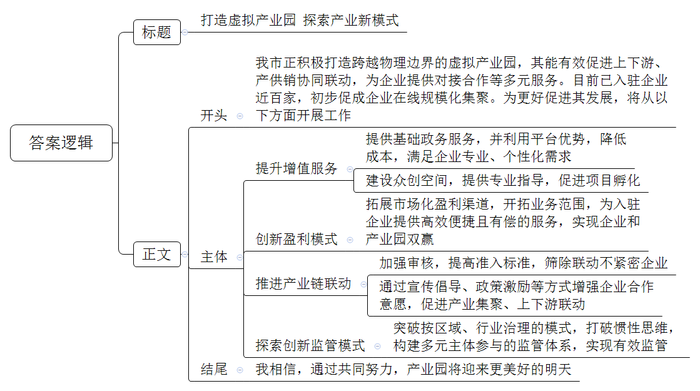
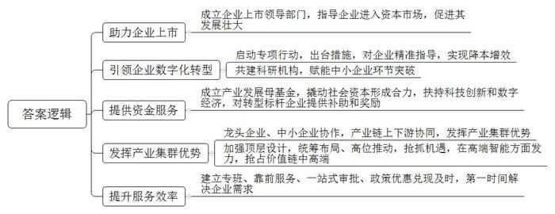
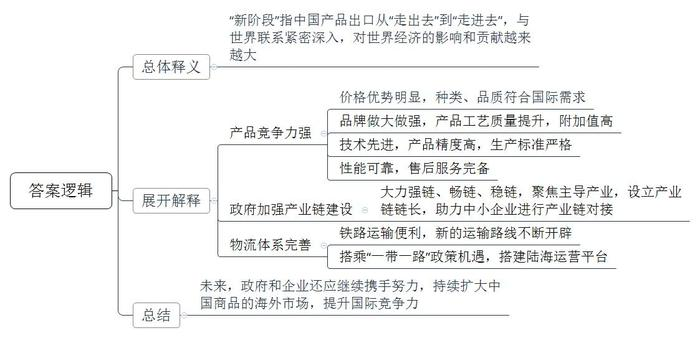
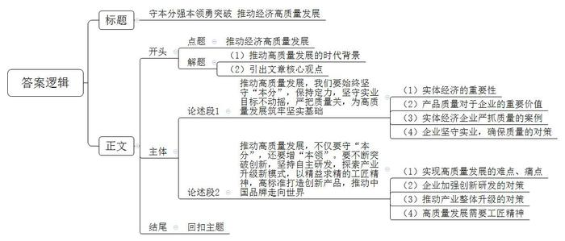

# 2023年公务员多省联考《申论》题（河南市级卷）

<!-- gwy:overview:start -->
> **河南 · 2023 · 申论 · 市级卷** ｜ 4 题 · 图片 4 处 · 答案随题折叠

导航：[题目](#题目) · [材料 1](#材料-1)
<!-- gwy:overview:end -->

> 候选采集稿。参考答案及解析来自粉笔页面，不代表官方答案或真实高分答卷；来源使用许可与原卷对应关系仍需人工核实。

## 给定材料

### 材料 1

“虽然我们的办公地点还在深圳，但我们可以享受到千里之外的D市提供的‘云端’服务和税收优惠等政策。”启程科技王总经理高兴地对记者说。启程科技所享受的服务和优惠，源于D市积极布局打造的跨越物理边界的虚拟产业园。

相较于传统产业园区，企业只需把公司注册到虚拟产业园，不用入驻指定地理区域生产经营，可自由选择办公城市和地点，也就是说，虚拟产业园内的企业可以分布在全国各地。

截至目前，D市虚拟产业园招商入驻企业近100家，主要为互联网企业、电商企业、高科技企业等，初步促成了企业在线规模化集聚。产业园为入驻企业提供了合作需求发布、企业资源交换、信息共享、互动交流等多方面服务。因为产业园掌握着比较丰富的数据，利用这些信息流，可以有效促进上下游、产供销协同联动，帮助园区内的一些电商企业与相关企业对接、合作，拓展渠道。

近日，D市市领导专门主持召开了虚拟产业园发展座谈会。下面是与会代表的发言摘录：

布拉电商科技有限公司陈总经理说：“前不久，我们在四川通过网络提交了相关材料，虚拟产业园的工作人员随即帮我们完成了工商注册，非常方便，公司已正式成为D市虚拟产业园的新成员。”

D市工业经济研究所何研究员认为，目前选择入驻虚拟产业园的大多数为初创型企业，这些企业往往资金规模较小，除了基础的政务服务需求外，也希望能够以较低的成本获取法律、人力、财务、营销、金融、品牌等专业服务。部分企业因为行业特性还会衍生出不少个性化的需求，例如电商企业对客服、营销服务的需求，文创企业对设计、美工服务的需求。

市经信委袁副主任说，虚拟产业园要发展，需在盈利模式上有所突破。与传统产业园区相比，虚拟产业园在房地产方面的销售和租赁收入很少，目前主要依靠税收返还、政府补贴等渠道获取收入，但这并非长久之计。既为入驻企业发展提供支撑，也能实现产业园自身的发展，是一个全新的课题。

虚拟产业园负责人石主任说：“我们发现，部分企业入驻产业园的主要目的是减税，与平台产业链上下游进行联动的意愿不强，创新链、服务链与产业链之间的有机衔接没有达到预期，产业链供应链还缺乏稳定性。”

D大学贺教授表示，作为新业态新模式的虚拟产业园打破行政边界后，如何实现有效监管对虚拟产业园发展至关重要。要打破传统业态按区域、按行业治理的惯性思维，探索创新监管模式。

君和咨询公司游经理表示，产业园在增值服务方面还有进一步提升的空间。虚拟产业园原本就有平台优势，现在的关键问题是如何把这个优势发挥好。例如，沿海某城市的网商虚拟产业园，他们在产业园建设了产学研一体化、培训、实训、孵化一条龙的“众创空间”，并邀请知名企业家、教授为创业团队提供专业意见和建议，该产业园已成功孵化项目超过30个。

### 材料 2

20多年来，J市根据企业需求不断推出新举措，当好企业的“引路人、推车手、服务员”。早在2001年，J市政府就成立了企业上市领导小组办公室，指导多家集团通过进入资本市场，为其发展壮大补充“资本燃料”。

2021年初，J市启动数字经济发展三年行动，出台了《支持产业数字化转型升级十二条措施》，扶持传统制造业数字化转型。针对不同企业在研发、生产、管理、销售等各环节面临的具体问题，为他们提供智能运维、调度、物流、管网及算法软件优化等精准指导，帮助企业降本增效。J市经信委相关负责同志介绍，数字化转型运行两年来，样板企业平均用工减少60%，运营成本降低20%，产品研发周期缩短50%，生产效率提升40%。

中科院某装备制造研究中心是中科院与J市人民政府共同建设的科研单位，该中心以赋能中小企业“环节突破”为核心要务，已为全市200多家中小企业提供了数字化转型服务。

2022年7月，由市政府主导、国有企业出资、总规模达50亿元的产业发展母基金正式成立。相关负责人介绍：“我们将以此撬动至少200亿元社会资本形成合力，用以投向科技创新和数字经济领域。”对鞋服、建材、医疗器械等传统产业的数字化转型标杆样板企业，市政府按照不超过其投入金额20%的标准给予补助；对于工业互联网平台、系统服务商，最高可获30万元奖励。

市发改委相关负责人表示，经过持续多年的产业布局，J市有7000多亿元的工业底盘，26万多个市场主体。行业龙头企业的周边活跃着数以千计的中小企业为之提供配套服务。他们中绝大多数的服务辐射半径在50公里以内。这就意味着，龙头企业能够快捷便利地找到配套商，大大降低了成本，而中小企业只需专注于产业链条某一环节的研发生产。龙头企业和中小企业同向发力，产业链上下游协同，是近年来J市发挥产业集群优势、稳住实体经济大盘的秘诀。某公司负责人说：“2022年以来，从鞋服、纸箱到标识、模具，产业链上下游500多家做配套的中小企业，全部和我们一道保持满负荷生产。”

泰信集团是一家纺织面料、纺织机械生产企业，为配合海外客户需求，公司于2016年在东南亚设立工厂。泰信集团总裁说：“东南亚国家企业生产运动鞋所需的高端面料、纱线、鞋底材料等，很大程度上依赖国内出口。在东南亚国家建设智能车间、数字化生产线，也离不开来自国内的技术人员和工程师。”对此，市发改委相关负责人表示，这是企业转型升级的机遇，要抓住这个机遇，接下来J市要通过顶层设计，统筹布局、高位推动，以产业集群优势，在精细化工、中高端面料、智能装备、高端设备、示范工厂等方面发力，抢占价值链中高端。

2022年3月，疫情使众多企业生产经营受到影响。多家企业负责人回忆。当时正是生产旺季，很多企业已经提前交付了海运集装箱定金，如果不能按时交货，将承担巨额违约责任。危急时刻，J市政府帮助困难企业闭环生产，点对点运送货物至港口出海，保障了按时生产和交货，挽救了一批企业。2022年8月，胜科纳米科技公司的芯片分析测试实验室正式运行。这家高科技企业，从决定在J市设立公司开始到正式运营，仅用了半年时间。J市的服务效率给公司刘总留下了深刻印象，“市里建立专班，靠前服务，各项审批手续一个窗口完成，人才补贴当年兑现，员工租房、联系食堂等也迅速协调解决。只要企业有需求，随时给政府部门打电话，都能在第一时间得到回应和解决。”

### 材料 3

“在刚刚结束的卡塔尔世界杯上，‘中国制造’随处可见。”球迷王先生兴奋地说。此刻，王先生正在卡塔尔首都多哈的一家世界杯官方特许商品零售店选购纪念品，帽子、围巾、水杯、徽章、吉祥物等商品琳琅满目，其中绝大多数都产自于中国。

与球迷王先生一样兴奋的还有凯奥体育用品有限公司的吴经理，他说：“我们公司是五届世界杯的‘元老级供货商’。10年前，我们靠低价抢占市场。这几年受疫情影响，来实地看货的海外客商有所减少，但公司抓住海外需求依然强劲的机遇，销量保持了持续增长，尤其在卡塔尔世界杯期间实现了40%的环比增长。现在我们的商品不仅价格优势明显，种类、品质也越来越符合国际市场的口味。”

利斯体育用品公司丁经理介绍说：“我们以做大做强品牌为目标，不断提升和改进产品工艺和质量。特别是今年，我们原创的带刺绣图案的牛津布旗帜，大量出口到欧美国家，在世界杯之后，还可用作室内装饰。虽然价格比普通旗帜贵10倍，订单却源源不断。”

某精工钢构集团是世界杯主体育场主体钢结构的承接单位，项目负责人刘经理说：“按设计要求，直径1600mm的圆管，对接错边不得超过3mm，而我们通过看家的硬核科技，将对接错边成功控制在了1mm。”连外方项目验收人员都感叹：“从未见过对自己都这么苛刻的工程公司。”球迷王先生表示，即便没有比赛，这座体育场的宏伟与各个细节的处理都令人感到山呼海啸的气势与精细绵柔的享受。

当一辆辆满载球迷的大巴车驶向一座座留有“中国制造”印记的世界杯体育场时，可能很多人还不知道，这些大巴车大多都是中国制造的新能源客车。世界杯结束后，这批车辆还将长期服务于多哈的公共交通。“中国的新能源客车不仅性能非常可靠，而且售后服务非常完备，我们非常满意！”多哈公共交通部门负责人说。

日前，津津食品公司刚刚拿到了第100家欧洲客商的订单，这在食品安全标准异常严格的欧洲是非常难得的。公司黄经理说：“我们这次能够这么快拿下这个订单，离不开政府在食品行业强链、畅链、稳链方面所做的大量工作，前不久，省政府聚焦十大主导产业，为100条产业链设立了链长，帮助链上中小企业进行产业链整零对接、芯机对接、产销对接。我们不能辜负政府的努力。”

近日，一趟满载出口商品的班列在某铁路货场鸣笛启程前往欧洲。在紧邻班列出发地的国际联运港会议室里，常驻货场的多个公司负责人正围坐一起畅谈公司发展。“我们计划开拓南线通道，增开线路，确保货物及时送出去。”国际物流公司罗经理说。“‘一带一路’需要陆路与海路的衔接，上个月我们就与某港口签了合作协议，陆海运营平台优势尽显。”联运港有限公司胡经理接过话茬。

某经济研究院杨副院长在民营经济发展论坛上指出，我国产品出口正在从“走出去”迈入“走进去”的<u>新阶段</u>，我们与世界的联系愈加紧密深入，对世界经济的影响和贡献越来越大。

### 材料 4

人多地少是G省的基本省情，在国家严控工业用地的背景下，面对蓬勃发展的制造业，如何节约集约利用存量工业用地，寻求增量空间，事关全省发展大局。近年来，G省积极探索“工业上楼”载体新模式来提升效益，增加新型工业、产业用地空间。

2019年7月，G省Z市在全国率先出台《Z市工业上楼工作指引》，规定容积率放宽到3.5以上，建筑密度放宽至55%，屋顶绿化折算绿地率，配套用房建筑面积可达到30%。

瑞名智能包装公司的新厂房楼高8层，其中1至5层分别为生产车间、仓储部、装配车间以及调试车间，6至8层为办公室。2022年底，原分散于三个厂区平摊式的生产线整体搬迁上楼，顺利实现良性运转。Z市城投城市更新投资有限公司刘经理说，针对瑞名智能等重荷载行业企业，他们设计了“下生产、中组装、上服务”的“工业上楼”空间布局。

Z市重点打造的智全科创园建筑面积17万平方米，设有生产研发、总部办公、产业配套、生活配套等功能区。目前，园区入驻企业120多家，入驻率95%，主导产业为机器人和智能装备，园区企业年产值35亿元，是2018年“工业上楼”改造之前的19倍。“除了空间更大，企业在生产运营方面的便捷也是‘上楼’前不能想象的。”智全科创园王经理说。当客户挑选完激光切割设备后，速光科技负责人李总将客户引荐到了同一栋楼的下游企业升科智能。“当初就是看到速光科技入驻了智全科创园，我才来的。上下游企业有相同的客户群体，客户到我们这里来看设备，还可以楼上楼下参观、交流，售后服务也方便。碰到技术研发上的问题，大家还能协作攻关，带来很大的成本优势。”目前这栋楼里，他的客户有三家，供应商有四五家，“一栋楼就是一条生产链。”升科智能宋总说。

Z市多个“工业上楼”项目均采用了新型工业化建造方式，以高适应性的空间去配合企业，满足企业对高大空间和重荷载的需求。“楼上”的产业空间体验好不好，功能全不全，企业说了算。贤云科技通过对企业“上楼意愿”及代表案例的总结研究，在Z市山南智造城市更新项目中，提出了“折叠空间、多维产城”设计理念，将货运交通引入不同楼层平台，实现“多首层”厂房，最大程度满足高端制造业的生产需求及入驻企业的低楼层意愿，得到入驻企业的高度评价。

2020年底，G省K市启动建设“工业上楼”项目——满天星科创产业园，推动工业用地向“研发+生产”的功能性土地转变。产业园一期运营以来，已吸引和扶持人工智能、智能制造等领域科创项目32个。满天星科创产业园熊主任说：“我们的目标是形成融合生产、生活、生态的新型复合园区。2022年以来，K市新上工业项目用地平均容积率较2021年提高了7%，亩均产出提高15%，用地成本却降低了10%。”K市自然资源和规划局涂局长说：“‘工业上楼’不仅满足了企业的研发、生产、生活需求，而且在建筑规划上最大限度契合了整体城市形象，也是我们打造产业社区的第一步，通过‘工业上楼’提升产业集聚度，进而聚集人才、形成社区。产业社区已成为都市型工业的升级版，其不仅关联产业，更是‘人城产’的深度融合。”

对于“工业上楼”，G省某大学龚教授分析说：“上楼有很多好处，但不是谁都能上楼。哪些企业哪些行业上楼，是对产业的一次优选。”

### 材料 5

二十多年前，A集团刚刚起步，还是个小企业，时任福建省省长习近平对A集团关怀鼓励的一幕幕场景令集团丁总记忆犹新。2001年4月20日，时任福建省省长习近平出席第三届中国国际鞋业博览会。开馆仪式后，他便径直来到A集团展馆，对企业提出了三点要求：“把好质量关，创出自己的品牌，要有自己的创新产品。”

“就是那时候开始，我们步入了发展的快车道。”丁总深有感触地说：“做实业确实蛮不容易，一定要有定力。”近年来，国际市场不稳定性不确定性上升，一些制造业企业特别是出口企业遇到困难。A集团没有转行赚快钱，而是坚持做实业，不断加大主业投入、提高研发投入，逐步成长为全球第三大体育用品集团。

2022年2月5日晚，在北京冬奥会2000米混合团体接力A组决赛中，中国队以0.016秒的优势，夺得短道速滑项目首枚金牌。这0.016秒的背后，离不开A集团运用空气湍流控制、边界滑移技术、高弹减阻面料和表面导流结构等多种减阻技术打造的短道速滑比赛服。不仅如此，在北京冬奥会上，A集团还为中国国家队打造了多类型高科技专业比赛装备。

2022年8月8日，A集团在年度创新科技大会上，发布了最新的自主研发科技创新成果——氮科技中底平台与碳管悬架系统。在这一最新技术加持下的全新奥运冠军跑鞋，拥有优越的缓震性能与超强的稳定支撑，中底能量回归率高达82.6%，耐受性提升33%，整体缓震性能提升26%，稳定性能提升23%。A集团始终对科技创新有着不懈追求。从2007年公司上市以来，A集团已累计投入超56亿用于自主创新研发，研发开支占比在我国可选消费品上市公司中持续位居前列。目前，A集团在中、美、日、韩、意建立了全球五大设计研发中心，主导搭建了覆盖20多个国家和地区、由60多所科研机构共同参与的全球创新研发网络。

### 材料 6

近日，Q市社会科学院召开学习贯彻党的二十大精神座谈会。

出席座谈会的市委党校熊教授发言时说：“党的二十大报告指出，没有坚实的物质技术基础，就不可能全面建成社会主义现代化强国，当前，世界百年未有之大变局加速演进，新一轮科技革命风起云涌，产业变革深入发展，我们必须心无旁骛，在大变局的喧嚣中始终坚守住‘本分’，切实增强好‘本领’，不断突破创新，推动高质量发展的步伐就能坚实稳健，我们就能走向广阔的未来。”

……

## 题目

### 第 1 题

**请结合“给定资料1”，为参加座谈会的市领导拟写一份总结发言稿。（20分）**

关联材料：材料 1

作答要求：

要求：定位准确，内容全面，不考虑格式；不超过400字。

第 1 题 · 答案与解析

**参考答案（粉笔题库参考内容）**

打造虚拟产业园 探索产业新模式

我市正积极打造跨越物理边界的虚拟产业园，其能有效促进上下游、产供销协同联动，为企业提供对接合作等多元服务。目前已入驻企业近百家，初步促成企业在线规模化集聚。为更好促进其发展，将从以下方面开展工作：

一、提升增值服务。提供基础政务服务，并利用平台优势，降低成本，满足企业专业、个性化需求；建设众创空间，提供专业指导，促进项目孵化。二、创新盈利模式。拓展市场化盈利渠道，开拓业务范围，为入驻企业提供高效便捷且有偿的服务，实现企业和产业园双赢。三、推进产业链联动。加强审核，提高准入标准，筛除联动不紧密企业；通过宣传倡导、政策激励等方式增强企业合作意愿，促进产业集聚、上下游联动。四、探索创新监管模式。突破按区域、行业治理的模式，打破惯性思维，构建多元主体参与的监管体系，实现有效监管。

我相信，通过共同努力，产业园将迎来更美好的明天。

**解析**

**参考答案说明**：（1）格式方面，本参考答案写到了“标题”“正文”两个部分。（2）正文部分，一方面从内容上来看，本参考答案的开头先介绍了D市虚拟产业园的基本情况，接着主体部分围绕“提升增值服务”“创新盈利模式”“推进产业链联动”“探索创新监管模式”这四个方面展开，最后，结尾部分进行了简单总结。另一方面，形式上，本参考答案做到了分段、分条撰写，整体上条理较为清晰。

**考点**：总结类

**来源**：2023年公务员多省联考《申论》题（河南市级卷）

### 第 2 题

**多年来，为当好企业的“引路人、推车手、服务员”，J市不断推出新举措，请根据“给定资料2”，对此进行梳理概括。（20分）**

关联材料：材料 2

作答要求：

要求：全面准确，条理清晰，有概括性；不超过300字。

第 2 题 · 答案与解析

**参考答案（粉笔题库参考内容）**

1.助力企业上市。成立企业上市领导部门，指导企业进入资本市场，促进其发展壮大。

2.引领企业数字化转型。启动专项行动，出台措施，对企业精准指导，实现降本增效；共建科研机构，赋能中小企业环节突破。

3.提供资金扶持。成立产业发展母基金，撬动社会资本形成合力，扶持科技创新和数字经济，对转型标杆企业提供补助和奖励。

4.持续产业布局。龙头企业、中小企业协作，产业链上下游协同，发挥产业集群优势；加强顶层设计，统筹布局、高位推动，抢抓机遇，在高端智能方面发力，抢占价值链中高端。

5.提升服务效率。建立专班、靠前服务、一站式审批、政策优惠兑现及时，第一时间解决企业需求。

**解析**

**参考答案说明**：本参考答案从“助力企业上市”“引领企业数字化转型”“提供资金扶持”“持续产业布局”和“提升服务效率”这五个方面展开。各条答案要点在内容上相互并列，没有交叉。

**考点**：概括措施类

**来源**：2023年公务员多省联考《申论》题（河南市级卷）

### 第 3 题

**请结合“给定资料3”，谈谈你对画线词语“新阶段”的理解。（20分）**

关联材料：材料 3

作答要求：

要求：准确、深入、有条理；不超过300字。

第 3 题 · 答案与解析

**参考答案（粉笔题库参考内容）**

“新阶段”指中国产品出口从“走出去”到“走进去”，与世界联系紧密深入，对世界经济的影响和贡献越来越大。

其原因有：

1.产品竞争力强。价格优势明显，种类、品质符合国际需求；品牌做大做强，产品工艺质量提升，附加值高；技术先进，产品精度高，生产标准严格；性能可靠，售后服务完备。

2.政府加强产业链建设。大力强链、畅链、稳链，聚焦主导产业，设立产业链链长，助力中小企业进行产业链对接。

3.物流体系完善。铁路运输便利，新的运输路线不断开辟；搭乘“一带一路”政策机遇，搭建陆海运营平台。

未来，政府和企业还应继续携手努力，持续扩大中国商品的海外市场，提升国际竞争力。

**解析**

**参考答案说明：**（1）思路方面，本参考答案按照词句解释题“总体释义+展开解释”的答题思路展开。（2）内容方面，本参考答案解释了题干给定词汇“新阶段”的含义；接着，“展开解释”部分从“市场竞争能力提升”“产品供应链完善”“市场布局深入”阐述了中国产品出口进入“新阶段”的具体原因；“总结”部分进行了展望。各条答案要点之间在内容上相互并列，没有交叉。

**考点**：词句解释类

**来源**：2023年公务员多省联考《申论》题（河南市级卷）

### 第 4 题

**“给定资料6”提到“在大变局的喧嚣中始终坚守住‘本分’，切实增强好‘本领’，不断突破创新，推动高质量发展的步伐就能坚实稳健，我们就能走向广阔的未来”，请结合对这句话的理解，联系实际，自选角度，自拟题目，写一篇文章。（40分）**

关联材料：材料 1、材料 2、材料 3、材料 4、材料 5、材料 6

作答要求：

要求：观点明确，见解深刻，思路清晰，结构完整，语言流畅；参考给定资料，但不拘泥于给定资料；1000-1200字。

第 4 题 · 答案与解析

**参考答案（粉笔题库参考内容）**

**参考答案一：**

**守本分强本领勇突破 推动经济高质量发展**

当今世界正处于百年未有之大变局，新一轮科技革命风起云涌，产业变革深入发展，如何在这一片喧嚣之中，开新局、育新机，彰显中国力量，推动高质量发展是大势所趋。前进的方向已经明确、前行的道路已经开拓，我们必须要守住“本分”，提高“本领”，不断突破创新，大力推动经济高质量发展，为全面建设社会主义现代化强国开好局起好步。

**推动高质量发展，我们要始终坚守“本分”，保持定力，坚守实业目标不动摇，严把质量关，为高质量发展筑牢坚实基础。**实体经济是支撑经济增长、保障国家安全的重要基础，是一国经济的立身之本，是财富创造的根本源泉。而在实体经济的主战场上，质量是企业的立身之本。从伊利推出“了不起的品质之旅”品质体验月，扭转国人对于国产乳制品的糟糕印象；到格力空调打出“好空调格力造”的世纪广告语，给出消费者无需售后服务的品质保证；再到海尔“怒砸问题冰箱”，唤醒员工的质量意识、市场意识，砸掉“中国制造”的刻板印象……这背后都是中国企业数十年如一日坚持做实业、“锱铢必较”严把质量关的生动写照。因此，迎战变局，企业一方面需要拿出“咬定青山不放松”的定力，迎难而上、攻坚克难，聚焦目标、聚焦实业；另一方面要严把材料关、生产关、检验关，确保产品质量过硬，用高品质立身，走稳高质量发展之路。

**推动高质量发展，不仅要守“本分”，还要增“本领”。要不断突破创新，坚持自主研发，探索产业升级新模式，以精益求精的工匠精神，高标准打造创新产品，推动中国品牌走向世界。**

曾经我们号称“制造大国”，但从“制造大国”到“制造强国”的路，我们走得艰难又漫长。制造业“大而不强”是实现高质量发展的难点、痛点，因此，我们要在科技创新上下足功夫，鼓励企业建立研发中心，加强研发投入，推出更具市场竞争力的产品。就如安踏集团集结20多个国家和地区、60多所科研机构共同研发体育用品，攻破运动科技领域“卡脖子”难题。“孤木不成林”，一个企业的创新难以推动整个制造业高质量发展，因此，还需要对产业进行升级，让企业的创新同频共振。“工业上楼”、虚拟产业园等等都体现了政府打破传统产业模式、淘汰落后产能的决心与信心。最后，高质量发展还离不开高标准、严要求、精益求精的工匠精神。“从未见过对自己都这么苛刻的工程公司”是外方项目验收员对卢塞尔球场的赞叹。卢塞尔球场主体钢结构对接错边控制在了1mm，工程难度之高可见一斑，但中国的精工钢构集团以“绣花功夫”向世界宣告，中国制造正在破茧成蝶！

潮平岸阔催人进，风正扬帆正当时。高质量发展是全面建设社会主义现代化国家的首要目标，我们要在守“本分”，增“本领”中实现高质量发展！

**文章分析**

**守本分强本领勇突破** **推动经济高质量发展**

【**标题的优点：**范文的标题突出了“高质量发展”这一主题，文章主题、角度都很清晰。】

（1）当今<u>世界正处于百年未有之大变局</u>，<u>新一轮科技革命风起云涌</u>，<u>产业变革深入发展</u>，如何在这一片喧嚣之中，<u>开新局、育新机</u>，<u>彰显中国力量</u>，推动高质量发展是大势所趋。（2）前进的方向已经明确、前行的道路已经开拓，<u>我们必须要守住“本分”</u>，<u>提高“本领”</u>，<u>不断突破创新</u>，<u>大力推动经济高质量发展</u>，<u>为全面建设社会主义现代化强国开好局起好步</u>。

【**开头的优点：**★内容方面。范文的开头是紧扣“高质量发展”这一主题展开的。首先，开头点出主题，做到了主题明确。其次，对“高质量发展”这一主题进行了分析阐述，指出了（1）推动高质量发展的时代背景。（2）引出文章核心观点。★文字表达方面。使用了设问的修辞手法，使文字表达更加有力。】

**推动高质量发展，我们要始终坚守“本分”，保持定力，坚守实业目标不动摇，严把质量关，为高质量发展筑牢坚实基础**。（1）<u>实体经济是支撑经济增长</u>、<u>保障国家安全的重要基础</u>，<u>是一国经济的立身之本</u>，是<u>财富创造的根本源泉</u>。（2）而在实体经济的主战场上，<u>质量是企业的立身之本</u>。（3）从伊利推出“了不起的品质之旅”品质体验月，<u>扭转国人对于国产乳制品的糟糕印象</u>；到格力空调打出“好空调格力造”的世纪广告语，<u>给出消费者无需售后服务的品质保证</u>；再到海尔“怒砸问题冰箱”，<u>唤醒员工的质量意识</u>、<u>市场意识</u>，<u>砸掉“中国制造”的刻板印象</u>……这背后都是中国企业数十年如一日坚持做实业、“锱铢必较”严把质量关的生动写照。（4）因此，迎战变局，<u>企业一方面需要拿出</u>“<u>咬定青山不放松</u>”<u>的定力</u>，<u>迎难而上</u>、<u>攻坚克难</u>，<u>聚焦目标</u>、<u>聚焦实业</u>；另一方面要<u>严把材料关</u>、<u>生产关</u>、<u>检验关</u>，<u>确保产品质量过硬</u>，<u>用高品质立身</u>，走稳高质量发展之路。

【**论述段1的优点：**★观点句：范文的观点句是紧扣“高质量发展”这一文章主题提出的。形式上，它在段首处直接写出，位置突出，容易发现。内容上，关键词突出，内容要点明确，可以明显看出是从“坚守实业，严把质量”的角度展开论述。★论述内容：（1）先介绍了实体经济的重要性；（2）接着介绍了产品质量对于企业的重要价值；（3）再列举实体经济企业严抓质量的案例；（4）最后指出了企业坚守实业，确保质量的对策。注意：以上四个方面的内容都是紧扣“推动高质量发展，我们要始终坚守‘本分’，保持定力，坚守实业目标不动摇，严把质量关，为高质量发展筑牢坚实基础”这个观点句进行分析论述的，论述的针对性强，内容层次丰富。在论述方法上采用了讲道理、举例子相结合的方式，论述充实透彻。】

**推动高质量发展，不仅要守“本分”，还要增“本领”。要不断突破创新，坚持自主研发，探索产业升级新模式，以精益求精的工匠精神，高标准打造创新产品，推动中国品牌走向世界**。

（1）曾经我们号称“制造大国”，但<u>从</u>“<u>制造大国</u>”<u>到</u>“<u>制造强国</u>”<u>的路</u>，我们<u>走得艰难又漫长</u>。制造业“<u>大而不强</u>”是<u>实现高质量发展的难点</u>、<u>痛点</u>，（2）因此，<u>我们要在科技创新上下足功夫</u>，<u>鼓励企业建立研发中心</u>，<u>加强研发投入</u>，<u>推出更具市场竞争力的产品</u>。就如安踏集团集结20多个国家和地区、60多所科研机构共同研发体育用品，攻破运动科技领域“卡脖子”难题。（3）“孤木不成林”，<u>一个企业的创新难以推动整个制造业高质量发展</u>，因此，<u>还需要对产业进行升级</u>，<u>让企业的创新同频共振</u>。“工业上楼”、虚拟产业园等等都体现了政府打破传统产业模式、淘汰落后产能的决心与信心。（4）最后，<u>高质量发展还离不开高标准</u>、<u>严要求</u>、<u>精益求精的工匠精神</u>。“从未见过对自己都这么苛刻的工程公司”是外方项目验收员对卢塞尔球场的赞叹。卢塞尔球场主体钢结构对接错边控制在了1mm，工程难度之高可见一斑，但中国的精工钢构集团以“绣花功夫”向世界宣告，中国制造正在破茧成蝶！

【**论述段2的优点：**★观点句：范文的观点句是紧扣“高质量发展”这一文章主题提出的。形式上，它在段首处直接写出，位置突出，容易发现。内容上，关键词突出，内容要点明确，可以明显看出是从“增强本领，创新升级”的角度展开论述。★论述内容：（1）先指出了实现高质量发展的难点、痛点；（2）接着指出了企业加强创新研发的对策；（3）再指出推动产业整体升级的对策；（4）最后介绍了高质量发展需要工匠精神。注意：以上四个方面的内容都是紧扣“推动高质量发展，不仅要守‘本分’，还要增‘本领’。要不断突破创新，坚持自主研发，探索产业升级新模式，以精益求精的工匠精神，高标准打造创新产品，推动中国品牌走向世界”这个观点句进行分析论述的，论述的针对性强，内容层次丰富。在论述方法上采用了讲道理、举例子相结合的方式，论述清晰透彻。】

【**论述段之间的关系：**范文的论述段之间是依照并列的逻辑展开的。论述段1先写了“坚守‘本分’”，论述段2再写了“增强‘本领’”，论述逻辑清晰。】

潮平岸阔催人进，风正扬帆正当时。高质量发展是全面建设社会主义现代化国家的首要目标，我们要在守“本分”，增“本领”中实现高质量发展！

【**结尾的优点：**范文的结尾回扣了“高质量发展”这个主题，语言精练不拖沓。】

**参考答案二：**

**坚守本分强基础 增强本领谋发展**

当今世界正处于百年未有之大变局，新一轮科技革命风起云涌，产业变革深入发展。如何于变局中开新局，中国智慧彰显出力量，我们国家顺应时势提出了高质量发展道路。前进的方向已经明确，前行的道路已经开拓，我们必须以坚守本分为原则，以增强本领为手段，以突破创新为核心动力，大力推动经济高质量发展，为全面建设社会主义现代化强国开好局起好步。

**推动高质量发展，我们要始终坚守住“本分”，保持定力，坚守实业目标不动摇，严把质量关，为高质量发展筑牢坚实基础。**实体经济是国民经济的基础和命脉，是国家强盛和民族复兴的重要支柱。而在实体经济的主战场上，质量是企业的立身之本。变局之下，大环境的不确定性、不稳定性增加，做实业考验着企业的定力。如何应对变局？格力给出了自己的答案。“好空调格力造”，这句脍炙人口的广告是格力三十年如一日坚持做实业、“锱铢必较”严把质量关的生动写照。因此，迎战变局，企业一方面需要拿出“咬定青山不放松”的定力，迎难而上、攻坚克难，聚焦目标、聚焦实业。另一方面要严把材料关、生产关、检验关，确保产品质量过硬，用高品质立身。

**高质量发展的实现需要增强好“本领”，打好科技革命战。**要秉持高标准和进取精神，打磨过硬技术，还要突破创新，积极自主研发，推动中国品牌走向世界。技术创新是推动企业发展的核心驱动力。通过不断提升技术水平，企业能够生产出更具竞争力的产品和提供更优质的服务，从而满足消费者需求。无论是对企业自身的提升，还是对整体经济的发展，打磨过硬技术都是不可或缺的。另一方面，在全球化竞争日益激烈的背景下，依靠模仿和跟随的发展模式已经无法适应市场需求。只有通过自主研发和创新，才能在国际竞争中脱颖而出。通过不断推陈出新，中国品牌能够树立起自身的技术和品牌优势，并逐步赢得全球市场的认可。

而增强“本领”还体现在要实现产业变革，一方面要努力推动主业高位发展，另一方面也要健全产业链条，打造新业态、新模式。主业是企业发展的核心竞争力，只有不断提升主业水平，才能在市场竞争中立于不败之地。通过加大科研投入、培养专业人才、提高技术创新能力，企业可以不断突破自身的局限，实现产业变革的目标。与此同时，一个完整的产业链条能够形成合理的分工和协同发展，提高资源利用效率和降低生产成本。通过与上下游企业的合作，可以实现资源共享、互利共赢，进而推动整个产业的升级变革。只有具备这些“本领”，企业才能在激烈的市场竞争中脱颖而出，向上发展。

君子务本，本立而道生。坚守物质技术基础，增强创新能力，我们就一定能于变局之中开新局，在危机之中育先机。不断推进高质量发展，把我国建设成为社会主义现代化强国。

**解析状态：unknown（来源未提供）**

**考点**：文章写作题

**来源**：2023年公务员多省联考《申论》题（河南市级卷）

