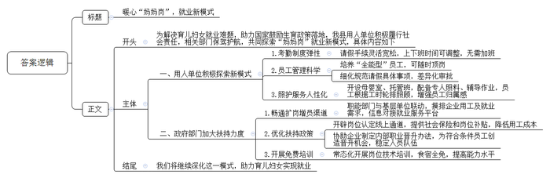
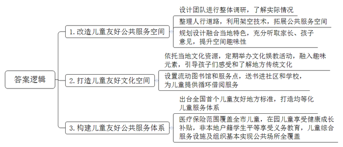
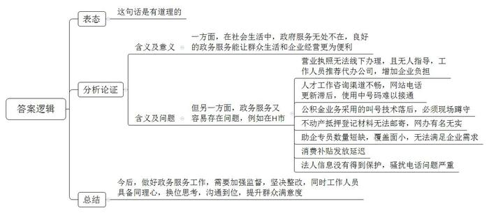
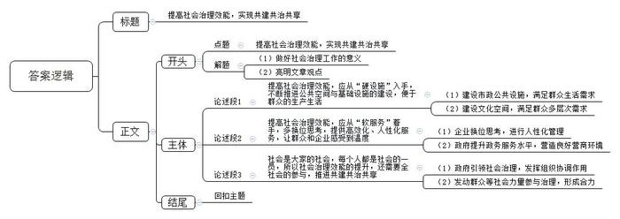

# 2024年公务员多省联考《申论》题（河南县级卷）

<!-- gwy:overview:start -->
> **河南 · 2024 · 申论 · 县级卷** ｜ 4 题 · 图片 4 处 · 答案随题折叠

导航：[题目](#题目) · [材料 1](#材料-1)
<!-- gwy:overview:end -->

> 候选采集稿。参考答案及解析来自粉笔页面，不代表官方答案或真实高分答卷；来源使用许可与原卷对应关系仍需人工核实。

## 给定材料

### 材料 1

位于G市Z县的成鑫电子是2012年成立的一家高新技术企业，以制造中高端小家电产品为主。自成立以来，企业一路顺风顺水，规模越来越大，每年为当地新增就业岗位近百个。2019年，公司探索党建工作新模式，以党建引领承担社会责任。

“当年，我们支部经常组织人员到附近村镇慰问老党员、困难户。村里有的老人向我们反映，自家媳妇生完孩子后就没有工作，看能不能帮忙介绍工作。这种事情对我们公司来说并不难，只要双方觉得合适，就能满足妈妈们进厂工作的愿望。”成鑫电子赵经理回忆道。

成鑫电子给予了“妈妈们”一些“小特殊”：请假手续灵活宽松，上下班时间可根据孩子上下学作出适当调整，晚上和周末不用加班。“刚开始，公司内部有管理人员对‘小特殊’有些看法，有的员工还给她们的岗位取名‘妈妈岗’，认为能上‘妈妈岗’就是一种福利待遇，感觉有些‘酸’。”赵经理说，2020年至2022年，成鑫电子面临“一边爆单，一边员工不足、招不到人”的窘况，家住工厂附近的“妈妈岗”员工竟成了成鑫电子的“功臣”。

成鑫电子将“妈妈岗”集中在一个车间，并有意培养一批“全能型”员工，可以随时顶替请假的员工，而“全能型”员工在工资待遇上也会多几百到上千元。此外，对请假的具体事项进行细化规范。像孩子生病、家长会这类事由一定支持，但像一些吃请类请假，则通过限定次数来控制。

不仅如此，成鑫电子厂区还设有母婴室、托管班。各有1名专职人员照料、辅导作业，“妈妈岗”员工上班期间可以根据各自岗位的工时安排，轮流排班帮忙照应。“设身处地为员工着想的企业文化让成鑫电子员工们具有强烈的归属感。”赵经理说。成鑫电子在用工方面的做法不胫而走，引来众多企业到成鑫电子“取经”。

2022年，Z县政府相关职能部门发现“妈妈岗”已在全市众多企业中“流行”，于是深入成鑫电子等多家企业走访调研。随后下发通知，要求相关职能部门与镇街、村（社区）联动，摸排企业用工需求和符合条件人员的就业需求，将相关信息上传到县就业服务平台，畅通“妈妈岗”扩岗增员渠道。开辟了专门的“妈妈岗”认定线上通道，上传了相关资料证明后，企业第二个月就开始享受到每月每人300元社会保险补贴和100元岗位补贴。根据企业实际情况，协助制定新的内部职业晋升办法，为一些没有年龄、工龄、学历优势但技术精湛、责任心强的员工创造了晋升机会，大大降低了企业用工成本，也稳定了“妈妈岗”队伍。

“当年若不是公司开‘绿灯’，我一个人养育两个孩子恐怕会比较艰辛。5年来，我参加过3轮岗位技术培训，上周还去县政府开设的高级技工培训班学了一个星期，食宿全免。‘妈妈岗’开启了我的新人生。”成鑫电子第一批“妈妈岗”员工小霞说。

省师范大学社会学系杨教授认为，25岁到35岁是女性职业发展的黄金年龄，同时也是不少女性成为母亲的时间。“宝妈”们该如何平衡工作需要与家庭关系，不仅是千万普通家庭面临的难题，更关系到国家鼓励生育政策落地开花的效果。

### 材料 2

“这顶凉帽是我在2023年暑假跟师傅学着做的。他教我们编织凉帽的时候，还给我们讲凉帽民俗和客家历史。”恬恬自豪地说。来自华成区凉帽新村的恬恬亲手编织的客家凉帽在N市首届儿童友好博览会上引起了围观，大人小孩纷纷试戴合影。

凉帽新村是一个典型的城中村，村里有500余名儿童，占总人口的16%。在N市儿童友好空间改造工作之前，华成区城管局活力城中村项目负责人小青带领设计团队做了整体调研，发现诸如凉帽新村这样的城中村普遍存在空间狭小、安全隐患多、环境差、儿童游乐设施少等问题。

为此，设计团队重新整理了凉帽新村西侧人行道路，利用架空技术，将人行道从1米多宽的步道拓展出3800平方米的公共服务空间。“其中有一处红色的儿童无动力设施——空中乐园最受孩子欢迎。每天一放学，这里就会‘长满’孩子。”小青说，设施的顶是形似竹编的钢结构，契合了凉帽新村的竹编特色。“设计过程中，我们专门听了家长和孩子们的意见，尽量避免过度设计可能带来的千篇一律、剥夺孩子想象空间的问题。对孩子而言，随处有一滩水、一处沙、一个捉迷藏的空间，比安装一个固定的滑梯更友好。”

“以前接小孩子放学后就要寸步不离看着他，村里的车乱开乱停，小孩子跑来跑去很危险。现在孩子们都喜欢去空中乐园玩，我们都很放心。”一位孩子妈妈开心地说。“除了有形的友好空间，新村也为儿童打造了友好的文化空间。村里以市级非遗凉帽编织技艺为主题，定期举办科普、彩绘等亲子文化娱教活动，并融入趣味元素，引导孩子们感受和了解地方传统文化。不仅在凉帽新村，打造儿童友好空间已经成为N市2135个城中村改造升级的重要内容之一。”N市妇联刘主席表示。

“妈妈，流动图书馆大巴怎么开到这里来了！”看到儿童友好博览会场外停着的一辆彩绘大巴，安化区中心小学的一菡同学激动地说，“我已经从流动图书馆里借阅了快100本书了，上幼儿园开始看绘本，现在上小学看书，我会讲好多好多故事！每次大巴车开到家门口，我都约了好朋友一起上车挑选，我太喜欢流动图书馆了。”

“安化区城中村比较多，有的村没有条件建设图书馆，于是我们就用大巴车将书送到孩子身边。”安化区图书馆姚馆长说，“大巴车按社区路线走，每个小朋友一次可以借阅20本书，两个月内大巴车会循环回来，届时小朋友可以还书再借新书。”安化区流动图书馆自2020年在N市率先启用以来，已在8个社区和16所学校设置服务点，已累计投入儿童书籍11万余册，借阅量超过7万册次。

2022年，N市出台全国首个儿童友好地方标准《儿童友好公共服务体系建设指南》，明确八个方面构建儿童友好公共服务体系。“作为一座移民城市，N市一直致力打造无户籍地域差异的均等化儿童公共服务体系，来了就是N市人，来了就是N市的娃，让改革发展成果更公平惠及所有儿童。”N市妇联刘主席说。N市的医疗保险范围已覆盖全市中小学、托幼机构在册的儿童，3至6岁在园儿童均可享受健康成长补贴，每年有58万名孩子受益。51%的义务教育学位提供给了非本地户籍学生，使这些孩子作为与户籍学生平等的主体，更好地融入这座城市。

截至2023年底，N市已建成市级儿童友好基地452个、友好公园1260座、儿童议事组织580个、社区儿童之家761个，建成母婴室1270间，基本实现公共场所全覆盖，创新推广移动母婴室，让儿童出行更为便利。

“去年，我们在湖华小学调研时，曾询问孩子们什么是‘儿童友好’，一位6年级学生想了想，说是‘尊重’。”N市妇联刘主席感慨地说，“八年来，N市正是学会了以‘一米’高度看城市，才把‘儿童友好’从一个概念变成现实。”

### 材料 3

在全国工商联发布的《万家民营企业评营商环境报告》中，H市得分排名靠后。为摸准实情，查出问题，市政府委派电视台记者就政务服务中存在的问题和不足进行了暗访。以下是暗访过程中收集到的几个案例：

案例一：“我操作了四五次，实在不会弄。我们年龄大了，电脑、手机上的东西，实在不太会操作，工作人员也不帮忙。”市民叶先生说，他想办理互联网销售的营业执照，但该业务在行政服务中心没有窗口，需要网上申报，对网上办理流程不太熟悉的叶先生，需要指导，却找不到人。“行政服务中心工作人员让我去市场监督管理所，可我到了市场监督管理所，工作人员同样表示无法受理，并表示没人也没空帮忙指导。”

在行政服务中心，记者去咨询办理个体户营业执照，结果工作人员推荐了某服务公司代办。

“你们要线下去跑街道的，最起码两趟，你首先去领表，数据填完，交到他们那里，等审核，不管过没过，都要再跑一趟拿审核结果。找我们代跑收一千块钱。”暗访视频中代办人员如是说。

询问代办是否靠谱，工作人员表示：“靠谱的，每天在这里，你想省事一点找他们，想自己弄就麻烦一点。”

后经咨询市场监管局及部分街道，办理该业务根本不需要多次跑。

案例二：“投诉之后才有人来联系我。”市民张先生说，他前几天申报H市高层次人才分类认定，上传了两次材料都被驳回，想咨询原因。“我拨打官网公布的电话，打过去之后说这个号码已经转号，转号的号码又打不通、没人接。”

记者随即通过网上“高层次人才分类认定申报管理系统”公示的联系方式，随机拨打了东湖区、安化区等多个区县人才工作部门的咨询电话，可对方语音提醒已改号，并且改过的号码不是无人接听，就是用户正忙。

案例三：H市民中心的政务服务中心公积金业务窗口前，排队市民抱怨道：“取号以后如果不想过号，就得一直守在现场。现在提醒到号的技术在商场都很成熟了，这儿却没有。”

在H市，不动产抵押登记实现全程移动端办理，是一项重要便民利企措施，但在玉林区，市民感觉这个“网办”名不副实。“在其他区县的不动产部门，是可以选择邮寄的，我们区不动产抵押登记窗口却要我们亲自送过来，虽然开通了网办，但我仍享受不到这个便民措施。”

案例四：在钱江区，不少街道、部门都有助企专员，但某小微企业孵化园负责人表示，“现在全区助企专员共有170多个，与全区12万经营主体相比，覆盖面只有1.5%，不知道什么时候能覆盖到我们。”

来自某科技企业的刘先生说，他最近想在钱江区开一家公司，可多方联系直到现在都没有得到满意答复。“更不解的是，按照政策，我可以享受区里的汽车消费补贴，可我去年12月在钱江区某4S店购买的车，能享受2500元购车补贴，3个月过去了，我还是没收到这笔补贴。”

案例五：“由于我们法人的姓名跟手机号码会被公布于网上，我经常会收到一些陌生的电话短信。有一次，我挂了一个陌生电话，结果对方用100多条的短信对我进行了‘轰炸’。”乔先生说。

“嗨，正常得很，前不久，我刚在阳江区市场监管局办完企业注册手续，回家路上就接到了问我需不需要贷款的电话。”随行的游先生表示。

暗访后，H市电视台举行了“公述民评”面对面问政，现场播放了暗访过程中收集的视频。暗访视频所涉及相关单位负责人直面监督，对暗访视频所曝光的问题进行了一一回应，作出了整改承诺。

H大学政府管理学院苏教授在点评环节表示，<u>良好的政务服务环境如同“清新的空气”</u><u>，</u><u>同时也是个“易碎品”</u>。在工作中多些同理心，多点换位思考，多点代入感，才会让人感到舒服，即便办不成事，你跟人家说清楚，人家也能够接受。

### 材料 4

每天清晨，都会有一班特殊的列车，穿过昏暗的黎明与渐亮的晨光，从郊外开进即将忙碌起来的城市中心地带。

这班列车是C市轨道交通4号线石船至民安大道方向的首班车，因为主要乘客是来自C市渝北区石船镇的菜农，他们都背着装满红薯叶、辣椒、韭菜等新鲜蔬菜的背篓，所以这班列车也被称为“背篓专列”。

近段时间，这趟“背篓专列”在各大平台火爆出圈，“坐着地铁去卖菜”被众多网友称为城市快速发展中的“人间烟火气”。日前，C市《当代党员》杂志“民生”专栏的工作人员小刘一行3人专门乘坐了一次“背篓专列”，以下是小刘的日志：

凌晨5点，我们从市区出发前往菜农们集中搭车的起点——石船站。到的时候，菜农们已在排队等待过安检了，因为背篓重，东西比较多，工作人员并没有要求他们将背篓放到安检传送带上，而是用手持式金属探测器进行安检。看到年纪大、行动缓慢的老人，他们会时不时搭把手，或引导他们乘坐无障碍电梯。

“菜农一般是赶早摘的新鲜蔬菜，难免沾有露水或雨水，是否会因此带来不便，甚至被拒绝上车？”我们问安检人员。“抛洒滴漏，造成地面湿滑，影响清洁，这是难免的。就算没有他们，有时候也有这些问题。如果带上车的菜有气味、汁水，弄脏车厢，工作人员也会上前处理。”安检人员回答道。

6点30分，列车准时到站，菜农们熟练地进入车厢，将自己的背篓、菜篮放置在中间空道处后，便在就近的位置坐下。

我们找了挨着他们的空位坐下，正纳闷为何大家都聚在人比较多的这几节车厢。身旁的老人解释，“不懂了吧？坐在一块儿，大家好聊天，顺便了解一下最近卖菜的行情和收获。而且这样也免得挤到其他乘客，影响别人出行。”

看我们拿着相机和笔记本，笑问是不是来采访他们的。

“对呀！我们今天要是没赶上这班车是不是就遇不上你们了？”我们问。

“卖菜要赶早，那自然要赶首班车。”老人说。

老人叫樊军，家住石船镇安置小区。去年1月起，老樊便开始进城卖菜。当时，轨道交通4号线二期还没开通，老樊得先赶到镇上的公交车站，然后换乘3、4次才能到达市区的菜市场，单程需耗时近4小时。现在，老樊一般选择在洋河卖菜。他每天准时乘上4号线，再换乘1次就抵达洋河，只需70来分钟。

在列车上，老樊感到很放松，因为车厢比公交车车厢更宽敞，不会因为背篓、菜篮挡其他乘客路而遭来“嫌弃”，也不用总是担心绊倒别人，带来安全隐患。“我以前做梦都想坐地铁去城里卖菜！”老樊对我们说，“我们是搭上时代发展的快车了。以前我们在镇上卖菜，人少，卖的慢，价格也低。同样的空心菜，在镇上1斤才卖1.5元，到了市区能卖3元，两三个小时就能卖完一大背篓，回家还能赶上吃午饭。”

当我们提及这趟“背篓专列”刷屏各大媒体时，坐在对面的一位乘客应道：“我也看到了，有很多人都在点赞。文明之所以文明，就是因为它既容纳了现代的行为方式，也包容了传统的生活习惯。”“我觉得这话说得很有道理，我听说有些地方是不允许菜农背着背篓上地铁的，说是怕弄脏地面，影响乘客观感和行车安全，又说是怕占座位、霸座，引起矛盾。但是公共交通本来就是为群众提供方便的，允许菜农乘坐地铁出行，既解决了他们的生计问题，也让我们在市区就能买到新鲜实惠的蔬菜。”与她同行的乘客附和道。

### 材料 5

橙事互动App，是D市重点打造的新型融媒体传播平台，设有橙事直通车、橙友圈等10余个功能模块，致力于提供全方位的城市新闻资讯、互动娱乐和同城社交服务，深受市民欢迎。

案例一：近日，有橙友在“橙事直通车”发帖称：“今天上午9点，青年路一饭店门口，一位老太太被石墩子绊倒，右手前臂骨折。”

“橙事直通车”记者赶往事发现场，发现青年路靠近解放路一段，沿途设置了许多石墩子，底部宽约70厘米，高约30厘米。该路段辅道正在施工改造，安装石墩子是为了防止车辆误入施工路段。

据附近饭店的店员讲：“年轻人过这些石墩子都很小心，别说是老人了。石墩子颜色与地面几乎一样，又比一般的石墩子要大很多，如果视力不好很容易被绊倒，尤其是晚上更难注意到，我昨晚差点儿就被绊倒了。”

刚好路过的毛大伯指着解放路方向对记者说：“那边也有一些石墩子设在人行道上，可能是不让车辆上人行道停放，也没有警示颜色，还做成了比较高的锥子形，看着都吓人，你们可以去那边看看。”

在青年路社区，工作人员告诉记者：“我们也了解这个事，石墩子对维护交通秩序用处很大，但对过往行人确实不太友好。目前，我们正准备协调相关部门先拆除部分非必要的石墩子，后续怎么办，还需要进一步协商。”

案例二：近日，有橙友在“橙事直通车”发帖称：就复兴路中央绿化带两旁的隔离设施的作用表达意见——

路人甲：多少有点用。偶尔还是有人横穿绿化带，但并不多，是否有必要为极少数人的不文明行为去花钱建护栏，需要决策者好好衡量。

路人乙：完全没有用。一个城市的文明形象就被这些绿化带栏杆给毁了，看起来很有规矩，但反而说明这个城市很不文明。

路人丙：非常有用。复兴路中央绿化带里再也没有熊孩子出没踩踏了，竹制的隔离栅栏也与绿化景观相得益彰。

……

D大学城市管理学院吴教授认为，<u>有效的社会治理，需要“硬设施”和“软服务”的完美结合，离不开参与各方的相互成就。</u>

## 题目

### 第 1 题

**G市准备召开“妈妈岗”就业新模式座谈会，要求Z县做典型发言。请结合“给定资料1”，为县领导拟写一份发言稿。（20分）**

关联材料：材料 1

作答要求：

要求：内容全面；角色定位准确；不考虑格式；不超过450字。

第 1 题 · 答案与解析

**参考答案（粉笔题库参考内容）**

暖心“妈妈岗”，就业新模式

为解决育儿妇女就业难题，助力国家鼓励生育政策落地，我县用人单位积极履行社会责任，相关部门保驾护航，共同探索“妈妈岗”就业新模式，具体内容如下：

一、用人单位积极探索新模式。1.考勤制度弹性。请假手续灵活宽松，上下班时间可调整，无需加班。2.员工管理科学。培养“全能型”员工，可随时顶岗；细化规范请假具体事项，差异化审批。3.照护服务人性化。开设母婴室、托管班，配备专人照料、辅导作业，员工根据工时轮排照顾，增强员工归属感。

二、政府部门加大扶持力度。1.畅通扩岗增员渠道。职能部门与基层单位联动，摸排企业用工及就业需求，信息对接就业服务平台。2.优化扶持政策。开辟岗位认定线上通道，提供社会保险和岗位补贴，降低用工成本；协助企业制定内部职业晋升办法，为符合条件员工创造晋升机会，稳定人员队伍。3.开展免费培训。常态化开展岗位技术培训，食宿全免，提高能力水平。

我们将继续深化这一模式，助力育儿妇女实现就业。

**解析**

**参考答案说明：**（1）格式方面，本参考答案写到了“标题”“正文”两个部分。（2）正文部分，一方面从内容上来看，围绕“‘妈妈岗’就业新模式”这一主题，本参考答案的开头先介绍了“妈妈岗”的设置初衷以及带来的积极意义；主体部分从“用人单位积极探索新模式”“政府部门加大扶持力度”两个方面介绍了具体经验；最后，结尾进行了适当的总结展望。另一方面，形式上，本参考答案做到了分段、分条撰写，整体上条理较为清晰。

**考点**：总结类

**来源**：2024年公务员多省联考《申论》题（河南县级卷）

### 第 2 题

**请根据“给定资料2”，梳理概括N市在儿童友好城市建设中的有益探索。（20分）**

关联材料：材料 2

作答要求：

要求：全面准确，条理清晰，有概括性；不超过300字。

第 2 题 · 答案与解析

**参考答案（粉笔题库参考内容）**

1.改造儿童友好公共服务空间。设计团队进行整体调研，了解实际情况；整理人行道路，利用架空技术，拓展公共服务空间；规划设计融合当地特色，充分听取家长、孩子意见，提升空间趣味性。

2.打造儿童友好文化空间。依托当地文化资源，定期举办文化娱教活动，融入趣味元素，引导孩子们感受和了解地方传统文化；设置流动图书馆和服务点，送书进社区和学校，为儿童提供循环借阅服务。

3.构建儿童友好公共服务体系。出台全国首个儿童友好地方标准，打造均等化儿童服务体系；医疗保险范围覆盖全市儿童，在园儿童享受健康成长补贴，非本地户籍学生平等享受义务教育，儿童综合服务设施及组织基本实现公共场所全覆盖。

**解析**

**参考答案说明：**本参考答案从“改造儿童友好公共服务空间”“打造儿童友好文化空间”“构建儿童友好公共服务体系”三个方面介绍了N市在儿童友好城市建设中的有益探索。每条答案要点之间在内容上是并列关系，没有交叉。

**考点**：概括措施类

**来源**：2024年公务员多省联考《申论》题（河南县级卷）

### 第 3 题

**“给定资料3”提到：“良好的政务服务环境如同‘清新的空气’，同时也是个‘易碎品’。”请深入分析理解点评专家的这一观点。（20分）**

关联材料：材料 3

作答要求：

要求：全面准确、条理清晰；不超过300字。

第 3 题 · 答案与解析

**参考答案（粉笔题库参考内容）**

这句话是有道理的：

一方面，在社会生活中，政府服务无处不在，良好的政务服务能让群众生活和企业经营更为便利。但另一方面，政务服务又容易存在问题，例如在H市：营业执照无法线下办理，且无人指导，工作人员推荐代办公司，增加企业负担；人才工作咨询渠道不畅，网站电话更新滞后，使用中号码难以接通；公积金业务采用的叫号技术落后，必须现场蹲守；不动产抵押登记材料无法邮寄，网办有名无实；助企专员数量短缺，覆盖面小，无法满足企业需求；消费补贴发放延迟；法人信息没有得到保护，骚扰电话问题严重。

今后，做好政务服务工作，需要加强监督，坚决整改，同时工作人员具备同理心，换位思考，沟通到位，提升群众满意度。

**解析**

**参考答案说明：**（1）思路方面，本参考答案按照观点现象分析题“解释抽象的观点、现象+表态+分析论证+总结”的答题思路展开。（2）内容方面，本参考答案先对专家的观点进行了表态；“分析论证”部分先介绍了“清新的空气”的含义和良好的政务服务的意义，接着指出了“易碎品”的含义，并以H市为例，分析了政务服务存在的具体问题；最后进行总结，给出了对策。（3）词句表达方面，本参考答案加上了“一方面”“另一方面”“今后”等连接词来承接上下文。

**考点**：观点现象分析类

**来源**：2024年公务员多省联考《申论》题（河南县级卷）

### 第 4 题

**“给定资料5”提到：“有效的社会治理，需要‘硬设施’和‘软服务’的完美结合，离不开参与各方的相互成就。”请深入思考这句话，参考给定资料，联系实际，自选角度，自拟题目，写一篇文章。（40分）**

关联材料：材料 1、材料 2、材料 3、材料 4、材料 5

作答要求：

要求：观点明确，见解深刻；思路清晰，语言流畅；参考给定资料，但不拘泥于给定资料；1000-1200字。

第 4 题 · 答案与解析

**参考答案（粉笔题库参考内容）**

提高社会治理效能，实现共建共治共享

基层强则国家强，基层安则天下安。只有做好基层社会治理工作，才能增强群众的获得感、幸福感、安全感，才能推动我国高质量发展。而要实现社会治理效能的提高，必须多管齐下，不仅要完善硬件设施建设，还应提升服务水平，更要发动社会力量参与社会治理，从而实现共建共治共享。

**提高社会治理效能，应从“硬设施”入手，不断推进公共空间与基础设施的建设，便于群众的生产生活。**公共设施是否完善与人民群众的幸不幸福密切相关，只有推进交通、排水、照明、供暖、网络等市政设施的建设，才能满足群众生活的基本需求。举例来说，让菜农坐着地铁去卖菜的“背篓专列”，便利了群众，也解决了其生计问题，这样的公共交通让人点赞。除此之外，我们也应该看到当下群众的需求是多样化的，既有基本的生活需求，也有精神文化等的需求，所以，还应建设如老年服务站、阅读室、健身房、儿童友好文化空间等设施，以满足群众多层次的需求。

**提高社会治理效能，应从“软服务”着手，多换位思考，提供高效化、人性化服务，让群众和企业感受到温度。**一方面，应多换位思考，考虑群众遇到的难题，并针对性地解决问题。成鑫电子厂对于许多妈妈找工作难的问题专门设了“妈妈岗”，不仅请假手续灵活宽松，上下班时间可灵活调整，还设有母婴室、托管班，这种人性化的企业文化让员工有归属感，值得全行业学习借鉴。另一方面，对于政府应提升政务服务水平，营造良好的营商环境，不仅应主动服务、高效服务，如优化流程、提供专人释疑指导等，实现企业“最多跑一趟”，还应推进智慧政务建设，如推出app、小程序等软件，提供线上服务，实现企业“一趟也不跑”。

**社会是大家的社会，每个人都是社会的一员，所以社会治理效能的提升，还需要全社会的参与，推进共建共治共享。**政府部门是“掌舵人”，应发挥引领作用，加强组织领导和部门协调，减少“单打独斗”的局面。同时，还应发动群众参与到社会治理中来，譬如，枫桥“红枫义警”、北京“朝阳群众”、天津“小巷管家”……这些都是群防群治的队伍，化解了诸多矛盾纠纷，还构成了人人参与的社会共同体，成为了社会治理的“范式”。因此，应发动社区居民、教师、快递员、环卫工人等社会力量，畅通意见反馈渠道，如开通热线电话、移动端平台等，以广泛地收集社情民意，提高决策的科学性和民主性，也更快地解决群众急难愁盼的问题。

在新的征程上，应不断推进社会治理创新，“软硬皆施”“共建共治”，从而提高治理效能，让更多的发展成果更多地惠及全体人民，也让社会更加安定、有序、文明！

**文章分析**

提高社会治理效能，实现共建共治共享

【**标题的优点：**首先，标题中含有主题词，使文章主题更突出、清晰。其次，形式上采用对称式结构，使标题更加完整、饱满。】

（1）<u>基层强则国家强</u>，<u>基层安则天下安</u>。只有做好基层社会治理工作，才能<u>增强群众的获得感、幸福感、安全感</u>，才能推动我国<u>高质量发展</u>。（2）而要实现社会治理效能的提高，必须多管齐下，不仅要<u><u>完善硬件设施建设</u></u>，还应<u><u>提升服务水平</u></u>，更要<u><u>发动社会力量参与社会治理</u></u>，从而实现共建共治共享。

【**开头的优点：**★内容方面。范文的开头是紧扣“提高社会治理效能”这一主题展开的。首先，开头点出主题，做到了主题明确。其次，对“提高社会治理效能”这一主题进行了分析阐述，指出了：（1）做好社会治理工作的意义。（2）亮明文章观点，指出提高社会治理效能需要多管齐下。★文字表达方面：使用了“只有……才能……才能……”“不仅……还……更……”等关联词，使语言表达有逻辑性。】

**提高社会治理效能，应从“硬设施”入手，不断推进公共空间与基础设施的建设，便于群众的生产生活。**（1）<u>公共设施</u>是否完善与<u>人民群众的</u>幸不<u>幸福密切相关</u>，只有推进交通、排水、照明、供暖、网络等<u>市政设施的建设</u>，才能<u>满足群众生活的基本需求</u>。举例来说，让菜农坐着地铁去卖菜的“<u>背篓专列</u>”，<u>便利了群众</u>，也<u>解决了其生计问题</u>，这样的公共交通让人点赞。（2）除此之外，我们也应该看到当下<u>群众的需求是多样化</u>的，既有基本的<u>生活需求</u>，也有<u>精神文化</u>等的<u>需求</u>，所以，还应<u>建设</u>如老年服务站、阅读室、健身房、儿童友好<u>文化空间等设施</u>，以<u>满足群众多层次的需求</u>。

【**论述段1的优点：**★观点句：范文的观点句是紧扣“提高社会治理效能”这一文章主题提出的。形式上，它在段首处直接写出，位置突出，容易发现。内容上，关键词突出，内容要点明确，可以明显看出主要从“硬设施”的角度展开论述。★论述内容：（1）建设市政公共设施，满足群众生活需求；（2）建设文化空间，满足群众多层次需求。注意：以上两个方面的内容都是紧扣“提高社会治理效能，应从‘硬设施’入手，不断推进公共空间与基础设施的建设，便于群众的生产生活”这个观点句进行分析论述的，论述的针对性强，内容层次丰富。在论述方法上采用了讲道理和举例子相结合的方式，论述充实透彻。】

**提高社会治理效能，应从“软服务”着手，多换位思考，提供高效化、人性化服务，让群众和企业感受到温度。**（1）一方面，应多<u>换位思考</u>，<u>考虑群众遇到的难题</u>，并<u>针对性地解决问题</u>。成鑫电子厂对于许多妈妈找工作难的问题专门设了“<u>妈妈岗</u>”，不仅<u>请假手续灵活宽松</u>，<u>上下班时间可灵活调整</u>，还设有<u>母婴室、托管班</u>，这种<u>人性化的企业文化</u>让<u>员工有归属感</u>，值得全行业学习借鉴。（2）另一方面，对于<u>政府应提升政务服务水平</u>，<u>营造良好的营商环境</u>，不仅应<u>主动服务、高效服务</u>，<u>如优化流程、提供专人释疑指导</u>等，实现企业“最多跑一趟”，还应<u>推进智慧政务建设</u>，如推出app、小程序等软件，提供<u>线上服务</u>，实现企业“一趟也不跑”。

【**论述段2的优点：**★观点句：范文的观点句是紧扣“提高社会治理效能”这一文章主题提出的。形式上，它在段首处直接写出，位置突出，容易发现。内容上，关键词突出，内容要点明确，可以明显看出主要从“软服务”的角度展开论述。★论述内容：（1）企业换位思考，进行人性化管理；（2）政府提升政务服务水平，营造良好营商环境。注意：以上两个方面的内容都是紧扣“提高社会治理效能，应从‘软服务’着手，多换位思考，提供高效化、人性化服务，让群众和企业感受到温度”这个观点句进行分析论述的，论述的针对性强，内容层次丰富。在论述方法上采用了讲道理和举例子相结合的方式，论述清晰深刻。】

**社会是大家的社会，每个人都是社会的一员，所以社会治理效能的提升，还需要全社会的参与，推进共建共治共享。**（1）<u>政府部门是“掌舵人”</u>，应<u>发挥引领作用</u>，<u>加强组织领导和部门协调</u>，减少“单打独斗”的局面。（2）同时，还应<u>发动群众参与到社会治理中来</u>，譬如，枫桥“红枫义警”、北京“朝阳群众”、天津“小巷管家”……这些都是<u>群防群治</u>的队伍，<u>化解了诸多矛盾纠纷</u>，还构成了<u>人人参与的社会共同体</u>，成为了<u>社会治理的“范式”</u>。因此，应<u>发动</u>社区居民、教师、快递员、环卫工人等<u>社会力量</u>，<u>畅通意见反馈渠道</u>，如<u>开通热线电话、移动端平台</u>等，以广泛地<u>收集社情民意</u>，<u>提高决策的科学性和民主性</u>，也更快地<u>解决群众急难愁盼的问题</u>。

【**论述段3的优点：**★观点句：范文的观点句是紧扣“提高社会治理效能”这一文章主题提出的。形式上，它在段首处直接写出，位置突出，容易发现。内容上，关键词突出，内容要点明确，可以明显看出主要从“各方参与社会治理”的角度展开论述。★论述内容：（1）政府引领社会治理，发挥组织协调作用；（2）发动群众等社会力量参与治理，形成合力。注意：以上两个方面的内容都是紧扣“社会是大家的社会，每个人都是社会的一员，所以社会治理效能的提升，还需要全社会的参与，推进共建共治共享”这个观点句进行分析论述的，论述的针对性强，内容层次丰富。在论述方法上采用了讲道理和举例子相结合的方式，论述充实到位。】

【**论述段之间的关系：**★内容的内在逻辑：范文的论述段之间是依照“并列”的逻辑展开的。论述段1先写了“提高社会治理效能，应从‘硬设施’入手”，论述段2再写了“提高社会治理效能，应从‘软服务’着手”，论述段3接着写了“社会治理效能的提升，还需要全社会的参与”。整体论述思路清晰。】

在新的征程上，应不断推进社会治理创新，“软硬皆施”“共建共治”，从而提高治理效能，让更多的发展成果更多地惠及全体人民，也让社会更加安定、有序、文明！

【**结尾的优点：**范文的结尾回扣了“提高社会治理效能”这一主题，语言简练，不拖沓。】

**解析状态：unknown（来源未提供）**

**考点**：文章写作题

**来源**：2024年公务员多省联考《申论》题（河南县级卷）

