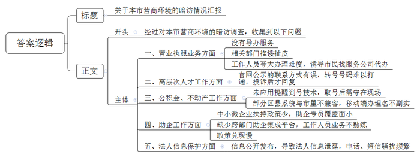
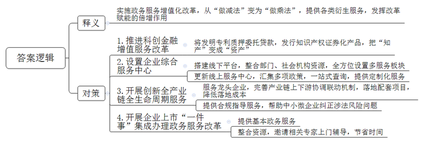
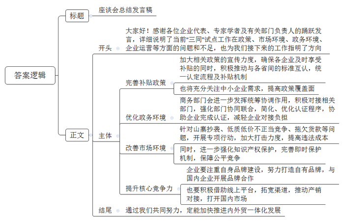
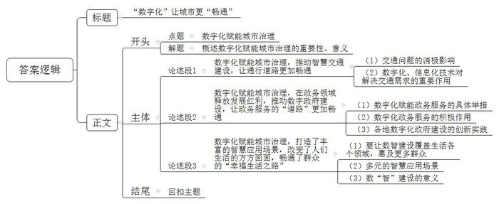

# 2024年公务员多省联考《申论》题（河南市级卷）

> 候选采集稿。参考答案及解析来自粉笔页面，不代表官方答案或真实高分答卷；来源使用许可与原卷对应关系仍需人工核实。

## 给定材料

### 材料 material-825da2376be4c131

在全国工商联发布的《2022年万家民营企业评营商环境报告》中，H市得分排名靠后。为摸准实情，查出问题，市政府派出工作组就当前本市营商环境的现状进行了暗访。以下是暗访过程中收集到的几个案例摘录：

案例一：“我操作了四五次，实在不会弄。我们年龄大了，电脑、手机上的东西，实在不太会操作，工作人员也不帮忙。”市民叶先生说，他想办理互联网销售的营业执照，但该业务在行政服务中心没有窗口，需要网上申报，对网上办理流程不太熟悉的叶先生，需要指导，却找不到人。“行政服务中心工作人员让我去市场监督管理所，可我到了市场监督管理所，工作人员同样表示无法受理，并表示没人也没空帮忙指导。”

在行政服务中心，工作组去咨询办理个体户营业执照，结果工作人员推荐了某服务公司代办。

“你们要线下去跑街道的，最起码两趟，你首先去领表，数据填完，交到他们那里，等审核，不管过没过，都要再跑一趟拿审核结果。找我们代办收一千块钱。”暗访视频中代办人员如是说。

询问代办是否靠谱，工作人员表示：“靠谱的，每天在这里，你想省事一点找他们，想自己弄就麻烦一点。”

后经咨询市场监管局及部分街道，办理该业务根本不需要多次跑。

案例二：“投诉之后才有人来联系我。”市民张先生说，他前几天申报H市高层次人才分类认定，上传了两次材料都被驳回，想咨询原因。“我拨打官网公布的电话，打过去之后说这个号码已经转号，转号的号码又打不通、没人接。”

无独有偶，安化区的方先生也同样遇到了窘境，“我电话打了好几天，后来回复我，说出差去了。”

工作组随即通过网上“高层次人才分类认定申报管理系统”公示的联系方式，随机拨打了东湖区、安化区等多个区县人才工作部门的咨询电话，可对方语音提醒已改号，并且改过的号码不是无人接听，就是用户正忙。

案例三：H市民中心的政务服务中心公积金业务窗口前，排队市民抱怨道：“取号以后如果不想过号，就得一直守在现场。现在提醒到号的技术在商场都很成熟了，这儿却没有。”

在H市，不动产抵押登记实现全程移动端办理，是一项重要便民利企措施，但在玉林区，市民感觉这个“网办”名不副实。“在其他区县的不动产部门，是可以选择邮寄的，我们区不动产抵押登记窗口却要我们亲自送过来，虽然开通了网办，但我仍享受不到这个便民措施。”市民马先生对此感到困惑，“据说是区里的不动产权系统和登记库与市里的不相融合。”

案例四：在钱江区，不少街道、部门都有助企专员，但一些企业表示，确实获得感不强。“我们现在政策还是针对招大引强的，看看能不能给努力成长的中小微企业更多扶持政策。”某小微企业孵化园负责人表示，“现在全区助企专员共有170多个，与全区12万经营主体相比，覆盖面只有1.5%，不知道什么时候能覆盖到我们。”

“这个事情涉及多部门，没有一个集成的平台，大家业务不太熟，也没有对他们进行培训。”来自某科技企业的刘先生说，他最近想在钱江区开一家公司，可多方联系直到现在都没有得到满意答复。“更不解的是，按照政策，我可以享受区里的汽车消费补贴，可我去年12月在钱江区某4S店购买的车，能享受2500元购车补贴，3个月过去了，我还是没收到这笔补贴。”

案例五：“由于我们法人的姓名、手机号码会被公布于网上，我经常会收到一些陌生的电话短信。有一次，我挂了一个陌生电话，结果对方用了100多条短信对我进行了‘轰炸’。”熊先生说，“把手机号码公布在网上，是本着信息公开的初衷，是照章办事，但这却影响到了我的正常工作和生活。”

“嗨，正常得很，前不久，我刚在阳江区市场监管局办完企业注册手续，回家路上就接到了问我需不需要贷款的电话。”随行的游先生表示。

### 材料 material-5798344bc0ac770a

2023年4月，K省营商环境优化提升大会提出增值服务改革这一概念后，Q市、T市、W市、S市先行开展了试点。

“我们有技术、有专利，但是缺少厂房、土地等固定资产，贷款融资很难。”Q市简叙科技公司经理说。这是一家专注于提供公共安全服务的科技型中小企业。考虑到类似简叙这样的轻资产、初创型、成长型企业越来越多，而传统金融模式和手段难以精准匹配的矛盾，Q市积极推进科创金融增值服务改革，把“知产”变成“资产”。经相关部门牵头，简叙的10项发明专利与市内其他10余家科技型中小企业的发明专利“打包”，以质押委托贷款模式，在深圳证券交易所正式发行知识产权证券化产品。简叙因此获得了1000万元融资。

为助推经济进一步回升向好，从中央到地方，各地各部门近两年都出台了一系列助企惠企的政策。“政策虽多，但不知道哪一款适合自己。”T市一家企业的负责人说，“一些大的企业专门成立了政策研究室，招聘专人研究政策，但我们实力有限，在优惠政策的获取和利用上，往往力不从心。”去年5月份，K省首家企业综合服务中心在T市亮相。中心整合20多个部门、80余家社会机构资源，设置人才、科创、金融、法治等八个服务板块，提供136项增值化服务。除了线下平台，T市还更新了线上企业综合服务中心，汇集了省市区多部门多项政策。“以前查询惠企政策需要到各地、各个部门去查询，现在全省一个平台就搞定。”康特药业有限公司政企事务部杨经理说，涉及生物医药企业的政策专业性强，现在可以线上一站式查询，补助也直接从线上兑现，直接给企业带来真金白银。“通过搭建数字化场景、运用算力，目前我们的线上服务平台就像会思考的人工智能大模型，为企业提供定制化的增值服务，而不仅是一个查找政策的搜索引擎。”T市胡市长表示。

过去，W市的市场经营主体大多是自我生长，而今政府重点转向对产业的悉心培育，基于市场规律，推动形成法治化、市场化、国际化营商环境，助力企业蓬勃生长。今年在该市一些落户当地的龙头企业的“二期项目”，均进入设计或施工阶段。在这背后，是W市近年来开展的创新全产业链全生命周期服务。以总投资479亿元的时代锂电产业园项目为例，W市帮助锂电项目完善了产业链上下游协调联动机制，配套落地了烧碱供应、电解液制备、电池回收利用等项目，使W市成为该项目国内落地成本的洼地。不仅服务龙头企业，针对中小微企业法务缺失等共性风险点，W市专门上线“合规指导服务”功能板块，为企业提供“合规指导”“合规体检”等增值服务。目前，该项目已服务企业200余家，帮助企业纠正涉法风险问题900余个。

上市是企业发展成长中的关键一步。股权架构如何搭建，股权激励如何规划，哪些涉税问题需要关注？不少拟上市的企业都存在这样的疑惑。S市今年试点开展了企业上市“一件事”集成办理增值式政务服务改革。当地金融部门除提供基本的咨询、受理等基本政务服务外，还整合了社会和市场资源，邀请券商、律所的相关专家，上门辅导帮助企业明确上市路径、完善上市方案、夯实上市基础、提升规范水平，为企业节省了宝贵的“时间成本”。

“形象地讲，过去政务服务改革是通过‘做减法’提高便利度，现在政务服务增值化改革是通过‘做乘法’提供其他各类衍生服务，发挥改革赋能的倍增作用。就是要实现从政府‘有什么、给什么’逐步向企业‘要什么、给什么’升级。”省委改革办陈副主任说。

## 题目

### 第 1 题

**请根据****“给定资料**1**”，代表工作组给市政府拟写一份暗访情况汇报。（20分）**

关联材料：material-825da2376be4c131

作答要求：

要求：全面准确、概括性强；不超过300字。

### 第 2 题

**“给定资料**2**”提到：“就是要实现从政府‘有什么、给什么’逐步向企业‘要什么、给什么’升级。”请深入理解这句话，结合资料，分析伴随这一升级过程政务服务需要做出哪些改变。（20分）**

关联材料：material-5798344bc0ac770a

作答要求：

要求：简明准确、内容全面、条理清晰；不超过300字。

### 第 3 题

**请结合****“给定资料**3**”，为N省商务厅负责人拟写一份总结发言稿。（20分）**

关联材料：material-825da2376be4c131

作答要求：

要求：内容全面、详略得当；不考虑格式；不超过500字。

### 第 4 题

**“给定资料**5**”提到：“‘数字’将让更多道路更畅通。当然，这些道路有些是有形的，有些是无形的。”请深入思考这句话，联系实际，自选角度，自拟题目，写一篇文章。（40分）**

关联材料：material-825da2376be4c131

作答要求：

要求：观点明确、见解深刻；思路清晰、语言流畅；参考给定资料，但不拘泥于给定资料；1000-1200字。

## 答案与解析

第 1 题

**参考答案（粉笔题库参考内容）**

关于本市营商环境的暗访情况汇报

经过对本市营商环境的暗访调查，收集到以下问题：

一、营业执照业务方面。没有导办服务；相关部门推诿扯皮；工作人员夸大办理难度，诱导市民找服务公司代办。二、高层次人才工作方面。官网公示的联系方式有误，转号号码难以打通，投诉后才回复。三、公积金、不动产工作方面。未应用提醒到号技术，取号后需守在现场；部分区县系统与市里不兼容，移动端办理名不副实。四、助企工作方面。中小微企业扶持政策少，助企专员覆盖面小；缺少跨部门助企集成平台，工作人员业务不熟练；政策兑现慢。五、法人信息保护方面。信息公开发布，导致法人信息泄露，电话、短信骚扰频繁。

**解析**

**参考答案说明**：（1）格式方面，本参考答案写到了“标题”“正文”两个部分。（2）正文部分，一方面从内容上来看，围绕着“H市营商环境”这一主题，本参考答案的开头先介绍了本次暗访的目的；接着主体部分从“营业执照业务”“高层次人才工作”“公积金、不动产工作”“助企工作”“法人信息保护”这五个方面展开。另一方面，形式上，本参考答案做到了分段、分条撰写，整体上条理较为清晰。

**考点**：考点总结类

**来源**：来源2024年公务员多省联考《申论》题（河南市级卷）

粉笔申论页面对本题只提供「解析视频」入口，该入口是会员推广位，页面无视频地址与文字解析。

第 2 题

**参考答案（粉笔题库参考内容）**

实施政务服务增值化改革，从“做减法”变为“做乘法”，提供各类衍生服务，发挥改革赋能的倍增作用。1.推进科创金融增值服务改革。将发明专利质押委托贷款，发行知识产权证券化产品，把“知产”变成“资产”。2.设置企业综合服务中心。搭建线下平台，整合部门、社会机构资源，全方位设置多服务板块；更新线上服务中心，汇集多项政策，一站式查询，提供定制化服务。3.开展创新全产业链全生命周期服务。服务龙头企业，完善产业链上下游协调联动机制，落地配套项目，降低落地成本；提供合规指导服务，帮助中小微企业纠正涉法风险问题。4.开展企业上市“一件事”集成办理政务服务改革。提供基本政务服务；整合资源，邀请相关专家上门辅导，节省时间。

**解析**

**参考答案说明：**本参考答案先写出了题干给定句子的释义，再分别从“推进科创金融增值服务改革”“设置企业综合服务中心”“开展创新全产业链全生命周期服务”“开展企业上市‘一件事’集成办理政务服务改革”四个方面提出了对策，各条答案要点之间在内容上相互并列，没有交叉。

**考点**：考点提出对策类

**来源**：来源2024年公务员多省联考《申论》题（河南市级卷）

粉笔申论页面对本题只提供「解析视频」入口，该入口是会员推广位，页面无视频地址与文字解析。

第 3 题

**参考答案（粉笔题库参考内容）**

座谈会总结发言稿

大家好！感谢各位企业代表、专家学者及有关部门负责人的踊跃发言，详细说明了当前“三同”试点工作在政策、市场环境、政务环境、企业运营等方面的问题和不足，也为我们接下来的工作指明了方向。

一、完善补贴政策。加大相关政策的宣传力度，确保各企业及时享受补贴的同时，积极推动与各省间的标准互认，统一认定流程及补贴机制。也将充分关注中小企业需求，提高政策覆盖面。

二、优化政务环境。商务部门会进一步发挥统筹协调作用，积极对接相关部门，强化部门协同联合，简化、优化认证程序，协助企业完成认证，减轻企业对接负担。

三、改善市场环境。针对山寨抄袭、低质低价不正当竞争、拖欠货款等问题，开展专项行动，加大打击力度，提高违法成本。同时，进一步强化知识产权保护，完善即时保护机制，保障公平竞争。

四、提升核心竞争力。企业要注重自身品牌建设，努力打造自有品牌，与国内企业开展品牌合作；也要积极借助线上平台，拓宽渠道，推动产销对接，打开国内市场。

通过我们共同努力，定能加快推进内外贸一体化发展！

**解析**

**参考答案说明**：（1）格式方面，本参考答案写到了“标题”“正文”两个部分。（2）正文部分，一方面从内容上来看，本参考答案的开头先介绍了总结发言稿的背景以及内外贸一体化“三同”试点工作存在的总结性问题，接着主体部分围绕“完善补贴政策”“优化政务环境”“改善市场环境”“提升核心竞争力”这四个方面展开，最后，结尾部分进行了简单总结。另一方面，形式上，本参考答案做到了分段、分条撰写，整体上条理较为清晰。

**考点**：考点总结类

**来源**：来源2024年公务员多省联考《申论》题（河南市级卷）

粉笔申论页面对本题只提供「解析视频」入口，该入口是会员推广位，页面无视频地址与文字解析。

第 4 题

**参考答案（粉笔题库参考内容）**

**“数字化”让城市更“畅通”**

习近平总书记曾强调：“强化数字赋能、推进城市治理现代化”。党的十八大以来，借助5G、大数据、云计算、人工智能等新技术，各大城市纷纷出台相关政策，加快推进智慧城市建设，城市治理水平稳步提升。数字化建设是推动经济社会高质量发展重要抓手，也是推动城市治理和服务水平能力现代化的关键“利器”。完善数字信息基础设施，推动城市数字化、智能化改造，让城市管理更加全面、精细，也让“数智”惠民更加可感可及。

**数字化赋能城市治理，推动智慧交通建设，让通行道路更加畅通。**交通问题历来是大城市治理的难点、堵点，不仅关乎交通运输的效率，更会影响人们的日常生活。公交车到站实时查询、高速公路口自动收费、查看公共停车位资源信息、智能算法实时深度分析给出“治堵”方案……数字化技术给出交通“最优解”，打造出一条条“绿波带”，给人们带来了畅快的生活和心情。面对全球规模最大、路况最复杂的交通需求，数字化、信息化技术在解决交通拥堵、优化出行服务方面发挥了越来越重要的作用。

当然，“数字”不仅仅畅通了有形的道路管网，还畅通了许多无形的“道路”。

**数字化赋能城市治理，在政务领域释放发展红利，推动数字政府建设，让政务服务的“道路”更加畅通。**以数字技术为支撑，搭建线上服务平台，梳理服务事项，打通系统、数据等壁垒，推动部门协同，实现一体化服务。既减轻了基层政府工作的压力，提高工作效率，也让政府服务效能大幅提升，提高了群众、企业办事的体验感。“最多跑一次”“一网通办”“一网统管”“一网协同”“接诉即办”……各地数字化政府建设的创新实践不断涌现，有效推动政府向服务型政府转变，一步一步实现了让数据“跑腿”代替群众“跑路”的目的。

**数字化赋能城市治理，打造了丰富的智慧应用场景，改变了人们生活的方方面面，畅通了群众的“幸福生活之路”。**以数治城，让“数治”渗透到生活的每个领域，使数字建设惠及到更多群众。通过分析水电气运行数据，对空巢独居老人实现全链条安全监护服务；“义务教育入学一件事”，整合接入多部门基础数据，实现入学报名“零证明”“零跑腿”；“九·一八”历史博物馆将“文化+科技”相融合，让红色资源“活”起来，提供沉浸式红色文化体验……数“智”建设，提升了治理的精度、力度，也给城市增添了新的温度。

新时代新征程，要加快数据赋能、技术赋能，提升城市治理运行效能，让更多“道路”畅通，更好满足人民对美好生活的新期待。

**解析**

**文章分析**

**“数字化”让城市更“畅通”**

【**标题的优点：**首先，范文的标题突出了“数字化赋能城市治理”这一主题。其次，形式上，文字简洁明快，不拖沓。】

习近平总书记曾强调：“强化数字赋能、推进城市治理现代化”。（1）党的十八大以来，借助5G、大数据、云计算、人工智能等新技术，各大城市纷纷出台相关政策，加快推进智慧城市建设，城市治理水平稳步提升。（2）数字化建设是推动经济社会高质量发展重要抓手，也是推动城市治理和服务水平能力现代化的关键“利器”。（3）完善数字信息基础设施，推动城市数字化、智能化改造，让城市管理更加全面、精细，也让“数智”惠民更加可感可及。

【**开头的优点：**★内容方面。范文的开头是紧扣“数字化赋能城市治理”这一主题展开的。首先，开头点出主题，做到了主题明确。其次，对“数字化赋能城市治理”这一主题进行了分析阐述，指出了（1）各地积极推进智慧城市建设的背景；（2）数字化建设的重要性；（3）推动城市数字化、智能化改造的对策。★文字表达方面。使用了“是……也是……”“让……也让……”等连接词，使语言表达更有气势。】

**数字化赋能城市治理，推动智慧交通建设，让通行道路更加畅通**。（1）交通问题历来是大城市治理的难点、堵点，不仅关乎交通运输的效率，更会影响人们的日常生活。（2）公交车到站实时查询、高速公路口自动收费、查看公共停车位资源信息、智能算法实时深度分析给出“治堵”方案……数字化技术给出交通“最优解”，打造出一条条“绿波带”，给人们带来了畅快的生活和心情。面对全球规模最大、路况最复杂的交通需求，数字化、信息化技术在解决交通拥堵、优化出行服务方面发挥了越来越重要的作用。

【**论述段****1的优点：**★观点句：范文的观点句是紧扣“数字化赋能城市治理”这一文章主题提出的。形式上，它在段首处直接写出，位置突出，容易发现。内容上，关键词突出，内容要点明确，可以明显看出是从“道路交通”的角度展开论述。★论述内容：（1）先介绍了交通问题的消极影响；（2）接着介绍了数字化、信息化技术对解决交通需求的重要作用。注意：以上两个方面的内容都是紧扣“数字化赋能城市治理，推动智慧交通建设，让通行道路更加畅通”这个观点句进行分析论述的，论述的针对性强，内容层次丰富。在论述方法上主要采用了讲道理、举例子相结合的方式，论述清晰充分。】

当然，“数字”不仅仅畅通了有形的道路管网，还畅通了许多无形的“道路”。

【**过渡段****的优点：**本段承上启下，既总结指出“数字”畅通了道路交通，还引出下文对“数字”畅通无形“道路”的论述。】

**数字化赋能城市治理，在政务领域释放发展红利，推动数字政府建设，让政务服务的****“道路”更加畅通**。（1）以数字技术为支撑，搭建线上服务平台，梳理服务事项，打通系统、数据等壁垒，推动部门协同，实现一体化服务。（2）既减轻了基层政府工作的压力，提高工作效率，也让政府服务效能大幅提升，提高了群众、企业办事的体验感。（3）“最多跑一次”“一网通办”“一网统管”“一网协同”“接诉即办”……各地数字化政府建设的创新实践不断涌现，有效推动政府向服务型政府转变，一步一步实现了让数据“跑腿”代替群众“跑路”的目的。

【**论述段****2的优点：**★观点句：范文的观点句是紧扣“数字化赋能城市治理”这一文章主题提出的。形式上，它在段首处直接写出，位置突出，容易发现。内容上，关键词突出，内容要点明确，可以明显看出是从“政务服务”的角度展开论述。★论述内容：（1）先介绍了数字化赋能政务服务的具体举措；（2）接着指出了数字化政务服务的积极作用；（3）最后介绍了各地数字化政府建设的创新实践。注意：以上三个方面的内容都是紧扣“数字化赋能城市治理，在政务领域释放发展红利，推动数字政府建设，让政务服务的‘道路’更加畅通”这个观点句进行分析论述的，论述的针对性强，内容层次丰富。在论述方法上主要采用了讲道理的方式，论述清晰透彻。】

**数字化赋能城市治理，打造了丰富的智慧应用场景，改变了人们生活的方方面面，畅通了群众的****“幸福生活之路”**。（1）以数治城，让“数治”渗透到生活的每个领域，使数字建设惠及到更多群众。（2）通过分析水电气运行数据，对空巢独居老人实现全链条安全监护服务；“义务教育入学一件事”，整合接入多部门基础数据，实现入学报名“零证明”“零跑腿”；“九·一八”历史博物馆将“文化+科技”相融合，让红色资源“活”起来，提供沉浸式红色文化体验……（3）数“智”建设，提升了治理的精度、力度，也给城市增添了新的温度。

【**论述段****3的优点：**★观点句：范文的观点句是紧扣“数字化赋能城市治理”这一文章主题提出的。形式上，它在段首处直接写出，位置突出，容易发现。内容上，关键词突出，内容要点明确，可以明显看出是从“改变群众生活”的角度展开论述。★论述内容：（1）先指出要让数智建设覆盖生活各个领域，惠及更多群众；（2）接着介绍了多元的智慧应用场景；（3）介绍了数“智”建设的意义。注意：以上三个方面的内容都是紧扣“数字化赋能城市治理，打造了丰富的智慧应用场景，改变了人们生活的方方面面，畅通了群众的‘幸福生活之路’”这个观点句进行分析论述的，论述的针对性强，内容层次丰富。在论述方法上主要采用了举例子和讲道理的方式，论述清晰有力。】

【**论述段之间的关系：**三个论述段分别从“交通道路”“政务服务‘道路’”“群众‘幸福生活之路’”的角度，对文章主题“数字化赋能城市治理”展开了论述，彼此之间呈现出并列的逻辑。】

新时代新征程，要加快数据赋能、技术赋能，提升城市治理运行效能，让更多“道路”畅通，更好满足人民对美好生活的新期待。

【**结尾的优点：**范文的结尾回扣了“数字化赋能城市治理”这个主题，并且进行了总结升华。】

**考点**：考点文章写作题

**来源**：来源2024年公务员多省联考《申论》题（河南市级卷）

粉笔申论页面对本题只提供「解析视频」入口，该入口是会员推广位，页面无视频地址与文字解析。

