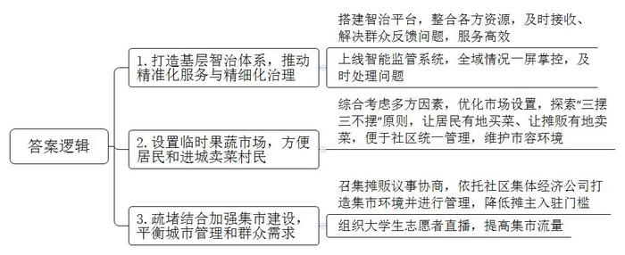
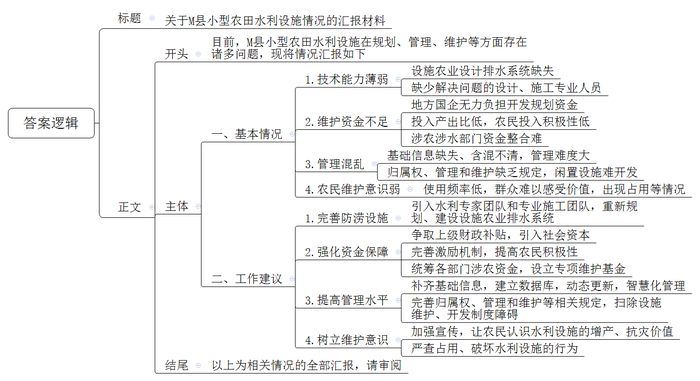
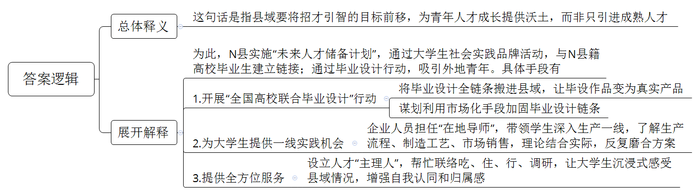
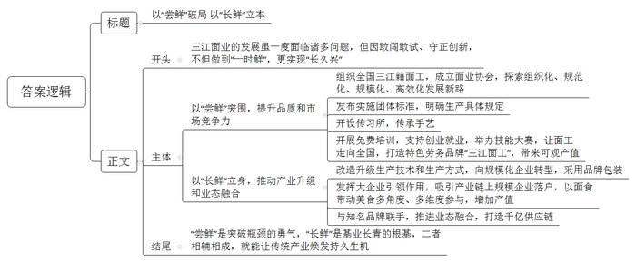
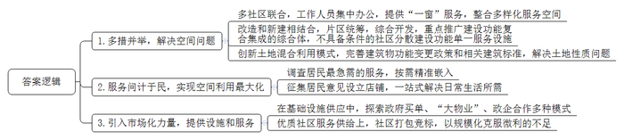

# 2025年公务员多省联考《申论》题（河南县级卷）

<!-- gwy:overview:start -->
> **河南 · 2025 · 申论 · 县级卷** ｜ 5 题 · 图片 5 处 · 答案随题折叠

导航：[题目](#题目)
<!-- gwy:overview:end -->

> 候选采集稿。参考答案及解析来自粉笔页面，不代表官方答案或真实高分答卷；来源使用许可与原卷对应关系仍需人工核实。

## 给定材料

### 材料 material-2060556e6a78dff6

南营街道地处Q县城近郊区，由7个行政村、6个社区共同组成，是一个典型的城乡接合部，既承载了县里最繁华的商圈，也有广袤的农村。

“太好了，以后再也不用摸黑摆龙门阵（方言，指聊天）了！”前段时间，南营街道三合村发生的一个小变化，令村民老高连连称赞。原来，老高所在的三合村居住集中区一直没有路灯，作为附近村民茶余饭后休闲的地方，夜里照明条件却不好。“那边没有人居住的马路边倒是安装了好几个路灯。”老高向三合村网格员小陈反映了这一情况。收到群众“点单”，小陈第一时间将问题上报到街道基层智治平台。恰逢街道人居环境整治安装太阳能路灯项目正在三合村实施，基层治理指挥中心随即“派单”。项目相关工作人员前往现场查看后，根据实际调整了路灯安装点，居住集中区当天晚上就亮起了路灯。

“以前网格员发现问题，需经过村（社区）、街道、部门，层层上报，费时费力。基层智治体系打通了智治‘最后一公里’，街道、部门等各方资源得以整合，推动问题及时解决，服务群众更加高效。”南营街道基层治理指挥中心蔡主任介绍。

2024年，南营街道基层智治平台还上线了智能监管系统，通过“智能前端监控+视频AI算法+智治平台”，实现全域情况“一屏掌控”，进一步探索了精准化服务与精细化治理的有效路径。“有一次，中心接到一条基层智治平台推送的机动车违停信息，我们马上将事件交办给违停地点社区网格员，网格员接到任务后立即赶赴现场，将违停车辆劝离，从收到提示到处置完成仅耗时5分钟。”蔡主任说。

“很方便，而且也很干净，一点也不乱。”每天上午7点，莲花小区居民曾女士都会在家附近的临时果蔬市场买菜。

“我们了解到，由于没有农贸市场，近郊村民进城卖菜只能挑着到处走，这对村民们来说并不方便，而且马路上还常常有丢弃的垃圾。”南营街道党工委江书记说。对此，街道综合考虑便民服务、市容环境卫生、城市交通等因素，优化“市场”设置，探索出“三摆三不摆”原则——街道统筹规划摆、特定区域规范摆、清洁卫生规矩摆，主干大道不准摆、商户门前不能摆、小区大门不得摆。“我们设置了10多处临时果蔬市场，一方面让居民有地买菜、让摊贩有地卖菜，另一方面也便于社区统一管理，维护市容环境。”

在顺兴社区，每天下午3点社区集市开市，摊位统一墙体、绿植、棚伞等风格，搭配五彩斑斓的装饰以及彩绘涂鸦，既美观又整洁。到了夜间，彩灯闪烁，集市里人潮涌动，充满欢声笑语，人间烟火气充盈着曾经杂乱的街巷。

“社区集市给了我们‘家’的感觉。”摊位上，小王一边乐呵呵地卖着烤肠一边说道，过去她都是推着小吃车在大街小巷卖烤肠和冰粉。

为了平衡城市管理的“面子”和群众的“袋子”，南营街道坚持疏堵结合，召集摊贩开展议事协商，依托社区集体经济公司对集市环境进行打造，对集市清洁卫生、水电等进行管理。“摊主每月只需缴纳150元的服务费、办个健康证就可以在集市经营。”江书记表示，对于这样的模式，摊贩们很支持，刚开始登记，顺兴社区的56个社区集市摊位便一“抢”而空。

日前，社区还组织了大学生志愿者对集市进行直播，提高集市流量，每天到集市打卡消费的人群达2000余人，这里已然成为Q县有名的“网红”集市。

“中国式现代化，应该是人民群众感受得到的现代化，要坚持群众视角，从点滴做起，一件接着一件做，这样才能让基层治理更加有效。”

### 材料 material-c317f8a84242f355

“大棚根本进不去，里面积水太深。”2024年8月，一场特大暴雨降临M县，老孙至今都清晰地记得当时自家大棚的情形。

几天过去，地表的积水慢慢退去，但只要用脚轻轻一踩，水即刻渗出地面。老孙发现，只要附近的水库一放水，棚里的水井就跟着涨水。大棚不远处还有一座废弃的方塘，如果方塘涨水，棚内积水就更加严重。

邻近的几十个大棚，情况大同小异。“当时下那么大的雨，总不能说不让水库放水吧？”无奈之下老孙拨通了刘镇长的电话。此时，刘镇长正焦头烂额：“下雨当晚，东边几个村就断了电，香菇大棚里的菌棒漂得到处都是，西边冲断了座桥，好多垃圾堵在那儿，水的流向变了，眼瞅着就要冲到大棚，一旦淹过去，一个大棚的损失就得几十万。”

土生土长的刘镇长，人熟，地也熟。他记得小时候，田里种的是玉米和一些杂粮，“旱得厉害，根本收不了多少。”后来，镇里鼓励大家种果树，不少村子开始修建方塘，雨天蓄水，需要的时候拿泵抽水浇果树。“2005年左右，镇里牵头开始引进设施农业，建大棚，种黄瓜和香菇。蔬菜大棚的灌溉，特别是香菇种植，基本不需要方塘蓄水，很多方塘就慢慢废弃了。”当初在引进设施农业时，他全程参与了设计，“那时考虑的是防旱，从没想过排涝的事。田里也没什么排水设计，在后续优化中，排水问题也几乎没有纳入考量。”

水库、方塘、大棚……前往老孙家的路上，刘镇长反复思量其中的关联。“到了他家，看了情况，我也不确定是咋回事。附近河道水位比大棚都高，挖沟排水根本不现实。而且突然挖出一条沟，万一有小孩失足掉进去更危险。”刘镇长坦言，当时灾情紧急，很多想法来不及论证，请示上级后他便做主清理河道。“太专业的知识我也不懂，当时多少有点‘赌一把’的心态。想着水库、方塘和大棚里的水井在地下是不是连通的，如果是，那把河道清出来应该有用。”于是他紧急调来两台挖掘机和翻斗车对垃圾进行清理，同时深挖和拓宽河道。

河道挖开，大棚水退，刘镇长庆幸自己赌赢了。然而，开挖河道只是权宜之计，一旦再遭遇如此暴雨，水漫大棚的情况极有可能再次发生。他觉得：“这不是随便挖条沟、挖个坑就能解决的事，具体该怎么设计、怎么施工都需要很专业的技术人员，我们没有这个水平。”不仅如此，他坦言，更恼火的是资金问题，“这属于公共设施，村民不可能自己出钱，镇里也没这笔钱。”

M县共有水域及水利设施用地超5200公顷，其中，坑塘水面约76公顷，沟渠超46公顷。但却没有各村镇沟渠、坑塘等排水和灌溉设施分布和使用的具体信息。很容易看到废弃的方塘和水井，水井不远处的泵房也早就无人管理，一片杂乱之象。村中的水井已经有五六十年之久，早已无人使用。

2018-2019年，县里对小型农田水利的管理进行了职能调整。“那次调整把‘小农水’的归口管理从水利部门调到了农业部门，但事走了、人没动，各种资料、手续很多还在水利局。以前信息化、数字化不像现在这样普及，存在基础信息缺失和含混不清等问题。”县政府办王副主任表示，加之近些年的人事变动，全县“小农水”管理困难重重。

农业水利专家周教授指出，目前，农田水利公共设施由农业主管部门负责建设，但建成后的归属权、管理和维护问题却缺乏明确的政策规定。

村民老马说：“之前有人承包方塘养鱼、建垂钓园，那会儿由他们自己管。但不挣钱，后来就慢慢荒了，再倒点垃圾，水都臭了。”

刘镇长说，过去种果树、种粮食的年代，村里会对方塘进行集中管理，定期组织清淤、检查维护泵房。“现在利用率太低了，就没人管了。在别的地方，还有人把坑填了另做他用，我们不敢这么干。之前水库管理局将所辖部分闲置鱼池租赁给驾校，其中20亩左右坑塘水面改建成了硬化训练道路，结果因非法占用被通报了。”

“这些都是历史问题，想要重新管起来太难了。”县水利局陈科长说，水库建设之初在下游预留了几个坑塘，想着可以养养鱼，职工也可以搞点副业。后来，经历机构改革，水库管理局的建制早已不复存在，水库和相关资产、人员转由地方国企统一管理，但只是清算了工资，根本没钱对坑塘水面和周边土地作进一步的开发和规划。“而且多年历史遗留的产权归属可能也有一定问题，所以就只能搁着，可惜了一块好地方。”

周教授介绍，当前，各地小型农田水利工程，如果被划入高标准农田建设范畴或是几大灌区的主要水利设施，有中央财政参与支持，管理就比较规范，但对于其他农田或者温室大棚这样的设施农业，灌排工作更多还是以农户或生产经营者自身为主。“农业的投入产出效益比较低，农民对于‘小农水’的投入积极性不高。”他指出，虽然各级涉农涉水部门均有相关建设资金，但各自项目要求不同，整合起来并不容易。

“要想从根本上解决问题，还必须想方设法让村集体和农户意识到其中潜在的价值。”周教授说，在乡村各类基础设施中，道路是管理维护最好的，“老百姓几乎每天要走，能每时每刻感受到价值，所以维护意识很强。小型农田水利设施使用频率低，特别在发生涝害几率小的地区，对排水排涝不够重视，经常会看到排水沟里种植作物，还有的因为种地要用大型农机，直接把沟填平了。”

### 材料 material-14b512ffc79a09a9

三个大小不一、叠在一起的棕色圆盘，拉伸展开，便成为一套颜值“爆表”的户外桌椅……

在N县腾浩户外用品有限公司，新品刚刚完成试样。张总经理一边拿着“滚烫”的样品反复检测，频频点头，一边给销售部下达任务：“今年主推这款，争取9月上市！”一旁，设计师、大四学生小谭的心怦怦直跳，这个新品是他的毕业设计作品。“电脑里的效果图变成货架上的真实产品，想想就很‘燃’！”

这一切，来自于2022年N县的“全国高校联合毕业设计”行动。N县马县长介绍：“每年9月，我们‘出题’，全国高校学子10月开始‘选题’和‘答题’，第二年5月进行终期答辩。”这项行动目前已吸引171所高校的千余名大学生奔赴，诞生了456个作品。通过一系列的场景重构、流程再造、机制创新，把毕业设计全链条搬进了县域。未来，N县还谋划利用投资、金融等市场化手段加固毕业设计“链条”。N县打造“中国毕业设计之城”的梦想正在成为现实。

腾浩是户外用品行业的后起之秀，3年前凭借一款可折叠“魔法凳”出圈，年产值2000多万元。2024年初，腾浩拿下一笔千万元订单，忙着为“魔法凳”做配套设计，扩充产品线。张总经理抛出的题，引来了初出茅庐的小谭，他在腾浩住了下来，郑重写下开题报告：《“魔方”户外露营桌凳系列产品设计》。

然而，令小谭始料未及的是，他的设计方案“一波三折”。“最初，我设计了折弯结构的桌脚，可到了生产一线，才发现要实现它，不仅需加装转弯轴承，还要让铁件加厚，这大大增加了生产难度和成本。第二稿改用伸缩结构，但因为没有生产经验，数据不准，比例失调……”一遍遍修改、一次次提升，在这一过程中，“在地导师”帮了小谭大忙。

小谭的“在地导师”张总经理，并不着急让他动手设计，而是带着他扎进生产一线，从了解生产流程、制造工艺、市场销售开始，再理论结合实际，磨合方案，大大小小的修改不计其数。

最近，某大学视觉传达专业大四学生小秦在N县喜获首批毕业设计“联络官”新身份。她来到N县住下，每天都出去逛，县域的慢节奏让她沉下心做设计，一待就是一个多月。这期间，小秦沉浸式感受N县蓬勃的脉动，吃、住、行、调研都有人才“主理人”帮她安排联络。

“除了不会讲N县话，我已经是半个‘N县通’了，在这里，我找到更多自我认同和归属感。最初，我很惊讶也很好奇，是怎样一个地方对大学生这么好！”小秦感叹背后，是N县精心谋算的一笔人才大账。2015年，N县就提出了“未来人才储备计划”，通过“家燕归巢”“返家乡”寒暑假大学生社会实践等品牌活动，千方百计与N县籍高校毕业生建立链接。而毕业设计行动更是将眼光外拓，吸引外地青年特别是大学毕业生更多流入，集纳更广阔的人才资源。

“县域，或许没有充足富集的平台，没有一掷千金的引才实力，但可以给初出茅庐的青年人才提供成长沃土，把‘题’出好，这条路走通了，县域与人才的双向奔赴也就照进了现实。”马县长说，“我们不提要求、不讲条件、不谈结果，只做好服务，并且在毕业设计作品完结后，继续帮他们搭建平台，创造条件。未来县域的产业发展势必更加依赖年轻人，招才引智的目标也将前移。我们应当把更多精力投入在‘种树’上，而非静待成熟再‘摘果’。”

### 材料 material-e2d8e1281f7a41f5

“老板，来2两招牌豌杂面，多放点辣子！”天刚蒙蒙亮，位于Q市三江区的“三江早面”形象店迎来首批食客。

老曹在热气腾腾的面锅跟前，一边用长筷翻搅着锅内的鲜面，一边示意身边的徒弟将佐料碗备好，嘴里还叮嘱，“要时刻观察面煮在汤里的状态，时间过短或过长都会破坏弹性和口感。”老曹既是首家“三江早面”形象店的老板，也是三江区面业协会会长。老曹很清楚“三江面”的优势，但他也坦言，随着社会发展，仅靠吃苦耐劳就想延续三江面业的辉煌几乎是不可能的。上任会长之初，老曹就在思考如何走上煮好“一碗面”的新赛道。

“过去，面业从业者分布全国各地，多以家庭作坊为主，产品品质差异大，市场综合竞争力不足，这些都是棘手问题。”老曹坦言。2014年，由区政府牵线，将分布在全国各地的三江籍面工组织起来，成立面业协会，探索组织化、规范化、规模化、高效化发展新路。一批又一批设备更新、技术换代、品牌推新的面条加工厂如雨后春笋般应运而生。2022年，“三江鲜面”团体标准发布实施，对质量要求、工艺流程、生产环境等做了具体规定。

在三江区杠子面传习所，杠子面第37代手艺传承人陈师傅正在带学徒。为把杠子面的制作手艺传承下去，陈师傅特意将传习所选在巴家村的一处农家院内，成为巴家村的“新村民”，手把手为当地村民授艺。小院正屋的墙上，挂着一副对联：历经压打千百遍，一生只为一碗面。

“区职教中心免费开设鲜面制作培训班，鼓励有一定面工技能的群众创业就业，推动‘三江面工’向全国各地开枝散叶，每年区里还举办面工职业技能大赛，累计吸引600余名三江籍面工同台竞技。目前，全国有三江人所开面坊7万余家，从业人员超20万人，他们的足迹遍布全国2700多个县级行政区，‘挑’起了全国70%以上鲜面市场，每年带来逾700亿元产值。”三江区发改委负责人介绍。

按照“政府搭台、市场唱戏”思路，三江区多部门协同，打造“三江面工”特色劳务品牌，2023年底，品牌被纳入Q市地方标准制订修订“蓄水池”。

小杨17岁就跟随父亲学习做面，2013年成立公司后，对传统生产技术和生产方式进行了全方位改造升级，逐步从家庭作坊向规模化企业转型。“以前，我们的确还欠缺一些品牌意识。”小杨表示，今后公司所有产品都将以三江特产“江小面”作为品牌包装。

“我们是一家在全国拥有15家工厂、年产值3个多亿元的鲜面产业链企业。”得知家乡正在围绕面业打造千亿产业链，三江人老吴毫不犹豫就将集团总部迁回三江。三江区商务委负责人说，“我们积极发挥大企业的引领性作用，截至目前，已吸引8家面业产业链上规模企业落户三江面产业园，年产值超11亿元。”

2024年12月，三江区获得一项来自中国烹饪协会授予的新称号——“中国·三江面食美食地标城市”。“以面食带动美食，只要是跟面食美食有关系的，都能多角度、多维度参与进来，可以实现产值翻番。此外，我们与全国一些知名面食品牌，在鲜面供应、品牌推广等方面推进业态融合，强强联手，上下游供应链交易额近1000亿元。”三江区商务委负责人表示，“三江面业大有可为，我们不仅要‘尝鲜’，更要‘长鲜’。”

### 材料 material-196f0122751773db

看着小区内正在装修的社区服务综合体，B市白沙街道南华社区居民老周满怀期待，“社区说已经在进行运营商招投标，5月份就能使用，太好了！”这个面积达2000平方米的综合体，具备养老、托育、健身、阅读等功能，居民在家门口就能享受普惠优质的社区服务。

2023年，国家发改委选择50个城市开展“城市社区嵌入式服务设施”试点。南华社区的这个服务综合体，就是B市最新打造的“城市社区嵌入式服务设施”之一。

“在家门口”，意味着步行可及，居民能够方便获取服务。尤其是老年人和儿童群体，活动半径较小，对服务的便捷性要求高，如果远距离寻找服务，时间、交通和陪护成本将明显增加。不管是商品还是服务，“普惠优质”对老百姓来说永远是他们的“心头好”。

B市是嵌入式服务设施建设领域的先行者。2020年，B市启动产业园区嵌入式幼儿园（托育）建设。2023年，启动“民生幸福共同体”建设，突破社区（村）服务行政区划，以“共同体”形式提升完善“15分钟公共服务圈”……

江滨街道未来社区服务综合体由新民、七塘、太安3个社区共同打造，北临大运会主场馆，南接物联网小镇核心区，可谓“寸土寸金”。三个社区现有居民两万余人，且老年人占了相当比例。“在街道统筹下，我们将3个社区的存量空间，整合出1万平方米为居民提供服务，社区工作人员集中办公，社区服务‘一窗’提供。”工作人员小李指着临街的服务空间说，这里有阅览室、食堂、健身房、医疗室、托育所、公园等。

云开区红梅社区将雅苑三区20幢原3层、2100平方米房屋拆除后重建，打造5层楼高、4300平方米的邻里中心；双桥区长河街道明月社区，向隔壁西湖街道租了800平方米服务用房用于托育中心建设……

对于服务空间，B市秉持“改造和新建相结合”的原则：重点推广和优先建设功能复合集成的社区嵌入式服务综合体，暂不具备条件的采用“插花”式分散建设功能相对单一的嵌入式服务设施。支持以片区统筹、综合开发模式推进建设。

空间的腾挪，有不少涉及土地性质问题。比如，七彩社区为更好建设嵌入式服务设施，在土地出让时混合了住宅、商业、公共场站、停车场、文化设施等多种性质用地，创新了土地混合利用模式。B市完善建筑物使用功能变更政策和幼儿园建筑标准等，为多家产业园区嵌入式幼儿园（托育）的开办“开了绿灯”。

有了空间后，如何引入服务，实现空间的最大化利用？“从目前的实践来看，最有效的办法就是问计于民。”B市发改委相关负责人介绍，在启动“民生幸福共同体”建设前，他们做过一个网络调查，从3000多份问卷中遴选出居民最急需的家门口服务，实现“按需精准嵌入”。

和睦路街道仙桃社区是一个典型的老社区，60周岁以上的人口占36%。这几年，社区利用居民楼的楼下空间打造了“仙桃养老爱心街区”。“居民日常生活所需基本都能在这条街上一站式解决。”街道党工委文书记说，“街”上的店铺类型，大多是征求居民意见设立的，街口是早点餐饮，街尾是公园，在仙桃社区4幢至10幢之间嵌入了乐养中心、小超市、小药房、小修小补店等，覆盖“15分钟生活服务圈”内的近万居民。“社区正在讨论要不要把这里改成相亲角，因为年轻人的交友问题，已经成为‘新需求’。”文书记指着街角的一间闲置用房说。

在社区基础设施供应中，有不少市场化力量加入其中。如蔚来集团在B市运营着多个未来社区。集团事业部何经理表示，目前大多数社区服务以政府购买形式委托运营商运营，也就是政府买单；也有物业公司接管周边片区的“大物业”模式，设计、采购、施工及运营一体化的总承包模式；还有越来越多的社区与运营公司合资成立“强社公司”，联合运营探索全域可持续的政企合作模式。

“社区人手有限、专业人做专业事，优质社区服务的供给最好是引入市场化力量。然而作为公共服务，收费水平不能太高，没有利润的话就没有企业愿意投入，也无法保证公共服务的质量。政府兜底是没办法的办法。”B市发改委杨主任表示，考虑到社区服务的微利属性，在城乡社区“民生幸福共同体”建设中，一些街道采取几个社区打包竞标，以规模化克服微利的不足。

从现实情况来看，城市社区嵌入式服务设施建设需要集基本服务、公益服务以及商业服务等多种服务为一体，仅靠政府大包大揽难以持续，单靠企业投资又难有作为。二者之间如何平衡是个大难题。“不仅如此，投入大量资金建成的设施如何可持续运营，更是一个值得关注的问题。搞得不好，就容易出现‘建设轰轰烈烈，服务冷冷清清’。”杨主任强调，为老百姓在家门口提供更多普惠优质的服务，还需要更深入的探索。

## 题目

### 第 1 题

**请根据****“给定资料**1**”，梳理总结南营街道在基层治理工作中是如何坚持群众视角的。（15分）**

关联材料：材料 material-2060556e6a78dff6、材料 material-c317f8a84242f355、材料 material-14b512ffc79a09a9、材料 material-e2d8e1281f7a41f5、材料 material-196f0122751773db

作答要求：

要求：全面准确、条理清晰。不超过250字。

第 1 题 · 答案与解析

**参考答案（粉笔题库参考内容）**

1.打造基层智治体系，推动精准化服务与精细化治理。搭建智治平台，整合各方资源，及时接收、解决群众反馈问题，服务高效；上线智能监管系统，全域情况一屏掌控，及时处理问题。

2.设置临时果蔬市场，方便居民和进城卖菜村民。综合考虑多方因素，优化市场设置，探索“三摆三不摆”原则，让居民有地买菜、让摊贩有地卖菜，便于社区统一管理，维护市容环境。

3.疏堵结合加强集市建设，平衡城市管理和群众需求。召集摊贩议事协商，依托社区集体经济公司打造集市环境并进行管理，降低摊主入驻门槛；组织大学生志愿者直播，提高集市流量。

**解析**

**参考答案说明**：本参考答案从“打造基层智治体系，推动精准化服务与精细化治理”“设置临时果蔬市场，方便居民和进城卖菜村民”“疏堵结合加强集市建设，平衡城市管理和群众需求”三个方面展开，各条答案要点之间在内容上相互并列，没有交叉。

**考点**：考点概括措施类

**来源**：来源2025年公务员多省联考《申论》题（河南县级卷）

粉笔申论页面对本题只提供「解析视频」入口，该入口是会员推广位，页面无视频地址与文字解析。

### 第 2 题

**上级部门近期将派工作组到****M县开展小型农田水利设施相关情况调研。请根据“给定资料**2**”，为M县拟写一份汇报稿。（25分****）**

关联材料：材料 material-2060556e6a78dff6、材料 material-c317f8a84242f355、材料 material-14b512ffc79a09a9、材料 material-e2d8e1281f7a41f5、材料 material-196f0122751773db

作答要求：

要求：主题明确，全面准确，不考虑格式。不超过500字。

第 2 题 · 答案与解析

**参考答案（粉笔题库参考内容）**

关于M县小型农田水利设施情况的汇报材料

目前，M县小型农田水利设施在规划、管理、维护等方面存在诸多问题，现将情况汇报如下：

一、基本情况：1.技术能力薄弱。设施农业设计排水系统缺失；缺少解决问题的设计、施工专业人员。2.维护资金不足‌。地方国企无力负担开发规划资金；投入产出比低，农民投入积极性低；涉农涉水部门资金整合难。3.管理混乱。基础信息缺失、含混不清，管理难度大；归属权、管理和维护缺乏规定，闲置设施难开发。4.农民维护意识弱。使用频率低，群众难以感受价值，出现占用等情况。

二、工作建议：1.完善防涝设施。引入水利专家团队和专业施工团队，重新规划、建设设施农业排水系统。2.强化资金保障。争取上级财政补贴，引入社会资本；完善激励机制，提高农民积极性；统筹各部门涉农资金，设立专项维护基金。3.提高管理水平。补齐基础信息，建立数据库，动态更新，智慧化管理；完善归属权、管理和维护等相关规定，扫除设施维护、开发制度障碍。4.树立维护意识。加强宣传，让农民认识水利设施的增产、抗灾价值；严查占用、破坏水利设施的行为。

以上为相关情况的全部汇报，请审阅。

**解析**

**参考答案说明：**（1）格式方面，本参考答案写到了“标题”“正文”两个部分。（2）正文部分，一方面从内容上来看，围绕“小型农田水利设施”这一主题，本参考答案的开头先简单叙述了整体情况；主体部分主要介绍了“基本情况”和“工作建议”，其中，“基本情况”从“技术能力薄弱”“维护资金不足”“管理混乱”“农民维护意识弱”四个方面展开；“工作建议”从“完善防涝设施”“强化资金保障”“提高管理水平”“树立维护意识”四个方面展开。最后，结尾进行了简单总结。另一方面，形式上，本参考答案做到了分段、分条撰写，整体上条理较为清晰。

**考点**：考点总结类

**来源**：来源2025年公务员多省联考《申论》题（河南县级卷）

粉笔申论页面对本题只提供「解析视频」入口，该入口是会员推广位，页面无视频地址与文字解析。

### 第 3 题

**请理解分析****“给定资料**3**”的画线句子“我们应当把更多精力投入在‘种树’上，而非静待成熟再‘摘果’****。****”****（****20分）**

关联材料：材料 material-2060556e6a78dff6、材料 material-c317f8a84242f355、材料 material-14b512ffc79a09a9、材料 material-e2d8e1281f7a41f5、材料 material-196f0122751773db

作答要求：

要求：全面、准确、深入。不超过300字。

第 3 题 · 答案与解析

**参考答案（粉笔题库参考内容）**

这句话是指县域要将招才引智的目标前移，为青年人才成长提供沃土，而非只引进成熟人才。

为此，N县实施“未来人才储备计划”，通过大学生社会实践品牌活动，与N县籍高校毕业生建立链接；通过毕业设计行动，吸引外地青年。具体手段有：

1.开展“全国高校联合毕业设计”行动。将毕业设计全链条搬进县域，让毕设作品变为真实产品；谋划利用市场化手段加固毕业设计链条。

2.为大学生提供一线实践机会。企业人员担任“在地导师”，带领学生深入生产一线，了解生产流程、制造工艺、市场销售，理论结合实际，反复磨合方案。

3.提供全方位服务。设立人才“主理人”，帮忙联络吃、住、行、调研，让大学生沉浸式感受县域情况，增强自我认同和归属感。

**解析**

**参考答案说明****：**（1）思路方面，本参考答案写到了“总体释义+展开解释”这两个部分。（2）内容方面，本参考答案首先对画线句子进行总体释义，然后展开解释部分先介绍了总体举措，接着具体举措从“开展‘全国高校联合毕业设计’行动”“为大学生提供一线实践机会”“提供全方位服务”这三个方面展开。（3）词句表达方面，本参考答案加上了“具体手段有”“为此”等连接词来承接上下文，使上下衔接更顺畅。

**考点**：考点词句解释类

**来源**：来源2025年公务员多省联考《申论》题（河南县级卷）

粉笔申论页面对本题只提供「解析视频」入口，该入口是会员推广位，页面无视频地址与文字解析。

### 第 4 题

**“给定资料**4**”是《Q市日报》刊登的一篇专题报道。请以“尝鲜·长鲜”为话题，写一篇短评。（20分）**

关联材料：材料 material-2060556e6a78dff6、材料 material-c317f8a84242f355、材料 material-14b512ffc79a09a9、材料 material-e2d8e1281f7a41f5、材料 material-196f0122751773db

作答要求：

要求：观点明确，说理充分。不超过400字。

第 4 题 · 答案与解析

**参考答案（粉笔题库参考内容）**

以“尝鲜”破局 以“长鲜”立本

三江面业的发展虽一度面临诸多问题，但因敢闯敢试、守正创新，不但做到“一时鲜”，更实现“长久兴”。

以“尝鲜”突围，提升品质和市场竞争力。组织全国三江籍面工，成立面业协会，探索组织化、规范化、规模化、高效化发展新路；发布实施团体标准，明确生产具体规定；开设传习所，传承手艺；开展免费培训，支持创业就业，举办技能大赛，让面工走向全国，打造特色劳务品牌“三江面工”，带来可观产值。

以“长鲜”立身，推动产业升级和业态融合。改造升级生产技术和生产方式，向规模化企业转型，采用品牌包装；发挥大企业引领作用，吸引产业链上规模企业落户，以面食带动美食多角度、多维度参与，增加产值；与知名品牌联手，推进业态融合，打造千亿供应链。

“尝鲜”是突破瓶颈的勇气，“长鲜”是基业长青的根基，二者相辅相成，就能让传统产业焕发持久生机。

**解析**

**参考答案说明**：（1）格式方面，本参考答案写到了“标题”“正文”两个部分。（2）正文部分，一方面从内容上来看，围绕着“尝鲜·长鲜”这一话题，本参考答案的开头先写到了三江面业的发展背景以及给出了观点；接着主体部分从“以‘尝鲜’突围，提升品质和市场竞争力”“以‘长鲜’立身，推动产业升级和业态融合”这两个方面展开，最后，结尾部分进行了总结。另一方面，形式上，本参考答案做到了分段、分条撰写，整体上条理较为清晰。

**考点**：考点评论类

**来源**：来源2025年公务员多省联考《申论》题（河南县级卷）

粉笔申论页面对本题只提供「解析视频」入口，该入口是会员推广位，页面无视频地址与文字解析。

### 第 5 题

**请根据****“给定资料**5**”，梳理总结B市在“城市社区嵌入式服务设施”建设中，既实现“建设轰轰烈烈”****，****又避免****“服务冷冷清清”的探索。（20分****）**

关联材料：材料 material-2060556e6a78dff6、材料 material-c317f8a84242f355、材料 material-14b512ffc79a09a9、材料 material-e2d8e1281f7a41f5、材料 material-196f0122751773db

作答要求：

要求：全面准确、有概括性。不超过300字。

第 5 题 · 答案与解析

**参考答案（粉笔题库参考内容）**

1.多措并举，解决空间问题。多社区联合，工作人员集中办公，提供“一窗”服务，整合多样化服务空间；改造和新建相结合，片区统筹，综合开发，重点推广建设功能复合集成的综合体，不具备条件的社区分散建设功能单一服务设施；创新土地混合利用模式，完善建筑物功能变更政策和相关建筑标准，解决土地性质问题。

2.服务问计于民，实现空间利用最大化。调查居民最急需的服务，按需精准嵌入；征集居民意见设立店铺，一站式解决日常生活所需。

3.引入市场化力量，提供设施和服务。在基础设施供应中，探索政府买单、“大物业”、政企合作多种模式；优质社区服务供给上，社区打包竞标，以规模化克服微利的不足。

**解析**

**参考答案说明**：本参考答案从“多措并举，解决空间问题”“服务问计于民，实现空间利用最大化”“引入市场化力量，提供设施和服务”三个方面展开，各条答案要点之间在内容上相互并列，没有交叉。

**考点**：考点概括措施类

**来源**：来源2025年公务员多省联考《申论》题（河南县级卷）

粉笔申论页面对本题只提供「解析视频」入口，该入口是会员推广位，页面无视频地址与文字解析。

