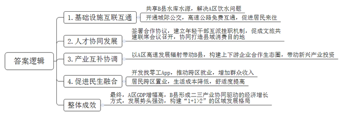
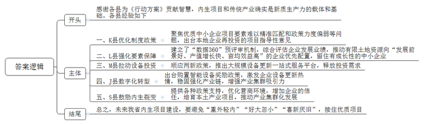
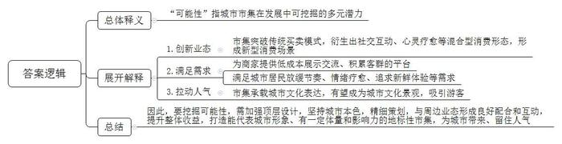
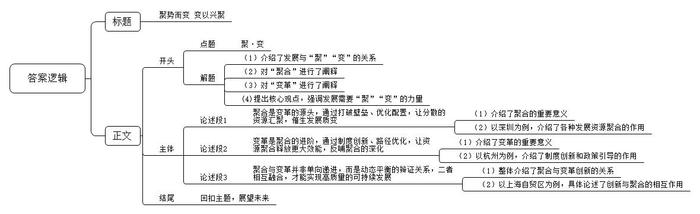

# 2025年公务员多省联考《申论》题（河南市级卷）

<!-- gwy:overview:start -->
> **河南 · 2025 · 申论 · 市级卷** ｜ 4 题 · 图片 4 处 · 答案随题折叠

导航：[题目](#题目)
<!-- gwy:overview:end -->

> 候选采集稿。参考答案及解析来自粉笔页面，不代表官方答案或真实高分答卷；来源使用许可与原卷对应关系仍需人工核实。

## 给定材料

### 材料 material-04014d9c3284cfac

清晨，A区居民小陈准备烧饭，打开水龙头，清冽的自来水哗哗流出。这股来自13公里外B县最大饮用水源保护地三合水库的清泉，让A区3个街道的16万人“解了渴”。同饮一库水，得益于两地的同城化发展。

A区和B县地域相连且同属C市，主城区相距不到20公里，A区人口众多、商贸发达，B县人文和生态资源丰富。2018年，在市政府主导下，两地签署战略合作协议，全力推动同城化发展，推进了80余项合作。

B县中医院的骨科远近闻名，这两年，从A区到B县来看骨伤的患者明显增多了。A区商贸业发达，经常能看到成群结队的B县年轻人到A区逛街、消费。而B县的农家乐也很受A区居民欢迎，去年前往B县乡村游的A区游客占总量的50%。“这几年两地开通了城际公交，实现了高速公路免费互通，两地的互联互通还在进一步加速，未来将新建、提升改造3条道路。”A区交通运输局相关负责人介绍。

2020年4月，两地组织部门签署了人才协同发展战略合作框架协议，建立年轻干部互派挂职机制。现挂职A区文旅局副局长的B县青阳街道办马副主任在漫步A区文创街区时，想到青阳特色美食街，突然冒出一个想法，“两地各有优势，何不强强联手？”想到就干，他与同事合作，促成A区与B县召开文旅共建联席会议，积极推动两地开展“美食文创街区”旅游营销活动，协同打造县域消费目的地。

“这几年，A区高速发展对B县的辐射带动正在逐步增强，两地产业互补性、协调性还在加深。”B县孙县长表示，“2024年，B县制造业投资增长超过50%，增速位列全市第一。在A区新兴产业带动下，一批与其紧密关联的新能源项目相继落地B县，不仅完善了产业结构，也带动了装备制造、光伏光电、电子信息等新兴产业投资。”

走进毗邻A区的B县黄龙工业园区，一栋栋现代化新厂房映入眼帘。近几年，该园区共落地企业218家，其中企业法人为A区籍的有86家。A区某面膜生产企业负责人表示，2020年看准两地同城合作机遇，她在B县投资建起了新工厂。在市场需求带动下，A区和B县之间已经形成了面膜上下游供应链企业紧密合作的生态圈。近期，两地的物流公司正积极谋划，在黄龙工业园区开展综合货运枢纽共建等项目。“我们在黄龙工业园建有物流仓库，在此集货后，可通过A区中欧班列、水运发往全世界。”A区某物流公司负责人说，在B县建仓成本低、发货效率高。

B县某商业小区因地理位置优越、价格适中，项目一开盘就吸引了500余户A区市民前来投资置业。“在A区赚钱，在B县生活。”在A区做服装生意的小江选择将家安在B县，生活成本低、舒适度高，一家人在一起，幸福甜蜜。

今年，B县人社部门帮助推广A区的“找零工”App，将A区实时响应的零工招聘信息推送到B县用户手中，已帮助1000余名B县籍务工人员在A区找到了打短工的机会。B县人社局就业科负责人说，家住B县城乡接合部的邹先生，忙时在家务农，闲时出门打工。这几年A区对零工需求很多，打包的、配货的、装运的，有时一干就是十天半个月，增加了不少收入。

据统计，2019-2024年A区GDP增幅达31%，增幅高出B县约11个百分点。但在A区的带动下，B县二三产业协同驱动的经济增长方式逐渐形成，多项经济指标增速在C市9个区县中名列前茅，显示出强劲的发展势头。虽然2024年A区GDP增速仍然高于B县，但两地增幅的差距，已由去年的1.6个百分点缩小到了1.1个百分点，目前“1+1>2”的区域发展格局初步形成。

### 材料 material-56f0487ab8914c8b

党的二十届三中全会强调，深化投资审批制度改革，形成市场主导的有效投资内生增长机制。

日前，H省拟出台《大力推动制造业内生项目建设行动方案》，推动本地企业聚焦新技术、新产品、新市场，不断扩大有效投资。为此，省工信部门专门召开座谈会，邀请省内2024年制造业投资增速超过10%的5个县及有关人员介绍相关情况。下面是发言摘录：

K县：2021年至2023年，受联芯、亚迪等一批招商引资大项目带动，制造业投资额翻了一番。与此同时，一些声音也随之出现：“优先保障外来大项目，中小企业拿地难。”“外来的和尚好念经，我们到外地投资去争取优惠政策。”……

“事实上，一些内生项目的投资力度并不比大型招商项目小。”K县经信局黄局长说，比如三山股份近几年每年投资额都在1亿元以上，而一些地方过于注重招商引资，本地优质中小企业却难以拿到土地。

2023年9月，K县出台内生项目（即本地企业再投资的项目）指导性意见，聚焦优质中小企业项目要素难以精准匹配和政策力度偏弱等问题，制定了9方面25条政策。比如，要求各地每年保障高成长中小企业用地总量不低于当年出让工业用地总量的20%，内生项目政策技改补助从原先的6%提高到10%。

L县：“2023年，我们建立了‘数据360’预评审机制，对企业近几年发展业绩进行综合评估，让数据说话，凭数据决策，推动有限土地资源向‘发展前景好、产值增长快、亩均效益高’的企业优先配置。”L县经信局周局长介绍，“在这一机制推动下，去年，L县制造业项目完成投资148亿元，同比增长13%。其中，内生项目投资占大头。”

兴全精工是一家年销售额近20亿元的大企业，这几年每年都会投入近亿元用于扩产投资，而十几年前，他们只是一家小微企业。当初为了土地指标，他们差点去省外重新建厂，最后经当地政府挽留才没有外迁。“中小企业对要素保障是最敏感的，他们往往是大企业的前身和底座。留住有成长性的中小企业，就是在培育内生项目。”杨董事长说。

M县：经信局姜局长说：“其实，不愿意投资新项目，并不意味着不愿意投资。工欲善其事，必先利其器。在设备更新上，大家热情就很高。”

2024年上半年，M县顺应“两新”政策，推出大规模设备更新一站式服务平台“更新之家”，很快就有400余家企业达成设备购买意向，金额超3.5亿元。

天海集团是首批入驻企业之一，在“更新之家”平台推出10多款5代注塑机。入驻以来，天海集团胡经理发现，企业数控机床等高端装备的订单增势喜人。“在存量上做投资，是一种隐形的项目投资。”姜局长说，M县是制造业大县，设备保有量大，按产值计算，全县超六成的传统制造企业对通过技术改造提高生产效益有强烈意愿，预计每年可释放100亿元投资需求。

J县：该县袜业产量占全国的70%，前几年，顺应数字化转型潮流，县政府鼓励袜企购置织缝翻一体袜机等智能装备，奖励比例最高达40%。这一奖励，激发了企业“换新”的热情。衡亿针纺科技有限公司分批购置了300多台织缝翻一体袜机，淘汰普通袜机近400台，全面实现智能化“换装”。

“设备改造以后，全县袜业产业链得到了稳固和强化。”J县经信局赵局长介绍，时不时有省内外的袜企向J县转移，袜业集群吸引力进一步增强，有效提升J县袜业尤其是中高档袜子市场反应能力，大量中高档袜子订单回流。

S县：“内生裂变”经常被挂在S县干部的嘴边。“内生裂变不是招商引资，胜似招商引资。”县经信局负责人介绍，去年12月，该县举行四季度内生裂变、招商引资项目签约开工活动，其中内生裂变项目20个、总投资近40亿元。

比如隆向集团就裂变出瑞浦能源等一批本土重大产业项目，加速带动S县新能源汽车产业布局。这些年来，隆向集团在新能源汽车整车研发制造领域的专业能力不断被认可，为此接到不少省外的邀请，但都婉拒了。集团陈董事长说，公司周边50公里以内，就有六七十家产业上下游供应商，都是跟随他们成长起来的配套企业。这些稳定的产业环境，是他们投资本地、放弃外地的直接原因。“政府和各种政策支持为公司发展提供了优异的营商环境，让信任不断加深。”

省工信厅投资处游处长表示，以往基层项目投资一定程度上存在“重外轻内”“好大忽小”“喜新厌旧”的问题，致使有时“接不住”本地优质项目。

H省工业和信息化研究院梁院长表示，内生项目也是新质生产力的重要载体，人们在谈新质生产力的时候，多将其局限在战略性新兴产业和未来产业，事实上，传统产业是现代化产业体系的基底，也是催生新质生产力的基础。

### 材料 material-cf2300f4d772965b

踩着音乐的节奏走出“城市森林”，稍走一段路就能和正在摆摊的手工创作者们交流作品心得；走出半开放式商场，就进入了两侧摆满小摊的街道，捧一杯热腾腾的热饮暖手，再看街边舞台上的各类演出，轻松惬意……因市而集，集兴而旺，古已有之的市集在当下再度兴起。

“我曾经卖出过一幅画，当时问客人为什么喜欢这幅画。”在S市某商圈的一场市集上，插画师小林说，“他说从这幅画上蘑菇的缤纷色彩里感受到一种孤独，好像一切都是误食蘑菇后的幻境。这位客人的话让我觉得对方很懂我，能将自己的作品交给这样一位客人，感觉暖暖的。”

“市集上，不光是你看摊主，他们也在看你，你愿意攀谈，他们也乐意分享，买卖双方形成了有趣的互动。”在S市工艺美院创新基地负责人云方看来，这是一种新型的消费模式。

“这些图案不是画上去的，是将不同颜色的皮革切割下来拼在一起的。”在古里手作市集的一个皮具摊位前，见有人驻足把玩，摊主老马从摊位里走出来向客人介绍。即便不买，他也会请客人关注自己的社交媒体——几乎每个摊位上都有创作者的社交媒体二维码。老马直言：“我这样的小创作者很难撑起一个实体店面，寄售又无法跟爱好者交流，市集是个不错的平台。”

在滨江路举办的“好市将至”市集上，有摊主带了宠物猫摆摊，消费者下单后可以与“猫员工”亲密互动。“当下都市生活紧张繁忙，大家希望放慢脚步、放缓节奏。”S市文化创意产业研究院曹研究员表示，在市集上，消费者可以进行灵活的混合型消费，满足多元需求。

当下S市有很多个性化的市集，策划者根据自身感兴趣的类目做市集设计。“有的摊位销售的不是商品，而是聊天，内容大多涉及哲学与心理学，主打一个心灵休憩、情绪疗愈。”

不久前，在华新路上举办的“草台班子”市集，是一个以非职业技能学习为主题的市集，小蒋在这里学习了剪纸，现场还提供理发服务、手语学习等，“很新鲜，可以放飞自我。”

“市集在满足消费需求的同时也承载着城市的文化表达，许多人在国外旅游时会把当地的市集列入目的地。”云方表示，“而在S市，这些市集虽然有了更多可能性，但能不能成为城市文化景观，还有待时间检验。”

去年6月，S市某大型商业广场开业，同步举行的“双手做工”市集为商场带来一波人气。如今，许多商业综合体、步行街每逢周末几乎都要做市集，将之视作拉动人气的“法宝”。“城市市集遍地开花是好现象，但热度能否持续仍有待考验。”崔副院长指出，与其挖空心思复制“他人之火”吸引消费者，倒不如从顶层设计上思考如何在坚持本色的基础上串联起来，打造能代表城市形象、有一定体量和影响力的地标性市集。

“对于传统的市集而言，须在功能和业态上进行转变和提升。如果缺乏精细策划，市集与周边业态没能形成良好配合和互动，反而会影响周边商户的生意，降低整体收益。”曹研究员表示，“消费是人的生活的一部分，大力提振消费是当前经济工作的重点任务，城市市集作为一种新的消费潮流，可以为城市带来人气、留住人气，但实现这一切需要我们在打开市集的‘可能性’上下更多功夫。”

## 题目

### 第 1 题

**请根据****“****给定资料**1**”****，梳理概括****A区与B县在推动同城化发展中的举措和成效。（20分）**

关联材料：材料 material-04014d9c3284cfac

作答要求：

要求：全面准确，条理清晰，有概括性；不超过250字。

第 1 题 · 答案与解析

**参考答案（粉笔题库参考内容）**

1.基础设施互联互通。共享B县水库水源，解决A区饮水问题；开通城际公交，高速公路免费互通，促进居民来往。

2.人才协同发展。签署合作协议，建立年轻干部互派挂职机制，促成文旅共建联席会议召开，协同打造县域消费目的地。

3.产业互补协调。以A区高速发展辐射带动B县，构建上下游企业合作生态圈，带动新兴产业投资。

4.促进民生融合。开发找零工App，推动跨区就业，增加群众收入；居民跨区置业，生活成本降低，舒适度提高。

最终，A区GDP增幅高，B县形成二三产业协同驱动的经济增长方式，发展势头强劲，构建“1+1>2”的区域发展格局。

**解析**

**参考答案说明**：本参考答案先分别从“基础设施互联互通”“人才协同发展”“产业互补协调”“促进民生融合”这四个方面给出了做法，再给出“整体成效”，各条答案要点之间在内容上互相并列，没有交叉。

**考点**：考点多要素组合类

**来源**：来源2025年公务员多省联考《申论》题（河南市级卷）

粉笔申论页面对本题只提供「解析视频」入口，该入口是会员推广位，页面无视频地址与文字解析。

### 第 2 题

**根据****“****给定资料**2**”****，为参会的工信厅领导写一个总结发言提纲。（****20分）**

关联材料：材料 material-56f0487ab8914c8b

作答要求：

要求：主题突出，定位准确；详略得当，不考虑格式；不超过400字。

第 2 题 · 答案与解析

**参考答案（粉笔题库参考内容）**

感谢各县为《行动方案》贡献智慧，内生项目和传统产业确实是新质生产力的载体和基础。各县经验如下：

一、K县优化制度政策。聚焦优质中小企业项目要素难以精准匹配和政策力度偏弱等问题，出台本地企业再投资的项目指导性意见。二、L县强化要素保障。建立了“数据360”预评审机制，综合评估企业发展业绩，推动有限土地资源向“发展前景好、产值增长快、亩均效益高”的企业优先配置，留住有成长性的中小企业。三、M县拉动设备投资。顺应两新政策，推出大规模设备更新一站式服务平台，释放投资需求。四、J县数字化转型。出台购置智能设备奖励政策，激发企业设备更新热情，稳固强化产业链，增强产业集群吸引力。五、S县鼓励内生裂变。提供各种政策支持，优化营商环境，增加企业的信任，培育本土产业项目，推动产业集群化发展。

总之，未来我省内生项目建设，要避免“重外轻内”“好大忽小”“喜新厌旧”，接住优质项目。

**解析**

**参考答案说明**：（1）格式方面，根据题干要求，本参考答案只需撰写“正文”部分。（2）正文部分，一方面从内容上来看，开头介绍了工信部门召开座谈会的目的以及内生项目和传统产业对于新质生产力的重要性；接着主体部分从“K县优化制度政策”“L县强化要素保障”“M县拉动设备投资”“J县数字化转型”“S县鼓励内生裂变”五个方面介绍了经验；最后结尾部分进行了总结。另一方面，形式上，本参考答案做到了分段分条撰写，整体上条理较为清晰。

**考点**：考点总结类

**来源**：来源2025年公务员多省联考《申论》题（河南市级卷）

粉笔申论页面对本题只提供「解析视频」入口，该入口是会员推广位，页面无视频地址与文字解析。

### 第 3 题

**根据****“****给定资料**3**”****，分析理解画线词语****“****可能性****”****的所指。（****20分）**

关联材料：材料 material-cf2300f4d772965b

作答要求：

要求：全面准确，条理清晰；不超过250字。

第 3 题 · 答案与解析

**参考答案（粉笔题库参考内容）**

“可能性”指城市市集在发展中可挖掘的多元潜力，具体指：

1.‌创新业态。市集突破传统买卖模式，衍生出社交互动、心灵疗愈等混合型消费形态，形成新型消费场景。2.满足需求。为商家提供低成本展示交流、积累客群的平台；满足城市居民放缓节奏、情绪疗愈、追求新鲜体验等需求。3.‌拉动人气‌。市集承载城市文化表达，有望成为城市文化景观，吸引游客。

因此，要挖掘可能性，需加强顶层设计，坚持城市本色，精细策划，与周边业态形成良好配合和互动，提升整体收益，打造能代表城市形象、有一定体量和影响力的地标性市集，为城市带来、留住人气。

**解析**

**参考答案说明****：**（1）思路方面，本参考答案按照词句解释题“总体释义+展开解释+总结”的一般答题思路展开。（2）内容方面，本参考答案先对题干给定词语进行了总体释义；展开解释部分再从“‌创新业态”“满足需求”和“拉动人气”三个方面介绍了“城市市集‘可能性’”的具体表现，最后在“总结”部分提出了对策。（3）词句表达方面，本参考答案加上了“因此”等连接词来承接上下文。

**考点**：考点词句解释类

**来源**：来源2025年公务员多省联考《申论》题（河南市级卷）

粉笔申论页面对本题只提供「解析视频」入口，该入口是会员推广位，页面无视频地址与文字解析。

### 第 4 题

**参考给定资料，以****“****聚****·****变****”****为话题，自选角度，自拟题目，写一篇文章。（****40分）**

关联材料：材料 material-04014d9c3284cfac

作答要求：

要求：

（1）观点明确，见解深刻；

（2）参考给定资料，而不拘泥于给定资料；

（3）逻辑清晰，语句通顺；

（4）1000-1200字。

第 4 题 · 答案与解析

**参考答案（粉笔题库参考内容）**

**聚势而变** **变以兴聚**

在时代的浪潮中，发展从来不是单线程的推进，而是聚合与变革交织共舞的宏大叙事。聚合，是资源的汇聚、力量的凝结；变革，是突破的勇气、创新的智慧。唯有聚势而变，方能变以兴聚，于动态的平衡里绘就一幅生生不息、永续繁荣的壮美发展画卷。

**聚合是变革的源头，通过打破壁垒、优化配置，让分散的资源汇聚，催生发展质变**。当资金、技术、人才等要素向某一领域集中，便能形成“聚变效应”，激发创新动能，推动产业升级、区域发展等等。深圳，这座曾经的小渔村，借助改革开放的春风，打开了资源汇聚的大门。全国各地的资金纷至沓来，为科技发展注入强劲动力；顶尖技术在此交流碰撞，激发无限创新可能；大量人才慕名而至，成为推动产业进步的核心力量；华为、腾讯等科技巨头在这里崛起，5G技术、人工智能等前沿产业蓬勃发展。深圳从一个小渔村蜕变为国际化大都市，成为中国科技创新的高地，这正是聚合之力催生变革的生动写照。

**变革是聚合的进阶，通过制度创新、路径优化，让资源聚合释放更大效能，反哺聚合的深化**。当某一领域或区域通过创新实现突破，便能形成“虹吸效应”，吸引更多政策支持和资源投入，形成良性循环。杭州，作为中国互联网经济的先行者，通过制度创新和政策引导，大力发展电子商务、云计算、大数据等新兴产业。政府出台一系列优惠政策，鼓励企业创新发展，吸引了阿里巴巴等众多互联网企业集聚。同时，杭州不断完善交通、教育、医疗等基础设施，提升城市品质，进一步吸引了大量高端人才和资本流入。如今，杭州已成为全球知名的互联网城市，形成了“创新—聚合—再创新”的良性循环。

**聚合与变革并非单向递进，而是动态平衡的辩证关系，二者相互融合，才能实现高质量的可持续发展**。资源汇聚为创新提供基础，创新突破为资源汇聚创造条件，二者共同构建发展闭环，实现高质量发展。上海自贸区的建设，便是聚合与变革相辅相成、共同发展的有力实践。自贸区通过制度创新，打破了传统贸易壁垒，吸引了大量国内外企业入驻，形成了资源汇聚的“洼地效应”。同时，自贸区不断推动金融、贸易、投资等领域的创新，为企业提供了更加便捷、高效的服务，进一步激发了市场活力，吸引了更多资源汇聚。这种聚合与变革的良性互动，推动了上海自贸区的快速发展，也为全国自贸区建设提供了宝贵经验。

“积力之举得胜，众智之为功成。”站在新的历史起点上，我们应深刻认识聚合与变革的辩证关系，积极推动资源汇聚，勇于创新变革，让聚合与变革的力量相互交融、彼此成就，共同书写高质量发展的壮丽篇章。

**解析**

**文章分析**

**聚势而变** **变以兴聚**

【**标题的优点****：**主题突出，角度鲜明，言简意赅。】

（1）在时代的浪潮中，发展从来不是单线程的推进，而是聚合与变革交织共舞的宏大叙事。（2）聚合，是资源的汇聚、力量的凝结；（3）变革，是突破的勇气、创新的智慧。（4）唯有聚势而变，方能变以兴聚，于动态的平衡里绘就一幅生生不息、永续繁荣的壮美发展画卷。

【**开头的优点：**★内容方面。范文的开头是紧扣题目给定的“聚·变”这一主题展开的。（1）首先介绍了发展与“聚”“变”的关系。（2）接着对“聚合”进行了阐释。（3）接下来还对“变革”进行了阐释；(4)最后提出核心观点，强调发展需要“聚”“变”的力量。★文字表达方面。使用了“不是……而是……”“唯有……方能……”等句式，增强了表述的逻辑性与气势。】

**聚合是变革的源头，通过打破壁垒、优化配置，让分散的资源汇聚，催生发展质变。**（1）当资金、技术、人才等要素向某一领域集中，便能形成“聚变效应”，激发创新动能，推动产业升级、区域发展等等。（2）深圳，这座曾经的小渔村，借助改革开放的春风，打开了资源汇聚的大门。全国各地的资金纷至沓来，为科技发展注入强劲动力；顶尖技术在此交流碰撞，激发无限创新可能；大量人才慕名而至，成为推动产业进步的核心力量；华为、腾讯等科技巨头在这里崛起，5G技术、人工智能等前沿产业蓬勃发展。深圳从一个小渔村蜕变为国际化大都市，成为中国科技创新的高地，这正是聚合之力催生变革的生动写照。

【**论述段****1****的优点：**★观点句：范文的观点句是紧扣“聚·变”这一主题提出的。形式上，它在段首处直接写出，位置突出，容易发现。内容上，关键词突出，内容要点明确，可以明显看出主要论述“聚合是变革的源头”。★论述内容：（1）先介绍了聚合的重要意义；（2）接着以深圳为例，介绍了各种发展资源聚合的作用。注意：以上两个方面的内容都是紧扣“聚合是变革的源头，通过打破壁垒、优化配置，让分散的资源汇聚，催生发展质变”这个观点句进行分析论述的，论述的针对性强，内容层次丰富。在论述方法上通过讲道理、摆事实的结合，让论述内容有理有据。】

**变革是聚合的进阶，通过制度创新、路径优化，让资源聚合释放更大效能，反哺聚合的深化****。**（1）当某一领域或区域通过创新实现突破，便能形成“虹吸效应”，吸引更多政策支持和资源投入，形成良性循环。（2）杭州，作为中国互联网经济的先行者，通过制度创新和政策引导，大力发展电子商务、云计算、大数据等新兴产业。政府出台一系列优惠政策，鼓励企业创新发展，吸引了阿里巴巴等众多互联网企业集聚。同时，杭州不断完善交通、教育、医疗等基础设施，提升城市品质，进一步吸引了大量高端人才和资本流入。如今，杭州已成为全球知名的互联网城市，形成了“创新—聚合—再创新”的良性循环。

【**论述段****2****的优点：**★观点句：范文的观点句是紧扣“聚·变”这一主题提出的。形式上，它在段首处直接写出，位置突出，容易发现。内容上，关键词突出，内容要点明确，可以明显看出主要论述“变革是聚合的进阶”。★论述内容：（1）先介绍了变革的重要意义；（2）接着以杭州为例，介绍了制度创新和政策引导的作用。注意：以上两个方面的内容都是紧扣“变革是聚合的进阶，通过制度创新、路径优化，让资源聚合释放更大效能，反哺聚合的深化”这个观点句进行分析论述的，论述的针对性强，内容层次丰富。在论述方法上通过讲道理、摆事实的结合，让论述内容有理有据。】

**聚合与变革并非单向递进，而是动态平衡的辩证关系，二者相互融合，才能实现高质量的可持续发展。**（1）资源汇聚为创新提供基础，创新突破为资源汇聚创造条件，二者共同构建发展闭环，实现高质量发展。（2）上海自贸区的建设，便是聚合与变革相辅相成、共同发展的有力实践。自贸区通过制度创新，打破了传统贸易壁垒，吸引了大量国内外企业入驻，形成了资源汇聚的“洼地效应”。同时，自贸区不断推动金融、贸易、投资等领域的创新，为企业提供了更加便捷、高效的服务，进一步激发了市场活力，吸引了更多资源汇聚。这种聚合与变革的良性互动，推动了上海自贸区的快速发展，也为全国自贸区建设提供了宝贵经验。

【**论述段****3****的优点：**★观点句：范文的观点句是紧扣“聚·变”这一主题提出的。形式上，它在段首处直接写出，位置突出，容易发现。内容上，关键词突出，内容要点明确，可以明显看出主要论述“聚合与变革的关系”。★论述内容：（1）先整体介绍了聚合与变革创新的关系；（2）接着以上海自贸区为例，具体论述了创新与聚合的相互作用。注意：以上两个方面的内容都是紧扣“聚合与变革并非单向递进，而是动态平衡的辩证关系，二者相互融合，才能实现高质量的可持续发展”这个观点句进行分析论述的，论述的针对性强，内容层次丰富。在论述方法上主要采用了讲道理的方式，论述层层深入、严谨有力。】

【**论述段之间的关系**：★内容上：文章先分别论述“聚合”与“变革”的重要性，接着围绕两者关系展开论述。在逻辑上，三个论述段呈现出层层递进的思路，论述十分严谨；在形式上，三个论述段都紧扣主题展开，在视觉上给人以工整清晰的体验。】

“积力之举得胜，众智之为功成。”站在新的历史起点上，我们应深刻认识聚合与变革的辩证关系，积极推动资源汇聚，勇于创新变革，让聚合与变革的力量相互交融、彼此成就，共同书写高质量发展的壮丽篇章。

【**结尾的优点：**范文的结尾回扣了“聚·变”这个主题，并且进行了展望，升华了主题。】

**考点**：考点文章写作题

**来源**：来源2025年公务员多省联考《申论》题（河南市级卷）

粉笔申论页面对本题只提供「解析视频」入口，该入口是会员推广位，页面无视频地址与文字解析。

