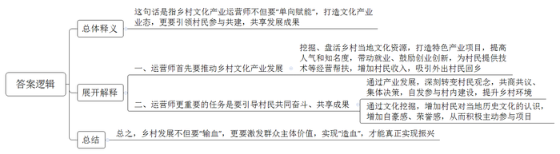
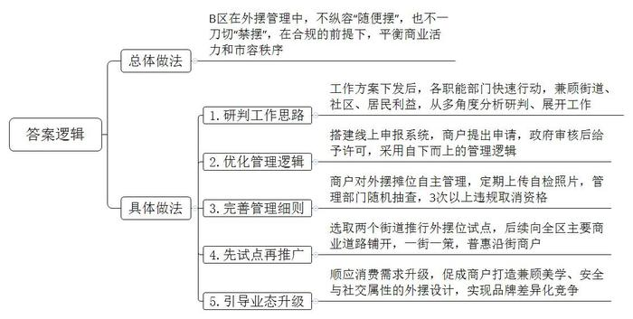
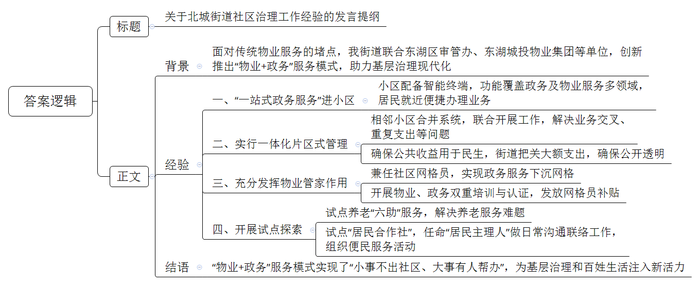
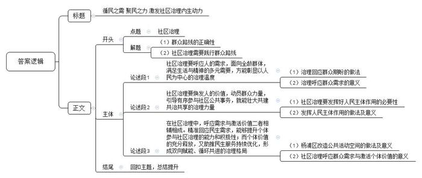

# 2026年公务员多省联考《申论》题（河南县级卷）

<!-- gwy:overview:start -->
> **河南 · 2026 · 申论 · 县级卷** ｜ 4 题 · 图片 4 处 · 答案随题折叠

导航：[题目](#题目) · [材料 1](#材料-1)
<!-- gwy:overview:end -->

> 候选采集稿。参考答案及解析来自粉笔页面，不代表官方答案或真实高分答卷；来源使用许可与原卷对应关系仍需人工核实。

## 给定材料

### 材料 1

12月19日，2025年F市“乡村文化产业运营师培育”实训班在该市Q县举行，培训的目的是“从培育一个人、带动一个村到激活一个片区”。其实，乡村文化产业运营从来不缺资源，缺的是为资源“解码翻译”的“操盘手”，如何用好隐于乡野的文化宝藏，对乡村文化产业运营至关重要。两年来，全市累计培训1000余名乡村文化产业运营师。

“这次实训，我是带着攒了两年多的疑问来的，培训后我的收获很大。”来自Q县的运营师小君告诉记者。

2023年底，一个偶然的机会，小君参访了千年古镇——中山镇。本在省城从事餐饮业的他，把视线投向了古镇的豆腐制作工艺，这是一项市级非遗。张罗了小半年，小君的“非遗豆腐工坊”开张了，推出了日销1000杯的网红豆浆冰淇淋，设立了豆腐制作体验区等。他还向古镇村民提供技术，帮助他们把非遗豆腐做大做强。同时，也鼓励村民自创项目，这样，以“非遗豆腐工坊”为核心，村民们或加入其中，或自立门户，或标新立异，形成众星拱月的格局。

“95后”的小然是陶家村的一位运营师，大学毕业后返乡创业，在村里打造了一个占地230亩的休闲旅游文化生态农业基地——陶渊文化园。

眼看着村里许多房屋人去楼空，空置的老房子破旧不堪，村子越来越冷清，小然决定，将一栋空置的破旧老屋承租下来进行翻修。村民们很不理解，翻修了这些房子难道村子就不冷清了吗？

老屋一点一点重新修缮、装饰，被打造成陶艺体验馆，游客们亲手制作陶艺，体验其中的乐趣，人气越来越旺。村民们看到这些变化，纷纷参与进来，把闲置的资源变成了文化产品，村民们有了收益，这也吸引了外出的村民回乡就业创业。

陶渊文化园的蓬勃发展，深刻地影响和改变着村民的生活观念。村里主干道旁有一个池塘，过去因受养殖场的影响，脏乱不堪。“我们每天从这里路过，衣服上都是一股臭味，这会影响游客的心情”……屋场会上，村民们一致决定关停养殖场，共同出力对池塘进行改造。

“建屋场是件好事，我是党员，贡献一份力量是应该的。”村民小彭返乡后正赶上村里建设，自掏腰包免费为工人提供伙食，还协助调解矛盾，村民们也主动投工投劳。之后，自发参与池塘改造的村民越来越多。

目前，池塘内淤泥废弃物已全部清除，还新修建了80米仿木水泥栏杆、6处台阶、1座木质凉亭。池塘边的荒地被改造成一片800平方米的共享菜园。几位村民合伙将池塘承包下来养鱼，发展垂钓产业。如今，这里已然成为陶家村一道亮丽的风景线，更是村民共同奋斗、共享成果的生动写照。

N县潭水村的运营师小宁，与一些“摸着石头过河”的运营师不同，她的运营逻辑很清晰：先是带团队开发以进士文化为内核的沉浸式研学课程，带给游客以沉浸式探索体验——穿上古装，在韵味别致的古院、戏台、青石板路间穿梭，解谜闯关，体验耕读文化；再以共创中心为枢纽，设计跨村文旅动线，形成规模效应。

这些项目走红，吸引了大量年轻游客，带动了本村及周边村民就业。更重要的是，使村民对本村历史有了深刻的认知，增加了自豪感和荣誉感。村民们在项目的参与中“不是要我做，而是我要做”。

“乡村文化产业运营师的价值，不仅在于‘我为你做了什么’，更在于‘我们一起成就了什么’。”小宁说。

### 材料 2

2025年6月中旬，S市多部门联合发布了进一步优化设摊治理、提升城市“烟火气”工作方案，提出包容与鼓励守法合规的外摆位、设摊经营等活动。很多商家纷纷拨打12345市民服务热线，希望尽快落实外摆摊位政策，迎接盛夏的热销季。下面是民生观察员在B区夜市聚集的天星桥路附近的采访摘录：

“天天讲市容市貌，摆个摊条条框框一大堆，这个查那个罚的，我就是个卖馄饨的，养个家容易吗？”摊主老吴抱怨道。“我们每个商家都备有可供外摆的桌椅，但没有外摆许可，往年都是‘打游击’，偷摸把桌椅摆出去，现实版的猫和老鼠就这样上演。”商户朱大姐打趣道。

“胖翼”大排档张老板说，“餐饮业最讲究的是‘烟火气’，夏天出来纳凉的人多，路人经过，看见可以坐在室外喝啤酒吃龙虾，就愿意留下来坐一坐。摆上七八张这样的桌子，经营面积能扩大一倍，这样也能多些收入，要是能一家家形成规模，这不就是新闻里天天说的刺激消费，拉动内需嘛！”

“夏天就是要的那个热乎劲儿，坐店里没感觉，几个兄弟外摆摊上一坐，吹着小风儿，吃着小串儿，喝着小酒儿，真得劲儿！”上班族小楚声情并茂地说着。

“我们老年人怕闹，摊子摆在外面，有时候占用人行道，对我们散步有些影响，有时声音高了，对我们休息也有些影响，能不能规定好区域，控制好户外的音量。”王老先生说。

针对走访中了解到的问题，民生观察员随后走访了B区政府部门。“方案下发后我们各职能部门快速行动，从外摆位如何对街道、社区、居民有利，如何对激发业态、促进就业、提升经济活力有利等多个角度进行分析研判、展开工作。”B区政府部门主要负责人说。

“切实把涉及老百姓切身利益的政策落实到位，是我们义不容辞的责任。我们刚刚在两个街道推行外摆位试点，建立‘沿街商铺外摆线上申报’系统。这一管理逻辑是‘自下而上’的，即商户提出申请，政府部门审核后给予许可。”B区职能部门相关负责人说。

“外摆不是‘随便摆’，也不能搞‘禁摆’一刀切，而是要在合规的前提下，让商业活力与市容秩序找到平衡点。”B区相关部门负责人的这句话道出了外摆管理的核心逻辑。在S市推进城市精细化治理的背景下，突破“要么全禁、要么乱摆”的困境，需要整合相关资源，做好“一件事”服务。

“商户都可以提出申请。复核时，只要不影响交通、不扰民，我们会尽量满足商户的需求。商户对外摆位实行自主管理，每个月需上传2次外摆自检照片，同时接受管理部门随机抽查，若出现3次以上违规则会被取消外摆资格。”相关部门负责人解释了试点的管理细节。下一步，B区将在全区主要商业道路实施“外摆申请”，一街一策，让普通街区商户享有外摆的机会。

傍晚6点，B区天星桥路的“胖翼”大排档外，几张餐桌已整齐摆放，桌角点缀的小绿植与暖黄色灯光相映，携宠而来的顾客正轻声交谈。这既是B区外摆经济的缩影，也是城市“烟火气”与“秩序感”共生的注脚。

随着消费者需求从“吃饱”向“吃氛围”“吃文化”升级，外摆位已不再是简单的经营空间扩展，而成了品牌差异化竞争的“新赛道”。商户们逐渐意识到，外摆区的设计需要兼顾美学、安全与社交属性：有的咖啡店在外摆区设置露天书架，打造“阅读+咖啡”场景；还有的引入“游戏化运营”，顾客在外摆区消费可集卡兑换伴手礼，提升复购率。

“外摆摊位多摆了几张桌子，却让城市更有活力，我们要做的就是‘宽而有制，从容以和’。”B区相关部门负责人说。

### 材料 3

传统物业服务难以调动多元责任主体、政务服务与百姓日常生活总有一点儿距离等问题，是一些地方基层治理“最后一百米”的堵点。在新老小区交织错落的G市东湖区北城街道，类似堵点也曾出现。

2024年，乘着东湖区物业管理工作整体提质增效的东风，北城街道联合东湖区审管办、东湖城投物业集团等单位率先破题，创新推出“物业+政务”服务模式，为基层治理现代化勾勒出了一幅可推广的实践样本。

“您好，我是AI管家小微，请问有什么可以帮您？”近日，居民小颖在小区物业管理中心的“一站式政务服务”智能终端前，体验了一把“家门口”的政务服务。小颖想开一家餐饮店，她在家登录G市政务服务网，线上提交了开店申请。以往，市民的此类申请通过后，要么选择邮政寄送营业执照，要么须到政务服务大厅自行领取。而现在，小颖只需在小区的智能终端屏幕上简单操作，就能自行打印出营业执照。“物业搭建起了政务服务和居民的桥梁。”小颖说，生活缴费、快递寄取、证照服务、投诉受理……屏幕上可供选择的功能覆盖政务及物业服务多个领域。

“除了‘一站式政务服务’进小区，我们还与东湖城投物业集团商议，在街道内多个相邻小区实行一体化片区式管理。例如相邻小区合并监控系统和停车系统、联合开展小区内外街巷‘大保洁’与垃圾分类等，有效解决了业务交叉、重复支出等问题，显著降低了物业与政务服务成本。”北城街道办宋主任说。此外，一些小区每年产生的公共收益要反哺小区软硬件建设或改善居民生活，如果支出金额超出一定范围，还多加了一道街道把关的程序，确保小区利用公共收益办大事公开透明，从源头消除居民疑虑。

物业管家是为小区居民服务的重要力量。2024年以来，北城街道多个小区的物业管家又新添了一重身份——社区网格员。政务服务下沉网格有了切实的保障。近日，身兼社区网格员的华阳小区物业管家小赵收到业主黄大爷送来的一面锦旗。原来黄大爷家厨房墙壁渗水多日，经小区维修人员实地查看，判定漏水点位于楼上业主厨房墙体内，但该业主迟迟不愿配合整改。小赵了解这一情况后，以社区网格员身份联合居委会，启动社区“惠·议厅”议事机制，多次上门耐心解释、协调矛盾，最终说服楼上业主积极配合维修整改。

提起此事，东湖城投物业集团陈经理感慨万千：“过去，物业管理常常受‘夹板气’，管不了、理不顺，大多只能做一些基本的小区服务，遇到业主们复杂一点儿的问题，就感觉很难办。现在的物业管理不只是‘管’，更要学会‘理’，理解诉求，理清问题，理顺情绪。这都得益于‘物业+政务’的强强联手。”

在北城街道新入职物业管家培训班上，东湖区委党校的专家提出，沉得下网格、走得进家门、看得到笑脸，应是对小区物业管家的基本要求。上岗后的物业管家不只是懂维修、能保洁，更要当街道社区的好帮手、广大业主的贴心人。北城街道27个网格中，经过物业和政务双重培训并认证的物业管家可根据需要主动亮明“身份”，为业主提供政务方面的协助。

在上堡社区某小区工作的物业管家小关每天下班后，如没有其他安排，就在集体宿舍内复习岗前培训时的资料，包括《G市政务服务百事通》《线上政务操作手册》等。有朋友不理解：“做好物业的活儿不就行了吗？”小关却不以为然，在她看来，每个月能领到东湖区网格员补贴，就有责任做好相关工作。“趁年轻，学一学政务服务，想一想里面的门道，说不定对我以后也会有帮助。”小关说。

随着北城街道“物业+政务”服务模式日渐成熟，2026年初，上堡社区试点社区养老“六助”服务——助餐、助洁、助医、助养、助急、助行，解决社区养老服务“最后一百米”难题。居民李老伯是脑梗患者，子女在外工作，生活多有不便，也很少与邻里往来。小关得知情况后，第一时间联系李老伯的子女，上门与李老伯签约了“六助”服务项目。

“与外面的公司、机构服务人员相比，自家小区的物业工作人员，我们更熟悉，也更放心，而且几乎24小时随叫随到。”华悦小区退休人员张阿姨说。张阿姨是该小区的“居民主理人”，这个身份是北城街道试点“居民合作社”后赋予张阿姨等人的，请他们在居民、物业公司、业主委员会、居民委员会和街道办事处之间做日常沟通联络工作。2025年，张阿姨作为主理人，在街道社区专业指导和小区物业的紧密配合下，组织“居民合作社”开展了15场便民服务活动，主题涵盖健康、教育、就业等多个领域，被多家省级媒体报道。

有媒体评价说，“物业+政务”服务模式让居民在小区内即可享受或参与政务服务。打破了居民、物业、政务之间的藩篱，真正实现“小事不出社区、大事有人帮办”，为基层治理和百姓生活注入了新的活力。“基层治理就像一棵大树，只有把根扎进土壤深处，才能迎来枝繁叶茂的景象。”宋主任感慨地说。

### 材料 4

9月，D县花园路街道香湖社区，一棵百年黄桷树下，年近七旬的韦阿姨正在引吭高歌，几位老街坊用二胡笛子伴奏，邻里们坐在环形椅上听得有滋有味。

不久前，这棵黄桷树下还是一地黄土，晴天尘土飞扬，雨天泥水成沟。

“香湖社区建于上个世纪80年代，是典型的‘老旧散’社区，基础设施落后，居民归属感弱，管理难度大。”香湖社区党委于书记直言，“近年来，社区充分发挥党建引领作用，提出‘益人益己益家园’的‘三益’理念，形成‘我为人人，人人为我’的治理新格局。”

社区通过群、公众号、宣传栏等，积极宣传“三益”理念，随着时间的推移，该理念逐渐被大家认同。社区还创新打造智慧征集平台，鼓励能人、达人、热心人建言献策，商户企业、社会组织出资相助，昔日“泥水沟”焕然一新，成为居民休憩娱乐的好去处。

社区微益坊二楼阅览室内，老李左手持葫芦、右手运笔，不一会儿，寿星含笑的彩绘便呈现出来，这是他退休后在社区的微益坊学到的新技能。

“最初在社区组织的培训中，花了一个月才掌握了上色技巧，如今已能够创作，艺术无止境，唯有不断学习、努力钻研。”老李笑着说。

“受本地历史上三益书院‘益己益人益天下’教育理念的启发，我们提出了‘益人益己益家园’的社区治理理念，通俗地讲，就是‘你好我好大家好’。”于书记解释。

在社区的引导下，渐渐地，社区花园里“党群之家”内，“初心”“轻养”等5个“家课堂”时常座无虚席，各式课程丰富着居民的精神世界；微益坊内，“翰墨香”书画社、“巧手”工坊等社会组织日渐壮大，不仅满足了居民的多样化需求，还融入到社区教育、文化活动等公共事务中。

老李带徒传艺，如今桃李芬芳。他的葫芦陈列室里，花鸟、山水、人物彩绘葫芦琳琅满目，细观落款，不少出自其学员之手，他们中既有学生族，也有上班族、银发族，他们逐光而来，也终成照亮自己的光。

“在社区，每个人都能找到自己心仪的课堂。更难得的是，大家在学习中彼此了解，彼此拉近，每个人微小的提升，也都能为社区发展积攒后劲，就像一束光，照亮自己也照亮他人。”于书记感慨。

9月15日下午，焕然一新的香湖社区滨湖路，沿街小店鳞次栉比，顾客络绎不绝。

“真是大变样！以前这条路破旧冷清，哪能想到如今这么热闹非凡。”一位故地重游的老居民连声赞叹。

2024年初，香湖社区着手盘活闲置资产，因地制宜发展社区经济。正为新店选址的小唐被滨湖路的周边环境所吸引，决定在此开一家名为“春喜”的咖啡店。

“刚来的时候，街面上大多是闲置的店铺。”小唐回忆道，“虽说我的店慢慢有了熟客，但单打独斗终究难成气候。”

社区的“三益”治理理念给了他启发，尤其是“益人”理念提倡的“勇于做一束照亮别人的光”，深深触动了他。

“一个人走，可能会走得很快，但一群人互相扶持，才能走得更远。作为党员，我更应带这个头。”抱着这样的信念，小唐打算在社交平台发布“招商帖”，当这条街的“线上推介官”。

社区知晓后，主动协调相关部门，召开专题会，帮助小唐完善“招商推介”方案。没承想，“招商帖”一发布，便有不少商户慕名前来考察。社区工作人员和小唐引领商户参观商铺、分析客流、核算成本。服装店装修，他帮着比报价、出方案；小酒馆进场，他主动提供临时水电；“随喜”茶室筹备，他帮忙代收快递……在他的感染下，守望相助成了商户们心照不宣的默契。

社区网红主播小华，将“巧手”工坊成员制作的手工艺品在网上义务售卖，10万元的收入全部注入社区公益基金；社区“针爱”工作室的党员、群众一起编织绒线帽子、围巾，送给山区留守儿童和孤寡老人；老李将彩绘葫芦所得收益的一半捐赠给社区，用于基础设施维修、人居环境管护……“我们搭建了一个连接邻里、汇聚爱心的社区公益基金平台，不仅解决了社区活动资金不足的难题，更为推动社区发展、传递温暖关爱提供了强有力的支持。”

杨婆婆家住8楼，以前未装电梯，外出对她来说成了一件需要攒足勇气的事情。除了清晨必须外出采购食材，平时很少下楼。

“浑身直冒汗，走几步就得歇一歇，爬一趟最少需要15分钟。”杨婆婆这样描述，“要是提桶水、拎袋米，连我女婿都喊累。”

和杨婆婆一样，社区里不少住户都对爬楼梯望而却步，邻里之间的走动受限，社区活动也就很少露面，纷纷向社区提出加装电梯。这个想法很快得到社区的积极响应，他们随即行动起来：挨家挨户征集意见、比较电梯品牌、召开院坝会倾听民意、协调电路更新改造……两年时间过去，社区已有五栋居民楼加装了电梯。

“现在方便多了，一分钟就到家。”杨婆婆语气轻快，“我经常下楼和邻居们喝茶聊天。”“电梯连通楼层，更抵达人心，邻里间的互动也愈发频繁，空间障碍消除，更拉近了人与人之间的心理距离。”于书记说。

“社区是个大家庭，想让居民住得安心、舒心，社区环境要跟得上时代发展的步伐才行。”于书记介绍，“除了给老楼装电梯，我们还整合多方资源对现有空间进行软装升级，打造了三益剧场等20多个社区服务场景，利用社会组织、专业社工等力量为居民提供免费医疗、心理疏导等服务，不断延长便利生活的半径。”社区的点滴变化，点燃了居民自主参与、主动作为的热情。

“社区长期以来存在旧散棚多、违章建筑多、楼龄高、设备老旧等问题，以前，居民们认为事不关己而冷眼旁观。我们组织社区工作人员逐一入户宣传，向大家讲述违章建筑的危害以及开展老旧小区改造的好处。经过近半年的动员和努力，居民们自觉拆除违章建筑40余处，还自筹资金增设停车位200余个，安装视频感知设备80余个。”于书记说，“越来越多居民选择从观望到加入，大家心往一处想、劲往一处使，让我们这个老社区不仅‘不显老’，还重焕青春。”

如今，在香湖社区，“三益”早已超越治理理念的范畴，它厚植一方热土，让个体被看见，让善意有回音，已经沉淀为一种深入人心的生活方式。某大学国家治理学院郭院长表示：“当每一处变化都呼应人的需求，每一个人都焕发新的价值，社区便能获得持续生长的内在力量。”

## 题目

### 第 1 题

**结合“给定资料1”提到的“乡村文化产业运营师的价值，不仅在于‘我为你做了什么’，更在于‘我们一起成就了什么’。”请谈一谈你对这句话的理解。（20分）**

关联材料：材料 1

作答要求：

要求：全面，准确，不超过300字。

第 1 题 · 答案与解析

**参考答案（粉笔题库参考内容）**

这句话是指乡村文化产业运营师不但要“单向赋能”，打造文化产业业态，更要引领村民参与共建，共享发展成果。

一、运营师首先要推动乡村文化产业发展：挖掘、盘活乡村当地文化资源，打造特色产业项目，提高人气和知名度，带动就业、鼓励创业创新，为村民提供技术等经营帮扶，增加村民收入，吸引外出村民回乡。

二、运营师更重要的任务是要引导村民共同奋斗、共享成果：通过产业发展，深刻转变村民观念，共商共议、集体决策，自发参与村内建设，提升乡村环境；通过文化挖掘，增加村民对当地历史文化的认识，增加自豪感、荣誉感，从而积极主动参与项目。

总之，乡村发展不但要“输血”，更要激发群众主体价值，实现“造血”，才能真正实现振兴。

**解析**

**参考答案说明：**（1）思路方面，本参考答案按照词句解释题“总体释义+展开解释+总结”的一般答题思路展开。（2）内容方面，本参考答案先对题干给定句子进行总体释义，再分别从“运营师首先要推动乡村文化产业发展”“运营师更重要的任务是要引导村民共同奋斗、共享成果”两个方面进行展开解释，最后进行总结。（3）词句表达方面，本参考答案加上了“首先”“总之”等连接词来承接上下文，使上下衔接更顺畅。

**考点**：词句解释类

**来源**：2026年公务员多省联考《申论》题（河南县级卷）

### 第 2 题

**根据“给定资料2”，请你谈谈B区是如何实现“宽而有制，从容以和”的？（20分）**

关联材料：材料 2

作答要求：

要求：全面准确，语言精炼，不超过300字。

第 2 题 · 答案与解析

**参考答案（粉笔题库参考内容）**

B区在外摆管理中，不纵容“随便摆”，也不一刀切“禁摆”，在合规的前提下，平衡商业活力和市容秩序。

1.研判工作思路。工作方案下发后，各职能部门快速行动，兼顾街道、社区、居民利益，从多角度分析研判、展开工作。

2.优化管理逻辑。搭建线上申报系统，商户提出申请，政府审核后给予许可，采用自下而上的管理逻辑。

3.完善管理细则。商户对外摆摊位自主管理，定期上传自检照片，管理部门随机抽查，3次以上违规取消资格。

4.先试点再推广。选取两个街道推行外摆位试点，后续向全区主要商业道路铺开，一街一策，普惠沿街商户。

5.引导业态升级。顺应消费需求升级，促成商户打造兼顾美学、安全与社交属性的外摆设计，实现品牌差异化竞争。

**解析**

**参考答案说明：**本参考答案先概括了总体做法，然后分别从“研判工作思路”“优化管理逻辑”“完善管理细则”“先试点再推广”“引导业态升级”五个方面展开具体做法，各条答案要点之间在内容上相互并列，没有交叉。

**考点**：概括措施类

**来源**：2026年公务员多省联考《申论》题（河南县级卷）

### 第 3 题

**近期，G市拟召开推进基层治理现代化工作交流会，北城街道办主任将在会上发言，根据“给定资料3”，拟写一份发言提纲，介绍本街道社区治理工作经验。（25分）**

关联材料：材料 3

作答要求：

要求：重点突出，逻辑清晰，详略得当，不考虑格式，400字以内。

第 3 题 · 答案与解析

**参考答案（粉笔题库参考内容）**

关于北城街道社区治理工作经验的发言提纲

背景：面对传统物业服务的堵点，我街道联合东湖区审管办、东湖城投物业集团等单位，创新推出“物业+政务”服务模式，助力基层治理现代化。

经验：一、“一站式政务服务”进小区。小区配备智能终端，功能覆盖政务及物业服务多领域，居民就近便捷办理业务。二、实行一体化片区式管理。相邻小区合并系统，联合开展工作，解决业务交叉、重复支出等问题；确保公共收益用于民生，街道把关大额支出，确保公开透明。三、充分发挥物业管家作用。兼任社区网格员，实现政务服务下沉网格；开展物业、政务双重培训与认证，发放网格员补贴。四、开展试点探索。试点养老“六助”服务，解决养老服务难题；试点“居民合作社”，任命“居民主理人”做日常沟通联络工作，组织便民服务活动。

结语：“物业+政务”服务模式实现了“小事不出社区、大事有人帮办”，为基层治理和百姓生活注入新活力。

**解析**

**参考答案说明：**（1）格式方面，本参考答案写到了“标题”“正文”两个部分。（2）正文部分：一方面从内容来看，围绕“北城街道社区治理工作”这一主题，本参考答案的首先介绍了北城街道创新社区治理模式的背景及总体做法；接着从“‘一站式政务服务’进小区”“实行一体化片区式管理”“充分发挥物业管家作用”“开展试点探索”这四个方面介绍了北城街道创新社区治理工作的具体经验；最后结语部分进行了总结评价。另一方面从形式来看，本参考答案做到了分段、分层撰写，整体上条理较为清晰。

**考点**：总结类

**来源**：2026年公务员多省联考《申论》题（河南县级卷）

### 第 4 题

**“给定资料4”中提到：“当每一处变化都呼应人的需求，每一个人都焕发新的价值，社区便能获得持续生长的内在力量。”请结合你对这句话的理解，参考给定资料，联系实际，自选角度，自拟题目，写一篇文章。（35分）**

关联材料：材料 1、材料 2、材料 3、材料 4

作答要求：

要求：观点明确，见解深刻；参考给定资料，但不拘泥于给定资料；思路明晰，语言流畅；1000-1200字。

第 4 题 · 答案与解析

**参考答案（粉笔题库参考内容）**

**循民之需** **聚民之力** **激发社区治理内生动力**

“一切为了群众，一切依靠群众。”群众路线是我们党的根本工作路线，几十年的社会治理实践已充分证明其正确性。社区作为社会治理的基本单元，同样需要践行这一根本方法：既要关注人的需求，贴合群众期盼，还要焕发人的价值，发挥主体作用。唯有将二者紧密结合、互促共进，才能让社区既有暖意又有力量，实现从“治理”到“生长”的跨越，培育民生幸福的沃土。

**社区治理要呼应人的需求，面向全龄群体，满足生活与精神的多元需要，方能彰显以人民为中心的治理温度。**治理的根本在于人，首要任务是回应群众对美好生活的期盼。这要求治理者深入体察民情，既关注“一老一小”的特殊需求，如为老旧住宅加装电梯、提供儿童托管服务；也关切全体居民在宜居环境、精神文化等方面的普遍愿望，如改造闲置空间、开设多样课程。当服务精准对接诉求，环境切实得到改善，居民便能从心底感受到温暖与归属。这种将群众期盼具化为民生实事的努力，正是治理初心最朴素的注脚，也为社区发展奠定了最深厚的情感根基。

**社区治理要焕发人的价值，动员群众力量，引导有序参与社区公共事务，就能壮大共建共治共享的治理力量。**“人民是历史的创造者”，社区治理同样要发挥好人民的主体作用。如果社区事务长期停留在“干部干、群众看”的状态，不仅治理成效有限，更会消解居民的主人翁意识。对此，一方面，完善以精神激励为主、物质激励为辅的认可机制，让参与奉献者获得尊重与价值感；另一方面，建立居民议事厅、能人工作室、志愿服务队等多元平台，让有热情、有专长的居民都能找到发挥作用的舞台。当每个人的价值在参与中被看见、被点亮，社区治理便获得了最持久的力量源泉。

**在社区治理中，呼应需求与激活价值二者相辅相成。精准回应民生需求，能够提升个体参与社区治理的能力和积极性；而个体价值的充分释放，又助推民生服务持续优化，形成双向赋能、循环共进的治理格局。**面对居民对公共活动空间的渴求，杨浦区长海路街道市京一村将破败闲置的老旧花园改造为党建微花园，既改善了小区环境，还搭建了邻里互动平台，增强居民投身社区事务的意愿。同时，居民主动参与花园方案设计、组建志愿者护园队，推动社区服务丰富完善。由此可见，当每一处改变都呼应人的期盼，当每一个人都成为发光的星火，社区便能获得源源不断的内生力量，在共建共治共享中实现持续生长。

民生无小事，枝叶总关情。社区治理当以人民为中心，回应群众诉求、激活居民力量，二者同向发力，方能推动社区持续生长，以基层微光汇聚治理暖流，共建民生幸福新家园。

**文章分析**

**循民之需** **聚民之力** **激发社区治理内生动力**

【**标题的优点：**范文的标题突出了“社区治理”这一主题。】

（1）“一切为了群众，一切依靠群众。”<u>群众路线是我们党的根本工作路线</u>，几十年的社会治理实践已充分证明其正确性。（2）<u>社区作为社会治理的基本单元</u>，同样需要践行这一根本方法：既要<u>关注人的需求</u>，<u>贴合群众期盼</u>，还要<u>焕发人的价值</u>，<u>发挥主体作用</u>。唯有将<u>二者紧密结合、互促共进</u>，才能让社区既有暖意又有力量，实现从“治理”到“生长”的跨越，<u>培育民生幸福</u>的沃土。

【**开头的优点：**★内容方面：范文的开头是紧扣“社区治理”这一主题展开的。首先，开头点出主题，做到了主题明确。其次，对“社区治理”这一主题进行了分析阐述：（1）指出了群众路线的正确性；（2）指出了社区治理需要践行群众路线。★文字表达方面：使用了“既要……还要……”等关联词，使语言表达有逻辑性。】

**社区治理要呼应人的需求，面向全龄群体，满足生活与精神的多元需要，方能彰显以人民为中心的治理温度**。（1）治理的根本在于人，首要任务是<u>回应群众对美好生活的期盼</u>。这要求<u>治理者深入体察民情</u>，既<u>关注</u>“一老一小”的<u>特殊需求</u>，如为老旧住宅加装电梯、提供儿童托管服务；也<u>关切</u>全体居民在宜居环境、精神文化等方面的<u>普遍愿望</u>，如改造闲置空间、开设多样课程。（2）当<u>服务精准对接诉求</u>，<u>环境切实得到改善</u>，<u>居民便能从心底感受到温暖与归属</u>。这种<u>将群众期盼具化为民生实事</u>的努力，正是治理初心最朴素的注脚，也<u>为社区发展奠定了最深厚的情感根基</u>。

【**论述段1的优点：**★观点句：范文的观点句是紧扣“社区治理”这一文章主题提出的。形式上，它在段首处直接写出，位置突出，容易发现。内容上，关键词突出，内容要点明确，可以明显看出主要从“呼应人的需求”这个角度展开论述。★论述内容：（1）介绍了治理回应群众期盼的做法；（2）介绍了治理呼应群众需求的意义。注意：以上两个方面的内容都是紧扣“社区治理要呼应人的需求，面向全龄群体，满足生活与精神的多元需要，方能彰显以人民为中心的治理温度”这个观点句进行分析论述的，论述的针对性强，内容层次丰富。在论述方法上采用了讲道理与举例子相结合的方式，论述充实透彻。】

**社区治理要焕发人的价值，动员群众力量，引导有序参与社区公共事务，就能壮大共建共治共享的治理力量**。（1）“人民是历史的创造者”，社区治理同样要<u>发挥好人民的主体作用</u>。如果社区事务长期停留在“干部干、群众看”的状态，不仅治理成效有限，更会消解居民的<u>主人翁意识</u>。（2）对此，一方面，<u>完善以精神激励为主、物质激励为辅的认可机制</u>，让参与奉献者<u>获得尊重与价值感</u>；另一方面，<u>建立居民议事厅、能人工作室、志愿服务队等多元平台</u>，让有热情、有专长的居民都能<u>找到发挥作用的舞台</u>。当每个人的价值在参与中被看见、被点亮，社区治理便<u>获得了最持久的力量源泉</u>。

【**论述段2的优点：**★观点句：范文的观点句是紧扣“社区治理”这一文章主题提出的。形式上，它在段首处直接写出，位置突出，容易发现。内容上，关键词突出，内容要点明确，可以明显看出主要从“焕发人的价值”这个角度展开论述。★论述内容：（1）介绍了社区治理要发挥好人民主体作用的必要性；（2）介绍了发挥人民主体作用的做法及意义。注意：以上两个方面的内容都是紧扣“社区治理要焕发人的价值，动员群众力量，引导有序参与社区公共事务，就能壮大共建共治共享的治理力量”这个观点句进行分析论述的，论述的针对性强，内容层次丰富。在论述方法上主要采用了讲道理的方式，论述清晰深刻。】

**在社区治理中，呼应需求与激活价值二者相辅相成。精准回应民生需求，能够提升个体参与社区治理的能力和积极性；而个体价值的充分释放，又助推民生服务持续优化，形成双向赋能、循环共进的治理格局**。（1）面对<u>居民对公共活动空间的渴求</u>，杨浦区长海路街道市京一村将破败闲置的老旧花园改造为<u>党建微花园</u>，既改善了小区环境，还搭建了邻里互动平台，增强居民投身社区事务的意愿。同时，<u>居民主动参与</u>花园方案设计、组建志愿者护园队，推动社区服务丰富完善。（2）由此可见，当每一处改变都<u>呼应人的期盼</u>，当<u>每一个人都成为发光的星火</u>，<u>社区便能获得源源不断的内生力量</u>，在<u>共建共治共享</u>中实现持续生长。

【**论述段3的优点：**★观点句：范文的观点句是紧扣“社区治理”这一文章主题提出的。形式上，它在段首处直接写出，位置突出，容易发现。内容上，关键词突出，内容要点明确，可以明显看出主要从“呼应需求与激活价值相辅相成”这个角度展开论述。★论述内容：（1）介绍了杨浦区改造公共活动空间的做法及意义；（2）介绍了社区治理呼应群众需求与激活个体价值的意义。注意：以上两个方面的内容都是紧扣“在社区治理中，呼应需求与激活价值二者相辅相成”这个观点句进行分析论述的，论述的针对性强，内容层次丰富。在论述方法上采用了讲道理与举例子相结合的方式，论述充实清晰。】

【**论述段之间的关系：**★内容的内在逻辑：范文的论述段之间是依照“并列”的逻辑展开的。论述段1先写了“社区治理要呼应人的需求”，论述段2再写了“社区治理要焕发人的价值”，论述段3接着写了“在社区治理中，呼应需求与激活价值二者相辅相成”。文章整体论述思路清晰。】

民生无小事，枝叶总关情。社区治理当以人民为中心，回应群众诉求、激活居民力量，二者同向发力，方能推动社区持续生长，以基层微光汇聚治理暖流，共建民生幸福新家园。

【**结尾的优点：**范文的结尾回扣了“社区治理”这个主题，并且进行了总结提升。】

**解析状态：unknown（来源未提供）**

**考点**：文章写作题

**来源**：2026年公务员多省联考《申论》题（河南县级卷）

