# 2008年浙江省公务员录用考试《行测》题

<!-- gwy:overview:start -->
> **浙江 · 2008 · 行测 · 统考** ｜ 130 题 · 图片 21 处 · 答案随题折叠

| 题型模块 | 题量 | 题号 |
| --- | ---: | ---: |
| 数量关系 | 25 | 1–25 |
| 言语理解与表达 | 30 | 26–55 |
| 判断推理 | 35 | 56–90 |
| 综合基础知识 | 20 | 91–110 |
| 资料分析 | 20 | 111–130 |
| **合计** | **130** | |

导航：[题型与作答说明](#题型与作答说明) · [题目](#题目) · [材料 1](#材料-1)
<!-- gwy:overview:end -->

> 候选采集稿。参考答案及解析来自粉笔页面，不代表官方答案或真实高分答卷；来源使用许可与原卷对应关系仍需人工核实。

## 题型与作答说明

数量关系

（25题）

本部分包括数字推理与数学运算两种类型的试题。

言语理解与表达

（30题）

每道题包括一段话或一个句子，后面是一个不完整的陈述，要求你从四个选项中选出一个来完成陈述。注意：答案可能是完成对所给文字主要意思的提要，也可能是满足陈述中其他方面的要求，你的选择应与所提要求最相符合。

判断推理

（35题）

本部分包括图形推理、类比推理、定义判断与演绎推理四种类型的试题。

综合基础知识

（20题）

根据题目要求，在四个选项中选出一个正确答案。

资料分析

（20题）

针对下列文字、图或表回答问题。你应根据资料提供的信息进行分析、比较、计算、处理。

## 题目

### 第 1 题

20，20，33，59，98，()。

A. 150

B. 152

C. 154

D. 156

第 1 题 · 答案与解析

**参考答案（粉笔题库参考内容）**

A

**解析**

观察数列，无明显特征，优先考虑多级数列。后项减前项得到新数列为：0、13、26、39，（ ），是公差为13的等差数列，下一项为39+13=52，故所求项为98+52=150。

故正确答案为A。

**考点**：多级数列

**来源**：2008年浙江省公务员录用考试《行测》题第1题

### 第 2 题

1，4，3，1，1/5，1/36，()。

A. 1/92

B. 1/124

C. 1/262

D. 1/343

第 2 题 · 答案与解析

**参考答案（粉笔题库参考内容）**

D

**解析**

数列均为幂次数，考虑幂次数列。原数列可表示为：1^3、2^2、3^1、4^0、5^-1、6^-2。底数为连续自然数数列，下一项为7；指数为公差为-1的等差数列，下一项为-2-1=-3，故所求项为7^−3 = 1/343。

故正确答案为D。

**考点**：幂次数列

**来源**：2008年浙江省公务员录用考试《行测》题第2题

### 第 3 题

675，225，90，45，30，30，()。

A. 27

B. 38

C. 60

D. 124

第 3 题 · 答案与解析

**参考答案（粉笔题库参考内容）**

C

**解析**

数列相邻两项之间存在明显的倍数关系，优先考虑作商。前项÷后项得到新数列：3、5/2、2、3/2、1、（ ），是公差为-1/2的等差数列，下一项为1 − 1/2 = 1/2，故所求项为30÷1/2=60。

故正确答案为C。

**考点**：作商数列

**来源**：2008年浙江省公务员录用考试《行测》题第3题

### 第 4 题

34，-6，14，4，9，13/2，（ ）。

A. 22/3

B. 25/3

C. 27/4

D. 31/4

第 4 题 · 答案与解析

**参考答案（粉笔题库参考内容）**

D

**解析**

观察数列无明显特征，作差无规律，考虑递推数列。观察数列可得：(34+(−6))/2=14，((-6) + 14)/2 = 4，(14+4)/2=9，(4 + 9)/2 = 13/2，即(第一项+第二项)/2=第三项，故所求项为(9+13/2)/2=31/4。

故正确答案为D。

**考点**：多级数列、递推数列

**来源**：2008年浙江省公务员录用考试《行测》题第4题

### 第 5 题

0，7，26，63，124，()。

A. 209

B. 215

C. 224

D. 262

第 5 题 · 答案与解析

**参考答案（粉笔题库参考内容）**

B

**解析**

观察数列，每项周围均有幂次数，考虑幂次修正数列。观察发现：0=1^3−1，7 = 2^3 − 1，26 = 3³ − 1，63=4^3−1，124 = 5^3 − 1。底数为连续的自然数列，下一项为6，指数均为3，修正项均为-1，故所求项为6^3 - 1 = 215。

故正确答案为B。

**考点**：多级数列、幂次数列

**来源**：2008年浙江省公务员录用考试《行测》题第5题

### 第 6 题

1/3，3，1/12，4/3，3/64，()。

A. 13/84

B. 64/75

C. 3/52

D. 3/32

第 6 题 · 答案与解析

**参考答案（粉笔题库参考内容）**

B

**解析**

数列多为分数，考虑分数数列无规律，作差、作和、递推均无规律，考虑作积。相邻两项数字相乘得到新数列：1、 1/4、 1/9 、 1/16、（ ），分子均为1，分母为平方数数列，下一项为5^2=25，则新数列下一项为1/25，故所求项为1/25 ÷ 3/64 = 64/75。

故正确答案为B。

**考点**：作和作积数列

**来源**：2008年浙江省公务员录用考试《行测》题第6题

### 第 7 题

1，4，14，31，55，()。

A. 83

B. 84

C. 85

D. 86

第 7 题 · 答案与解析

**参考答案（粉笔题库参考内容）**

D

**解析**

观察数列无明显规律，考虑多级数列。后项减前项得到新数列：3、10、17、24、（ ），是公差为7的等差数列，下一项为24+7=31，故所求项为55+31=86。

故正确答案为D。

**考点**：多级数列

**来源**：2008年浙江省公务员录用考试《行测》题第7题

### 第 8 题

1/12，2，7/6，10/3，44/9，()。

A. 199/18

B. 283/21

C. 365/24

D. 467/27

第 8 题 · 答案与解析

**参考答案（粉笔题库参考内容）**

D

**解析**

数列多为分数，考虑分数数列无规律，作差、作和均无规律，考虑递推数列。观察数列可得：(1/12)×2+1=7/6，2×7/6+1=10/3，7/6 × 10/3 + 1 = 44/9，即第一项×第二项+1=第三项，故所求项为10/3 × 44/9 + 1 = 467/27。

故正确答案为D。

**考点**：递推数列

**来源**：2008年浙江省公务员录用考试《行测》题第8题

### 第 9 题

3，65，35，513，99，（ ）

A. 1427

B. 1538

C. 1642

D. 1729

第 9 题 · 答案与解析

**参考答案（粉笔题库参考内容）**

D

**解析**

出现64附近数字，考虑幂次修正数列。原数列可表示为：3 = 2^2 − 1，65 = 4^3 + 1，35=6^2-1，513=8^3+1，99 = 10^2 − 1。底数为连续偶数数列，下一项为12；指数项是以2，3为周期的周期数列，下一项为3；修正项是以-1，+1为周期的周期数列，下一项为+1。故所求项= 12^3 + 1 = 1729，对应D项。

故正确答案为D。

**考点**：幂次数列

**来源**：2008年浙江省公务员录用考试《行测》题第9题

### 第 10 题

2，5，13，35，97，（ ）

A. 214

B. 275

C. 312

D. 336

第 10 题 · 答案与解析

**参考答案（粉笔题库参考内容）**

B

**解析**

观察数列无明显特征，作差无规律，考虑递推数列。观察数列可得：2 × 3 - 1 = 5，5 × 3 − 2 = 13，13 × 3 − 4 = 35，35 × 3 − 8 = 97，即第n项×3-2^(n-1)= 第(n+1)项。故所求项为97 × 3 - 16 = 275。

故正确答案为B。

**考点**：递推数列

**来源**：2008年浙江省公务员录用考试《行测》题第10题

### 第 11 题

把分数3/7用小数来表示，则小数点后第2008位的数字是：

A. 1

B. 2

C. 4

D. 5

第 11 题 · 答案与解析

**参考答案（粉笔题库参考内容）**

D

**解析**

3/7=0.42857142……“428571”为循环周期，共有6个数字。2008/6 = 334……4，即第2008位数字等价于第4位数字，对应“5”。

故正确答案为D。

**考点**：周期余数问题

**来源**：2008年浙江省公务员录用考试《行测》题第11题

### 第 12 题

1/42+1/56+1/72+1/90+1/110的值是：

A. 1/6

B. 5/66

C. 7/85

D. 1/128

第 12 题 · 答案与解析

**参考答案（粉笔题库参考内容）**

B

**解析**

12.

单选题

1/42+1/56+1/72+1/90+1/110的值是：

-   A

    1/6

-   B

    5/66

-   C

    7/85

-   D

    1/128

B正确答案

未作答你的答案

72 %全站正确率

C易错项

解析

根据1/(n(n+1))=1/n-1/(n+1)可得，原式= 1/(6×7) + 1/(7×8) + 1/(8×9) + 1/(9×10)+ 1/(10×11) = 1/6 − 1/7 + 1/7 −1/8+1/8-1/9+1/9-1/10+1/10−1/11= 1/6 - 1/11 = 5/66。

故正确答案为B。

来源

2008年浙江省公务员录用考试《行测》题第12题

笔记

**来源**：2008年浙江省公务员录用考试《行测》题第12题

### 第 13 题

在自然数1至50中，将所有不能被3除尽的数相加，所得的和是：

A. 865

B. 866

C. 867

D. 868

第 13 题 · 答案与解析

**参考答案（粉笔题库参考内容）**

C

**解析**

“1至50，所有不能被3除尽的数相加”等价于“1到50所有数的和减去能被3整除的项”， 50以内最大的3的倍数为48，共有48/3=16项，且为公差为3的等差数列。根据等差数列的求和公式S_n = (首项 + 末项)/2 × 项数可得，所求值为(1 + 50)/2 × 50-(3+48)/2×16= 51 × 25 − 51 × 8= 51 × (25-8)= 51 × 17=867，对应C项。

故正确答案为C。

**考点**：数列问题

**来源**：2008年浙江省公务员录用考试《行测》题第13题

### 第 14 题

一个边长为1的正方形木板，锯掉四个角使其变成正八边形，那么正八边形的边长是多少？

A. 1/2

B. √2/2

C. 2−√2

D. √2−1

第 14 题 · 答案与解析

**参考答案（粉笔题库参考内容）**

D

**解析**

由题意可以画出如下示意图：

锯掉的角为等腰三角形，根据三条边的比例为1：1：√2，设锯掉的三角形直角边为x，则正八边形的边长为直角三角形斜边，即√2x。根据题意可列方程为2x + √2x = 1，解得x = 1/(2+√2)，则正八边形的边长是√2x = √2/(2+√2)= 1/(√2+1)= √2 − 1。

故正确答案为D。

**考点**：几何结论类-三角形相关

**来源**：2008年浙江省公务员录用考试《行测》题第14题

### 第 15 题

如下图所示，在△ABC中，已知AB=AC，AM=AN，∠BAN=30°。

问：∠MNC的度数是多少？

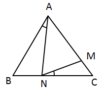

A. 15°

B. 20°

C. 25°

D. 30°

第 15 题 · 答案与解析

**参考答案（粉笔题库参考内容）**

A

**解析**

设∠ANM = x，由于AM=AN，则∠AMN = x，由三角形内角和为180°，所以∠NAM = 180° − 2x。那么∠BAC = 210° − 2x。

由AB=AC得∠ACB = [180° − (210° − 2x)] ÷ 2 = x − 15°；

由外角定理得∠MNC = ∠AMN - ∠ACB= x - (x - 15°) = 15°。

故正确答案为A。

**考点**：几何结论类-三角形相关、几何结论类-几何小题型

**来源**：2008年浙江省公务员录用考试《行测》题第15题

### 第 16 题

现有A、B、C三桶油，先把A的1/3倒入B桶，再把B桶的1/4倒入C桶，最后把C桶的1/10倒入A桶，经这样操作后，三桶油各为90升。

问A桶原来有油多少升：

A. 90

B. 96

C. 105

D. 120

第 16 题 · 答案与解析

**参考答案（粉笔题库参考内容）**

D

**解析**

根据“经这样操作后，三桶油各为90升”可得，C桶倒入A桶前有90/(1 − 1/10) = 100升，即倒入A桶100-90=10升，则A桶原来有90-10=80升；则A桶倒入B桶前有80/(1 − 1/3) = 120升。

故正确答案为D。

**考点**：和差倍比问题

**来源**：2008年浙江省公务员录用考试《行测》题第16题

### 第 17 题

有面积为1平方米、4平方米、9平方米、16平方米的正方形地毯各10块，现有面积为25平方米的正方形房间需用以上地毯来铺设，要求地毯互不重叠而且刚好铺满。

问最少需几块地毯？

A. 6块

B. 8块

C. 10块

D. 12块

第 17 题 · 答案与解析

**参考答案（粉笔题库参考内容）**

B

**解析**

要使所用地毯最少，就要尽可能多地用面积大的正方形地毯。

从用面积为16平方米的地毯开始铺，最少是1×16+1×9=25，要10块。

要是用面积为9平方米的地毯，则最少是1 × 4 + 4 × 3 + 9 × 1 = 25，要8块。具体的铺法如下图所示：

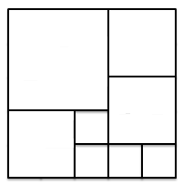

要是没有用16平方米和9平方米的地毯，最少的数目都大于8。

故正确答案为B。

**考点**：几何其他题型、统筹规划问题

**来源**：2008年浙江省公务员录用考试《行测》题第17题

### 第 18 题

有颜色不同的四盏灯，每次使用一盏、两盏、三盏或四盏，并按一定的次序挂在灯杆上表示信号，问共可表示多少种不同的信号？

A. 24种

B. 48种

C. 64种

D. 72种

第 18 题 · 答案与解析

**参考答案（粉笔题库参考内容）**

C

**解析**

共分成四类：

（1）使用一盏灯，有C_4^1=4种情况；

（2）使用两盏灯，存在顺序，有A_4^2 = 4 × 3 = 12种情况；

（3）使用三盏灯，存在顺序，有A(4,3) = 4×3×2 = 24种情况；

（4）使用四盏灯，存在顺序，有A_4^4 = 4 × 3 × 2 × 1 = 24种情况。

分类用加法，则共有4+12+24+24=64种情况。

故正确答案为C。

**考点**：基础排列组合

**来源**：2008年浙江省公务员录用考试《行测》题第18题

### 第 19 题

如图所示，在3×3方格内填入恰当的数后，可使每行、每列以及两条对角线上的三数的和都相等。问方格内的x的值是多少？

A. 2

B. 9

C. 14

D. 27

第 19 题 · 答案与解析

**参考答案（粉笔题库参考内容）**

A

**解析**

假定中间数字为a，则a+6=8+3，则a=5。而3+a=x+6，解得x=2。

故正确答案为A。

**考点**：数字推理-其他

**来源**：2008年浙江省公务员录用考试《行测》题第19题

### 第 20 题

甲、乙两人沿直线从A地步行至B地，丙从B地步行至A地。已知甲、乙、丙三人同时出发，甲和丙相遇后5分钟，乙与丙相遇。如果甲、乙、丙三人的速度分别为85米/分钟、75米/分钟、65米/分钟。

问A、B两地距离为多少米？

A. 8000米

B. 8500米

C. 10000米

D. 10500米

第 20 题 · 答案与解析

**参考答案（粉笔题库参考内容）**

D

**解析**

设甲、丙相遇所用时间为x分钟，则乙、丙相遇所用时间为(x+5)分钟。根据相遇路程=速度和 × 时间，可列式为：(85+65)x=(75+65)(x+5)，解得x=70，则两地距离为150×70=10500米。

故正确答案为D。

**考点**：相遇追及

**来源**：2008年浙江省公务员录用考试《行测》题第20题

### 第 21 题

有A、B两个电脑显示器，已知旧显示器A的宽高比例是4:3，新显示器B的宽高比例是16:9，若两个显示器面积相同，问B的宽度与A的宽度比是：

A. √3:1

B. √3:6

C. 2:√3

D. 4:√3

第 21 题 · 答案与解析

**参考答案（粉笔题库参考内容）**

C

**解析**

假定显示器A的宽为4a，则高为3a，显示器B的宽为16b，则高为9b。由A、B显示器的面积相等得：4a × 3a = 16b × 9b，解得a : b = 2√3，则所求的16b:4a=2:√3。

故正确答案为C。

**考点**：和差倍比问题、几何公式类-平面图形

**来源**：2008年浙江省公务员录用考试《行测》题第21题

### 第 22 题

若商品的进货价降低8%，而售价不变，那么利润（按进货价而定）可由目前的P%增加到(P+10)%。

问P的值是：

A. 20

B. 15

C. 10

D. 5

第 22 题 · 答案与解析

**参考答案（粉笔题库参考内容）**

B

**解析**

赋值原进货价为100，可列表如下：

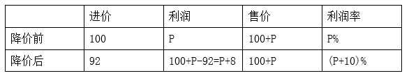

根据利润率=利润/进价，可列式为：(P+8)/92=(P+10)%，解得P=15。

故正确答案为B。

**考点**：经济利润问题

**来源**：2008年浙江省公务员录用考试《行测》题第22题

### 第 23 题

如图所示，梯形ABCD的两条对角线AD、BC相交于O，EF平行于两条边且过O点。现已知AB=6，CD=18。

问EF长为多少：

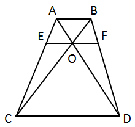

A. 8.5

B. 9

C. 9.5

D. 10

第 23 题 · 答案与解析

**参考答案（粉笔题库参考内容）**

B

**解析**

在梯形ABCD中，AB∥CD，则∠BAD=∠ADC、∠CBA = ∠DCB，又有∠BOA=∠DOC，则△ABO ∽ △DCO，则OA/OD=OB/OC=AB/CD=6/18=1/3。EF∥CD，则△AEO ∽ △ACD，△BOF∽△BCD，则OE/DC=AO/AD= 1/(3 + 1)=1/4，BO/BC=OF/CD= 1/(3 + 1)=1/4，则OE=OF=1/4CD，EF = (1/2)CD= 18/2 = 9。

故正确答案为B。

**考点**：几何公式类-平面图形、几何结论类-相似图形

**来源**：2008年浙江省公务员录用考试《行测》题第23题

### 第 24 题

某人月初用一笔人民币投资股票，由于行情较好，他的资金每月都增加1/3。即使他每月末都取出1000元用于日常开销，他的资金仍然在3个月后增长了一倍。

问他开始时投资了多少人民币：

A. 9900元

B. 9000元

C. 12000元

D. 11100元

第 24 题 · 答案与解析

**参考答案（粉笔题库参考内容）**

D

**解析**

方法一：选项信息充分，考虑代入排除法。根据题意可得，每月剩余金额均为3的倍数。

代入A项：投入9900元，则一个月后变为9900+3300-1000=12200，不是3的倍数，排除；

代入B项：投入9000元，则一个月后变为9000+3000-1000=11000，不是3的倍数，排除；

代入C项：投入12000元，则一个月后变为12000+4000-1000=15000，两个月后变为15000+5000-1000=19000，不是3的倍数，排除。

方法二：假定开始时投资了27x元，由题意得[(4/3 × 27x - 1000) × 4/3 - 1000]×4/3−1000=54x，解得x = 3700/9，则开始时投资了27x = 27 × 3700/9= 11100元。

故正确答案为D。

**考点**：和差倍比问题

**来源**：2008年浙江省公务员录用考试《行测》题第24题

### 第 25 题

小明、小刚和小红三人一起参加一次英语考试，已知考试共有100道题，且小明做对了68题，小刚做对了58题，小红做对了78题。

问三人都做对的题目至少有几题？

A. 4题

B. 8题

C. 12题

D. 16题

第 25 题 · 答案与解析

**参考答案（粉笔题库参考内容）**

A

**解析**

出现“都······至少”，考虑最值问题中多集合反向构造问题，反向求和作差。根据题意可得，小明做错了100-68=32题，小刚做错了100-58=42题，小红做错了100-78=22题，三人做错的题都不一样，才能使“三人同时做对的题目最少”。一共错了32+42+22=96题，至少100-96=4题三人都做对了。

故正确答案为A。

**考点**：多集合反向构造

**来源**：2008年浙江省公务员录用考试《行测》题第25题

### 第 26 题

出于对进城农民工生活的深切关怀，作家们在叙述农民进城的故事时，大都会情不自禁地持有一种严正的道德立场，这些故事往往被简化为一种苦难叙事或控诉文学，在这种叙事图景中，城市和农村往往被抽象化为两个相对立的价值世界，农民们在城市中的挣扎，也总是被演绎为一曲关于质朴价值遭到毁灭的挽歌。

这段文字的主旨是：

A. 现代文学创作应更多关注进城农民工的生活

B. “三农问题”积重难返，城乡差距日益扩大，进城农民工生活艰难

C. 文学创作关于农民进城故事的叙述，有利于引起社会对他们的关注

D. 关于进城农民工的文学创作，不应局限于简单的价值判断

第 26 题 · 答案与解析

**参考答案（粉笔题库参考内容）**

D

**解析**

此题是典型的中心理解题。

材料对叙述农民工城市生活的写作评价为“故事被简化为文学控诉”“城市和农村被抽象化为相对立的价值世界” 和“被演绎为关于质朴价值遭到毁灭的挽歌”，可见，材料的表面主旨是关于进城农民工的文学创作陷于简单化，而作者并不赞成这种“把问题简单化叙述”的文学现象。并且作者通过“往往”“简化”和“总是”等词语强调关于进城农民工的文学创作带有局限性的观点。所以作者的观点是：关于进城农民工的文学创作，不应局限于简单的价值判断。

选项D说法与材料作者倾向吻合，因此，结合选项应该选择D。

选项A引申不对，材料的重点在于叙述的简单化，而不是关注不够多；选项B不是材料叙述的重点；选项C材料未涉及，也无法引申。

故正确答案为D。

**考点**：中心理解题

**来源**：2008年浙江省公务员录用考试《行测》题第26题

### 第 27 题

《竹书纪年》的整理者也受到后世的一都独尊制度和思想的影响，在整理此书时，有意删掉了一些不符合“更不徙都”的材料。然而这样删削，却为人们廓清那些本来就不易弄清的遥远的历史问题带来了更多的麻烦。幸好有一些文献，特别是《括地志》又将“更不徙都”以外的一些材料拾掇起来，乍看上去这些材料是相互矛盾的，实质上却是客观事实的反映。

对这段话的主旨概括最恰当的一项是：

A. 《竹书纪年》并不是一部完整意义上的史书，因为它隐瞒了一些事实

B. 史书中关于一些历史事实的记载往往自相矛盾

C. 不同史书之间的交叉验证有助于我们发掘历史的真相

D. 封建独尊制度的流毒遗害至今，对于考古学是一个严峻的挑战

第 27 题 · 答案与解析

**参考答案（粉笔题库参考内容）**

C

**解析**

本题属于中心理解题。

文段首先介绍有些史书整理者因为受到制度和思想的影响而有意删减历史材料，这给人们认清历史带来麻烦，后通过“幸好”进行了转折，指出其他史书可能会拾掇这些被有意删除的历史材料，从而帮助我们正确认识历史，转折之后的内容才是作者要表达的真正意思。通过阅读，我们知道整个文段在讲不同史学文献中的矛盾材料有助于后人廓清历史问题。结合选项，C项可与转折后面的句子进行同义替换，当选。

A项，文段以《竹书纪年》为例进行展开论述，而例子本身不是文段的重点，故排除。

B项，说法错误，对应原文“乍看上去这些材料是相互矛盾的，实质上却是客观事实的反映”，文段重点是要讲述“矛盾材料有助于后人廓清历史问题”，而不是单单为了说明历史事实存在矛盾，故排除。

D项，未抓住文段转折之后的重点，故排除。

故正确答案为C。

【文段出处】《<括地志>证明<竹书纪年>的整理者之误》

**考点**：关联词-转折

**来源**：2008年浙江省公务员录用考试《行测》题第27题

### 第 28 题

英特尔表示，其新一代处理器已经不再使用铅作为原料，预计到2008年将停止使用卤素。通过这些举措，英特尔处理器对于环境的危害将大大降低。英特尔新型处理器的一个最大特点是采用了铪，可以有效地解决电泄漏的问题，使处理器功耗效率提升了30%。随着晶体管的体积不断缩小，电泄漏也更加严重，导致处理器发热和功能过大的问题日益突出。从某种程度上讲，电泄漏已经成为阻碍处理器性能进一步提升的瓶颈。
对这段话的主要意思概括最恰当的一项是：

A. 英特尔公司已经成功开发出了解决电泄漏问题的新技术

B. 电泄漏问题是处理器生产过程中亟待解决的瓶颈问题

C. 随着晶体管体积的不断缩小，处理器的发热和功耗问题将越来越严重

D. 英特尔公司的新一代处理器应用了新材料，不仅更加环保，而且提升了功耗效率

第 28 题 · 答案与解析

**参考答案（粉笔题库参考内容）**

D

**解析**

根据提问句中“概括”一词可知本题为中心理解题。

材料前半部分讲英特尔新一代处理器使用新原料，将更加环保。后半部分讲英特尔第一代处理器使用新材料，有效解决电泄露问题，提升功耗效率。整个材料构成“分—分”的结构。因此材料的表面主旨必须包括“环保”和“提升功效”两个方面。

因此，结合选项应该选择D。

选项A说法偏颇，“可以有效地解决电泄漏的问题”不能等同于“已经成功开发出了解决电泄漏问题的新技术”；选项B、C仅提到了“电泄露”和“发热和功耗”其中一面，不能概括整个材料。

故正确答案为D。

**考点**：关联词-并列

**来源**：2008年浙江省公务员录用考试《行测》题第28题

### 第 29 题

面对心理辅导与治疗的本土化，我们要对西方的理论存有一种开明的态度，迫切的问题是：我们如何以实证方式如结果研究，来检验有关理论在中国人中之有效性，然后去芜存菁。同时，通过吸收、借鉴外国的理论和方法，发展或创造出适合中国文化和中国人特点的心理辅导和治疗体系。

对这段话的主要意思概括最恰当的一项是：

A. 心理学是一门因人而异、因材施教的学科

B. 我们迫切需要用实证方式来验证西方心理辅导与治疗理论的科学性

C. 心理辅导与治疗的本土化目标的实现，要建立在对西方理论去伪存真和自主创新的基础上

D. 尽可能开明地对待西方理论，海纳百川，博采众长，方能实现心理辅导与治疗的本土化

第 29 题 · 答案与解析

**参考答案（粉笔题库参考内容）**

C

**解析**

根据提问句中“概括”一词可知本题为中心理解题。

材料中冒号后是“心理辅导与治疗的本土化”需要的态度：要“检验有效性，去芜存菁”。然后用“同时”引出第二个需要的态度：要“吸收、借鉴”。表面主旨必须包含这两面。

因此，结合选项应该选择C。

选项A在材料中未提及；选项B以偏概全，仅提到了“检验有效性”；选项D以偏概全，仅提到了“吸收、借鉴”。

故正确答案为C。

**考点**：关联词-并列

**来源**：2008年浙江省公务员录用考试《行测》题第29题

### 第 30 题

伏尔泰以天纵之资，博览群书，吃掉了的东西自己加以消化，作为营养，为他的“理性哲学”服务。伏尔泰涉猎的诸“家”当中，中国只是不很重要的“一家”，并不是“情有独钟”；用显微镜把它单挑出来像“特写镜头”一样放大，那不是“幻觉”，也是“错觉”。

这段文字主要说明：

A. 伏尔泰用中国素材为其“理性哲学”服务

B. 中国素材在伏尔泰的哲学体系中占重要地位

C. 夸大中国因素在伏尔泰哲学体系中的作用是不对的

D. 伏尔泰用“特定镜头”的方式来描绘中国

第 30 题 · 答案与解析

**参考答案（粉笔题库参考内容）**

C

**解析**

根据提问句中“主要说明”一词可知本题为中心理解题。

材料首句阐述伏尔泰读书为“理性哲学”服务，接着讲到读的书中中国因素并不很重要，并从反面再次阐释。可见材料的重点在于中国因素对伏尔泰哲学体系影响不大。从这句话：用显微镜把它单挑出来像“特写镜头”一样放大，那不是“幻觉”，也是“错觉”。可以看出作者的观点是：不应该把伏尔泰哲学体系中的中国因素夸大。

因此，结合选项应该选择C。

A项错在选错描述对象，材料的重点不是“理性哲学”；B项表述明显错误；D项错在偷换概念，材料用比喻这一修辞方法，说明夸大中国因素在伏尔泰哲学体系中的作用就像使用“特写镜头”，而非伏尔泰用“特写镜头”的方式来描绘中国。

故正确答案为C。

**考点**：关联词-并列

**来源**：2008年浙江省公务员录用考试《行测》题第30题

### 第 31 题

过去有人认为，犯罪是因为罪犯心理不健全或对社会感到疏离等原因而从事犯罪行为，因此不能凭借惩罚来阻止。不过，从微观经济学的角度来看，多数罪犯都会根据自己的情况来做理性选择。这种分析方法对于公共政策的制定和司法审判都形成了相当程度的影响。现在，如果法官和立法者对犯罪采取宽松的态度，就会引起民众强烈不满。由此可见，很多人也开始从微观经济学的角度来诠释犯罪行为了。

这段话表达的主要意思是：

A. 大多数罪犯都是理性的

B. 心理性或社会性因素是犯罪的主要原因

C. 微观经济学改变了很多人对犯罪的看法

D. 用微观经济学诠释犯罪行为更为科学

第 31 题 · 答案与解析

**参考答案（粉笔题库参考内容）**

C

**解析**

根据提问方式可知本题为中心理解题。

材料第一句讲过去人们对犯罪的看法，第二句通过转折词“不过”话锋一转，讲现在可从微观经济学角度看待犯罪。最后两句讲微观经济学改变了很多人对犯罪的看法。可见材料的主题词为“微观经济学”。

因此，结合选项应该选择C。

选项A、B不包含主题词，不选；选项D说法过于绝对。

故正确答案为C。

**考点**：主题词

**来源**：2008年浙江省公务员录用考试《行测》题第31题

### 第 32 题

民族主义曾经是社会争取统一与独立的现代化力量，而今一旦立国成功，却很容易变成一种保守压迫的力量。几乎没有政治领袖具有这样的见识：将其国民的需要置于国家目标之上，而常常是实现现代化的手段本身变成了目的。

对这段文字理解不正确的是：

A. 民族主义是一把双刃剑

B. 民族主义具有保守与压迫的本质属性

C. 有远见的政治家会将国民的需要置于重要地位

D. 在现代国家的建立过程中，民族主义起过积极性作用

第 32 题 · 答案与解析

**参考答案（粉笔题库参考内容）**

B

**解析**

据提问可知此题是细节判断题。

因此，结合选项应该选择B，选项B属于强加理解，材料讲“立国成功后，民族主义易变成保守压迫的力量”，并不代表民族主义具有保守与压迫的“本质属性”。并且选项B的说法与材料“民族主义具有两面性”的说法不符，选项B错误。

材料讲了民族主义的两个方面，即曾经具有积极作用，立国成功后又萌生消极作用，因此“民族主义是一把双刃剑”，选项A正确；由材料“几乎没有政治领袖······置于国家目标之上”，可以判断“有远见的政治家会将国民的需要置于重要地位”，选项C正确；由材料“民族主义曾经是社会争取统一与独立的现代化力量”易知，“在现代国家的建立过程中，民族主义起过积极性作用”，选项D正确。

本题为选非题，故正确答案为B。

**考点**：细节判断题

**来源**：2008年浙江省公务员录用考试《行测》题第32题

### 第 33 题

人们试图去预测世界发展线路或寻求过分简化及单向的解决办法，对此我们都应保持怀疑的态度，因为世界形势极其复杂。发展趋势分析则在我们展望未来时提供了一种更为错综复杂的观点，使我们集中关注所要面临的决策分析。

对这段文字理解正确的是：

A. 发展趋势分析在一定程度上能避免简单化的倾向

B. 简单化的思维对认清世界发展路线是毫无意义的

C. 发展趋势分析是一种精确的趋势预测方法

D. 鉴于世界形势的极端复杂性，预测发展趋势是徒劳的

第 33 题 · 答案与解析

**参考答案（粉笔题库参考内容）**

A

**解析**

此题考查细节判断。

由材料“发展趋势分析则在我们展望未来时提供了一种更为错综复杂的观点”可判断，发展趋势分析在一定程度上能避免简单化的倾向。

因此，结合选项应该选择A。

选项B、C、D中的“毫无意义”“精确”“徒劳”都是对材料的偏颇理解，均不选。

故正确答案为A。

**考点**：细节判断题

**来源**：2008年浙江省公务员录用考试《行测》题第33题

### 第 34 题

传统的道德是对应着较单纯的生活和与人际关系结合密切的小组织产生的，道德教化在生活单纯的小组织里还能发挥作用。但在高度复杂化的现代社会，如果把人的爱心和慷慨，仅由面对面的方式表现，把移风易俗的重任，仅寄望于少数有德者，很难想象这个社会会变成个什么样子。

根据这段文字，理解错误的是：

A. 道德是在一定的环境中产生并发挥作用的

B. 道德教化在传统社会中具有积极功能

C. 在现代社会发扬传统道德是一件非常困难的事情

D. 道德教化在现代社会的功能趋于式微

第 34 题 · 答案与解析

**参考答案（粉笔题库参考内容）**

C

**解析**

据提问可知此题是细节判断题。

选项C错在偷换概念，材料叙述的主体是“道德教化”并非“传统道德”。材料讲使用道德教化的方式在现代社会发扬传统道德困难，并非在现代社会发扬传统道德困难。

由材料“道德教化在生活单纯的小组织里还能发挥作用”可以判断，选项A、B正确；材料前一句讲道德教化在传统社会能发挥作用，后一句以转折词“但”引出道德教化在现代社会难以发挥作用。选项D中的“式微”指事物由兴盛而衰落，恰当地表达了材料的意思。

本题为选非题，故正确答案为C。

**考点**：细节判断题

**来源**：2008年浙江省公务员录用考试《行测》题第34题

### 第 35 题

2001年，占世界人口4.68%的美国人消耗了世界卫生资源的46.7%，人均卫生费用支出4873美元；占世界人口0.5%的加拿大也消耗了2.22%的世界卫生资源。美、加两国的卫生资源可谓充足，但是调查显示，当时还有13%的美国人、11%的加拿大人没有享受到必需的卫生服务。在美国，53%的医疗需求未得到满足者认为，这主要是由于费用过高导致的；在加拿大，32%的未满足者认为，等候时间过长是主要原因。

作者通过这段文字最有可能想说明的观点是：

A. 不能笼统地将未满足需求作为卫生资源总量供给不足的根据

B. 发达国家消耗了世界上大部分的卫生资源

C. 美、加两国的卫生水平高，卫生资源总量充足

D. 世界各国占有与消耗的卫生资源是极不均衡的

第 35 题 · 答案与解析

**参考答案（粉笔题库参考内容）**

A

**解析**

根据提问方式可知本题为中心理解题。

材料第一句讲美、加两国占有与消耗了与其人口不相称的卫生资源。第二句讲美、加两国卫生资源总量供给充足，但仍存在着国民没有享受到必需的卫生服务的问题。第三句讲造成这两个国家存在国民未享受到卫生服务的原因。整个材料构成“论述背景—提出事实—事实原因”的分—总—分的结构。中间的“总”是材料的表面主旨，卫生资源总量充足也存在未满足需求的情况，即“不能笼统地将未满足需求作为卫生资源总量供给不足的根据”。

因此，结合选项应该选择A。

选项B、C、D均为前面“分”的部分，不选。

故正确答案为A。

**考点**：分述句特征-数据资料

**来源**：2008年浙江省公务员录用考试《行测》题第35题

### 第 36 题

传统凯恩斯主义的缺陷，新古典主义的成效与失误启发了一些学者构建微观基础的宏观经济学，并另辟蹊径地对劳动力市场与产品市场进行实证分析，以期发现宏观失业与经济波动的原因。他们以工资、价格刚性和非市场出清假设取代新古典主义的工资、价格灵活性和市场出清假设，并把它结合到宏观产量与就业决定理论中而得出凯恩斯主义结论，这样就产生了新凯恩斯主义。

对以上文字理解正确的一项是：

A. 新古典主义的成效与失误是宏观经济学的基础

B. 微观基础的宏观经济学的突破在于对劳动力市场和产品市场的实证分析

C. 新凯恩斯主义就是以工资、价格刚性和非市场出清假设取代新古典主义的假设

D. 工资、价格灵活性和市场出清假设也许是新古典主义的成效与失误所在

第 36 题 · 答案与解析

**参考答案（粉笔题库参考内容）**

B

**解析**

此题考查细节判断。

材料中提到“另辟蹊径地对劳动力市场与产品市场进行实证分析”，“另辟蹊径”一词说明这一举措具有突破性。

因此，结合选项应该选择B。

A项理解偏颇，材料讲新古典主义的成效与失误“启发”了一些学者构建微观基础的宏观经济学，“启发”并不等于说前者是后者建立的“基础”。况且从材料字面来看，这种“启发”并不仅来源于“新古典主义的成效与失误”，还有“传统凯恩斯主义的缺陷”，可以判断A项改变了材料原意；从材料第二句的并列关系词“并”可知，新凯恩斯主义包括两项：一是以工资、价格刚性和非市场出清假设取代新古典主义的工资、价格灵活性和市场出清假设；二是把它结合到宏观产量与就业决定理论中而得出凯恩斯主义结论，两者缺一不可。选项C仅提到了前面一点，不正确；选项D理解偏颇，从材料第二句可知“工资、价格灵活性和市场出清假设”是新古典主义的内容，但不代表“工资、价格灵活性和市场出清假设也许是新古典主义的成效与失误所在”。

故正确答案为B。

**考点**：细节判断题

**来源**：2008年浙江省公务员录用考试《行测》题第36题

### 第 37 题

将传统节日纳入国家法定节日，体现的是对中国传统文化的尊重和回归。中国传统文化是我们精神家园的重要组成部分。但是这些年来，一些“洋节”越来越成为时尚，传统节日反倒有被人们，特别是青年人淡忘的趋势。

下列不符合文意的一项是：

A. 作者支持将传统节日纳入国家法定节日的做法

B. 传统节日是中国传统文化的重要组成部分

C. 一些“洋节”越来越成为时尚，大部分青年人已经淡忘了传统节日

D. 将传统节日纳入国家法定节日可以唤起大家对传统文化的重视

第 37 题 · 答案与解析

**参考答案（粉笔题库参考内容）**

C

**解析**

据提问可知此题是细节判断题。

因此，结合选项应该选择C，选项C说法错误。材料中“传统节日反倒有被人们，特别是青年人淡忘的趋势”说的是一种趋势，而非“已经淡忘了”的现实；另外，原文中并未提到青年人的数量，C项中说“大部分青年人”显然属于无中生有，C错误。

由材料“体现的是对中国传统文化的尊重和回归”，可以看出作者支持将传统节日纳入国家法定节日，A正确；综合材料第一句“对传统文化的尊重”和第二句“中国传统文化是我们精神家园的重要组成部分”，可以判断“传统节日是中国传统文化的重要组成部分”，B正确；由材料第三句可知，这些年来传统节日有被人们淡忘的趋势。而第一句讲“将传统节日纳入国家法定节日，体现的是对中国传统文化的尊重和回归”。因此将传统节日纳入国家法定节日，可以使人们从“淡忘”转变为“重视”，D正确。

本题为选非题，故正确答案为C。

**考点**：细节判断题

**来源**：2008年浙江省公务员录用考试《行测》题第37题

### 第 38 题

在一个低气压的时代，水土特别不相宜的地方，谁也不存什么幻想，期待文艺园地里有奇花异卉探出头来。然而天下比较重要的一些事故，往往在你冷不防的时候出现。史学家或社会学家，会用逻辑来证明，偶发的事故实在是酝酿已久的结果。但没有这种分析头脑的大众，总觉得世界上真有魔术棒似的东西在指挥着，每件新事故都像从天而降，教人无论悲喜都有些措手不及。张爱玲女士的作品给予读者的第一个印象，便有这情形。

对这段话理解不正确的一项是：

A. 张爱玲作品的问世在当时社会背景下是一个特例

B. 在文艺园地里奇花异卉的出现是不能用科学和逻辑来解释的

C. 大众对于张爱玲作品问世的感觉是太突兀、太奇迹

D. 张爱玲作品的问世并不是偶然的，存在一定的必然性

第 38 题 · 答案与解析

**参考答案（粉笔题库参考内容）**

B

**解析**

此题考查细节判断。

材料“史家或社会学家，会用逻辑来证明，偶发的事故实在是酝酿已久的结果”说明是可以用科学和逻辑来解释“文艺园地里奇花异卉的出现”，选项B理解不正确。

因此，结合选项应该选择B。

从“在一个低气压的时代······有奇花异卉探出头来”可知，张爱玲作品的问世在当时社会背景下是一个特例，A项正确；从材料“没有这种分析头脑的大众······措手不及”和“张爱玲女士的作品给予读者的第一个印象，便有这情形”，可以得出大众对于张爱玲作品问世的感觉是太突兀、太奇迹，C项正确；从“用逻辑来证明······酝酿已久的结果”可以得出张爱玲作品的问世并不是偶然的，存在一定的必然性，D项正确。

本题为选非题，故正确答案为B。

**考点**：细节判断题

**来源**：2008年浙江省公务员录用考试《行测》题第38题

### 第 39 题

我不幸偶尔看了一本外国的讲论儿童的书，才知道游戏是儿童最正当的行为，玩具是儿童的天使。于是二十年来毫不忆及的幼小时候对于精神的虐杀的这一幕，忽地在眼前展开，而我的心仿佛也同时变成了铅块，很重很重地坠下去了。但心又不竟坠下去而至于断绝，他只是很重很重地坠着，坠着。我也知道补过的方法的：送他风筝，赞成他放，劝他放，我和他一同。我们嚷着，跑着，笑着——然而他其实已经和我一样，早已有了胡子了。

下列不能从这段话中得出的一项是：

A. “我”曾经阻止过“他”正当的游戏行为

B. “我”为自己二十年前的愚蠢行为感到愧疚

C. 二十年后“我”的忏悔对于“他”已无实际意义

D. “我”在小时候也没放过风筝

第 39 题 · 答案与解析

**参考答案（粉笔题库参考内容）**

D

**解析**

此题考查细节判断。

因此，结合选项应该选择D，D项属于无中生有。

从材料“游戏是儿童最正当的行为”“幼小时候对于精神的虐杀的这一幕”，可以得出“我”曾经阻止过“他”正当的游戏行为，A项正确；从“精神的虐杀”“心也仿佛同时变了铅块，很重很重地坠下去”可以体会出“我”为自己二十年前的愚蠢行为感到愧疚，B项正确；从“我也知道补过的方法的”以及“然而他其实已经和我一样，早已有了胡子了”可知，二十年后“我”的忏悔对于“他”已无实际意义，C项正确。

本题为选非题，故正确答案为D。

**考点**：细节判断题

**来源**：2008年浙江省公务员录用考试《行测》题第39题

### 第 40 题

以下各句中，加下划线的词语使用恰当的一项是：

A. 在原则问题上，党员干部应该有自己鲜明的立场，采取似是而非的态度是极不负责的

B. 王刚任公司经理以来，公司的业绩一落千丈，员工的工资福利待遇也越来越差，这次他被免职，实在是人心所向

C. 在世界杯决赛前夕，面对部分足球流氓的过激行为，英国警方以暴易暴，逮捕了五名带头制造事端的不法分子

D. 孙明利用业余时间创作的油画获得了国际大奖，面对记者的采访，他谦虚地说自己只是略通一二，远远谈不上登堂入室

第 40 题 · 答案与解析

**参考答案（粉笔题库参考内容）**

D

**解析**

本题考查易用错语境的成语的辨析。

因此，结合选项应该选择D，D项“登堂入室”比喻学问或技能从浅到深，循序渐进，达到了很高的水平。符合原句语境的意思。

A项“似是而非”指事物似真而实假，或似正确而实错误。不能用来形容态度，故错误；B项“人心所向”指人民群众所拥护的，向往的。将褒义色彩的成语错用在贬义语境中，故错误；C项“以暴易暴”指用凶暴的代替凶暴的，表示统治者改换了，可是暴虐的统治依然不变。与原句语境不符，原句划线处成语可改为“以暴制暴”，故错误。

故正确答案为D。

**来源**：2008年浙江省公务员录用考试《行测》题第40题

### 第 41 题

以下各句中，加下划线的词语使用不恰当的一项是：

A. 习习的风轻掠过河面，微波粼粼，投射长廊斑驳的白墙上，竟是我说不出的美轮美奂

B. 但近来作文，避忌已甚，有时骨鲠在喉，不得不吐，遂亦不免为人所憎

C. 一个腐败分子被查办了，固然是咎由自取，人们会拍手称快，但同时更应引起有关部门深刻的反思

D. 冤案一再发生，而又迟迟没有体制上和制度上的进一步完善，这恐怕正说明了，我们的反思多属于文过饰非

第 41 题 · 答案与解析

**参考答案（粉笔题库参考内容）**

A

**解析**

本题考查易用错语境的成语的辨析。

因此，结合选项应该选择A，A项“美轮美奂”多形容建筑物雄伟壮观、富丽堂皇。此处形容水波的投影不合适。

B项“骨鲠在喉”比喻心里有话没有说出来，非常难受。符合原句语境“不得不吐”的意思；C项“咎由自取”指灾祸或罪过是自己招来的，形容自作自受。符合原句语境的意思；D项“文过饰非”指用漂亮的言词掩饰自己的过失和错误。符合原句语境的意思。

本题为选非题，故正确答案为A。

**来源**：2008年浙江省公务员录用考试《行测》题第41题

### 第 42 题

下列各句中，句意明确，没有语病的一句是：

A. 在适当的阶段对所学知识进行及时的总结，是李波同学取得优异成绩的一条成功经验

B. 《哈利波特》这部科幻大片对我来说有较大的兴趣

C. 一则小品的好坏，不仅在于构思的巧妙，语言的诙谐幽默，还要考虑观众的文化背景和历史传统

D. 在市场取向的社会环境中，借由文化创意产业发展不那么庸俗化和低劣的产品，早已不是一件令人大惊小怪的事

第 42 题 · 答案与解析

**参考答案（粉笔题库参考内容）**

D

**解析**

D项没有语病。

A项中的“成功经验”语意重复，应去掉“成功”；B项错在颠倒了主体同客体的关系，不是“科幻大片对我有兴趣”，应是“我对科幻大片有兴趣”；C项错在两面对一面，前句“好坏”两面，后句是“好”的一面。

故正确答案为D。

**来源**：2008年浙江省公务员录用考试《行测》题第42题

### 第 43 题

下列各句中，句意明确，没有语病的一项是：

A. 美国哈佛大学一位名叫理查德·哈斯的天体物理学家和一位地质学专家领导的科研小组正在对一块陨石进行研究

B. 在世界主要文明中，唯有日耳曼民族的起源不详，他们确切的史料起始于纪元前半个世纪罗马人的征讨

C. 刚发行的这期《老年周刊》，以大约一半的篇幅，对老年人关注的饮食问题进行了重点采访和报道

D. 为和平解决朝鲜核问题，目前国际社会正采取了多种措施协力斡旋调解

第 43 题 · 答案与解析

**参考答案（粉笔题库参考内容）**

B

**解析**

B项没有语病。

A项存在歧义，究竟是一位地质学专家领导的科研小组这个团队外加美国哈佛大学一位名叫理查德·哈斯的天体物理学家在进行研究，还是美国哈佛大学一位名叫理查德·哈斯的天体物理学家和一位地质学专家共同领导进行研究，不明确；C项语序不当，“对老年人关注的饮食问题”采访在前，“以大约一半篇幅”报道在后；D项前后时态矛盾，“目前”和“正”表示尚在进行，“了”表示已经结束。

故正确答案为B。

**来源**：2008年浙江省公务员录用考试《行测》题第43题

### 第 44 题

下列各句中，有语病的一句是：

A. 众所周知，房地产行业是个资源消耗型行业，对土地、水泥、钢铁消耗巨大，同时它也是一个资本密集型行业，对利率比较敏感

B. 农业、农村和农民问题，是关系全面建设小康社会和现代化事业全局的重大问题

C. 某些司法部门的这种做法不利于公民宪法权利的保护，也不利于宪法作为国家根本大法的最高权威

D. 今年是本届政府任期的最后一年，我们要以更加昂扬的精神状态，努力把各项工作做得更好，向人民交出满意的答卷

第 44 题 · 答案与解析

**参考答案（粉笔题库参考内容）**

C

**解析**

C项宾语残缺，应改为“也不利于宪法作为国家根本大法最高权威的维护”。

A、B、D项没有语病。

本题为选非题，故正确答案为C。

**来源**：2008年浙江省公务员录用考试《行测》题第44题

### 第 45 题

我们的纪录片的问题，         手法上的落后，         对现实关注的少，         缺乏深度、缺乏对社会人文主题的深度开采，缺乏用影像来表达一个比较深刻和开放性话题的能力，正是这一点使当代纪录片在整体上缺乏厚度和广度。

填入划横线部分最恰当的一项是：

A. 在于 而不是 或是

B. 在于 和 而不是

C. 不在于 或是 而是

D. 不在于 且 因而

第 45 题 · 答案与解析

**参考答案（粉笔题库参考内容）**

C

**解析**

本题考查选择关联词填空的能力。

第一、三空，根据材料最后一句“缺乏厚度和广度”，可以判断作者认为缺乏“深度”是纪录片的问题之一，“手法上的落后”和“对现实关注的少”不是纪录片的问题，因此第三空格语句与前一空格语句应构成否定前句，肯定后句的取舍关系。

第二空，“手法上的落后”和“对现实关注的少”是并列关系，第二空应填入并列关联词。

故正确答案为C。

**来源**：2008年浙江省公务员录用考试《行测》题第45题

### 第 46 题

该书的资料来源显得有些杂乱，编辑也比较粗糙，但整本书却 　了一个清晰的大主题：提倡一种生活情调和处事哲学。

填入横线部分最恰当的一项是：

A. 贯穿

B. 隐藏

C. 体现

D. 蕴含

第 46 题 · 答案与解析

**参考答案（粉笔题库参考内容）**

A

**解析**

此题考查实词语境搭配的辨析与填空。

A项“贯穿”指从头到尾穿过一个或一系列事物，“整本书贯穿一个大主题”更符合语意。

由材料中“清晰”一词可排除B、D项；C项“体现”仅强调结果。

故正确答案为A。

**考点**：词的辨析-词义侧重、实词填空

**来源**：2008年浙江省公务员录用考试《行测》题第46题

### 第 47 题

影片《大国崛起》讲述了一个新的历史叙事，它关注不同的大国在不同历史时期“崛起”的原因。以开放和坦然的心态直面那些过去被        的历史。

填入横线部分最恰当的一项是：

A. 赞扬、肯定甚至奉为教条

B. 扬弃、赞美甚至视为真理

C. 批判、避讳甚至遗忘

D. 忽视、避讳甚至批判

第 47 题 · 答案与解析

**参考答案（粉笔题库参考内容）**

D

**解析**

此题考查实词语体色彩的辨析。

选项D中“忽视”表示不重视；“避讳”指忌讳，由于道德或审美的原因或可能遭到危险而不愿说出或听到某些会引起不愉快的字眼；“批判”指对被认为是错误的思想或言行批驳否定，显然“批判”语气最重，“忽视”语气最轻。D项正确。

由材料“开放和坦然的心态”“直面”可判断，填入的词语必然是表示否定意味的词，因为唯有被否定的事物才需要勇气“直面”，可排除A、B项；选项中“甚至”一词表示递进，其后的词应该比之前所述意思上有所递进。选项C“批判”“避讳”“遗忘”三词语气轻重顺序错误，可排除C项。

故正确答案为D。

**考点**：词的辨析-程度轻重、对应关系-前后呼应、混搭填空

**来源**：2008年浙江省公务员录用考试《行测》题第47题

### 第 48 题

再卑微的人也有不容他人\_\_\_\_\_\_\_\_的自尊。

填入横线部分最恰当的一项是：

A. 猥亵

B. 亵渎

C. 侵犯

D. 干涉

第 48 题 · 答案与解析

**参考答案（粉笔题库参考内容）**

B

**解析**

文段表达的意思是“再卑微的人都有自尊，而且这种自尊是不容别人不尊重的”，所以横线处填入的词语应该含有“不尊重”的意思，结合选项，B项“亵渎”意为轻慢，冒犯，不恭敬，符合文意，当选。

A项“猥亵”指下流，淫秽或做下流的动作。

C项“侵犯”指以伤害他人或他物为目的的行为。

D项“干涉”指强行过问，干预，关涉。

A、C、D项均不符合文意，故排除。

故正确答案为B。

**考点**：词的辨析-搭配对象、实词填空

**来源**：2008年浙江省公务员录用考试《行测》题第48题

### 第 49 题

自张爱玲在大洋彼岸以自己独特的方式        告别人世至今，张爱玲研究已经         ，海峡两岸三地出版的张爱玲传记、张爱玲研究专著和张爱玲评论汇编接连不断。

填入横线部分最恰当的一项是：

A. 悄然 蔚为大观

B. 悄悄 汗牛充栋

C. 悄然 汗牛充栋

D. 悄悄 蔚为大观

第 49 题 · 答案与解析

**参考答案（粉笔题库参考内容）**

A

**解析**

此题考查实词与成语的混搭填空。

第一空，“悄然”表示寂静地，同时又有忧愁地的意思。“悄悄”只表示不声不响的意思。根据原句“告别人世”可判断，“悄然”更贴切。

第二空，“蔚为大观”形容事物美好繁多，给人一种盛大的印象。“汗牛充栋”形容藏书非常多。第二空填入的词用来形容“张爱玲研究”“接连不断”的状态，显然“汗牛充栋”不符合语意，“蔚为大观”形容这种研究现象较贴切。

故正确答案为A。

**考点**：词的辨析-词义侧重、词的辨析-搭配对象、混搭填空

**来源**：2008年浙江省公务员录用考试《行测》题第49题

### 第 50 题

将下列词语依次填入横线处，最恰当的一组是：

①他家的宠物狗贝贝可难         了，像小孩一样爱挑食。

②在韩剧《渊盖苏文》里，唐太宗被弓箭射成了独眼龙，很明显        了我国历史，颠倒黑白。

③现代大部分国家都认同        的重要，虽然他们产生法律、立法代表的方法不太相同，它的好处在于能防止由特定的个人凌驾法律而伤害其他大多数人的利益。

A. 伺候 篡改 法治

B. 侍候 篡改 法制

C. 伺候 窜改 法制

D. 侍候 窜改 法治

第 50 题 · 答案与解析

**参考答案（粉笔题库参考内容）**

A

**解析**

此题考查近义实词使用对象及语体色彩的辨析。

句①，“伺候”指在身边照料生活，用于人时，对长、幼、平级都可；也可用于牲畜等。“侍候”一般用于人，多用于对长辈或地位高者。句中的对象是“宠物狗”，应选“伺候”。

句②，“篡改”指用作伪的手段改动或曲解经典、理论、政策等，属于贬义词。“窜改”指改动，改动成语、文件、古书等，属于中性词。由句子“颠倒黑白”可判断，作者对“唐太宗被弓箭射成了独眼龙”这一剧情持否定态度，且“篡改历史”属于固定搭配，应选“篡改”。

句③，“法治”指用法律来治理国家，是治理社会的一种理论、原则、理念和方法。“法制”指法律制度。由句中“它的好处在于······大多数人的利益”可知，“它”指代“法治”，横线处应选“法治”。

故正确答案为A。

**考点**：词的辨析-词义侧重、词的辨析-感情色彩、实词填空

**来源**：2008年浙江省公务员录用考试《行测》题第50题

### 第 51 题

小说只是小说，文学只是文学，既不当误认作一部历史，亦不当误认作一篇科学的论文。对于文艺，除掉         以外，不妨作一种研究；但这种研究，不当为历史的或科学的，只是趣味的研究。

填入划横线部分最恰当的一项是：

A. 欣赏

B. 品味

C. 鉴赏

D. 评论

第 51 题 · 答案与解析

**参考答案（粉笔题库参考内容）**

C

**解析**

此题考查近义实词的语境搭配。

C选项“鉴赏”专指对文物、艺术品等的鉴定和欣赏。“鉴赏”与“文艺”搭配更贴切。

横线处的词需与“文艺”搭配，且符合“趣味”的语境。“评论”不符合“趣味”的语境，故先排除选项D；A选项“欣赏”指领略玩赏，使用对象较为广泛；B选项“品味”指仔细体会，使用对象较为广泛。

故正确答案为C。

**考点**：词的辨析-搭配对象、实词填空、对应关系-前后呼应

**来源**：2008年浙江省公务员录用考试《行测》题第51题

### 第 52 题

都说眼下属于图像时代。且不说电视、电影、光盘等         着文化消费和阅读走向，单单老照片、老漫画、老插图等等历史陈迹的        ，便足以表明人们已不再满足于在文字里感受生活，感受历史了。

填入横线部分最恰当的一项是：

A. 引领 席卷而来

B. 引导 沉渣泛起

C. 主导 异军突起

D. 引领 纷至沓来

第 52 题 · 答案与解析

**参考答案（粉笔题库参考内容）**

C

**解析**

本题考查成语与实词的混搭填空。

第二空，“沉渣泛起”比喻已经绝迹了的腐朽、陈旧事物又重新出现，属于贬义词。“纷至沓来”指接连不断地到来，含有“杂乱”的意思。这两词与材料的感情色彩不符，可先排除。“异军突起”比喻新的派别或新的力量突然崛起。“席卷而来”表示在短时内迅速有力地掠过，也可用于各种热潮的兴起。“席卷而来”侧重潮流迅速兴起又退去，故“异军突起”形容图像时代老照片、老漫画、老插图等历史陈迹比描述文字更能吸引读者的兴趣，诱发读者的想象这一趋势更为贴切。该空应选“异军突起”。

第一空，与“引领”和“引导”相比，“主导”指引导全局并推动全局发展，侧重强调对全局的重要作用。又根据材料可知，电视、电影、光盘是指引文化消费和阅读走向的重要因素，故该空选“主导”更符合语境。

故正确答案为C。

**考点**：词的辨析-词义侧重、词的辨析-感情色彩、混搭填空

**来源**：2008年浙江省公务员录用考试《行测》题第52题

### 第 53 题

晚清的新学之士，提及开通民智，总是首推报馆与学校。二者同为“教育人才指导”、“传播文明”之“利器”，却因体制及利益不同，无法          。

填入划横线部分最恰当的一项是：

A. 珠联璧合

B. 相辅相成

C. 相得益彰

D. 取长补短

第 53 题 · 答案与解析

**参考答案（粉笔题库参考内容）**

A

**解析**

本题考查成语的语境搭配。

由材料中“二者同为‘教育人才指导’‘传播文明’之‘利器’”可以判断，作者对报馆与学校均持肯定态度。“珠联璧合”比喻杰出的人才或美好的事物结合在一起，符合材料语意。

因此，结合选项应该选择A。

B项“相辅相成”指相互补充，相互配合；C项“相得益彰”指互相配合和补充更能显出长处、发挥作用；D项“取长补短”指吸取别人的长处，用来弥补自己的短处。B、C、D项三个成语均有优势和劣势相互补充的意思。材料中未提到报馆与学校各自所具有的优势和劣势，相互补充及配合无从谈起。

故正确答案为A。

**考点**：对应关系-前后呼应、成语填空

**来源**：2008年浙江省公务员录用考试《行测》题第53题

### 第 54 题

卢梭在《爱弥尔》的序文中说：“大人常在孩子中求大人，他们不想一想，未成大人时的孩子是什么样子的？”这句话的意思是说，大人因为不理解孩子，而强迫孩子照大人的样子做人，这是目前儿童教育的        。

填入划横线部分最恰当的一项是：

A. 病根

B. 症状

C. 困境

D. 趋势

第 54 题 · 答案与解析

**参考答案（粉笔题库参考内容）**

A

**解析**

作者写这段话旨在说明大人强迫孩子照大人的样子做人在儿童教育中起着基础性的错误引导，A项“病根”指引起失败或灾祸的原因，符合语意。

因此，结合选项应该选择A。

从卢梭在《爱弥尔》中表达的观点，以及作者使用的“强迫”等词，可见作者对“大人强迫孩子照大人的样子做人”这种教育现状是持批判态度的，故括号部分须填入能表达批判态度的词。D项“趋势”是中性词，因此可排除D项；B项“症状”指患者因疾病而表现出来的不正常状态，C项“困境”指困难的处境，均不能表明这种教育理念对大人采取的其他教育手段的错误引导。

故正确答案为A。

**考点**：词的辨析-感情色彩、实词填空、对应关系-前后呼应

**来源**：2008年浙江省公务员录用考试《行测》题第54题

### 第 55 题

宋代周守中的《养生类纂》载有：“沟渠通浚，屋宇洁净无移气，不生瘟疫病”。古代的中国政府对于沟渠的通塞也很注意，每逢雨季之前，就命水利官员加以        以免泛滥。

填入划横线部分最恰当的一项是：

A. 整治

B. 疏浚

C. 疏导

D. 疏通

第 55 题 · 答案与解析

**参考答案（粉笔题库参考内容）**

B

**解析**

本题考查实词的固定搭配。

填入横线处的词需与“沟渠”搭配，“疏浚沟渠”属于固定搭配，另外“疏浚”一词也与材料中引用的“沟渠通浚”相对应。

因此，结合选项应该选择B。

选项A“整理”一词包含的动作范围太大，不能精确对应材料中的“通塞”，不选；选项C、D均有“通塞”的意思，但与“沟渠”不符，也不选。

故正确答案为B。

**考点**：词的辨析-搭配对象、实词填空

**来源**：2008年浙江省公务员录用考试《行测》题第55题

### 第 56 题

从所给的四个选项中，选择最合适的一个填入问号处，使之呈现一定的规律性：

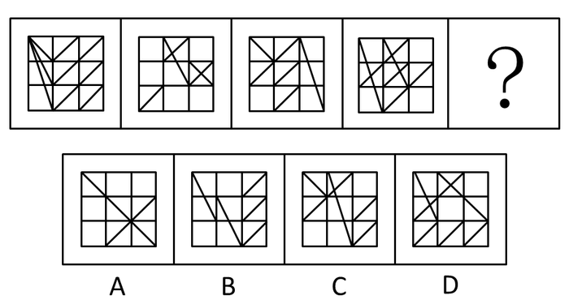

A. A

B. B

C. C

D. D

第 56 题 · 答案与解析

**参考答案（粉笔题库参考内容）**

C

**解析**

解析1：

每一幅图形中朝向为“/”的斜线和朝向为“\\”的斜线数目一致。仔细数每一个小方格内的斜线，发现第一幅图的“/”“\\”数目都是6，第二幅图的“/”“\\”数目都是3，第三幅图的“/”“\\”数目都是4，第四幅图的“/”“\\”数目都是5，只有选项C中的“/”“\\”数目相同。故正确答案为C。

解析2：

第二第三第四个图形中的斜线都可以在第一个图形中找到。选项中只有C满足这一特征。

故正确答案为C。

**考点**：数量规律-线

**来源**：2008年浙江省公务员录用考试《行测》题第56题

### 第 57 题

从所给的四个选项中，选择最合适的一个填入问号处，使之呈现一定的规律性：

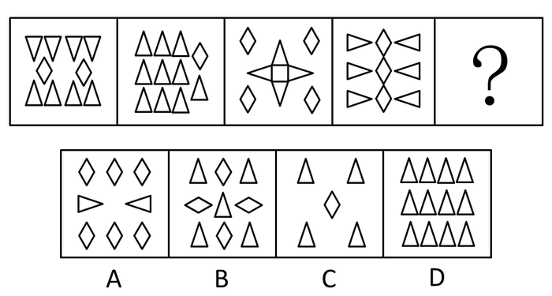

A. A

B. B

C. C

D. D

第 57 题 · 答案与解析

**参考答案（粉笔题库参考内容）**

D

**解析**

元素的换算。

本题考查的是图形的数量。一个菱形相当于2个三角形，将题干中的菱形都置换成三角形，则每个图都由12个三角形组成，选项中换算后的三角形数量分别是14、13、6、12。符合该规律的为D项 。

故正确答案为D。

**考点**：数量规律-素

**来源**：2008年浙江省公务员录用考试《行测》题第57题

### 第 58 题

从所给的四个选项中，选择最合适的一个填入问号处，使之呈现一定的规律性：

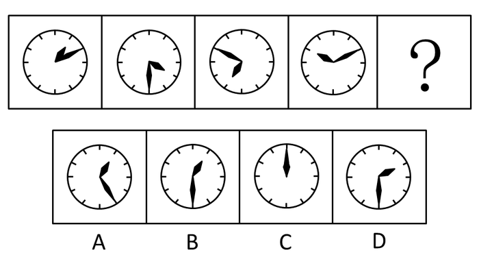

A. A

B. B

C. C

D. D

第 58 题 · 答案与解析

**参考答案（粉笔题库参考内容）**

B

**解析**

解析1：

元素组成相同，考查位置规律。本题考查图形的旋转。时针和分针都是顺时针旋转，时针每次旋转3格（5分钟1格），分针每次旋转4格，符合该规律的为B项。

解析2：

时针和分针夹角依次为30°，60°，90°，120°，所以第五个应该是150°，根据图形可知应该选择B。

故正确答案为B。

**考点**：位置规律-旋转

**来源**：2008年浙江省公务员录用考试《行测》题第58题

### 第 59 题

从所给的四个选项中，选择最合适的一个填入问号处，使之呈现一定的规律性：

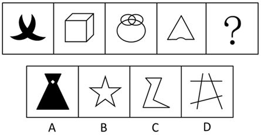

A. A

B. B

C. C

D. D

第 59 题 · 答案与解析

**参考答案（粉笔题库参考内容）**

A

**解析**

题干图形出现等腰元素，每个图形有且只有一条对称轴，A项有且只有一条对称轴，B项五条对称轴，C、D两项不是轴对称图形。

故正确答案为A。

**考点**：属性规律-对称性

**来源**：2008年浙江省公务员录用考试《行测》题第59题

### 第 60 题

从所给的四个选项中，选择最合适的一个填入问号处，使之呈现一定的规律性：

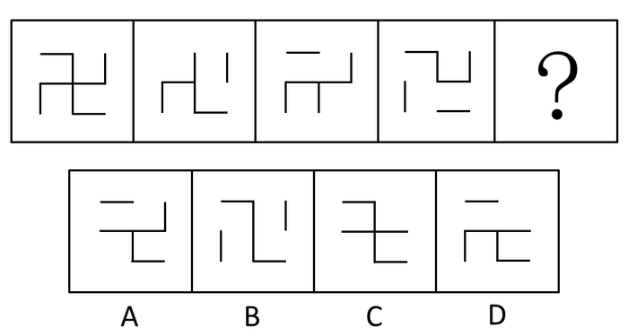

A. A

B. B

C. C

D. D

第 60 题 · 答案与解析

**参考答案（粉笔题库参考内容）**

C

**解析**

元素组成相似，元素叠加运算。

第一幅图包含8条等长线段。其后的第二、三、四个图形都比第一幅图减少2条线段，并且减少的线段不重复。符合该规律的只有C项。

故正确答案为C。

**考点**：位置规律-平移

**来源**：2008年浙江省公务员录用考试《行测》题第60题

### 第 61 题

从所给的四个选项中，选择最合适的一个填入问号处，使之呈现一定的规律性：

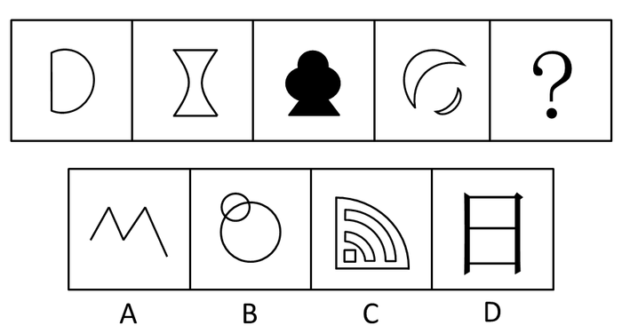

A. A

B. B

C. C

D. D

第 61 题 · 答案与解析

**参考答案（粉笔题库参考内容）**

C

**解析**

元素组成凌乱，考数数。

图形变化规律为图形中曲线数目依次递增，四幅图的曲线数分别为1、2、3、4，选项曲线数为0、2、5、0 。

故正确答案为C。

**考点**：数量规律-线

**来源**：2008年浙江省公务员录用考试《行测》题第61题

### 第 62 题

从所给的四个选项中，选择最合适的一个填入问号处，使之呈现一定的规律性：

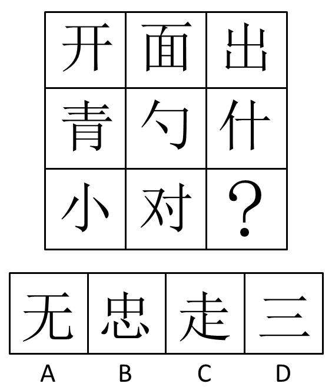

A. A

B. B

C. C

D. D

第 62 题 · 答案与解析

**参考答案（粉笔题库参考内容）**

D

**解析**

元素组成凌乱，考数数。

观察每个字相连的部分，第一行均为一个部分，第二行均可分为不牵连的两个部分，第三行均可分为不牵连的三个部分。

故正确答案为D。

**考点**：数量规律-素、文字/字母/数字类

**来源**：2008年浙江省公务员录用考试《行测》题第62题

### 第 63 题

从所给的四个选项中，选择最合适的一个填入问号处，使之呈现一定的规律性：

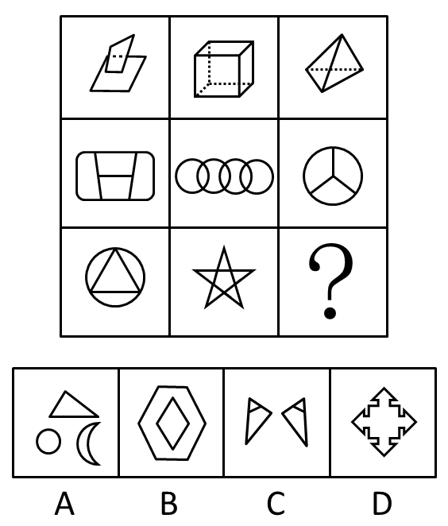

A. A

B. B

C. C

D. D

第 63 题 · 答案与解析

**参考答案（粉笔题库参考内容）**

B

**解析**

元素组成凌乱，考数数。观察每幅图的封闭图形数目。每行第一个图形封闭图形数加第三个图形封闭图形数等于第二个图形封闭图形数，第一行封闭图形数是2＋4＝6；第二行4＋3＝7；第三行第一个封闭图形数是4，中间的封闭图形数是6，所以空缺处需要有2个封闭图形。符合该规律的为B。

故正确答案为B。

**考点**：数量规律-面

**来源**：2008年浙江省公务员录用考试《行测》题第63题

### 第 64 题

从所给的四个选项中，选择最合适的一个填入问号处，使之呈现一定的规律性：

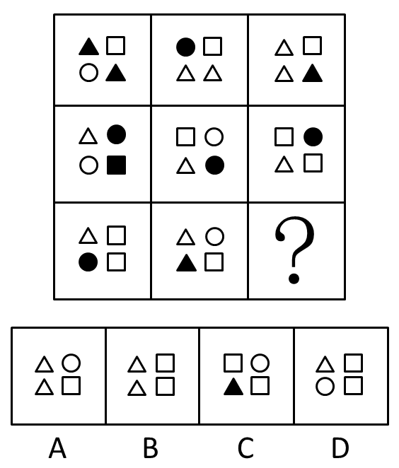

A. A

B. B

C. C

D. D

第 64 题 · 答案与解析

**参考答案（粉笔题库参考内容）**

B

**解析**

元素组成相似，元素黑白叠加。

观察前两行，相同部分变白，不同部分为阴影，叠加后优先顺序为方块>三角>圆。

故正确答案为B。

**考点**：样式规律-黑白运算

**来源**：2008年浙江省公务员录用考试《行测》题第64题

### 第 65 题

从所给的四个选项中，选择最合适的一个填入问号处，使之呈现一定的规律性：

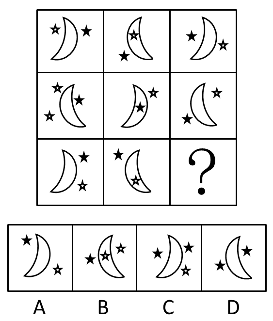

A. A

B. B

C. C

D. D

第 65 题 · 答案与解析

**参考答案（粉笔题库参考内容）**

C

**解析**

元素组成相似，元素周遍。

首先，观察月亮方向，相邻发生变化，排除B、D。黑色五角星现在比白色少一个，需要补充。

故正确答案为C。

本题存在另外一种解释：每一行只有一个五角星在弯月内部的中间，且每个图形均只含一个黑色五角星，故答案为A。

**考点**：位置规律-翻转、样式规律-遍历

**来源**：2008年浙江省公务员录用考试《行测》题第65题

### 第 66 题

新闻：内幕

A. 日记：感受

B. 医院：生命

C. 教育：学校

D. 奋斗：成就

第 66 题 · 答案与解析

**参考答案（粉笔题库参考内容）**

A

**解析**

第一步：判断题干词语间逻辑关系。

题干两词是属性关系，且是必然属性关系，后一个词是前一个词的属性特征。

第二步：判断选项词语间逻辑关系。

两组词是文字资料及其作用，新闻可以揭露事件的内幕，日记可以记录内心感受。

B项医院是地点；

C项前后项的顺序颠倒了；

D项表述的是因果关系。

故正确答案为A。

**考点**：逻辑关系-对应关系

**来源**：2008年浙江省公务员录用考试《行测》题第66题

### 第 67 题

青蛙：庄稼

A. 律师：被告

B. 树木：城市

C. 合同：买方

D. 空气：健康

第 67 题 · 答案与解析

**参考答案（粉笔题库参考内容）**

B

**解析**

第一步：判断题干词语间逻辑关系。

题干两词是对应关系，且是事物及其作用对象之间的或然关系。

第二步：判断选项词语间逻辑关系。

题干中有青蛙，庄稼更好，没有青蛙，庄稼不一定不好；

A项是人物之间的并列关系；

B项中树木和城市也是或然关系；

C项是事物的包容关系，“合同”中包含了“买方”和“卖方”；

D项空气和健康是必然关系，有优质空气，更健康，没有优质空气，肯定不健康。

故正确答案为B。

**考点**：逻辑关系-对应关系

**来源**：2009年426联考《行测》题（天津/陕西/湖北）第71题

### 第 68 题

做作：表情

A. 苦恼：思索

B. 怆然：泪下

C. 僵硬：舞姿

D. 演绎：角色

第 68 题 · 答案与解析

**参考答案（粉笔题库参考内容）**

C

**解析**

第一步：判断题干词语间逻辑关系。

题干两个词属于语法关系。做作和表情可以组成偏正结构短语“做作的表情”。

第二步：判断选项词语间逻辑关系。

A选项，两个词不能组成偏正短语，没有“苦恼的思索”这一说，排除。

B选项，“泪下”即流泪，是动词，“怆然泪下”不是偏正结构，排除。

C选项，可以组成偏正结构短语“僵硬的舞姿”，正确。

D选项，“演绎”是个动词，“演绎角色”不是偏正结构，排除。

第三步：再次标注答案。

故正确答案为C。

**考点**：语法关系

**来源**：2008年浙江省公务员录用考试《行测》题第68题

### 第 69 题

囚犯：枷锁

A. 小贩：豆浆

B. 空姐：微笑

C. 白领：跑车

D. 农夫：锄头

第 69 题 · 答案与解析

**参考答案（粉笔题库参考内容）**

D

**解析**

第一步：判断题干词语间逻辑关系。

枷锁象征囚犯，二者为比喻象征义的关系。

第二步：判断选项词语间逻辑关系。

A项：豆浆不能象征小贩，与题干逻辑关系不一致，排除；

B项：微笑不能象征空姐，与题干逻辑关系不一致，排除；

C项：跑车不能象征白领，与题干逻辑关系不一致，排除；

D项：锄头象征农夫，与题干逻辑关系一致，当选。

故正确答案为D。

**考点**：语义关系-比喻象征义

**来源**：2008年浙江省公务员录用考试《行测》题第69题

### 第 70 题

清凉：盛夏

A. 喧嚣：子夜

B. 局促：广场

C. 安详：长眠

D. 萧瑟：深秋

第 70 题 · 答案与解析

**参考答案（粉笔题库参考内容）**

A

**解析**

第一步：判断题干词语间逻辑关系。

盛夏不是清凉的，清凉不是盛夏的特点。

第二步：判断选项词语间逻辑关系。

A项：子夜不是喧嚣的，喧嚣不是子夜的特点，与题干逻辑关系一致，当选；

B项：局促和广场没有必然联系，与题干逻辑关系不一致，排除；

C项：长眠的特点是安详的，与题干逻辑关系不一致，排除；

D项：深秋的特点是萧瑟的，与题干逻辑关系不一致，排除。

故正确答案为A。

**考点**：逻辑关系-对应关系

**来源**：2008年浙江省公务员录用考试《行测》题第70题

### 第 71 题

光照：影子

A. 酒精：气氛

B. 振动：声音

C. 努力：成功

D. 飓风：损失

第 71 题 · 答案与解析

**参考答案（粉笔题库参考内容）**

B

**解析**

第一步：判断题干词语间逻辑关系。

题干两词是对应关系，自然现象及其产生条件的关系，后词是自然现象，前词是条件。

第二步：判断选项词语间逻辑关系。

题干要产生影子需要光照。

A项：气氛不一定靠酒精产生；

B项：只有振动才能产生声音，符合该逻辑关系；

C项：努力和成功也是条件关系，但不是自然现象；

D项：飓风和损失是因果关系，非条件关系。

故正确答案为B。

**考点**：逻辑关系-对应关系

**来源**：2008年浙江省公务员录用考试《行测》题第71题

### 第 72 题

负荆请罪：廉颇

A. 三顾茅庐：诸葛亮

B. 卧薪尝胆：夫差

C. 乐不思蜀：刘禅

D. 城下之盟：宋太祖

第 72 题 · 答案与解析

**参考答案（粉笔题库参考内容）**

C

**解析**

第一步：判断题干词语间逻辑关系。

题干两词是对应关系，且是历史事件和其执行者的对应。

第二步：判断选项词语间逻辑关系。

负荆请罪的是廉颇。

A项：三顾茅庐的是刘备，不是诸葛亮；

B项：卧薪尝胆的是勾践，不是夫差；

C项：乐不思蜀讲的是刘禅；

D项：城下之盟来自于春秋时楚国攻打绞国的事件。

故正确答案为C。

**考点**：逻辑关系-对应关系

**来源**：2008年浙江省公务员录用考试《行测》题第72题

### 第 73 题

曹七巧：张爱玲

A. 杜甫：李白

B. 于连：狄更斯

C. 骆驼祥子：老舍

D. 林徽因：郭沫若

第 73 题 · 答案与解析

**参考答案（粉笔题库参考内容）**

C

**解析**

第一步：判断题干词语间逻辑关系。

题干两词是对应关系，且后词是作品的作者，前词是作品中的人物。

第二步：判断选项词语间逻辑关系。

题干中，曹七巧是张爱玲作品《金锁记》中的人物。

首先排除A、D两项，杜甫、李白和林徽因、郭沫若都是作者；

B项：于连是司汤达《红与黑》中的人物，也应排除；

C项：骆驼祥子是老舍作品《骆驼祥子》中的人物。

故正确答案为C。

**考点**：逻辑关系-对应关系

**来源**：2008年浙江省公务员录用考试《行测》题第73题

### 第 74 题

林冲：水浒

A. 范进：官场现形记

B. 贾宝玉：红楼梦

C. 闰土：祝福

D. 吴承恩：西游记

第 74 题 · 答案与解析

**参考答案（粉笔题库参考内容）**

B

**解析**

第一步：判断题干词语间逻辑关系。

题干两词是对应关系，且后词是作品，前词是作品中的人物。

第二步：判断选项词语间逻辑关系。

题干林冲是《水浒传》中的人物之一。

A项中范进不是《官场现形记》中的人物，而是《儒林外史》中的人物；

B项中贾宝玉是《红楼梦》中的人物之一；

C项中闰土不是《祝福》中的人物，而是《故乡》中的人物；

D项中吴承恩是《西游记》的作者。

故正确答案为B。

**考点**：逻辑关系-对应关系

**来源**：2008年浙江省公务员录用考试《行测》题第74题

### 第 75 题

守株待兔：望梅止渴

A. 唇亡齿寒：鸡鸣狗盗

B. 闻鸡起舞：指鹿为马

C. 掩耳盗铃：拔苗助长

D. 不寒而栗：不学无术

第 75 题 · 答案与解析

**参考答案（粉笔题库参考内容）**

C

**解析**

“守株待兔”比喻企图不经过努力而得到成功的侥幸心理。“守株”是方式，“待兔”是目的；“望梅止渴”比喻愿望无法实现，便凭空想来加以安慰，“望梅”是方式，“止渴”是目的。二者均为方式目的的对应关系。

A项：“唇亡齿寒”比喻关系密切，利害相关，“唇亡”是原因，“齿寒”是结果；“鸡鸣狗盗”指微不足道的本领，也指偷偷摸摸的行为，“鸡鸣”和“狗盗”构成并列关系，前后逻辑关系不一致，排除；

B项：“闻鸡起舞”比喻有志报国的人及时奋起，“闻鸡”之后“起舞”，二者是顺承关系；“指鹿为马”比喻故意颠倒黑白，混淆是非，前后逻辑关系不一致，排除；

C项：“掩耳盗铃”比喻自己欺骗自己，明明掩盖不住的事情偏要想法子掩盖，“掩耳”是方式，“盗铃”是目的；“拔苗助长”比喻违反自然规律发展的客观规律，急于求成，不加思考，反而把事情弄糟，“拔苗”是方式，“助长”是目的，二者均为方式目的的对应关系，前后逻辑关系一致，当选；

D项：“不寒而栗”比喻因为害怕而形成发抖的样子，没有明显的感情色彩；“不学无术”比喻人无学问、没本事，二者均不是方式目的的关系，前后逻辑关系不一致，排除。

故正确答案为C。

**考点**：拆分思维

**来源**：2008年浙江省公务员录用考试《行测》题第75题

### 第 76 题

意识形态：在一定的社会经济基础上形成的代表了某一阶级或社会集团的利益的系统的思想观念。

下列属于意识形态的是：

A. 虽然本周股市低迷，但大部分股民都相信下周股票一定会上涨

B. 某省文学艺术界联合会号召大家在新时期要抵制低俗文化，净化文化环境

C. 摄影师小韩在某知名论坛上发布了一组某藏族贫困小学生艰辛求学的照片，号召大家为其捐助，许多人纷纷回应，在网上引起了轩然大波

D. “嫦娥一号”成功发射那一刻，举国上下欢呼庆祝

第 76 题 · 答案与解析

**参考答案（粉笔题库参考内容）**

B

**解析**

第一步：抓住定义中的关键词。

关键词强调“思想观念”且“代表了某一阶级或社会集团的利益”。

第二步：逐一判断选项。

A项中股民对下周股市的看法是暂时性的；

只有B项“新时期要抵制低俗文化，净化文化环境”符合定义；

C和D没有提到“思想观念”；

A项、C项和D项都不是系统的思想观念。

故正确答案为B。

**考点**：拆词

**来源**：2008年浙江省公务员录用考试《行测》题第76题

### 第 77 题

流动偏好：凯恩斯提出的一种人们以货币的形式保持一部分资产的愿望和偏爱，它是一种心理动机，是人们为了应付日常开支、意外开支和在适当的时机投机牟利活动需要而愿意手头持有现金的倾向。

下列现象不属于流动偏好的一项是：

A. 银行一再降息，全国的储蓄率仍然很高

B. 为了孩子将来上大学，金明从结婚后就开始为孩子存款

C. 最近一段时间来，股市形势一直不好，许多股民纷纷退出股市

D. 李明平时勤俭节约不乱花钱是怕突如其来的下岗后的拮据

第 77 题 · 答案与解析

**参考答案（粉笔题库参考内容）**

B

**解析**

第一步：抓住定义中的关键词。

关键词：“以货币形式”“应付日常开支、意外开支和投机牟利活动”且“保持资产”。

第二步：逐一判断选项。

A项：“储蓄率”是保持资产的行为，符合定义，排除；

B项：为孩子将来上大学存钱，不属于应付日常开支、意外开支和在适当时机投机牟利，不符合定义，当选；

C项：股民退出股市是为了适当时机投机牟利，符合定义，排除；

D项：为怕下岗后生活拮据，属于为了应付意外开支需要而保持资产，符合定义，排除。

本题为选非题，故正确答案为B。

**考点**：方式目的

**来源**：2008年浙江省公务员录用考试《行测》题第77题

### 第 78 题

自我实现预期：当人们对后果有期望或期待时，就会引发某种行为，预期可以通过自我暗示或他人暗示形成自我鼓励或他人鼓励，对激发与调动潜在的能力起到一定的作用。积极的预期会产生积极的结果，消极的预期则产生消极的结果。

下列现象不属于“自我实现预期”的是：

A. 她的同学都说她很漂亮，我也越看越觉得漂亮了

B. 他一直担心自己性格内向而通不过面试，结果在面试时他特别紧张而被淘汰

C. 星座书上说她今年学业不顺利，于是她就颓废消极，结果期末考试真的没通过

D. 亲戚朋友都赞许他很聪明，将来一定能考上名牌大学，他受到鼓励后学习更加努力，结果考上了北京大学

第 78 题 · 答案与解析

**参考答案（粉笔题库参考内容）**

A

**解析**

第一步：抓住定义中的关键词。

关键词强调“自我暗示或他人暗示”且对结果“起到一定的作用”。

第二步：逐一判断选项。

A项不是由于期待某人漂亮而使其变得漂亮，不符合定义；

B、C项因为消极的“自我暗示”对结果起到“消极作用”；

D项因为积极的“他人暗示”对结果起到“积极作用”。

本题为选非题，故正确答案为A。

**考点**：方式目的

**来源**：2008年浙江省公务员录用考试《行测》题第78题

### 第 79 题

污名化：一个群体将人性的低劣强加在另一个群体之上并加以维持的动态过程，它是将群体的偏向负面的特征刻板印象化，并由此掩盖其他特征，成为在本质意义上与群体特征对应的指标物，在这个过程中，处于强势且不具污名的一方最常采用的一种策略，即“贴标签”。

下列现象不属于污名化现象的是：

A. 某市治安日益恶化，市民都抱怨是农民工流入城市的恶果

B. 杭州出生的魏某鄙视农村来的妻子，认为她邋遢土气，没文化

C. 某餐厅打出招聘广告：“本餐馆招收服务员一名，XX省的人一概不考虑”

D. 在旧上海，苏北人被视为懒惰的群体，被排除在上海人通婚圈之外

第 79 题 · 答案与解析

**参考答案（粉笔题库参考内容）**

B

**解析**

第一步：抓住定义中的关键词。

关键词强调“一个群体对另一群体”且“偏向负面的特征刻板印象化”。

第二步：逐一判断选项。

A项是市民对农民负面特征的贴标签；

污名化是一个群体对另一个群体的印象，而B项是一个人对另一个人的看法，不符合定义条件；

C项是餐厅对“XX省”务工人员的污名化；

D项是上海人对苏北人贴“懒惰”的标签。

本题为选非题，故正确答案为B。

**考点**：主客体

**来源**：2008年浙江省公务员录用考试《行测》题第79题

### 第 80 题

霸王条款：一些经营者针对消费者单方面制定的逃避法定义务、减免自身责任的不平等的格式合同、通知、声明和店堂公告或者行业惯例等。

下列属于霸王条款的是：

A. 无业青年王某等三人强行占据菜场停车场，并声称：要停车必须缴费十元

B. 个体户洪某恶狠狠地威胁街对面同样经营大米批发生意的赵某：“以后你要是敢比我早开门，我砸了你的店”

C. 某商场举行店庆时在电子广告牌上写明：全场火爆，满四百减一百五；请勿拥挤，排队入场；1.4米以下儿童入场必须有家长陪同

D. 某服装店玻璃窗上写着“打折期间售出商品概不退换”

第 80 题 · 答案与解析

**参考答案（粉笔题库参考内容）**

D

**解析**

第一步：抓住定义中的关键词。

关键词强调“逃避法定义务、减免自身责任”的“经营者针对消费者”的行为。

第二步：逐一判断选项。

A、B选项不是经营者对消费者的行为；

C选项属于合理的通告和说明；

D项“商品概不退换”显然是在逃避法定义务。

故正确答案为D。

**考点**：单定义-其他句式

**来源**：2008年浙江省公务员录用考试《行测》题第80题

### 第 81 题

甲、乙、丙、丁四对夫妇参加一场交谊舞会。开始时，四位先生的舞伴都是自己的夫人，后来他们先后三次交换了舞伴：

①乙先生和丙先生交换舞伴；

②甲先生和丙先生交换舞伴；

③乙夫人和丁夫人交换舞伴。

问三次交换舞伴后，下列哪种舞伴搭配是正确的？

A. 甲先生和丁夫人

B. 丙先生和乙夫人

C. 丙先生和丁夫人

D. 丁先生和甲夫人

第 81 题 · 答案与解析

**参考答案（粉笔题库参考内容）**

A

**解析**

第一步：分析题干条件。

①乙先生和丙先生交换舞伴；

②甲先生和丙先生交换舞伴；

③乙夫人和丁夫人交换舞伴；

④甲、乙、丙、丁四对夫妇参加一场交谊舞会。开始时，四位先生的舞伴都是自己的夫人。

第二步：根据题干条件进行推理。

第一次交换后：甲先生和甲夫人，乙先生和丙夫人，丙先生和乙夫人，丁先生和丁夫人。

第二次交换后：甲先生和乙夫人，乙先生和丙夫人，丙先生和甲夫人，丁先生和丁夫人。

第三次交换后：甲先生和丁夫人，乙先生和丙夫人，丙先生和甲夫人，丁先生和乙夫人。只有A项符合。

故正确答案为A。

**考点**：从确定信息开始推

**来源**：2008年浙江省公务员录用考试《行测》题第81题

### 第 82 题

若GDP增长率大于3%，那么城市居民和农民的人均收入一定增长了。

假设以上推论是正确的，那么下列哪项一定正确？

A. 城市居民和农民的人均收入都增长了，那么GDP增长率一定大于3%

B. 城市居民的人均收入增长了，而农民的人均收入却减少了，那么GDP增长率一定小于或等于3%

C. 如果GDP增长率小于或等于3%，城市居民的人均收入一定减少了

D. 即使城市居民和农村的人均收入都减少了，GDP增长率也可能大于3%

第 82 题 · 答案与解析

**参考答案（粉笔题库参考内容）**

B

**解析**

第一步：翻译题干。利用充分必要条件。

题干：GDP增长率大于3％→城市居民人均收入增长∧农民人均收入增长。

第二步：逐一翻译选项并判断选项正确与否。利用逆否规则。

A项：城增∧农增→GDP增大于3％。“城增∧农增”属于肯定题干后件无法推出肯定题干前件的结论，A项错误；

B项：城增∧农减→GDP增长率一定小于或等于3％。利用逆否规则，“城增∧农减”属于否定题干后件可以推出否定题干前件的结论，B项正确；

C项：GDP增小于或等于3％→城减。“GDP增小于或等于3％”属于否定题干前件无法推出否定题干后件的结论，C项错误；

D项：城减∧农减→GDP增可能大于3％。“城减∧农减”属于否定题干后件无法推出肯定题干前件的结论，D项错误。

故正确答案为B。

**考点**：常规翻译

**来源**：2008年浙江省公务员录用考试《行测》题第82题

### 第 83 题

最近三年来，捷达牌计算机的销量有了飞速的增长。而同一时期，该品牌用于电视广告的费用也明显增长了。因而有人认为，捷达牌计算机销量的增长，得益于其电视广告的促销作用。以下哪项为真，最能削弱上述结论？

A. 捷达牌计算机的购买者中，很少有人注意到该品牌的电视广告

B. 宏远牌计算机是捷达的主要竞争对手，它的电视广告投入更多

C. 注意到捷达牌计算机电视广告的人中，很少有人购买该产品

D. 最近三年来，人们对计算机的需求总量有明显增长

第 83 题 · 答案与解析

**参考答案（粉笔题库参考内容）**

A

**解析**

第一步：找出论点论据。

论点：捷达牌计算机销量的增长，得益于其电视广告的促销作用。

论据：最近三年来，捷达牌计算机的销量有了飞速的增长。而同一时期，该品牌用于电视广告的费用也明显增长了。

第二步：逐一判断选项。

A项，“很少有人注意到该品牌的电视广告”，说明捷达牌计算机的购买者不是因为受其广告影响才购买的，即其销量的飞速增长并不是因为电视广告促销带来的结果，直接否定了结论，最能削弱。

B项，宏远牌计算机在电视广告上投入更多，与捷达牌计算机销量增长是否得益于广告无关，不能削弱。

C项，说明捷达牌计算机电视广告没有什么促销的效果，可以削弱，但论点讨论的是捷达牌计算机销量增长的原因，而非广告是否有效。该项削弱力度有限。

D项，阐述“人们对计算机的需求总量”，和题干讨论的话题不一致，无关选项，不能削弱。

故正确答案为A。

**考点**：削弱论点

**来源**：2008年浙江省公务员录用考试《行测》题第83题

### 第 84 题

争议最大的问题是：植物如何做出这样的反应呢？人类和其它高级动物通过神经系统和大脑整合来自其所处环境的信号，并做出反应。但植物没有神经系统，没有大脑，因此肯定是通过其他途径做到的。最有可能的解释是，它们的反应依靠某种激素和电子信号的接收、转换和反馈系统来协调。

从上文中可以推出，接下来，作者最可能表述的问题是：

A. 动物如何对外界刺激做出反应的具体描述

B. 动物和植物对外界刺激的敏感度不同

C. 对外界刺激，植物依靠某种激素和电子信号协调做出反应的相关研究

D. 相关科学家在植物对外界刺激的反应问题上存在巨大分歧

第 84 题 · 答案与解析

**参考答案（粉笔题库参考内容）**

C

**解析**

第一步：抓住每句话中的对象及其关系。

题干第一句提出疑问“植物如何做出这样的反应”。第二句说人类和其它高级动物通过神经系统和大脑做出反应。第三句说植物通过其他途径做到。第四句说植物的反应依靠某种激素和电子信号的接收、转换和反馈系统来协调。

第二步：判断整体关系。

题干的内容逐步递进，解释了植物如何对外界刺激做出反应，接下来的内容也应围绕“植物如何对外界刺激做出反应”进行展开。

第三步：逐一判断选项正确与否。

A项“动物如何应对外界刺激”与题干不符，A项错误；

B项中“敏感度”在题干中从未涉及，B项错误；

C项和“植物如何对外界刺激做出反应”相关，并且“植物依靠某种激素和电子信号协调做出反应的相关研究”与题干第四句话有上下承接关系，C项正确；

先有分歧，然后才有“最有可能的解释”，所以D项中“相关科学家存在分歧”应该放于第四句话之前，D项错误。

故正确答案为C。

**考点**：日常结论

**来源**：2008年浙江省公务员录用考试《行测》题第84题

### 第 85 题

现代的这个主导信仰有一项不可抗拒的吸引力：当你越快取得某样想要的东西，就越保证能得到另一样想要的东西。说它具有吸引力还真的有点疑问，因为这些说辞完全越过伦理的考量；无须任何牺牲或克己；相反的，我们有科技的协助不断向和平与富裕之路迈进，而这所需的一切就是我们不应表现愚蠢、非理性而伤害自身。

根据以上文字，下列推断不正确的一项是：

A. 现代的主导信仰超越了伦理的范畴

B. 现代主导信仰崇尚自我、理性、科学

C. 作者对于现代主导信仰的潜在态度是质疑的

D. 科技之路最终将通向和平与富裕

第 85 题 · 答案与解析

**参考答案（粉笔题库参考内容）**

B

**解析**

第一步：抓住每句话中的对象及其关系。

第一句说现代的主导信仰有吸引力。第二句说这种吸引力存在疑点。

第二步：逐一判断选项正确与否。

A项：由题干中“因为这些说辞完全越过伦理的考量”可知现代的主导信仰越过了伦理的范围，所以A正确；

B项：“崇尚自我、理性、科学”在题干中并未涉及，B不能从题干中推出，所以B不正确；

C项：由题干中“说它具有吸引力还真的有点疑问”可知作者对于这种吸引力存在质疑，所以C正确；

D项：由“相反的，我们有科技的协助不断向和平与富裕之路迈进”可知科技协助引导我们通向和平富裕之路，所以D正确。

本题为选非题，故正确答案为B。

**考点**：日常结论

**来源**：2008年浙江省公务员录用考试《行测》题第85题

### 第 86 题

供给学派认为，只有了解上述所得转移的税收效果，我们才能希望设计出一种社会福利制度，既能帮助真正需要帮助的人，又能给予那些在工作的人最大的激励。只有当人们从事工作和储蓄，进而提高全国资本存量时，才有国家财富的分配可言。

上文中“上述所得转移的税收效果”最有可能指的是：

A. 目前的税收体制在保障工作人士激励方面的作用还不够

B. 目前的税收效果是保障了穷人的最低所得和生活需求

C. 目前的税收体制激励人们依赖福利金而不去工作

D. 目前的税收体制关心的是维持个人的所得水平和消费能力

第 86 题 · 答案与解析

**参考答案（粉笔题库参考内容）**

A

**解析**

首先定位原文，“上述所得转移的税收效果”出现在文段的开头，由后文“既能帮助真正需要帮助的人，又能给予那些在工作的人最大的激励”可知，工作的人缺乏激励，对应A项。

B、C、D三项都没有把握住文段的重点“激励”，与该语句的含义无关，排除。

故正确答案为A。

**考点**：句子

**来源**：2008年浙江省公务员录用考试《行测》题第86题

### 第 87 题

据统计结果显示，在韩国由于“心理问题”接受心理咨询的大学生数量大幅增加，以延世大学咨询中心为例：2003年咨询案例为1364件，到了2006年达到3485件，增加了1.5倍。首尔大学的大学生活文化院咨询人数也是从2004年的191人，增加到2005年的285人、2006年的320人，呈逐年递增趋势。

下列哪个成立，最能严重削弱“咨询案大幅上升的原因是大学生心理问题增多”的观点？

A. 未来前途和就业方面的精神压力增大，承受精神痛苦的韩国大学生骤增

B. 2004年以前韩国的大学生即便出现心理问题也基本不接受心理咨询

C. 调查表明，最近几年，韩国某大学咨询中心的咨询案件反而呈下降趋势

D. 从2005年开始韩国许多大学成立了心理咨询中心

第 87 题 · 答案与解析

**参考答案（粉笔题库参考内容）**

B

**解析**

第一步：找到论点和论据。

本题的论点是“咨询案大幅上升的原因是大学生心理问题增多”。论据是韩国一些大学的统计数据。

第二步：逐一判断选项正确与否。

A项说明“大学生心理问题增多”，这是对题干中原因的加强，A错误；

B项中“2004年以前韩国的大学生即便出现心理问题也基本不接受心理咨询”说明咨询案大幅上升不是大学生心理问题增多导致的，而是心理咨询的认可度和接受度上升导致的，这削弱了观点，B项正确；

C项中韩国某大学只是个例不具有普遍性，不能对观点进行整体削弱，C项错误；

D项中“成立咨询中心”在题干中并无涉及，D项是无关项，D项错误。

故正确答案为B。

**考点**：削弱论点

**来源**：2008年浙江省公务员录用考试《行测》题第87题

### 第 88 题

人们通过同位素测定法可以准确地得到地球的绝对年龄。很早以来，人们发现岩石中放射性同位素都会自动并以不变的速率逐渐衰变为非放射性的子体同位素，同时释放出能量。只要温度、压力等因素不变，人们就可以获得准确的数值。当然，这种方法也有缺点，在进行同位素年龄测定时，所选取的样品很难消除后期热变质作用的影响，如果样品是遭受过风化的岩石，与母岩的性质更是相差甚远，所得到的绝对年龄值往往不能代表岩层的真正年龄。

从这段文字可以推出：

A. 同位素测定法依然是目前测定岩层年龄的唯一可依赖的较精确的方法

B. 要想通过同位素测定法得到一个地区准确的地质年代，精确的取样是关键之一

C. 同位素测定法只适合于一些地质年代里变化剧烈因而存在着大量放射性元素的岩层

D. 人类掌握的知识总是有限的，科学测量结果也不一定可信

第 88 题 · 答案与解析

**参考答案（粉笔题库参考内容）**

B

**解析**

第一步：抓住每句话中的对象及其关系。

第一句说同位素测定可准确得到地球绝对年龄。第二句说岩石中放射性同位素都会变为非放射性同位素，同时释出能量。第三句说只要温度、压力等因素不变，就可获得准确的数值。第四句说同位素测定法的缺点。

第二步：判断整体关系。

题干解释了同位素测定法的原理以及这种方法的缺点。

第三步：逐一判断选项正确与否。

A项“唯一可依赖的较精确的方法”在题干中并未涉及到，A错误；

B项由第三句“只要温度、压力等因素不变，就可获得准确的数值”可知取样时有条件限制，而且限制越严数值越准确，由此可见精确取样的重要性，B正确；

C项说该方法“只适合于一些地质年代里变化剧烈因而存在着大量放射性元素的岩层”，而题干中并没有体现这种方法的适用范围，C错误；

D项说“结果不一定可信”，这与题干的观点完全不同，D错误。

故正确答案为B。

**考点**：日常结论

**来源**：2008年浙江省公务员录用考试《行测》题第88题

### 第 89 题

墨子熟悉儒家，但终于否定了儒家。其中最重要的，是以无差别的“兼爱”，否定了儒家有等级的“仁爱”。他认为，儒家的爱，有厚薄，有区别，有层次，集中表现在自己的家庭，家庭里又有亲疏差异，其实最后的标准是看与自己关系的远近，因此核心还是自己。这样的爱，是自私之爱。他主张“兼爱”，也就是祛除自私之心，爱他人就像爱自己。

从这段文字可以推出的是：

A. 墨子是伟大的爱国主义先驱

B. 墨学站在更高的角度对统治阶级提出了“兼爱”的要求，实用性更强

C. 墨子主张打破等级森严的封建宗法观念而去追求一个虚幻的平等社会

D. 等级制度是人类历史发展的必然现象

第 89 题 · 答案与解析

**参考答案（粉笔题库参考内容）**

C

**解析**

第一步：抓住每句话中的对象及其关系。

第一句说墨子否定儒家。第二句说以“兼爱”否定“仁爱”。第三句说“仁爱”是有等级的，其核心是自己。第四句说“仁爱”是自私之爱。第五句说墨子主张“兼爱”。

第二步：判断整体关系。

题干整体说明了墨子否定有阶级的“仁爱”，主张人人平等，无差别的“兼爱”。

第三步：逐一判断选项正确与否。

A项中“墨子是伟大的爱国主义先驱”在题干中并没有涉及，A项错误；

B项中“对统治者提出要求”在题干中并没有相关内容予以支持，B项错误；

由题干可知墨子主张“兼爱”否定“仁爱”，也就是说他追求人人平等的社会，想打破有等级之分的社会体制，C项正确；

D项中“等级制度是人类历史发展的必然现象”在题干中并未得到体现，题干的焦点在于“仁爱”和“兼爱”的抉择，D项错误。

故正确答案为C。

**考点**：日常结论

**来源**：2008年浙江省公务员录用考试《行测》题第89题

### 第 90 题

雪崩体能使每平方米的被打物体表面承受40～50吨的力量，冲击力量非常惊人，雪崩体在高速运动过程中，还能够引起空气剧烈的振荡，在雪崩龙头前方造成类似于原子弹爆炸时的冲击波的强大气浪。在陡岩或者河谷急转弯的地方，雪崩体很可能被阻停留下来。而雪崩气浪却会继续沿着雪崩运动的方向爬山越岭，摧毁森林、房屋，倾覆车辆，人畜遇到它可能窒息而死。

从这段文字可以推出的是：

A. 雪崩体的巨大冲击力更甚于原子弹爆炸

B. 雪崩的威力一般只能达到陡岩或者河谷急转弯的地方

C. 雪崩体对登山队员的主要威胁在于缺氧

D. 雪崩气浪的作用范围要比雪崩体大得多

第 90 题 · 答案与解析

**参考答案（粉笔题库参考内容）**

D

**解析**

日常结论题，根据题干信息逐一分析选项。

A项：根据“雪崩体在高速运动过程中，还能够引起空气剧烈的振荡，在雪崩龙头前方造成类似于原子弹爆炸时的冲击波的强大气浪”可知，是“雪崩气浪”与原子弹爆炸的冲击波类似，而非“雪崩体的冲击力”比原子弹爆炸更强，无法推出，排除；

B项：根据“在陡岩或者河谷急转弯的地方，雪崩体很可能被阻停留下来”可知，“雪崩体”可能只能达到陡岩或者河谷急转弯的地方，但不是“雪崩的威力”，无法推出，排除；

C项：题干未提及雪崩体对登山队员的主要威胁是不是缺氧，无中生有，无法推出，排除；

D项：根据“在陡岩或者河谷急转弯的地方，雪崩体很可能被阻停留下来。而雪崩气浪却会继续沿着雪崩运动的方向爬山越岭，摧毁森林、房屋，倾覆车辆，人畜遇到它可能窒息而死”可知，雪崩气浪的作用范围确实要比雪崩体大得多，可以推出，当选。

故正确答案为D。

**考点**：日常结论

**来源**：2008年浙江省公务员录用考试《行测》题第90题

### 第 91 题

马克思主义唯物辩证法认为，事物发展的根本规律是：

A. 物质决定意识，意识反作用于物质的规律

B. 对立统一规律

C. 质量互变规律

D. 生产力决定生产关系，经济基础决定上层建筑的规律

第 91 题 · 答案与解析

**参考答案（粉笔题库参考内容）**

B

**解析**

对立统一规律是唯物辩证法的根本规律，它揭示出自然界、人类社会和人类思维等领域的任何事物都包含着内在的矛盾性，对立统一规律揭示了普遍联系的根本内容和事物发展的内在动力，揭示了事物发展的动力和源泉，揭示了发展和联系的本质。

故正确答案为B。

**考点**：唯物辩证法

**来源**：2008年浙江省公务员录用考试《行测》题第91题

### 第 92 题

毛泽东思想初步形成的重要标志是：

A. 在分析中国社会各阶级的基础上，提出党在民主革命中的基本路线

B. 发表《星星之火，可以燎原》等著作，提出走“农村包围城市，武装夺取政权”的道路

C. 新民主主义革命总路线的形成

D. 党的第七次全国代表大会的召开

第 92 题 · 答案与解析

**参考答案（粉笔题库参考内容）**

B

**解析**

本题考查毛泽东思想的相关知识。

A项，该项是毛泽东1925年12月在《中国社会各阶级的分析》中提到的，并非标志毛泽东思想的初步形成，与题意不符，应排除。

B项，1928年10月至1930年间，毛泽东写了《中国的红色政权为什么能够存在》《井冈山的斗争》《星星之火，可以燎原》《反对本本主义》等著作，从理论上对中国革命的一些基本问题作了深刻论述，提出了“农村包围城市，武装夺取政权”的独创性理论，标志着毛泽东思想的初步形成。该项与题意相符，应选。

C项，1948年毛泽东在《在晋绥干部会议上的讲话》中第一次全面、系统地提出了新民主主义革命的总路线和总政策，即“无产阶级领导的，人民大众的，反对帝国主义、封建主义和官僚资本主义的革命”。此时毛泽东思想早已确立，因此，该项与题意不符，应排除。

D项，中共七大上选举产生以毛泽东为首的中央领导集体，使全党在组织上达到空前的团结。此时确立了毛泽东的领导权而不是毛泽东思想的初步形成，因此，该项与题意不符，应排除。

故正确答案为B。

**来源**：2008年浙江省公务员录用考试《行测》题第92题

### 第 93 题

邓小平同志在             中对社会主义的本质这一重大问题作了总结性的理论概括，指出：“社会主义的本质，是解放生产力，发展生产力，消灭剥削，消除两极分化，最终达到共同富裕”。

A. 党的十一届三中全会

B. 党的十二届三中全会

C. 南方谈话

D. 党的十三大

第 93 题 · 答案与解析

**参考答案（粉笔题库参考内容）**

C

**解析**

邓小平于1992年初在南方谈话中提出“社会主义的本质，是解放生产力，发展生产力，消灭剥削，消除两极分化，最终达到共同富裕”的观点，是对中国社会主义本质的深刻论述。

故正确答案为C。

**来源**：2008年浙江省公务员录用考试《行测》题第93题

### 第 94 题

下列关于科学发展观的表述中，不适当的一项是：

A. 2003年3月10日，胡锦涛同志在中央人口资源环境工作座谈会上，系统阐述了科学发展观的基本内涵

B. 科学发展观的核心是以人为本，基本要求是全面协调可持续

C. 科学发展观丰富和完善了新世纪新阶段我国现代化建设的发展道路、发展模式和发展战略

D. 科学发展观的根本方法是统筹兼顾，坚持以节约资源和环境保护为中心

第 94 题 · 答案与解析

**参考答案（粉笔题库参考内容）**

A

**解析**

2003年4月，胡锦涛总书记视察广东时，首次提出了科学发展观的重要思想。党的十六届三中全会正式提出“科学发展观”。 涵义：“坚持以人为本，树立全面、协调、可持续的发展观，促进经济社会和人的全面发展”，按照“统筹城乡发展、统筹区域发展、统筹经济社会发展、统筹人与自然和谐发展、统筹国内发展和对外开放”的要求推进各项事业的改革和发展的一种方法论。科学发展观，第一要义是发展，核心是以人为本，基本要求是全面协调可持续，根本方法是统筹兼顾。

本题为选非题，故正确答案为A。

**来源**：2008年浙江省公务员录用考试《行测》题第94题

### 第 95 题

从1988年到2004年，我国现行宪法先后进行了四次修正。其中“将乡镇人大的任期，由三年改为五年”是在：

A. 1988年的第一个宪法修正案

B. 1993年的第二个宪法修正案

C. 1999年的第三个宪法修正案

D. 2004年的第四个宪法修正案

第 95 题 · 答案与解析

**参考答案（粉笔题库参考内容）**

D

**解析**

从1988年至2004年，我国共进行了四次宪法修正案，其内容分别为：

1988年宪法修正案：（1）国家允许私营经济在法律规定的范围内存在和发展，从而确定了私营经济在我国的法律地位。（2）任何组织或者个人不得侵占、买卖或者以其他形式非法转让土地，土地的使用权可以依照法律的规定转让，从而有效保护我国的土地资源。

1993年宪法修正案：（1）增加了“坚持改革开放”内容，将建设“高度文明、高度民主的社会主义国家”，修改为建设“富强、民主、文明的社会主义国家”，使国家的奋斗目标更为科学和实事求是。（2）确认了“中国共产党领导的多党合作和政治协商制度将长期存在和发展”，有利于巩固和发展爱国统一战线。（3）取消了“农村人民公社”，确认“家庭联产承包为主的责任制”的法律地位。（4）将县级人民代表大会每届的任期，由三年改为五年，以利于发挥县级政权在社会主义现代化建设中的职能作用。

1999年宪法修正案：（1）将邓小平理论与马克思列宁主义、毛泽东思想并列写入宪法，确认邓小平理论在我国社会主义现代化建设中的指导地位。（2）确认了我国现阶段“坚持公有制为主体、多种所有制经济共同发展的基本经济制度”和“坚持按劳分配为主体、多种分配方式并存的分配制度”。（3）删去了“家庭联产承包为主的责任制”的提法，规定“农村集体经济组织实行家庭承包经营为基础、统分结合的双层经营体制”。

2004年宪法修正案：（1）“国家为了公共利益的需要，可以依照法律规定对土地实行征收或者征用并给予补偿。”（2）“公民的合法的私有财产不受侵犯，国家依照法律规定保护公民的私有财产权和继承权。国家为了公共利益的需要，可以依照法律规定对公民的私有财产实行征收或者征用并给予补偿。”（3）新增“国家尊重和保障人权。”（4）“地方各级人民代表大会每届任期五年。”

故正确答案为D。

**考点**：宪法

**来源**：2008年浙江省公务员录用考试《行测》题第95题

### 第 96 题

根据《行政复议法》，在一般情况下，公民、法人或者其他组织认为具体行政行为侵犯其合法权益的，可以自知道该具体行政行为之日起            内提出行政复议申请；而行政复议机关应当自受理申请之日起            内作出行政复议决定。

A. 60日 60日

B. 60日 30日

C. 30日 30日

D. 30日 60日

第 96 题 · 答案与解析

**参考答案（粉笔题库参考内容）**

A

**解析**

本题考查法律常识。

《行政复议法》第二十条规定：“公民、法人或者其他组织认为行政行为侵犯其合法权益的，可以自知道或者应当知道该行政行为之日起六十日内提出行政复议申请；但是法律规定的申请期限超过六十日的除外。”

《行政复议法》第六十二条规定：“适用普通程序审理的行政复议案件，行政复议机关应当自受理申请之日起六十日内作出行政复议决定；但是法律规定的行政复议期限少于六十日的除外。情况复杂，不能在规定期限内作出行政复议决定的，经行政复议机构的负责人批准，可以适当延长，并书面告知当事人；但是延长期限最多不得超过三十日。”

故正确答案为A。

**考点**：行政法

**来源**：2008年浙江省公务员录用考试《行测》题第96题

### 第 97 题

下列关于“缓刑”的说法中，不适当的一项是：

A. 累犯不适用缓刑

B. 缓刑只适用于被判处5年以下有期徒刑的犯罪分子

C. 被宣告缓刑的犯罪分子，在缓刑考验期限内，由公安机关考察

D. 如果没有法定的应当撤销缓刑的情形，缓刑考验期满，原判的刑罚就不再执行，并公开予以宣告

第 97 题 · 答案与解析

**参考答案（粉笔题库参考内容）**

B

**解析**

本题考查缓刑。适用缓刑必须同时满足两个条件：

（1）对象：适用缓刑的对象必须是被判处拘役，或者三年以下有期徒刑的犯罪分子；

（2）条件：犯罪分子确有悔改表现，适用缓刑确实不致再危害社会，即法院认为不关押也不至于再危害社会。另外，缓刑犯都规定一定的“缓刑考验期”，在此期间内，由公安机关负责监督考察，考验期满，原判刑罚就不再执行，并予以公告。

本题为选非题，故正确答案为B。

注：本套卷为2008年浙江省公务员考试题，根据2008年《刑法》法律条文，缓刑考验期限内由公安机关考察是正确的。但最新的《刑法》第七十六条，缓刑考验期限内应由社区矫正，望各位考生注意。

**考点**：刑法

**来源**：2008年浙江省公务员录用考试《行测》题第97题

### 第 98 题

下列对《民事诉讼法》中的“共同诉讼人”的表述，最适当的是：

A. 在同一诉讼中，对原告、被告及其诉讼代理人的总称

B. 在共同诉讼中共居于相同诉讼地位的当事人，即原告或被告一方为两个以上

C. 在诉讼中，对他人之间的诉讼标的有独立请求权的诉讼参加人

D. 在同一诉讼中，与诉讼标的有利害关系的所有诉讼参加人

第 98 题 · 答案与解析

**参考答案（粉笔题库参考内容）**

B

**解析**

本题考查共同诉讼。

（1）共同诉讼，是指当事人一方或双方为二人以上的诉讼，有共同原告和共同被告。

（2）在诉讼中，对他人之间的诉讼标的有独立请求权的人，被称为“有独立请求权第三人”，其可以有不同于原告和被告的独立的诉讼请求。因此，“有独立请求权第三人”是诉讼参加人，但不是共同原告也不是共同被告。

（3）与诉讼标的有利害关系的人，是第三人，既不是共同原告，也不是共同被告。

故正确答案为B。

**考点**：诉讼法

**来源**：2008年浙江省公务员录用考试《行测》题第98题

### 第 99 题

根据《公务员法》，国家实行公务员职位分类制度。与“品位分类”相比，“职位分类”的特点是：

A. 以“人”为中心，分类简单，重视公务员的人品条件和学历、资历

B. 以“事”为中心，分类详尽，重视职位工作和公务员个人的专长，官职与官阶合一

C. 以人为对象进行分类，官职与级别相对分离

D. 突出对公务员的品级、官阶的区分，公务员队伍组织严密、等级分明

第 99 题 · 答案与解析

**参考答案（粉笔题库参考内容）**

B

**解析**

世界各国人事分类主要有两种类型：一是以“人”为标准，即品位分类。其主要依据是公务员的个人素质（资历、学历）和身份（官位高低）。二是以“事”为标准，即职位分类。其主要依据是工作性质、责任轻重、难易程度等。在我国，公务员职位类别按照公务员职位的性质、特点和管理需要，划分为综合管理类、专业技术类和行政执行类等类别。

故正确答案为B。

**考点**：行政法

**来源**：2008年浙江省公务员录用考试《行测》题第99题

### 第 100 题

以下不属于对公务员的处分的种类是：

A. 警告

B. 记过

C. 罚款

D. 撤职

第 100 题 · 答案与解析

**参考答案（粉笔题库参考内容）**

C

**解析**

本题考查法律常识。

《公务员法》第六十二条：“处分分为：警告、记过、记大过、降级、撤职、开除。”不包括罚款。

本题为选非题，故正确答案为C。

**考点**：行政法

**来源**：2008年浙江省公务员录用考试《行测》题第100题

### 第 101 题

行政执行可划分为准备、具体实施和评估三大阶段。以下不属于行政执行实施阶段的环节是：

A. 行政决策

B. 行政授权

C. 行政沟通

D. 行政协调

第 101 题 · 答案与解析

**参考答案（粉笔题库参考内容）**

A

**解析**

行政执行是行政决策的实现过程。行政实施阶段是由行政管理工作的若干功能性环节组成的，这些环节主要包括行政指挥、行政控制、行政沟通、行政协调等。而行政决策是行政管理活动的首要环节，即准备阶段。

本题为选非题，故正确答案为A。

**来源**：2008年浙江省公务员录用考试《行测》题第101题

### 第 102 题

以下对股份有限公司的特点的说法中，不适当的一项是：

A. 所有权与经营权统一，委托代理关系简单

B. 公司开设和歇业的法定程序复杂，有碍于公司资产重组与破产

C. 公司经营财务状况向社会公开，难以保守商业秘密

D. 股东为谋取个人利益而买卖股票，缺乏对企业长远的关心，股价的波动不能构成经营者决策的基本依据

第 102 题 · 答案与解析

**参考答案（粉笔题库参考内容）**

A

**解析**

A说法错误，股份有限公司的所有权与经营权是分开的，这也是股份有限公司的特色。

本题为选非题，故正确答案为A。

**来源**：2008年浙江省公务员录用考试《行测》题第102题

### 第 103 题

根据通货膨胀理论，假如通货膨胀的初始原因是成本推动，如果没有（ ）的伴随，将会出现生产萎缩，失业增加，最终引起严重的经济萧条。

A. 供给减少

B. 供给增长

C. 需求减少

D. 需求增长

第 103 题 · 答案与解析

**参考答案（粉笔题库参考内容）**

D

**解析**

本题考查成本推进的通货膨胀的相关知识。

成本推进的通货膨胀又称为供给型通货膨胀，是由厂商生产成本增加而引起的一般价格总水平的上涨。

A项，成本推进的通货膨胀中，商品价格的增长意味着需求的降低，此时已处于供给过剩的状态，减少供给量确实可以缓解供求关系的不平衡，但是减少供给意味着生产萎缩，造成失业增加，而不是防止这种情况。该项应排除。

B项，成本推进的通货膨胀中，商品价格的增长意味着需求的降低，此时已处于供给过剩的状态，供给增长会进一步加剧供求失衡，而不是防止这种情况。该项应排除。

C项，成本推进的通货膨胀中，商品价格的增长意味着需求的降低，此时已处于供给过剩的状态，需求减少会加剧生产萎缩，而不是防止这种情况。该项应排除。

D项，成本推进的通货膨胀中，商品价格的增长意味着需求的降低，此时已处于供给过剩的状态，需求增长会使总供给量和总需求量达到平衡，不仅可以保证经济正常运行，也可以防止生产萎缩、失业增加和经济萧条的情况。该项应选。

故正确答案为D。

**考点**：宏观经济与调控政策

**来源**：2008年浙江省公务员录用考试《行测》题第103题

### 第 104 题

国际收支平衡表是在一定时期内，一国居民对其他国家的居民所进行的全部经济贸易的系统记录。国际收支平衡表最基本的项目是：

A. 资本项目

B. 经常项目

C. 关税项目

D. 金融项目

第 104 题 · 答案与解析

**参考答案（粉笔题库参考内容）**

B

**解析**

本题考查经济常识。

国际收支平衡表是一种统计表，它以特定的形式记录、分类、整理一个国家或地区在一定时期里（通常为一年）所有的国际经济交易，用来表示这个国家对外经济的全部情况。国际收支平衡表由经常项目、金融与资本项目、平衡项目组成。

A项错误，资本项目包括资本转移和非生产、非金融资产的收买和出售。

B项正确，经常项目是国际收支平衡表中最基本、最重要的项目，它包括贸易收支、劳务收支、单方面转移三个重要的收支项目。

C项错误，国际收支平衡表中无关税项目。

D项错误，金融项目包括直接投资、证券投资和其它投资等。

故正确答案为B。

**考点**：国际经济及组织

**来源**：2008年浙江省公务员录用考试《行测》题第104题

### 第 105 题

热力学三定律是现代物理学研究的一个重要的内容。其中，根据热力学第一定律，我们可知道：

A. 任何热机的效率都不可能达到100%

B. 在温度达到绝对零度时，物质系统（分子或原子）无规则的热运动将停止

C. 不可能造出既不需外界能量又不消耗系统内能的永动机

D. 热不可能独立地、没有补偿地从低温物体传向高温物体

第 105 题 · 答案与解析

**参考答案（粉笔题库参考内容）**

C

**解析**

本题考查物理常识。热力学第一定律是对能量守恒和转换定律的一种表述方式。热力学第一定律指出，热能可以从一个物体传递给另一个物体，也可以与机械能或其他能量相互转换，在传递和转换过程中，能量的总值不变。

故正确答案为C。

**考点**：物理常识

**来源**：2008年浙江省公务员录用考试《行测》题第105题

### 第 106 题

存储器的容量大小是衡量计算机性能的一个重要指标。我们通常把（ ）位二进制作为一个单位来计算存储器的容量，取名为字节。

A. 2

B. 8

C. 32

D. 1024

第 106 题 · 答案与解析

**参考答案（粉笔题库参考内容）**

B

**解析**

本题考查科技常识。字节是计算机信息技术用于计量存储容量和传输容量的一种计量单位，1个字节等于8位二进制。

故正确答案为B。

**考点**：生活常识

**来源**：2008年浙江省公务员录用考试《行测》题第106题

### 第 107 题

20世纪40年代末，美国物理学家             等提出了大爆炸宇宙模型，认为宇宙起源于160亿年前温度和密度极高的“原始火球”的一次大爆炸。

A. 爱因斯坦

B. 奥本海默

C. 伽莫夫

D. 霍金

第 107 题 · 答案与解析

**参考答案（粉笔题库参考内容）**

C

**解析**

20世纪中叶，G·伽莫夫等人提出了热大爆炸宇宙模型，他们还预言，根据这一模型，应能观测到宇宙空间目前残存着温度很低的背景辐射。1965年微波背景辐射的发现证实了伽莫夫等人的预言。1980年，美国的古斯在热大爆炸宇宙模型的基础上又进一步提出了暴涨宇宙模型。这一模型可以解释目前已知的大多数重要观测事实。

A选项爱因斯坦是相对论的提出者；

B选项奥本海默是二战后期美国曼哈顿计划的领导者，被称为“原子弹之父”；

D选项霍金是英国物理学家，在黑洞研究领域有突出贡献。

故正确答案为C。

**考点**：科技理论与成就

**来源**：2008年浙江省公务员录用考试《行测》题第107题

### 第 108 题

1921年7月23日，中国共产党第一次全国代表大会在上海召开。大会选举产生了党的领导机构            ，            为书记。

A. 书记处　董必武

B. 中央局　毛泽东

C. 书记处　李大钊

D. 中央局　陈独秀

第 108 题 · 答案与解析

**参考答案（粉笔题库参考内容）**

D

**解析**

本题考查毛中特。

1921年7月23日，中国共产党第一次全国代表大会在上海召开。出席大会的有毛泽东、何叔衡、董必武，陈潭秋、王尽美、邓恩铭、李达等，大会选举产生了由陈独秀、李达、张国焘3人组成的党的领导机构中央局，陈独秀为书记。

故正确答案为D。

**考点**：党的历史

**来源**：2008年浙江省公务员录用考试《行测》题第108题

### 第 109 题

下列关于公文格式的表述中，恰当的一项是：

A. 发文字号，是制发机关按顺序编列的公文代号，由机关代字、年份、序号三部分组成

B. 公文标题由发文机关、事由和文种三部分组成，缺一不可

C. 附件是补充说明正文的依据材料，通常与主件分开装订

D. 印发日期是指公文的生效日期，一般以负责人签发的日期为准

第 109 题 · 答案与解析

**参考答案（粉笔题库参考内容）**

A

**解析**

公文标题由发文机关、事由和公文种类组成，这是公文的常用标题。在公务活动中，公文标题可根据实际情况作不同的处理：省略发文机关名称，由事由和公文种类组成；省略事由，由发文机关和公文种类组成；只写公文种类。

附件是公文的附属部分，起补充说明或参考印证的作用，附件应放在公文成文日期之后，另起一页与正文一起装订。

成文时间是公文生效的时间。印发时间是为了反映公文的生成时效，一般晚于负责人签发的时间，应以公文付印的日期为准。

故正确答案为A。

**来源**：2008年浙江省公务员录用考试《行测》题第109题

### 第 110 题

以下不属于公文的发文办理的环节是：

A. 审核

B. 用印

C. 拟办

D. 签发

第 110 题 · 答案与解析

**参考答案（粉笔题库参考内容）**

C

**解析**

发文办理主要包括：草拟、审核、签发、复核、缮印、用印、登记、分发等程序。拟办属于收文办理。

本题为选非题，故正确答案为C。

**来源**：2008年浙江省公务员录用考试《行测》题第110题

## 材料 1

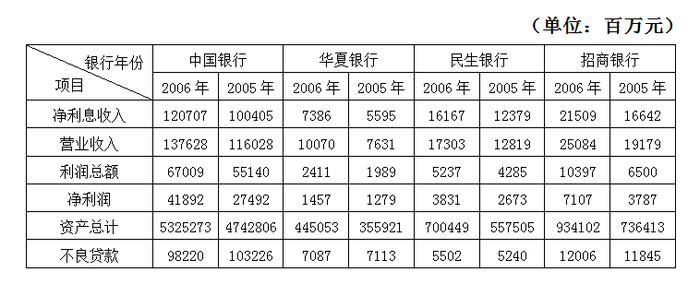

| 银行年份 项目 | 中国银行 2006年 | 中国银行 2005年 | 华夏银行 2006年 | 华夏银行 2005年 | 民生银行 2006年 | 民生银行 2005年 | 招商银行 2006年 | 招商银行 2005年 |
| --- | ---: | ---: | ---: | ---: | ---: | ---: | ---: | ---: |
| 净利息收入 | 120707 | 100405 | 7386 | 5595 | 16167 | 12379 | 21509 | 16642 |
| 营业收入 | 137628 | 116028 | 10070 | 7631 | 17303 | 12819 | 25084 | 19179 |
| 利润总额 | 67009 | 55140 | 2411 | 1989 | 5237 | 4285 | 10397 | 6500 |
| 净利润 | 41892 | 27492 | 1457 | 1279 | 3831 | 2673 | 7107 | 3787 |
| 资产总计 | 5325273 | 4742806 | 445053 | 355921 | 700449 | 557505 | 934102 | 736413 |
| 不良贷款 | 98220 | 103226 | 7087 | 7113 | 5502 | 5240 | 12006 | 11845 |

### 第 111 题

2006年，营业收入最低的银行是：

A. 中国银行

B. 华夏银行

C. 民生银行

D. 招商银行

第 111 题 · 答案与解析

**参考答案（粉笔题库参考内容）**

B

**解析**

定位表格材料可知，2006年营业收入最低的是华夏银行，为10070百万元。

故正确答案为B。

**考点**：统计表、直接找数

**来源**：2008年浙江省公务员录用考试《行测》题第111题

### 第 112 题

与2005年相比，2006年招商银行的净利润约增长了：

A. 81.37%

B. 83.28%

C. 85.16%

D. 87.67%

第 112 题 · 答案与解析

**参考答案（粉笔题库参考内容）**

D

**解析**

根据题干“······增长了”，结合选项为百分数，可判定本题为一般增长率问题。定位表格材料可知，2005、2006年招商银行的净利润分别为3787百万元、7107百万元。根据公式：增长率= (现期量 − 基期量)/基期量可得，2006年招商银行的净利润约增长了(7107-3787)/3787≈ 3320/3790≈87.6%，与D项最接近。

故正确答案为D。

**考点**：一般增长率、统计表

**来源**：2008年浙江省公务员录用考试《行测》题第112题

### 第 113 题

2005年，四个银行的净利息收入的总和约为：

A. 1350亿元

B. 1658亿元

C. 1784亿元

D. 1821亿元

第 113 题 · 答案与解析

**参考答案（粉笔题库参考内容）**

A

**解析**

定位表格材料可知，2005年四个银行净利息收入的总和为100405 + 5595 + 12379 + 16642 ≈100400 + 5600 + 12400 + 16600 = 135000百万元=1350亿元，对应A项。

故正确答案为A。

**考点**：统计表、简单加减计算

**来源**：2008年浙江省公务员录用考试《行测》题第113题

### 第 114 题

与上年相比，2006年四个银行中，“利润总额”的增长率最大的银行是：

A. 中国银行

B. 华夏银行

C. 民生银行

D. 招商银行

第 114 题 · 答案与解析

**参考答案（粉笔题库参考内容）**

D

**解析**

根据题干“······增长率最大”，可判定本题为一般增长率问题。定位表格材料可知2005、2006年各大银行的利润总额。根据公式：增长率= (现期量 − 基期量)/基期量可得，2006年各大银行利润总额增长率分别为：中国银行(67009-55140)/55140≈12/55=20^+%、华夏银行(2411 - 1989)/1989≈4/20=20%、民生银行(5237-4285)/4285≈9/43=20^+%、招商银行(10397 − 6500)/6500≈39/65=60%。故“利润总额”的增长率最大的银行是招商银行。

故正确答案为D。

**考点**：一般增长率、统计表

**来源**：2008年浙江省公务员录用考试《行测》题第114题

### 第 115 题

下列说法中，不正确的一项是：

A. 2006年中国银行的“资产总计”的同比增长率超过了10%

B. 与上年相比，2006年四个银行的“不良贷款”的总和下降了

C. 2006年，华夏银行6个项目的数据都比其他三个银行相应项目的数据小

D. 与上年相比，2006年四个银行的“利润总额”和“净利润”都增加了

第 115 题 · 答案与解析

**参考答案（粉笔题库参考内容）**

C

**解析**

A项：定位表格材料可知，2005年、2006年中国银行资产分别为4742806百万元、5325273百万元。根据增长率= (现期量 − 基期量)/基期量可得，2006年中国银行资产总计同比增长率= (5325273 - 4742806)/4742806≈6/47＞10%，正确；

B项：定位表格材料可知，2005年4个银行不良贷款的总和为103226 + 7113 + 5240 + 11845 ≈103000 + 7000 + 5000 + 12000 = 127000百万元，2006年4个银行不良贷款的总和为98220 + 7087 + 5502 + 12006 ≈98000 + 7000 + 6000 + 12000 = 123000百万元。127000＞123000，即不良贷款的总和减少了，正确；

C项：定位表格材料可知，华夏银行2006年不良贷款为7087百万元，民生银行2006年不良贷款为5502百万元，前者大于后者，错误；

D项：定位表格材料可得，四个银行2006年“利润总额”和“净利润”均比2005年大，正确。

本题为选非题，故正确答案为C。

**考点**：综合分析、统计表

**来源**：2008年浙江省公务员录用考试《行测》题第115题

## 材料 2

据2006年人口变动抽样调查，年末浙江省常住人口为4980万人，比上年增长1.67%。其中，男性人口2511.4万人，女性人口2468.6万人，分别占总人口的50.43%和49.57%。全年出生人口50.78万人，出生率为10.29‰；死亡人口26.75万人，死亡率为5.42‰。

据对全省城乡住户抽样调查，全省城镇居民人均可支配收入18265元，农村居民人均纯收入7335元，分别比上年实际增长10.9%和9.3%。城镇居民人均住房使用面积26.4平方米，比上年末增加0.3平方米；农村居民人均居住面积55.6平方米，比上年末增加0.6平方米。

全年全省参加企业养老保险人数964.4万人，比上年末增加87.6万人；企业实际缴费人数722万人，企业养老保险基金收入318.2亿元，支出192.3亿元，累计结余453.7亿元，比上年末增加125.9亿元，基金支付能力稳定上升，支付能力达26个月。参加失业保险人数504.4万人，比上年末增长13.4%；基本医疗保险参保人数730.6万人，比上年末增长14.2%；工伤保险参保人数604万人，比上年末增长33.3%。

新型社会救助体系进一步深化完善。全省已有城乡低保对象62.9万人，其中城镇8.9万人，月均补助145.5元/人；农村54万人，月均补助72.3元/人。年末全省各种收养性社会福利单位拥有床位10.69万张，收养人员7.56万人。农村“五保”集中供养率92%，城镇“三无”集中供养率98%。现有1500多个乡镇（街道）和2.7万个社区（村）建立了社会救助综合管理服务机构，分别占总数的98.6%和73.4%，社会救助工作人员3.8万名。

### 第 116 题

2006年浙江省自然增长人口为：

A. 24.03万人

B. 27.46万人

C. 29.51万人

D. 32.73万人

第 116 题 · 答案与解析

**参考答案（粉笔题库参考内容）**

A

**解析**

定位文字材料第一段可知，全年出生人口50.78万人，死亡人口26.75万人。自然增长人口=出生人口-死亡人口=50.78-26.75=24.03万人。

故正确答案为A。

**考点**：文字资料、简单加减计算

**来源**：2008年浙江省公务员录用考试《行测》题第116题

### 第 117 题

2006年全省城镇居民人均可支配收入约比上年增加了：

A. 9.3%

B. 12.2%

C. 1991元

D. 1795元

第 117 题 · 答案与解析

**参考答案（粉笔题库参考内容）**

D

**解析**

根据题干“······比上年增加了”，结合选项单位为元，可判定本题为增长量计算问题。定位文字材料第二段可知，全省城镇居民人均可支配收入18265元，比上年实际增长10.9%。选项中没有10.9%的选项，计算增长量，根据公式：增长量= 现期量/(1 + 增长率) × 增长率可得，2006年全省城镇居民人均可支配收入约比上年增加了18265/(1+10.9%) × 10.9%≈ 18265/(1 + 1/9) × 1/9=18265/10= 1826.5元，与D项最接近。

故正确答案为D。

**考点**：增长量计算、文字资料

**来源**：2008年浙江省公务员录用考试《行测》题第117题

### 第 118 题

与上年末相比，2006年末，以下四个项目人数增加最多的是：

A. 参加企业养老保险人数

B. 参加失业保险人数

C. 基本医疗保险参保人数

D. 工伤保险参保人数

第 118 题 · 答案与解析

**参考答案（粉笔题库参考内容）**

D

**解析**

根据题干“······增加最多”，可判定本题为增长量比较问题。定位文字材料第三段可知，全年全省参加企业养老保险人数比上年末增加87.6万人；参加失业保险人数504.4万人，比上年末增长13.4%；基本医疗保险参保人数730.6万人，比上年末增长14.2%；工伤保险参保人数604万人，比上年末增长33.3%。根据增长量= 现期量/(1 + 增长率) × 增长率可得，各项目参保人数增长量分别为：失业保险504.4/(1 + 13.4%) × 13.4%≈ 504.4/(1+1/7.5) × 1/7.5=504.4/8.5＜100万人，基本医疗保险730.6/(1 + 14.2%) × 14.2%≈ 730.6/(1+1/7) × 1/7= 730.6/8 ＜ 100万人，工伤保险604/(1+33.3%)×33.3%≈ 604/(1 + 1/3) × 1/3=604/4=151万人。故工伤保险参保人数增加最多。

故正确答案为D。

**考点**：增长量比较、文字资料

**来源**：2008年浙江省公务员录用考试《行测》题第118题

### 第 119 题

根据以上资料，2006年全省用于农村低保对象的补助支出约为：

A. 0.39亿元

B. 4.69亿元

C. 0.13亿元

D. 1.55亿元

第 119 题 · 答案与解析

**参考答案（粉笔题库参考内容）**

B

**解析**

根据题干“2006年全省用于农村低保对象的补助支出约为”，结合材料给出月均补助，可判定本题为现期平均数问题。定位文字材料第四段可知，全省农村低保对象54万人，月均补助72.3元/人。由年总量=平均数×人数×12个月可得，2006年全省用于农村低保对象的补助支出为54万×72.3×12＞50万×70×10=35000万元=3.5亿元，只有B项满足。

故正确答案为B。

**考点**：文字资料、现期平均数

**来源**：2008年浙江省公务员录用考试《行测》题第119题

### 第 120 题

已知2005年女性人口约占全省常住人口总数的49.3%，则2005年全省的女性人口约为：

A. 2367万人

B. 2391万人

C. 2415万人

D. 2432万人

第 120 题 · 答案与解析

**参考答案（粉笔题库参考内容）**

C

**解析**

根据题干“已知2005年女性人口约占全省常住人口总数的49.3%······”，结合材料时间为2006年，可判定本题为基期比重问题。定位文字材料第一段可知，2006年末浙江省常住人口为4980万人，比上年增长1.67%；根据题干可知道，2005年女性人口约占全省常住人口的49.3%。根据基期量=现期量/(1+增长率)可得，2005年浙江省常住人口为4980/(1 + 1.67%)≈4980/1.02≈ 4882万人，则2005年全省的女性人口约为4882 × 49.3%= 4882×(50%-0.7%)= 2441 − 30^+ ≈ 2410万人，与C项最接近。

故正确答案为C。

**考点**：文字资料、基期比重

**来源**：2008年浙江省公务员录用考试《行测》题第120题

## 材料 3

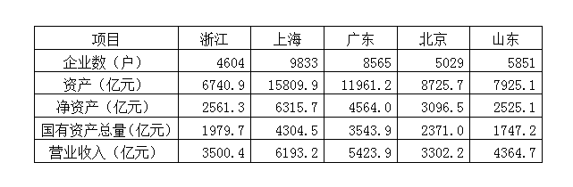

| 项目 | 浙江 | 上海 | 广东 | 北京 | 山东 |
| --- | ---: | ---: | ---: | ---: | ---: |
| 企业数（户） | 4604 | 9833 | 8565 | 5029 | 5851 |
| 资产（亿元） | 6740.9 | 15809.9 | 11961.2 | 8725.7 | 7925.1 |
| 净资产（亿元） | 2561.3 | 6315.7 | 4564.0 | 3096.5 | 2525.1 |
| 国有资产总量（亿元） | 1979.7 | 4304.5 | 3543.9 | 2371.0 | 1747.2 |
| 营业收入（亿元） | 3500.4 | 6193.2 | 5423.9 | 3302.2 | 4364.7 |

### 第 121 题

国有企业数最多的地区是：

A. 浙江

B. 上海

C. 广东

D. 山东

第 121 题 · 答案与解析

**参考答案（粉笔题库参考内容）**

B

**解析**

定位表格材料可得，国有企业数最多的地区是上海（9833户）。

故正确答案为B。

**考点**：统计表、直接找数

**来源**：2008年浙江省公务员录用考试《行测》题第121题

### 第 122 题

浙江省国有企业的“营业收入”比北京市多：

A. 158.7亿元

B. 162.4亿元

C. 173.6亿元

D. 198.2亿元

第 122 题 · 答案与解析

**参考答案（粉笔题库参考内容）**

D

**解析**

定位表格材料可知，浙江省、北京市国有企业的营业收入分别为3500.4亿元、3302.2亿元。则浙江省国有企业的“营业收入”比北京市多3500.4-3302.2。选项尾数不同，考虑尾数法，尾数4-尾数2=尾数2，对应D项。

故正确答案为D。

**考点**：统计表、简单加减计算

**来源**：2008年浙江省公务员录用考试《行测》题第122题

### 第 123 题

广东省国有企业的“国有资产总量”比山东省多：

A. 4036.1亿元

B. 3125.4亿元

C. 1796.7亿元

D. 1438.6亿元

第 123 题 · 答案与解析

**参考答案（粉笔题库参考内容）**

C

**解析**

定位表格材料可知，广东省、山东省国有企业的国有资产总量分别为3543.9亿元、1747.2亿元。则广东省国有企业的“国有资产总量”比山东省多3543.9-1747.2。选项尾数不同，考虑尾数法，尾数9-尾数2=尾数7，对应C项。

故正确答案为C。

**考点**：统计表、简单加减计算

**来源**：2008年浙江省公务员录用考试《行测》题第123题

### 第 124 题

五省市国有企业的“资产”总和为：

A. 51162.8亿元

B. 51376.4亿元

C. 51546.3亿元

D. 51760.7亿元

第 124 题 · 答案与解析

**参考答案（粉笔题库参考内容）**

A

**解析**

定位表格材料可知，五省市国有企业的资产总和为6740.9+15809.9+11961.2+8725.7+7925.1。选项尾数不同，考虑尾数法，尾数9+尾数9+尾数2+尾数7+尾数1=尾数8，对应A项。

故正确答案为A。

**考点**：统计表、简单加减计算

**来源**：2008年浙江省公务员录用考试《行测》题第124题

### 第 125 题

以下说法中，不正确的一项是：

A. 五省市中，浙江省的国有企业数最少

B. 上海市国有企业的“净资产”比浙江省和北京市两地国有企业的“净资产”总和还多

C. 山东省国有企业的“营业收入”比广东省低，比北京市高

D. 上海市国有企业的“营业收入”比浙江省的两倍还多

第 125 题 · 答案与解析

**参考答案（粉笔题库参考内容）**

D

**解析**

A项：定位表格材料可得，国有企业数最少的是浙江省（4604户），正确，排除；

B项：定位表格材料可得，浙江和北京国有企业净资产和为2561.3+3096.5＜2600+3100=5700亿元＜上海市国有企业的净资产6315.7亿元，正确，排除；

C项：定位表格材料可得，北京市国有企业营业收入3302.2亿元＜山东省国有企业营业收入4364.7亿元＜广东省国有企业营业收入5423.9亿元，正确，排除；

D项：定位表格材料可知，浙江省、上海市国有企业营业收入分别为3500.4亿元、6193.2亿元，6193.2/3500.4 ＜ 2，错误，当选。

本题为选非题，故正确答案为D。

**考点**：综合分析、统计表

**来源**：2008年浙江省公务员录用考试《行测》题第125题

## 材料 4

2003年，浙江省谷物类粮食种植面积为113.62万公顷（注：1公顷＝15亩），比上年减少22.79万公顷；谷物类粮食的总产量达700.60万吨，比上年减少141.68万吨。

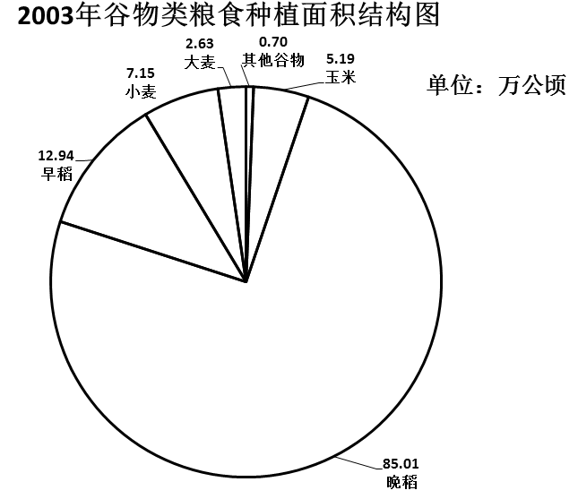

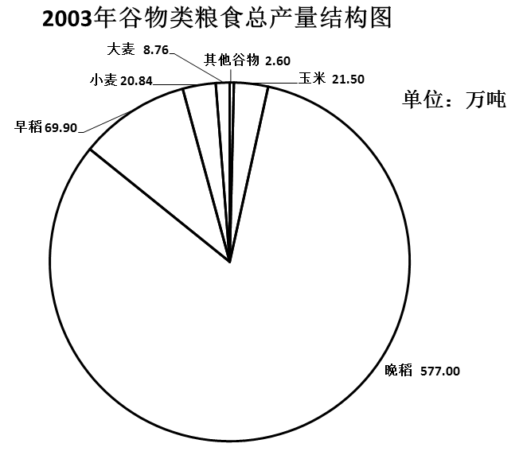

### 第 126 题

2003年浙江省谷物类粮食的总产量约比上年减少：

A. 16.82%

B. 20.22%

C. 23.27%

D. 25.35%

第 126 题 · 答案与解析

**参考答案（粉笔题库参考内容）**

A

**解析**

根据题干“······比上年减少”，结合选项均为百分数，可判定本题为一般增长率问题。定位文字材料可知，2003年浙江省谷物类粮食的总产量为700.60万吨，比上年减少141.68万吨。根据公式：增长率= 增长量/(现期量 − 增长量)可得，2003年浙江省谷物类粮食的总产量比去年减少了141.68/(700.60-(-141.68))≈ 141.68/842<20%，只有A项满足。

故正确答案为A。

**考点**：一般增长率、综合资料

**来源**：2008年浙江省公务员录用考试《行测》题第126题

### 第 127 题

2003年浙江省谷物类粮食的平均亩产量约是多少公斤？

A. 411公斤

B. 424公斤

C. 432公斤

D. 446公斤

第 127 题 · 答案与解析

**参考答案（粉笔题库参考内容）**

A

**解析**

文字资料：“2003年，浙江省谷物类粮食种植面积为113.62万公顷（注：1公顷＝15亩）”，“2003年，浙江省谷物类粮食的总产量达700.60万吨”。因此2003年，浙江省谷物类粮食种植面积为113.62×15≈114×15=1710万亩。平均亩产量为700.6 ÷ 1710 ≈ 700 ÷ 1710 ≈ 0.41吨＝410公斤，与A项最接近。

故正确答案为A。

**考点**：现期平均数、综合资料

**来源**：2008年浙江省公务员录用考试《行测》题第127题

### 第 128 题

以下粮食作物中，2003年的亩产量最高的是：

A. 早稻

B. 晚稻

C. 小麦

D. 玉米

第 128 题 · 答案与解析

**参考答案（粉笔题库参考内容）**

B

**解析**

四个选项对应的比重分别为69.9/12.94、577/85.01、20.84/7.15、21.50/5.19，量级相当，直除首位可得5、6、2、4。因此晚稻单位面积产量最高。

故正确答案为B。

**考点**：现期比重、综合资料

**来源**：2008年浙江省公务员录用考试《行测》题第128题

### 第 129 题

2003年亩产量最低的谷物类粮食的种植面积占：

A. 2.31%

B. 4.57%

C. 6.29%

D. 74.82%

第 129 题 · 答案与解析

**参考答案（粉笔题库参考内容）**

C

**解析**

由上题的计算所得，在“早稻、晚稻、小麦、玉米”中，小麦亩产量最小，再计算其他谷物和大麦的单位面积产量即可比较出最小亩产量的作物。大麦：8.76 ÷ 2.63 ≈ 8.6 ÷ 2.5 = 8.6 × 4/(2.5 × 4) ≈ 3.4，其他谷物：2.60÷0.70 ≈ 3.7，所以小麦的亩产量最低。故2003年亩产量最低的谷物粮食的种植面积约占谷物类粮食种植面积的7.15/113.62 ≈ 7/112 = 1/16 = 6.25%，与C项最接近。

故正确答案为C。

**考点**：现期比重、综合资料

**来源**：2008年浙江省公务员录用考试《行测》题第129题

### 第 130 题

以下关于2003年谷物类粮食的生产情况的说法中，不正确的一项是：

A. 晚稻的产量大于谷物类粮食总产量的五分之四

B. 产量最接近的两种粮食作物的种植总面积约为185万亩

C. “其他谷物”的种植面积和产量都是最小的

D. 大麦的亩产量不足210公斤

第 130 题 · 答案与解析

**参考答案（粉笔题库参考内容）**

D

**解析**

A项，晚稻的产量占谷物类粮食总产量的577 ÷ 700.6 ≈ 570 ÷ 700 ＞ 4/5，正确；

B项，读图，产量最接近的是小麦和玉米，它们的种植面积和为7.15+5.19=12.34万公顷＝12.34×15=185.1万亩，正确；

C项，读图可知道其他谷物的种植面积和产量都是最小的，正确；

D项，大麦单位面积产量由129题已经计算出，为3.4吨/公顷＝3400公斤/15亩≈227公斤/亩，错误。

本题为选非题，故正确答案为D。

**考点**：综合分析、综合资料

**来源**：2008年浙江省公务员录用考试《行测》题第130题

