# 2009年浙江省公务员录用考试《行测》题

<!-- gwy:overview:start -->
> **浙江 · 2009 · 行测 · 统考** ｜ 130 题 · 图片 224 处 · 答案随题折叠

| 题型模块 | 题量 | 题号 |
| --- | ---: | ---: |
| 言语理解与表达 | 30 | 1–30 |
| 数量关系 | 25 | 31–55 |
| 判断推理 | 35 | 56–90 |
| 综合基础知识 | 20 | 91–110 |
| 资料分析 | 20 | 111–130 |
| **合计** | **130** | |

导航：[题型与作答说明](#题型与作答说明) · [题目](#题目) · [材料 1](#材料-1)
<!-- gwy:overview:end -->

> 候选采集稿。参考答案及解析来自粉笔页面，不代表官方答案或真实高分答卷；来源使用许可与原卷对应关系仍需人工核实。

## 题型与作答说明

言语理解与表达

（30题）

每道题包含一段话或一个句子，后面是一个不完整的陈述，要求你从四个选项中选出一个来完成陈述。注意：答案可能是完成对所给文字主要意思的提要，也可能是满足陈述中其他方面的要求，你的选择应与所提要求最相符合。

数量关系

（25题）

本部分包括数字推理与数学运算两种类型的试题。

判断推理

（35题）

本部分包括类比推理、定义判断与逻辑判断三种类型的题目。

综合基础知识

（20题）

根据题目要求，在四个选项中选出一个正确答案。

资料分析

（20题）

针对下列文字、图或表回答问题。你应根据资料提供的信息进行分析、比较、计算、处理。

## 题目

### 第 1 题

理查德·比特纳把美国次贷危机中的借款人描述为“信用状况一塌糊涂，收入微薄，工作时有时无，没有租房史，也没有储蓄维持生活”。银行把钱贷给这样一些人显然是不可行的，政府监管也是不得力的。但美国社会为什么会有这么多穷人，或如此庞大的弱势群体？

以上文字的主旨最可能是：

A. 收入差距不断扩大是引起美国次贷危机的重要原因

B. 美国的金融危机是由银行的次贷危机引起的

C. 美国次贷危机的根源是银行把钱借给了大量没有还贷能力的穷人

D. 美国政府对借款人还贷能力的监管不够

第 1 题 · 答案与解析

**参考答案（粉笔题库参考内容）**

A

**解析**

根据提问“主旨”可知本题为中心理解题。

本段文字主要讲美国次贷危机的原因。根据最后一句的问号可知该句为重点句，即发出疑问“美国社会为什么会有这么多穷人，或如此庞大的弱势群体”，指出“美国大量弱势群体的存在”是次贷危机发生的重要原因，而该原因可引申为“收入差距扩大”，A项正确。

本段文字并不是探讨美国金融危机的根源，B项错误；通过文字并不能确定次贷危机产生的“根源”，C项错误；D项在文中只是一句过渡性的文字，不是作者要阐述的重心，D项错误。

故正确答案为A。

### 第 2 题

其实对于人生、道德、审美以及社会的解释，并无绝对正确的标准答案。每个时代、每个民族，都有提出问题的冲动以及解决问题的能力。满足这种历史需求的，便是所谓的“恰当学术”。你可以嘲笑胡适浅薄，称其提倡的实验主义颇为浅陋，甚至不如学衡派所推销的白璧德的新人文主义精细，但没用，后者就是不如前者适合那个时代中国人的趣味。

以上文字是在阐述：

A. 现实与理论的关系

B. 实验主义与新人文主义的关系

C. 时代与学术的关系

D. 人生、道德、审美与社会的关系

第 2 题 · 答案与解析

**参考答案（粉笔题库参考内容）**

C

**解析**

根据提问可知本题为中心理解题。

第一句通过“对于人生、道德、审美以及社会的解释，并无绝对正确的标准答案”，引出下文的进一步解释，即“每个时代、每个民族，都有提出问题的冲动以及解决问题的能力”，下文中的“恰当学术”是对上文中“提出问题的冲动以及解决问题的能力”的解释。最后一句为举例论证，表明学术是与不同时代的历史需求紧密相连的，即“满足这种历史需求的，便是所谓的‘恰当学术’”。

本段文字主要讲学术与时代的关系，C项当选。

A、B两项本段文字中均未涉及，故排除；D项为干扰项，第一句的作用只是引出下文，并非文章的主旨，在文章的后面并未涉及“人生、道德、审美以及社会”，故排除。

故正确答案为C。

### 第 3 题

卡尔·波兰尼说，如果听任市场机制成为人类命运及其自然环境乃至购买力的数量和用途的唯一指导者，那将导致对社会的破坏。就以商品而言，劳动力不可能被任意驱使、利用甚或舍弃而不影响刚好是这一特殊商品承担者的个人。也就是说，在处置一个人的劳动力时，制度总是面对着“人”那个称号下身体、心理和道德的统一体。

这段文字主要说明：

A. 无管制的市场会破坏社会

B. 劳动力是特殊的商品

C. 无管制的市场缺乏道德属性

D. 劳动力不能被商品化

第 3 题 · 答案与解析

**参考答案（粉笔题库参考内容）**

A

**解析**

根据提问可知本题为中心理解题。

从文字的结构来看，文段为“提出结论—解释论证”的“总—分”结构，第一句“如果听任市场机制成为人类命运及其自然环境乃至购买力的数量和用途的唯一指导者，那将导致对社会的破坏”为该段的主旨句。“市场机制成为唯一的指导”即市场处于“无管制”的状态，所以主旨句可以归纳为“无管制的市场将导致对社会的破坏”，A项当选。

B、D两项均属于文段的解释阐述部分，而非主旨，故排除；C项在文中找不到，没有依据，故排除。

故正确答案为A。

### 第 4 题

社会冲突扮演了一个激发器的角色，它激发了新规范、规则和制度的建立，从而充当了促使敌对双方社会化的代理人。此外，冲突重新肯定了潜伏着的规范，从而强化了对社会生活的参与。作为规范改进和形成的激发器，冲突使得调整已经发生变化了的社会关系成为可能。但是，社会冲突是否有利于内部适应，取决于是在什么样的问题上发生冲突，以及冲突发生的社会结构。

这段文字主要说明：

A. 社会冲突有助于社会整合

B. 社会冲突的整合功能是需要条件的

C. 社会冲突是社会化不充分的表现

D. 社会冲突是参与社会生活的方式之一

第 4 题 · 答案与解析

**参考答案（粉笔题库参考内容）**

B

**解析**

据提问可知该题为中心理解题。

文段用“但是”表达转折关系，前三句指出社会冲突扮演了一个激发器的角色，使得调整社会关系成为可能。

最后一句通过“但是”指出，社会冲突究竟是否有利于内部适应，取决于在什么样的问题上发生冲突，以及冲突发生的社会结构，这说明社会冲突的整合功能是需要条件的，故B项当选；

A项未表达出“但是”之后的意思，排除；C、D两项的说法均在题目中找不到根据，排除。

故正确答案为B。

### 第 5 题

香格里拉，本是佛陀的理想王国。其魅力在于那是一个可以贮放人类梦幻但又可望而不可及的天堂。我们既然将一种美妙的梦幻当作了实有的存在，并将神性的香格里拉变成了世俗的香格里拉，还认定了它的所在地，那么，我们就应该以藏胞对大自然那种宗教般的意志、虔诚和敬畏，殚精竭虑地去维护它的高洁与神圣。

以上文字最有可能出现在一篇散文中的哪个部分，起什么作用？

A. 文头埋下伏笔

B. 文中浓墨渲染

C. 文中扩展联想

D. 文末咏叹收笔

第 5 题 · 答案与解析

**参考答案（粉笔题库参考内容）**

D

**解析**

本题为非典型的细节判断，考查文段所在位置和作用。

通过文中的关系副词“既然”“了”“还”，可以推断出此段文字前一定围绕香格里拉展开了完整的描述，所以该文字最应该在文末。

通过“那么”“就应该”等词，可以表达作者的感情，呼应和咏叹是文章的结尾升华部分。

故正确答案为D。

### 第 6 题

不抵抗主义我向来很赞成，不过因为有些偏于消极，不敢实行。现在一想，这个见解实在是大谬。为什么？因为不抵抗主义面子上是消极，骨子里有最经济的积极。我们要办事有成效，假使不实行这主义，就不免消费精神于无用之地。我们要保存精神，在正当的地方用，就不得不在可以不必的地方节省些。这就是以消极为积极：没有消极，就没有积极。

以上文字主要告诉我们：

A. 我赞成不抵抗主义的理由

B. 不抵抗主义貌似消极，实则积极

C. 积极与消极其实只是相对意义上的哲学词汇而已

D. 要成功必须把有限的精力集中起来做最重要的事情

第 6 题 · 答案与解析

**参考答案（粉笔题库参考内容）**

B

**解析**

根据“主要告诉”一词可知本题属于中心理解题。

文段前两句提出观点：“不抵抗主义有些偏于消极”这一观点不对。然后以设问的方式用“为什么？”引出对这一观点的原因分析。本段文字是在论证不抵抗主义是积极的还是消极的，从“我们要办事有成效······就不得不在可以不必的地方节省些”可以看出，不抵抗主义是积极的，B项当选。

A项，作者没有一开始就赞成不抵抗主义，而是进行了反复的论证，最后得出“不抵抗主义实际上就是积极”的结论，表述错误，排除；C项，作者没有谈到二者的相对意义，也不涉及哲学词汇，无中生有，排除；D项，选项所述是文段世界观指导下的方法论，文中没有提及方法论的层面，属于过度引申，排除。

故正确答案为B。

### 第 7 题

“全球化”是一种非线性的、辩证的过程，在这一过程中，全球的与地方的不再是作为文化的两极而存在，而是作为并联在一起的、相互关联的原则而存在。这些过程不仅仅包括跨边界的相互联系，而且还要将内在于民族国家社会的社会与政治属性加以转化。这就是我所界定的“世界化”。

这段文字表达的主要观点是：

A. “全球化”是一种非线性的、辩证的过程

B. 世界化意味着内在的全球化，意味着发自民族国家社会内部的全球化

C. “全球化”过程中的世界的和地方的文化是相互关联的

D. 世界化包括跨边界的联系和民族国家内部的联系

第 7 题 · 答案与解析

**参考答案（粉笔题库参考内容）**

B

**解析**

根据“主要观点”一词可知本题为中心理解题。

本段文字主要是作者关于“世界化”的界定，首句用“全球化”来引出下文中对“世界化”的阐述。文中的“不仅仅······而且还······”表明了作者的观点，世界化意味着发自民族国家社会内部的全球化，B项当选。

A、C两项未抓住本段的主体词“世界化”，排除；D为强干扰项，“世界化包括跨边界的相互联系”是文中的原话，没有问题，D项可以根据这句话排除，即“这些过程不仅仅包括跨边界的相互联系，而且还要将内在于民族国家社会的社会与政治属性加以转化”。

故正确答案为B。

### 第 8 题

在一个成熟的经济政策制定和经济学教育体系中，经济学理论必须更面对现实，经济政策也必须以理论逻辑为依归。但是，这种理论与现实的结合应该靠学科疆域的拓展和理论的进步，靠科学的学科分工和职业定位，而不是靠个人的能力或者角色转变。

对这段文字理解不正确的是：

A. 经济学理论不面对现实，就不能制定出积极的经济政策

B. 作为经济学理论和现实相结合的经济政策不能根据经济学家的角色而制定

C. 经济学理论和现实的结合要以学科疆域的拓展和理论的进步为基础

D. 能否制定出合理的经济政策要看经济学家的能力如何

第 8 题 · 答案与解析

**参考答案（粉笔题库参考内容）**

D

**解析**

本题属于细节判断题。

该段文字两句话共表达了两层含义：①经济学理论和经济政策的相互依存关系；②经济学理论与现实的结合应该靠学科疆域的拓展和理论的进步，靠科学分工和职业定位，而不能靠个人能力或角色转变。很显然D项与第二层意思冲突，“经济学家的能力”只是个人的能力，当选。

A项可以从“经济学理论必须更面对现实”得出，排除；B项为“这种理论与现实的结合应该靠学科疆域的拓展和理论的进步······不是靠个人的能力或者角色转变”的具体阐述，排除；C项为文段中的原话，排除。

本题为选非题，故正确答案为D。

### 第 9 题

人类是一种文化动物。人类的行为不仅被先天的生物本能所决定，而且也受到后天的文化和社会等诸多因素的影响。爱美之心，人皆有之。然而，任何美妙的东西背后，都有并不美好的本质或起源，不管你是否能意识到。美丽往往是谎言，而实话往往很难听。浏览网页，你可能被华丽的页面吸引。如果从浏览器的菜单中查看源代码，你会发现一堆乱七八糟的东西，对你来说，没有任何意义。

这段文字表达的主要意思是：

A. 人类的行为受到后天的文化和社会等诸多因素的影响

B. 人类是一种文化动物

C. 任何美妙的东西背后，都有并不美好的本质或起源

D. 美丽往往是谎言，而实话往往很难听

第 9 题 · 答案与解析

**参考答案（粉笔题库参考内容）**

C

**解析**

文段首先引出话题，指出人的行为受先天和后天因素的影响，爱美之心，人皆有之。接着通过转折词“然而”指出，任何美妙的东西背后，都有并不美好的本质或起源。后文以美丽的谎言和网页为例进行举例论证，故文段重点强调任何美妙的东西背后，都有并不美好的本质或起源，对应C项。

A、B两项，均为转折前的内容，非重点，排除；

D项，为举例论证的内容，非重点，排除。

故正确答案为C。

### 第 10 题

赶路的人，为了远方的目标，无意留心沿路的风光。许多其实并不比你追寻的东西逊色的路边风景，被你轻易地忽略过去了，待我们多年后明白过来时，已追悔莫及。而当你把赶路的心态转换成散步的心态，你就会发觉，得到有味，失去也有味；富有有味，清贫也自有味；成功有味，失败也有味；热恋有味，失恋也有味；青春有味，衰老也有味······这时候，你才会恍然明白，你梦想中的东西其实就藏在路上，路途上的遭遇正有你所寻觅的东西。舍此之外，你还要寻求什么呢？

对这段文字理解错误的一项是：

A. 赶路的人是指那些为成功而舍弃沿途风景的人

B. 我们不应该为远方的目标而苦苦追寻

C. 也许梦想就藏在你匆匆赶路时的沿途风景中

D. 给人生留一些空闲的时间，而不是匆匆赶路

第 10 题 · 答案与解析

**参考答案（粉笔题库参考内容）**

B

**解析**

根据提问可知本题为细节判断题。

本段文字的意思是不能为了远方的目标而忽略沿路的风景，但并非不应该为目标而努力，远方目标和沿路风景并不是完全对立的。因此B项说法错误，当选；

A项为“赶路的人，为了远方的目标，无意留心沿路的风光”的同义转换，排除；C项为“你才会恍然明白，你梦想中的东西其实就藏在路上，路途上的遭遇正有你所寻觅的东西”的同义转换，排除；从文中建议“把赶路的心态转换成散步的心态”可以看出，“要给人生留一些空闲的时间”，所以D项说法正确，排除。

本题为选非题，故正确答案为B。

### 第 11 题

官员这种人从早到晚都在解决有答案的问题，头脑已经被训练成这样，因此不是当政治人物的料。政治人物的任务是处理没有答案的问题，去应付很有可能无解的问题。然而，一个人越是被训练成优异的官员，就越以为问题都是有答案的，一定可以解决，因此一遇到可能无解的问题就束手无策，甚至拍拍屁股一走了之。所以，一个人越是被训练成官员，就越会变成不称职的政治人物。

对这段文字的主旨概括最准确的一项：

A. 一个优异的官员总以为问题都是有答案的

B. 政治人物的任务是处理没有答案的问题

C. 不是所有的官员都能成为政治人物

D. 最优异的官员是差劲的政治人物

第 11 题 · 答案与解析

**参考答案（粉笔题库参考内容）**

C

**解析**

文段开篇通过“因此”指出官员不是当政治人物的料，并进行解释说明。随后通过转折关联词“然而”指出，训练得很优异的官员，遇到问题可能束手无策。然后用“所以”得出结论“一个人越是被训练成官员，就越会变成不称职的政治人物”，即“被训练成解决有答案的问题的官员无法成为真正优秀的政治人物”，换言之，并非所有的官员都能成为政治人物，对应C项。

A项，“一个优异的官员总以为问题都是有答案的”对应“所以”之前的内容，非重点，排除；
B项，“政治人物的任务是处理没有答案的问题”对应“然而”转折之前的内容，非重点，排除；

D项，表述过于绝对，文段指出“优异的官员”可能会变成“不称职的政治人物”，并非一定“是”，排除。
故正确答案为C。

### 第 12 题

建筑同样是有生命，有它的生命史。它不仅发生、成长，而且会成熟、转换、兴亡。生命是灵动的，建筑也同样是灵动的，是一个活体，所以它才倾注有那么多人类的情感。情感是生命的确证。生命需要空间，建筑与空间更是无法割裂，空间是它生命的舞台。同样，生命拥有历史，建筑也是活在时间中的，离开了时空，无论生命还是建筑都不存在了。但托庇于时空，生命与建筑却可以超越出来，进入无限与永恒——而这，正是建筑美学所追求的。

对以上文字在原文中的作用推测最准确的一项是：

A. 这段文字旨在论证建筑生命史

B. 这段文字作为后文阐述建筑美学的引子

C. 为接下来介绍建筑美学的历史渊源埋下伏笔

D. 对前文关于建筑美学的论述进行总结

第 12 题 · 答案与解析

**参考答案（粉笔题库参考内容）**

B

**解析**

本题考查对段落的理解。

本段前面讲“建筑是具有生命的”，并用“建筑与生命的很多共性”来进行论证，最后得出，建筑与生命一样追求的是“无限与永恒”，而这正是建筑美学的追求。

破折号引出重心，即建筑美学，下文必定会围绕建筑美学展开阐述，B项表述正确，当选。

根据本段文字各句之间的联系，表明了作者的写作重心在建筑美学，A项不符合题意，排除；本段文字显然不是一段总结性的文字，D项不符合题意，排除；引出主题后要围绕主题展开写作，但内容并不能判断出一定是建筑美学的历史渊源，因此排除C项。

故正确答案为B。

### 第 13 题

下列句子中，划线的成语使用恰当的一项是：

A. 面对金融危机，某市政府为当地的出口企业制定了许多扶持政策，大量企业在国际竞争中脱颖而出。

B. 如果你没有亲身参加过蹦极运动，那么它给人带来的巨大刺激你是无法感同身受的。

C. 易中天《品三国》一书出版后，受到许多读者的热烈欢迎，一时洛阳纸贵。

D. 考虑问题时没有大局意识，目无全牛，顾此失彼，这就是他决策失误的重要原因。

第 13 题 · 答案与解析

**参考答案（粉笔题库参考内容）**

C

**解析**

本题考查成语的使用。

C项中“洛阳纸贵”形容著作广泛流传，风行一时，用来形容《品三国》受欢迎之热烈程度很合适，符合本句语境；

A项中“脱颖而出”形容本领全部显露出来，也指工作时，通过努力超人一等，多用来指人，句中用来指“企业”不合适；B项中“感同身受”指虽未亲身经历，但感受就同亲身经历过一样，也泛指给别人带来麻烦，自己也能亲身感受到，多用来形容心情，“刺激”无法感同身受；D项中“目无全牛”比喻技术娴熟到了得心应手的境地，易误作缺乏整体观念。

故正确答案为C。

### 第 14 题

下列各句中，句意明确，没有语病的一句是：

A. 学校运动会将在下月中旬前后举行，所以我现在要好好准备了。

B. 已经推出并投入使用的杭州“市民卡”，除了包含“社保卡”所具有的医疗、养老保险功能外，还可享受其他各类公共服务。

C. 广大公务员，尤其是领导干部，想问题、办事情都要从党和人民的根本利益为出发点。

D. 复原后的距今100万年前的“郧县人”是一个额头低平、眉弓粗壮、眼窝深凹而宽、鼻短而上扬、吻部突出、唇长而薄的远古人形象。

第 14 题 · 答案与解析

**参考答案（粉笔题库参考内容）**

D

**解析**

此题考查病句辨析的能力。

A项中“下月中旬前后”词语范围模糊重复，排除；B项属于偷换主语，前半句主语为“市民卡”，后半句“还可享受其他各类公共服务”的主语则变为“市民”，排除；C项属于搭配不当，应改为“从党和人民的根本利益出发”或“以党和人民的根本利益为出发点”，排除。

故正确答案为D。

### 第 15 题

黄昏后，你穿过（ ）的树影，踏着铺石板小径，进入这家老店。在后院的葡萄架下，寻一个好座位。长条的木板桌椅都漆成淡绿色，带着此地农舍由来已久的风格。挂在葡萄藤上的旧式风灯，将密密实实的巴掌似的葡萄叶照得（ ） ，饶有画意。

填入括号内最恰当的一项是：

A. 斑斑驳驳 深深浅浅

B. 重重叠叠 深深浅浅

C. 斑斑驳驳 零零碎碎

D. 重重叠叠 零零碎碎

第 15 题 · 答案与解析

**参考答案（粉笔题库参考内容）**

B

**解析**

本题考查实词形象色彩的辨析与填空。

第二空，“深深浅浅”体现的是层次感，而“零零碎碎”表现的是一种细碎。由“挂在葡萄藤上的旧式风灯”以及“将······照得······”可知是表现葡萄叶在光线的照射下呈现出的样子，在光照下物体会有明暗深浅的不同，光照不能使物体变得零零碎碎，所以应选“深深浅浅”。

第一空，“斑斑驳驳”是强调的是不同颜色的掺杂，或颜色深浅不一；“重重叠叠”给人的直观感觉则是立体性的，体现的是一种错落有致的层次感。由“密密实实的巴掌似的葡萄叶”可知葡萄叶多而密，所以第一空应选“重重叠叠”。

故正确答案为B。

### 第 16 题

在中国古代，凭吊古迹是文人一生中的一件大事，在历史和地理的交错中，（ ）般的生命感悟甚至会使一个人脱胎换骨。那应是黄昏时分吧，离开广武山之后，阮籍的木车在（ ）间越走越慢，这次他不哭了，但仍有一种沉郁的气流涌向喉头，涌向口腔，他长长一吐，音调浑厚而悠扬。

填入括号内最恰当的一项是：

A. 闪电 夕阳衰草

B. 雷击 夕阳衰草

C. 闪电 长亭古道

D. 雷击 长亭古道

第 16 题 · 答案与解析

**参考答案（粉笔题库参考内容）**

B

**解析**

本题考查实词填空。

第一空，“闪电”有形容速度快、突然之意，“雷击”有形容强度大、彻底之意。根据下文中的“脱胎换骨”可知强调的是变化强度大，故用“雷击”。

第二空，阮籍驾车行走，不太可能是“长亭古道”，且“夕阳衰草”与“黄昏时分”相对应，更能营造出悲凉沉郁的氛围，放在语境中更合适。

故正确答案为B。

### 第 17 题

老庄固古今天下第一等聪明人，《道德经》五千言亦世界第一等聪明哲学。然聪明至此，已近老猾巨奸之哲学，不为天下先，则永远打不倒，盖老猾巨奸之哲学无疑。盖中国人之聪明达到极顶处，转而见出（ ），乃退而守愚藏拙以全其身。又因聪明绝顶，看破一切，知“为”与“不为”无别，与其（ ），何如不为以养吾生。

填入括号内最恰当的一项是：

A. 强弩之末 为而无效

B. 强弩之末 苦心孤诣

C. 聪明之害 苦心孤诣

D. 聪明之害 为而无效

第 17 题 · 答案与解析

**参考答案（粉笔题库参考内容）**

D

**解析**

本题考查成语的辨析填空。

第一空，“强弩之末”比喻很强的力量已经微弱，从文中“聪明达到极顶处”“退而守愚藏拙”可知，并非是聪明达到极顶处就不再聪明，因而不宜用“强弩之末”，该情形是由于过于聪明造成的，故“聪明之害”符合文意。

第二空，对应前后句，前句“为”与“不为”无别，后句为“不为以养吾生”，根据对应关系，第二空应该填入关于“为”的词语，故选“为而无效”。

故正确答案为D。

### 第 18 题

从鸦片战争到甲午战败，这个“数千年未有之大变局”的酿成乃是中国农耕文明（ ）与西方工业文明（ ）的双重结果。

填入括号内最恰当的一项是：

A. 式微 侵凌

B. 消亡 侵略

C. 衰落 熏陶

D. 变革 影响

第 18 题 · 答案与解析

**参考答案（粉笔题库参考内容）**

A

**解析**

本题考查近义实词的辨析填空，难度较大。

第二空，根据短时间内发生了“数千年未有之大变局”，显然不可能是“熏陶”“影响”这些渐进复杂化的结果，且“鸦片战争”和“甲午海战”都有外国的侵略性，所以不能说“熏陶”和“影响”，故排除C、D两项。

第一空，在A、B两项中选择，“中国农耕文明”显然并没有“消亡”，“式微”原指天将黄昏，现指事物由兴盛而衰落，用在此处合适，故排除B项。

故正确答案为A。

### 第 19 题

中国人的历史知识，多半儿是从“讲史”中得来，有本事、有耐心抱着二十四史读下来的，（ ）。

填入括号内最恰当的一项是：

A. 寥若晨星

B. 历历可数

C. 孤鸾寡鹤

D. 光前绝后

第 19 题 · 答案与解析

**参考答案（粉笔题库参考内容）**

A

**解析**

本题主要考查近义成语的辨析填空。

根据语意，“讲史”与“二十四史”相比，前者读的人比较多，而要读完后者需要“有本事、有耐心”，读完的人不会很多，易得知括号内的词语应为形容数量少的成语。

A项“寥若晨星”意思是稀少得好像早晨的星星，指为数极少，用在此处合适；

B项“历历可数”指可以清楚地一个个或一件件数出来，一般适用于物，用来指人不合适；C项“孤鸾寡鹤”指失去配偶的男子或女子，不合语意；D项“光前绝后”比喻事情做得干净利落，不留痕迹，不合语意。

故正确答案为A。

### 第 20 题

在《士兵突击》这个没有坏人的世界和极端（ ）的情景中，人与人之间的冲突却那么热烈、那么戏剧性，它把观众卷入其中并（ ）他们沉睡的正义感、神圣性，通过理想化的存在体验催生道德的价值观念。

填入括号内最恰当的一项是：

A. 纯净 诱导

B. 纯粹 诱发

C. 干净 诱导

D. 纯洁 诱发

第 20 题 · 答案与解析

**参考答案（粉笔题库参考内容）**

B

**解析**

本题考查近义实词的辨析填空。

第二空，“诱导”指劝诱引导，“诱发”指诱导启发，“诱导”的宾语一般为从句，“诱发”的宾语一般为名词，且“诱发”更能体现出观众“正义感”“神圣性”被激发的自主性和自觉性，故选“诱发”，排除A、C两项，在B、D两项中进行选择。

第一空，“纯洁”意为干净利索，“纯粹”指纯而单一、不复杂，根据转折词“却”可知第一个括号与“热烈、戏剧性”构成相反语意关系，强调的是单一、不复杂、不多变，所以选择“纯粹”。

故正确答案为B。

### 第 21 题

简洁精辟、意义完整、结构定型的成语被滥用谐音篡改得面目全非；任意生造的各种时髦语言花样别出，让人摸不着头脑；错字、别字屡屡见诸书籍、报刊和电视······此种情形令人（ ）。

填入括号部分最恰当的一项是：

A. 悚然

B. 惘然

C. 悻然

D. 愕然

第 21 题 · 答案与解析

**参考答案（粉笔题库参考内容）**

D

**解析**

本题考查近义实词的辨析填空。

根据语境，括号内的词语应为作者对上面描述的各种情形的态度，从作者的用语“面目全非”“任意生造”等可知作者对这些情况的发生很吃惊，是作者没有预料到的。D项“愕然”形容吃惊的样子，符合文意，当选。

A项“悚然”指害怕的样子，B项“惘然”指失意的样子，C项“悻然”指怨恨愤怒的样子，均不符合文意，排除。

故正确答案为D。

### 第 22 题

一个思想家或艺术家，没有比把作品写到生命上更令人（ ）。本雅明是这种人如其文的思想家，文字与生命贯彻着忧郁的气质。忧郁性格的人，建立的同时永远潜藏一股自我毁灭力，以否定来肯定一如从忧郁撷取力量。

填入括号部分最恰当的一项是：

A. 惊心动魄

B. 动人心魄

C. 胆战心惊

D. 触目惊心

第 22 题 · 答案与解析

**参考答案（粉笔题库参考内容）**

A

**解析**

本题考查成语的辨析填空。

括号内的词语用来形容“把作品写到生命上”带给人的感受。

A项“惊心动魄”形容使人感受很深，触动很大，用在此处合适，突出了“文字与生命结合”所带给读者心灵上的触动，当选；

B项“动人心魄”指激动人心，非常动人，此处不能说“令人动人心魄”，排除；C项“胆战心惊”形容十分害怕，D项“触目惊心”指看见某种严重情况而内心震惊，形容事态严重，引起轰动，二者均有害怕之意，用在文段中显然不合适，排除。

故正确答案为A。

### 第 23 题

社会生活的变化多样，使得任何一种规则体系都不能够不加变化地（ ）；反过来，文明社会的错综复杂，也不能仅靠抽象原则与模糊观念来（ ）。

填入括号部分最恰当的一项是：

A. 实施 维护

B. 调适 继续

C. 应用 维持

D. 适用 维系

第 23 题 · 答案与解析

**参考答案（粉笔题库参考内容）**

D

**解析**

本题考查近义实词的辨析填空。

第一空，应选“适用”，即适合使用，任何一种规则体系都需要加以变化才适合使用。A项“实施”主要用于具体措施，而不是“体系”，B项“调适”指调整使适应，与文段的“不能够不加变化”有所重复，排除A、B两项。

第二空，“维系”意为维持并联系，使不涣散，与“社会的错综复杂”搭配更合适。C项“维持”指继续存在下去，与“维系”相比少了“联系”之意，未能体现出“错综复杂社会”的维持之难，排除。

故正确答案为D。

### 第 24 题

文明的发展就像一场梦，虽然醒来觉得（ ），而（ ）时是认真而严肃的。用精神分析的方法剥去梦的果实，留下梦的种子——本能的种子，就是宗教的起源。

填入括号部分最恰当的一项是：

A. 神乎其神 身临其境

B. 不可思议 身临其境

C. 神乎其神 引人入胜

D. 不可思议 引人入胜

第 24 题 · 答案与解析

**参考答案（粉笔题库参考内容）**

B

**解析**

本题考查成语的辨析填空。

第一空，“神乎其神”指神秘奇妙到了极点，形容非常奇妙神秘；“不可思议”指不可想象，难以理解，含有神秘奥妙之意。两者相比，“不可思议”更适合用来形容梦境，且体现了梦境与现实的对照之意，第一空用“不可思议”，排除A、C两项。

第二空，“引人入胜”指引人进入佳境，现多用来指风景或文艺作品特别吸引人，用在此处不合适；“身临其境”指亲自到了那个境地，这里指人对梦的感觉，是“人进入到了梦境中”，与前面“醒来”形成对照，所以选“身临其境”。

故正确答案为B。

### 第 25 题

真正友谊的产物，只是一种（ ）了你身心的愉快。没有这种愉快，随你如何直谅多闻，也不会有友谊。接触着你真正的朋友，感觉到这种愉快，你内心的鄙吝残忍，自然会消失，无需说教式的（ ）。

填入括号部分最恰当的一项是：

A. 贯穿 指导

B. 贯穿 劝说

C. 渗透 诱导

D. 渗透 劝导

第 25 题 · 答案与解析

**参考答案（粉笔题库参考内容）**

D

**解析**

本题考查近义实词的语境填空。

第一空，“贯穿”指穿过、连通，与人的“身心”搭配不当。“渗透”体现了“真正的友谊”所带来的内心感触，使人愉快，所以选“渗透”，排除A、B两项。

第二空，“劝导”意为规劝开导，与前面的“说教式”相对应，符合语境。“诱导”指劝诱教导、引导，一般为采用某种方式来引导，而不是直接的引导。根据前文的“说教式”可知语境为直接的“劝导”而非间接的“诱导”，所以选“劝导”。

故正确答案为D。

### 第 26 题

那时候，老是慎重其事地把左掌右掌看了又看，或者，从一条曲曲折折的感情线，估计着感情的河道是否（ ）。有时，又正经地把一张脸交给一个人，从鼻山眼水中，去（ ）一生的风光。

填入括号部分最恰当的一项是：

A. 决堤 窥探

B. 崩溃 领略

C. 崩溃 窥视

D. 决堤 预测

第 26 题 · 答案与解析

**参考答案（粉笔题库参考内容）**

A

**解析**

本题考查实词的辨析填空。

第一空，与河道搭配的谓语应为“决堤”，“崩溃”常指政治、经济、军事等或人的精神，故第一空填“决堤”，排除B、C两项。

第二空，“预测”指预先测定或推测，从语境中可以看出，“一生的风光”是从一个人的脸上观察所得到的，即这个人已经经历过的“风光”，而不是预测未来的“风光”，排除D项；“窥探”指观察探索，有深入挖掘之意，且与“风光”搭配合适，A项符合文意，当选。

故正确答案为A。

### 第 27 题

不可以想象，没有以学术作为内容的思想，将成为怎样一种思想，而没有思想的学术，这种学术还有什么价值？思想和学术它们之间没有“不是东风压倒西风，便是西风压倒东风”那种（ ）的关系。
填入括号部分最恰当的一项是：

A. 非此即彼

B. 针锋相对

C. 势不两立

D. 此消彼长

第 27 题 · 答案与解析

**参考答案（粉笔题库参考内容）**

C

**解析**

本题考查成语的辨析填空。

括号处前边的语境“不是东风压倒西风，便是西风压倒东风”是对括号处的解释说明：学术与思想相互对立，且只能有一个存在。C项“势不两立”指两种事物不能同时存在，互相敌对，与前文表述一致，当选。

A项“非此即彼”中“非”指不是，“此”指这个，“即”指便是，“彼”指那个，指在两者之间必取其一的选择，并没有体现两者不能共存的关系，不符合文意，排除； B项，“针锋相对”指双方意见、观点尖锐对立，也比喻在斗争中对准对方的言论采取相应的措施，没有体现出二者不能共存的意思，不符合文意，排除；D项“此消彼长”意为我方削弱了，相对比起来，就会感觉对方的力量增长了，也没体现二者的对立关系，排除。

故正确答案为C。

### 第 28 题

司马迁心胸开阔，不带成见，是个严格的史学家，而不是儒教的提倡者，在议题上他采取（ ）的态度。他极度崇敬孔子，但他不是个（ ）的孔门信徒。他所描绘的孔子是个人，而不是个圣人。
填入括号部分最恰当的一项是：

A. 客观 虔诚

B. 开放 盲从

C. 中立 狭隘

D. 宽容 狂热

第 28 题 · 答案与解析

**参考答案（粉笔题库参考内容）**

C

**解析**

第一空，根据前文“心胸开阔，不带成见”可知，司马迁在写史时不偏不倚，忠于史实的态度，故“客观”或“中立”比较合适，排除B、D两项。

第二空，根据前文“他极度崇敬孔子，但······”，可知A项“虔诚”和文意相反，排除。C项“狭隘”指心胸、气量、见识等狭小，代入文段表达作者的认识比较宽广，不局限在一定范围内，对应后文“他所描绘的孔子是个人，而不是个圣人”，符合文意，当选。

故正确答案为C。

### 第 29 题

俄国的两位大作家，都情不自禁地对莎士比亚表达了自己的看法。屠格涅夫借批评《哈姆雷特》，对莎剧（ ），他的态度倒还像个绅士，总的来说还算温和。托尔斯泰就比较厉害，他对莎士比亚进行了最猛烈的攻击，口诛笔伐，几乎把伟大的莎士比亚说得（ ）。

填入括号部分最恰当的一项是：

A. 不屑一顾 一无是处

B. 颇有微词 一无是处

C. 心怀不敬 体无完肤

D. 嗤之以鼻 一塌糊涂

第 29 题 · 答案与解析

**参考答案（粉笔题库参考内容）**

B

**解析**

本题考查成语的语境填空。

第一空，根据下文可知屠格涅夫的态度比较温和。“不屑一顾”指认为不值得一看，形容极端轻视；“嗤之以鼻”指用鼻子吭声冷笑，表示轻蔑。二者态度都过于不温和，故排除A、D两项。“心怀不敬”指心里对某人不恭敬。但是文段已经指出，屠格涅夫借批评作品里的人物批评了莎士比亚的巨作，因此已经不仅是心里的不敬，而且已经表露出来了，故排除C项。“颇有微词”意为对某人或某事不很满意，有不少隐晦地批评。这正是屠格涅夫对莎士比亚的态度，所以第一空选“颇有微词”。

第二空，托尔斯泰态度非常鲜明地对莎士比亚进行抨击，认为其“一无是处”，意为没有一点儿对的或好的地方，故B项当选。“体无完肤”指全身的皮肤没有一块好的，形容遍体都是伤；也比喻理由全部被驳倒，或被批评、责骂得很厉害。“一塌糊涂”形容混乱或败坏到了不可收拾的程度。

故正确答案为B。

### 第 30 题

张恨水《春明外史》里的杨杏园是（ ）在传统与现代之间的一个轻度的精神分裂者，他白天的身份是（ ）于北京大街小巷的现代记者，晚上则是安居租赁而来的小四合院的古典诗人。

填入括号部分最恰当的一项是：

A. 踌躇 游走

B. 彷徨 奔走

C. 犹疑 奔跑

D. 徘徊 穿梭

第 30 题 · 答案与解析

**参考答案（粉笔题库参考内容）**

D

**解析**

第一空，根据“传统与现代之间的一个轻度的精神分裂者”可知，括号处表示杨杏园在传统与现代之间来回变化，D项“徘徊”指在一个地方来回地走，比喻事物在某一个范围内来回浮动、起伏，保留。A项“踌躇”指犹豫不决，拿不定主意，B项“彷徨”指犹豫不决，且没有方向，C项“犹疑”指犹豫，三项均强调“犹豫”，未体现“在两者之间来回变动”的动态感，与文意不符，排除。

第二空，代入验证，D项“穿梭”指像织布的梭子来回活动，形容来往频繁，对应文段中杨杏园作为记者出入各大街小巷，当选。

故正确答案为D。

### 第 31 题

0，16，8，12，10，（ ）

A. 11

B. 13

C. 14

D. 18

第 31 题 · 答案与解析

**参考答案（粉笔题库参考内容）**

A

**解析**

方法一：题干数列数值较小，无明显特征，优先考虑作差。后项减前项得新数列：16、-8、4、-2、（ ），新数列是公比为-1/2的等比数列，下一项为。因此所求项为10+1=11。

方法二：题干数列无单调性，无明显特征，考虑递推数列。观察数列可知，， ， ，规律为：。因此所求项。

故正确答案为A。

### 第 32 题

64，2，27，（ ），8，√2，1，1

A. 2√5

B. √5

C. √2

D. √3

第 32 题 · 答案与解析

**参考答案（粉笔题库参考内容）**

D

**解析**

题干数列加上所求项有8项，项数多，优先考虑多重数列，先考虑分组。奇数项：64、27、8、1，为立方数列；偶数项：2、（ ）、√2、1，有特殊符号根号，把数据统一整理到根号下，偶数项可化为：√4、（ ）、√2、√1，根号下数列是公差为-1的等差数列，故所求项为√3。

故正确答案为D。

### 第 33 题

7， 15， 29， 59， 117， （ ）

A. 227

B. 235

C. 241

D. 243

第 33 题 · 答案与解析

**参考答案（粉笔题库参考内容）**

B

**解析**

方法一：题干数列单调递增，无明显特征，作差无规律，考虑作和。相邻两项相加后得新数列：22、44、88、176、（ ），是公比为2的等比数列，下一项为。因此所求项为352-117=235。

方法二：题干数列相邻项约有2倍关系，考虑倍数之间的递推关系。，，，，规律为：，修正项为+1、-1周期循环。因此所求项为。

故正确答案为B。

### 第 34 题

31，29，23，（ ），17，13，11

A. 21

B. 20

C. 19

D. 18

第 34 题 · 答案与解析

**参考答案（粉笔题库参考内容）**

C

**解析**

原数列本身为质数数列的反向排列，括号内应该为19。

故正确答案为C。

### 第 35 题

22，36，40，56，68，（ ）

A. 84

B. 86

C. 90

D. 92

第 35 题 · 答案与解析

**参考答案（粉笔题库参考内容）**

C

**解析**

题干数列单调递增，无明显特征，作差作和后亦无规律，考虑递推。观察数列发现：、、，规律为：，因此所求项为。

故正确答案为C。

### 第 36 题

4，10，30，105，420，（ ）

A. 956

B. 125

C. 1684

D. 1890

第 36 题 · 答案与解析

**参考答案（粉笔题库参考内容）**

D

**解析**

题干数列倍数关系明显，优先考虑作商。后项除以前项得新数列：2.5、3、3.5、4、（ ），是公差为0.5的等差数列，下一项为4+0.5=4.5。因此所求项为。

故正确答案为D。

### 第 37 题

21，27，40，61，94，148，（ ）

A. 239

B. 242

C. 246

D. 252

第 37 题 · 答案与解析

**参考答案（粉笔题库参考内容）**

A

**解析**

题干数列单调递增，无明显特征，优先考虑作差。后项减前项得到新数列①：6、13、21、33、54、（ ），无明显特征，后项减前项得新数列②：7、8、12、21、（ ），依然无明显特征，再次用后项减前项得新数列③：1、4、9、（16），即1^2、2^2、3^2、（4^2），底数是公差为1的等差数列。因此所求项为16+21+54+148=239。

故正确答案为A。

### 第 38 题

1，3，11，67，629，（ ）

A. 2350

B. 3130

C. 4783

D. 7781

第 38 题 · 答案与解析

**参考答案（粉笔题库参考内容）**

D

**解析**

题干数列都是幂次周围的数，优先考虑幂次数列。原数列可整理为：1^0+0、2^1+1、3^2+2、4^3+3、5^4+4、（ ），底数、指数和修正项都是公差为1的等差数列。所求项底数为5+1=6，指数为4+1=5，修正项为4+1=5，即。

故正确答案为D。

### 第 39 题

2/3，1/4，2/15，1/12，2/35，()

A. 1/32

B. 2/32

C. 1/24

D. 5/86

第 39 题 · 答案与解析

**参考答案（粉笔题库参考内容）**

C

**解析**

题干和选项都是分数，本题为分数数列。分子、分母组成的数列不单调，通过反向约分，原数列可整理为：2/3、2/8、2/15、2/24、2/35、（ ），分子是常数列2，则所求项分子为2。分母组成的数列无明显特征，优先作差，后项减前项得新数列：5、7、9、11、（ ），是公差为2的等差数列，下一项是11+2=13，因此所求项分母为13+35=48。所求项为。

故正确答案为C。

### 第 40 题

3，8，17，32，57，（ ）

A. 96

B. 100

C. 108

D. 115

第 40 题 · 答案与解析

**参考答案（粉笔题库参考内容）**

B

**解析**

题干数列单调递增，无明显特征，作和作差亦无规律，考虑递推。相邻两项约有2倍关系，考虑倍数递推。、、、，规律为：，修正项数列为：2、1、-2，-7，（ ），前项减后项得：-1、-3、-5、（-7），是公差为-2的等差数列，因此所求项的修正项为-7+(-7)=-14。所求项为。

故正确答案为B。

### 第 41 题

已知两个数a、b的积是3/4，和是2，且a>b，则a/b的值是：

A. 3

B. 7/2

C. 4

D. 9/2

第 41 题 · 答案与解析

**参考答案（粉笔题库参考内容）**

A

**解析**

根据题意可得：······①，a+b=2······②，将②带入①中得，即，可分解为，解得：a=3/2或a=1/2。结合②，当a=1/2时，b=3/2，不符合a＞b，舍去。当a=3/2时，b=1/2，符合题意。因此。

故正确答案为A。

### 第 42 题

已知 a-b=46，a÷b÷c=2，a÷b-c=12，问a+b的值是：

A. 50

B. 60

C. 70

D. 80

第 42 题 · 答案与解析

**参考答案（粉笔题库参考内容）**

A

**解析**

已知a-b=46······①，······②，······③，把a÷b看成一个整体，联立②③，解得：······④，c=12；联立①④，解得：a=48，b=2。因此a+b=48+2=50。

故正确答案为A。

### 第 43 题

已知14.84×\[13/7÷(3 6/7-14 2/7x)\]=7.42，则x的值是：

A. 7/300

B. 0.02

C. 7/400

D. 0.01

第 43 题 · 答案与解析

**参考答案（粉笔题库参考内容）**

D

**解析**

43.

单选题

已知14.84×\[13/7÷(3 6/7-14 2/7x)\]=7.42，则x的值是：

-   A

    7/300

-   B

    0.02

-   C

    7/400

-   D

    0.01

D正确答案

未作答你的答案

58 %全站正确率

C易错项

<svg _ngcontent-ng-c978091351="" xmlns="http://www.w3.org/2000/svg" xmlns:xlink="http://www.w3.org/1999/xlink" width="18" height="14" viewBox="0 0 18 14" class="solution-title-icon"><path _ngcontent-ng-c978091351="" transform="matrix(1 0 0 1 0.5 2)" d="M5 0C7.76142 0 10 2.23858 10 5C10 7.76142 7.76142 10 5 10C2.23858 10 0 7.76142 0 5C0 2.23858 2.23858 0 5 0Z" fill-rule="nonzero" class="solution-title-icon-1"></path><path _ngcontent-ng-c978091351="" transform="matrix(1 0 0 1 7.50005 2)" d="M5 0C7.76142 0 10 2.23858 10 5C10 7.76142 7.76142 10 5 10C2.23858 10 0 7.76142 0 5C0 2.23858 2.23858 0 5 0Z" fill-rule="nonzero" class="solution-title-icon-2"></path></svg>

解析

14.84×\[13/7÷(3 6/7-14 2/7x)\]=7.42

故正确答案为D。

<svg _ngcontent-ng-c978091351="" xmlns="http://www.w3.org/2000/svg" xmlns:xlink="http://www.w3.org/1999/xlink" width="18" height="14" viewBox="0 0 18 14" class="solution-title-icon"><path _ngcontent-ng-c978091351="" transform="matrix(1 0 0 1 0.5 2)" d="M5 0C7.76142 0 10 2.23858 10 5C10 7.76142 7.76142 10 5 10C2.23858 10 0 7.76142 0 5C0 2.23858 2.23858 0 5 0Z" fill-rule="nonzero" class="solution-title-icon-1"></path><path _ngcontent-ng-c978091351="" transform="matrix(1 0 0 1 7.50005 2)" d="M5 0C7.76142 0 10 2.23858 10 5C10 7.76142 7.76142 10 5 10C2.23858 10 0 7.76142 0 5C0 2.23858 2.23858 0 5 0Z" fill-rule="nonzero" class="solution-title-icon-2"></path></svg>

来源

2009年浙江省公务员录用考试《行测》题第43题

<svg _ngcontent-ng-c978091351="" xmlns="http://www.w3.org/2000/svg" xmlns:xlink="http://www.w3.org/1999/xlink" width="18" height="14" viewBox="0 0 18 14" class="solution-title-icon"><path _ngcontent-ng-c978091351="" transform="matrix(1 0 0 1 0.5 2)" d="M5 0C7.76142 0 10 2.23858 10 5C10 7.76142 7.76142 10 5 10C2.23858 10 0 7.76142 0 5C0 2.23858 2.23858 0 5 0Z" fill-rule="nonzero" class="solution-title-icon-1"></path><path _ngcontent-ng-c978091351="" transform="matrix(1 0 0 1 7.50005 2)" d="M5 0C7.76142 0 10 2.23858 10 5C10 7.76142 7.76142 10 5 10C2.23858 10 0 7.76142 0 5C0 2.23858 2.23858 0 5 0Z" fill-rule="nonzero" class="solution-title-icon-2"></path></svg>

笔记

### 第 44 题

已知2008年的元旦是星期二，问2009年的元旦是星期几？

A. 星期二

B. 星期三

C. 星期四

D. 星期五

第 44 题 · 答案与解析

**参考答案（粉笔题库参考内容）**

C

**解析**

2008年的元旦到2009年的元旦，过了一整年，且2008年是闰年，一年有366天，星期问题7天一个周期，，即过了52个周期余2天。因此2009年的元旦是星期二往后推2天，即星期四。

故正确答案为C。

注：为快速解题，可以记住星期问题小结论：每过一个平年（365天），星期往后推一天；每过一个闰年（366天），星期往后推两天。

### 第 45 题

有一批长度分别为3、4、5、6和7厘米的细木条，它们的数量足够多，从中适当选取3根木条作为三角形的三条边，可能围成多少个不同的三角形？

A. 25个

B. 28个

C. 30个

D. 32个

第 45 题 · 答案与解析

**参考答案（粉笔题库参考内容）**

D

**解析**

根据三角形的基本性质“两边之和大于第三边，两边之差小于第三边”，对三角形进行分类枚举计数。

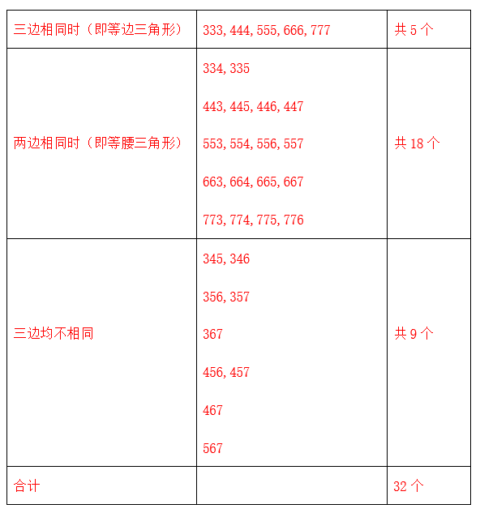

故正确答案为D。

### 第 46 题

甲、乙两港相距720千米，轮船往返两港需要35小时，逆流航行比顺流航行多花5小时；帆船在静水中每小时行驶24千米。问帆船往返两港要多少小时？

A. 58

B. 60

C. 64

D. 66

第 46 题 · 答案与解析

**参考答案（粉笔题库参考内容）**

C

**解析**

设轮船逆流航行a小时，顺流航行b小时，已知轮船往返两港需要35小时，则a+b=35；且逆流航行比顺流航行多花5小时，则a-b=5，联立两式，解得a=20，b=15，即轮船逆流航行用了20小时，轮船顺流航行用了15小时。再设水流速度为x千米/小时，轮船速度为y千米/小时，因此可得：20(y-x)=720，15(y+x)=720，联立解得x=6，y=42。所以帆船往返两港要的时间为：小时。

故正确答案为C。

### 第 47 题

有大小两个瓶，大瓶可以装水5千克，小瓶可以装水1千克，现在有100千克水共装了52瓶。问大瓶和小瓶相差多少个？

A. 26

B. 28

C. 30

D. 32

第 47 题 · 答案与解析

**参考答案（粉笔题库参考内容）**

B

**解析**

方法一：设大瓶有x个，则小瓶有（52-x）个，根据题意得，5x+(52-x)=100，解得x=12，则小瓶=52-12=40个，故大瓶和小瓶相差40-12=28个。

方法二：假设52个瓶子全部为小瓶，则可装水52×1=52千克，而实际装水100千克，多装水100-52=48千克。每个大瓶比小瓶多装水5-1=4千克，则大瓶个，小瓶=52-12=40个，故大瓶和小瓶相差40-12=28个。

故正确答案为B。

### 第 48 题

如下图所示，梯形ABCD的对角线AC、BD，其中AD=1/2，BC=3，AC=2 4/5，BD=2.1。问梯形ABCD的高AE的值是：

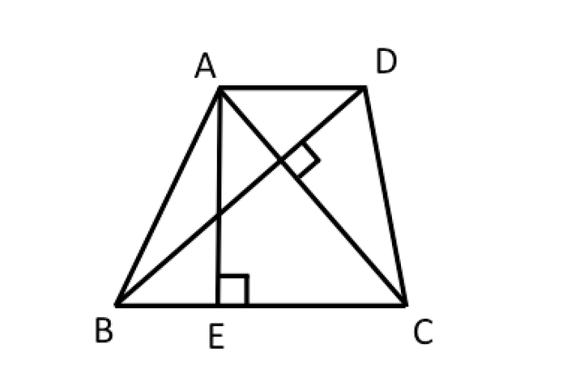

A. 43/24

B. 1.72

C. 42/25

D. 1.81

第 48 题 · 答案与解析

**参考答案（粉笔题库参考内容）**

C

**解析**

根据梯形面积公式可得；观察图形，梯形ABCD可划分为和两个三角形，假设AC与BD相交于O点，则，则，即，解得。

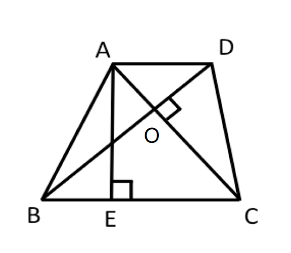

故正确答案为C。

### 第 49 题

现有6个一元面值硬币正面朝上放在桌子上，你可以每次翻转5个硬币（必须翻转5个），问你最少经过几次翻转可以使这6个硬币全部反面朝上？

A. 5

B. 6

C. 7

D. 8

第 49 题 · 答案与解析

**参考答案（粉笔题库参考内容）**

B

**解析**

将6个硬币抽象成一个6位二进制数字，假设硬币正面朝上时记为0，硬币反面朝上时记为1，因此原问题转化成每次改变5位数字，最少经过几次可以将000000变为111111，按照顺序改变，第几次改变就让第几位不变，过程为：

开始0：000000→变1次：011111→2：110000→3：000111→4：111100→5：000001→6：111111，因此总共需要6次。

故正确答案为B。

相关知识点：

硬币翻转问题有以下的规律：当硬币枚数是偶数，每次翻转的个数比硬币枚数少1的时候，只需要经过与硬币枚数相同次翻转即可以将硬币完全翻转过来；如果硬币的枚数是奇数个，那么就陷入奇偶互质的死循环，将不能使硬币全部翻转过来。

### 第 50 题

“红星”啤酒开展“7个空瓶换1瓶啤酒”的优惠促销活动。现在已知张先生在活动促销期间共喝掉347瓶“红星”啤酒，问张先生最少用钱买了多少瓶啤酒？

A. 296

B. 298

C. 300

D. 302

第 50 题 · 答案与解析

**参考答案（粉笔题库参考内容）**

B

**解析**

方法一：设张先生最少用钱买了x瓶啤酒。根据空瓶换酒公式，7个空瓶换1瓶啤酒，则x个空瓶最多可以换瓶啤酒，则，解得，故张先生最少用钱买了298瓶啤酒。

备注：此处的x/6表示取x/6的整数部分。

方法二：根据7瓶换1瓶可知，张先生喝的347瓶啤酒中，能被7整除的数值就是换购的。，因此一共有49瓶是换购的，而另外的347-49=298瓶是张先生花钱购买的。

故正确答案为B。

### 第 51 题

如图所示，圆被三条线段分成四个部分。现有红、橙、黄、绿四种涂料对这四个部分上色，假设每部分必须上色，且任意相邻的两个区域不能用同一种颜色，问共有几种不同的上色方法？

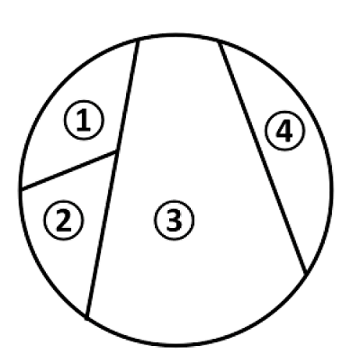

A. 64

B. 72

C. 80

D. 96

第 51 题 · 答案与解析

**参考答案（粉笔题库参考内容）**

B

**解析**

染色问题，对各个区域依次染色即可。

先考虑第③个区域，有4种选法；

再依次考虑第①②④区域，颜色选法分别为3、2、3。

总的染色方法数为：4×3×2×3＝72种。

故正确答案为B。

备注：染色问题的解答办法就是分步完成，直接相乘即可。为了避免在染色的过程中出现讨论的情形，一般从相邻区域最多的那个区域入手开始染色。

### 第 52 题

小孙的口袋里有四颗糖，一颗巧克力味的，一颗苹果味的，两颗牛奶味的。小孙任意从口袋里取出两颗糖，他看了看后说，其中一颗是牛奶味的。问小孙取出的另一颗糖也是牛奶味的可能性（概率）是多少？

A. 1/3

B. 1/4

C. 1/5

D. 1/6

第 52 题 · 答案与解析

**参考答案（粉笔题库参考内容）**

C

**解析**

两颗都是牛奶味的糖只有一种情况，而其中至少一颗是牛奶味的糖共有5种情况：（牛奶味1、苹果味），（牛奶味1、巧克力味），（牛奶味2、苹果味），（牛奶味2、巧克力味），（牛奶味1、牛奶味2），特别注意这里没有顺序要求，是组合。因此概率为1/5。

故正确答案为C。

### 第 53 题

下图是由 5 个相同的小长方形拼成的大长方形，大长方形的周长是 88 厘米，问大长方形的面积是多少平方厘米？

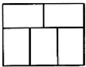

A. 472

B. 476

C. 480

D. 484

第 53 题 · 答案与解析

**参考答案（粉笔题库参考内容）**

C

**解析**

通过观察大长方形的上下两边，可得小长方形的长、宽存在等量关系：2长=3宽，则长：宽=3:2。设小长方形的长宽分别为3x厘米、2x厘米，则大长方形的长为2×3x=6x厘米，宽为3x+2x=5x厘米。根据长方形周长公式：周长=(长+宽)×2可得，(6x+5x)×2=88，解得x=4，则大长方形的长为6×4=24厘米，宽为5×4=20厘米。故大长方形面积=24×20=480平方厘米。

故正确答案为C。

### 第 54 题

一个边长为80厘米的正方形，依次连接四边中点得到第二个正方形，这样继续下去可得到第三个、第四个、第五个、第六个正方形，问第六个正方形的面积是多少平方厘米？

A. 128

B. 162

C. 200

D. 242

第 54 题 · 答案与解析

**参考答案（粉笔题库参考内容）**

C

**解析**

连接正方形四边中点得到的新正方形面积是原正方形面积的一半，规律即为：第n个正方形的面积是第一个正方形面积的(1/2)^(n-1)。则第六个正方形的面积是第一个正方形面积的(1/2)^5，即1/32。故第六个正方形的面积平方厘米。

故正确答案为C。

### 第 55 题

某专业有学生50人，现开设有甲、乙、丙三门选修课。有40人选修甲课程，36人选修乙课程，30人选修丙课程，兼选甲、乙两门课程的有28人，兼选甲、丙两门课程的有26人，兼选乙、丙两门课程的有24人，甲、乙、丙三门课程均选的有20人。问三门课程均未选的有多少人？

A. 1

B. 2

C. 3

D. 4

第 55 题 · 答案与解析

**参考答案（粉笔题库参考内容）**

B

**解析**

设选修甲课程的为集合A，选修乙课程的为集合B，选修丙课程的为集合C。根据容斥原理三集合标准型公式：A+B+C-A∩B-A∩C-B∩C+A∩B∩C=总数-都不，可得40+36+30-28-26-24+20=50-都不，则都不=2，即三门课程均未选的有2人。

故正确答案为B。

### 第 56 题

下面4个图形呈现一定的规律性。根据这种规律，在所给出的备选答案中选出一个最合理的答案，使之呈现一定的规律性：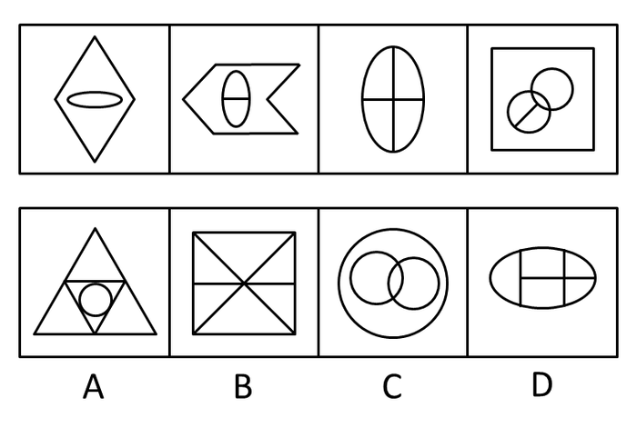

A. A

B. B

C. C

D. D

第 56 题 · 答案与解析

**参考答案（粉笔题库参考内容）**

B

**解析**

元素组成凌乱，考查数数。

本题为数面（封闭空间），已知图形的面数分别为2、3、4、5，接下来的图形应该有6个面，通过分析，选项中面的数量分别是7、6、4、5 。只有B项中图形符合。

故正确答案为B。

### 第 57 题

下面4个图形呈现一定的规律性。根据这种规律，在所给出的备选答案中选出一个最合理的答案，使之呈现一定的规律性：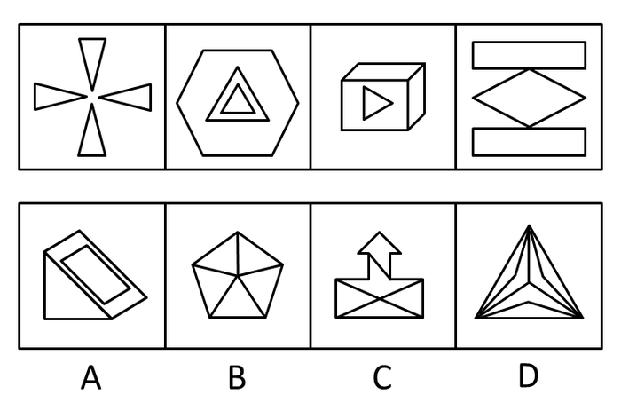

A. A

B. B

C. C

D. D

第 57 题 · 答案与解析

**参考答案（粉笔题库参考内容）**

D

**解析**

本题为数直线，已知图形直线数均为12，选项中有12条直线的只有D项。

故正确答案为D。

### 第 58 题

下面4个图形呈现一定的规律性。根据这种规律，在所给出的备选答案中选出一个最合理的答案，使之呈现一定的规律性：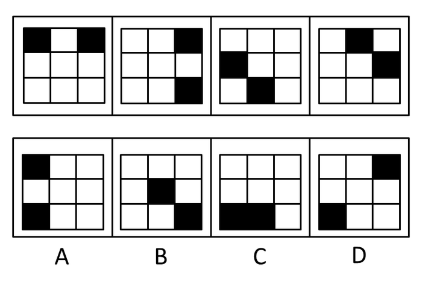

A. A

B. B

C. C

D. D

第 58 题 · 答案与解析

**参考答案（粉笔题库参考内容）**

A

**解析**

元素组成相同，考查位置规律。

已知图形中，第一个图形中的小黑色方块顺时针移动2格，得到第二个图形。第二个图形中的小黑色方块顺时针移动3格，得到第三个图形。第三个图形中的小黑色方块顺时针移动4格，得到第四个图形。则第四个图形中的小黑色方块顺时针移动5格，得到第五个图形通过分析，符合规律的只有A项中的图形。

故正确答案为A。

### 第 59 题

所给4个图形呈现一定的规律性。根据这种规律，从所给出的备选答案中选出一个最合理的答案，使之呈现一定的规律性：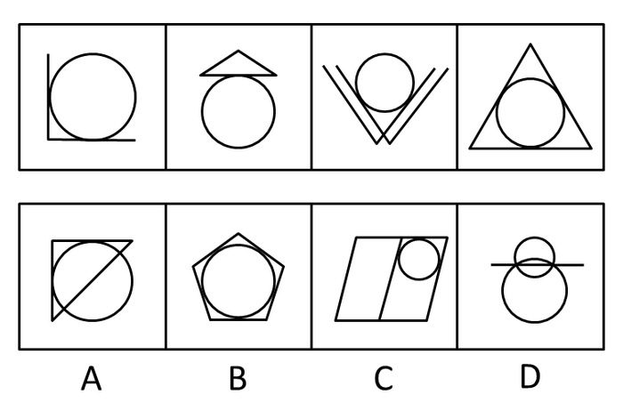

A. A

B. B

C. C

D. D

第 59 题 · 答案与解析

**参考答案（粉笔题库参考内容）**

A

**解析**

元素组成凌乱，图形中交点明显，本题考查数交点，题干所给图形的交点数分别是3、4、5、6、（7）。

故正确答案为A。

### 第 60 题

下面4个图形呈现一定的规律性。根据这种规律，在所给出的备选答案中选出一个最合理的答案，使之呈现一定的规律性：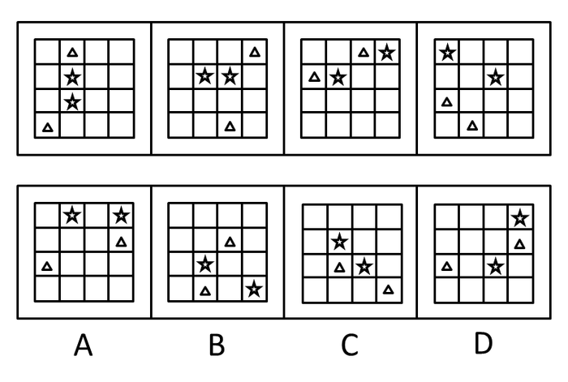

A. A

B. B

C. C

D. D

第 60 题 · 答案与解析

**参考答案（粉笔题库参考内容）**

D

**解析**

元素组成相同，考查位置规律。

局部位置的变化，通过分析已知图形发现，五角星都出现在表格的对角线上，三角形都出现在表格的边上，而选项中符合该规律的只有D项中的图形。

故正确答案为D。

### 第 61 题

下面4个图形呈现一定的规律性。根据这种规律，在所给出的备选答案中选出一个最合理的答案，使之呈现一定的规律性：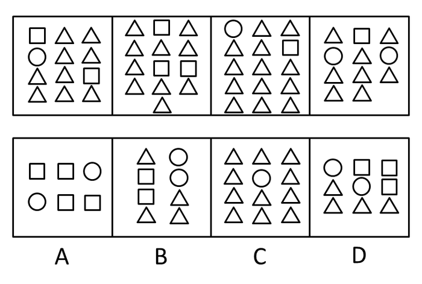

A. A

B. B

C. C

D. D

第 61 题 · 答案与解析

**参考答案（粉笔题库参考内容）**

B

**解析**

本题为元素换算。

令第一个图和第三个图等价可得1个正方形＝4个三角形，再令第三个图和第四个图等价可得1个圆＝5个三角形，将两个关系代入已知图形中可发现，每组图形均可等价为22个三角形。

故正确答案为B。

### 第 62 题

下面九宫格中的图形呈现一定的规律性。根据这种规律，在所给出的备选答案中选出一个最合理的答案，使之呈现一定的规律性：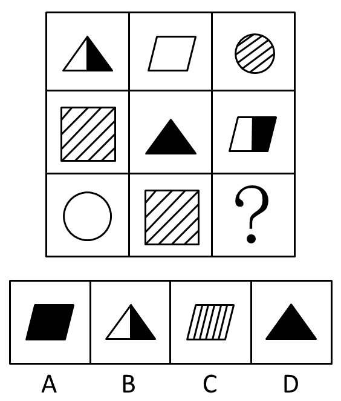

A. A

B. B

C. C

D. D

第 62 题 · 答案与解析

**参考答案（粉笔题库参考内容）**

D

**解析**

元素组成相似，综合考查元素周边和位置规律。

本题为平移题。事实上每行均为四个图，其中最右边一图隐藏不见。第一行最右隐藏的为全黑正方形，第二行最右隐藏的为全白圆圈，隐藏的图在下一行中从左边出现。每行图形依次从左到右移动得到下一行图形，第一行到第二行在移动过程中同时伴随颜色（条纹、全黑、全白、黑白）变化，也是从左到右加快一格。第二行到第三行图形移动，但颜色不变，通过分析，符合该规律的只有D项中图形。

故正确答案为D。

### 第 63 题

从所给的四个选项中，选择最合适的一个填入问号处，使之呈现一定的规律性：

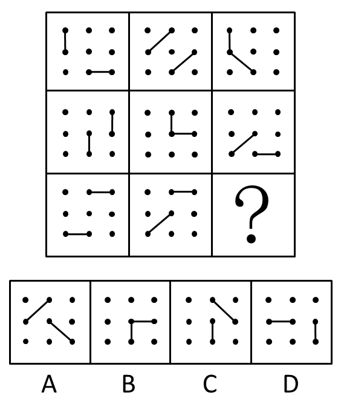

A. A

B. B

C. C

D. D

第 63 题 · 答案与解析

**参考答案（粉笔题库参考内容）**

B

**解析**

元素组成相同，考查其位置关系，先考虑每个图形两个线段所成的角度。每一行都有一个平行，一个直角，一个钝角，由此可知在B项和D项中选择。又发现已知图形每一行都有一个图形中的两个线段相接，由此排除D项。

故正确答案为B。

### 第 64 题

从所给的四个选项中，选择最合适的一个填入问号处，使之呈现一定的规律性：

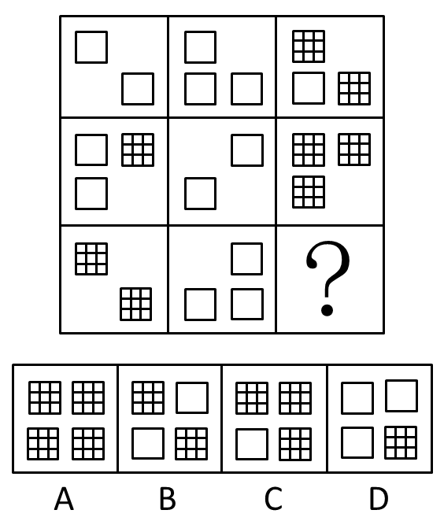

A. A

B. B

C. C

D. D

第 64 题 · 答案与解析

**参考答案（粉笔题库参考内容）**

C

**解析**

方法1：

本题为元素换算。通过分析可知，1个网格方块＝2个空白方块，且有每行前两个图形的方块之和等于第三个图形的方块，将换算关系代入每行已知图形可得关系，第一行为：2＋3＝5，第二行为：4＋2＝6，第三行为：4＋3＝7，只有C项中图形符合。

方法2：

从每行来看，前两个图形的直线数之和等于第三个图形的直线数，问号处应有28条直线。

故正确答案为C。

### 第 65 题

从所给的四个选项中，选择最合适的一个填入问号处，使之呈现一定的规律性：

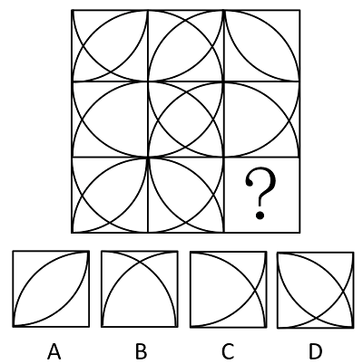

A. A

B. B

C. C

D. D

第 65 题 · 答案与解析

**参考答案（粉笔题库参考内容）**

B

**解析**

元素组成相似，元素叠加。以行为单位。每一行前两个图叠加后去同存异形成第三个图形，通过分析，只有B项中图形符合该规律。

故正确答案为B。

### 第 66 题

奢华：简朴

A. 忠诚：虚伪

B. 聪明：呆板

C. 敏捷：迟钝

D. 团结：勾当

第 66 题 · 答案与解析

**参考答案（粉笔题库参考内容）**

C

**解析**

第一步：判断题干词语间逻辑关系。

题干两词是反义词。

第二步：判断选项词语间逻辑关系。

A项中，“忠诚”的反义词应该是“背叛”；

B项中，“聪明”的反义词应该是“愚昧”；

C项与题干逻辑关系相同，“敏捷”和“迟钝”是一组反义词；

D项中，“团结”与“勾当”无明显逻辑关系。

故正确答案为C。

### 第 67 题

宋太祖：杯酒释兵权

A. 萧何：暗度陈仓

B. 班固：不入虎穴，焉得虎子

C. 曹丕：才高八斗

D. 赵括：纸上谈兵

第 67 题 · 答案与解析

**参考答案（粉笔题库参考内容）**

D

**解析**

第一步：判断题干词语间逻辑关系。

题干两词是对应关系，且是人物和历史典故间的一一对应关系。

第二步：判断选项词语间逻辑关系。

A项中“暗度陈仓”与张良、韩信有关，而与“萧何”无关；

B项中“不入虎穴，焉得虎子”语出《后汉书·班超传》，是“班超”之言，而非“班固”之言；

C项中“才高八斗”形容“曹植”而非“曹丕”；

D项中“纸上谈兵”正是来源于“赵括”的故事，与题干逻辑关系一致。

故正确答案为D。

### 第 68 题

诺言：履行

A. 思想：交流

B. 选择：武断

C. 电影：制片

D. 名单：邀请

第 68 题 · 答案与解析

**参考答案（粉笔题库参考内容）**

A

**解析**

第一步：判断题干词语间逻辑关系。

履行诺言，二者为动宾关系。

第二步：判断选项词语间逻辑关系。

A项：交流思想，二者为动宾关系，与题干逻辑关系一致，当选；

B项：武断地选择，二者为偏正关系，与题干逻辑关系不一致，排除；

C项：电影和制片均为名词，无法构成动宾关系，与题干逻辑关系不一致，排除；

D项：邀请名单，二者搭配不当，与题干逻辑关系不一致，排除。

故正确答案为A。

### 第 69 题

班门弄斧：布鼓雷门

A. 曲高和寡：雅俗共赏

B. 囫囵吞枣：不求甚解

C. 爱不释手：弃如敝屣

D. 投鼠忌器：声名狼藉

第 69 题 · 答案与解析

**参考答案（粉笔题库参考内容）**

B

**解析**

第一步：判断题干词语间逻辑关系。

“班门弄斧”指在鲁班门前舞弄斧子，“布鼓雷门”指在雷门前击布鼓，都比喻在能手面前卖弄本领，两词是近义词。

第二步：判断选项词语间逻辑关系。

A项：“曲高和寡”意思为曲调高深，能跟着唱的人就少，旧指知音难得，现比喻言论或作品不通俗，能了解的人很少，“雅俗共赏”形容某些文艺作品既优美，又通俗，各种文化程度的人都能够欣赏，两词不是近义词，与题干逻辑关系不一致，排除；

B项：“囫囵吞枣”和“不求甚解”都表示读书停留于表面，缺乏真实的理解，两词是近义词，与题干逻辑关系一致，当选；

C项：“爱不释手”意思为喜爱得舍不得放手，“弃如敝屣”意思为像扔破鞋一样扔掉，比喻毫不可惜地扔掉或抛弃，两词不是近义词，与题干逻辑关系不一致，排除；

D项：“投鼠忌器”意思为想用东西打老鼠，又怕打坏了近旁的器物，比喻做事有顾忌，不敢放手干，“声名狼藉”意思为名声败坏到了极点，两词不是近义词，与题干逻辑关系不一致，排除。

故正确答案为B。

### 第 70 题

阴霾：失意

A. 角落：寂寞

B. 爆竹：喜庆

C. 瑞雪：欢欣

D. 滂沱：盛怒

第 70 题 · 答案与解析

**参考答案（粉笔题库参考内容）**

C

**解析**

第一步：判断题干词语间逻辑关系。

题干两词是对应关系，且是自然现象与心情一一对应关系。

第二步：判断选项词语间逻辑关系。

与题干相同逻辑关系的即为C项。

A项和B项中没有自然现象，D项中“滂沱”和“盛怒”虽然分别是自然现象和心情，但是它们之间没有对应关系。

故正确答案为C。

### 第 71 题

蓝色：忧郁

A. 黑色：幽默

B. 紫色：高雅

C. 白色：恐怖

D. 红色：醒目

第 71 题 · 答案与解析

**参考答案（粉笔题库参考内容）**

B

**解析**

第一步：判断题干词语间逻辑关系。

题干两词是关系对应关系，且是颜色和寓意间的一一对应关系。

第二步：判断选项词语间逻辑关系。

与题干相同逻辑关系的即为B项，颜色与寓意对应；

A项中“黑色”应该代表“凝重”；C项中“白色”应该代表“纯洁”；D项中“红色”应该代表“热情”。

故正确答案为B。

### 第 72 题

艺术：生活

A. 喷泉：公园

B. 利润：企业

C. 梦境：大脑

D. 战乱：掠夺

第 72 题 · 答案与解析

**参考答案（粉笔题库参考内容）**

C

**解析**

第一步：判断题干词语间逻辑关系。

题干两个词的关系是对应关系。生活是艺术的来源。

第二步：判断选项词语间逻辑关系。

A项：公园是喷泉的存在场所，而不是来源，和题干逻辑关系不一致，排除；

B项：利润来源于剩余价值，企业是利润的生成媒介和方式，而不是来源，和题干逻辑关系不一致，排除；

C项：梦境是脑细胞活动的结果，梦境来源于大脑，和题干逻辑关系一致，当选；

D项：战乱是掠夺的存在背景和情境，而不是来源，和题干逻辑关系不一致，排除；

故正确答案为C。

### 第 73 题

锋芒毕露：韬光养晦

A. 莫衷一是：见仁见智

B. 隔靴搔痒：雾里看花

C. 循规蹈矩：离经叛道

D. 安土重迁：随遇而安

第 73 题 · 答案与解析

**参考答案（粉笔题库参考内容）**

C

**解析**

第一步：判断题干词语间逻辑关系。

题干两个词是反义词，锋芒毕露指锐气和才华全都显露出来，多指一个人喜欢表现自己；韬光养晦指隐藏才能，不轻易外露。

第二步：判断选项词语间逻辑关系。

A项，莫衷一是本意是不能决定哪个是对的，形容意见分歧；见仁见智指对同一个问题，不同的人从不同的立场或角度有不同的看法。两者不是反义词，和题干逻辑关系不一致，排除；

B项，隔靴搔痒指说话或做事不中肯，不贴切，没有抓住要点；雾里看花本意是年老视力差，看东西模糊，形容看事情不真切。两者不是反义词，和题干逻辑关系不一致，排除；

C项，循规蹈矩本意是遵守规矩，不敢违反，泛指拘守旧准则，不敢稍做变动；离经叛道本意是违反封建统治阶级所尊奉的经典和教条，泛指背离占主导地位的理论或学说。两者是反义词，和题干逻辑关系一致，当选；

D项，安土重迁指安于本乡本土，不愿轻易迁移；随遇而安指能顺应环境，在任何境遇中都能满足。两者不是反义词，和题干逻辑关系不一致，排除。

故正确答案为C。

### 第 74 题

不共戴天：仇人

A. 契若金兰：朋友

B. 相敬如宾：兄弟

C. 年谊世好：夫妻

D. 救死扶伤：医生

第 74 题 · 答案与解析

**参考答案（粉笔题库参考内容）**

A

**解析**

第一步：判断题干词语间逻辑关系。

题干两词是对应关系，且是比喻词和关系词的对应关系，前者能够形容后者。

第二步：判断选项词语间逻辑关系。

A项与题干逻辑关系相同；

B项中“相敬如宾”应该是形容“夫妻”关系；

C项中“年谊世好”应该是形容“世交”关系；

D项中“医生”是一种职业，不是描述人与人之间关系的词。

故正确答案为A。

### 第 75 题

劳心者治人，劳力者治于人：孟子

A. 出师未捷身先死，长使英雄泪满襟：诸葛亮

B. 衣带渐宽终不悔，为伊消得人憔悴：屈原

C. 回眸一笑百媚生，六宫粉黛无颜色：白居易

D. 江山代有才人出，各领风骚数百年：杜甫

第 75 题 · 答案与解析

**参考答案（粉笔题库参考内容）**

C

**解析**

第一步：判断题干词语间逻辑关系。

题干两词是对应关系，且是名言警句和作者间的对应关系。

第二步：判断选项词语间逻辑关系。

A项中“出师未捷身先死，长使英雄泪满襟”出自杜甫的《蜀相》；

B项中“衣带渐宽终不悔，为伊消得人憔悴”出自柳永的《蝶恋花》；

C项中“回眸一笑百媚生，六宫粉黛无颜色”出自白居易的《长恨歌》，与题干逻辑关系相同；

D项中“江山代有才人出，各领风骚数百年”出自赵翼的《论诗》。

故正确答案为C。

### 第 76 题

鸡尾酒会效应：在鸡尾酒会上，很多人在同时进行着各种交谈，但一个人同一个时刻只能注意和参与其中的一个交谈，这是注意分配的问题。由于心理资源有限，同一时刻只能将信息加以过滤和筛选，以此刻最重要或最有兴趣的信息为注意对象。作为一个选择过滤器，注意就像收音机上的旋钮，一方面挡住大多数不需要的信息，一方面延留所需要的信息，使之进入意识。

根据上述定义，下列不属于鸡尾酒会效应的是：

A. 讲座上听众们都认真听讲，全然不顾外面电闪雷鸣

B. 生日聚会上他从一个话题转移到另一个话题，侃侃而谈

C. 很少有人注意到83版的《射雕英雄传》中有跑龙套的周星驰

D. 婚礼上来宾们把目光都投向了新郎新娘

第 76 题 · 答案与解析

**参考答案（粉笔题库参考内容）**

B

**解析**

第一步：抓住定义中的关键词。

关键词包括“同一个时刻”、“注意分配”、“过滤和筛选”。

第二步：逐一判断选项。

A项中听众听讲座忽视闪电雷鸣，C项中观众忽视跑龙套的周星驰，D项中来宾把目光投向新郎新娘，三种情况均符合关键词，都属于鸡尾酒会效应，排除。

B项中主人公并没有对注意力进行分配，相反，他引导了别人的注意力，不符合关键词“注意分配”，因此不属于鸡尾酒会效应，当选。

本题为选非题，故正确答案为B。

### 第 77 题

白日梦指一种适度的意识状态的改变形式，注意力不再诉诸对环境刺激的反应，而是对内在刺激的反应。思维报告反映出注意偏离了现时要求的任务，不指向任何现时的外部刺激。一般来说，白日梦是人独处和放松休息时普遍的一种活动，在人们入睡前的短暂时刻里最多见，清醒时、就餐时、性生活时最少见。

根据上述定义，下列属于白日梦现象的是：

A. 在看韩剧的时候她经常把自己想像成剧中的女主角

B. 中午午睡的时候他做梦自己成了百万富翁

C. 小明患有精神分裂症，常常说自己是玉皇大帝

D. 恍惚中，她觉得日夜思念的爱人就在眼前

第 77 题 · 答案与解析

**参考答案（粉笔题库参考内容）**

D

**解析**

第一步：抓住定义中的关键词。

关键词包括“适度的意识状态”、“内在刺激”。

第二步：逐一判断选项。

A项中“看韩剧”属于对外界环境的反应，不符合关键词“内在刺激”，因此不属于白日梦现象；

B项中“做梦”属于无意识的状态，不符合关键词“适度的意识状态”，因此不属于白日梦现象；

C项中“精神分裂症”也是无意识，不符合关键词“适度的意识状态”，因此不属于白日梦现象；

D项中描述的现象符合关键词，属于白日梦现象。

故正确答案为D。

### 第 78 题

民法中的埋藏物指包藏于他物之中，不容易从外部发现的物。埋藏物是有主物，只是所有人不明，而非无主物。具有历史、艺术和科学价值的文物不属于埋藏物。

根据上述定义，下列属于埋藏物的是：

A. 老张看见老李将一包东西埋藏起来，老张趁人不注意将其挖出

B. 老张在公交车上发现的一个皮包

C. 老张在耕地时挖出的一把八成新铁锨

D. 老张拾荒时在垃圾堆里捡到的一台废弃电脑

第 78 题 · 答案与解析

**参考答案（粉笔题库参考内容）**

C

**解析**

第一步：抓住定义中的关键词。

关键词包括“包藏于他物之中”、“所有人不明”、“有主物”。

第二步：逐一判断选项。

A项中老李埋藏的包是所有人明确的物，不符合关键词“所有人不明”，因此不属于埋藏物；

B项中公交车上的皮包容易从外部发现，不符合关键词“包藏于他物之中”，因此不属于埋藏物；

C项中的铁锨埋藏在地下，所有人不明，符合关键词，属于埋藏物；

D项中废弃的电脑属于无主物，也没有包藏在他物中，因此不属于埋藏物。

故正确答案为C。

### 第 79 题

马太效应：任何个人、群体或地区，一旦在某方面（如金钱、名誉、地位等）获得成功和进步，就会产生一种积累优势，就会有更多的机会取得更大的成功和进步。

根据上述定义，下列不属于马太效应的是：

A. 教授、专家越是有名，得到的科研经费越多，社会兼职越多

B. 国家总是重点投资建设名校，那些投入充分而硬件和软件占绝对优势的学校想不继续成为名校恐怕都很困难

C. 在股市狂潮中，赚的总是庄家，赔的总是散户，普通大众的金钱，就会通过这种形式聚集到少数人手中

D. 陈经理喜欢买彩票，最近他连买连中，买了新车，邻居羡慕之余纷纷向他讨教选号的方法

第 79 题 · 答案与解析

**参考答案（粉笔题库参考内容）**

D

**解析**

第一步：抓住定义中的关键词。

关键词包括“积累优势”、“更大的成功和进步”。

第二步：逐一判断选项。

A、B、C三项中所描述的都符合关键词，均属于马太效应；

D项中陈经理买股票连中并不是一种“积累优势”，因此不属于马太效应。

本题为选非题，故正确答案为D。

### 第 80 题

强迫症：以强迫观念和强迫动作为主要表现的一种神经症。以有意识的自我强迫与有意识的自我反强迫同时存在为特征，患者明知强迫症的持续存在毫无意义且不合理，却不能克制地反复出现。

根据上述定义，下列属于强迫症的是：

A. 模特小张最近为了保持苗条身材，强迫自己每次参加聚会都少吃东西，她感觉很痛苦

B. 过春节了，高三学生小陈一边很想跟同学出去玩，一边为了考上好大学不得不强迫自己在家里认真看书

C. 林女士每次走出小区门口时，都会怀疑自家的煤气没有关掉或者大门没锁，于是再折回检查

D. 内向的小李很想对喜欢的女孩子表白，但又很害怕被拒绝，整个晚上反复思考不能入眠

第 80 题 · 答案与解析

**参考答案（粉笔题库参考内容）**

C

**解析**

第一步：抓住定义中的关键词。

关键词包括“自我强迫”、“自我反强迫”、“毫无意义且不合理”、“反复出现”。

第二步：逐一判断选项。

A项中的模特保持身材苗条的目的是合理且有意义的，不符合关键词“毫无意义且不合理”，同时并没有反强迫，因此不属于强迫症；

B项中的为了考上好大学同样是合理且有意义的，不符合关键词“毫无意义且不合理”，同时并没有反强迫，因此也不属于强迫症；

C项中行为符合关键词，因此属于强迫症；

D项中反复思考不能入眠，该行为既没有自我强迫，也没有自我反强迫，因此不属于强迫症。

故正确答案为C。

### 第 81 题

青春中学的一些数学老师取得了硕士学位。因此，青春中学的有些男教师取得了硕士学位。

以下哪项为真，最支持上述论证的成立？

A. 青春中学的数学教师都是男教师

B. 青春中学的男教师有些是教数学的

C. 青春中学的数学老师中有些是男教师

D. 有些青春中学的女性数学教师并没有取得硕士学位

第 81 题 · 答案与解析

**参考答案（粉笔题库参考内容）**

A

**解析**

第一步：分析题干信息。

条件：青春中学的一些数学老师与取得了硕士学位的关系。

结论：青春中学的有些男教师与取得了硕士学位的关系。

第二步：根据三段论特点得到以下步骤，直接得出结论。

（1）在条件和结论不同的对象间搭桥，即在数学老师和男教师间搭桥；

（2）搭桥的方向：由条件的对象指向结论的对象，即由数学老师推出男教师；

（3）该表达必须是充分的表达，即所有数学老师都是男教师。

第三步：分析选项得出答案。

通过分析，只有A项中的说法恰是第二步中的结论。

故正确答案为A。

### 第 82 题

H市的交通管理部门表示，和去年相比，今年我市市区的道路通行有明显改善。该部门负责人认为，这是由于我市聘用了大量的交通协管员。

以下哪项最不能削弱该负责人的结论？

A. 今年初，H市专门召开会议对交通问题进行认真研究和整理

B. 许多专家认为，聘用大量的交通协管员的成本巨大，得不偿失

C. 今年初，H市市区的道路新建扩建工程刚刚结束

D. 今年H市对驶入市区的车辆进行了严格的限制，许多大货车、外地车在交通“高峰”时期不能进入市区

第 82 题 · 答案与解析

**参考答案（粉笔题库参考内容）**

B

**解析**

第一步：找到论点和论据。

论点：和去年相比，今年我市市区的道路通行有明显改善。

论据：该部门负责人认为，这是由于我市聘用了大量的交通协管员。

第二步：判断削弱方式。

提问指出是削弱该负责人的结论，而该负责人的结论是题干的论据，因此本题削弱论据，即削弱原因。

第三步：逐一判断选项。

A、C、D三项都指明论点的成立可能有另外的原因，属于他因削弱；

B项提到的成本与道路通行改善无关，所以属无关选项。

本题为选非题，故正确答案为B。

### 第 83 题

当枪声平息下来后，我爬出帐篷，看到那名向我要烟的男子的脸朝下趴在那里。周围的人说，他已经死了，显然死于心脏病发作。这也是许多刚果人的结局，不死在枪林弹雨中，也会死在各种各样的疾病中。

从以上文字推测作者目睹男子死亡的情绪中包括最主要的是：

A. 淡漠

B. 悲悯

C. 谴责

D. 愤怒

第 83 题 · 答案与解析

**参考答案（粉笔题库参考内容）**

B

**解析**

第一步：抓住题干中的关键句。

本题关键句为“这也是许多刚果人的结局，不死在枪林弹雨中，也会死在各种各样的疾病中”。

第二步：综合分析判断选出答案。

本题侧重于言语理解，通过阅读题干，重点结合关键句，可以知道作者认为死亡似乎已经成为刚果人命中注定的结局，面对这种无奈的结局，任何有同情心的人必然产生悲悯的感觉，因此作者对于男子的死亡怀有悲悯的情绪，而不是谴责和愤怒，当然也不是淡漠。

故正确答案为B。

### 第 84 题

把道德说成圣人立法，在很大程度上背离道德。正如恩格斯所说的“没有爱情的婚姻是不道德的”中的不道德，恰恰是封建伦理中极力宣扬的“道德”。而这种所谓道德的阶级性，这种成为意识形态的道德，只不过是伪道德，并不能证明道德在不同的阶级那里有不同的性质。

从以上文字推测作者要表达的原意最不可能的是：

A. 道德不是圣人立法

B. 道德易异化为服务于统治者的控制手段

C. 封建伦理中的道德观念沦为悲惨婚姻的精神桎梏

D. 在长期的阶级统治的政治高压下，统治者把持了道德的话语权

第 84 题 · 答案与解析

**参考答案（粉笔题库参考内容）**

C

**解析**

第一步：抓住每句话中的对象及其关系。

第一句说明道德被说成圣人立法很大程度上背离道德，第二句说明封建伦理中极力宣扬的“道德”是“没有爱情的婚姻是不道德的”中的不道德，第三句说明在道德的阶级性下成为意识形态的道德实际是伪道德。

第二步：逐一判断选项的正确。

A项：通过分析可知，本段文字论述对象是道德的阶级性。从第一句话可以得知，作者不同意道德是圣人立法的提法，因此A项符合作者原意；

B、D两项：由第二三句话可知B、D两项也可由原文推论出来；

C项：文中引用恩格斯的话是只为了佐证封建社会道德的阶级性，作者并没有对封建社会没有爱情的婚姻是否悲惨以及是否是道德造成的精神桎梏进行评价，因此该项不符合作者原意。

本题为选非题，故正确答案为C。

### 第 85 题

“我相信你，因为你是清白的。”这样的话，在逻辑上是说不通的。当你想了解他是否清白的时候，你已经不信任他了。信任是什么呢？如果你信仰上帝，就不能要求上帝走到你的面前，让上帝证明自己给你看。如果你信任别人，你就不能要求别人是清白的。信任是没有理由和前提的事情。

从以上文字可以推测作者对于信任的看法正确的是：

A. 不清白的人才需要信任

B. 信任就是默默地付出而不图任何回报

C. 对他人的信任与对上帝的信仰在心理上是一模一样的

D. 信任就是信任你的信任本身，而不在于事实真相

第 85 题 · 答案与解析

**参考答案（粉笔题库参考内容）**

D

**解析**

第一步：抓住题干中的关键句。

本题的关键句为“如果你信任别人，你就不能要求别人是清白的。信任是没有理由和前提的事情”。

第二步：逐一判断选项的正确。

A项根据题干“信任是没有理由和前提的事情”，可以推测作者对于信任的看法是，信任跟事实真相没有关系，而是信任对方的信任本身，因此A项不符合题干意思；

B项的回报在题干中没有涉及，属于无关项；

C项题干中并没有比较对他人的信任与对上帝的信仰之间的区别，因此C项错误；

D项正是作者所要表达的观点。

故正确答案为D。

### 第 86 题

西方宗教学的奠基人麦克斯·缨勒解释道“宗教是一种内心的本能或气质，它独立地、不借助感觉和理性，能使人们领悟在不同名称和各种伪装下的无限。”把宗教解释为“独立地、不借助感觉和理性”而领悟“无限”的才能，真是高明之极。让宗教站在“无限”上，也就一劳永逸地摆脱了科学知识的“纠缠”。因为科学知识无论怎样发展，始终是“有限”的，那些“未被科学知识体系说明过其原因的经验事实”也就永远成为“无限”——“神和上帝”的领地。

从以上文字可以推测：

A. 作者认为麦克斯的高明之处在于掌握了领悟无限的才能

B. 麦克斯支持“世界永远是不可知的”这样一种理论

C. 作者认为麦克斯的解释使“无限”成了“神和上帝”的领地

D. 科学知识无法触及支撑宗教发展乃至繁荣的智慧核心

第 86 题 · 答案与解析

**参考答案（粉笔题库参考内容）**

C

**解析**

第一步：抓住每句话中的对象及其关系。

第一句强调宗教是一种内心的本能或气质，第二句说明宗教解释为“独立地、不借助感觉和理性”而领悟“无限”的才能更好，第三句说明宗教站在“无限”上就一劳永逸地摆脱了科学知识的“纠缠”，第四句说明科学知识始终是“有限”的。

第二步：逐一判断选项的正确。

作者把麦克斯关于“无限”的观点与宗教的本质联系在一起。

A项中领悟“无限”的才能是宗教具有的而不是麦克斯本人的，因此A项错误；

B项是迷惑项，文中“未被科学知识体系说明过其原因的经验事实”并不表明“世界永远是不可知的”，所给信息并未从认识论的角度对宗教进行说明，因此也是错误项；

C项正是作者对麦克斯宗教理论成就的精确概括，可以由原文推测出来，因此C项正确；

D项内容文中并未体现，错误。

故正确答案为C。

### 第 87 题

某项调查研究表明，80后和90后的年轻人更喜欢通俗唱法的歌曲，而对美声、民族等唱法不感兴趣。美声民族等唱法正逐渐被时代所淘汰。

下列哪个正确，最能对以上结论构成有效的反驳？

A. 许多中年人喜欢美声唱法和民族唱法

B. 一些接受过正规音乐教育的年轻人更喜欢美声唱法和民族唱法

C. 流行音乐不仅给年轻人带来娱乐，还能更真切地表达其想法和意愿

D. 调查表明，美声和民族唱法在80年代以后的流行程度反而稳步上升了

第 87 题 · 答案与解析

**参考答案（粉笔题库参考内容）**

D

**解析**

第一步：找到论点和论据。

本题论点是美声民族等唱法正逐渐被时代所淘汰，论据是80后和90后的年轻人更喜欢通俗唱法的歌曲，而对美声、民族等唱法不感兴趣。

第二步：判断削弱方式。

本题论点与论据间存在因果关系，所以需削弱论点。

第三步：逐一判断选项的作用。

C项从侧面加强了结论，首先予以排除；

A项中的“中年人”和B项中的“年轻人”仅仅从一个方面对原有结论进行反驳；

D项中从趋势出发进行反驳，可见其力度最强。

故正确答案为D。

### 第 88 题

相比那些不踢足球的大学生，经常踢足球的大学生的身体普遍健康些。由此可见，足球运动能锻炼身体，增进身体健康。

以下哪项为真，最能削弱上述论断？

A. 大学生踢足球是出于兴趣爱好，不是为了锻炼身体

B. 身体不太好的大学生一般不参加激烈的足球运动

C. 足球运动有一定的危险性，容易使人受伤

D. 研究表明，长跑比踢足球更能达到锻炼身体的目的

第 88 题 · 答案与解析

**参考答案（粉笔题库参考内容）**

B

**解析**

第一步：找出论点和论据。

论点：足球运动能锻炼身体，增进身体健康；

论据：相比那些不踢足球的大学生，经常踢足球的大学生的身体普遍健康些。

第二步：判断削弱方式。

本题论点与论据间存在因果关系，所以需削弱论点。

第三步：逐一判断选项的作用。

A项说明踢足球是出于兴趣爱好，C项说明足球运动的危险性，均与足球运动能锻炼身体无关，属无关项；

B项说明先有身体好，后有参加运动，所以是因果倒置，通过对推出结论的前提是否有效削弱论点；

D项说明长跑比踢足球更能锻炼身体，虽然长跑更好，但是题干中的大学生实际中并不见得参加长跑，所以这只是个理论选项。

故正确答案为B。

### 第 89 题

经济学家认为政府对能源利用方面的管制是多余的，市场完全可以自行调节能源的供需矛盾。如果能源真的紧张，那么反映在市场上，能源价格自然会上涨，而能源价格的上涨，一方面会因为使用成本提高而使得人们减少对能源的使用，另一方面因为利润增加使得能源供应商增加供给。

以下哪项如果为真，能有力地对上述论断提出质疑？

A. 能源价格上涨后，人们会更多地使用节能产品

B. 由于难以忍受能源价格的上涨造成的生活成本的增加，人们会抗议政府在能源管理方面无所作为

C. 能源价格降低后会刺激人们使用更多的能源

D. 人们对能源的需求缺乏弹性

第 89 题 · 答案与解析

**参考答案（粉笔题库参考内容）**

D

**解析**

第一步：找出论点和论据。

论点：政府对能源利用方面的管制是多余的，市场完全可以自行调节能源的供需矛盾。

论据：如果能源真的紧张，那么反映在市场上，能源价格自然会上涨，而能源价格的上涨，一方面会因为使用成本提高而使得人们减少对能源的使用，另一方面因为利润增加使得能源供应商增加供给。

第二步：判断削弱方式。

本题论点与论据间存在因果关系，所以需削弱论点。

第三步：逐一判断选项的作用。

A项中能源价格上涨使得人们更多地使用节能产品，这是市场调节的结果，加强论点；

B项中抗议政府在能源管理方面无所作为与管制是多余的无关，属无关项；

C项中能源价格降低后使得人们使用更多的能源也是市场调节的结果，加强论点；

D项指出人们对能源的需求缺乏弹性，必然会导致市场失灵，即市场不能通过自身运行来调节能源的供需矛盾，因此有力地反驳了题干的论据，从而直接削弱论点。

故正确答案为D。

### 第 90 题

有红、蓝、黄、白、紫五种颜色的皮球，分别装在五个盒子里。甲、乙、丙、丁、戊五人猜测盒子里皮球的颜色。甲：第二盒是紫的，第三盒是黄的。乙：第二盒是蓝的，第四盒是红的。丙：第一盒是红的，第五盒是白的。丁：第三盒是蓝的，第四盒是白的。戊：第二盒是黄的，第五盒是紫的。猜完之后打开盒子发现，每人都只猜对了一种，并且每盒都有一个人猜对。

由此可以推断：

A. 第一个盒子内的皮球是蓝色的

B. 第三个盒子内的皮球不是黄色的

C. 第四个盒子内的皮球是白色的

D. 第五个盒子内的皮球是红色的

第 90 题 · 答案与解析

**参考答案（粉笔题库参考内容）**

C

**解析**

第一步：分析题干条件。

（1）有红、蓝、黄、白、紫五种颜色的皮球，分别装在五个盒子里；

（2）甲：第二盒是紫的，第三盒是黄的；

（3）乙：第二盒是蓝的，第四盒是红的；

（4）丙：第一盒是红的，第五盒是白的；

（5）丁：第三盒是蓝的，第四盒是白的；

（6）戊：第二盒是黄的，第五盒是紫的；

（7）每人都只猜对了一种，并且每盒都有一个人猜对。

第二步：根据题干条件进行推理。

分析题干条件可知，第一盒只有丙猜测，结合条件（7）可知，第一盒是红的；结合条件（3）可知，第二盒是蓝的；结合条件（2）、（6）可知，第三盒是黄的，第五盒是紫的；再结合条件（1）可知，第四盒是白的。综上所述，只有C项正确。

故正确答案为C。

### 第 91 题

“物质是标志客观实在的科学范畴，这种客观实在是人通过感觉感知的，它不依赖于我们的感觉而存在，为我们的感觉所复写、摄影、反映。”提出这一物质定义的是：

A. 费尔巴哈

B. 黑格尔

C. 列宁

D. 马克思

第 91 题 · 答案与解析

**参考答案（粉笔题库参考内容）**

C

**解析**

列宁对物质的定义：“物质是标志客观实在的科学范畴，这种客观实在是人通过感觉感知的，它不依赖于我们的感觉而存在，为我们的感觉所复写、摄影、反映。”

故正确答案为C。

本题相关知识点：

费尔巴哈是德国哲学家，费尔巴哈的人本学哲学属于德国古典哲学的形而上学唯物主义。马克思曾写过《费尔巴哈论纲》，批判他形而上学的唯物主义。费尔巴哈的主要著作有《黑格尔哲学批判》和《基督教的本质》等。

黑格尔是德国近代客观唯心主义哲学的代表、政治哲学家。他对德国资产阶级的国家哲学作了最系统、最丰富和最完整的阐述。黑格尔的主要作品包括《精神现象学》、《逻辑学》、《哲学科学全书纲要》、《美学讲演录》等。

### 第 92 题

资本的技术构成是：

A. 生产资料数量与劳动力数量的比例

B. 可变资本与不变资本的比例

C. 可变资本与总资本的比例

D. 剩余劳动时间与必要劳动时间的比例

第 92 题 · 答案与解析

**参考答案（粉笔题库参考内容）**

A

**解析**

资本技术构成是指资本在物质形态上由生产资料的数量同使用这些生产资料的劳动力数量所构成的比例。

故正确答案为A。

本题相关知识点：

购买生产资料的不变资本和购买劳动力的可变资本之间的比例是资本价值构成。资本技术构成决定资本价值构成，而这种“由资本技术构成决定并反映资本技术构成变化的资本价值构成，叫做资本有机构成”。

必要劳动时间是指雇佣工人生产自己所必需的生活资料价值的劳动所需要的时间；剩余劳动时间则是指雇佣工人超出为自己生产所必需的生活资料价值的必要劳动时间以外，生产剩余价值的劳动所需要的时间。

### 第 93 题

邓小平《       》的著名讲话，实际上是十一届三中全会的主题报告，它是开创建设有中国特色社会主义新理论的宣言书。

填入划线部分最恰当的一项是：

A. 建设有中国特色的社会主义

B. 解放思想，实事求是，团结一致向前看

C. 什么是社会主义，怎样建设社会主义

D. 实践是检验真理的唯一标准

第 93 题 · 答案与解析

**参考答案（粉笔题库参考内容）**

B

**解析**

1978年12月的中共十一届三中全会，是中国共产党历史上的伟大转折。邓小平在全会前夕的中央工作会议上作了题为《解放思想，实事求是，团结一致向前看》的重要讲话，这次讲话实际上成了三中全会的主题报告。

故正确答案为B。

本题相关知识点：

1.“建设有中国特色的社会主义”这一基本命题是邓小平在1982年中共十二大上明确提出的。

2.1992年初，邓小平在南方谈话中，明确提出了社会主义本质的著名论断，他说：“社会主义的本质，是解放生产力，发展生产力，消灭剥削，消除两极分化，最终达到共同富裕。”这是邓小平对“什么是社会主义、怎样建设社会主义”长期思索的理论概括和思想总结。

3.《实践是检验真理的唯一标准》是1978年5月11日发表在《光明日报》上的一篇特约评论员文章，该文引发了关于实践是检验真理的唯一标准问题的讨论。这一讨论得到邓小平、李先念等的支持，为党的十一届三中全会的召开准备了思想条件。

### 第 94 题

根据全面建设小康社会的目标，在优化结构和提高效益的基础上，我国的国内生产总值到      力争比2000年翻       。

填入划线部分最恰当的一项是：

A. 2015年 两番

B. 2015年 三番

C. 2020年 两番

D. 2020年 三番

第 94 题 · 答案与解析

**参考答案（粉笔题库参考内容）**

C

**解析**

在2002年召开的中共十六大上，江泽民在大会报告中提出全面建设小康社会的经济目标是“在优化结构和提高效益的基础上，国内生产总值到2020年力争比2000年翻两番”。

故正确答案为C。

本题相关知识点：胡锦涛在2007年的十七大报告中提出，实现人均国内生产总值（GDP）到2020年比2000年翻两番。这是中共首次在党代会报告中正式使用这种提法。在2012年的十八大报告中，胡锦涛提出“到2020年，实现国内生产总值和城乡居民人均收入比2010年翻一番”。这是中共首次明确提出居民收入倍增目标。

### 第 95 题

根据我国的法律效力层次，下列法律中效力最高的是：

A. 行政法规

B. 地方性法规

C. 政府规章

D. 自治条例

第 95 题 · 答案与解析

**参考答案（粉笔题库参考内容）**

A

**解析**

根据《宪法》和《立法法》的规定，行政法规的效力高于地方性法规、规章。地方性法规的效力高于本级和下级地方政府规章，其中省、自治区的人民代表大会及其常务委员会制定的地方性法规的效力又高于本行政区域内的较大的市的人民代表大会及其常务委员会制定的地方性法规。

故正确答案为A。

**本题相关知识点：**

根据《宪法》和《立法法》的规定，在中国的法律效力等级体系中，宪法具有最高的法律效力，一切法律、行政法规、地方性法规、自治条例和单行条例、规章都不得同宪法相抵触。宪法的法律效力高于行政法规、地方性法规、规章。其中基本法律的效力又高于基本法律以外的法律。

### 第 96 题

下列关于行政诉讼的被告的表述中，不正确的是：

A. 它只能是组织，而不能是个人

B. 它是被诉的一方当事人，可以以自己的名义应诉

C. 对共同行政行为不服的，作出共同行政行为的行政机关为共同被告

D. 在行政委托关系中，被委托的行政机关是被告

第 96 题 · 答案与解析

**参考答案（粉笔题库参考内容）**

D

**解析**

《中华人民共和国行政诉讼法》第二十六条规定，“行政机关委托的组织所作的行政行为，委托的行政机关是被告。”

本题为选非题，故正确答案为D。

本题相关知识点：

关于行政诉讼的被告，《行政诉讼法》第二十六条规定的完整内容如下：

“公民、法人或者其他组织直接向人民法院提起诉讼的，作出行政行为的行政机关是被告。

经复议的案件，复议机关决定维持原行政行为的，作出原行政行为的行政机关和复议机关是共同被告；复议机关改变原行政行为的，复议机关是被告。

复议机关在法定期限内未作出复议决定，公民、法人或者其他组织起诉原行政行为的，作出原行政行为的行政机关是被告；起诉复议机关不作为的，复议机关是被告。

两个以上行政机关作出同一行政行为的，共同作出行政行为的行政机关是共同被告。

行政机关委托的组织所作的行政行为，委托的行政机关是被告。

行政机关被撤销或者职权变更的，继续行使其职权的行政机关是被告。”

### 第 97 题

根据《行政许可法》，除可以当场作出行政许可决定的外，行政机关应当自受理行政许可申请之日起       内作出行政许可决定。

填入划线部分最恰当的一项是：

A. 三日

B. 七日

C. 十日

D. 二十日

第 97 题 · 答案与解析

**参考答案（粉笔题库参考内容）**

D

**解析**

《行政许可法》第四十二条规定，“可以当场作出行政许可决定的外，行政机关应当自受理行政许可申请之日起二十日内作出行政许可决定。二十日内不能作出决定的，经本行政机关负责人批准，可以延长十日，并应当将延长期限的理由告知申请人。但是，法律、法规另有规定的，依照其规定。”

故正确答案为D。

本题相关知识点：行政机关作出准予行政许可的决定，应当自作出决定之日起十日内向申请人颁发、送达行政许可证件，或者加贴标签、加盖检验、检测、检疫印章。

### 第 98 题

根据我国《刑法》的相关规定，下列罪犯不得假释的是：

A. 甲犯强奸罪被判处有期徒刑11年

B. 乙犯贪污罪被判处有期徒刑13年

C. 丙犯受贿罪被判处无期徒刑

D. 丁犯盗窃罪被判处有期徒刑8年

第 98 题 · 答案与解析

**参考答案（粉笔题库参考内容）**

A

**解析**

《刑法》第八十一条第二款规定：“对累犯以及因故意杀人、强奸、抢劫、绑架、放火、爆炸、投放危险物质或者有组织的暴力性犯罪被判处十年以上有期徒刑、无期徒刑的犯罪分子，不得假释。”甲犯强奸罪，被判处有期徒刑11年，不符合假释条件。

本题为选非题，故正确答案为A。

本题相关知识点：

关于“假释”，《刑法》第八十三条规定：“有期徒刑的假释考验期限，为没有执行完毕的刑期；无期徒刑的假释考验期限为十年。假释考验期限，从假释之日起计算。”

### 第 99 题

行政监督可以分为政府自我监督和行政外部监督两大类，下列属于政府自我监督的是：

A. 立法监督

B. 审计监督

C. 司法监督

D. 政党监督

第 99 题 · 答案与解析

**参考答案（粉笔题库参考内容）**

B

**解析**

行政监督可以分为政府自我监督和行政外部监督两大类。政府自我监督可分为直辖监督、行政监察、审计监督三类。行政外部监督则分为立法监督、司法监督、政党监督、社会监督四类。

故正确答案为 B。

### 第 100 题

《公务员法》规定，对公务员考核的内容包括德、能、勤、绩、廉五个方面，重点考核的是：

A. 思想道德

B. 廉洁自律

C. 业务能力

D. 工作实绩

第 100 题 · 答案与解析

**参考答案（粉笔题库参考内容）**

D

**解析**

本题考查法律常识。

根据《公务员法》第三十五条规定：“公务员的考核应当按照管理权限，全面考核公务员的德、能、勤、绩、廉，重点考核政治素质和工作实绩。考核指标根据不同职位类别、不同层级机关分别设置。”

故正确答案为D。

### 第 101 题

下列对公务员的处分的说法中，不准确的一项是：

A. 处分种类包括警告、记过、记大过、降级、撤职、开除六种

B. 处分决定应当以书面的形式通知公务员本人

C. 受处分期间，公务员不得晋升职务和级别，不得晋升工资档次

D. 警告的受处分期间为六个月

第 101 题 · 答案与解析

**参考答案（粉笔题库参考内容）**

C

**解析**

本题考查法律常识。

《公务员法》第六十四条第一款规定：“公务员在受处分期间不得晋升职务和级别，其中受记过、记大过、降级、撤职处分的，不得晋升工资档次。”

本题为选非题，故正确答案为C 。

本题相关知识点：

公务员受到的处分不同，受处分的期间也不同，具体如下：“警告，六个月；记过，十二个月；记大过，十八个月；降级、撤职，二十四个月”。受撤职处分的，按照规定降低级别。解除处分后，晋升工资档次、级别和职务不再受原处分的影响。但是，解除降级、撤职处分的，不视为恢复原级别、原职务。

### 第 102 题

制度经济学认为，        是同时包含“冲突、依存和秩序”这三种成分的“最小的单位”，是分析经济制度的基本范畴。

填入划线部分最恰当的一项是：

A. 交易

B. 价格

C. 商品

D. 风险

第 102 题 · 答案与解析

**参考答案（粉笔题库参考内容）**

A

**解析**

制度经济学是把制度作为研究对象的一门经济学分支。康芒斯是制度经济学方面有特色的威斯康星传统的奠基人，他提出了“交易”这一独特的概念。康芒斯认为，传统经济学一直以商品为基本经济范畴。这是一种物资经济学。事实上，“交易”才是经济活动的最基本形态，因而才能作为经济学的基本范畴。他解释说：“我一直在设法解决可能用什么作为研究的单位，这种单位要包括冲突、依存和秩序这三种成分。经过许多年，我得到结论，认为它们只有在一种交易的公式里结合在一起，与商品、劳动、欲望、个人和交换那些旧的概念不同。所以，我用‘交易’作为经济研究的基本单位。”

故正确答案为A。

本题相关知识点：

从方法论上讲，制度经济学的最初起源可追溯到19世纪40年代，以F·李斯特为先驱的德国历史学派。历史学派反对英国古典学派运用的抽象、演绎的自然主义方法，而主张运用具体的实证的历史主义方法，强调从历史实际情况出发，强调经济生活中的国民性和历史发展阶段的特征。20世纪末21世纪初，在美国以T·凡勃伦、J·R·康芒斯、W·C·米切尔等为代表，形成了制度经济学派别。

### 第 103 题

在市场经济中，价格的高低决定着生产者之间经济利益的分配，竞争力强的企业获得的利润多，而竞争力弱的企业则获得的利润少。

这是市场经济的：

A. 利益刺激功能

B. 优胜劣汰功能

C. 自动调节收入分配功能

D. 优化资源配置功能

第 103 题 · 答案与解析

**参考答案（粉笔题库参考内容）**

C

**解析**

本题的四个选项均属于市场经济的基本功能，答题时关键在于了解各项功能的定义。自动调节收入分配功能是指，在市场经济中价格的高低决定着生产者之间经济利益的分配，竞争力强的企业获得的利润多，而竞争力弱的企业获得的利润少。

故正确答案为C 。

本题相关知识点：

利益刺激功能是指，在市场经济条件下，追求最大收入的动机会刺激商品生产者不断改进技术，加强经营管理，提高各种生产要素的生产率，从而推动企业不断发展。

优胜劣汰功能是指，市场经济中企业是独立自主、自负盈亏的经济实体，只有获得可持续利润的企业才能长久生存和发展，反之就会被淘汰。

优化资源配置功能是指，在市场经济中，企业为获得盈利就会产生积极参与竞争的动机，企业间的竞争便会使资源得到最佳配置，从而起到优化资源配置的作用。

### 第 104 题

“北美自由贸易区”是        三国于1992年8月12日宣布成立的，是发达国家和发展中国家共同参与的经济一体化组织。

填入划线部分最恰当的一项是：

A. 美国、加拿大、智利

B. 美国、加拿大、墨西哥

C. 美国、智利、秘鲁

D. 美国、阿根廷、巴西

第 104 题 · 答案与解析

**参考答案（粉笔题库参考内容）**

B

**解析**

北美自由贸易区由美国、加拿大和墨西哥组成，这三个国家于1992年8月12日就《北美自由贸易协定》达成一致意见，并于同年12月17日由三国领导人分别在各自国家正式签署。1994年1月1日，协定正式生效，北美自由贸易区宣布成立。

故正确答案为B。

本题相关知识点：

北美自由贸易区是典型的南北双方为共同发展与繁荣而组建的区域经济一体化组织，南北合作和大国主导是其最显著的特征，其中美国的经济运行在区域内占据主导和支配地位。

### 第 105 题

艾滋病被称为“20世纪的瘟疫”，艾滋病病毒将人体内的        作为攻击目标。

填入划线部分最恰当的一项是：

A. 红细胞

B. 血红蛋白

C. 淋巴细胞

D. 神经系统

第 105 题 · 答案与解析

**参考答案（粉笔题库参考内容）**

C

**解析**

艾滋病病毒进入人体后，首先遭到巨噬细胞的吞噬，但艾滋病病毒很快改变了巨噬细胞内某些部位的酸性环境，创造了适合其生存的条件，并随即进入T－CD4淋巴细胞大量繁殖，最终使淋巴免疫细胞遭到完全破坏。

故正确答案为C。

### 第 106 题

我国是一个统一的多民族国家，其中少数民族占全国人口的8%左右。请问下列少数民族中，人口最少的是：

A. 高山族

B. 苗族

C. 回族

D. 壮族

第 106 题 · 答案与解析

**参考答案（粉笔题库参考内容）**

A

**解析**

据2000年第五次全国人口普查统计，壮族有1617.88万人，回族有981.68万人，苗族人口为894.01万人，高山族只有0.45万人。

故正确答案为A。

本题相关知识点：

2010年第六次人口普查数据显示，少数民族中人口最多的三个是壮族（16926381人，占比1.2700%），回族（10586087人，占比0.7943%）和满族（10387958人，占比0.7794%），人口最少的三个民族是高山族（4009人，占比0.0003%），珞巴族（3682人，占比0.0003%）和塔塔尔族（3556人，占比0.0003%）。

### 第 107 题

下列关于公文格式的说法中，不正确的一项是：

A. 发文机关标识一般由发文机关全称或规范化简称后加“文件”两字组成，套红印刷

B. 主送机关又称抬头、上款，书写在标题之下靠左顶格位置

C. 附件是公文的重要组成部分，附件名称一般需加书名号

D. 印章是制发机关对公文生效负责的凭证。通常，联合上报的公文，由主办机关加盖印章；联合下发的公文，发文机关都应加盖印章

第 107 题 · 答案与解析

**参考答案（粉笔题库参考内容）**

C

**解析**

《国家行政机关公文处理办法》规定，公文如有附件，应当注明附件顺序（阿拉伯数字）和名称。附件名称中除法规、规章名称加书名号外，一般不用标点符号。

本题为选非题，故正确答案为C。

本题相关知识点：

公文一般由秘密等级和保密期限、紧急程度、发文机关标识、发文字号、签发人、标题、主送机关、正文、附件说明、成文日期、印章、附注、附件、主题词、抄送机关、印发机关和印发日期等部分组成。主送机关是指公文的主要受理机关，应当使用全称或者规范化简称、统称。如“广东省发展和改革委员会”简称为“省发展改革委”，不能简称为“省发改委”。公文除《会议纪要》和以电报形式发出的以外，都应加盖印章。

### 第 108 题

被人们称为“现代奥林匹克之父”，他是        国人。

填入划线部分最恰当的一项是：

A. 阿尔维尔 法

B. 顾拜旦 英

C. 阿尔维尔 美

D. 顾拜旦 法

第 108 题 · 答案与解析

**参考答案（粉笔题库参考内容）**

D

**解析**

顾拜旦，全称皮埃尔·德·顾拜旦，现代奥林匹克运动会的创始人，被誉为“现代奥林匹克之父”，终生倡导奥林匹克精神。他1863年1月1日出生于法国巴黎，1896年至1925年任国际奥林匹克委员会主席，也是奥林匹克会徽、奥林匹克会旗的设计者。

故正确答案为D。

本题相关知识点：

顾拜旦不仅是世界著名的国际体育活动家，同时也是卓有成就的教育学家和历史学家。在1892年12月25日，顾拜旦发表演讲，在演讲中首次提出“复兴奥林匹克运动”。1894年在巴黎举办了国际体育会议，决定在希腊创办第一届现代奥运会，并规定每4年举行一次。

### 第 109 题

民谚有“础润而雨”的说法，作为劳动人民千百年来宝贵劳作经验的总结，它的主要科学依据体现在        的变化通过“础润”的形式表现出来，从而预示着天气的变化。

填入划线部分最恰当的一项是：

A. 温度

B. 湿度

C. 气压

D. 风向

第 109 题 · 答案与解析

**参考答案（粉笔题库参考内容）**

B

**解析**

“础润而雨”本义指“柱子的基石润湿了，就是要下雨的征候”。从气象科学的角度看，在大雨将至时，空气中的水汽比较多，当空气中的含水量达到或超过一定程度时，气象学上就叫它饱和湿空气或超饱和湿空气。由于水泥地、石柱等容易散热，当它们的表面温度比空气温度低时，暖湿的空气碰到它们，温度就会降低，空气里的水汽就会在它们的表面凝集，结成水珠，出现“天云蒸，柱础润”的现象。因此，“柱础润”说明湿度大。

故正确答案为B。

本题相关知识点：

经常和“础润而雨”一起出现的另一个表达是“月晕而风”。“月晕而风”指的是“月亮出现光环，表示将要刮风”。晕的出现，预示着天气要有变化。因为形成晕的卷层云是一种降雨云系的前部，接着会出现高积云和高层云，再发展成雨层云，就要下雨了，而且常伴有大风。一般日晕下雨的可能性大，月晕多是刮风。

### 第 110 题

春秋时期，周天子的地位一落千丈，诸侯王不再听命于周王，一些强大的诸侯趁机发动兼并战争，强迫其他各国承认其霸主地位。管仲辅佐         打着“尊王攘夷”旗号，使其“九合诸侯，一匡天下”，成为春秋时期第一个霸主。

填入划线部分最恰当的一项是：

A. 晋文公

B. 楚庄王

C. 齐桓公

D. 秦穆公

第 110 题 · 答案与解析

**参考答案（粉笔题库参考内容）**

C

**解析**

本题考查人文历史。

A项错误，晋文公，姬姓，名重耳，是中国春秋时期晋国的第二十二任君主，晋文公文治武功卓著，是春秋五霸中第二位霸主，开创了晋国长达百年的霸业。与齐桓公并称“齐桓晋文”。

B项错误，楚庄王，芈姓，熊氏，名旅，春秋时期楚国国君，春秋五霸之一。楚庄王饮马黄河，问鼎中原，实现了自己称霸的愿望。

C项正确，齐桓公，姜姓，吕氏，名“小白”，齐桓公任管仲为相，推行改革，打出“尊王攘夷”的旗号，九合诸侯，北击山戎，南伐楚国，成为中原第一个霸主。

D项错误，秦穆公，嬴姓，赵氏，名任好，春秋时期秦国国君，谥号穆，被《史记索隐》等书认定为春秋五霸之一。

故正确答案为C。

## 材料 1

2007年我国粮食种植面积10553万公顷，比上年增加70万公顷；棉花种植面积559万公顷，增加7万公顷；油料种植面积1094万公顷，减少60万公顷；糖料种植面积167万公顷，增加10万公顷。

全年粮食产量50150万吨，比上年增加350万吨，增产0.7%，其中，夏粮产量11534万吨，增产1.3%；早稻产量3196万吨，增产0.3%；秋粮产量35420万吨，增产0.6%。

全年棉花产量760万吨，比上年增产1.3%。油料产量2461万吨，减产4.2%。糖料产量11110万吨，增产11.4%。烤烟产量239万吨，减产3.9%。茶叶产量114万吨，增产10.9%。

全年肉类总产量6800万吨，比上年减少3.5%。其中，猪肉减少9.2%；牛、羊肉分别增长6.1%和5.8%。全年水产品产量4737万吨，增长3.3%。全年木材产量6974万立方米，增长5.5%。

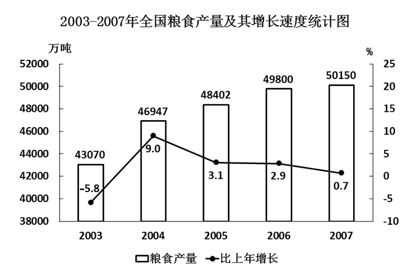

### 第 111 题

2002年我国的粮食产量约为：

A. 45722万吨

B. 44965万吨

C. 44761万吨

D. 40709万吨

第 111 题 · 答案与解析

**参考答案（粉笔题库参考内容）**

A

**解析**

根据题干“2002年我国的粮食产量约为”，结合统计图中时间为2003年，可判定本题为基期计算问题。定位统计图可得：2003年我国的粮食产量为43070万吨，增长率为-5.8%。根据公式：基期量，可得2002年我国的粮食产量万吨，只有A项满足。

故正确答案为A。

### 第 112 题

2007年我国粮食的平均亩产量约为（1公顷=15亩）：

A. 475公斤

B. 416公斤

C. 368公斤

D. 317公斤

第 112 题 · 答案与解析

**参考答案（粉笔题库参考内容）**

D

**解析**

根据题干“2007年我国粮食的平均亩产量约为”，结合材料时间为2007年，可判定本题为现期平均数问题。定位文字材料第一、二段可得：2007年我国粮食种植面积10553万公顷，全年粮食产量50150万吨。则2007年我国粮食的平均产量吨/亩吨/亩=313公斤/亩，即2007年我国粮食的平均亩产量约为313公斤，与D项最接近。

故正确答案为D。

备注：1吨=1000公斤=2000斤。

### 第 113 题

下列阴影部分最能体现2006年秋粮产量占当年粮食产量比重的是：

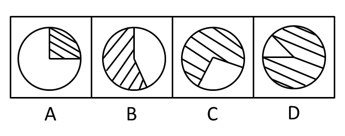

A. A

B. B

C. C

D. D

第 113 题 · 答案与解析

**参考答案（粉笔题库参考内容）**

C

**解析**

根据题干“2006年秋粮产量占当年粮食产量比重”，结合材料中秋粮产量时间为2007年，可判定本题为基期比重问题。定位文字材料第二段可得：2007年秋粮产量35420万吨，增产0.6%；定位统计图：2006年粮食产量为49800万吨。根据公式：，可得2006年秋粮产量万吨，则2006年秋粮产量占当年粮食产量比重≈70%，观察选项，只有C项满足。

故正确答案为C。

### 第 114 题

能够从上述资料中推出的是：

A. 2005年我国粮食的种植面积

B. 2005年我国早稻的产量

C. 2006年我国茶叶的产量

D. 2006年我国猪肉的产量

第 114 题 · 答案与解析

**参考答案（粉笔题库参考内容）**

C

**解析**

A项：定位文字材料第一段可得：2007年我国粮食种植面积10553万公顷，比上年增加70万公顷。缺少条件，无法推出2005年我国粮食的种植面积；

B项：定位文字材料第二段可得：2007年早稻产量3196万吨，增产0.3%。缺少条件，无法推出2005年我国早稻的产量；

C项：定位文字材料第三段可得：2007年茶叶产量114万吨，增产10.9%。根据公式：，可求出2006年我国茶叶的产量，故可以推出；

D项：定位文字材料第四段可得：全年······其中，猪肉减少9.2%。缺少条件，无法推出2006年我国猪肉的产量。

故正确答案为C。

### 第 115 题

以下说法中，正确的有：

Ⅰ．2003—2007年我国的粮食产量是逐年增长的

Ⅱ．2006年我国的棉花产量不足750万吨

Ⅲ．2006年我国的油料产量超过2500万吨

Ⅳ．2006年我国的水产品产量不足4500万吨

A. 1个

B. 2个

C. 3个

D. 4个

第 115 题 · 答案与解析

**参考答案（粉笔题库参考内容）**

B

**解析**

Ⅰ：定位统计图可得：2003—2007年我国的粮食产量是逐年增长的，正确；

Ⅱ：定位文字材料第三段可得：2007年全年棉花产量760万吨，比上年增产1.3%。根据公式：，可得2006年我国的棉花产量\=760-760×1.3%=760-9.88=750.12万吨，非不足750万吨，错误；

Ⅲ：定位文字材料第三段可得：2007年油料产量2461万吨，减产4.2%。根据公式：，可得2006年我国的油料产量2461+2461×4.2%＞2461+2400×4%=2461+96=2557万吨，即超过2500万吨，正确；

Ⅳ：定位文字材料第四段可得：2007年全年水产品4737万吨，增长3.3%。根据公式：，可得2006年我国的水产品产量4737-4737×3.3%＞4737-5000×3.3%=4737-165=4572万吨，并非不足4500万吨，错误。

故Ⅰ、Ⅲ正确，共2个。

故正确答案为B。

## 材料 2

2006年末，浙江省拥有人才资源数379.5万人，比2005年增长18.7%；每万人口中拥有人才资源数达820人，比2005年增长18%。人才资源中拥有大专及以上学历人员204.3万人，比2005年增长26%；拥有高级技术职称人员13.7万人，比2005年增长23.9%。

2006年，浙江省各市、县（市、区）本级财政科技拨款为44.6亿元，比2005年增长31%；本级财政科技拨款占本级财政支出的比例达4.19%，比2005年提高0.42个百分点。财政科普活动经费拨款为6632万元，比2005年增长23.2%，人均科普活动经费达1.43元，比2005年提高0.25元。

2006年，全省全社会科技活动经费内部支出达407.8亿元，比2005年增长26.9%，科技活动经费内部支出占地区生产总值的比例达2.59%，比2005年提高0.2个百分点；其中，全社会研究与试验发展（R&D）经费支出224亿元，比2005年增长37.2%，R&D经费支出占地区生产总值的比例达1.42%，比2005年提高0.2个百分点。规模以上工业企业技术开发经费支出328.1亿元，比2005年增长26.7%，企业技术开发经费占产品销售收入的比例由2005年的1.14%提高到2006年的1.15%。企业消化吸收经费支出占引进国外技术经费支出的比例也由2005年的29%提高到2006年的46.7%。

### 第 116 题

2006年的浙江省人才资源中拥有大专及以上学历人员约占全省人才资源总数的：

A. 56.5%

B. 55.3%

C. 53.8%

D. 52.8%

第 116 题 · 答案与解析

**参考答案（粉笔题库参考内容）**

C

**解析**

根据题干“2006年······约占······”，结合材料时间为2006年，可判定本题为现期比重问题。定位文字材料第一段可得：2006年末，浙江省拥有人才资源数379.5万人······人才资源中拥有大专及以上学历人员204.3万人。则2006年拥有大专以上学历人员占全省人才资源总数的比重。

故正确答案为C。

### 第 117 题

2005年浙江省各市、县（市、区）本级财政科技拨款约为：

A. 34.81亿元

B. 34.63亿元

C. 34.35亿元

D. 34.05亿元

第 117 题 · 答案与解析

**参考答案（粉笔题库参考内容）**

D

**解析**

根据题干“2005年······本级财政科技拨款约为”，结合材料时间为2006年，可判定本题为基期计算问题。定位文字材料第二段可得：2006年，浙江省各市、县（市、区）本级财政科技拨款为44.6亿元，比2005年增长31%。根据公式：，可得2005年浙江省各市、县（市、区）本级财政科技拨款亿元。

故正确答案为D。

### 第 118 题

从上述资料可以推出2006年浙江省的地区生产总值约为：

A. 1.64万亿元

B. 1.58万亿元

C. 1.41万亿元

D. 1.32万亿元

第 118 题 · 答案与解析

**参考答案（粉笔题库参考内容）**

B

**解析**

定位文字材料第三段可得：2006年，全省全社会科技活动经费内部支出达407.8亿元······科技活动经费内部支出占地区生产总值的比例达2.59%。根据总体，可得2006年浙江省的地区生产总值亿元=1.57万亿元，与B项最接近。

故正确答案为B。

### 第 119 题

2006年浙江省规模以上工业企业产品销售收入约为：

A. 2.85万亿元

B. 2.98万亿元

C. 3.12万亿元

D. 3.18万亿元

第 119 题 · 答案与解析

**参考答案（粉笔题库参考内容）**

A

**解析**

定位文字材料第三段可得：2006年······规模以上工业企业技术开发经费支出328.1亿元······企业技术开发经费占产品销售收入的比例由2005年的1.14%提高到2006年的1.15%。根据总体，可得2006年浙江省规模以上工业企业产品销售收入亿元=2.85万亿元。

故正确答案为B。

### 第 120 题

以下说法中，不正确的有：

A. 2005年浙江省拥有人才资源数不足325万人

B. 2006年浙江省拥有高级技术职称人员占全省人才资源总数的比例超过3%

C. 2005年浙江省每万人口中拥有人才资源数超过685人

D. 2005年浙江省全社会研究与试验发展（R&D）经费支出不足150亿元

第 120 题 · 答案与解析

**参考答案（粉笔题库参考内容）**

D

**解析**

A项：定位文字材料第一段可得：2006年末，浙江省拥有人才资源数379.5万人，比2005年增长18.7%。根据公式：基期量，可得2005年浙江省拥有人才资源数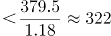亿元＜325亿元，即不足325亿元，正确；

B项：定位文字材料第一段可得：2006年末，浙江省拥有人才资源数379.5万人······拥有高级技术职称人员13.7万人。则2006年浙江省拥有高级技术职称人员占全省人才资源总数的比例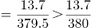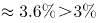，即超过3%，正确；

C项：定位文字材料第一段可得：2006年末······每万人口中拥有人才资源数达820人，比2005年增长18%。根据公式：基期量，可得2005年浙江省每万人口中拥有人才资源数人＞685人，即超过超过685人，正确；

D项：定位文字材料第三段可得：2006年······全社会研究与试验发展（R&D）经费支出224亿元，比2005年增长37.2%。根据公式：基期量，可得2005年浙江省全社会研究与试验发展（R&D）经费支出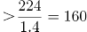亿元＞150亿元，并非不足150亿元，错误。

本题为选非题，故正确答案为D。

## 材料 3

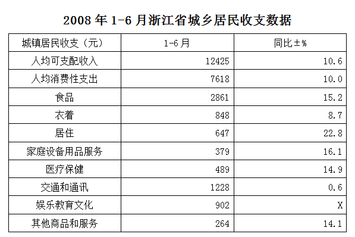

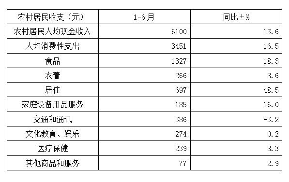

### 第 121 题

2008年1—6月，城镇居民8类人均消费性支出占人均消费性总支出的比重超过10%的有：

A. 2个

B. 3个

C. 4个

D. 5个

第 121 题 · 答案与解析

**参考答案（粉笔题库参考内容）**

C

**解析**

根据题干“2008年1—6月······占······的比重······”，结合材料时间为2008年1—6月，可判定本题为现期比重问题。定位统计表可得：2008年1—6月，城镇居民人均消费性总支出为7618元，则城镇居民人均消费性总支出的10%为7618×10%=761.8元。观察表格中数据，食品（2861元）、衣着（848元）、交通和通讯（1228元）、娱乐教育文化（902元）的人均消费性支出均超过了761.8元，故共有4类人均消费性支出占人均消费性总支出的比重超过10%。

故正确答案为C。

### 第 122 题

2007年1—6月，农村居民8类消费性支出中，第三高的是：

A. 居住

B. 交通和通讯

C. 文化教育、娱乐

D. 衣着

第 122 题 · 答案与解析

**参考答案（粉笔题库参考内容）**

B

**解析**

根据题干“2007年1—6月······第三高的是”，结合材料时间为2008年1—6月，可判定本题为基期比较问题。定位表2可得：2008年1—6月农村居民8类消费性支出金额和同比增速。根据公式：基期量，可得2007年1—6月农村居民食品支出元，居住支出元，交通和通讯支出元。由于2008年1—6月其余5类消费性支出金额均小于300元，且同比增速均大于0，则2007年1—6月其余5类消费性支出金额均小于300元。综上，2007年1—6月农村居民8类消费性支出中，第三高的是交通和通讯。

故正确答案为B。

### 第 123 题

已知2007年1—6月，城镇居民用于“娱乐教育文化”的人均消费性支出为927元，则上表中“x”的值约为：

A. \-2.7

B. 2.7

C. \-2.8

D. 2.8

第 123 题 · 答案与解析

**参考答案（粉笔题库参考内容）**

A

**解析**

根据题干“上表中‘x’的值约为”，结合表格第三列为增长率数据，可判定本题为一般增长率问题。定位统计表可得：2008年1—6月城镇居民用于“娱乐教育文化”的人均消费性支出为902元。根据公式：增长率，可得，故。

故正确答案为A。

### 第 124 题

2007年1—6月，城镇居民人均可支配收入约是农村居民人均现金收入的：

A. 1.82倍

B. 1.89倍

C. 2.04倍

D. 2.09倍

第 124 题 · 答案与解析

**参考答案（粉笔题库参考内容）**

D

**解析**

根据题干“2007年1—6月······约是······”，结合材料时间为2008年1—6月，选项单位为“倍”，可判定本题为基期倍数问题。定位统计表可得：2008年1—6月城镇居民人均可支配收入为12425元，同比增长10.6%；农村居民人均现金收入为6100元，同比增长13.6%。根据公式：基期倍数，即\>2.04，只有D项满足。

故正确答案为D。

### 第 125 题

下列说法中，不正确的一项是：

A. 2008年1-6月，城镇居民人均消费性支出比农村居民人均消费性支出的2倍还多

B. 2007年1-6月，城镇居民用于“衣着”的人均消费性支出比农村居民用于“衣着”的人均消费性支出的3倍还多

C. 2007年1-6月，农村居民用于“交通和通讯”及“医疗保健”的人均消费性支出之和不足600元

D. 2008年1-6月，城镇居民和农村居民用于“食品”的人均消费性支出都超过各自人均消费性支出的三分之一

第 125 题 · 答案与解析

**参考答案（粉笔题库参考内容）**

C

**解析**

A项：定位表1和表2可得：2008年1-6月，城镇居民人均消费性支出和农村居民人均消费性支出分别为7618元和3451元。由于，即2倍还多，正确；

B项：定位表1和表2可得：2008年1-6月，城镇居民用于“衣着”的人均消费性支出为848元，同比增长8.7%；农村居民用于“衣着”的人均消费性支出为266元，同比增长8.6%。根据公式：基期倍数，则2007年1-6月，城镇居民用于“衣着”的人均消费性支出是农村居民用于“衣着”的人均消费性支出的倍，即3倍还多，正确；

C项：定位表2可得：2008年1-6月，农村居民用于“交通和通讯”的人均消费性支出为386元，同比增长-3.2%，用于“医疗保健”的人均消费性支出为239元，同比增长8.3%。根据公式：基期量，则2007年1-6月农村居民用于“交通和通讯”及“医疗保健”的人均消费性支出之和元，并非不足600元，错误；

D项：定位表1和表2可得：2008年1-6月，城镇居民人均消费性支出为7618元，用于“食品”的人均消费性支出为2861元；农村居民人均消费性支出为3451元，用于“食品”的人均消费性支出为1327元。根据公式：比重，则2008年1-6月城镇居民用于“食品”的人均消费性支出占人均消费性支出的，农村居民用于“食品”的人均消费性支出占人均消费性支出的，即占比都超过三分之一，正确。

本题为选非题，故正确答案为C。

## 材料 4

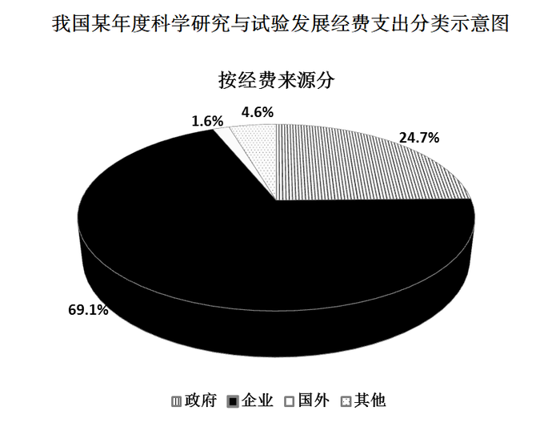

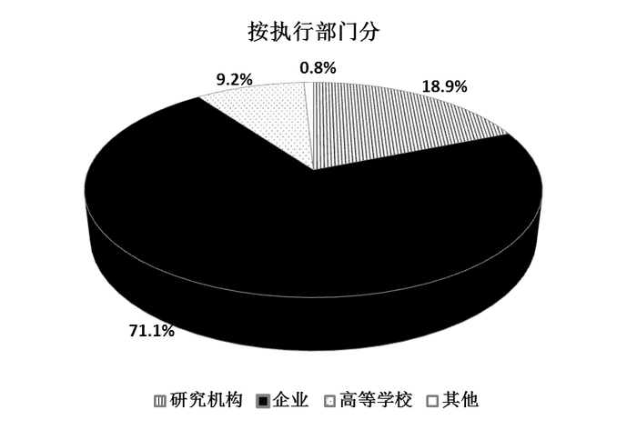

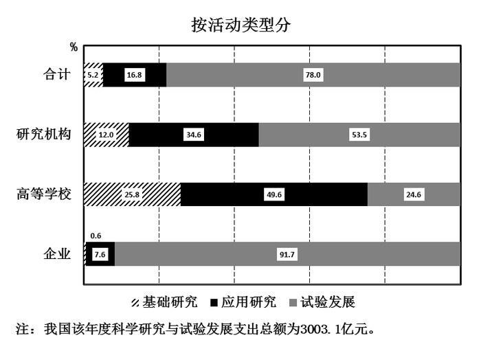

### 第 126 题

按执行部门分，该年度我国企业部分的“科学研究与试验发展经费支出”约为：

A. 567.6亿元

B. 2135.2亿元

C. 2075.1亿元

D. 2353.2亿元

第 126 题 · 答案与解析

**参考答案（粉笔题库参考内容）**

B

**解析**

根据题干“······企业部分的‘科学研究与试验发展经费支出’约为”，结合统计图、备注中给出占比和总额，可判定本题为现期比重问题。定位统计图及备注可得：我国该年度科学研究与试验发展支出总额为3003.1亿元；按执行部门分，企业部分占比为71.1%。根据公式：部分=总体×比重，则该年度我国企业部分的“科学研究与试验发展经费支出”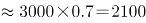亿元，与B项最接近。

故正确答案为B。

### 第 127 题

按经费来源分，该年度我国企业部分的“科学研究与试验发展经费支出”约比政府部分：

A. 多44.4%

B. 少44.4%

C. 多1333.4亿元

D. 多1567.6亿元

第 127 题 · 答案与解析

**参考答案（粉笔题库参考内容）**

C

**解析**

根据题干“······企业部分的‘科学研究与试验发展经费支出’约比政府部分”，结合统计图、备注中给出占比和总额，可判定本题为现期比重问题。定位统计图及备注可得：我国该年度科学研究与试验发展支出总额为3003.1亿元；按经费来源分，企业占比69.1%，政府占比24.7%。根据公式：部分，可得按经费来源分，该年度我国企业部分的“科学研究与试验发展经费支出”约比政府部分多亿元，与C项最接近。

故正确答案为C。

### 第 128 题

该年度我国高等学校用于应用研究部分的“科学研究与试验发展经费支出”约为：

A. 95.6亿元

B. 137.0亿元

C. 196.4亿元

D. 1489.5亿元

第 128 题 · 答案与解析

**参考答案（粉笔题库参考内容）**

B

**解析**

根据题干“······高等学校用于应用研究部分的‘科学研究与试验发展经费支出’约为”，结合统计图、备注中给出占比和总额，可判定本题为现期比重问题。定位统计图及备注可得：我国该年度科学研究与试验发展支出总额为3003.1亿元；按执行部门分，高等学校占比9.2%；按活动类型分，高等学校用于应用研究部分的占比49.6%。根据公式：部分，可得该年度我国高等学校用于应用研究部分的“科学研究与试验发展经费支出”亿元，与B项最接近。

故正确答案为B。

### 第 129 题

该年度我国研究机构用于基础研究部分的“科学研究与试验发展经费支出”约为企业用于应用研究部分的：

A. 1.6倍

B. 1/30

C. 13%

D. 42%

第 129 题 · 答案与解析

**参考答案（粉笔题库参考内容）**

D

**解析**

根据题干“该年度······约为······的”，结合选项为倍数，可判定本题为现期倍数问题。定位统计图及备注可得：我国该年度科学研究与试验发展支出总额为3003.1亿元；按执行部门分，研究机构占比18.9%，企业占比71.1%；按活动类型分，研究机构用于基础研究部分的占比12.0%，企业用于应用研究部分的占比7.6%。该年度我国研究机构用于基础研究部分的“科学研究与试验发展经费支出”约为企业用于应用研究部分的，即40%，与D项最接近。

故正确答案为D。

### 第 130 题

该年度我国企业的“科学研究与试验发展经费支出”中，用于应用研究的约比用于基础研究的多：

A. 149.5亿元

B. 210.2亿元

C. 135.6亿元

D. 242.1亿元

第 130 题 · 答案与解析

**参考答案（粉笔题库参考内容）**

A

**解析**

根据题干“······企业的‘科学研究与试验发展经费支出’中，用于应用研究的约比用于基础研究的多”，选项为······亿元，结合统计图、备注中给出占比和总额，可判定本题为现期比重问题。定位统计图及备注可得：我国该年度科学研究与试验发展支出总额为3003.1亿元；按执行部门分，企业占比71.1%；按活动类型分，企业用于应用研究部分的占比7.6%，用于基础研究部分的占比0.6%。根据公式：部分，可得该年度我国企业的“科学研究与试验发展经费支出”中，用于应用研究的约比用于基础研究的多≈149亿元，与A项最接近。

故正确答案为A。

