# 2010年浙江省公务员录用考试《行测》题（A类）

<!-- gwy:overview:start -->
> **浙江 · 2010 · 行测 · A类** ｜ 130 题 · 图片 204 处 · 答案随题折叠

| 题型模块 | 题量 | 题号 |
| --- | ---: | ---: |
| 言语理解与表达 | 35 | 1–35 |
| 判断推理 | 30 | 36–65 |
| 数量关系 | 25 | 66–90 |
| 综合知识 | 20 | 91–110 |
| 资料分析 | 20 | 111–130 |
| **合计** | **130** | |

导航：[题型与作答说明](#题型与作答说明) · [题目](#题目) · [材料 1](#材料-1)
<!-- gwy:overview:end -->

> 候选采集稿。参考答案及解析来自粉笔页面，不代表官方答案或真实高分答卷；来源使用许可与原卷对应关系仍需人工核实。

## 题型与作答说明

言语理解与表达

（35题）

每道题包含一个句子或一段话，后面是一个不完整的陈述，要求是从四个选项中选出一个来完成陈述。你的选择应与所提要求最相符合。

判断推理

（30题）

本部分包括图形推理、类比推理、逻辑判断与定义判断四种类型的试题。

数量关系

（25题）

本部分包括数字推理与数学运算两种类型的试题。

综合知识

（20题）

根据题目要求，在四个选项中选出一个正确答案。

资料分析

（20题）

所给出的图、表或一段文字均有5个问题要你回答。你应根据资料所提供的信息进行分析、比较、计算和判断处理。

## 题目

### 第 1 题

在过去六十年中，现代中国的建设走过一条          的道路，经历过无数艰辛、动荡、摇摆与反复，既有山重水复之           ，也有柳暗花明之转机。

填入横线部分最恰当的一项是：

A. 循环往复 迷惘

B. 迂回曲折 困惑

C. 艰难险阻 迷惑

D. 跌宕起伏 困难

第 1 题 · 答案与解析

**参考答案（粉笔题库参考内容）**

B

**解析**

考查成语与实词混搭填空。

第一空，所填的词语用来形容“现代中国的建设道路”，根据“艰辛、动荡、摇摆与反复”，可知这条道路既反复又曲折。B项，“迂回曲折”既能体现反复，又能体现曲折，保留；A项，“循环往复”只能体现摇摆和反复，排除；C项，“艰难险阻”指前进道路上的困难、危险和障碍，仅能体现“艰辛、动荡”，无法体现“摇摆与反复”，排除；D项，“跌宕起伏”仅能体现动荡，排除。

第二空，代入验证，“既有······也有······”体现前后是一个反义并列，“困惑”与“转机”对应准确。

故正确答案为B。

### 第 2 题

《功夫熊猫》的热映说明“中国元素”已不仅仅只是好莱坞电影中的          ，它甚至已经成好莱坞电影导演的灵感来源，片中“功夫”和“熊猫”两个主要元素都来自中国文化，而猴王、老虎、螳螂、毒蛇、丹顶鹤等五大高手更是把中国功夫中的轻功演绎得          。

填入横线部分最恰当的一项是：

A. 点缀 惟妙惟肖

B. 卖点 栩栩如生

C. 陪衬 精妙绝伦

D. 题材 活灵活现

第 2 题 · 答案与解析

**参考答案（粉笔题库参考内容）**

A

**解析**

第一空，根据文段中关联词“不仅仅······甚至”可知第一空填的词语与“灵感来源”构成递进关系，语义比“灵感来源”轻。A项“点缀”指对事物加以衬托或装饰，使原有事物更加美好，C项“陪衬”指的是衬托，均符合文意；B项“卖点”指商品具备了别出心裁或与众不同的特色、特点，D项“题材”指的是为表现作品主题所用的材料，均程度过重，排除。

对比“点缀”和“陪衬”，“点缀”的感情色彩更为积极，表示用本来就美好的事物去装饰其他事物，锦上添花；而“陪衬”只是中性词，体现不出积极的感情色彩，对应“中国元素”，“点缀”更为恰当，基本锁定A项。

第二空，横线处表示“五大高手更是把中国功夫中的轻功演绎得非常像”，A项“惟妙惟肖”形容描写模仿得非常逼真，或是雕刻得十分逼真，符合语境；C项“精妙绝伦”形容精美巧妙到了极点，与文段“演绎”搭配不当，排除。

故正确答案为A。

### 第 3 题

奥运一百多年的历史始终陷入一种          ，一方面它高扬超越民族的人类精神，另一方面参与竞争的基本单位是民族国家。前者表现为超越功利的尊重和欣赏；后者则是更实在的、不敢怠慢的国家荣誉和自尊心，金牌多寡成了竞争的          。

填入横线部分最恰当的一项是：

A. 困境 准则

B. 矛盾 标志

C. 争议 目的

D. 悖论 核心

第 3 题 · 答案与解析

**参考答案（粉笔题库参考内容）**

D

**解析**

第一空，横线处对应“一方面它高扬超越民族的人类精神，另一方面参与竞争的基本单位是民族国家”，体现的是一种相反的观点。B项“矛盾”符合；D项“悖论”指在逻辑上可以推导出互相矛盾之结论，但表面上又能自圆其说的命题或理论体系，符合；而A项“困境”和C项“争议”体现不出“一方面······另一方面”中背道而驰的观点，排除。

第二空，横线处的主语是“金牌的多寡”，具有一定的不确定性，而“准则”“标志”“目的”都是明确性的，用“核心”更贴切。

故正确答案为D。

### 第 4 题

我无法不老，但我还有可能年轻，我不敢对我们过于庞大的文化有什么祝祈，却希望看完自己笔下的文字能有一种          后的回味、焦灼后的会心、冥思后的放松、苍老后的年轻，当然，希望也只是希望罢了，何况这实在已是一种          。

填入横线部分最恰当的一项是：

A. 苦涩 奢望

B. 辛酸 奢求

C. 历练 幻想

D. 风雨 梦境

第 4 题 · 答案与解析

**参考答案（粉笔题库参考内容）**

A

**解析**

考查语境搭配的近义实词辨析与填空。

由“回味”可知，文段第一个空应选“苦涩”或“辛酸”等与味觉相关的通感类的词汇，排除C、D两项；“辛酸”常比喻个人遭遇的悲苦，与文段积极乐观的语境不符，排除B项。

“奢望”与“希望”对应，比喻因要求过高而难以实现的希望。

故正确答案为A。

### 第 5 题

毫无疑问，在今日武断批判中医的人中，不乏以“科学”代言人自居者，将各种自己不懂的知识系统一棍子打死，归入          ，这种态度不能不使人怀疑其言论与知识的讨论无关，另有用意。不过，在抗拒这种学霸的同时，我们也不必要陷入相反的          ，坦率地说，身为一个“中医”，我以为目前的中医面临的最大危机不是外来的，而是内在的，中医沦落到今天这个地步，一定程度上可谓是          。

填入横线部分最恰当的一项是：

A. 邪说 境地 罪有应得

B. 异端 泥潭 咎由自取

C. 异己 泥潭 责无旁贷

D. 异类 困境 作茧自缚

第 5 题 · 答案与解析

**参考答案（粉笔题库参考内容）**

B

**解析**

考查语境搭配的近义实词与成语填空。

“异端”的意思是异常的征兆，现多指自认为正统者对异己的思想、理论的称呼。文中提到“将各种自己不懂的知识系统一棍子打死”，所以“异端”更加符合语境语义。

“罪有应得”指按罪恶或错误的性质，理应得到这样的惩罚；“咎由自取”意为灾祸或罪过是自己招来的，指自作自受；“责无旁贷”意指自己的责任，不能推卸给别人；“作茧自缚”意为做了某件事，结果使自己受困，也比喻自己给自己找麻烦。文段侧重于危机的来源，“咎由自取”贴合题意。

“陷入泥潭”和“陷入困境”均为固定搭配，但“泥潭”比“困境”更生动。

故正确答案为B。

### 第 6 题

至少在中文世界，将儒家传统定性为一种“人文主义”，已经成为学界的          ，而视儒家传统为一种“宗教”，或者认为儒家传统具有一种宗教性，自清末民初以来一直聚讼不已，至今          。

填入横线部分最恰当的一项是：

A. 公认 尚无定论

B. 共鸣 未置可否

C. 共识 莫衷一是

D. 惯例 前途未卜

第 6 题 · 答案与解析

**参考答案（粉笔题库参考内容）**

C

**解析**

考查语境搭配的近义实词与成语填空。

“共识”的意思是指一个社会不同阶层、不同利益的人所寻求的共同认识、价值、理解。文中指出将儒家传统定义为一种“人文主义”是学界的一致观点，“共识”较其它词更符合语境；由句意可知第一空应该填的是名词，而“公认”的动词，排除A。

第二空前的“聚讼不已”是众说纷纭、争论不休的意思；“尚无定论”意为尚且还没有下结论；“未置可否”意为不表示同意，也不表示反对；“莫衷一是”意为不知哪个是正确，形容意见分歧，没有一致的看法；“前途未卜”意为将来的光景不能预测。文段中人们对儒家传统是否是一种“宗教”这个问题“一直争论不休”，各持一方，至今都不知道哪个是正确的，用“莫衷一是”恰当。

故正确答案为C。

### 第 7 题

很长一段时间以来，文学          了，文学家们似乎都已经退隐到超凡脱俗的文学世界里，或专营文学技术的革新，或致力于自我感情的          ，在各种重大场合都很难看到文学的身影。

填入横线部分最恰当的一项是：

A. 消失 装饰

B. 寂静 掩饰

C. 沉默 宣泄

D. 沉寂 雕饰

第 7 题 · 答案与解析

**参考答案（粉笔题库参考内容）**

D

**解析**

考查语境搭配的近义实词辨析与填空。

“沉寂”的意思是杳无音讯。文中提到“文学家们似乎都已经退隐到超凡脱俗的文学世界里”，“沉寂”与“退隐”相呼应，更加符合语境语义。

文段中第二空的对象为“感情”，“雕饰”指过分地刻画修饰，符合题意，其余三项搭配不当。

故正确答案为D。

### 第 8 题

诚然，在相当长的一段时间里，对抗或叛逆确实是中国当代诗歌完成自我          的法则之一，以真实取代虚假，以个人反抗群体，以感性抵制理性，以平面消除深度，中国当代诗歌正是在这种不断地反叛中实行着某种          。

填入横线部分最恰当的一项是：

A. 衍变 更新

B. 蜕变 更迭

C. 嬗变 替换

D. 演变 置换

第 8 题 · 答案与解析

**参考答案（粉笔题库参考内容）**

B

**解析**

考查语境搭配的近义实词辨析与填空。

根据“以真实取代虚假，以个人反抗群体，以感性抵制理性，以平面消除深度”可知，中国当代诗歌的变化是本质上的改变，A项“衍变”意为通过进化而发展；B项“蜕变”意为人物或者事情发生质变；C项“嬗变”指彻底改变，一般指观念或政权的变化；D项“演变”指历时较久的发展变化。因此，选择“蜕变”更为合适。

第二空，代入验证，“更迭”意为轮流更替，符合文意。

故正确答案为B。

### 第 9 题

静一点也好，从柳宗元开始，这里历来寂静，京都太嘈杂了。面壁十年的九州学子，都曾          过这种嘈杂。结果，满腹经纶被车轮马蹄捣碎，脆亮的吆喝填满了疏朗的胸襟，唯有在这里，文采华章才从朝报奏折中抽出，重新          心灵，并形成反面。

填入横线部分最恰当的一项是：

A. 期待 注入

B. 迷恋 塞入

C. 奢求 灌入

D. 向往 凝入

第 9 题 · 答案与解析

**参考答案（粉笔题库参考内容）**

D

**解析**

考查语境搭配的近义实词辨析与填空。

本题可从第二空入手，根据“满腹经纶”“疏朗的胸襟”“文采华章”可知文段的语言表达非常书面化，第二空搭配“心灵”，A项“注入”、B项“塞入”、C项“灌入”比较写实，结合前文的“文采华章”，“凝入心灵”表达更加形象生动，排除。

第一空，代入验证，“向往这种嘈杂”搭配得当。

故正确答案为D。

### 第 10 题

中国六十年的经济发展历程，是一个在以发达国家为主导的全球资本主义体系当中，如何在农业人口大国的基础上，艰苦地完成工业化的原始积累，进入产业资本扩张阶段，并开始向金融资本阶段          的过程。

填入横线部分最恰当的一项是：

A. 上升

B. 跨越

C. 跃进

D. 跃升

第 10 题 · 答案与解析

**参考答案（粉笔题库参考内容）**

D

**解析**

由文段可知，中国由“产业资本扩张阶段”开始进入到“金融资本阶段”，这是一个迅速的上升阶段，是一个纵向的发展过程，D项“跃升”指跳跃式地上升，指在名次、地位、价位等方面越过前面的次第迅速上升，既能体现出上升的速度，也能体现纵向提升，当选。

A项“上升”和B项“跨越”没有突显出“速度”；C项“跃进”与D项“跃升”比较，“跃升=跃进+上升”，D项“跃升”语义丰富，优选。

故正确答案为D。

### 第 11 题

作为启蒙思想家，他们的思想和言论激烈、出格，乃至“悖于常理”，这都在情理之中，因为思想的创造需要那种“虽千万人，吾往矣”的对抗俗世的气概与意志，所以“          ”并非思想家的缺陷，也绝非衡量思想之深度、广度乃至力度的标准。

填入横线部分最恰当的一项是：

A. 危言耸听

B. 虚张声势

C. 夸夸其谈

D. 豪言壮语

第 11 题 · 答案与解析

**参考答案（粉笔题库参考内容）**

A

**解析**

横线处表示启蒙思想家的思想和言论激烈、出格，体现启蒙思想家的语出惊人，A项“危言耸听”指故意说些夸大的吓人的话，使人惊疑震动；B项“虚张声势”指假装出强大的气势；C项“夸夸其谈”形容说话、写文章浮夸不切实际，表贬义；D项“豪言壮语”形容充满英雄气概的话。A项符合文意，当选。

故正确答案为A。

### 第 12 题

传统经济学习惯铺陈宏大的讲说辞，在人性的细节方面，总是          ，被抽空了细节的经济学，虽          ，拥有如庙堂般巍峨的气势，却还原和解读不了世界的真实。

填入横线部分最恰当的一项是：

A. 语焉不详 高屋建瓴

B. 闪烁其词 博大精深

C. 含糊其辞 鞭辟入里

D. 捉襟见肘 天马行空

第 12 题 · 答案与解析

**参考答案（粉笔题库参考内容）**

A

**解析**

考查语境搭配的成语辨析与填空。

语焉不详：指虽然提到了，但说得不详细；闪烁其词：指不肯透露真相或回避要害问题；含糊其辞：形容有顾虑，不敢把话照直说出来；捉襟见肘：比喻十分穷困。根据词意以及文中“铺陈宏大”和“细节方面”可知是指说的不够详细，因此第一空应填“语焉不详”。

高屋建瓴：把瓶子里的水从高层顶上倾倒，比喻居高临下，不可阻遏；博大精深：形容思想和学识广博高深；鞭辟入里：鞭打触及到了衣服的最里层，形容做学问切实，也形容分析透彻，切中要害；天马行空：比喻思想奔放，任意驰骋，后来又比喻浮躁不安。根据文段，此处填的成语应与“拥有如庙堂般巍峨的气势”相呼应，用“高屋建瓴”最为恰当。

故正确答案为A。

### 第 13 题

工业革命以来，两百余年的时间，生产力的飞速提高造就了昌盛的工业文明，在人类为自己创造的奇迹          时，却丝毫不曾察觉已经在透支未来；知识与技术的瓶颈，以及人性的          让工业文明在创造辉煌的同时也走向了尽头。

填入横线部分最恰当的一项是：

A. 洋洋得意 虚伪

B. 陶醉 无知

C. 沉迷 罪恶

D. 沾沾自喜 贪婪

第 13 题 · 答案与解析

**参考答案（粉笔题库参考内容）**

D

**解析**

考查语境搭配的实词与成语填空。

“洋洋得意”形容得意时神气十足的姿态；“沾沾自喜”形容自以为不错而得意的样子。题干第一个空应是形容人们认为工业文明成就卓越而得意，“沾沾自喜”贴合题意，排除A项。

第二个空涉及人性，不能用“无知”或“罪恶”描述，排除B、C两项；文段描述工业文明辉煌的物质成就走向尽头的原因，与之相对应的是人性的负面因素，“贪婪”与句中的“透支”相呼应，更符合语境。

故正确答案为D。

### 第 14 题

说“把玩学术”不大合适，显得有点          ，但如果是“沉潜把玩”呢？其实读书做学问，目的性太强，很难达到痛快淋漓、出神入化的地步。这一点，学问与游戏之道是          的，缺乏足够的好奇心，求知欲，距离感，反而做不好。按照今日不少人的“学者”标准恐怕传统中国读书人，全都是业余性质——可那种“爱美的”读书人，自有          之处。

填入横线部分最恰当的一项是：

A. 轻浮 相近 可叹

B. 轻佻 相通 可爱

C. 轻慢 相似 可敬

D. 轻视 相仿 可赞

第 14 题 · 答案与解析

**参考答案（粉笔题库参考内容）**

B

**解析**

考查语境搭配的近义实词辨析与填空。

“轻浮”意为轻率浮躁，也指言行举止随便、不稳重、不庄重；“轻佻”指言行举止不沉着，不严肃；“轻慢”指对人不尊重，态度傲慢；“轻视”指小看、小瞧。文段中“把玩学术”，把学术当做一件玩具在手中把弄玩耍，未免有些不严肃，故用“轻佻”最贴切。

“相通”的意思是彼此沟通、连通、互相通融。文中首先指出“读书做学问，目的性太强，很难达到痛快淋漓、出神入化的地步”，紧接着表达“学问与游戏之道”的一致，表明融会贯通之意，“相通”符合文意。

“可那种‘爱美的’读书人”，即把做学问当做游戏，自有可爱之处。

故正确答案为B。

### 第 15 题

《汉魏两晋南北朝佛教史》于1938年问世，至今已超过半个世纪，此书规模之          ，结构之严谨，材料之丰富，考证之          ，问题提出之深刻，剖析解释之          ，实在可为中外学者们的楷模。

填入横线部分最恰当的一项是：

A. 宏大 精准 周全

B. 恢宏 精确 周密

C. 庞大 精到 周评

D. 宏伟 精妙 周严

第 15 题 · 答案与解析

**参考答案（粉笔题库参考内容）**

B

**解析**

本题从第二空入手，修饰“考证”，C项“精到”指精细周到，D项“精妙”意为精致巧妙，不能修饰“考证”，排除；B项“精确”指精密而准确，正确，锁定B项。

第三空，形容“剖析解释”，B项“周密”指周到缜密，符合文意，正确。A项“周全”指周到全面，与“剖析解释”搭配不当，排除。

第一空，代入验证，规模恢宏，搭配恰当，符合文意，当选。

故正确答案为B。

### 第 16 题

一直到九十年代中期以前，我们都在试图重新寻找自己的精神家园，钱穆、钱钟书和陈寅恪的著作和传记成了畅销书。《顾准文集》、《顾准日记》          于市场，这个中国“市场经济第一人”，坚持学术自由的孤独者形象，          了人们对于知识分子的期许。《傅雷家书》长达二十余年的畅销，成为了          的“三字经”，浪漫骑士王小波横空出世，给这个日益保守的社会打开了一个叛逆的缺口。

填入横线部分最恰当的一项是：

A. 充斥 符合 金玉良言

B. 风靡 印证 字字珠玑

C. 风行 满足 老少咸宜

D. 充塞 引发 家喻户晓

第 16 题 · 答案与解析

**参考答案（粉笔题库参考内容）**

C

**解析**

第一空，对应前文的“畅销书”，表示这两本书在市场上很受欢迎、很流行，A项“充斥”指多得到处都是，也有充满的意思，程度过重，排除；D项“充塞”意为塞满，充满，程度过重，排除；B、C两项均表示流行、盛行，符合。

第二空，搭配“期许”，“满足期许”为常用搭配，而“印证”表示验证，与“期许”搭配不当，排除，锁定C项。

第三空修饰“三字经”，C项“老少咸宜”指老的小的都适用，符合“三字经”的特点，正确。

故正确答案为C。

### 第 17 题

下列各句中，句意明确，没有语病的一句是（ ）。

A. 我国北方基地计划鼓励当地农民把波儿羊与当地的山羊进行杂交，以提高农民养羊的经济效益，满足发展羊肉产业的需要。

B. 司法腐败导致对有权势的罪犯的庇护，而贪污、受贿等职务犯罪的构成要件是当事人是否有职权。

C. 我们在坚定不移地坚持改革开放，大力发展社会生产力，增强我国的综合国力，不断提高人民生活。

D. 一部影视作品，要想有高的收视率或票房价值，作品本身要有质量和必要的包装宣传缺一不可。

第 17 题 · 答案与解析

**参考答案（粉笔题库参考内容）**

A

**解析**

B项，“贪污、受贿等职务犯罪的构成要件”与“是否有职权”属于一面对两面的错误。

C项，“提高生活”表述不当，应改为“不断提高人民生活水平”。

D项，语句杂糅，应去掉“作品本身要有”或者“缺一不可”。

故正确答案为A。

### 第 18 题

下列各句中，标点符号使用规范的一句是：

A. 绿色是多么宝贵呀！它是生命、它是希望、它是安慰、它是快乐。

B. 被郁郁苍苍的扁柏、蒲葵、一品红、木麻黄环绕着的三元里抗英斗争烈士纪念碑，在晴空下，金色的字迹正闪闪发光。

C. 今年我们公司的新年联欢晚会有以下节目——大合唱、男女声独唱、诗歌朗诵、舞蹈和杂技。

D. 我不知道这件事怎么会变成这个样子？但是，无论如何我们都应该竭尽全力把这件事情处理好。

第 18 题 · 答案与解析

**参考答案（粉笔题库参考内容）**

B

**解析**

考查辨析标点的能力。

A项，“它是XX”是句子，之间应该用逗号，应改为“绿色是多么宝贵呀！它是生命，它是希望，它是安慰，它是快乐。”

C项，破折号应改为冒号。破折号和冒号都可以表注释，但二者是有所区别的。一是分说部分，如果是总说部分的分项叙述，应用冒号，如C项的正确表达。如果是对总说部分的注释，则应用破折号，如“我国的四大发明——火药、印刷术、指南针、造纸术对世界历史的发展有伟大贡献”。二是凡是破折号表示注释的，可以把注释删去，句子的内容与形式仍是完整的。用冒号表示分说的句子则不能把分说部分删去，否则句子表意不完整。

D项，将问号改为句号，前句不是一个问句，而是一个陈述句。

故正确答案为B。

### 第 19 题

一个悲观的人，把所有的快乐都看成不快乐，好比美酒到充满胆汁的口中也会变苦一样，生命的幸福与困厄，不在于降临的事情本身是苦是乐，而要看我们如何去面对这些事。

这段文字意在告诉我们：

A. 世界原来是美好的，我们应该热爱生活

B. 用悲观的态度去认识世界，是人类的天性

C. 心情的颜色决定着世界的颜色

D. 为物所扰，为己所累，是现代人的生存困难

第 19 题 · 答案与解析

**参考答案（粉笔题库参考内容）**

C

**解析**

文段开篇举例，通过“悲观的人”这一例证，强调作者观点“不在于降临的事情本身是苦是乐，而要看我们如何去面对这些事”，意在强调，我们面对问题的心情决定了事情的色彩，对应C项。
A项“热爱生活”、B项“人类的天性”、D项“现代人的生存困难”均为无中生有选项，排除。

故正确答案为C。

### 第 20 题

日前大规模的信贷投款会引起通胀吗？如果经济复苏不明显，而银行系统依然开闸放水，那么大量资金并不能进入实体经济，从而会推高物价指数，并带来通胀，最坏的情况下甚至会形成“滞胀”；如果信贷的大规模投入伴随着经济复苏，那么，即使物价指数上涨，也是属于温和健康上涨，和通胀无关。

这段文字意在说明：

A. 通胀的影响要具体问题具体分析，不可一概而论

B. 大规模信贷投放与通胀的发生之间并无必然的因果关系

C. 物价上涨的程度，是判断通胀是否发生的主要指标

D. 在经济迅速增长的情况下，通胀是不大可能发生的

第 20 题 · 答案与解析

**参考答案（粉笔题库参考内容）**

B

**解析**

据提问可知此题为中心理解题。

文段开篇提出“大规模的信贷投款会引起通胀吗”这一问题，后文通过分号引导并列，强调大规模的信贷投款只有在经济复苏不明显的情况下才会形成通胀，而如果信贷的大规模投入伴随着经济复苏则和通胀无关。对问题进行回答，即大规模信贷投放不一定会引发通胀。

因此，结合选项应该选择B。

文段始终围绕“大规模信贷与通胀之间的关系”展开，A、C、D三项都没有体现两者之间的关系，且A项“通胀的影响”和D项无中生有，C项理解错误，根据文段有无通胀都发生在“物价上涨”的情况下，因此得不出该结论。

故正确答案为B。

### 第 21 题

只要一个国家的决策者，真心希望发展市场经济，愿意按照资本创造与流通的规律办事，能够尊重多数国民基于现实的财产占有与处置权利，就可以让多数所有权变得合法，从而创造出让合法财产灵活流动的环境，这正如将彼此孤立的湖泊，串连成一片巨大的水城，避免零星的湖水消失在一块块贫瘠的沙地里，大量资本流动起来，财富创造与经济效率就会在市场中野蛮生长。

对这段文字的主旨理解最准确的是：

A. 国家需尊重多数国民的财产占有与处置权利

B. 没有法律保护的所有权，是效率偏低、缺乏活力的所有权

C. 市场经济的发展程度与一国决策者的水平密切相关

D. 所有权合法化，是市场经济正常发展的关键

第 21 题 · 答案与解析

**参考答案（粉笔题库参考内容）**

D

**解析**

文段强调要满足“真心希望发展市场经济”，“愿意按照资本创造与流通的规律办事”，“能够尊重多数国民基于现实的财产占有与处置权利”这三个条件，就能达到所有权合法化，从而创造出让合法财产灵活流动的环境，最终实现市场经济的发展，后面举例进行解释说明，故文段的重点即为所有权合法化，是市场经济发展的重要因素，对应D项。

A项，仅是达到所有权合法化的一个条件，非重点，排除；

B项，文段只说明了满足什么条件能让所有权合法，所有权合法是市场经济正常发展的关键，并没有提到“没有法律保护的所有权”，无中生有，排除；

C项，强调的是“决策者的水平”，不是文段重点，排除。

故正确答案为D。

### 第 22 题

理学重道德的修养固然不错，其对于中国社会日后发展贡献，也不容忽视，但不能否认，理学所倡导的偏重道德轻视事功的倾向，还有他那过分的内省自律，正好为专制帝王起到了为渊驱鱼的效果。读书人的大丈夫气概日渐消亡，英雄豪杰只有在草莽中孕育，从梁山里诞生。宋、明两次亡于外族，无疑与宋代以来主流思想的自宫与内敛不无干系。

对这段文字的主旨理解最准确的是：

A. 理学特有的价值取向遵循了古代统治者的统治需求

B. 理学所倡导的精神导致古代读书人中很少出现英雄豪杰

C. 读书人大丈夫气概的缺失和理学自身的特点有关

D. 宋明两次亡于外族，理学理论起到了推波助澜的作用

第 22 题 · 答案与解析

**参考答案（粉笔题库参考内容）**

A

**解析**

据提问可知此题为中心理解题。

文段欲抑先扬，首先说理学的好，通过转折词“但”语锋一转，提出理学的缺陷，然后举例说明其“为渊驱鱼”的表现和影响。因此文段的重点为转折之后的“理学所倡导的偏重道德轻视事功的倾向，还有他那过分的内省自律，正好为专制帝王起到了为渊驱鱼的效果”，意在表明理学“偏重道德轻视事功”这一价值取向与古代统治者的统治需求相同，对应A项。

B、C两项不全面，对读书人的影响只是“为渊驱鱼”的效果之一，都不是文段的主旨；D项只是文中举的例子。

故正确答案为A。

### 第 23 题

在结构主义盛行的文化背景下，在功利取向为主导的市场经济中，人们缺乏理性向道德妥协的意识，迷信于理性计算，从而使得信仰与道德日渐荒漠化，信仰的缺乏必然造成人无法对生活及生命的意义进行完整解读，缺乏对规则的敬畏，从而信仰被理性“杀死”。

作者通过这段文字表达的主要意思是：

A. 理性和信仰的相互对立是现代社会的一个标志

B. 在现代社会，理性需要向道德妥协，人需要有信仰

C. 迷信理性，会导致信仰缺失、道德沦丧

D. 在现代社会，道德和信仰的形成非常困难

第 23 题 · 答案与解析

**参考答案（粉笔题库参考内容）**

C

**解析**

文段开篇提出观点，人们迷信于理性计算，导致信仰与道德日渐荒漠化。后文进一步解释迷信理性导致的不好的结果。故文段旨在强调迷信理性导致信仰缺失、道德沦丧，对应C项。
A项“现代社会的标志”，无中生有，排除；B项过于绝对，文段中只提及“人们缺乏理性向道德妥协的意识”，“需要妥协，需要信仰”并非对于文段的概括，排除；D项理解片面，文段主要说的是迷信于理性与道德、信仰荒漠化的因果关系，而D只强调了果，忽略了因。
故正确答案为C。

### 第 24 题

事实上从九十年代开始，绿色经济的研究者就预言，按照著名的康德拉吉耶夫经济长波理论或熊彼特创新周期理论，在以信息技术革命为内容的第五次创新长波之后，即将来临的是以资源生产革命为特征的第六次创新长波，而这个长波的意义就是开创以低碳能源为特征的生态经济新时代，哥本哈根国际气候会议将会实质地启动这个绿色经济的新长波，并到2020年进入高潮，不管哥本哈根会议的具体结果如何，世界肯定将走低碳经济的绿色发展道路。

这段文字主要在说明哥本哈根国际气候会议的：

A. 理论基础

B. 时代背景

C. 重要意义

D. 前景展望

第 24 题 · 答案与解析

**参考答案（粉笔题库参考内容）**

C

**解析**

文段开篇通过“绿色经济的研究者”的话引出，第六次创新长波的意义是开创以低碳能源为特征的生态经济新时代，并指出哥本哈根国际气候会议将启动这个绿色经济的新长波，随后交代了会议的意义，即“世界肯定将走低碳经济的绿色发展道路”，故文段重点强调哥本哈根国际气候会议的重要意义，对应C项。
A项，“理论基础”对应“康德拉吉耶夫经济长波理论或熊彼特创新周期理论”，其只是预言第六次长波即将到来的理论基础，并不是会议的理论基础，排除；B项，文段前半部分只是绿色经济研究者的一个预言，并不是会议的时代背景，排除；D项文段仅提及“到2020年进入高潮”并未重点阐述具体的前景，排除。
故正确答案为C。

### 第 25 题

作为一种力量，文化力不是一种直接作用的力，其显现发挥必然是通过一定的载体或媒介，要么是附着于人们的思想观念或是精神理念上，要么是物化在一定的物质产品或精神产品上，只有通过精神的或者物质的载体，文化力才有了真实的存在，也就是说，文化力并不是那种立竿见影式的显在力量，不可能由人们随心所欲地控制，这也是千百年来人们对文化力认识一直甚为模糊的根本原因之一。

作者通过这段文字意在：

A. 说明文化力是一种软实力

B. 表明文化力的表现形式是多样的

C. 阐释文化力本质上具有依赖性质

D. 解释人们对文化力认识不清的原因

第 25 题 · 答案与解析

**参考答案（粉笔题库参考内容）**

C

**解析**

文段开篇强调文化力想要发挥必然通过一定的载体和媒介，后文通过“也就是说”对前文观点进一步阐述，指出文化力具有依赖的性质，对应C项。

A项“软实力”无中生有，排除；B、D两项，“文化力表现形式多样”“人们对文化力认识不清”主要都是因为文化力需要依靠一定载体，故偏离文段重点，排除。

故正确答案为C。

### 第 26 题

公平正义不仅是一个主观认识的问题，也是一个客观的可选择性问题，不仅是一个静态的问题，也是一个动态的过程，在认知问题上，我们需要通过媒体、舆论构建一个基本的社会认同，从客观的角度看，社会体制应该在某个时间和空间中尽可能满足绝大多数人的需求，即使当人们在这个时空结构中暂时满足，难以达成公平正义时，理想的社会体制也应该可以给他创造条件，让他看到希望，能在后续的某个时空结构中享受公共产品的阳光。

这段文字意在阐述：

A. 公平正义的本质属性

B. 公平正义的实现途径

C. 公平正义是可以被建构的

D. 公平正义实现的重要途径

第 26 题 · 答案与解析

**参考答案（粉笔题库参考内容）**

B

**解析**

文段开篇引出“公平正义”这一话题，随后从主观和客观两个方面对公平正义的实现途径进行了阐述，即“通过媒体、舆论构建一个基本的社会认同”和“社会体制应该在某个时间和空间中尽可能满足绝大多数人的需求”。因此文段旨在强调公平正义的实现途径，对应B项。

A项“本质属性”无中生有，排除；C项“被构建”对应公平正义的主观实现途径，片面，排除；D项“重要”一词在文中无从体现，文段并没有把这些途径和其他途径对比，也没有强调是“重要”途径。

故正确答案为B。

### 第 27 题

循环经济与生态经济在考虑自然资源时，不仅视其为可利用的资源，而且是需要维持良性循环的生态系统；在考虑科学技术时，不仅考虑其对自然的开发能力，而且充分考虑到它对生态系统的维系和修复能力，使之成为有益于环境的技术；在考虑人自身发展时，不仅考虑人对自然的改造能力，而且更重视人与自然和谐相处的能力，促进人的全面发展。

这段文字表达了循环经济和生态经济理念中的：

A. 系统观

B. 价值观

C. 生产观

D. 环保观

第 27 题 · 答案与解析

**参考答案（粉笔题库参考内容）**

A

**解析**

文段通过两个分号构成并列结构，分别讲述的是循环经济和生态经济如何看待自然资源，如何看待科学技术的作用，如何看待人自身的发展，全面概括，也就是循环经济和生态经济理念从全局的角度看待世界，即系统观，对应A项。

B项“价值观”指价值选择，无中生有，排除；

C、D两项：表述片面，均只对应文段其中一部分，排除。

故正确答案为A。

### 第 28 题

研究表明，把在电动跑步机上45分钟的锻炼改为到附近公园慢跑，可以减少将近1公斤的二氧化碳排放量；不用洗衣机甩干衣服，而是让其自然晾干，这可以减少2~3公斤的二氧化碳排放量；在午餐休息时间和下班后关闭电脑及其显示器，可以将这些电脑的二氧化碳排放量减少三分之一；改为节水型沐浴喷头，不仅可以节水，还可以使热水淋浴所导致的二氧化碳排放量减少一半。

作者通过这段文字最想表达的意思是：

A. 自然的生活方式能够节能

B. 节能意识十分重要

C. 普通民众可以对节能做出贡献

D. 节能必须从一点一滴做起

第 28 题 · 答案与解析

**参考答案（粉笔题库参考内容）**

C

**解析**

文段通过三个分号构成的并列结构，举例说明民众在生活的各个方面都能减少二氧化碳的排放量，对应C项。
A项，“自然的生活方式”对应“公园慢跑”、“自然晾干”，但“电脑”和“沐浴喷头”并不能体现“自然”，片面，排除；B项“意识”并非文段强调重点，排除；D项，“一点一滴”形容微小零星，侧重强调举手之劳，而文中例举的大部分事情并非“轻易”，且共同点均是面对广大民众，排除。
故正确答案为C。

### 第 29 题

多种怪之中，最突出的是“自知”与“他知”的迥然不同，这样的情况也是古已有之，比如明朝的徐文长，提起青藤山人的画，几乎无人不知，无人不爱，可是他自己评论，却是字（书法）第一，诗第二，画第三。

根据这段文字，下列说法中正确的是：

A. “自知”中的“知”是认知的意思

B. 文章主旨在于评论徐文长的“怪”

C. 在“他知”中，徐文长的字排第一

D. “自知”与“他知”不同，并不奇怪

第 29 题 · 答案与解析

**参考答案（粉笔题库参考内容）**

A

**解析**

根据文段“‘自知’与‘他知’的迥然不同”“他自己评论，却是字（书法）第一，诗第二，画第三”可知，“自知”中的“知”指的是认知，故A项正确。B项表述错误，根据文段“比如明朝的徐文长”可知，“徐文长”为文段中的例子，不是文段主旨，排除；C项“字排第一”表述错误，根据文段可知，别人认为他的画排在第一位，排除；D项“并不奇怪”表述错误，文段提到“多种怪之中，最突出的是‘自知’与‘他知’的迥然不同”，文段强调的是两者的不同“最突出”，而非“不奇怪”，排除。
故正确答案为A。

### 第 30 题

每一种行为都来自一定的思想，不一定都是行动的信号，人们越是充分运用语言工具自由地交流思想，越是能运用正确的认识以支配较为理智的行动。因此，镇压言论往往不是防止错误的行动，倒是防止了深思熟虑的行动，其结果必然是，假如压力有足够大，人们则消极被动，假如压力小了，人们就会任意乱动。

作者通过以上文字想要表达的主要意思是：

A. 有思想就会产生行动

B. 限制言论会限制思想

C. 限制言论可以限制行动

D. 行动产生于思想

第 30 题 · 答案与解析

**参考答案（粉笔题库参考内容）**

B

**解析**

文段开篇先点明行为与思想的关系，即行为源于思想，但思想未必引发行动，随后进一步指出语言是思想的外在表现，且自由交流思想有助于形成正确认识、支配理智行动。后文通过“因此”引出核心结论，即限制言论会阻碍思想的充分交流，进而限制思想。尾句“压力大则消极被动，压力小则任意乱动”的内容，进一步论证了限制言论的负面影响。故文段主旨是限制言论会限制思想，对应B项。

A项，根据文段“每一种思想却不一定导致一定的行动”可知，选项表述绝对，排除；

C项，文段明确指出限制言论不会真正限制行动，只会让行动失去理智支撑，表述错误，排除；

D 项，“行动产生于思想”是文段开篇的铺垫内容，非重点，排除。

故正确答案为B。

### 第 31 题

在中国，所有公民都在宪法的保护之下。但是，在穷人得不到充分保护的资源语境下奢谈“保护富人”是相当危险而诡异的──它很可能对“贫富关系”造成舆情上的断裂与伤害。某种意义上说，在中国市场经济舞台上，以企业家为代表的“富人”群体的逐利本性与穷人的挣扎生存相比，似乎更值得我们警惕。

作者通过这段文字想表达的观点是：

A. 奢谈保护富人是不对的

B. 保护穷人利益是根本

C. 要遏制为富不仁的现象

D. 要在公平的前提下讨论贫富问题

第 31 题 · 答案与解析

**参考答案（粉笔题库参考内容）**

A

**解析**

文段开篇通过转折关联词“但是”强调要在穷人得到充分保护的资源语境下谈“保护富人”，后文对观点进行解释说明。故文段旨在强调奢谈保护富人是错误的，对应A项。

B、C、D三项均未包含文段主题词“保护富人”，排除。

故正确答案为A。

### 第 32 题

公共领域的问题从来都不是科学的问题、统计数字的问题，而是主观认识的问题、意识的问题、想象的问题。在社会领域，民众的主观感觉才是最主要的客观事实。因此，在讨论公共政策问题的时候，看似准确的数字，其实并不像官员、专家们想象的那样重要。相反，如果一个国家的民众感觉自己的税负沉重，那么该国的税负就是沉重的，不论专家们计算出来的宏观税负水平与其他国家相比有多低。

这段文字意在告诉我们：

A. 有时公共政策的科学制定需要我们远离数据分析

B. 一国税负的沉重与否取决于该国公民对税负的主观感受

C. 我们对一些公共领域问题的认识有失偏颇

D. 解决公共领域的问题时参考民众的感觉比数据更重要

第 32 题 · 答案与解析

**参考答案（粉笔题库参考内容）**

D

**解析**

根据提问可知此题为中心理解题。
文段是“提出观点—正反论证”的总—分结构。文段一二句提出观点，构成“总”；后面从正反两方面论证“总”的观点。由文中“公共领域的问题从来都不是科学的问题、统计数字的问题，而是主观认识的问题、意识的问题、想象的问题”“在社会领域，民众的主观感觉才是最主要的客观事实”及“如果一个国家的民众感觉自己的税负沉重，那么该国的税负就是沉重的”可知，文段意在告诉我们民众感觉才是解决公共领域问题的依据。
因此，结合选项应该选择D。
A项“远离数据分析”、C项“认识有失偏颇”表述不明确，文段强调的是“主观感受”，排除；B项“税负的沉重与否”是作者举的公共政策问题的一个例子，非重点，且“取决于”表述过于绝对，排除。
故正确答案为D。

### 第 33 题

由于受定论思想的影响，我们的研究总要分为正面人物与反面人物，而且人们一般认为一切过错都应是反面人物造成的，并天真地以为，只要没有反面人物，任何事情都会顺利地进行，按照人们预想的道路向前发展，这是不尊重历史的表现。我们强调历史地看问题，可是我们的很多评价并没有体现这一点，而只是按照我们现代人的思想感情去评价人，给人贴标签。

以下对作者的本意表述不正确的是：

A. 对历史人物的研究应该客观

B. 反面人物不应为所有过错负责

C. 在历史评价中应尽量抛开现代人的思想感情

D. 定论思想使我们对历史的研究走入了误区

第 33 题 · 答案与解析

**参考答案（粉笔题库参考内容）**

C

**解析**

根据文中“我们强调历史地看问题，可是我们的很多评价并没有体现这一点，而只是按照我们现代人的思想感情去评价人”，即我们不应该只按我们现代人的思想感情还应历史地去看问题，并不是说要“抛开”现代人的思想感情，C项表述错误；

根据“按照人们预想的道路向前发展，这是不尊重历史的表现”可知人们不应该只主观地去看待历史人物，应该尊重历史，客观地去看待，A项表述正确；

根据“人们一般认为一切过错都应是反面人物造成的”，后面说这种观点是错误的，因此并不是所有过错都是反面人物造成的，就不应为所有过错负责，B项表述正确；

根据“由于受定论思想的影响······这是不尊重历史的表现”可知，“定论思想使我们对历史的研究走入了误区”，D项表述正确。

本题为选非题，故正确答案为C。

### 第 34 题

人们是否接受，或在多大程度上接受市场竞争体制，与其说是个文化差异问题，毋宁说是个历史案例问题，即竞争是否公正的问题。文化传统差异极大的拉美、俄国、伊朗都有强大的公众反竞争运动，而文化类型相同的美英则此无彼有，可见回避竞争是否公正而专在“文化传统”、“深层心理”上做文章，是多么缺乏说服力。

这段文字意在说明：

A. 市场竞争体制可以被不同文化传统的国家接受

B. 公正问题是市场竞争体制的核心问题

C. 市场竞争体制的文化决定论缺乏解释力

D. 市场竞争体制根植于文化传统

第 34 题 · 答案与解析

**参考答案（粉笔题库参考内容）**

C

**解析**

文段开篇指出“人们是否接受市场竞争体制是竞争公正问题”，后文通过对比文化差异极大以及文化类型相同的国家举例论证前文观点，尾句通过“可见”总结前文，进一步强调“回避竞争是否公正而专在‘文化传统’、‘深层心理’上做文章缺乏说服力”，故文段重点强调“市场竞争体制的文化决定论缺乏解释力”，C项符合题意。

A项“被不同文化传统的国家接受”无中生有，排除；B项偷换概念，竞争是否公正是人们是否接受市场竞争体制的关键问题，而不是市场竞争体制本身的问题，排除；D项“根植于”表述过于绝对，排除。

故正确答案为C。

### 第 35 题

一个故事是有关美国的一个自封的皇帝的，了解点美国历史的人都知道，美国的历史和现实中有许多稀奇古怪的事情，但有一样东西是没有的，就是皇帝。因为美国从来就没有实行过帝制，因而也就不可能有所谓的皇帝。然而，1880年1月9日的旧金山主要报纸之一的《旧金山纪事报》却在头版头条刊登了这样一条消息：“君王驾崩”，宣布“美国皇帝和墨西哥保护者诺顿一世逝世”。

根据上文推断，作者接下来最可能讲述的内容是：

A. 美国没有实行帝制的原因分析

B. 对该报纸的性质、宗旨进行简要介绍

C. 告诉读者美国政治制度的演变过程

D. 介绍诺顿一世的传奇故事

第 35 题 · 答案与解析

**参考答案（粉笔题库参考内容）**

D

**解析**

考查语句衔接的接语选择题。

由文段开头“一个故事是有关美国的一个自封的皇帝的”，结尾处“美国皇帝和墨西哥保护者诺顿一世逝世”，既然最后一句点出了这个“美国皇帝”诺顿一世，那么接下来应该是讲他的有关故事。

因此，结合选项应该选择D。

A项“原因分析”和C项“演变过程”文段均没有谈，属于无关的错项推断；B是针对报纸说话，自然没有抓住核心对象“美国皇帝”——诺顿一世，B项理解错误。

故正确答案为D。

### 第 36 题

从所给的四个选项中，选择最合适的一个填入问号处，使之呈现一定的规律性：

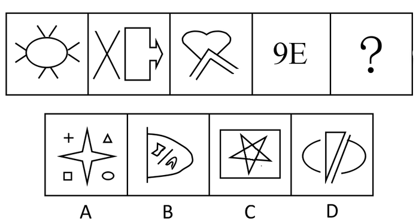

A. A

B. B

C. C

D. D

第 36 题 · 答案与解析

**参考答案（粉笔题库参考内容）**

D

**解析**

元素组成凌乱，不存在明显的属性特点，考数数。

已知图形中，每个图形均包含一个封闭区域，依此规律，未知图形也只包含一个封闭区域。

四个选项中，A项的封闭区域有四个，B项有三个，C项有七个，D项有一个。

故正确答案为D。

### 第 37 题

从所给的四个选项中，选择最合适的一个填入问号处，使之呈现一定的规律性：

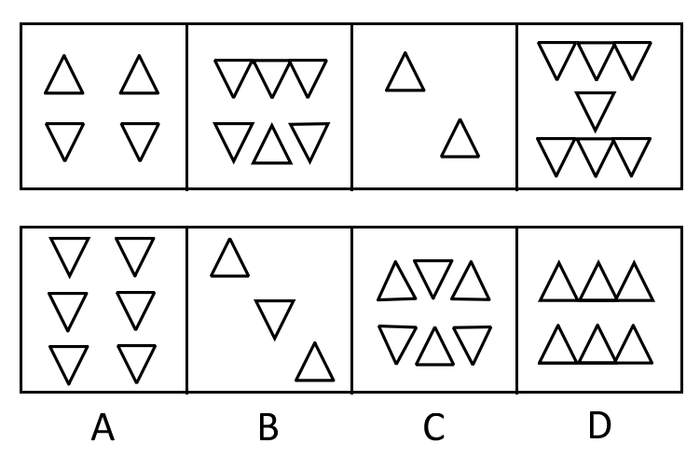

A. A

B. B

C. C

D. D

第 37 题 · 答案与解析

**参考答案（粉笔题库参考内容）**

A

**解析**

特殊考点，考查元素之间的换算，把一个向上的三角形转换为四个向下的三角形，则题干中向下三角形的个数分别为10、9、8、7，下一组图换算后应为6个向下的三角形，符合条件的只有A项。

故正确答案为A。

### 第 38 题

请从所给的四个选项中，选择最合适的一个填入问号处，使之呈现一定的规律性：

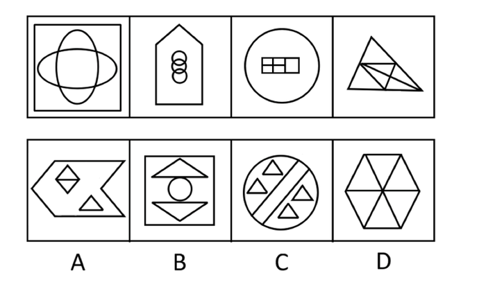

A. A

B. B

C. C

D. D

第 38 题 · 答案与解析

**参考答案（粉笔题库参考内容）**

D

**解析**

元素组成凌乱，考数数。题干中各个图形封闭区域的个数均为6，四个选项封闭区域的数量依次为4、4、7、6。符合条件的只有D项。

故正确答案为D。

### 第 39 题

从所给的四个选项中，选择最合适的一个填入问号处，使之呈现一定的规律性：

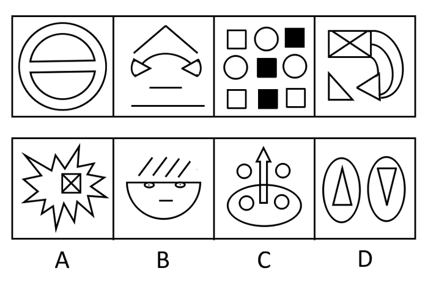

A. A

B. B

C. C

D. D

第 39 题 · 答案与解析

**参考答案（粉笔题库参考内容）**

B

**解析**

元素组成凌乱，数数-数曲线，题干中各个图形均有3条曲线，选项中曲线数量依次为0、3、5、2。符合条件的只有B项。

故正确答案为B。

### 第 40 题

从所给的四个选项中，选择最合适的一个，使之呈现一定的规律性：

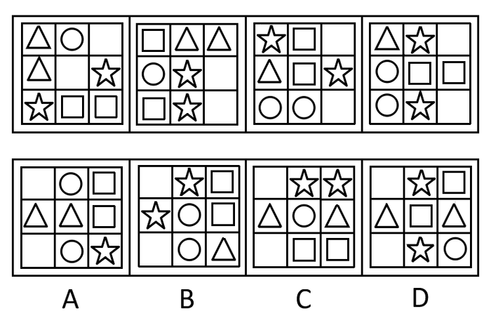

A. A

B. B

C. C

D. D

第 40 题 · 答案与解析

**参考答案（粉笔题库参考内容）**

A

**解析**

题干由多个小元素组成，考虑元素的种类和个数，发现均无规律。继续观察题干图形发现，题干每幅图中均有两个相同的小图形，考虑相同小图形的位置，发现相同小图形均相邻，且一组呈竖直排列，一组呈横向排列，符合条件的只有A项。B项中两组相同图形都是呈竖直排列，C项中两组相同图形都是呈横向排列，而D项中相同图形均不相邻。

故正确答案为A。

### 第 41 题

从所给的四个选项中，选择最合适的一个填入问号处，使之呈现一定的规律性：

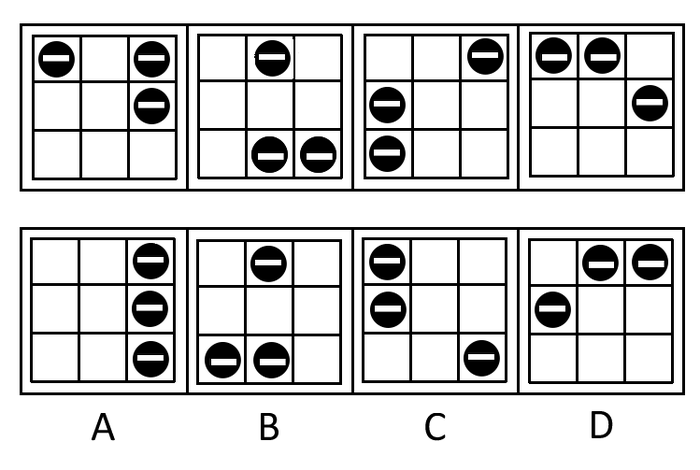

A. A

B. B

C. C

D. D

第 41 题 · 答案与解析

**参考答案（粉笔题库参考内容）**

A

**解析**

元素组成相同，考查位置规律。

单独的元素每次沿九宫外沿移动一格，连在一起的元素每次沿外沿移动两格，第四幅图移动后得到三个元素均位于右侧，A项符合题意。

故正确答案为A。

### 第 42 题

从所给的四个选项中，选择最合适的一个填入问号处，使之呈现一定的规律性：

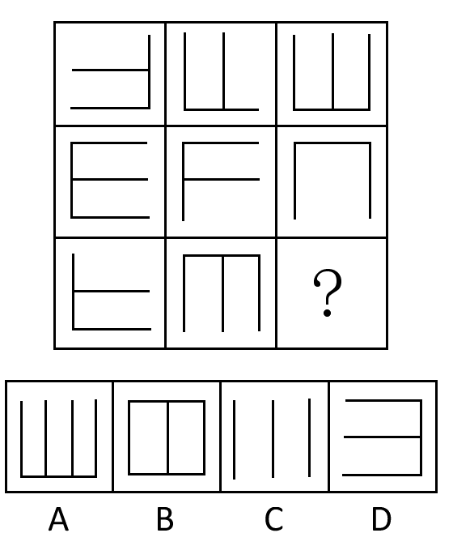

A. A

B. B

C. C

D. D

第 42 题 · 答案与解析

**参考答案（粉笔题库参考内容）**

C

**解析**

元素组成不同，且无明显属性规律，考虑数量规律。观察发现，题干图形均由直线构成，优先考虑直线数。九宫格优先看横行，第一行图形直线数依次为3、3、4，第二行图形直线数依次为4、3、3，每行图形的直线数总和均为10，第三行前两幅图形直线数依次为3、4，故？处应选择直线数为3的图形，只有C项符合。

故正确答案为C。

### 第 43 题

从所给的四个选项中，选择最合适的一个填入问号处，使之呈现一定的规律性：

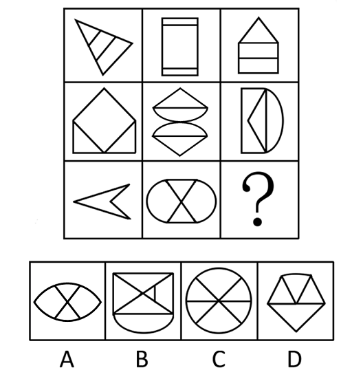

A. A

B. B

C. C

D. D

第 43 题 · 答案与解析

**参考答案（粉笔题库参考内容）**

D

**解析**

元素组成凌乱，考虑属性-对称轴的数量。

观察发现，每行对称轴之和为4。第三行中，第一幅图有一条对称轴，第二幅图有两条对称轴，所以第三幅图应有一条对称轴，符合条件的只有D项。

故正确答案为D。

### 第 44 题

明星：媒体：炒作

A. 经济学：政策：复苏

B. 商品：市场：交换

C. 国家：武器：战争

D. 分歧：会议：谈判

第 44 题 · 答案与解析

**参考答案（粉笔题库参考内容）**

B

**解析**

第一步：判断词语之间逻辑关系。

题干词语间是对应关系，第二个是作为媒介，前者通过媒介达到后者的目的。明星通过媒体进行炒作。

第二步：判断选项词语之间逻辑关系。

A项中政策不是媒介，经济学和复苏没有明显逻辑关系；

B项中市场是媒介，商品通过市场达到交换的目的，符合题干逻辑；

C项中武器也不是媒介，战争不能作为目的；

D项中谈判的主体应是人，而不是分歧。

故正确答案为B。

### 第 45 题

建筑：水泥：粉刷

A. 皮包：拉链：制作

B. 大桥：钢铁：焊接

C. 家具：木材：油漆

D. 歌曲：音符：组合

第 45 题 · 答案与解析

**参考答案（粉笔题库参考内容）**

C

**解析**

第一步：判断题干词语间的逻辑关系。

题干词语间是对应关系，水泥是建筑的主要原材料，在建筑建成后，粉刷起到装饰作用。

第二步：判断选项词语间的逻辑关系。

A项：拉链不是皮包的主要原材料，与题干逻辑关系不一致，排除；

B项：钢铁是大桥的主要原材料，但是焊接并非装饰作用，而是造桥的主要方法，与题干逻辑关系不一致，排除；

C项：木材是家具的主要原材料，家具制成后，油漆起到装饰作用（注：油漆可做动词用），与题干逻辑关系一致，当选；

D项：音符不是歌曲的主要原材料，与题干逻辑关系不一致，排除。

故正确答案为C。

### 第 46 题

冲突：解决：和谐

A. 吵架：爆发：混乱

B. 生活：富裕：美好

C. 噪音：消除：安静

D. 兴奋：镇定：放松

第 46 题 · 答案与解析

**参考答案（粉笔题库参考内容）**

C

**解析**

第一步：判断题干词语之间第一重逻辑关系。

题干前两个词语间是倒置的动宾结构，解决冲突是动宾结构，A项前两个词语是倒置的动宾结构。B项前两个词语是偏正结构。C项前两个词语是倒置的动宾结构。D项前两个词语是反义词关系。排除BD项。

第二步：判断题干词语之间第二重逻辑关系并判断选项。

题干前两个词语间和后一个词语构成对应关系，解决冲突是为了和谐。A项爆发吵架的目的不是混乱，不符合题干逻辑。C项消除噪音的目的是为了安静，符合题干逻辑。

故正确答案为C。

### 第 47 题

战士：勇敢

A. 职员：八卦

B. 学者：平庸

C. 僧侣：愚昧

D. 农民：朴实

第 47 题 · 答案与解析

**参考答案（粉笔题库参考内容）**

D

**解析**

第一步：判断词语之间逻辑关系。

题干词语间是属性关系，后者是对前者的修饰。勇敢用来形容战士，且是褒义词。

第二步：判断选项词语之间逻辑关系。

D项朴实用来形容农民，是褒义词；

其他选项后者用来形容前者极不恰当，且和题干逻辑关系不一致。

故正确答案为D。

### 第 48 题

锦衣玉食：奢华

A. 汗牛充栋：辛苦

B. 噤若寒蝉：寒冷

C. 吹毛求疵：洁癖

D. 城下之盟：屈辱

第 48 题 · 答案与解析

**参考答案（粉笔题库参考内容）**

D

**解析**

第一步：判断词语之间逻辑关系。

题干词语间是语义关系，前者是对后者的形容，“锦衣玉食”用来形容奢华。

第二步：判断选项词语间逻辑关系。

A项：“汗牛充栋”对应的应是藏书多；

B项：“噤若寒蝉”对应的应是害怕、不敢出声；

C项：“吹毛求疵”对应的是苛刻；

D项：“城下之盟”用来形容屈辱，满足题干逻辑关系。

故正确答案为D。

### 第 49 题

历程：回顾

A. 集会：参与

B. 实力：增强

C. 活力：展现

D. 速度：加快

第 49 题 · 答案与解析

**参考答案（粉笔题库参考内容）**

C

**解析**

第一步：判断题干词语间的逻辑关系。

题干词语间是动宾关系，回顾历程，历程是已经经历过的，无法改变的，而且历程是一种看不见摸不着的经历，是抽象的。

第二步：判断选项词语间的逻辑关系。

A项：参与集会符合动宾关系，但集会是具体的，与题干逻辑关系不一致，排除；

B项：实力可以增强，也可以减弱，与题干逻辑关系不一致，排除；

C项：展现活力符合动宾关系，且展现的一定是自己已有的活力，活力是抽象的，与题干逻辑关系一致，当选；

D项：速度可以加快，也能够减慢，与题干逻辑关系不一致，排除。

故正确答案为C。

### 第 50 题

（ ） 对于 网络 相当于 运输 对于 （ ）

A. 电脑 货物

B. 流量 交通

C. 交流 航线

D. 查询 车辆

第 50 题 · 答案与解析

**参考答案（粉笔题库参考内容）**

C

**解析**

逐一代入选项。

A项：电脑需要网络，二者为配套使用的对应关系，运输货物，二者是动宾关系，前后逻辑关系不一致，排除；

B项：网络会产生流量，交通包括运输和邮电两个方面，运输是交通的一部分，为包容关系，前后逻辑关系不一致，排除；

C项：网络有交流的功能，航线的功能是运输，且网络和航线都是抽象名词，前后逻辑关系一致，当选；

D项：网络有查询的功能，车辆的功能是运输，但网络是抽象名词，车辆是实体名词，前后逻辑关系不一致，排除。

故正确答案为C。

备注：C项不完美，“航线”和“运输”在历年真题中，曾经考查的是依据对应（依据航线运输），因此C项后者能否看成功能对应略有争议。所以有部分同学选D项也有道理，本题有争议，不建议同学们作为备考重点来练习。

### 第 51 题

风险 对于 （ ） 相当于 制度 对于 （ ）

A. 巨大 激进

B. 信用 管理

C. 规避 完善

D. 减少 缺少

第 51 题 · 答案与解析

**参考答案（粉笔题库参考内容）**

C

**解析**

逐一代入选项。

A项：巨大的风险，二者为偏正关系，但激进一般不用于形容制度，前后逻辑关系不一致，排除；

B项：风险和信用没有明显的逻辑关系，排除；

C项：规避风险和完善制度，均为动宾关系，并且都是现代企业所要遵循的准则，前后逻辑关系一致，当选；

D项：减少风险，二者为动宾关系，但缺少制度并非固定搭配，前后逻辑关系不一致，排除。

故正确答案为C。

### 第 52 题

理论 对于 （ ） 相当于 （ ） 对于 设计

A. 实践 规划

B. 建构 图纸

C. 完美 严密

D. 系统 程序

第 52 题 · 答案与解析

**参考答案（粉笔题库参考内容）**

B

**解析**

第一步：将选项逐一代入，判断各选项前后部分的逻辑关系。

A项理论和实践是并列关系，而规划和设计是交叉关系，前后逻辑关系不对应；

B项建构理论，设计图纸均是动宾关系，前后逻辑关系一致；

C项前者是倒置偏正结构，后者是偏正结构，前后逻辑关系不一致；

D项系统理论中系统为形容词，构成偏正结构；而设计程序中设计是动词，构成动宾结构，前后逻辑关系不一致。

第二步：逻辑关系相同即为答案。

综上分析，B项前后逻辑关系保持一致。

故正确答案为B。

### 第 53 题

所有甲都属于乙，有些甲属于丙，所有乙都属于丁，没有戊属于丁，有些戊属于丙。

以下哪一项不能从上述论述中推出：

A. 有些丙属于丁

B. 没有戊属于乙

C. 有些甲属于戊

D. 所有甲都属于丁

第 53 题 · 答案与解析

**参考答案（粉笔题库参考内容）**

C

**解析**

第一步：翻译题干。

①甲→乙；

②有的甲→丙；

③乙→丁；

④戊→-丁；

⑤有的戊→丙

第二步：逐一分析选项。

A项：翻译为：有的丙→丁，将条件②换位可得：有的丙→甲，再与条件①③串联可得：有的丙→甲→乙→丁，即：有的丙→丁，可以推出，排除；

B项：翻译为：戊→-乙，将条件③④串联可得：戊→-丁→-乙，即：戊→-乙，可以推出，排除；

C项：翻译为：有的甲→戊，将条件①③④串联可得：甲→乙→丁→-戊，即：甲→-戊，与“有的甲→戊”矛盾，不能推出，当选；

D项：翻译为：甲→丁，将条件①③串联可得：甲→乙→丁，即：甲→丁，可以推出，排除。

本题为选非题，故正确答案为C。

### 第 54 题

某健康中心对A市居民参加体育锻炼的情况进行的调查表明，经常参加体育锻炼的居民数近两年来不断上升，而该健身中心的顾客数略有下降。

以下各项除了哪一项，都有助于解释上述矛盾：

A. 该健身中心对顾客的统计不仔细，统计的准确性值得怀疑

B. 为节省开支，许多居民改为到公园参加锻炼

C. A市调查中抽取的样本较多，所以调查具有较高的准确性

D. 近两年该市新开发了许多健身中心

第 54 题 · 答案与解析

**参考答案（粉笔题库参考内容）**

C

**解析**

第一步：找到题干矛盾点。

矛盾点：经常参加体育锻炼的居民数近两年来不断上升，而该健身中心的顾客数略有下降。

第二步：逐一分析选项。

A项：“对顾客的统计不仔细，统计的准确性值得怀疑”说明了该中心可能统计错误，能解释为什么健身中心顾客减少，排除；

B项：“许多居民改为到公园参加锻炼”能解释为什么健身中心顾客减少，排除；

C项：“调查具有较高的准确性”说明调查可靠，无法解释题干矛盾，当选；

D项：“近两年该市新开发了许多健身中心”说明了健身中心增加分走了客源，能解释为什么健身中心顾客减少，排除。

本题为选非题，故正确答案为C。

### 第 55 题

某城市一个居民小区2008年以前盗窃事件经常发生，2008年在小区居民的要求下，物业管理部门为该小区安装了技术先进的多功能防盗系统，结果该小区盗窃事件的发生率显著下降，这说明多功能防盗系统对于防止盗窃的发生起到了重要作用。

以下哪一项为真，最能加强上述结论：

A. 从2008年开始，该城市其他小区的盗窃事件有显著增加

B. 该城市另一个居民小区也安装了这种多功能防盗系统，但效果不佳

C. 从2008年开始，该城市加强了治安管理，盗窃事件有所减少

D. 采取其他的防盗措施对预防盗窃事件也能起到一定的效果

第 55 题 · 答案与解析

**参考答案（粉笔题库参考内容）**

A

**解析**

第一步：找到论点和论据。

论点是某城市一个居民小区多功能防盗系统对于防止盗窃的发生起到了重要作用。没有明显的论据。

第二步：判断加强方式。

只有论点，没有论据，需要加强论点。

第三步：逐一判断选项的作用。

A项“该城市其他小区的盗窃事件有显著增加”，而该小区盗窃事件的发生率显著下降，说明防盗系统很有作用，对题干起到了加强作用。

B项“该城市另一个居民小区也安装了这种多功能防盗系统，但效果不佳”说明多功能防盗系统没有起到作用，进一步削弱了论点。

C选项说明整体的盗窃事件的发生率都降低了，与防盗系统无关，削弱了论点。

D项说明了别的措施也能达到同样的效果，不能加强论点。

故正确答案为A。

### 第 56 题

在世界市场上，中国生产的汽车比其他国家生产的汽车要便宜得多，因此其他国家的汽车工业将失去一部分汽车市场，而这些市场将被中国汽车占据。

以下哪一项是上述论述所要假设的：

Ⅰ.中国汽车的油耗比其他国家汽车的油耗更低

Ⅱ.价格是汽车购买者考虑的重要因素

Ⅲ.中国的汽车和其他国家的汽车耐用性基本相同

Ⅳ.汽车购买者具有较高的品牌忠诚度

A. Ⅰ和Ⅱ

B. Ⅰ、Ⅱ和Ⅲ

C. Ⅱ、Ⅲ和Ⅳ

D. Ⅱ和Ⅲ

第 56 题 · 答案与解析

**参考答案（粉笔题库参考内容）**

D

**解析**

第一步：找到论点和论据。

论点是中国汽车占据了其他国家一部分汽车市场。论据是中国生产的汽车比其他国家生产的汽车要便宜得多。

第二步：逐一判断选项的作用。

假设Ⅰ说明中国汽车的油耗比其他国家更低，Ⅱ强调价格是汽车购买者考虑的重要因素，Ⅲ强调汽车耐用性基本相同，Ⅳ强调品牌忠诚度。题干由价格优势推出中国生产的汽车的销量大。要使这个推论成立，则价格必须是购买者考虑的重要因素，并且中国汽车和其他国家汽车的耐用性基本相同，即Ⅱ和Ⅲ是必须假设的。即使油耗相等，购买者也可能因为价格原因选择中国汽车，所以Ⅰ不是必须假设的。Ⅳ强调品牌忠诚度，品牌忠诚度和价格之间没有明显的关系，所以假设Ⅳ不能使题干论点成立。

故正确答案为D。

### 第 57 题

2009年12月初，两院院士新增选名单相继公布，继而有统计数据披露：中国科学院新增的35名院士中，八成是高校或研究机构的现任官员，中国工程院新增的48名院士中，超过85%是现任官员；工程院60岁以下新当选的院士，均有校长、院长、副院长、董事长等职务。所以有人认为，“官员身份”在院士评选中起到了非常大的作用。

以下哪一项正确，最能对上述结论构成反驳：

A. 院士评选没有规定官员不能当选

B. 许多非常优秀的学者担任了行政职务

C. 有官员身份的学者整体的比例不大

D. 优秀的官员可以兼任学者

第 57 题 · 答案与解析

**参考答案（粉笔题库参考内容）**

B

**解析**

第一步：找到论点和论据。

论点是“官员身份”在院士评选中起到了非常大的作用。论据是两院院士新增院士中八成或以上是官员。

第二步：判断削弱方式。

论点和论据之间存在因果关系，要构成削弱，可对论点进行削弱。

第三步：逐一判断选项的作用。

A项“没有规定官员不能当选”是无关项；

B项“许多非常优秀的学者担任了行政职务”说明当选院士的学者同时也担任了其他行政职务，并不是由于“官员身份”，进而削弱了论点；

C、D两项说明了官员身份起到了作用，加强了论点。

故正确答案为B。

### 第 58 题

有关数据显示，从2005年以来，广东高校毕业生自主创业的数量约占当年高校毕业生的1%-2%。以2008年为例，应届高校毕业生中选择自主创业的仅占1.2%。而在西方发达国家，这个数字为20%-30%。由此看来，西方发达国家的大学生更具有创业才能。

以下哪一项正确，最能对上述结论构成质疑：

A. 中国关于鼓励高校毕业生创业的政策较少，创业环境不佳

B. 中国高校毕业生的绝对数量比西方发达国家多

C. 西方发达国家大学生创业成功率不比中国大学生高

D. 西方发达国家的大学生更喜欢挑战自我

第 58 题 · 答案与解析

**参考答案（粉笔题库参考内容）**

C

**解析**

第一步：找出论点和论据。

论点：西方发达国家的大学生更具有创业才能。

论据：广东高校毕业生自主创业的数量约占当年高校毕业生的1%-2%。以2008年为例，应届高校毕业生中选择自主创业的仅占1.2%。而在西方发达国家，这个数字为20%-30%。

第二步：逐一分析选项。

A项：指出创业环境不佳，但创业环境与论点中创业才能之间并无必然联系，无关项，排除；

B项：中国高校毕业生的绝对数量比西方发达国家多，但是现在中国的创业比例低于西方发达国家，只能说明中国高校毕业生创业人数少，但是创业人数多少并不能说明创业才能高低，不明确选项，排除；

C项：“创业成功率”能够体现创业才能，现在西方发达国家大学生创业成功率不比中国大学生高，说明西方发达国家大学生的创业才能也不比中国大学生高，削弱题干观点，当选；

D项：“西方发达国家的大学生更喜欢挑战自我”，只能说明创业积极性高，但也和创业才能之间并无必然联系，无关项，排除。

故正确答案为C。

### 第 59 题

A市的图书销售量高于B市，因此，A市的居民比B市的居民更喜爱阅读。

以下各项除了哪一项，都会削弱以上结论（ ）。

A. A市的人口比B市多

B. 有很多B市的居民到A市购买图书

C. B市居民习惯到图书馆借书阅读

D. A市图书的平均销售价略高于B市

第 59 题 · 答案与解析

**参考答案（粉笔题库参考内容）**

D

**解析**

第一步：找出论点论据。

论点：A市的居民比B市的居民更喜爱阅读。

论据：A市的图书销售量高于B市。

第二步：逐一判断选项。

A项，该项表明A市销量比B市高的原因可能是因为人口比B市多，而非A市居民比B市居民更爱阅读，可以削弱。

B项，B市的居民到A市买书，表明A市图书的高销量并非只来源于A市居民，还包括很多B市居民，则不能证明A市居民比B市居民更爱阅读，可以削弱。

C项，B市居民习惯到图书馆借书阅读，说明除了购买以外，还可以通过借阅来表现对阅读的喜爱，则不能只参考图书销量来判断是否喜欢阅读。该项引入了他因，可以削弱。

D项，A市图书售价高且销量高，即A市居民更愿意在图书上花钱，从侧面说明A市居民比B市居民更爱阅读。该项加强论证，不能削弱。

第三步：再次标注答案

本题为选非题，故正确答案为D。

### 第 60 题

尽管大家开始抵制珍稀动物的皮草产品，但仍有家居制造商将珍稀动物的皮毛用于家居饰品。几年前，专家发明了一种新的高仿合成皮草，受到了家居制造商广泛的好评。但从最近几年的统计看，各地为获取皮毛而对珍稀动物进行捕杀的活动却并没有减少。

以下哪一项正确，最有助于对“捕杀活动没有减少”进行解释：

A. 生产新的高仿合成皮草比生产原来的合成皮草的成本更低

B. 新的高仿合成皮草与动物皮毛的质地相似，很难区分

C. 绝大部分珍稀动物的皮毛用在越来越流行的皮草服饰上

D. 家居制造商在销售大的家居物件时，往往将家居饰品当作赠品免费送给购买者

第 60 题 · 答案与解析

**参考答案（粉笔题库参考内容）**

C

**解析**

第一步：找出题干矛盾。

专家发明了一种新的高仿合成皮草，受到了家居制造商广泛的好评。但从最近几年的统计看，各地为获取皮毛而对珍稀动物进行捕杀的活动却并没有减少。

第二步：逐一分析选项。

A项强调原来的合成皮草，而不是真正的皮毛，所以是无关选项；

B项强调新的高仿合成皮草非常好，这应该有助于减少捕杀，属削弱选项；

C项“珍稀动物的皮毛用在越来越流行的皮草服饰上”说明皮草服饰有很大需求，进而对珍稀动物的皮毛也有很大需求，解释了对珍稀动物“捕杀活动没有减少”，符合题意；

D项“将家居饰品当作赠品免费送给购买者”，没有说明家居饰品的材质，属于无关选项。

故正确答案为C。

### 第 61 题

留置权是指债务人不履行到期债务，债权人可以留置已经合法占有的债务人的动产，并有权就该动产优先受偿。

根据上述定义，下列关于行为人是否享有留置权的说法中正确的是：

A. 甲委托乙保管某件物品，乙在保管期间，发现该物品有质量问题，遂将该物品交给丙修理，修好后，甲拒付维修费用，丙无权留置该物品

B. 甲向乙借了1万元钱，偿还期已到，甲未偿还，乙对甲工厂里的机器设备享有留置权

C. 甲公司与乙某签订了一份运输合同，约定货到付款，乙某将货物运达目的地后，甲公司未付运费，乙某可以留置运输货物

D. 李某有偿委托孙某代购一批产品，孙某买到产品后，李某不支付约定的报酬，孙某无权留置该批产品

第 61 题 · 答案与解析

**参考答案（粉笔题库参考内容）**

C

**解析**

第一步：抓住定义中的关键词。

关键词有“债务人不履行到期债务”、“债权人可以留置已经合法占有”。

第二步：逐一判断选项。

A项“该物品交给丙修理，修好后甲拒付维修费用”符合定义“债务人不履行到期债务”，但“丙无权留置该物品”不符合定义“债权人可以留置已经合法占有”；

B项“甲工厂里的机器设备”尚没有被乙合法占有，不符合定义“已经合法占有的债务人的动产”；

C项“乙某将货物运达目的地后，甲公司未付运费”体现了“债务人不履行到期债务”，“乙某可以留置运输货物”也体现了“可以留置已经合法占有的”，因此C项符合题意；

D项“李某不支付约定的报酬”符合“债务人不履行到期债务”，但孙某无权留置该批产品不符合“债权人可以留置已经合法占有的”，根据定义孙某有权留置该批产品。

故正确答案为C。

### 第 62 题

恐惧症：对某种物体或某种环境的一种非理性的、不适当的恐惧感。一旦面对这种物体或环境时，尽管当时并无危险，恐惧症患者仍会产生一种极端的恐惧感。

根据上述定义，下列属于恐惧症的是：

A. 陈女士从小就胆小，一次去乡下办事，经过一户农家的门口，冷不防一只体型壮硕的狼狗钻出来凶恶地盯着她，吓得她立刻尖叫着跑掉了

B. 工程师小徐每次看到印有深海的图片时，就感觉自己像置身于深海之中，四周都是幽暗深邃的海水，感到呼吸困难、心跳加快，害怕得再也不敢看那些图片一眼

C. 晚饭后，有点醉意的老同事执意送大家回去，小李还没到小区门口就喊着要下车，因为他受不了那种害怕会出车祸的精神压力了

D. 看了一部日本恐怖片后，小钱感觉脑子里总是浮现电影里的恐怖场景，好几天都睡不好觉

第 62 题 · 答案与解析

**参考答案（粉笔题库参考内容）**

B

**解析**

第一步：抓住定义中的关键词。

恐惧症的定义关键词有“非理性、不适当”、“面对这种物体或环境时”、“当时并无危险仍会产生极端恐惧感”。

第二步：逐一判断选项。

A项中“狼狗钻出来凶恶地盯着她，吓得她立刻尖叫着跑掉了”说明陈女士当时确实有危险，不符合定义“当时并无危险”；

B项中“小徐每次看到印有深海的图片时”以及“害怕得再也不敢看那些图片一眼”说明小徐的情况符合“当时并无危险仍会产生极端恐惧感”；

C项中“受不了那种害怕会出车祸的精神压力”说明小李面临着出车祸的危险，不符合“当时并无危险”；

D项中“小钱感觉脑子里总是浮现电影里的恐怖场景”说明了小钱的恐惧感是由于看恐怖片造成的，显然不符合“面对这种物体或环境时”。

故正确答案为B。

### 第 63 题

形式公正指个人或权力机关对同样的事件平等对待，以及对所有人按统一标准（而不是根据个人或所从属的特殊集团的立场）施加管束。

根据上述定义，下列属于形式公正的是：

A. 国家录用公务员，实行“凡进必考”

B. 通过税收杠杆对收入差距进行调节

C. 设立保护区，保护濒临灭绝的生物

D. 政府对某件商品设立远远低于市场价格的指导价

第 63 题 · 答案与解析

**参考答案（粉笔题库参考内容）**

A

**解析**

第一步：抓住定义中的关键词。

关键词包括“对同样的事件平等对待”、“对所有人按统一标准”。

第二步：逐一判断选项。

A项“凡进必考”符合“对同样的事件平等对待”和“对所有人按统一标准”，符合题干定义；

B项“税收杠杆”体现了对富人多征税，而对穷人少征税，不符合题干“对所有人按统一标准”；

C项“设立保护区”和D项“对某件商品设立远远低于市场价格的指导价”均不符合“对同样的事件平等对待”。

故正确答案为A。

### 第 64 题

继续犯又称持续犯，指犯罪行为与该行为引起的不法状态在一定时间内处于继续状态的犯罪。

根据上述定义，下列行为属于继续犯的是：

A. 孙某与有夫之妇张某存在不正当男女关系，被张某丈夫发现后，张某与孙某断绝了关系，孙某怀恨在心，两天之内先后将张某与其丈夫杀害

B. 李某举报某派出所所长王某徇私舞弊，王某为报复李某，借执法之名，将李某非法拘禁3日

C. 张某非法行医三年多，导致1人死亡，2人身体残疾

D. 王某在走私毒品的过程中，遇到边防人员的检查，王某以暴力方法抗拒检查

第 64 题 · 答案与解析

**参考答案（粉笔题库参考内容）**

B

**解析**

第一步：找出定义关键词。

“犯罪行为与该行为引起的不法状态”、“在一定时间内处于继续状态”。

第二步：逐一分析选项。

A项：孙某和张某存在不正当男女关系不属于犯罪行为，而孙某将张某与其丈夫杀害不是由犯罪行为引起的，不符合关键词“犯罪行为与该行为引起的不法状态”，不符合定义，排除；

B项：“王某徇私舞弊”属于犯罪行为，而王某将李某非法拘禁则是由其犯罪行为引起的，符合关键词“犯罪行为与该行为引起的不法状态”，而“非法拘禁3日”也体现了“一定时间内处于继续状态的犯罪”，符合定义，当选；

C项：“非法行医”属于犯罪行为，但“三年多”不符合“一定时间内处于继续状态的犯罪”，不符合定义，排除；

D项：“走私毒品”属于犯罪行为，但“以暴力方法抗拒检查”并不是“走私毒品”引起的，不符合关键词“犯罪行为与该行为引起的不法状态”，不符合定义，排除。

故正确答案为B。

### 第 65 题

印象管理指人们试图管理和控制他人对自己所形成的印象的过程。通常，人们总是倾向于以一种与当前的社会情境或人际背景吻合的形象来展示自己，以确保他人对自己做出愉快的评价。

根据上述定义，下列属于印象管理的是：

A. 某香港明星的经纪人想尽办法让明星多参与电视娱乐节目，以此提高人气

B. 董事长批评陈经理说，客户看到你们的办公室天天乱成这样，哪里会对公司有信心

C. 林某听到同学偷偷说自己的坏话就忍不住上去打了他

D. 面试前，小李在服饰、发型等方面都作了精心准备，以求一次成功

第 65 题 · 答案与解析

**参考答案（粉笔题库参考内容）**

D

**解析**

第一步：抓住定义中的关键词。

“印象管理”定义中强调“与当前的社会情境或人际背景吻合”“确保他人对自己做出愉快的评价”。

第二步：逐一判断选项。

A项“经纪人想尽办法让明星多参与电视娱乐节目”没有体现“确保他人对自己做出愉快的评价”；

B项涉及客户的评价，但“办公室天天乱成这样”是不愉快的评价，也不符合“确保他人对自己做出愉快的评价”；

C项“说自己的坏话”也是不愉快的评价；

D项小李的各种精心准备符合“与当前的社会情境或人际背景吻合”，符合定义。

故正确答案为D。

### 第 66 题

204，180，12，84，-36，（ ）。

A. 60

B. 24

C. 10

D. 8

第 66 题 · 答案与解析

**参考答案（粉笔题库参考内容）**

A

**解析**

方法一：数列无明显特征，作差后无规律，考虑作和。前项加后项得到新数列：384，192，96，48，（ ），是公比为1/2的等比数列，则新数列下一项为。故所求项为24-(-36)=60。

方法二：数列无明显特征，作差后无规律，考虑递推。观察发现：，，，即规律为：。则所求项为。

故正确答案为A。

### 第 67 题

52，-56，-92，-104，（ ）。

A. \-100

B. \-107

C. \-108

D. \-112

第 67 题 · 答案与解析

**参考答案（粉笔题库参考内容）**

C

**解析**

数列无明显特征，优先考虑作差。后项减前项得到新数列：-108，-36，-12，（ ），是公比为1/3的等比数列，则新数列的下一项为，故所求项为-104+(-4)=-108。

故正确答案为C。

### 第 68 题

2，5，14，29，86，（ ）。

A. 159

B. 162

C. 169

D. 173

第 68 题 · 答案与解析

**参考答案（粉笔题库参考内容）**

D

**解析**

数列无明显特征，作差作和均无规律，考虑递推。观察发现：2×2+1=5，5×3-1=14，14×2+1=29，29×3-1=86，即从第二项起，偶数项=前一项×2+1，奇数项=前一项×3-1。所求项为偶数项，故所求项为86×2+1=173。

故正确答案为D。

### 第 69 题

82，98，102，118，62，138，（ ）。

A. 68

B. 76

C. 78

D. 82

第 69 题 · 答案与解析

**参考答案（粉笔题库参考内容）**

D

**解析**

数列无明显特征，作差后无规律，考虑作和。前项加后项得到新数列：180，200，220，180，200，为周期数列，则新数列下一项为220，故所求项为220-138=82。

故正确答案为D。

### 第 70 题

\-344，17，-2，5，（ ），65。

A. 86

B. 124

C. 162

D. 227

第 70 题 · 答案与解析

**参考答案（粉笔题库参考内容）**

B

**解析**

数列无明显特征，观察发现每项周围均有幂次数，考虑幂次修正数列。原数列可转化为、、、2^2+1、（ ）、8^2+1，底数是公差为3的等差数列，指数为3、2循环，修正项为-1、+1循环。故所求项应为。

故正确答案为B。

### 第 71 题

12，-4，8，-32，-24，768，()。

A. 432

B. 516

C. 744

D. \-1268

第 71 题 · 答案与解析

**参考答案（粉笔题库参考内容）**

C

**解析**

数列无明显特征，作差无规律，考虑递推数列。观察可以发现：12+(-4)=8，，8+(-32)=-24，，运算方式为相邻两项加法、乘法循环得到第三项。故所求项为(-24)+768=744。

故正确答案为C。

### 第 72 题

5，3，7/3，2，9/5，5/3，（ ）。

A. 13/8

B. 11/7

C. 7/5

D. 1

第 72 题 · 答案与解析

**参考答案（粉笔题库参考内容）**

B

**解析**

观察数列，题干和选项中均有分数，优先考虑分数数列。反约分后，原数列可转化为：5/1、6/2、7/3、8/4、9/5、10/6，分子分母都为自然数列，所以下一项为11/7。

故正确答案为B。

### 第 73 题

6，7，18，23，38，（ ）。

A. 47

B. 53

C. 62

D. 76

第 73 题 · 答案与解析

**参考答案（粉笔题库参考内容）**

A

**解析**

数列无明显特征，且观察数列发现多为幂次数附近数字，考虑幂次修正数列。原数列可转化为：2^2+2、3^2-2、4^2+2、5^2-2、6^2+2、（ ），底数为自然数列，指数均为2，修正项为+2、-2循环。故下一项应为。

故正确答案为A。

### 第 74 题

2，3，7，25，121，（ ）。

A. 545

B. 619

C. 721

D. 825

第 74 题 · 答案与解析

**参考答案（粉笔题库参考内容）**

C

**解析**

数列无明显特征，作差作和均无明显规律，考虑递推数列。观察可以发现：2×2-1=3、3×3-2=7、7×4-3=25、25×5-4=121，第一个乘数为数列前一项，第二个乘数为自然数列，修正项是公差为-1的等差数列，故所求项为121×6-5=721。

故正确答案为C。

### 第 75 题

12，16，22，30，39，49，（ ）。

A. 61

B. 62

C. 64

D. 65

第 75 题 · 答案与解析

**参考答案（粉笔题库参考内容）**

A

**解析**

观察数列特征，数列变化起伏较小且呈递增趋势，优先考虑多级数列。后一项减前一项得到新数列：4、6、8、9、10、（ ），是合数数列，则新数列下一项应为12，故原数列下一项为49+12=61。

故正确答案为A。

### 第 76 题

的值与下列哪个数最接近：

A. 0.45

B. 0.5

C. 0.56

D. 0.6

第 76 题 · 答案与解析

**参考答案（粉笔题库参考内容）**

C

**解析**

原式，与C项最接近。

故正确答案为C。

### 第 77 题

一个自然数“x”，除以3的余数是2，除以4的余数是3，问“x”除以12的余数是：

A. 1

B. 5

C. 9

D. 11

第 77 题 · 答案与解析

**参考答案（粉笔题库参考内容）**

D

**解析**

根据题干可知，x+1为3的倍数且x+1为4的倍数，故x+1为12的倍数，即x=12的倍数-1，则x除以12余数为12-1=11。

故正确答案为D。

### 第 78 题

一个四位数“”分别能被15、12和10除尽，且被这三个数除尽时所得的三个商的和为1365，问四位数“”中四个数字的和是：

A. 17

B. 16

C. 15

D. 14

第 78 题 · 答案与解析

**参考答案（粉笔题库参考内容）**

C

**解析**

列方程可解得，设4位数为x，有，解得x=5460，4数字和为15。

故正确答案为C。

### 第 79 题

用数字0、1、2（即可全用也可不全用）组成的非零自然数，按从小到大排列，问“1010”排在第几个：

A. 30

B. 31

C. 32

D. 33

第 79 题 · 答案与解析

**参考答案（粉笔题库参考内容）**

A

**解析**

本题实际求由0、1、2构成的数字中，小于1010的有多少个。

显然组成的非零一位数有2个；

两位数有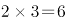个；

三位数有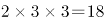个；

四位数中比1010小的为1000、1001、1002共计3个。

则1010排在2＋6＋18＋3＋1＝30位。

故正确答案为A。

### 第 80 题

定义，，按此规律，的值为：

A. 528

B. 525

C. 423

D. 420

第 80 题 · 答案与解析

**参考答案（粉笔题库参考内容）**

A

**解析**

三角符号代表着以符号前一个数为首项，符号后的数为项数，公差为1的一个等差数列，用等差公式求和，26△15=495，，因此和值为528。

故正确答案为A。

### 第 81 题

建华中学共有1600名学生，其中喜欢乒乓球的有1180人，喜欢羽毛球的有1360人，喜欢篮球的有1250人，喜欢足球的有1040人，问以上四项球类运动都喜欢的至少有几人：

A. 20人

B. 30人

C. 40人

D. 50人

第 81 题 · 答案与解析

**参考答案（粉笔题库参考内容）**

B

**解析**

根据问题求“都喜欢的至少”可判定本题为多集合反向构造问题，采取逆向思维法。

不喜欢乒乓的1600－1180＝420；不喜欢羽毛球的1600－1360＝240；不喜欢篮球的1600－1250＝350；不喜欢足球的1600－1040＝560。要使四项运动都喜欢的人数最少，那么不喜欢的人数就要最多，那么都尽量不相交，从而达到最多：420＋240＋350＋560＝1570人，所以都喜欢的至少有1600－1570＝30人。

故正确答案为B。

### 第 82 题

工人甲一分钟可生产螺丝3个或螺丝帽9个，工人乙一分钟可生产螺丝2个或螺丝帽7个，现在两人各花20分钟，共生产螺丝和螺丝帽134个，问生产的螺丝比螺丝帽多几个：

A. 34个

B. 32个

C. 30个

D. 28个

第 82 题 · 答案与解析

**参考答案（粉笔题库参考内容）**

A

**解析**

设两人20分钟全部生产螺丝，则共生产了100个，注意到甲生产螺丝帽比螺丝每分钟多6个，乙每分钟多5个。设甲生产螺丝帽x分钟，乙生产螺丝帽y分钟，根据鸡兔同笼原理，有6x+5y=134-100，当x=4，y=2时，符合条件，再代入计算，得螺丝帽有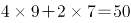个，螺丝有84个，则螺丝比螺丝帽多84－50＝34个。

故正确答案为A。

相关知识点：

鸡兔同笼公式：

解法1：(兔的脚数×总只数－总脚数)÷(兔的脚数－鸡的脚数)=鸡的只数

总只数－鸡的只数=兔的只数

解法2：(总脚数－鸡的脚数×总只数)÷(兔的脚数－鸡的脚数)=兔的只数

总只数－兔的只数=鸡的只数

解法3：总脚数÷2—总头数=兔的只数

总只数—兔的只数=鸡的只数

### 第 83 题

如下图所示，是等腰直角三角形，AB=12，AD的长度是CD的2倍，四边形EBCD与的面积之比为3:2，AE的长度是：

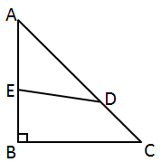

A. 6.9

B. 7.1

C. 7.2

D. 7.4

第 83 题 · 答案与解析

**参考答案（粉笔题库参考内容）**

C

**解析**

四边形EBCD与三角形AED的面积之比为3:2，则三角形ABC与三角形AED的面积之比为5:2。已知AD的长度是CD的2倍，则AD的长度是AC的2/3。作DF垂直AB于点F，则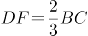（相似三角形原理），三角形ABC的面积＝，三角形AED的面积＝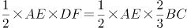代入之前的比例式，可得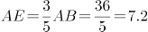。

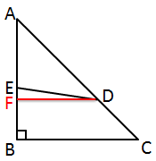

故正确答案为C。

### 第 84 题

某俱乐部中女会员的人数比男会员的一半少61人，男会员的人数比女会员的3倍多2人，问该俱乐部共有会员多少人：

A. 475人

B. 478人

C. 480人

D. 482人

第 84 题 · 答案与解析

**参考答案（粉笔题库参考内容）**

D

**解析**

设女会员有x人，男会员为y人，则有0.5y-61=x，3x+2=y，解得x=120，y=362，总人数为120＋362＝482。

故正确答案为D。

### 第 85 题

某区要从10位候选人中投票选举人大代表，现规定每位选举人必须从这10中任选两位投票，问至少要有多少位选举人参加投票，才能保证有不少于10位选举人投了相同两位候选人的票：

A. 382位

B. 406位

C. 451位

D. 516位

第 85 题 · 答案与解析

**参考答案（粉笔题库参考内容）**

B

**解析**

选取两位候选人，共有种选法。根据最不利原则，要使有10位选举人投了相同两位候选人的票，那么投了其他相同候选人票的选举人是9位。所以最少要位选举人。

故正确答案为B。

### 第 86 题

如图所示，是直角三角形，四边形IBFD和四边形HFGE都是正方形，已知AI=1cm，IB=4cm，正方形HFGE的面积是：

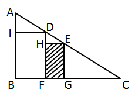

A. 10 16/25

B. 10 9/16

C. 10 6/25

D. 10 5/16

第 86 题 · 答案与解析

**参考答案（粉笔题库参考内容）**

C

**解析**

设正方形的边长为x，由三角形EHD相似于三角形DIA可知，，即，解得，那么正方形面积为。

故正确答案为C。

### 第 87 题

有一本畅销书，今年每册书的成本比去年增加了10%，因此每册书的利润下降了20%，但是今年的销量比去年增加了70%。则今年销售该畅销书的总利润比去年增加了：

A. 36%

B. 25%

C. 20%

D. 15%

第 87 题 · 答案与解析

**参考答案（粉笔题库参考内容）**

A

**解析**

题干中没有具体值，所求也为比值，因此可以考虑赋值法。赋值去年每册书利润为10元，去年销量为10册，则今年每册书的利润为元，销量为册。因此去年的总利润为元，今年的总利润为元，因此今年销售该畅销书的总利润比去年增加了。

故正确答案为A。

### 第 88 题

有一只怪钟，每昼夜设计成10小时，每小时100分钟，当这只怪钟显示5点时，实际上是中午12点，当这只怪钟显示8点50分时，实际上是：

A. 17点50分

B. 18点10分

C. 20点04分

D. 20点24分

第 88 题 · 答案与解析

**参考答案（粉笔题库参考内容）**

D

**解析**

解法1：

怪钟从5点走到8点50分经过了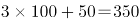分钟，又因为怪钟每天为1000分钟，正常钟为1440分钟，设正常钟走过了x分钟，则有，解得x=504，从12点开始经过了504分钟，时间为20点24分。

解法2：

怪钟从5点走到8点50分走了一天的35%，相当于正常时间的小时。实际时间为12+8.4=20.4小时，即20点24分。

故正确答案为D。

### 第 89 题

已知盐水若干千克，第一次加入一定量的水后，盐水浓度变为6%，第二次加入同样多的水后，盐水浓度变为4%，第三次再加入同样多的水后盐水浓度是：

A. 3%

B. 2.5%

C. 2%

D. 1.8%

第 89 题 · 答案与解析

**参考答案（粉笔题库参考内容）**

A

**解析**

根据题意可知，溶质质量没有发生变化，可赋值盐量为12。根据第一次加入水后的浓度为6%，可知此时盐水总量；第二次加水后浓度为4%，可知此时盐水总量为。因此每次加水量为300-200=100。由此可知第三次加入同样多的水后盐水总量为400，因此浓度为。

故正确答案为A。

### 第 90 题

某环形公路长15千米，甲、乙两人同时同地沿公路骑自行车反向而行，0.5小时后相遇，若他们同时同地同向而行，经过3小时后，甲追上乙，问乙的速度是多少：

A. 12.5千米/小时

B. 13.5千米/小时

C. 15.5千米/小时

D. 17.5千米/小时

第 90 题 · 答案与解析

**参考答案（粉笔题库参考内容）**

A

**解析**

设甲速度每小时x千米，乙每小时y千米，根据环形相遇公式：，可得0.5(x+y)=15，即x+y=30；根据环形追击公式：，可得3(x-y)=15，即x-y=5，联立解得x=17.5，y=12.5。

故正确答案为A。

### 第 91 题

改革开放以来我们取得一切成绩和进步的根本原因，归结起来如下：开辟了中国特色社会主义道路，形成了中国特色社会主义理论体系，高举中国特色社会主义伟大旗帜，最根本的就是要坚持这条道路和这个理论体系。

下列哪一项完整概括了中国特色社会主义理论体系的内容：

①马列主义

②毛泽东思想

③邓小平理论

④“三个代表”重要思想

⑤科学发展观

A. ①②③④⑤

B. ①③④⑤

C. ②③④⑤

D. ③④⑤

第 91 题 · 答案与解析

**参考答案（粉笔题库参考内容）**

D

**解析**

中国共产党第十七次全国代表大会提出了中国特色社会主义理论体系的科学命题，明确指出：“中国特色社会主义理论体系，就是包括邓小平理论、‘三个代表’重要思想以及科学发展观等重大战略思想在内的科学理论体系。”中国共产党第十八次全国代表大会删除了“等重大战略思想”这几个字，对这一命题做出新的表述：“中国特色社会主义理论体系，就是包括邓小平理论、‘三个代表’重要思想以及科学发展观在内的科学理论体系，是对马克思列宁主义、毛泽东思想的坚持和发展”。这个界定，指明了中国特色社会主义理论体系的时间和空间范围。从时间讲，这个理论体系是中国共产党人在改革开放以来继续推进马克思主义中国化的最新理论成果的统称；从空间讲，是对邓小平理论、“三个代表”重要思想和科学发展观等重大理论成果的整合。

故正确答案为D。

本题相关知识点：

中国共产党在不断推进马克思主义中国化的进程中，先后实现了两次历史性飞跃。

第一次飞跃发生在新民主主义革命时期，形成的理论成果是毛泽东思想。

第二次飞跃发生在党的十一届三中全会以后，形成的理论成果是中国特色社会主义理论体系，包括邓小平理论、“三个代表”重要思想以及科学发展观等重大战略思想，是马克思主义中国化的最新成果。

### 第 92 题

建设和谐文化是建设社会主义和谐社会的主要任务。          是建设和谐文化的根本，是社会主义意识形态的本质体现：

A. 公平正义理念

B. 四项基本原则

C. 社会主义荣辱观

D. 社会主义核心价值体系

第 92 题 · 答案与解析

**参考答案（粉笔题库参考内容）**

D

**解析**

中国共产党十六届六中全会（2006年）提出，建设和谐文化是构建社会主义和谐社会的重要任务，社会主义核心价值体系是建设和谐文化的根本。

故正确答案为D。

**本题相关知识点：**

十六届六中全会也明确提出，社会公平正义是社会和谐的基本条件，制度是社会公平正义的根本保证，必须加紧建设对保障社会公平正义具有重大作用的制度，保障人民在政治、经济、文化、社会等方面的权利和利益，引导公民依法行使权利、履行义务。

四项基本原则是邓小平提出的。1979年3月30日，邓小平代表中共中央在北京召开的理论工作务虚会上作了题为《坚持四项基本原则》的讲话，他在讲话中将中国共产党一贯所强调的思想政治方面的原则，科学地概括为“四项基本原则”，即“坚持社会主义道路，坚持无产阶级专政，坚持中国共产党的领导，坚持马列主义、毛泽东思想。”（1982年《宪法》将无产阶级专政改为人民民主专政）

社会主义荣辱观是胡锦涛在2006年3月4日参加全国政协十届四次会议民盟、民进界委员联组讨论时提出。社会主义荣辱观以“八荣八耻”为核心，具体为“以热爱祖国为荣、以危害祖国为耻，以服务人民为荣、以背离人民为耻，以崇尚科学为荣、以愚昧无知为耻，以辛勤劳动为荣、以好逸恶劳为耻，以团结互助为荣、以损人利己为耻，以诚实守信为荣、以见利忘义为耻，以遵纪守法为荣、以违法乱纪为耻，以艰苦奋斗为荣、以骄奢淫逸为耻”。

### 第 93 题

党的十七届四中全会审议通过了《中共中央关于加强和改进新形势下党的建设若干重大问题的决定》，全会提出要把          作为重大而紧迫的战略任务抓紧抓好。

A. 推进马克思主义中国化

B. 建设马克思主义学习型政党

C. 提高党的执政能力建设和先进性建设

D. 推进惩治和预防腐败体系建设

第 93 题 · 答案与解析

**参考答案（粉笔题库参考内容）**

B

**解析**

党的十七届四中全会（2009年）审议通过了《中共中央关于加强和改进新形势下党的建设若干重大问题的决定》，全会提出：“必须按照科学理论武装、具有世界眼光、善于把握规律、富有创新精神的要求，把建设马克思主义学习型政党作为重大而紧迫的战略任务抓紧抓好。”

故正确答案为B。

### 第 94 题

根据我国现行《宪法》和有关组织的规定，下列关于我国现行立法体制权限划分的表述不正确的是：

A. 全国人大修改宪法，全国人大及其常委会可以制定和修改刑法、民法和其他基本法律

B. 省、自治区、直辖市的人民代表大会及其常委会可以制定地方性法规

C. 省、自治区人民政府所在市的人民政府，可以根据法律和行政法规，制定规章

D. 自治区人民代表大会有权制定自治条例和单行条例

第 94 题 · 答案与解析

**参考答案（粉笔题库参考内容）**

A

**解析**

A项错误，《中华人民共和国立法法》第七条规定：“全国人民代表大会和全国人民代表大会常务委员会行使国家立法权。全国人民代表大会制定和修改刑事、民事、国家机构的和其他的基本法律。全国人民代表大会常务委员会制定和修改除应当由全国人民代表大会制定的法律以外的其他法律；在全国人民代表大会闭会期间，对全国人民代表大会制定的法律进行部分补充和修改，但是不得同该法律的基本原则相抵触。”因此A项的表述“全国人大及其常委会可以制定和修改刑法、民法和其他基本法律”有误，全国人大常委会没有权利制定和修改刑法、民法和其他基本法律。

B项正确，根据《中华人民共和国立法法》第七十二条第一款规定：“省、自治区、直辖市的人民代表大会及其常务委员会根据本行政区域的具体情况和实际需要，在不同宪法、法律、行政法规相抵触的前提下，可以制定地方性法规。”

C项正确，根据《中华人民共和国立法法》第八十二条第一款规定：“省、自治区、直辖市和设区的市、自治州的人民政府，可以根据法律、行政法规和本省、自治区、直辖市的地方性法规，制定规章。”

D项正确，根据《中华人民共和国立法法》第七十五条第一款规定：“民族自治地方的人民代表大会有权依照当地民族的政治、经济和文化的特点，制定自治条例和单行条例。自治区的自治条例和单行条例，报全国人民代表大会常务委员会批准后生效。”

本题为选非题，故正确答案为A。

### 第 95 题

甲与乙签订了一项买卖合同。约定：甲向乙支付定金5万元，如果任何一方不履行合同应支付违约金8万元，后来乙违约，甲打算向法院提起诉讼，下列哪种诉讼请求既能最大限度地保护自己的利益，又能获得法院的支持：

A. 请求乙支付违约金8万元

B. 请求乙双倍返还定金10万元

C. 请求乙支付违约金8万元，同时请求返还定金5万元

D. 请求乙双倍返还定金10万元，同时请求乙支付违约金8万元

第 95 题 · 答案与解析

**参考答案（粉笔题库参考内容）**

C

**解析**

《合同法》第一百一十六条规定，当事人约定违约金，又约定定金的，一方违约时，对方可以选择适用违约金或定金条款。由此可见，二者不可并用，只能选择其中一个主张。本题可作以下分析：

（1）若选择定金罚则，则乙应双倍返还定金，即10万元；

（2）若选择违约金，则为约定的违约金8万元，同时由于是乙违约，所以必须返还定金5万元给甲，这样甲共获得13万元，大于定金罚则的10万元，能获得自己利益的最大化，也能得到法院支持。故C项正确；

（3）禁止“并用式”选择，即甲不能要求乙支付违约金8万元，另加定金罚则的10万元，总共18万元。故D项错误。

本题难点在于（2），选择了违约金责任后，原定金收受方还要将定金原价返还，“8万+5万”之意不是违约金与定金罚则并用，而是只适用违约责任。

故正确答案为C。

### 第 96 题

某市安全生产监督管理局在进行全市煤矿企业安全情况大检查时，发现甲企业在安全生产方面存在巨大隐患，责令该企业停产停业进行整顿，该企业对此决定不服，该企业：

A. 可以向该市安全生产监督管理局申请行政复议

B. 只能向该市市政府申请行政复议

C. 可以直接向人民法院提起行政诉讼

D. 应该先向该市市政府申请行政复议，若不服复议决定，再向人民法院提起行政诉讼

第 96 题 · 答案与解析

**参考答案（粉笔题库参考内容）**

BC

**解析**

A项错误，B项正确，根据《行政复议法》第二十四条规定：“县级以上地方各级人民政府管辖下列行政复议案件：（一）对本级人民政府工作部门作出的行政行为不服的；（二）对下一级人民政府作出的行政行为不服的；（三）对本级人民政府依法设立的派出机关作出的行政行为不服的；（四）对本级人民政府或者其工作部门管理的法律、法规、规章授权的组织作出的行政行为不服的。”因此，该企业可以向该市市政府申请行政复议。

C项正确，根据《行政诉讼法》第四十四条规定：“对属于人民法院受案范围的行政案件，公民、法人或者其他组织可以先向行政机关申请复议，对复议决定不服的，再向人民法院提起诉讼；也可以直接向人民法院提起诉讼。”因此，该公司直接向人民法院提起行政诉讼的行为是正确的。

D项错误，根据C项引用法条内容，该企业“可以”而不是“应该”先向市政府申请行政复议。“应该”一词更具指向性，而“可以”更具选择性。

故正确答案为BC。

### 第 97 题

我国《物权法》中的物权，是指权利人依法对特定的物享有直接支配和排他的权利。包括所有权、用益物权和          三大类。

A. 地役权

B. 质权

C. 担保物权

D. 留置权

第 97 题 · 答案与解析

**参考答案（粉笔题库参考内容）**

C

**解析**

A项错误，地役权指为使用自己不动产的便利或提高其效益而按照合同约定利用他人不动产的权利。其一，地役权是按照当事人的约定设立的用益物权。其二，地役权是存在于他人不动产上的用益物权。其三，地役权是为了需役地的便利而设立的用益物权。

B项错误，质权指债权人与债务人或债务人提供的第三人以协商订立书面合同的方式，移转债务人或者债务人提供的第三人的动产或权利的占有，在债务人不履行债务时，债权人有权以该财产价款优先受偿，也叫“质押”，属于担保物权的一种。

C项正确，根据《物权法》第二条规定：“本法所称物权，是指权利人依法对特定的物享有直接支配和排他的权利，包括所有权、用益物权和担保物权。”

D项错误，留置权指当债务人逾期不履行债务时，合法占有债务人动产的债权人有权留置动产并享有对该动产的优先受偿权，属于担保物权的一种。

故正确答案为C。

本题相关知识点：

关于所有权，《物权法》规定：“所有权人对自己的不动产或者动产，依法享有占有、使用、收益和处分的权利。所有权人有权在自己的不动产或者动产上设立用益物权和担保物权。用益物权人、担保物权人行使权利，不得损害所有权人的权益”。

用益物权是指用益物权人对他人所有的不动产或者动产，依法享有占有、使用和收益的权利。用益物权包括土地承包经营权、建设用地使用权、宅基地使用权、地役权、自然资源使用权（海域使用权、探矿权、采矿权、取水权和使用水域、滩涂从事养殖、捕捞的权利）。

担保物权指担保物权人在债务人不履行到期债务或者发生当事人约定的实现担保物权的情形，依法享有就担保财产优先受偿的权利，但法律另有规定的除外。担保物权包括抵押权、质权和留置权。

### 第 98 题

李某因诈骗罪被判处有期徒刑2年，缓刑3年，缓刑考验期满后，司法机关查获李某在缓刑考验期内，曾经伙同他人盗窃财物价值3万元，对李某应当如何处理：

A. 不撤销缓刑，以累犯从重处罚

B. 撤销缓刑，以惯犯从重处罚

C. 不撤销缓刑，以盗窃罪从重处罚

D. 撤销缓刑，前后罪数罪并罚

第 98 题 · 答案与解析

**参考答案（粉笔题库参考内容）**

D

**解析**

《中华人民共和国刑法》第七十七条规定：“被宣告缓刑的犯罪分子，在缓刑考验期限内犯新罪或者发现判决宣告以前还有其他罪没有判决的，应当撤销缓刑，对新犯的罪或者新发现的罪作出判决，把前罪和后罪所判处的刑罚，依照本法第六十九条的规定，决定执行的刑罚。”李某是在缓刑考验期内犯新罪，所以应该撤销缓刑，前后罪数罪并罚。

故正确答案为D。

**本题相关知识点：**

《刑法》第六十九条规定：“判决宣告以前一人犯数罪的，除判处死刑和无期徒刑的以外，应当在总和刑期以下、数刑中最高刑期以上，酌情决定执行的刑期，但是管制最高不能超过三年，拘役最高不能超过一年，有期徒刑总和刑期不满三十五年的，最高不能超过二十年，总和刑期在三十五年以上的，最高不能超过二十五年。如果数罪中有判处附加刑的，附加刑仍须执行。”

### 第 99 题

在下列哪种情形中，甲构成不当得利：

A. 某城市修建地铁，地铁附近居民甲的房屋大幅升值

B. 甲、乙之间订有买卖合同，价款为8000元，甲将价值5000元的带有瑕疵的标的物卖给乙

C. 甲在赌场参加赌博，乙输给甲5000元，并当场支付给甲

D. 甲到某超市购物，付款时由于收银员的疏忽，致使一件价值500元的商品未付款

第 99 题 · 答案与解析

**参考答案（粉笔题库参考内容）**

D

**解析**

不当得利是指没有合法根据，或事后丧失了合法根据而被确认为是因致他人遭受损失而获得的利益。不当得利的构成要件包括：① 双方当事人必须一方为受益人，他方为受害人；②受益人取得利益与受害人遭受损害之间必须有因果关系；③受益人取得利益没有合法根据，即既没有法律上、也没有合同上的根据，或曾有合法根据，但后来丧失了这一合法根据。

A项错误，地铁站附近居民甲的房屋大幅升值，没有利益相关方受损，不构成不当得利；

B、C项错误，不符合不当得利的构成要件；

D项正确，甲由于收银员的疏忽，致使一件价值500元的衣服未付款，在这种情况下，商场的利益受到损害，所以甲的行为构成不当得利。

故正确答案为D。

### 第 100 题

以下不属于《公务员法》中对公务员处分种类的是：

A. 警告

B. 记大过

C. 开除

D. 降职

第 100 题 · 答案与解析

**参考答案（粉笔题库参考内容）**

D

**解析**

根据《公务员法》第六十二条规定：“处分分为：警告、记过、记大过、降级、撤职、开除。”降职不属于法律规定的处分种类。

本题为选非题，故正确答案为D。

### 第 101 题

是实现管理效率和效果的灵魂，是管理过程的核心环节。

A. 计划职能

B. 领导职能

C. 控制职能

D. 组织职能

第 101 题 · 答案与解析

**参考答案（粉笔题库参考内容）**

B

**解析**

A项错误，广义的计划职能是指管理者制定计划、执行计划和检查计划执行情况的全过程；狭义的计划职能是指管理者事先对未来应采取的行动所作的谋划和安排。计划职能在时间顺序上是处于计划—组织—领导—控制四大管理职能的始发或第一职能位置，是实施管理活动的依据。

B项正确，领导职能是指领导者运用组织赋予的权力，组织、指挥、协调和监督下属人员，完成领导任务的职责和功能。它包括决策、选人用人、指挥协调、激励和思想政治工作等。领导职能是实现管理效率和效果的灵魂，是管理过程的核心环节。

C项错误，控制职能包括制定各种控制标准；检查工作是否按计划进行，是否符合既定的标准；若工作发生偏差要及时发出信号，然后分析偏差产生的原因，纠正偏差或制定新的计划，以确保实现组织目标，包括控制时间、控制数量、控制质量和控制安全四种基本方式。

D项错误，组织职能是指按计划对企业的活动及其生产要素进行的分派和组合。组织职能对于发挥集体力量、合理配置资源、提高劳动生产率具有重要的作用。

故正确答案为B。

### 第 102 题

由商品的价格变动所引起的商品相对价格的变动，进而由商品的相对价格变动所引起的商品需求量的变动，称为：

A. 挤出效应

B. 替代效应

C. 收入效应

D. 外部效应

第 102 题 · 答案与解析

**参考答案（粉笔题库参考内容）**

B

**解析**

A项错误，挤出效应指一个相对平衡的市场上，由于供应、需求有新的增加，导致部分资金从原来的预支中挤出，而流入到新的商品中。

B项正确、C项错误，一种商品价格变动所引起的该商品需求量变动的总效应可以被分解为替代效应和收入效应两个部分，即总效应=替代效应+收入效应。其中，由商品的价格变动所引起的商品相对价格的变动，进而由商品的相对价格变动所引起的商品需求量的变动为替代效应。由商品的价格变动所引起的实际收入水平变动，进而由实际收入水平变动所引起的商品需求量的变动为收入效应。替代效应不改变消费者的效用水平，收入效应表示消费者的效用水平发生变化。

D项错误，外部效应指在实际经济活动中，生产者或者消费者的活动对其他生产者或消费者带来的非市场性影响。这种影响可能是有益的，也可能是有害的，有益的影响被称为外部效益，外部经济性，或正外部性；有害的影响被称为外部成本，外部不经济性，或负的外部性。

故正确答案为B。

### 第 103 题

以下有关世界贸易组织（WTO）的表述中，不正确的一项是：

A. WTO的前身是关贸总协定，WTO于1995年1月1日建立

B. 部长会议是WTO的最高权力机构和决策机构

C. WTO总干事在部长会议休会期间，行使部长会议的职权

D. 2001年12月11日，中国以新成员的身份正式加入WTO

第 103 题 · 答案与解析

**参考答案（粉笔题库参考内容）**

C

**解析**

A项正确，WTO前身是关税与贸易总协定。1994年4月15日，在摩洛哥的马拉喀什市举行的关贸总协定乌拉圭回合部长会议决定成立更具全球性的世界贸易组织，1995年1月1日正式开始运作。

B项正确，世贸组织的最高决策权力机构是部长会议。部长会议由所有成员国主管外经贸的部长、副部长级官员或其全权代表组成，一般两年举行一次会议，讨论和决定涉及世贸组织职能的所有重要问题，并采取行动。

C项错误，在部长会议休会期间，由全体成员代表组成的总理事会代行部长会议职能，并非由WTO总干事代行。

D项正确，2001年12月11日，中国正式加入世界贸易组织，成为其第143个成员。

本题为选非题，故正确答案为C。

本题相关知识点：

2012年8月22日，俄罗斯正式成为世贸组织第156个成员。

### 第 104 题

创新型国家是指将科技创新作为基本战略，能够通过大幅度提高科技创新能力，形成日益强大的竞争优势的国家，其科技进步贡献率在：

A. 50%

B. 60%

C. 70%

D. 80%

第 104 题 · 答案与解析

**参考答案（粉笔题库参考内容）**

C

**解析**

创新型国家是指那些将科技创新作为基本战略，大幅度提高科技创新能力，形成日益强大的竞争优势的国家。创新型国家是以技术创新为经济社会发展核心驱动力的国家。

作为创新型国家，应具备以下四个特征：

（1）创新投入高，国家的研发投入即R&D（研究与开发）支出占GDP的比例一般在2%以上；

（2）科技进步贡献率达70%以上；

（3）自主创新能力强，国家的对外技术依存度指标通常在30%以下；

（4）创新产出高,世界上公认的20个左右的创新型国家所拥有的发明专利数量占全世界总数的99%。

因此，由上述第（2）条可知，C项正确。

故正确答案为C。

本题相关知识点：

是否拥有高效的国家创新体系是区分创新型国家与非创新型国家的主要标志。

### 第 105 题

1938年，德国人（ ）在用慢中子轰击铀核时，首次发现了原子核的裂变现象，并放出新的中子。

A. 哈恩

B. 查德威克

C. 卢瑟福

D. 麦克斯韦

第 105 题 · 答案与解析

**参考答案（粉笔题库参考内容）**

A

**解析**

A项正确，奥托·哈恩，德国放射化学家和物理学家。1904年从镭盐中分离出一种新的放射性物质射钍。其最大的贡献是1938年和斯特拉斯曼一起发现核裂变现象，揭示了利用核能的可能性。

B项错误，詹姆斯·查德威克，英国物理学家。因发现中子的杰出贡献，获得1935年诺贝尔物理学奖。

C项错误，欧内斯特·卢瑟福，英国著名物理学家，知名为原子核物理学之父。因为“对元素蜕变以及放射化学的研究”，荣获1908年诺贝尔化学奖。

卢瑟福领导团队成功地证实在原子的中心有个原子核，创建了卢瑟福模型（行星模型）。他最先成功地在氮与α粒子的核反应里将原子分裂，他又在同实验里发现了质子，并且为质子命名。

D项错误，詹姆斯·克拉克·麦克斯韦，英国物理学家、数学家。经典电动力学的创始人，主要贡献是建立了麦克斯韦方程组，创立了经典电动力学，并且预言了电磁波的存在，提出了光的电磁说。

故正确答案为A。

### 第 106 题

下列关于我国国情的表述不正确的是：

A. 根据我国的区域协调发展战略，全国分成东部、西部、中部和南部四大经济区

B. 我国是世界上动植物种类最多的国家

C. 我国少数民族人口占全国总人口的8%左右

D. 我国大陆海岸长达1.8万公里

第 106 题 · 答案与解析

**参考答案（粉笔题库参考内容）**

A

**解析**

A项错误，为科学反映我国不同区域的社会经济发展状况，为党中央、国务院制定区域发展政策提供依据，根据《中共中央、国务院关于促进中部地区崛起的若干意见》、《国务院发布关于西部大开发若干政策措施的实施意见》以及党的十六大报告精神，现将我国的经济区域划分为东部、中部、西部和东北四大地区。因此，南部说法错误。

B项正确，我国约有10.4万种动植物，是世界上动植物种类最多的国家。

C项正确，我国人口最多的民族是汉族，约占全国总人口的92%，少数民族约占全国人口总数的8%。

D项正确，我国海岸线总长度3.2万公里,其中大陆海岸线自鸭绿江口至北仑河口，长达1.8万公里，岛屿海岸线1.4万公里。

本题为选非题，故正确答案为A。

### 第 107 题

中国共产党第          次全国代表大会提出了无产阶级在民主革命中的领导权问题和工农联盟问题。

A. 二

B. 三

C. 四

D. 五

第 107 题 · 答案与解析

**参考答案（粉笔题库参考内容）**

C

**解析**

本题考查毛中特。

A项错误，中共二大于1922年7月16日至23日在上海英租界南成都路辅德里625号举行。此次大会制定了党的最高纲领和最低纲领，在中国近代历史上第一次明确提出了彻底地反帝反封建的民主革命任务。

B项错误，中共三大于1923年6月12日至20日在广州恤孤院后街31号召开。此次大会确定的建立国共合作革命统一战线的策略，促进了第一次国共合作的实现。

C项正确，中共四大于1925年1月11日至22日在上海举行。此次大会明确提出了无产阶级在民主革命中的领导权问题和工农联盟问题。

D项错误，中共五大于1927年4月25日至5月9日在当时革命的中心武汉召开。此次大会纠正了陈独秀的机会主义错误，并决定党的重大方针政策，并选举产生了新的中央委员会和中央监察委员会。

故正确答案为C。

### 第 108 题

下列有关公文知识的表述中正确的是：

A. 多级行文是上行文中最基本的行文方式

B. 通报适用于公布社会各有关方面应遵守或者周知的事项

C. 行文关系决定了行文方向，是行文制度的核心

D. 公文的版记部分包括签发人，附注等内容

第 108 题 · 答案与解析

**参考答案（粉笔题库参考内容）**

C

**解析**

A项错误，多级行文是指将公文同时发送给上几级或下几级机关，甚至直达基层与人民群众直接见面。此种方式多用于为加快文件传递的上行文或部分不容许作任何变通和发挥的下行文，上行文最常用的方式，是逐级行文，即下级机关仅向具有隶属关系的上一级机关行文；

B项错误，适用于公布社会各有关方面应遵守或者周知的事项是通告；通报是表彰先进，批评错误，传达重要精神或者情况，通报多限在机关体系内部适用，属于限制性公文；

D项错误，公文版记包括主题词、抄送机关、印发机关和印发日期、份数等要素，置于公文最后一页。

故正确答案为C。

### 第 109 题

是我国第一部长篇历史章回小说。

A. 《水浒传》

B. 《三国演义》

C. 《红楼梦》

D. 《三国志》

第 109 题 · 答案与解析

**参考答案（粉笔题库参考内容）**

B

**解析**

本题的四个选项中，《三国志》属于史书，它是一部主要记载魏、蜀、吴三国鼎立时期的纪传体国别史。《水浒传》、《三国演义》、《红楼梦》都属于章回小说，其中《三国演义》是我国第一部长篇历史章回小说。

故正确答案为B。

**本题相关知识点：**

章回小说是我国古典长篇小说的一种，由宋元讲史话本发展而来。它的特点是分回标目、分章叙事、首尾完整、故事连接、段落整齐。

### 第 110 题

下列有关生活常识的表述中，不正确的一项是：

A. 女性比男性更易患抑郁症

B. 水果榨汁喝会减少对水果中维生素C和纤维素的摄取

C. 运动时脚扭伤肿了，应该进行热水敷应急处理

D. 打呵欠是一种深呼吸运动，它会让人比平常更多的吸进氧气和排出二氧化碳

第 110 题 · 答案与解析

**参考答案（粉笔题库参考内容）**

C

**解析**

C项错误，运动时脚扭伤肿了，在扭伤后24小时内是应该冷敷的，48小时后热敷，这样可以减少出血，促进肿胀的消退。在进行冷敷时应连续冷敷20—30分钟后，休息一段时间，再次冷敷，同时应注意观察，避免冻伤。热敷时也是同样，不能持续热敷，也是连续热敷20—30分钟后，休息一会儿，再次热敷。

本题为选非题，故正确答案为C。

## 材料 1

经初步核算，2009年上半年我国国内生产总值同比增长7.1%，比一季度加快1.0个百分点。其中，第一产业增加值12025亿元，增长3.8%，第二产业增加值70070亿元，增长6.6%，第三产业增加值57767亿元，增长8.3%。上半年，全社会固定资产投资91321亿元，同比增长33.5%，增速比上年同期加快7.2个百分点。其中，城镇固定资产投资78098亿元，增长33.6%，加快6.8个百分点；农村固定资产投资13223亿元，增长32.7%，加快9.5个百分点。上半年，社会消费品零售总额58711亿元，同比增长15.0%。其中，城市消费品零售额39833亿元，增长14.4%，县及县以下消费品零售额18878亿美元，增长16.4%。上半年，进出口总额9461亿美元，同比下降23.5%。其中，出口5215亿美元；进口4246亿美元，贸易顺差同比减少21亿美元。上半年，城镇居民家庭人均总收入9667元，其中，人均可支配收入8856元，同比增长9.8%，在城镇居民家庭人均总收入中，工资性收入6394元，增长11.1%；转移性收入2273元，增长16.0%；经营净收入778元，增长3.9%；财产性收入222元，增长9.1%。农村居民人均现金收入2733元，增长8.1%，其中，工资性收入954元，增长8.4%；家庭经营收入1512元，增长5.5%，财产性收入78元，增长9.9%；转移性收入189元，增长31.4%。

### 第 111 题

2009年上半年，我国国内生产总值为：

A. 139862亿元

B. 147953亿元

C. 148632亿元

D. 151429亿元

第 111 题 · 答案与解析

**参考答案（粉笔题库参考内容）**

A

**解析**

定位文字材料可得：2009年上半年三个产业的生产总值分别是12025亿元、70070亿元、57767亿元，故2009年上半年国内生产总值为亿元。

故正确答案为A。

### 第 112 题

2008年上半年，全社会固定资产投资同比增长：

A. 40.7%

B. 33.5%

C. 26.3%

D. 24.2%

第 112 题 · 答案与解析

**参考答案（粉笔题库参考内容）**

C

**解析**

根据题干“2008年上半年······同比增长”，结合选项为百分数，可以判定本题为一般增长率计算问题。定位文字材料可得：2009年上半年，全社会固定资产投资同比增长33.5%，增速比上年同期加快7.2个百分点”。故2008年上半年，全社会固定资产投资同比增长33.5%-7.2%=26.3%。

故正确答案为C。

### 第 113 题

2008年上半年，我国进出口贸易顺差为：

A. 1018亿美元

B. 990亿美元

C. 970亿美元

D. 948亿美元

第 113 题 · 答案与解析

**参考答案（粉笔题库参考内容）**

B

**解析**

定位文字材料可得：2009年上半年，进出口总额9461亿美元，同比下降23.5%。其中，出口5215亿美元；进口4246亿美元，贸易顺差同比减少21亿美元。则2008年上半年，我国进出口贸易顺差为(5215-4246)+21=990亿美元。

故正确答案为B。

### 第 114 题

2008年上半年农村居民人均财产性收入约占农村居民人均现金收入的：

A. 2.7%

B. 2.8%

C. 2.9%

D. 3.0%

第 114 题 · 答案与解析

**参考答案（粉笔题库参考内容）**

B

**解析**

根据题干“2008年上半年······占······”，结合选项为百分数，且材料时间为2009年，可判定本题为基期比重问题。定位文字材料可得：农村居民人均现金收入2733元（B），增长8.1%（b）；财产性收入78元（A），增长9.9%（a）。根据比重公式：基期比重，即

故正确答案为B。

### 第 115 题

以下对2009年上半年我国经济运行状况的表述中，不正确的一项是：

A. 固定资产投资快速增长

B. 国内市场销售平稳较快增长，县及县以下增长快于城市

C. 对外贸易形式乐观，进出口企稳回升

D. 城乡居民收入持续增长，转移性收入增幅较大

第 115 题 · 答案与解析

**参考答案（粉笔题库参考内容）**

C

**解析**

A项：根据文字材料可得：2009年上半年，全社会固定资产投资91321亿元，同比增长33.5%。可判定为快速增长，正确；

B项：根据文字材料可得：2009年上半年，城市消费品零售额39833亿元，增长14.4%，县及县以下消费品零售额18878亿美元，增长16.4%。县以及县以下增长（16.4%）快于城市（14.4%），正确；

C项：根据文字材料可得：2009年上半年，进出口总额9461亿美元，同比下降23.5%，可知进出口总额比上年下降，并没有达到回升的态势，错误；

D项：根据文字材料可得：2009年上半年，城镇居民家庭人均总收入9667元，其中，人均可支配收入同比增长9.8%，在城镇居民家庭人均总收入中，工资性收入同比增长11.1%；转移性收入同比增长16.0%；经营净收入同比增长3.9%；财产性收入同比增长9.1%。农村居民人均现金收入2733元，增长8.1%，其中，工资性收入同比增长8.4%；家庭经营收入同比增长5.5%，财产性收入同比增长9.9%；转移性收入同比增长31.4%。可知城乡居民收入持续增长，转移性收入增幅相对较大，正确。

本题为选非题，故正确答案为C。

## 材料 2

2008年，我国全年建设占用耕地19.16万公顷，灾毁耕地2.48万公顷，生态退耕0.76万公顷，因农业结构调整减少耕地2.49万公顷。土地整理复垦开发补充耕地22.96万公顷。

全年水资源总量27127亿立方米，比上年增加7.4%；人均水资源2048立方米，增加6.9%；全年平均降水量659毫米，增加8.0%；年末全国大型水库蓄水总量1962亿立方米，比上年末多蓄水93亿立方米；全年总用水量5840亿立方米，比上年增长0.4%。其中，生活用水增长0.6%，工业用水增长1.8%，农业用水减少0.2%，生态补水减少0.7%。万元国内生产总值用水量231.8立方米，比上年下降7.9%；万元工业增加值用水量130.3立方米，下降7.0%。

全年完成造林面积477万公顷。其中，人工造林329万公顷，林业重点工程完成造林面积312万公顷，占全部造林面积的65.4%。全民义务植树23.1亿株。截至2008年底，自然保护区达到2538个，其中国家级自然保护区303个。新增综合治理水土流失面积4.7万平方公里，新增实施水土流失地区封育保护面积2.6万平方公里。

初步测算，全年能源消费总量28.5亿吨标准煤，比上年增长4.0%。其中，煤炭消费量27.4亿吨，增长3.0%；原油消费量3.6亿吨，增长5.1%；天然气消费量807亿立方米，增长10.1%；电力消费量34502亿千瓦时，增长5.6%。全国万元国内生产总值能耗下降4.59%。主要原材料消费中，钢材消费量5.4亿吨，增长4.2%；精炼钢消费量538万吨，增长6.9%；电解铝消费量1260万吨，增长4.3%；乙烯消费量998万吨，下降2.9%；水泥消费量13.7亿吨，增长3.5%。

### 第 116 题

2007年全年我国水资源总量约为：

A. 24780亿立方米

B. 25260亿立方米

C. 25630亿立方米

D. 26120亿立方米

第 116 题 · 答案与解析

**参考答案（粉笔题库参考内容）**

B

**解析**

根据题干“2007年全年我国水资源总量约为”，结合材料时间为2008年，可判定本题为基期计算问题。定位文字材料第二段可得：全年水资源总量27127亿立方米，比上年增加7.4%。根据基期计算公式：基期量，题目所求为亿立方米，与B项最接近。

故正确答案为B。

### 第 117 题

2007年全年我国万元国内生产总值用水量约是万元工业增加值用水量的：

A. 1.5倍

B. 1.6倍

C. 1.7倍

D. 1.8倍

第 117 题 · 答案与解析

**参考答案（粉笔题库参考内容）**

D

**解析**

根据题干“2007年全年······是······”，结合选项为倍数，且材料时间为2008年，可判定本题为基期倍数问题。定位文字材料第二段：万元国内生产总值用水量231.8立方米，比上年下降7.9%；万元工业增加值用水量130.3立方米，下降7.0%。根据基期倍数公式：基期倍数，题目所求为≈1.8倍。

故正确答案为D。

### 第 118 题

2008年全国人工造林面积约占造林总面积的：

A. 63%

B. 65%

C. 69%

D. 74%

第 118 题 · 答案与解析

**参考答案（粉笔题库参考内容）**

C

**解析**

根据题干“2008年······占······”，结合选项为百分数，且材料时间为2008年，可判定本题为现期比重问题。定位文字资料第三段可得：2008年全年完成造林面积477万公顷，人工造林329万公顷。根据公式：现期比重，则所求比重。

故正确答案为C。

### 第 119 题

与2007年相比，2008年我国的水泥消费增加量和以下哪项最接近：

A. 8000万吨

B. 5000万吨

C. 800万吨

D. 500万吨

第 119 题 · 答案与解析

**参考答案（粉笔题库参考内容）**

B

**解析**

根据题干“与2007年相比，2008年······增加量······”，可判定本题为增长量计算问题。定位文字资料第四段可得：2008年水泥消费量13.7亿吨，增长3.5%。根据公式：增长量，故所求增加量亿吨=4400万吨，与B项最接近。

故正确答案为B。

### 第 120 题

根据以上资料，下列说法不正确的是：

A. 我国原有耕地在2008年减少了24.89万公顷

B. 2007年年末全国大型水库蓄水量1869亿立方米

C. 截至2008年底，我国国家级自然保护区数占自然保护区总数的比重超过13%

D. 2007年全国乙烯消费量超过1000万吨

第 120 题 · 答案与解析

**参考答案（粉笔题库参考内容）**

C

**解析**

A项：定位文字资料第一段可得，2008年我国全年建设占用耕地19.16万公顷，灾毁耕地2.48万公顷，生态退耕0.76万公顷，因农业结构调整减少耕地2.49万公顷。故我国原有耕地在2008年减少了19.16+2.48+0.76+2.49=24.89万公顷，正确；

B项：定位文字资料第二段可得，2008年年末全国大型水库蓄水总量1962亿立方米，比上年末多蓄水93亿立方米。故2007年年末全国大型水库蓄水总量为1962-93=1869亿立方米，正确；

C项：定位文字资料第三段可得，截至2008年底，自然保护区达到2538个，其中国家级自然保护区303个。根据公式：比重，故所求比重为\<13%，即比重未超过13%，错误；

D项：定位文字资料第四段可得，2008年乙烯消费量998万吨，下降2.9%。根据公式：基期量，故2007年全国乙烯消费量为万吨，即超过1000万吨，正确。

本题为选非题，故正确答案为C。

## 材料 3

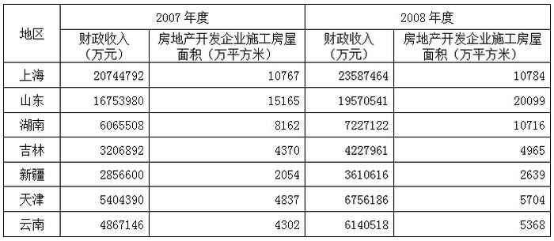

### 第 121 题

山东2008年度财政收入在2007年度基础上约增长了：

A. 16.8%

B. 16.2%

C. 15.9%

D. 15.4%

第 121 题 · 答案与解析

**参考答案（粉笔题库参考内容）**

A

**解析**

根据题干“山东2008年度······在2007年度基础上约增长了”，结合选项为百分数，可判定本题为一般增长率计算问题。定位表格可得：山东2007年和2008年的财政收入分别为16753980万元、19570541万元。根据公式：增长率，则所求增长率=，与A项最接近。

故正确答案为A。

### 第 122 题

2008年度“财政收入”和“房地产开发企业施工房屋面积”都比云南多的地区有：

A. 2个

B. 3个

C. 4个

D. 5个

第 122 题 · 答案与解析

**参考答案（粉笔题库参考内容）**

C

**解析**

定位表格可得2008年度各地区的财政收入和房地产开发企业施工房屋面积，比较可知，2008年度“财政收入”和“房地产开发企业施工房屋面积”都比云南多的地区有天津、上海、山东和湖南，共4个地区。

故正确答案为C。

### 第 123 题

2007年度上海的财政收入约是新疆的：

A. 7.3倍

B. 7.6倍

C. 7.9倍

D. 8.1倍

第 123 题 · 答案与解析

**参考答案（粉笔题库参考内容）**

A

**解析**

根据题干“2007年度······是······的”，结合选项为倍数，可判定本题为现期倍数问题。定位表格可得：2007年上海和新疆的财政收入分别为20744792万元（A）、2856600万元（B）。则所求倍数，与A项最接近。

故正确答案为A。

### 第 124 题

与2007年度相比2008年度“房地产开发企业施工房屋面积”增长最快的是：

A. 新疆

B. 山东

C. 吉林

D. 云南

第 124 题 · 答案与解析

**参考答案（粉笔题库参考内容）**

B

**解析**

根据题干“与2007年度相比2008年度······增长最快的是”，可判定本题为增长率比较问题。定位表格可得2007年和2008年各地区房地产开发企业施工房屋面积，根据公式：增长率，则2008年新疆、山东、吉林、云南房地产开发企业施工房屋面积的增长率分别为、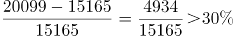、、，故增长最快的是山东。

故正确答案为B。

### 第 125 题

2008年度“房地产开发企业施工房屋面积”最大的三个地区的面积之和比2007年度该三个地区之和增加了：

A. 7615万平方米

B. 7595万平方米

C. 7535万平方米

D. 7505万平方米

第 125 题 · 答案与解析

**参考答案（粉笔题库参考内容）**

D

**解析**

根据题干“2008年度······比2007年度······增加了”，结合选项带单位，可判定本题为增长量计算问题。定位表格可得：2008年度房地产开发企业施工房屋面积最大的三个地区为山东（20099万平方米）、上海（10784万平方米）、湖南（10716万平方米），且其2007年度房地产开发企业施工房屋面积分别为15165万平方米、10767万平方米、8162万平方米。根据公式：增长量=现期量-基期量，故所求增长量=(20099+10784+10716)-(15165+10767+8162)=7505万平方米。

故正确答案为D。

备注：本题可以采用尾两数直接估算末两位，从而快速锁定答案。

## 材料 4

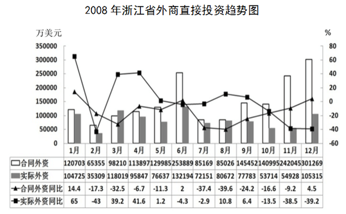

### 第 126 题

2008年浙江省合同外资约为：

A. 156亿美元

B. 154亿美元

C. 178亿美元

D. 189亿美元

第 126 题 · 答案与解析

**参考答案（粉笔题库参考内容）**

C

**解析**

定位图表可得2008年1-12月浙江省合同外资，故2008年全年浙江省合同外资=120703+65355+98210+113897+129985+253889万美元=178亿美元。

故正确答案为C。

### 第 127 题

估算2007年第四季度浙江省的实际外资总和约为：

A. 30.5亿美元

B. 32.5亿美元

C. 34.5亿美元

D. 36.5亿美元

第 127 题 · 答案与解析

**参考答案（粉笔题库参考内容）**

B

**解析**

根据题干“2007年第四季度······总和······”，结合材料时间为2008年，可判定本题为基期和差问题。定位图表可得：2008年第四季度浙江省每月实际外资分别为53714万美元、54928万美元、105315万美元，同比分别为-13.5%、-38.5%、-39.2%。根据公式：基期量，则2007年第四季度浙江实际外资总和万美元亿美元，与B项最接近。

故正确答案为B。

### 第 128 题

2008年实际外资最多的月份的合同外资约是实际最少的月份的合同外资的：

A. 3.1倍

B. 3.3倍

C. 3.6倍

D. 3.9倍

第 128 题 · 答案与解析

**参考答案（粉笔题库参考内容）**

D

**解析**

根据题干“2008年······是······的”，结合选项均为倍数，且材料时间为2008年，可判定本题为现期倍数问题。定位图表可得：2008年实际外资最多的月份是6月，合同外资为253889万美元（A）；实际外资最少的月份是2月，合同外资为65355万美元（B）。故所求倍数=A/B倍。

故正确答案为D。

### 第 129 题

2008年浙江省合同外资与实际外资的差在以下哪个范围：

A. 70至80亿美元

B. 55至65亿美元

C. 50至55亿美元

D. 45至50亿美元

第 129 题 · 答案与解析

**参考答案（粉笔题库参考内容）**

A

**解析**

2008年浙江省合同外资与实际外资的差可转换为1-12月每月两者的差值之和。定位图表可得2008年1-12月浙江省实际外资和合同外资，则1-12月各月合同外资减实际外资的差值见下表（单位为亿美元）：

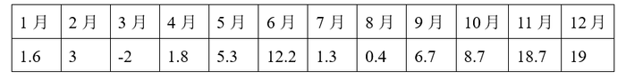

故题干所求差值=1.6+3-2+1.8+5.3+12.2+1.3+0.4+6.7+8.7+18.7+19=76.7亿美元，在70至80亿美元范围内。

故正确答案为A。

### 第 130 题

根据资料，以下关于2008年浙江省外商直接投资的说法不正确的一项是：

A. 2008年浙江省的合同外资比2007年少

B. 12个月份中，合同外资和实际外资的同比增长率都是负数的有四个

C. 12个月份中，合同外资大于实际外资的有11个

D. 实际外资与合同外资相差最悬殊的月份和最接近的月份分别是11月份和8月份

第 130 题 · 答案与解析

**参考答案（粉笔题库参考内容）**

D

**解析**

A项：定位图表可得2008年浙江省合同外资及其同比增速，观察发现，2008年浙江省有9个月的合同外资同比下降，只有1月、6月和12月同比增加。根据公式：增长量，可得：

1月增长量万美元＜5月减少量万美元；

6月增长量万美元＜2月减少量万美元；

12月增长量万美元＜11月减少量万美元。

故2008年较2007年的增长量一定小于减少量，即2008年浙江省的合同外资比2007年少，正确；

B项：定位图表可得2008年1-12月份合同外资和实际外资的同比增长率，两者同比增长率都为负的月份有2月、7月、10月、11月，共4个，正确；

C项：定位图表可得2008年1-12月份合同外资和实际外资，合同外资小于实际外资的只有3月，故合同外资大于实际外资的有11个月，正确；

D项：定位图表可得2008年1-12月份合同外资和实际外资，根据本篇材料第四题可知1-12月各个月份两者的差值，故差值最悬殊的是12月，最接近的是8月，错误。

本题为选非题，故正确答案为D。

