# 2011年浙江省公务员录用考试《行测》题

<!-- gwy:overview:start -->
> **浙江 · 2011 · 行测 · 统考** ｜ 130 题 · 图片 188 处 · 答案随题折叠

| 题型模块 | 题量 | 题号 |
| --- | ---: | ---: |
| 言语理解与表达 | 35 | 1–35 |
| 数量关系 | 25 | 36–60 |
| 综合知识 | 20 | 61–80 |
| 判断推理 | 35 | 81–115 |
| 资料分析 | 15 | 116–130 |
| **合计** | **130** | |

导航：[题型与作答说明](#题型与作答说明) · [题目](#题目) · [材料 1](#材料-1)
<!-- gwy:overview:end -->

> 候选采集稿。参考答案及解析来自粉笔页面，不代表官方答案或真实高分答卷；来源使用许可与原卷对应关系仍需人工核实。

## 题型与作答说明

言语理解与表达

（35题）

根据题目要求，在每个选项中选出一个正确答案。

数量关系

（25题）

本部分包括数字推理与数学运算两种类型的试题。

综合知识

（20题）

根据题目要求，在四个选项中选出一个正确答案。

判断推理

（35题）

本部分包括类比推理、逻辑判断、图形推理与定义判断四种类型的试题。

资料分析

（15题）

所给出的图、表、文字或综合性资料均有5个问题要你回答，根据提供的信息进行分析、比较、计算和判断处理。

## 题目

### 第 1 题

国际货币体系是保证国际交易正常进行的某种世界各国\_\_\_\_的制度安排。其主要\_\_\_\_­有二：第一，提供流动性，方便商品、资产跨境交易；第二，提供调整贸易不平衡的某种机制。

填入画横线部分最恰当的一项是：

A. 遵照 目标

B. 遵循 目的

C. 遵从 用途

D. 遵守 功能

第 1 题 · 答案与解析

**参考答案（粉笔题库参考内容）**

D

**解析**

此题为实词填空题。

第一空，C选项遵从是指遵照并服从，一般指上级的命令，而文段中并没有提到上级命令，故排除C。

第二空，空格后有两点内容，目标和目的都有想要达到的境地的含义，但是题干中的两点内容并非是要达到的境地或结果，而是描述国际货币体系的有利作用，故第二个空排除A、B两项，用“功能”最为合适，故D选项符合题意。

第一个空格填写遵守，意思是依照规定行动，根据习惯搭配，遵守规定、制度最为合适，验证D项正确。

故正确答案为D。

**考点**：词的辨析-词义侧重、实词填空、对应关系-解释说明

**来源**：2011年浙江省公务员录用考试《行测》题第1题

### 第 2 题

所有经典都有其局限性，不加选择地将经典灌输给学生确实是缺乏教育责任的表现。但将经典进行删减，然后将\_\_\_\_的“洁本”教给学生，就一定能给学生营造出理想的“世外桃源”吗？

填入画横线部分最恰当的一项是：

A. 穿凿附会

B. 断章取义

C. 东拼西凑

D. 支离破碎

第 2 题 · 答案与解析

**参考答案（粉笔题库参考内容）**

D

**解析**

此题为成语填空题。

通过题干可知将经典进行删减，然后将被删减后的“洁本”教给学生。

因此，结合选项应该选择D，D选项支离破碎形容事物零散破碎，不完整，文段提到“将经典进行删减”，将“洁本”教给学生，说明经典是不完整的，与支离破碎相对应。

A选项穿凿附会是指把讲不通的或不相干的道理、事情硬扯在一起进行解释，没有体现文段中的“将经典进行删减”；B选项断章取义是指不顾全篇文章或谈话的内容，孤立地取其中的一段或一句的意思，多指引用与原意不符，也没有体现文段中的“将经典进行删减”；C选项东拼西凑比喻零乱地加以拼凑，文段并没有提到拼凑零乱的内容。

故正确答案为D。

**考点**：成语填空、对应关系-前后呼应

**来源**：2011年浙江省公务员录用考试《行测》题第2题

### 第 3 题

1929年经济危机引发了政治革命，当时罗斯福认为，自由的基础不是对政府权力        ，如果这样的话，会“把人民拱手送给大公司任其奴役”，大公司的权力只有通过政府权力的扩展和延伸才能受到钳制。

填入画横线部分最恰当的一项是：

A. 制约

B. 限制

C. 放任

D. 不拘

第 3 题 · 答案与解析

**参考答案（粉笔题库参考内容）**

B

**解析**

根据后文可知，横线处意在表达政府权力需要扩展和延伸，不应被限制。B项“限制”指规定范围，不许超过，符合文意，当选。A项“制约”指甲事物本身的存在和变化以乙事物的存在和变化为条件，则甲事物为乙事物所制约，制约政府权力仅表示政府权力有了一定约束，并非不可拓展和延伸，与“限制”对比，限制更能体现不可越线，不能扩展和延伸之意，A项排除；C项“放任”指听其自然，不加约束或干涉，D项“不拘”指不拘泥、不计较、不限制，均与文意不符，排除。

故正确答案为B。

**考点**：实词填空、对应关系-前后呼应

**来源**：2011年浙江省公务员录用考试《行测》题第3题

### 第 4 题

要想走近历史的“原生态”，首要的是要深入发掘一手的可靠的原始史料，要真正读懂历史文本，在史学分析时也应重视解释、追寻研究对象的原貌。尽可能地不作\_\_\_\_ 的评论，不带任何偏见。

填入画横线部分最恰当的一项是：

A. 陈词滥调

B. 夸夸其谈

C. 不着边际

D. 信口开河

第 4 题 · 答案与解析

**参考答案（粉笔题库参考内容）**

C

**解析**

此题为成语填空题。

根据题干可知对历史进行评论是应该要有态度的，文段指出应根据事实本身进行评论，C选项“不着边际”的意思是挨不着边儿，多指说话空泛，不接触实际，因此不作不着边际的评论符合题意，C项符合题意。

因此，结合选项应该选择C。

A选项“陈词滥调”是指陈腐、空泛的论调；B选项“夸夸其谈”形容说话浮夸不切实际；D选项“信口开河”比喻随口乱说一气，指说话没有根据，不可靠；A、B、D三项都没有体现根据事实进行评论，因此都排除。

故正确答案为C。

**考点**：成语填空、对应关系-前后呼应

**来源**：2011年浙江省公务员录用考试《行测》题第4题

### 第 5 题

“获指标逾期不买车”该受罚吗？既然无法保证市民在多长时间内参加摇号一定能摇到，那么就没有理由对那些\_\_\_\_ 的市民予以惩罚，这是一个基本的公平。更何况，大到国家政策尚且可能\_\_\_\_，普通家庭因为种种原因而临时改变购车计划，凭什么就得挨罚呢？

填入画横线部分最恰当的一项是：

A. 未雨绸缪 朝令夕改

B. 防患未然 反复无常

C. 居安思危 变幻莫测

D. 临渴掘井 变化多端

第 5 题 · 答案与解析

**参考答案（粉笔题库参考内容）**

A

**解析**

此题为近义成语辨析填空题。

第一空，主要描写的是为买车事先做准备进行摇号的市民不应该受到惩罚，A选项“未雨绸缪”指还没有下雨，先把门窗绑牢，比喻事先做准备，符合题意；B选项“防患未然”指防止事故或祸害于尚未发生之前；C选项“居安思危”是指虽然处在平安的环境里，也要想到有出现危险的可能，指随时有应付意外事件的思想准备；D选项“临渴掘井”指感到渴才掘井，比喻平时没有准备，事到临头才想办法；B、C、D三个选项多指预防灾祸，买车达不到灾祸的程度，故排除B、C、D项。

第二空，A选项中“朝令夕改”是指早晨发布的命令，晚上就改了，比喻经常改变主张和办法，一会儿一个样，常用“朝令夕改”来形容国家时常改变政策。填写“朝令夕改”最为合适，验证A项正确。

故正确答案为A。

**考点**：词的辨析-搭配对象、成语填空、对应关系-前后呼应

**来源**：2011年浙江省公务员录用考试《行测》题第5题

### 第 6 题

思想史研究在很长时间里面，变得相当狭窄和单一，近来这种状况有一些变化的\_\_\_\_，其实，学科界限的打破是一种必然的趋势，在这种趋势下的思想史研究不能\_\_\_\_ 。

填入画横线部分最恰当的一项是：

A. 痕迹 刻舟求剑

B. 苗头 南辕北辙

C. 迹象 画地为牢

D. 呼声 闭门造车

第 6 题 · 答案与解析

**参考答案（粉笔题库参考内容）**

C

**解析**

此题为实词与成语混搭填空题。

第二空，结合文段中“学科界限的打破是一种必然的趋势”可知，思想史研究需要打破固有思维，不能只在指定的范围内研究。A选项“刻舟求剑”比喻不懂事物已发展变化而仍静止地看问题；B选项“南辕北辙”比喻行动和目的正好相反；C选项“画地为牢”比喻只许在指定的范围内活动；D选项“闭门造车”指关起门来造车子，比喻脱离实际，只凭主观办事。经解释可知，第二个空格选择“画地为牢”与文段意思相符，故排除A、B、D三项。

第一空，“迹象”的意思是表露出来的不很显著的情况，可借以推断事物的过去或将来。通过文段中“其实，学科界限的打破是一种必然的趋势”可知，前文中的状况变化是不显著的，因此第一个空格填入迹象是符合文意的，验证C项正确。

故正确答案为C。

**考点**：词的辨析-搭配对象、对应关系-前后呼应、混搭填空

**来源**：2011年浙江省公务员录用考试《行测》题第6题

### 第 7 题

20世纪50年代，英国首相丘吉尔\_\_\_\_\_\_于美苏技术的飞跃发展，乃开始对技术正视，1956年的白皮书是技术教育的绿灯，继而技术学院纷纷成立。今天，科技已经普遍成为大学知识结构的一个组成部分。就大学教学与研究来说，不但再没有轻忽“实用性”知识的现象，实用性知识已与纯理论知识完全\_\_\_\_\_\_了。

填入画横线部分最恰当的一项是：

A. 惊叹 并驾齐驱

B. 震惊 等量齐观

C. 钦羡 齐头并进

D. 嫉恨 不分伯仲

第 7 题 · 答案与解析

**参考答案（粉笔题库参考内容）**

B

**解析**

此题为混搭填空题。第一空，结合语境，丘吉尔应该是对美苏的技术发展感到惊讶和震动，“惊叹”和“震惊”都可以表示丘吉尔的态度，可以先排除C、D两个选项。第二空，根据“不但······完全”递进关系关联词可知，空格处比“没有轻忽”程度更重。“等量齐观”指对有差别的事物同等看待，与“轻忽”构成对应；而“并驾齐驱”比喻彼此的力量或才能不分高下，与文意不符。

故正确答案为B。

**考点**：对应关系-前后呼应、混搭填空

**来源**：2011年浙江省公务员录用考试《行测》题第7题

### 第 8 题

我们宣传思想工作，必须以科学的理论\_\_\_\_人，以正确的舆论\_\_\_\_ 人，以高尚的精神\_\_\_\_人，以优秀的作品\_\_\_\_人，不断培养和造就一代又一代有文化，有纪律的社会主义新人。

填入画横线部分最恰当的一项是：

A. 武装 开导 塑造 感染

B. 指导 武装 造就 鼓舞

C. 武装 引导 塑造 鼓舞

D. 引导 武装 造就 感染

第 8 题 · 答案与解析

**参考答案（粉笔题库参考内容）**

C

**解析**

此题考查实词语境搭配。

第二空，根据习惯搭配，以正确的舆论引导人，而不是开导人，其中“引导”是指带领，在行动上帮人引出困境，广义上来说是指通过用某种手段或方法去带动某事物的发展，符合文意，故排除A、B、D三项。

第一空，以科学的理论武装人，其中“武装”表面是指用武器来装备，实际是指用科学的理论使人强大，符合语境；第三空格填入“塑造”，意思是通过培养、改造使人或事物达到某种预定的目标，以高尚的精神来塑造人，符合语义。

第四空，填入“鼓舞”，意思是激励，使人更加振作，通过优秀的作品来鼓舞人，符合语境，验证C选项正确。

故正确答案为C。

**考点**：词的辨析-搭配对象、实词填空

**来源**：2011年浙江省公务员录用考试《行测》题第8题

### 第 9 题

书法界常有字因人贵的说法，不无道理。而在颜真卿这里，却是字因人重，忠贞正直的人格为其瑰丽书法添辉，骨力遒劲的书法为其雄壮人生增彩，做人与写字\_\_\_\_，在颜真卿身上得到了圆满的统一。颜真卿书法成就一直为后代\_\_\_\_，其人格同样颇具感召力。

填入画横线部分最恰当的一项是：

A. 交相辉映 尊重

B. 和光同尘 尊敬

C. 相得益彰 推崇

D. 相辅相成 推崇

第 9 题 · 答案与解析

**参考答案（粉笔题库参考内容）**

C

**解析**

第一空，文段指出颜真卿做人忠贞正直，写字骨力遒劲，两者相互配合，更加突出颜真卿的品格。C项“相得益彰”指两个人或两件事物互相配合，使双方的能力、作用和好处能得到充分展示，此处是指做人与写字相得益彰，符合语境，故C选项正确。而A选项“交相辉映”是指各种光亮、色彩等互相映照，常用于形容美好的景象。B选项“和光同尘”是指不露锋芒，用与世无争的平和处世方法，也比喻随波逐流，同流合污。D选项“相辅相成”是指两件事物互相配合，互相辅助，缺一不可，不能体现书法和人品相加之后变得“更好”，故应排除A、B、D三项。

验证第二空，“推崇”指非常重视某人的思想、才能、行为、著作、发明等，给以很高的评价，此处指颜真卿的书法评价很高，为后人重视，故此处填“推崇”合适，符合语境，验证C项正确。

故正确答案为C。

**考点**：对应关系-前后呼应、混搭填空

**来源**：2011年浙江省公务员录用考试《行测》题第9题

### 第 10 题

发展经济和保护环境，关系到人类的前途和命运，成为全球普遍关注、亟待解决的重大问题。西方工业社会\_\_\_\_了二战以来经济和社会迅猛发展的人间喜剧，\_\_\_\_了科技革命给人类带来的空前无限的风光，但也亲身体验了环境破坏所带来的生态危机的切肤之痛。

填入画横线部分最恰当的一项是：

A. 扮演 欣赏

B. 参与 感受

C. 目睹 领略

D. 经受 分享

第 10 题 · 答案与解析

**参考答案（粉笔题库参考内容）**

C

**解析**

此题为实词填空题。

第一空，是指西方工业社会亲眼看到二战以来经济和社会发展的人间喜剧，A选项“扮演”是指化装成某种人物出场表演，西方社会扮演了人间喜剧搭配不当；B选项“参与”指的是以第二或第三方的身份加入、融入某件事之中，西方社会参与了······人间喜剧也搭配不当；C选项“目睹”是指亲眼看见事情发生，目睹可以与人间喜剧搭配；D选项“经受”是指承受，受到，与人间喜剧搭配不当，故第一个空格填“目睹”，排除A、B、D三项。

第二空，填入“领略”，领略风光搭配得当，验证C项正确。

故正确答案为C。

**考点**：词的辨析-搭配对象、实词填空

**来源**：2011年浙江省公务员录用考试《行测》题第10题

### 第 11 题

在我们的党员干部中，有的群众观念淡薄，          做群众工作；有的对群众没有感情，           做群众工作；有的缺乏基层经验，          做群众工作；有的明哲保身，         做群众工作，甚至还有一些人漠视群众疾苦，违背群众意愿，侵害了群众利益，站到了群众对立面。

填入画横线部分最恰当的一项是：

A. 不会 不屑 不敢 不愿

B. 不会 不屑 不愿 不敢

C. 不屑 不愿 不会 不敢

D. 不屑 不愿 不敢 不会

第 11 题 · 答案与解析

**参考答案（粉笔题库参考内容）**

C

**解析**

此题为实词填空题。

第一空，“不屑”是认为不值得做，轻视，与文段中的群众观念淡薄搭配，符合题意，故排除A、B两项。

第二空，对应“对群众没有感情”，不愿意做群众工作，没有不屑的意思，故选“不愿”。

第三空，对应“缺乏基层经验”，由于缺乏经验因此不会做群众工作，故排除D项，选择“不会”。

第四空，前面提到干部为了“明哲保身”，则“不敢”做群众工作，验证C项正确。

故正确答案为C。

**考点**：实词填空、对应关系-前后呼应

**来源**：2011年浙江省公务员录用考试《行测》题第11题

### 第 12 题

《最后的通用语言》的作者奥斯特勒向读者讲述了世界主要语言          的命运。事实说明每种语言的“唯我独尊”到最后均是          。波斯语差不多花了1000年才确立通用语的地位，但在短短的16年里就沦为了寻常语言。如果现在我们           英语至高无上的地位会永远持续下去，就是犯了“失忆症”与“典型的想象力缺乏症”。

填入画横线部分最恰当的一项是：

A. 历经坎坷 烟消云散 揣测

B. 跌宕起伏 不堪一击 臆想

C. 沧海桑田 明日黄花 幻想

D. 此消彼长 败走麦城 预测

第 12 题 · 答案与解析

**参考答案（粉笔题库参考内容）**

B

**解析**

此题为混搭填空题。

第二空，文段中“波斯语差不多花了1000年才确立通用语的地位，但在短短的16年里就沦为了寻常语言”说明波斯语经不起打击，崇高的地位在很短的时间就失去了。A选项“烟消云散”比喻事物消失得无影无踪，与文意不符，故排除；D选项“败走麦城”形容事事都成功的人也有失败的时候，也与文意不符，故排除；C选项“明日黄花”多比喻已失去新闻价值的报道或已失去应时作用的事物，与文意不相关，故排除；B选项“不堪一击”形容力量薄弱，经不起一次打击；结合文意，“不堪一击”最能体现波斯语在短时间地位下降，故排除A、C、D三项。

第一空，B选项中的“跌宕起伏”用来形容事物多变，不稳定，符合文段中语言发展的命运；第三空“臆想”是指主观的想象，符合文段中我们对英语地位的想象的语境，验证B项正确。

故正确答案为B。

**考点**：对应关系-前后呼应、混搭填空

**来源**：2011年浙江省公务员录用考试《行测》题第12题

### 第 13 题

在碳纳米管的研究问题上，当国外把主攻方向放在小直径时，我国科学家          ，瞄准了超长纳米管的合成。

填入画横线部分最恰当的一项是：

A. 独辟蹊径

B. 离经叛道

C. 标新立异

D. 推陈出新

第 13 题 · 答案与解析

**参考答案（粉笔题库参考内容）**

A

**解析**

此题为成语填空题。

根据题干可知我国科学家采取了和国外主攻方向不同的方向，瞄准了超长纳米管的合成，属于创新，应选择具有创新含义的成语。

因此，结合选项应该选择A，A选项“独辟蹊径”比喻独创一种新风格或者新方法，新体裁，与文段语意相符。

B选项“离经叛道”泛指背离占主导地位的理论或学说，与我国科学家创新地研究问题不符，故排除；C选项“标新立异”指故意与众不同以显示自己，也不符合文意，故排除；D选项“推陈出新”多指对旧文化进行分析批判，剔除其糟粕，吸取其精华，创造新文化，不符合上下文语境，故排除。

故正确答案为A。

**考点**：成语填空、对应关系-前后呼应

**来源**：2011年浙江省公务员录用考试《行测》题第13题

### 第 14 题

下列成语中，划线字的读音全部正确的一项是：

A. 沆瀣（xiè）一气 刚愎（fù）自用 杳（yǎo）无音信 连篇累（lěi）牍

B. 饮鸩（zhèn）止渴 言简意赅（gāi） 恃(shì)才傲物 一曝（pù）十寒

C. 如火如荼（tù）睚眦（zì）必报 纵横捭（pì）阖 繁文缛（ròu）节

D. 良莠（xiú）不齐 追根溯（sù）源 岿（kuì）然不动 残垣（yuá n）断壁

第 14 题 · 答案与解析

**参考答案（粉笔题库参考内容）**

B

**解析**

此题为字音辨析题。

A选项中“刚愎自用”的“愎”应为bì，故排除A项；C选项中“如火如荼”的“荼”应为tú，“纵横捭阖”的“捭”应为bǎi，“繁文缛节”的“缛”应为rù，故排除C项；D选项中“良莠不齐”的“莠”应为yǒu，岿然不动的“岿”应为kuī，故排除D项。

故正确答案为B。

**来源**：2011年浙江省公务员录用考试《行测》题第14题

### 第 15 题

下列句子中，标点符号使用正确的一项是：

A. 我们班的同学来自全国各地，有山东的、浙江的、黑龙江的、贵州的······等。

B. 为支援灾区，全国各地为玉树灾区送去了帐篷、食物、药品、与一些恢复重建需要的其他物资。

C. 这次出去旅游，你打算去北京游长城呢？还是去上海看世博会？

D. 佛典里一句话：“福不唐捐。”唐捐就是白白地丢了。我们也应该说：“功不唐捐！”没有一点努力是会白白地丢了的。

第 15 题 · 答案与解析

**参考答案（粉笔题库参考内容）**

D

**解析**

此题为标点辨析题。

A选项中的省略号与“等”不能同时使用，故排除A项；B选项“药品”后面的顿号多余，故排除B项；C选项第一个问号应该使用逗号，故排除C项。

故正确答案为D。

**来源**：2011年浙江省公务员录用考试《行测》题第15题

### 第 16 题

下列句子中，下划线成语使用正确的一项是：

A. 地震脱险已经两年多，如今回想起来，我仍然心有余悸

B. 老大爷身子骨儿挺硬朗，面红耳赤，气色极好

C. 退休以后，他义务干起了街道工作，一点也没有无所事事、销声匿迹的感觉

D. 老张工作认真负责，勤于钻研，为人正派，单位里的领导和同事都认为他是好好先生

第 16 题 · 答案与解析

**参考答案（粉笔题库参考内容）**

A

**解析**

此题考查成语辨析的能力。

结合选项应该选择A，A选项“心有余悸”是指危险的事情虽然过去了，但回想起来心里还是害怕。与句子中经历地震，现在回想起来还是害怕相符合，故A选项正确。

B选项“面红耳赤”是指脸和耳朵都红了，形容因激动或羞愧而脸色发红，B句是形容老大爷身体好，“面红耳赤”使用不当，应该用容光焕发，故排除B项；C选项“销声匿迹”指不公开讲话，不出头露面，形容隐藏起来或不公开出现，没有了音讯，与C句语境不符，故排除C项；D选项“好好先生”指不坚持原则、对谁也不敢或不愿得罪的人，D句意在表扬老张，而不是说他不坚持原则，故排除D项。

故正确答案为A。

**来源**：2011年浙江省公务员录用考试《行测》题第16题

### 第 17 题

下列句子中，句意明确，没有语病的一项是：

A. 俗话说：“上有天堂，下有苏杭。”的确如此，而且春天的西湖是最美丽的季节

B. 现在，电子计算机已经广泛应用到各行各业，这就要求我们必须尽快提高和造就一大批专业技术人才

C. 人们的悲哀在于，应该珍惜的时候不懂得珍惜，而懂得珍惜的时候却失去了珍惜的机会

D. 投资环境的好坏，服务质量的优劣，政府公务人员素质的高低，这些都是地区经济健康发展的重要保证

第 17 题 · 答案与解析

**参考答案（粉笔题库参考内容）**

C

**解析**

此题为病句辨析题。

A选项中的主语“西湖”与宾语“季节”搭配不当，故排除A项；B选项中的动词“提高”与宾语“人才”搭配不当，故排除B项；D选项中的“好坏”、“优劣”与“重要保证”搭配不当，犯了两面对一面的错误，故排除D项。

故正确答案为C。

**来源**：2011年浙江省公务员录用考试《行测》题第17题

### 第 18 题

判断下列句子使用的修辞手法，正确的一项是：

①月下观景，雾中看花，不是别有一番情趣在心头吗？

②读好文章如饮醇酒，其味无穷。

③头顶盘着大辫子，顶得学生制帽高高耸起，形成一座富士山。

④许多马克思主义的学者也是言必称希腊。对于自己的祖宗，则对不住，忘记了。

A. 反问 夸张 比喻 借代

B. 设问 比喻 夸张 比喻

C. 反问 比喻 夸张 借代

D. 设问 夸张 比喻 象征

第 18 题 · 答案与解析

**参考答案（粉笔题库参考内容）**

C

**解析**

此题考查句子使用的修辞手法。

反问是用疑问的形式表达确定的意思，用以加重语气的一种修辞手法。反问只问不答，答案暗含在反问句中；设问为了强调某部分内容，故意先提出问题，明知故问，自问自答，常用于表示强调作用。句子①采用的是反问的修辞手法，故排除B、D两项；句子②将读好文章比作饮酒，是采用的比喻修辞手法；句子③将盘着的大辫子比作一座富士山，属于夸张手法；借代是用相关的事物代替所要表达的事物，句子④用“言必称希腊”代表崇洋媚外的观点。

故正确答案为C。

**来源**：2011年浙江省公务员录用考试《行测》题第18题

### 第 19 题

①也许，除了反思民众的文化素质，不妨再问问，是什么绊住了百姓走向正规医院的脚步？是什么促使百姓寄希望于那些“神医”？

②解决这些问题，也是防止“神医现象”再现的关键所在。

③可是怎样既在社会制度层面、民生层面，又在精神领域顺利完成这种“现代性转换”，这是一个系统工程。

④实际上，作为一个转型中的拥有悠久传统文化的古国，出现张悟本、李一等“神医现象”也算是一种“必然”。

⑤除了医疗资源严重不足的原因，我们对病患及其家属的精神关怀是否充分？有没有将以人为本落到实处？

将以上5个句子重新排列，语序正确的是：

A. ①⑤④③②

B. ①⑤④②③

C. ④③②①⑤

D. ④③①⑤②

第 19 题 · 答案与解析

**参考答案（粉笔题库参考内容）**

D

**解析**

阅读题干，可知①⑤阐述“神医现象”出现的原因或引发的思考，而④则引出“神医现象”这一话题，故可知④应在①⑤之前，因此排除A、B两项；

②应在①⑤之后，“解决这些问题”中的“这些问题”即指代上文中“医疗资源”“精神关怀”等，故排除C；④先提出“神医现象”出现是一种必然，③承接④提出“神医现象”出现的原因，①⑤解释原因，②进行总结，呼应④，对应D项。

故正确答案为D。

**考点**：确定顺序、确定捆绑

**来源**：2011年浙江省公务员录用考试《行测》题第19题

### 第 20 题

①但鲜有人注意到在整个迈锡尼时代，希腊人完全没有神庙、神坛的概念。

②神庙、神坛是公元前八世纪以来希腊宗教生活的中心。

③直至今日，雅典卫城的帕特农神庙遗址仍让全世界惊叹。

④考古发掘表明，神庙神坛不是希腊土生土长的，而是在“东方化革命”中从埃及和两河流域引进的。

⑤一谈到希腊宗教，人们首先可能想到的是那些巍峨、壮观的神庙。

将以上5个句子重新排列，语序正确的是：

A. ⑤③②①④

B. ⑤②③④①

C. ②③⑤①④

D. ②⑤③①④

第 20 题 · 答案与解析

**参考答案（粉笔题库参考内容）**

A

**解析**

先关注首句，⑤句引出了神庙、神坛这一话题，而②句是对这一话题的具体阐述，故⑤句应该为第一句，排除C、D两项；再看④句提到的“神庙、神坛”不是希腊土生土长的，①句是转折句，“但”引出希腊人没有神庙、神坛的概念，两者语义一致，不能构成转折，只能对①④进行捆绑，故排除B项；再进行验证，②句提到神庙、神坛是希腊宗教生活的中心，按理说应该比较熟悉，①②两句语义相反，故对之进行捆绑，A项语序合理，当选。

故正确答案为A。

**考点**：确定顺序、确定捆绑

**来源**：2011年浙江省公务员录用考试《行测》题第20题

### 第 21 题

①学术研究从来都是站在他人的肩膀上眺望，因此不可不对脚底下的肩膀心存敬畏。

②写作也好搞学术也罢，哪些东西是人家的，哪些东西是自己的，这个本来就该清清楚楚。

③更何况，西学东渐已有百年以上历程，没有建立起相应的学术规范，这无论如何也说不过去。

④否则以后别人踩在你的肩膀上却吭都不吭一声，恐怕自己也会觉得受到了侮辱和损害。

⑤把他人的学术成果当作“垫脚石”，总该做个记号表示致敬。

将以上5个句子重新排列，语序正确的是：

A. ①②③⑤④

B. ②①③⑤④

C. ①②④⑤③

D. ②①⑤④③

第 21 题 · 答案与解析

**参考答案（粉笔题库参考内容）**

D

**解析**

首先对比选项确定首句，①出现表示结论的标志词“因此”，不适合放在文段开头，首先排除A、C两项；进一步观察发现，③出现表示递进关系的关联词“更”，应与前文构成程度上的加重，与④构成捆绑，锁定D项。

故正确答案为D。

**考点**：确定捆绑

**来源**：2011年浙江省公务员录用考试《行测》题第21题

### 第 22 题

学术没有钱就像艺术没有钱一样，大概是很难发展。马克思没有恩格斯的资助，怕是写不完《资本论》的——尽管他是天才。杜甫如果不是有当着刺史、节度使，可以给他资助或支一份饷银的高适、严武前辈可以投靠，他在成都那些年的生活、创作，都得是另外一副模样——哪怕是诗圣。但是，单靠钱也堆不出学术，堆不出艺术。

这段文字的主要意思是：

A. 没有钱，学术和艺术的发展寸步难行

B. 马克思和杜甫的成就离不开朋友的资助

C. 钱是学术和艺术发展的必要条件

D. 只有钱和没有钱一样，学术和艺术都不能得到很好的发展

第 22 题 · 答案与解析

**参考答案（粉笔题库参考内容）**

D

**解析**

根据提问可知此题为中心理解题。

阅读可知文段为并列结构，前段主要阐述如果没有钱，学术和艺术很难发展；后段主要阐述如果单靠钱，学术和艺术也不能取得成功，换言之，只有钱和没有钱的话，学术和艺术都不能获得成功。

因此，结合选项应该选择D。

A选项过于夸张，文段指出“学术没有钱就像艺术没有钱一样，大概是很难发展”，很难发展并不是寸步难行，故排除A项；B选项浮于文段表面含义，而且不全面，故排除B项；C选项认为钱是学术和艺术发展的必要条件，但是文段中提到的是“学术没有钱就像艺术没有钱一样，大概是很难发展”，而不是肯定不能发展，因此无法得出钱是必要条件，故C选项错误。

故正确答案为D。

**考点**：关联词-并列

**来源**：2011年浙江省公务员录用考试《行测》题第22题

### 第 23 题

中国“管理学本土化”研究要运用质性研究方法。由于质性研究不像量化研究那样有明确的程序与路径可循，开始时做起来头绪纷繁，费时费力，这对于惯于量化研究和逻辑实证研究的研究者而言，困难更大。这就使一些研究者放弃进行真正意义上的“管理学本土化”研究，而去做一些研究路径比较固定、研究范式较为清晰、发表论文较为快速、同时更能获得国际期刊编辑青睐的研究题目。

这段文字主要说明中国“管理学本土化”研究：

A. 要突破量化研究的范式

B. 要克服急功近利思想

C. 要有明确的程序与路径

D. 要更加注重质性研究

第 23 题 · 答案与解析

**参考答案（粉笔题库参考内容）**

B

**解析**

根据提问可知此题为中心理解题。

文段首先提出中国“管理学本土化”要运用质性研究方法，接着说明质性研究方法费时费力，同时和量化研究、逻辑实证研究做对比，指出一些研究者就放弃这种研究，转向相对简单、发表论文比较快速的研究题目。由此可知，中国“管理学本土化”研究存在急功近利的现象，所以要克服急功近利思想，B项符合题意。

因此，结合选项应该选择B。

A项没有抓住文段讨论的重点，即运用质性研究，故排除A项；C、D两个选项只是浮于文段表面的含义，没有抓住重点，因此排除C、D两项。

故正确答案为B。

**考点**：关联词-对策

**来源**：2011年浙江省公务员录用考试《行测》题第23题

### 第 24 题

现代通识教育鼓励个体藉着知识、智慧、善意与爱，在精神上摆脱物质的束缚，在生活中摆脱各种利害，不为物役，不以物喜，不以己悲，追求心灵的成长和人性内在的精神解放，在真正的学习和探究中，展现个体的潜能，体悟生命的意义，诠释生活的真谛，实现对功利的超越，对自我的超越。

从这段文字可以得出以下哪个结论？

A. 通识教育是文化教育

B. 通识教育是自由教育

C. 通识教育是人生价值教育

D. 通识教育是综合素质教育

第 24 题 · 答案与解析

**参考答案（粉笔题库参考内容）**

B

**解析**

此题为中心理解题。

由文段中对于通识教育的阐述“在精神上摆脱物质的束缚，在生活中摆脱各种利害”“追求心灵的成长和人性内在的精神解放”可知，通识教育是一种自由教育，B项正确。

因此，结合选项应该选择B。

A、C、D三项没有抓住文段的关键词，只是根据常识以及文段的部分内容进行归纳，因此是不正确的。

故正确答案为B。

**考点**：主题词

**来源**：2011年浙江省公务员录用考试《行测》题第24题

### 第 25 题

从目前销售情况来看，全球一个季度可卖出iPad约400万台，接近同期笔记本电脑全球销量的1/10。美国分析师估算，iPad上市以来已为苹果公司赚得数十亿美元的进账，而由于Windows设备市场份额缩减，所以微软市值损失了500亿美元。更可怕的是，iPad孤军奋战的日子就要过去，谷歌、三星、黑莓和微软等几乎所有IT巨鳄们，都排着队准备推出平板电脑。

这段文字要表达的主要意思是：

A. iPad已经成为苹果公司的重要利润源

B. 目前全球笔记本电脑销量仍高于iPad

C. 平板电脑将对笔记本电脑构成重大威胁

D. 销量的背后体现科技之间的激烈竞争

第 25 题 · 答案与解析

**参考答案（粉笔题库参考内容）**

C

**解析**

根据提问可知此题为中心理解题。

文段是分—总结构，首先通过iPad畅销和Windows设备市场份额缩减说明目前平板电脑和笔记本电脑的销售情况，最后通过“更可怕的是”引出几乎所有IT巨鳄都准备推出平板电脑，由此可知平板电脑将对笔记本电脑构成重大威胁，C项符合题意。

因此，结合选项应该选择C。

文段第一句有提到iPad已经成为苹果公司的重要利润来源，但只是对文段的前半部分进行归纳，不是文段主要意思，所以不选择A项；B选项虽然字面意思是正确的，但不是文段的中心意思，故排除B项；D选项文段没有提到，属于无中生有。

故正确答案为C。

**来源**：2011年浙江省公务员录用考试《行测》题第25题

### 第 26 题

人类一直就不知道什么是最好的生活，即使万一猜到了，也肯定不知道如何去实现最好的生活，即使碰巧猜到了什么是实现最好生活的条件，也一定做不成，这是一个难以置信的事实，但确实如此，根本上说，这是因为，人类的好事需要普遍合作，而人性的缺陷总是使任何普遍合作成为泡影。

这段文字要表达的主要意思是：

A. 实现最好的生活是人类追求的目标

B. 只有普遍合作才能实现人类的美好生活

C. 人性的缺陷使人类无法达到最好的生活

D. 人性具有反合作的缺陷

第 26 题 · 答案与解析

**参考答案（粉笔题库参考内容）**

C

**解析**

根据提问可知此题为中心理解题。

文段首先提出人类无法达到最好的生活这一事实，接着说明其原因，即“人类的好事需要普遍合作，而人性的缺陷总是使任何普遍合作成为泡影”，换言之是人性的缺陷使人类无法达到最好的生活，C项符合题意。

因此，结合选项应该选择C。

A项不是文段的主要观点，排除；B选项过于表面，根据文意应该是克服人性的缺陷才有可能达成美好的生活，排除；D选项属于无中生有，因此排除。

故正确答案为C。

**考点**：分述句特征-引入铺垫

**来源**：2011年浙江省公务员录用考试《行测》题第26题

### 第 27 题

著名学者齐美尔认为，由于允许冲突的存在，结构松散群体和开放社会会对那种危及基本意见一致的冲突形成保护层，从而把产生有损核心价值观念的分歧的危险减少到最低程度，对立群体的互相依赖和这种社会内部冲突的交叉，有助于通过互相抵消而把“社会体系缝合起来”，这样就阻止了沿着一条主要分裂线的崩溃。

这段文字要表达的主要意思是：

A. 某些社会冲突有助于社会稳定

B. 社会冲突可能会导致核心价值观念的分歧

C. 开放社会的特征是允许不同群体间的冲突存在

D. 社会的和谐与冲突是辩证的

第 27 题 · 答案与解析

**参考答案（粉笔题库参考内容）**

A

**解析**

根据提问可知此题为中心理解题。

文段主要论述了允许冲突存在所带来的好处，即“有助于通过互相抵消而把‘社会体系缝合起来’，这样就阻止了沿着一条主要分裂线的崩溃”，也就是避免社会体系分裂，维护社会稳定，A选项符合题意。

因此，结合选项应该选择A。

B选项与题意相反，文段指出“由于允许冲突的存在······从而把产生有损核心价值观念的分歧的危险减少到最低程度”，即保护了核心价值观念，故排除B项；文段没有提到开放社会的特征，而且这也不是文段的重点，故排除C项；文段强调的是冲突的价值，没有对社会的和谐与冲突进行辩证的讨论，因此排除D项。

故正确答案为A。

**考点**：分述句特征-引入铺垫

**来源**：2011年浙江省公务员录用考试《行测》题第27题

### 第 28 题

社会公正不是人们头脑中凭空产生的抽象概念，而是随着社会产生而产生、随着社会发展而发展的。在不同的历史条件下，人们对社会公正的认识是不同的。恩格斯曾精辟地指出：“希腊人和罗马人的公平认为奴隶制度是公平的；1789年资产者的公平要求废除封建制度，因为据说它不公平······所以，关于永恒公平的观念不仅因时因地而变，甚至也因人而异”。

这段文字说明：

A. 社会公正是具体的

B. 社会公正是历史的

C. 社会公正是相对的

D. 社会公正是有阶级性的

第 28 题 · 答案与解析

**参考答案（粉笔题库参考内容）**

B

**解析**

根据提问可知此题为中心理解题。

文段首先阐述了社会公正是随着社会的产生而产生、随着社会发展而发展的，接着引出“在不同的历史条件下，人们对社会公正的认识是不同的”这个关键句，最后再通过恩格斯说过的话进行验证，说明社会公正是历史的，B选项是正确的。

因此，结合选项应该选择B。

A、C、D三个选项虽然有一定道理，但都是片面的，只有“历史的”最符合题意。

故正确答案为B。

**考点**：分述句特征-举例子

**来源**：2011年浙江省公务员录用考试《行测》题第28题

### 第 29 题

繁荣与自由是现代社会追求的两个具有终极导向的一体化目标。这一目标能够为人们带来经济上的富足和精神上的自在，正因为如此，人类不会因为自由的存在而放弃对繁荣的追求，也不会为了秩序化的安排而舍弃对自由的理想。\_\_\_\_，人类的这种追求必将在不断涌现的风险中颠簸前行。

填入画横线部分最恰当的一句是：

A. 但繁荣与自由基础上的生存和竞争带有与生俱来的不确定性

B. 缺乏自由的繁荣是另一种形式的贫困

C. 经济与权益双重最大化的追求形成了人类社会繁荣与自由的发展目标

D. 然而当今社会所面临的一系列风险可能正是规范自由发展的结果

第 29 题 · 答案与解析

**参考答案（粉笔题库参考内容）**

A

**解析**

此题为语句填空题，横线出现在结尾，是对前文内容的总结。

文段前文阐述了繁荣和自由的关系，既然是对前文的一个总结，需要涉及“繁荣”与“自由”，同时由于空格后写到“人类的这种追求必将在不断涌现的风险中颠簸前行”，所以应该是存在一种不确定的因素，A选项符合题意。

因此，结合选项应该选择A。

B选项重点阐述繁荣，没有概括文段总体含义，故排除；C选项本身错误，文段指出“繁荣与自由是现代社会追求的两个具有终极导向的一体化目标”，故排除；D选项通过转折词“然而”强调自由，忽视了繁荣，因此排除。

故正确答案为A。

**考点**：横线在结尾

**来源**：2011年浙江省公务员录用考试《行测》题第29题

### 第 30 题

我们以往所理解的“现代化”概念仅仅局限于物质层面，局限于表层经济现代化，这也是迟发展国家长期存在的一个普遍性问题：在物质层面上求变的欲望很强，而在制度层面和观念层面上却是文化守成主义的，这种状况对于现代化实际进程的影响自不必说，它对于学术的影响是导致知识的流俗化。不断地更换新词语，在新词语的装潢下重复古老的思想观念，结果是词语和口号不断地更换，而社会精神气质则没有实质性的变化。

这段文字要表达的主要意思是：

A. 现代化应包括物质的、制度的，观念的三个层面

B. 片面理解现代化是迟发展国家长期存在的一个普遍性问题

C. 物质层面的落后现状是迟发展国家片面理解现代化的一个重要因素

D. 片面理解现代化会导致知识的流俗化

第 30 题 · 答案与解析

**参考答案（粉笔题库参考内容）**

D

**解析**

文段首先提出以往对“现代化”概念的理解具有局限性，不够全面，接下来用“这种状况”对前文进行总结，随后用“导致”引出文段重点，即知识的流俗化，后文对其进行解释说明，故文段的重点是强调对现代化理解不够全面导致了知识的流俗化，对应D项；A项和B项是结论之前的内容，没有提到“知识的流俗化”这一结论，非重点，排除A、B两项；C项“物质层面的落后现状”是无中生有，文段并没有提到，排除。

故正确答案为D。

**考点**：关联词-因果

**来源**：2011年浙江省公务员录用考试《行测》题第30题

### 第 31 题

在民意与权力的地位不平等时，民意就无法获得权力的尊重，在权力面前自保尚不可得，更何谈让权力听话？因此，要让民意真正发挥作用，除了给予民意力量外，别无他法，权力尤其需要明白的是，民意就是权力动作的前提和基础，而尊重民意的体现，也并非事事按照民意办——在限于某些条件无法依民意而行事的时候，向公众坦陈原因，求得民众谅解，这是达成权力和民意双赢的必由之路。

通过这段文字，作者想表达的主要观点是：

A. 只有尊重民意的权力才是合法的权力

B. 权力应服从于民意，不能服从时应保持坦诚和谦卑

C. 民意无法获得权力尊重的根本原因是民意的力量弱小

D. 权力和民意双赢的关键在于公众的知情和谅解

第 31 题 · 答案与解析

**参考答案（粉笔题库参考内容）**

D

**解析**

根据提问可知此题为中心理解题。

文段为“提出问题······解决问题”的结构，首先通过民意权力地位不平等的现状提出问题，随后通过“因此”提出对策，即“向公众坦陈原因，求得民众谅解，这是达成权力和民意双赢的必由之路”说明解决问题的办法，即权力和民意双赢的关键在于公众的知情和谅解。

因此，结合选项应该选择D。

A选项过于绝对，而且没有抓住文段重点，故排除；B选项，文段提到权力应尊重民意，而不是服从民意，故排除；C选项本身错误，民意无法获得权力尊重的根本原因是民意和权力的不平等，应该给予民意力量，而不是民意力量弱小，因此排除。

故正确答案为D。

**考点**：关联词-对策

**来源**：2011年浙江省公务员录用考试《行测》题第31题

### 第 32 题

解决人口老龄化问题，需要政府、社会和家庭共同努力。在传统中国，老人赡养在很大程度上属于子女义务，而不是政府责任。这种观念不仅会增加年轻一代的负担，也会影响人力资源的最佳配置，同时有悖于以人为本的价值取向。将养老问题纳入社会统筹和政府责任范围，不仅会使老龄人口受益，也会减轻年轻一代的负担。在这方面，一些发达国家已经探索出可资借鉴的成功经验。早在上世纪80年代，日本就在《国民年金法》《老人福利法》和《老人保健法》的基础上，制定了《长寿社会对策大纲》，以致力于建立“具有活力的长寿社会”，并将其纳入社会整体部署。

通过这段文字，作者想表达的主要观点是：

A. 要制定完备的法律法规体系来应对人口老龄化问题

B. 中国传统重子女义务的养老模式存在弊端

C. 我国养老问题的解决需要强调社会和政府责任

D. 中国的养老模式与发达国家存在不小的差距

第 32 题 · 答案与解析

**参考答案（粉笔题库参考内容）**

C

**解析**

根据提问可知此题为中心理解题。

文段是典型的总—分结构，文段首句“解决人口老龄化问题，需要政府、社会和家庭的共同努力”是关键句，接着文段指出中国老人赡养存在的问题，然后举例说明日本政府及社会在人口老龄化问题上的经验，由此可知作者想表达的主要观点是解决人口老龄化问题应该强调社会和政府的责任。

因此，结合选项应该选择C。

文段主要讨论的解决办法不是完备的法律法规体系，故排除A项；B项只是描述中国养老存在的客观问题，没有提到解决办法，故排除；文段通过中外对比来寻找解决办法，而不是证明差距，因此排除D选项。

故正确答案为C。

**考点**：关联词-对策、分述句特征-其他

**来源**：2011年浙江省公务员录用考试《行测》题第32题

### 第 33 题

2010年10月，国家广电总局电影局副局长毛羽公开表示：“虽然截至目前电影票房已经完成80亿元，然而观影人数同比并无增加，票房提高主要依赖于票价提升。”这就解释了为何影院越来越多，看电影却越来越贵的疑问，可以看出的是，中国电影\_\_\_\_。

填入画横线部分最恰当的一句是：

A. 票价高的主要原因还是电影业发展不足

B. 高票房的成绩并不能掩盖其发展过程中存在的许多问题

C. 在无限风光的背后，暗藏的是一点冲动和一丝乱象

D. 与其说创造了“票房奇迹”，不如说创造了“票价奇迹”

第 33 题 · 答案与解析

**参考答案（粉笔题库参考内容）**

D

**解析**

此题为语句填空题。

文段的主要意思是电影票房完成80亿元，不是因为观影人数增多，而是依赖于票价的提升。D选项指出了中国票房高的原因是票价贵，最符合题意。

因此，结合选项应该选择D。

由空格所在的位置及上下文可以看出空格部分应该填入对文段内容进行概括总结的句子。接下来看各选项是否符合题意：文段没有阐述电影票价高的原因，故排除A项；文段没有提到电影业发展过程中存在的许多问题，故排除B项；C选项与文段主旨不相干，排除C项。

故正确答案为D。

**考点**：横线在结尾

**来源**：2011年浙江省公务员录用考试《行测》题第33题

### 第 34 题

大学的真正自治，是中国建立现代大学制度的第一步，自然也是最为关键的一步。一个自治的教学和学术共同体作为一个充分的自为者，不仅有建立自己的宗旨、品格、学术与道德标准和荣誉的必要，而且也有联合其他大学共同捍卫大学的声誉、学术和道德标准的动力，在这种情况下，中国大学和学术界种种腐败以及更为普遍的灰色学术，才会失去滋生的土壤和庇护的依靠。中国大学就能走进它们从来没有进去过的象牙之塔。

这段文字意在说明：

A. 中国如何才能建立现代大学制度

B. 中国大学真正自治的重要性

C. 中国学术腐败和灰色学术产生的根源

D. 中国大学如何才能摆脱象牙塔的限制

第 34 题 · 答案与解析

**参考答案（粉笔题库参考内容）**

B

**解析**

文段开篇指出大学的真正自治是中国建立现代大学制度的第一步，也是最为关键的一步。随后具体阐述了大学自治的意义，最后说明在这种情况下，大学腐败和灰色学术会失去滋生土壤，大学能走进象牙之塔。故文段围绕大学真正自治展开论述，强调其对建立现代大学制度及解决大学现存问题的关键作用，对应B项。

A项，文段重点强调的是大学真正自治的重要性，而非建立现代大学制度的具体方式，非重点，且该项对应背景引入部分内容，非重点，排除；

C项，“中国学术腐败和灰色学术产生的根源”为解释说明内容，非重点，排除；

D项，文段强调的是大学实现真正自治后能走进象牙之塔，而不是“摆脱象牙塔的限制”，该项与文意相悖，排除。

故正确答案为B。

**考点**：分述句特征-其他

**来源**：2011年浙江省公务员录用考试《行测》题第34题

### 第 35 题

“经济学家以及政治哲学家之思想，其力量之大，往往出乎常人意料。事实上统治世界者，就只是这些思想而已。许多实行者自以为不受任何学理之影响，却往往当了某个已故经济学家之奴隶。狂人执政，自以为得天启示，实则其狂想之来，乃得自若干年以前的某个学人。我很确信，既得利益之势力，未免被人过分夸大，实在远不如思想之逐渐侵蚀力之大。”

通过这段文字，作者想表达的主要观点是：

A. 政治家是思想家的奴隶

B. 狂人执政受学理的影响较小

C. 既得利益的势力易被夸大

D. 思想的影响力非常大

第 35 题 · 答案与解析

**参考答案（粉笔题库参考内容）**

D

**解析**

根据提问可知此题为中心理解题。

整个文段都是围绕“思想”进行阐述，首先指出“思想力量之大出乎常人意料”，接着写到“统治世界的是思想”，最后通过“我很确信······实在远不如思想之逐渐侵蚀力之大”强调思想的影响力之大。

因此，结合选项应该选择D。

A选项错误理解文段第一句的含义，同时没有抓住重点，故排除；狂人执政的“狂想”来自“某个学人”，故仍受思想的影响，故排除B项；C选项没有抓住重点，文段末尾是通过与既得利益的势力对比，突出思想影响力之大，因此排除。

故正确答案为D。

**考点**：分述句特征-其他

**来源**：2011年浙江省公务员录用考试《行测》题第35题

### 第 36 题

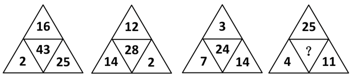

A. 39

B. 40

C. 41

D. 42

第 36 题 · 答案与解析

**参考答案（粉笔题库参考内容）**

B

**解析**

每个数阵中心的数字都等于周围三个数字的和，即16+2+25=43，12+14+2=28，3+7+14=24，因此?=25+4+11=40。

故正确答案为B。

**来源**：2011年浙江省公务员录用考试《行测》题第36题

### 第 37 题

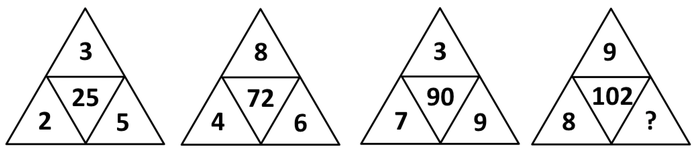

A. 6

B. 7

C. 8

D. 9

第 37 题 · 答案与解析

**参考答案（粉笔题库参考内容）**

A

**解析**

，即，，，因此 ，解得?=6。

故正确答案为A。

**来源**：2011年浙江省公务员录用考试《行测》题第37题

### 第 38 题

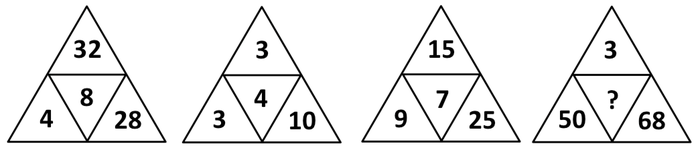

A. 9

B. 10

C. 11

D. 12

第 38 题 · 答案与解析

**参考答案（粉笔题库参考内容）**

C

**解析**

，即，，，因此，解得?=11。

故正确答案为C。

**来源**：2011年浙江省公务员录用考试《行测》题第38题

### 第 39 题

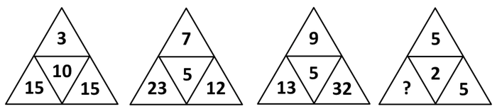

A. 5

B. 4

C. 3

D. 2

第 39 题 · 答案与解析

**参考答案（粉笔题库参考内容）**

A

**解析**

，即，，，因此。

故正确答案为A。

**来源**：2011年浙江省公务员录用考试《行测》题第39题

### 第 40 题

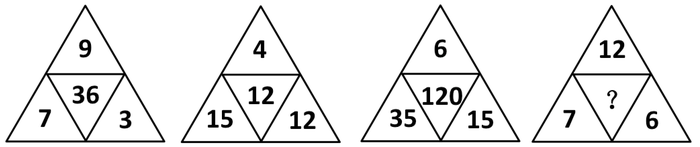

A. 9

B. 10

C. 11

D. 12

第 40 题 · 答案与解析

**参考答案（粉笔题库参考内容）**

D

**解析**

，即，，，因此。

故正确答案为D。

**来源**：2011年浙江省公务员录用考试《行测》题第40题

### 第 41 题

，，，，。

A. 

B. 

C. 

D. 

第 41 题 · 答案与解析

**参考答案（粉笔题库参考内容）**

C

**解析**

观察数列特征可知，每项分子为前项分子与分母之和，分母为前项分母与自身分子之和，因此原数列未知项为。

故正确答案为C。

**来源**：2011年浙江省公务员录用考试《行测》题第41题

### 第 42 题

16，23，9，30，2，。

A. 37

B. 41

C. 45

D. 49

第 42 题 · 答案与解析

**参考答案（粉笔题库参考内容）**

A

**解析**

方法1：奇数项16、9、2是公差为-7的等差数列，偶数项23、30、(37)是公差为7的等差数列。

方法2：

数值部分7、14、21、28、35为等差数列，因此原数列未知项应为37。

故正确答案为A。

**来源**：2011年浙江省公务员录用考试《行测》题第42题

### 第 43 题

2，1，3，10，103，。

A. 8927

B. 9109

C. 9247

D. 10619

第 43 题 · 答案与解析

**参考答案（粉笔题库参考内容）**

D

**解析**

每项等于前项的平方加上更前一项，即，，，因此原数列未知项为，可根据尾数法排除A、C两项；，在验证B、D两项后可得D项正确。

故正确答案为D。

**来源**：2011年浙江省公务员录用考试《行测》题第43题

### 第 44 题

1，2，7，19，138，。

A. 2146

B. 2627

C. 3092

D. 3865

第 44 题 · 答案与解析

**参考答案（粉笔题库参考内容）**

B

**解析**

前两项之积再加上5等于第三项，即，，，因此原数列未知项为，根据尾数法可直接确定答案为B项。

故正确答案为B。

**来源**：2011年浙江省公务员录用考试《行测》题第44题

### 第 45 题

，，，4.8，，。

A. 5.9

B. 

C. 6.5

D. 7.8

第 45 题 · 答案与解析

**参考答案（粉笔题库参考内容）**

C

**解析**

将数列各项写成小数形式为：1.5、2.24、3.14、4.8、5.29，可以发现整数部分为1、2、3、4、5、(6)。

故正确答案为C。

**来源**：2011年浙江省公务员录用考试《行测》题第45题

### 第 46 题

的值为：

A. 20110

B. 21010

C. 21100

D. 21110

第 46 题 · 答案与解析

**参考答案（粉笔题库参考内容）**

A

**解析**

。

故正确答案为A。

**来源**：2011年浙江省公务员录用考试《行测》题第46题

### 第 47 题

，若，则x的值为：

A. 5

B. 4

C. 3

D. 2

第 47 题 · 答案与解析

**参考答案（粉笔题库参考内容）**

D

**解析**

按照新定义运算展开，得，解得x=2。

故正确答案为D。

**来源**：2011年浙江省公务员录用考试《行测》题第47题

### 第 48 题

设用小数来表示时其小数点后第2010个数字为a，且|b|=b+2010，则|2b+10a|-(b+5a)的值为：

A. 2400

B. 2600

C. 2800

D. 3000

第 48 题 · 答案与解析

**参考答案（粉笔题库参考内容）**

D

**解析**

，是一个循环小数，循环节为428571，周期是6，又因为2010是6的整数倍，所以第2010个数字为1，即a=1；|b|=b+2010中如果b是正数，则|b|=b，代入矛盾，所以|b|=-b，代入得b=-1005，将a和b的值代入|2b+10a|-(b+5a)，得3000。

故正确答案为D。

**考点**：周期余数问题

**来源**：2011年浙江省公务员录用考试《行测》题第48题

### 第 49 题

在平面直角坐标系中，如果点P(3a-9,1-a)在第三象限内，且横坐标纵坐标都是整数，则点P的坐标是：

A. （－1，－3）

B. （－3，－1）

C. （－3，2）

D. （－2，－3）

第 49 题 · 答案与解析

**参考答案（粉笔题库参考内容）**

B

**解析**

根据点P在第三象限，有3a-9<0，1-a<0，得1<a<3，所以a=2，代入可知，点P的坐标为（-3，-1）。

故正确答案为B。

**考点**：和差倍比问题

**来源**：2011年浙江省公务员录用考试《行测》题第49题

### 第 50 题

四位厨师聚餐时各做了一道拿手菜。现在要求每个人去品尝一道菜，但不能尝自己做的那道菜。问共有几种不同的尝法？

A. 6种

B. 9种

C. 12种

D. 15种

第 50 题 · 答案与解析

**参考答案（粉笔题库参考内容）**

B

**解析**

此题为错位排列问题，元素个数为1～5的错位排列数分别为0、1、2、9、44，本题中为四位厨师，因此方法有9种。

故正确答案为B。

错位排列问题又称“装错信封问题”，指有N个信封和N封信，分别从1到N进行编号，每封信都没有装到相同编号的信封有多少种方法？记方法数为，则，，，，。

**考点**：错位排列

**来源**：2011年浙江省公务员录用考试《行测》题第50题

### 第 51 题

一列客车长250米，一列货车长350米，在平行的轨道上相向行驶，从两车头相遇到两车尾相离经过15秒，已知客车与货车的速度比是5:3。问两车的速度相差：

A. 10米/秒

B. 15米/秒

C. 25米/秒

D. 30米/秒

第 51 题 · 答案与解析

**参考答案（粉笔题库参考内容）**

A

**解析**

两车头相遇到两车尾相离相当于两车车尾相遇过程，设两车速度为5v、3v，则有，解得v=5，因此两车速度相差5v-3v=2v=10米/秒。

故正确答案为A。

**考点**：相遇追及

**来源**：2011年浙江省公务员录用考试《行测》题第51题

### 第 52 题

a大学的小李和b大学的小孙分别从自己学校同时出发，不断往返于a、b两校之间。现已知小李的速度为85米/分钟，小孙的速度为105米/分钟，且经过12分钟后两人第二次相遇。问a、b两校相距多少米？

A. 1140米

B. 980米

C. 840米

D. 760米

第 52 题 · 答案与解析

**参考答案（粉笔题库参考内容）**

D

**解析**

两人第二次相遇时，两人共走的路程为 a、b 间距离的3倍，因此 a、b 两校相距。

故正确答案为D。

**考点**：相遇追及

**来源**：2011年浙江省公务员录用考试《行测》题第52题

### 第 53 题

甲、乙两辆清洁车执行东、西城间的公路清扫任务。甲车单独清扫需要6小时，乙车单独清扫需要9小时，两车同时从东、西城相向开出，相遇时甲车比乙车多清扫15千米。问东、西两城相距多少千米：

A. 60千米

B. 75千米

C. 90千米

D. 135千米

第 53 题 · 答案与解析

**参考答案（粉笔题库参考内容）**

B

**解析**

甲乙的速度比为3:2，设全程为5份，则甲乙相遇时甲清扫了3份，乙清扫了2份，甲比乙多1份，而1份对应15千米，因此东西两城相距千米。

故正确答案为B。

**考点**：相遇追及、给具体单位型

**来源**：2011年浙江省公务员录用考试《行测》题第53题

### 第 54 题

已知一个长方体的长、宽、高分别为10分米、8分米和6分米，先从它上面切下一个最大的正方体，然后再从剩下的部分上切下一个最大的正方体。问切除这两个正方体后，最后剩下部分的体积是：

A. 212立方分米

B. 200立方分米

C. 194立方分米

D. 186立方分米

第 54 题 · 答案与解析

**参考答案（粉笔题库参考内容）**

B

**解析**

要使切下的正方体体积最大，则第一次切下的正方体边长为6分米，第二次切下的正方体边长只能为4分米，因此剩下部分的体积为。

故正确答案为B。

**考点**：几何公式类-立体图形

**来源**：2011年浙江省公务员录用考试《行测》题第54题

### 第 55 题

甲、乙各有钱若干元，甲拿出给乙后，乙再拿出总数的给甲，这时他们各有160元，问甲、乙原来各有多少钱？

A. 120元 200元

B. 150元 170元

C. 180元 140元

D. 210元 110元

第 55 题 · 答案与解析

**参考答案（粉笔题库参考内容）**

C

**解析**

选项信息充分，直接考虑代入排除。代入A项，120元拿出去即40元给乙，则乙变为200＋40＝240元，如果乙拿出去，尾数不是0，则剩余不可能为160元，因此排除A项；依次代入发现C项满足条件。

故正确答案为C。

**考点**：和差倍比问题

**来源**：2011年浙江省公务员录用考试《行测》题第55题

### 第 56 题

如下图所示，中DE∥BC，且BO和CO分别是和的角平分线。已知AB=25.4cm，BC=24.5cm，AC=20cm。问的周长是：

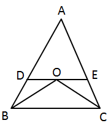

A. 45.4 cm

B. 45.1 cm

C. 44.8 cm

D. 44.5 cm

第 56 题 · 答案与解析

**参考答案（粉笔题库参考内容）**

A

**解析**

BO是的角平分线，则，又DE∥BC，得，因此是等腰三角形，有BD=OD，同理有CE=OE，因此的周长=AD+AE+DE=AB+AC=45.4cm。

故正确答案为A。

**考点**：几何公式类-平面图形、几何结论类-三角形相关

**来源**：2011年浙江省公务员录用考试《行测》题第56题

### 第 57 题

一个三位数的各位数字之和是16。其中十位数字比个位数字小3。如果把这个三位数的百位数字与个位数字对调，得到一个新的三位数，则新的三位数比原三位数大495，则原来的三位数是：

A. 169

B. 358

C. 469

D. 736

第 57 题 · 答案与解析

**参考答案（粉笔题库参考内容）**

B

**解析**

将各项直接代入，只有B项符合，可直接得出B项正确。

故正确答案为B。

**来源**：2011年浙江省公务员录用考试《行测》题第57题

### 第 58 题

一艘游轮从甲港口顺水航行至乙港口需7小时，从乙港口逆水航行至甲港口需9小时。问如果在静水条件下，游轮从甲港口航行至乙港口需多少小时？

A. 7.75小时

B. 7.875小时

C. 8小时

D. 8.25小时

第 58 题 · 答案与解析

**参考答案（粉笔题库参考内容）**

B

**解析**

方法1：

根据所需时间比，设距离为63，则游轮顺水和逆水的速度分别为9、7，则游轮自身的速度为，因此在静水条件下所需时间为小时。

方法2：

设甲乙港口相距距离为S，则游轮顺水和逆水的速度分别为、，游轮自身速度为，因此静水条件下所需时间为。

故正确答案为B。

**考点**：流水行船

**来源**：2011年浙江省公务员录用考试《行测》题第58题

### 第 59 题

某班同学要订A、B、C、D四种学习报，每人至少订一种，最多订四种，那么每个同学有多少种不同的订报方式：

A. 7种

B. 12种

C. 15种

D. 21种

第 59 题 · 答案与解析

**参考答案（粉笔题库参考内容）**

C

**解析**

根据订阅报纸种类的不同，可以分为4种情况，分别是订阅1、2、3、4种，则对应的方式分别有、、、种，共种。

故正确答案为C。

**考点**：基础排列组合

**来源**：2011年浙江省公务员录用考试《行测》题第59题

### 第 60 题

某服装店老板去采购一批商品，其所带的钱如果只买某种进口上衣可买120件，如果只买某种普通上衣则可买180件。现在知道，最后该老板买的进口上衣和普通上衣的数量相同，问他最多可以各买多少件？

A. 70件

B. 72件

C. 74件

D. 75件

第 60 题 · 答案与解析

**参考答案（粉笔题库参考内容）**

B

**解析**

根据题意，设钱数为360元，因为360是180和120的最小公倍数。则进口上衣3元，普通上衣2元，因此可以各买件。

故正确答案为B。

**考点**：和差倍比问题

**来源**：2011年浙江省公务员录用考试《行测》题第60题

### 第 61 题

赫拉克利特认为万物的本原是火，世界是按规律燃烧着，照规律熄灭着的一团永恒的活火。赫拉克利特的这一观点属于：

A. 客观唯心主义

B. 主观唯心主义

C. 朴素唯物主义

D. 机械唯物主义

第 61 题 · 答案与解析

**参考答案（粉笔题库参考内容）**

C

**解析**

朴素唯物主义，是指用某一种或几种具体物质形态来解释世界本原的哲学学说，是唯物主义发展的最初历史形态。它否认世界是神创造的，把世界的本原归根为某一种或几种具体物质形态。赫拉克利特关于世界本原是火的观点，属于典型的朴素唯物主义。

故正确答案为C。

本题相关知识点：

客观唯心主义把客观精神（如上帝、理念、绝对精神等）看作世界的主宰和本原，认为现实的物质世界只是这些客观精神的外化和表现。中国宋代程朱理学的“理”，古希腊柏拉图的“理念”，德国黑格尔的“绝对观念”，都是这种作为世界本体的客观精神或原则。

主观唯心主义把个人的某种主观精神如感觉、经验、心灵、意识、观念、意志等看作是世界上一切事物产生和存在的根源与基础，而世界上的一切事物则是由这些主观精神所派生的，是这些主观精神的显现。中国宋明时期的心学，即所谓的“心即理”“吾心即是宇宙”“心外无物”“心外无理”，英国贝克莱的所谓“存在就是被感知”“物是观念的集合”等观点，就是有代表性的、典型的主观唯心主义。庄子是中国主观唯心主义的代表人物之一。

机械唯物主义，即形而上学唯物主义，它承认世界的物质性，但却用孤立、静止、片面的观点解释世界，看不到世界的事物和现象之间的普遍联系和变化发展，或者只是承认机械的联系和机械的运动，因而表现出机械的、形而上学的特征。17世纪的英国唯物主义，18世纪的法国唯物主义，19 世纪40年代德国费尔巴哈的唯物主义，是近代唯物主义的几个主要流派。

**考点**：唯物论

**来源**：2011年浙江省公务员录用考试《行测》题第61题

### 第 62 题

1939年10月，毛泽东发表《〈共产党人〉发刊词》一文，该文中被毛泽东豪迈地称之为“伟大的工程”的是：

A. 建设一个全国范围的、广大群众性的、思想上政治上组织上完全巩固的马克思列宁主义政党

B. 在坚持党对统一战线的领导的基础上，不断巩固和扩大人民民主统一

C. 以武装斗争为主要形式，以土地革命为基本内容，以农村革命根据地为战略基地，走农村包围城市夺取全国胜利的道路

D. 在共产党的领导下，以人民军队为骨干，发动一场广泛动员人民参与的全民战争

第 62 题 · 答案与解析

**参考答案（粉笔题库参考内容）**

A

**解析**

本题考查毛中特。

1939年毛泽东在《〈共产党人〉发刊词》中把党的建设形象地称为“伟大的工程”，即“建设一个全国范围的、广大群众性的、思想上政治上组织上完全巩固的马克思列宁主义政党”。

故正确答案为A。

**来源**：2011年浙江省公务员录用考试《行测》题第62题

### 第 63 题

下列关于党的十七届五中全会的表述正确的是：

①全会审议通过了《中共中央关于制定国民经济和社会发展第十二个五年规划的建议》

②全会强调，要坚持把经济结构战略性调整作为加快转变经济发展方式的主攻方向

③全会提出，要坚持扩大内需战略、保持经济平稳较快发展，加强和改善宏观调控，建立扩大消费需求的长效机制

④全会决定，增补习近平为中央军事委员会副主席

A. ①③

B. ①②④

C. ②③④

D. ①②③④

第 63 题 · 答案与解析

**参考答案（粉笔题库参考内容）**

D

**解析**

①④表述正确，十七届五中全会于2010年10月15日—18日在北京召开，全会听取和讨论了胡锦涛受中央政治局委托作的工作报告，审议通过了《中共中央关于制定国民经济和社会发展第十二个五年规划的建议》；全会决定，增补习近平为中央军事委员会副主席；

②③表述正确，全会强调，要坚持把经济结构战略性调整作为加快转变经济发展方式的主攻方向，坚持把科技进步和创新作为加快转变经济发展方式的重要支撑，坚持把保障和改善民生作为加快转变经济发展方式的根本出发点和落脚点，坚持把建设资源节约型、环境友好型社会作为加快转变经济发展方式的重要着力点，坚持把改革开放作为加快转变经济发展方式的强大动力，提高发展的全面性、协调性、可持续性，实现经济社会又好又快发展；全会提出十二五期间的十大“任务”，并把扩大内需摆在突出位置，提出要坚持扩大内需战略、保持经济平稳较快发展，加强和改善宏观调控，建立扩大消费需求的长效机制。

故正确答案为D。

**考点**：重要会议讲话

**来源**：2011年浙江省公务员录用考试《行测》题第63题

### 第 64 题

“四项基本原则”是指：

①社会主义道路

②人民代表大会制度

③马列主义、毛泽东思想

④中国共产党的领导

⑤人民民主专政

A. ①③④⑤

B. ①②③④

C. ②③④⑤

D. ①②④⑤

第 64 题 · 答案与解析

**参考答案（粉笔题库参考内容）**

A

**解析**

党在社会主义初级阶段的基本路线是“以经济建设为中心，坚持四项基本原则，坚持改革开放”，即“一个中心，两个基本点”。其中，“四项基本原则”是指坚持社会主义道路，坚持人民民主专政，坚持中国共产党领导，坚持马克思列宁主义、毛泽东思想。故选①③④⑤。

故正确答案为A。

**来源**：2011年浙江省公务员录用考试《行测》题第64题

### 第 65 题

科学发展观的第一要义是：

A. 以人为本

B. 发展

C. 统筹兼顾

D. 全面协调可持续

第 65 题 · 答案与解析

**参考答案（粉笔题库参考内容）**

B

**解析**

党的十七大报告对科学发展观作了全面系统的阐述：科学发展观，第一要义是发展，核心是以人为本，基本要求是全面协调可持续，根本方法是统筹兼顾。

故正确答案为B。

**来源**：2011年浙江省公务员录用考试《行测》题第65题

### 第 66 题

党的十七大对实现全面建设小康社会奋斗目标提出了新要求，其中之一就是转变发展方式取得重大进展，在优化结构、提高效益、降低消耗、保护环境的基础上，实现          到2020年比2000年翻两番：

A. 国内生产总值

B. 国民生产总值

C. 第三产业产值

D. 人均国内生产总值

第 66 题 · 答案与解析

**参考答案（粉笔题库参考内容）**

D

**解析**

十七大报告对我国经济社会发展和全面建设小康社会提出了新的更高要求，提出“在优化结构、提高效益、降低消耗、保护环境的基础上，实现人均国内生产总值到2020年比2000年翻两番。”

故正确答案为D。

本题相关知识点：

人均国内生产总值（Real GDP per capita），也称作“人均GDP”，常作为发展经济学中衡量经济发展状况的指标，是重要的宏观经济指标之一，它是人们了解和把握一个国家或地区的宏观经济运行状况的有效工具。

人均国内生产总值 = 总产出（即 GDP 总额，社会产品和服务的产出总额）/ 总人口。

**考点**：重要文件

**来源**：2011年浙江省公务员录用考试《行测》题第66题

### 第 67 题

公民不可以对下列哪一情形提起行政诉讼？

A. 对行政拘留不服

B. 认为行政机关侵犯了法律规定的经营自主权

C. 对省人民政府制定的规章不服

D. 认为行政机关没有依法发给抚恤金

第 67 题 · 答案与解析

**参考答案（粉笔题库参考内容）**

C

**解析**

《行政诉讼法》第十三条规定，人民法院不予受理公民对行政法规、规章或者行政机关制定、发布的具有普遍约束力的决定、命令的诉讼。

故正确答案为C。

本题相关知识点：

人民法院不予受理的事项还有：国防、外交等国家行为，行政机关对行政机关工作人员的奖惩、任免等决定；法律规定由行政机关最终裁决的具体行政行为；公安、国家安全等机关依照《刑事诉讼法》的明确授权实施的行为；行政机关的调解行为以及法律规定的仲裁行为；不具有强制力的行政指导行为；驳回当事人对行政行为提起申诉的重复处理行为；对公民、法人或其他组织权利义务不产生实际影响的行为。

**考点**：行政法

**来源**：2011年浙江省公务员录用考试《行测》题第67题

### 第 68 题

张某在路上发现有小偷正在对行人李某行窃，便立刻上前阻止，结果被该小偷用刀刺伤。张某共花费医疗费用5万元。

针对该情况，下列表述中正确的是：

A. 张某可以选择向李某或者小偷要求承担该医疗费用

B. 如果该小偷逃逸，则应由李某承担全部医疗费用

C. 如果该小偷逃逸，李某从道义上应支付部分医疗费用，但这并非李某的法律义务

D. 如果该小偷逃逸，张某向李某提出补偿请求，李某有义务予以适当补偿

第 68 题 · 答案与解析

**参考答案（粉笔题库参考内容）**

D

**解析**

《侵权责任法》第二十三条规定，因防止、制止他人民事权益被侵害而使自己受到损害的，由侵权人承担责任。侵权人逃逸或者无力承担责任，被侵权人请求补偿的，受益人应当给予适当补偿。

本题中张某为了避免行人李某的利益受到损失而见义勇为，小偷逃逸的话，有权要求李某补偿医疗费用，李某有义务补偿。

故正确答案为D。

**考点**：民法典

**来源**：2011年浙江省公务员录用考试《行测》题第68题

### 第 69 题

小张今年15周岁，根据《刑法》规定，他对下列哪种行为不负刑事责任？

A. 抢劫

B. 故意伤害致人轻伤

C. 放火

D. 贩卖毒品

第 69 题 · 答案与解析

**参考答案（粉笔题库参考内容）**

B

**解析**

《刑法》第十七条第一、二、三款规定：

已满十六周岁的人犯罪， 应当负刑事责任。

已满十四周岁不满十六周岁的人，犯故意杀人、故意伤害致人重伤或者死亡、强奸、抢劫、贩卖毒品、放火、爆炸、投放危险物质罪的，应当负刑事责任。

已满十二周岁不满十四周岁的人，犯故意杀人、故意伤害罪，致人死亡或者以特别残忍手段致人重伤造成严重残疾，情节恶劣， 经最高人民检察院核准追诉的，应当负刑事责任。

故正确答案为B。

**考点**：刑法

**来源**：2011年浙江省公务员录用考试《行测》题第69题

### 第 70 题

下列关于管理学常识的表述正确的是：

A. 管理幅度与管理层次之间存在正比例关系

B. “审时度势，相机权变”是权变原理的实质

C. 效率性原则是公共危机管理的首要原则

D. 行政协调是指行政机关运用各种媒介传递或交流行政信息的过程

第 70 题 · 答案与解析

**参考答案（粉笔题库参考内容）**

B

**解析**

A项错误，管理幅度和管理层次是反比例关系；

C项错误，采取紧急处置手段，及时控制危机事态发展的时间性原则是危机管理的第一原则；

D项错误，行政协调是指行政组织与外部环境、行政组织内部各部门之间的协同一致的和谐关系，以提高行政效率，实现行政目标的过程；

通过排除法，可知本题选B。

故正确答案为B。

**考点**：其他

**来源**：2011年浙江省公务员录用考试《行测》题第70题

### 第 71 题

企业制度主要是指以          为基础和核心的企业组织制度与管理制度？

A. 产权制度

B. 决策制度

C. 生产销售制度

D. 经营管理制度

第 71 题 · 答案与解析

**参考答案（粉笔题库参考内容）**

A

**解析**

企业产权制度是企业制度的核心，它决定了企业财产的组织形式和经营机制。

故正确答案为A。

**来源**：2011年浙江省公务员录用考试《行测》题第71题

### 第 72 题

下列关于财政政策和货币政策的表述不正确的是：

A. 存款法定准备金率提高后，商业银行可用于贷款的现金会减少

B. 当民间需求过旺时，可以采取增加政府支出的政策来缩小总需求

C. 当央行降低贴现率时，市场货币供给将增加

D. 通过增加税收来抑制总需求属于紧缩性财政政策

第 72 题 · 答案与解析

**参考答案（粉笔题库参考内容）**

B

**解析**

本题考查经济常识。

A项正确，法定存款准备金率是指一国中央银行规定的商业银行和存款金融机构必须缴存中央银行的法定准备金占其存款总额的比率。存款法定准备金率提高后，商业银行缴存在中央银行的法定存款准备金增多，相应的，商业银行可用于贷款的现金会减少。

B项错误，当民间需求过旺时，增加政府支出会进一步增加社会总需求，应采取减少政府支出的政策来缩小总需求。

C项正确，贴现率是指持票人以没有到期的票据向银行要求兑现，银行将利息先行扣除所使用的利率。当央行降低贴现率时，商业银行扣除的利息会减少，市场货币供给将增加。

D项正确，紧缩性财政政策是指通过增加财政收入或减少财政支出以抑制社会总需求增长的政策，主要措施有增加税收，减少政府购买和转移支付等。

本题为选非题，故正确答案为B。

**考点**：宏观经济与调控政策

**来源**：2011年浙江省公务员录用考试《行测》题第72题

### 第 73 题

1919年谁在《新青年》上发表《我的马克思主义观》一文，比较全面地介绍了马克思主义的唯物史观、经济学说和社会主义理论？

A. 陈独秀

B. 毛泽东

C. 李大钊

D. 周恩来

第 73 题 · 答案与解析

**参考答案（粉笔题库参考内容）**

C

**解析**

1919年，在《新青年》杂志上，李大钊写下了一篇介绍马克思主义的文章。该文章即是《我的马克思主义观》。

故正确答案为C。

**考点**：中国历史

**来源**：2011年浙江省公务员录用考试《行测》题第73题

### 第 74 题

1927年大革命失败后，中国共产党召开的确定土地革命和武装斗争方针的会议是：

A. 八七会议

B. 古田会议

C. 遵义会议

D. 洛川会议

第 74 题 · 答案与解析

**参考答案（粉笔题库参考内容）**

A

**解析**

本题考查毛中特。

1927年的八七会议是在中国革命的危急关头召开的，会议正式确定了实行土地革命和武装斗争的方针，并把领导农民进行秋收起义作为当前党的最主要任务。

故正确答案为A。

**考点**：党的历史

**来源**：2011年浙江省公务员录用考试《行测》题第74题

### 第 75 题

下列关于我国国情的表述，不正确的是：

A. 2010年我国的GDP总量已位居世界第二位，仅次于美国

B. 我国提出要协调区域发展，把全国分成东、中部、西部、东北四大经济区

C. 我国的老龄化现象日益突出，即将进入老龄化社会

D. 我国是典型的季风气候，夏季盛行偏南风，冬季盛行偏北风

第 75 题 · 答案与解析

**参考答案（粉笔题库参考内容）**

C

**解析**

C选项表述错误，根据联合国科教文组织制定的标准，当一个国家60岁及60岁以上的老年人口超过该国家总人口的10%，或者65岁及65岁以上的老年人口超过该国家总人口的7%，那么该国家就进入“老年型国家”的行列。2000年，中国第五次人口普查结果显示，中国60岁以上人群比例已达11.21%；2001年，65岁以上人群比例也将达到7%。也就是说，在本世纪初中国就已进入老龄化社会。A、B、D三项均正确。

本题为选非题，故正确答案为C。

**考点**：中国地理

**来源**：2011年浙江省公务员录用考试《行测》题第75题

### 第 76 题

上海世博会围绕“\_\_\_\_”的主题，秉承和弘扬理解、沟通、欢聚、合作的世博理念，创造和演绎了一场精彩纷呈的世界文明大展示：

A. 平等、互惠、合作和共赢

B. 激情盛会，和谐亚洲

C. 城市，让生活更美好

D. 同一个世界，同一个梦想

第 76 题 · 答案与解析

**参考答案（粉笔题库参考内容）**

C

**解析**

A项错误，“平等、互惠、合作和共赢”是博鳌亚洲论坛的主题；

B项错误，“激情盛会，和谐亚洲”是第16届亚运会理念；

C项正确，上海世博会的主题是“城市，让生活更美好”；

D项错误，“同一个世界，同一个梦想”是2008年北京奥运会主题。

故正确答案为C。

**考点**：文化常识

**来源**：2011年浙江省公务员录用考试《行测》题第76题

### 第 77 题

下列有关科学常识的表述，不正确的是：

A. 月亮对海水的吸引力比太阳大，引起地球上潮汐现象的主要原因是月亮对海水的吸引力

B. 世界著名的“死海”位于西亚，尽管“死海”的含盐量较高，但其中的营养物质也很丰富，“死海”中有大量的水生动植物

C. 云和雾都是水蒸气达到饱和并凝结成细小的水滴而形成的，它们在本质上是相同的

D. “X射线”是一种波长比紫外线更短的光，它是由德国物理学家伦琴在1895年发现的

第 77 题 · 答案与解析

**参考答案（粉笔题库参考内容）**

B

**解析**

B项错误，死海是位于西南亚的著名大咸湖，湖面低于地中海海面392米，是世界最低洼处，因温度高、蒸发强烈、含盐度高（达25%～30%），除个别的微生物外，水生植物和鱼类等生物都不能生存，故得“死海”之名。当滚滚洪水流来之期，约旦河及其他溪流中的鱼虾被冲入死海，由于死海中含盐量太高，水中又严重缺氧，这些鱼虾必死无疑。

本题为选非题，故正确答案为B。

**考点**：其他

**来源**：2011年浙江省公务员录用考试《行测》题第77题

### 第 78 题

下列有关世界著名建筑的表述，不正确的是：

A. “泰姬陵”位于泰国，是世界著名的纪念性建筑，有“泰国的珍珠”之称

B. “吴哥窟”古迹位于柬埔寨，是世界著名的佛教建筑，现在柬埔寨的国旗上就绘有吴哥窟的造型

C. 敦煌“莫高窟”又称千佛洞，位于甘肃省，是集建筑、绘画、雕塑于一体的立体艺术，是世界上现存规模最宏大、保存最完好的佛教艺术宝库之一

D. “圣彼得大教堂”是世界上最大的教堂，位于梵蒂冈，教堂内有许多世界著名的雕像和浮雕，艺术价值极高

第 78 题 · 答案与解析

**参考答案（粉笔题库参考内容）**

A

**解析**

A项表述错误，泰姬陵位于印度，有“印度的珍珠”之称。

B、C、D三项均正确。

本题为选非题，故正确答案为A。

本题相关知识点：泰姬陵是印度知名度最高的古迹之一，在今印度距新德里200多公里外的北方邦的阿格拉城内，是莫卧儿王朝第5代皇帝沙贾汗为了纪念他已故皇后阿姬曼·芭奴而建立的陵墓，被誉为“完美建筑”，有“印度的珍珠”之称。

**来源**：2011年浙江省公务员录用考试《行测》题第78题

### 第 79 题

以下中国历史上著名历史事件按发生先后顺序排序，完全正确的是：

A. 牧野之战——长平之战——赤壁之战——淝水之战

B. 黄巾起义——陈胜吴广起义——太平天国运动——李自成起义

C. 诸葛亮七擒孟获——陈汤平定匈奴——郑成功收复台湾——郑和下西洋

D. 安史之乱——八王之乱——玄武门之变——土木堡之变

第 79 题 · 答案与解析

**参考答案（粉笔题库参考内容）**

A

**解析**

本题考查人文历史。

A项正确，牧野之战，是武王伐纣的决胜战，商朝战败，纣王自杀，商朝灭亡；长平之战，是战国历史的最后转折，此战是中国古代军事史上最早、规模最大、最彻底的大型歼灭战；赤壁之战，是东汉末年，孙权、刘备联军在赤壁一带大破曹操大军的战役，这是中国历史上以少胜多、以弱胜强的著名战役之一；淝水之战，是东晋时期北方的统一政权前秦向南方东晋发起的侵略吞并的一系列战役中的决定性战役，是中国历史上著名的以少胜多的战例。

故正确答案为A。

本题相关知识点：

黄巾起义：东汉。陈胜吴广起义：秦朝。太平天国：清朝。李自成：明朝。

诸葛亮七擒孟获：三国。陈汤平定匈奴：汉代。郑成功收复台湾：明末清初。郑和下西洋：明初。

安史之乱：唐朝中后期。八王之乱：西晋。玄武门之变：唐初。土木堡之变：明朝。

**考点**：中国历史

**来源**：2011年浙江省公务员录用考试《行测》题第79题

### 第 80 题

下列关于人文常识的表述，不正确的是：

A. 开创三省六部制和科举制的朝代是隋朝

B. “民为贵，社稷次之，君为轻”是孟子民本思想的体现

C. 提出“中庸”这一中国传统文化最高价值原则的人是孔子

D. 严复翻译出版的《天演论》所宣传的主要思想是“师夷长技以制夷”

第 80 题 · 答案与解析

**参考答案（粉笔题库参考内容）**

D

**解析**

D项表述错误，严复翻译出版的《天演论》所反映的思想是“物竞天择，适者生存”。

A、B、C三项均正确。

本题为选非题，故正确答案为D。

本题相关知识点：“师夷长技以制夷”的思想由魏源提出。魏源是拥有当时第一流西方知识的大学者，他编成《海国图志》100卷，广泛介绍西方知识，并提出“师夷长技以制夷”的思想，试图吸收西方先进技术，使中国富强起来。

**考点**：文化常识

**来源**：2011年浙江省公务员录用考试《行测》题第80题

### 第 81 题

农药：污染

A. 太阳：温度

B. 运动：健康

C. 噩耗：悲痛

D. 电脑：辐射

第 81 题 · 答案与解析

**参考答案（粉笔题库参考内容）**

D

**解析**

第一步：判断题干词语之间逻辑关系。

农药可能导致污染，而且农药是一个具体的实物。

第二步：判断选项词语之间逻辑关系。

A项：太阳和温度之间并没有直接的逻辑关系，与题干逻辑关系不一致，排除；

B项：运动可能导致健康，但是运动不是一个具体的实物，与题干逻辑关系不一致，排除；

C项：噩耗可能导致悲痛，但是噩耗不是一个具体的实物，与题干逻辑关系不一致，排除；

D项：电脑可能导致辐射，而且电脑是一个具体的实物，与题干逻辑关系一致，当选。

故正确答案为D。

**考点**：逻辑关系-对应关系

**来源**：2011年浙江省公务员录用考试《行测》题第81题

### 第 82 题

知觉：感性认识

A. 意识：物质

B. 管制：刑罚

C. 运动：发展

D. 灾难：地震

第 82 题 · 答案与解析

**参考答案（粉笔题库参考内容）**

B

**解析**

第一步：判断题干词语间逻辑关系。

题干两词是包容关系，且是包容中的种属关系，“知觉”是一种“感性认识”。

第二步：判断选项词语间逻辑关系。

A项是一组反义词，与题干词语间逻辑关系不符；

B项与题干逻辑关系相同，“管制”是“刑罚”的一种；

C项是并列关系，与题干词语间逻辑关系不符；

D项是包容中的种属关系，“地震”是一种“灾难”，但是与题干的逻辑顺序相反。

故正确答案为B。

**考点**：逻辑关系-包容关系

**来源**：2011年浙江省公务员录用考试《行测》题第82题

### 第 83 题

元宵：汤圆

A. 清明：龙舟

B. 冬至：面条

C. 重阳：菊花

D. 端午：茱萸

第 83 题 · 答案与解析

**参考答案（粉笔题库参考内容）**

C

**解析**

第一步：判断题干词语间逻辑关系。

题干两词之间是对应关系，且是中国传统节日和特有的民俗文化间的一一对应关系。

第二步：判断选项词语间逻辑关系。

A项“清明节”的习俗是祭祖、扫墓、踏青；

B项“冬至”的习俗是吃饺子；

C项与题干逻辑关系相同，“元宵节”吃“汤圆”、“重阳节”赏“菊花”；

D项“端午”的习俗是吃粽子、赛龙舟。

故正确答案为C。

**考点**：逻辑关系-对应关系

**来源**：2011年浙江省公务员录用考试《行测》题第83题

### 第 84 题

《诗经》：诗集

A. 《说文解字》：字典

B. 《琵琶行》：戏剧

C. 运动会：奥运会

D. 国家：主权

第 84 题 · 答案与解析

**参考答案（粉笔题库参考内容）**

A

**解析**

第一步：判断题干词语间逻辑关系。

题干两词是包容关系，且是包容中的种属关系，前者是后者的一种。

第二步：判断选项词语间逻辑关系。

A项与题干逻辑关系相同，《说文解字》是字典的一种；

B项《琵琶行》是一首七言古诗；

C项是种属关系，但是是后者属于前者的一种；

D项是包容中的必然组成关系。

故正确答案为A。

**考点**：逻辑关系-包容关系

**来源**：2011年浙江省公务员录用考试《行测》题第84题

### 第 85 题

决策：执行

A. 组织：监督

B. 计划：实施

C. 总结：改进

D. 合同：制定

第 85 题 · 答案与解析

**参考答案（粉笔题库参考内容）**

B

**解析**

第一步：判断题干词语间逻辑关系。

题干两个词是对应关系，决策是执行的客体，即执行决策，而且在管理活动中，执行是决策的下一个环节。

第二步：判断选项词语间逻辑关系。

A项，组织与监督无明显逻辑关系，不符合题意。

B项，计划是实施的客体，即实施计划，而且在管理活动中，实施是计划的下一个环节，符合题意。

C项，总结不是改进的客体，改进的客体应该是总结中提出的现状与问题，而非总结本身，不符合题意。

D项，合同是制定的客体，但制定合同不是管理活动中的环节，不符合题意。

故正确答案为B。

**考点**：逻辑关系-对应关系

**来源**：2011年浙江省公务员录用考试《行测》题第85题

### 第 86 题

破釜沉舟：项羽

A. 乐不思蜀：刘备

B. 精忠报国：岳飞

C. 卧薪尝胆：夫差

D. 纸上谈兵：赵奢

第 86 题 · 答案与解析

**参考答案（粉笔题库参考内容）**

B

**解析**

第一步：判断题干词语间逻辑关系。

题干两词是对应关系，且是成语和所讲述的人物间的一一对应关系。

第二步：判断选项词语间逻辑关系 。

A项乐不思蜀讲的是刘禅的故事；

B项与题干逻辑关系相同；

C项卧薪尝胆讲的是勾践的故事；

D项纸上谈兵讲的是赵括的故事。

故正确答案为B。

**考点**：逻辑关系-对应关系

**来源**：2011年浙江省公务员录用考试《行测》题第86题

### 第 87 题

房屋：地基

A. 艺术：经济

B. 火车：铁路

C. 婚姻：爱情

D. 烦恼：欲望

第 87 题 · 答案与解析

**参考答案（粉笔题库参考内容）**

B

**解析**

第一步：判断题干词语间逻辑关系。

“房屋”建立在“地基”上，要想建造“房屋”，必须先打“地基”。因此“地基”是“房屋”的基础，且“房屋”和“地基”都是具体的事物。

第二步：判断选项词语间逻辑关系。

A项：“艺术”和“经济”之间没有明显的逻辑关系，虽然“经济”状况良好对于发展“艺术”能够起到推动和促进作用，但是“艺术”的发展并不以“经济”良好为基础，与题干逻辑关系不一致，排除；

B项：“火车”运行在“铁路”上，要想运行“火车”，必须修建“铁路”，因此“铁路”是“火车”的基础，且“火车”和“铁路”都是具体的事物，与题干逻辑关系一致，当选；

C项：“婚姻”建立在“爱情”上，因此“爱情”是“婚姻”的基础，但“婚姻”和“爱情”都是抽象的事物，与题干逻辑关系不一致，排除；

D项：人们有些时候是因为“欲望”而产生“烦恼”，但是“烦恼”也会来源于其他方面，比如没有达到期望、没有完成目标等，而且二者都是抽象的事物，与题干逻辑关系不一致，排除。

故正确答案为B。

**考点**：逻辑关系-对应关系

**来源**：2011年浙江省公务员录用考试《行测》题第87题

### 第 88 题

教师：教室：教育

A. 经理：市场：经商

B. 军队：国家：保卫

C. 公务员：机关：执法

D. 演员：舞台：表演

第 88 题 · 答案与解析

**参考答案（粉笔题库参考内容）**

D

**解析**

第一步：判断题干词语间逻辑关系。

题干中教师在教室进行教育，三词是人物、工作场所、工作间的一一对应关系。

第二步：判断选项词语间逻辑关系。

A项：经理的工作场所应该是企业，与题干逻辑关系不一致，排除；

B项：没有人物；

C项：公务员的工作不是执法，执法是一个比较大的概念，与题干逻辑关系不一致，排除；

D项： 演员在舞台进行表演，是人物、工作场所、工作间的一一对应关系，与题干逻辑关系一致，当选。

故正确答案为D。

**考点**：逻辑关系-对应关系

**来源**：2011年浙江省公务员录用考试《行测》题第88题

### 第 89 题

（ ） 对于 纠纷 相当于 垄断 对于 （ ）

A. 调解 市场

B. 经济 价格

C. 磋商 议会

D. 劳动 权力

第 89 题 · 答案与解析

**参考答案（粉笔题库参考内容）**

A

**解析**

第一步：将选项逐一代入，判断各选项前后部分的逻辑关系。

A项中前面部分是语法关系，两者构成动宾结构，后面部分是语法关系，两者构成动宾结构；

B项中前面部分是语法关系，两者构成名词短语，后面部分无明显逻辑关系；

C项中前面部分无明显逻辑关系，后面部分无明显逻辑关系；

D项中前面部分是语法关系，两者构成名词短语，后面部分无明显逻辑关系。

第二步：逻辑关系相同即为答案。

根据第一步可知，逻辑关系完全相同的是A项。

故正确答案为A。

**考点**：语法关系

**来源**：2011年浙江省公务员录用考试《行测》题第89题

### 第 90 题

电子邮件 对于 （ ） 相当于 （ ） 对于 道路

A. 隐私 城市

B. 网络 汽车

C. 信息 交通

D. 交流 运输

第 90 题 · 答案与解析

**参考答案（粉笔题库参考内容）**

B

**解析**

逐一代入选项。

A项，电子邮件涉及隐私，城市和道路为组成关系，前后逻辑关系不一致，排除；

B项，电子邮件需要网络，汽车需要道路，二者均为必要条件的对应关系，前后逻辑关系一致，当选；

C项，电子邮件可以传递信息，交通需要道路，前后逻辑关系不一致，排除；

D项，电子邮件的功能是交流，道路的功能可以是运输，但前后词语顺序相反，前后逻辑关系不一致，排除。

故正确答案为B。

**考点**：逻辑关系-对应关系

**来源**：2011年浙江省公务员录用考试《行测》题第90题

### 第 91 题

某单位共有20名工作人员，①有人是本科学历；②单位的负责人不是本科学历；③有人不是本科学历。上述三个判断中只有一个是真的。

以下哪项正确表示了该单位具有本科学历的工作人员的人数？

A. 20个人都是本科学历

B. 只有1个人是本科学历

C. 20个人都不是本科学历

D. 只有1个人不是本科学历

第 91 题 · 答案与解析

**参考答案（粉笔题库参考内容）**

A

**解析**

第一步：找关系。

①和③两句话中必有一真。

第二步：看其余。

本题只有一句为真，则②为假，即单位的负责人是本科学历。

由单位的负责人是本科学历可知，①为真，③为假，则20个人都是本科学历。

故正确答案为A。

**考点**：只有一真/一假

**来源**：2011年浙江省公务员录用考试《行测》题第91题

### 第 92 题

只有巧干加实干，才能创造出惊人的业绩。某公司的业务经理取得了非凡的业绩，可见该业务经理实践了巧干加实干。

下列哪个推理结构与上述推理在形式上是相同的？

A. 如果一个人犯了罪，那么他就会受到刑事处罚，张某受到了刑事处罚，可见张某犯了罪

B. 这种植物只有开花，才能结出果实，今年这种植物没有开花，所以不会结出果实

C. 只有通过全国统一司法考试的人才能从事律师职业。小李从事律师职业，所以小李已通过全国统一司法考试

D. 只有在特定的土质和气候条件下，这种葡萄才能获得好收成。现在这种葡萄没有获得好收成，说明这里没有这种特定的土质和气候条件

第 92 题 · 答案与解析

**参考答案（粉笔题库参考内容）**

C

**解析**

第一步：翻译题干。

第一句的推导关系是：创造出惊人的业绩巧干加实干，第二句“某公司的业务经理取得了非凡的业绩”，属于肯前件，推出第三句中“该业务经理实践了巧干加实干”。

第二步：逐一翻译选项判断正确答案。

A选项：第一句的推导关系是：一个人犯了罪刑事处罚，第二句“张某受到了刑事处罚”，属于肯后件，无法推出绝对表达的结论，第三句中“张某犯了罪”不能推出，A项错误；

B选项：第一句的推导关系是：结出果实开花，第二句“今年这种植物没有开花”，属于否后件，根据逆否规则，推出第三句中“这种花不会结出果实”，结论正确，但是推理在形式上与题干是不同的，题干是通过肯前件推出结论，B项错误；

C选项：第一句的推导关系是：从事律师职业通过全国统一司法考试，第二句“小李从事律师职业”，属于肯前件，推出第三句中“小李已通过全国统一司法考试”，C项正确；

D选项：第一句的推导关系是：葡萄获得好收成特定的土质和气候条件，第二句“葡萄没有获得好收成”，属于否前件，无法推出绝对表达的结论，故第三句中“这里没有这种特定的土质和气候条件”不能推出，D项错误。

故正确答案为C。

**考点**：常规翻译

**来源**：2011年浙江省公务员录用考试《行测》题第92题

### 第 93 题

七名候选人中有女性三人：张丽、孙美和朱萍，男性四人：赵海、王波、李田和胡庆。现要从这七名候选人中选出三人组成某委员会，且符合以下规则：孙美和王波不能同时入选，胡庆不能与女性候选人同时入选。

问如果赵海和李田不入选，那么该委员会的组成有几种可能？

A. 一种

B. 两种

C. 三种

D. 四种

第 93 题 · 答案与解析

**参考答案（粉笔题库参考内容）**

B

**解析**

第一步：分析题干条件。

（1）女性三人：张丽、孙美和朱萍，男性四人：赵海、王波、李田和胡庆；

（2）孙美和王波不能同时入选；

（3）胡庆不能与女性候选人同时入选；

（4）赵海和李田不入选。

第二步：根据题干条件进行推理。

根据条件（3）可知，若胡庆入选，则不能选择张丽、孙美和朱萍，而结合条件（4），此时入选人数最多为2，不满足题干条件“从这七名候选人中选出三人”，因此胡庆不入选。此时需从“张丽、孙美、朱萍、王波”中选出三人，根据条件（2）可知，孙美和王波不能同时入选，则一定入选的人为张丽和朱萍。因此有两种可能情况：①张丽、朱萍、孙美；②张丽、朱萍、王波。则该委员会的组成有两种可能。

故正确答案为B。

**考点**：假设

**来源**：2011年浙江省公务员录用考试《行测》题第93题

### 第 94 题

大学生小王参加研究生入学考试，一共考了四门科目：政治、英语、专业科目一、专业科目二。政治和专业科目一的成绩之和与另外两门科目的成绩之和相等。政治和专业科目二的成绩之和大于另外两门科目的成绩之和。专业科目一的成绩比政治和英语两门科目的成绩之和还高。

根据以上条件，小王四门科目的成绩从高到低依次是：

A. 专业科目一、专业科目二、英语、政治

B. 专业科目二、专业科目一、政治、英语

C. 专业科目一、专业科目二、政治、英语

D. 专业科目二、专业科目一、英语、政治

第 94 题 · 答案与解析

**参考答案（粉笔题库参考内容）**

B

**解析**

第一步：直接翻译题干等式和不等式关系。

题干所述关系可简写为：①政治＋专一＝英语＋专二；②政治＋专二＞英语＋专一；③专一＞政治＋英语。

第二步：通过式子间的加减运算求解。

由①＋②可知，2政治＋专一＋专二＞2英语＋专一＋专二，则政治＞英语；由②－①可知，专二－专一＞专一－专二，则专二＞专一；由③可知，专二＞专一＞政治＞英语。

故正确答案为B。

**考点**：组合排列-单题-其他

**来源**：2011年浙江省公务员录用考试《行测》题第94题

### 第 95 题

一般而言，帕金森病多是因人类大脑中产生多巴胺的细胞死亡而发病的。华盛顿大学的研究人员用一些基因改造过的双翅目昆虫果蝇来做实验，这些果蝇在迈入老年时期时，多巴胺细胞会逐渐死亡。科学家惊奇地发现，当他们将烟草、咖啡榨成汁，喂给这些果蝇以后，果蝇们的多巴胺细胞又增多了，而且这些果蝇又变得生龙活虎起来。因此，研究者指出，有烟瘾和嗜好咖啡的人，得帕金森病的几率更低。

如果以下各项为真，不能质疑上述推测的是：

A. 人类与果蝇大脑产生多巴胺细胞的机制存在差异

B. 实验的4个小组当中，其中1组得出了相反结果

C. 人类大脑中的多巴胺细胞过量分泌容易导致暴力犯罪

D. 多数双翅目昆虫在获得新食物种类后均会产生多巴胺细胞分泌增多现象

第 95 题 · 答案与解析

**参考答案（粉笔题库参考内容）**

C

**解析**

第一步：找出论点和论据。

论点：有烟瘾和嗜好咖啡的人，得帕金森病的几率更低。

论据：将烟草、咖啡榨成汁，喂给多巴胺细胞逐渐死亡的年老果蝇以后，果蝇们的多巴胺细胞又增多了，而且这些果蝇又变得生龙活虎起来。

本题论点和论据均在讨论烟草、咖啡和帕金森病之间的关系，二者话题一致，且本题为选非题，找到可以削弱的选项排除即可。

第二步：逐一分析选项。

A项：选项指出人类与果蝇产生多巴胺的机制不同，因此不能通过果蝇的实验得出人类的结论，可以削弱，排除；

B项：选项指出有1组实验得出了相反的结果，因此通过该实验得出的结论不一定正确，可以削弱，排除；

C项：选项指出人类多巴胺细胞过量分泌可能产生的后果，与论点讨论的话题不一致，无关选项，无法削弱，当选；

D项：选项指出多数双翅目昆虫在获得新食物种类后均会产生多巴胺细胞分泌增多现象，说明实验中的烟草和咖啡不一定是那些年老果蝇多巴胺分泌增多的原因，可以削弱，排除。

本题为选非题，故正确答案为C。

**考点**：削弱选非题

**来源**：2011年浙江省公务员录用考试《行测》题第95题

### 第 96 题

以上4张卡片均为一面是图案，另一面是阿拉伯数字。现在断定：如果一面是梅花，那么另一面是6。

如果要检验该断定正确与否，且只允许翻动以上两张卡片，正确的选择是：

A. 翻动第一张和第三张

B. 翻动第二张和第三张

C. 翻动第一张和第四张

D. 翻动第二张和第四张

第 96 题 · 答案与解析

**参考答案（粉笔题库参考内容）**

D

**解析**

第一步：翻译题干，利用充分必要条件。

一面是梅花另一面是6，根据逆否规则可知，该命题的逆否命题为一面不是6另一面不是梅花。因此要想检验命题是否正确，只需要符合上述两种说法的一种即可。

第二步：结合选项，进一步分析。

题干要求只允许翻动两张卡片，所以只要翻一面是梅花的和另一面不是6的就可以判断断定正确与否。

故正确答案为D。

**来源**：2011年浙江省公务员录用考试《行测》题第96题

### 第 97 题

一起盗窃案发生，经调查共有二人合伙作案。警察逮捕了甲、乙、丙、丁四名嫌疑人，罪犯必是其中二人。经询问，甲说：“丁是罪犯。”乙说：“甲是罪犯。”丙说：“我不是罪犯。”丁说：“我也不是罪犯。”

经调查，四人中二人说了假话，二人说了真话。则下列哪项可能为真：

A. 甲、丁二人合伙作案

B. 丙、丁二人合伙作案

C. 甲、丙二人合伙作案

D. 甲、乙二人合伙作案

第 97 题 · 答案与解析

**参考答案（粉笔题库参考内容）**

C

**解析**

第一步：找突破口。

本题突破口为甲和丁之间的矛盾关系，两人的话必有一真和一假。

第二步：看其他的话。

本题有两句为真，则乙和丙中也有一人为真，若①乙说的话为真，则丙说的就是假话，则罪犯就是甲和丙，那么甲说的就是假话，丁说的是真话，符合题意，则罪犯可能是甲和丙；②乙说的话为假，则丙说的就是真话，则罪犯就是乙和丁，则甲说的是真话，丁说的是假话，满足题意，但是没有对应选项。

故正确答案为C。

**考点**：两真两假

**来源**：2011年浙江省公务员录用考试《行测》题第97题

### 第 98 题

某专家就目前多方对支线航空安全性的质疑发表声明，他表示，支线飞机所执行的安全标准，与波音、空客大飞机基本一致，大小飞机结构强度也是一样的。乘客感觉支线飞机颠簸，是由于飞机越大，抗干扰能力就越强，所以感觉平稳。事实上，支线飞机和干线飞机在安全性上没有任何差别。

以下哪项如果为真，最能质疑该专家的观点：

A. 近年来我国支线航空的发展过快，支线机场管理和设备滞后问题日益突出

B. 在北美、欧洲等成熟的航空市场，支线航空占到近40%的比例

C. 航空事故中，乘客是否具有迅速离开出事飞机的能力非常重要

D. 部分心脑血管疾病患者不愿意坐支线飞机

第 98 题 · 答案与解析

**参考答案（粉笔题库参考内容）**

A

**解析**

第一步：找到论点和论据。

论点：支线飞机和干线飞机在安全性上没有任何差别。

论据：支线飞机所执行的安全标准，与波音、空客大飞机基本一致，大小飞机结构强度也是一样的。

第二步：判断削弱方式。

本题论点与论据间存在因果关系，所以要削弱论点。

第三步：逐一判断选项的作用。

A项说明支线机场管理和设备存在问题，削弱了论点；

B项说明的是支线航空的比例扩大，与安全性无关，属于无关选项；

C项说明的是航空事故中，乘客的应变能力很重要，与安全性无关，属于无关选项；

D项说部分心脑血管疾病患者不愿意坐支线飞机，并没有说明是什么原因，不能得出支线飞机是否安全的结论。

故正确答案为A。

**考点**：削弱论点

**来源**：2011年浙江省公务员录用考试《行测》题第98题

### 第 99 题

某大学学生会换届选举，张华和其他四个竞选者报名竞选学生会主席一职。其他四个竞选者都没有同时具备张华所有的优点。

从以上断定能合乎逻辑地得出以下哪项结论：

A. 其他四个竞选者都有一些缺点

B. 张华是最优秀的学生，具备当选学生会主席的条件

C. 其他四个竞选者都有不如张华的地方

D. 张华具有其他四个竞选者的所有优点

第 99 题 · 答案与解析

**参考答案（粉笔题库参考内容）**

C

**解析**

第一步：找出题干所给的关键点。

其他四个竞选者都没有同时具备张华所有的优点。

第二步：逐一判断选项的正确性。

A项从题干可知，其他四个竞选人没有同时具备张华所有的优点，不能说明他们是否有缺点，A项不正确；

B项从题干可知，张华可能不具有其他四个竞选人的某些优点，不能判断张华是最优秀的学生，B项不正确；

C项从题干可知，其他四个竞选者都没有同时具备张华所有的优点，所以其他四个竞选者都有不如张华的地方，C项正确；

D项题干只提到其他四个竞选人没有同时具备张华所有的优点，不能反过来推导说明张华具有其他四个竞选者的所有优点，D项不正确。

故正确答案为C。

**考点**：日常结论

**来源**：2011年浙江省公务员录用考试《行测》题第99题

### 第 100 题

有人说看电视会影响小学生的学习，可是对一所学校的调查发现，该校看电视时间较长的学生比看电视时间较短的学生的学习成绩好。由此看来，看电视不会影响小学生的学习。

以下哪项如果为真，最能削弱上面的推论：

A. 该被调查学校的代表性不强

B. 看电视可以开阔小学生的视野，增长他们的见识，有助于学习

C. 该学校小学生的父母经常让孩子看一些具有教育意义的电视节目

D. 该学校小学生的父母只在孩子取得了好成绩的时候才允许他们看电视

第 100 题 · 答案与解析

**参考答案（粉笔题库参考内容）**

D

**解析**

第一步：找到论点和论据。

论点：看电视不会影响小学生的学习。

论据：对一所学校的调查发现，该校看电视时间较长的学生比看电视时间较短的学生的学习成绩好。

第二步：逐一判断选项的作用。

A项：说明被调查的学生不代表所有小学生，削弱论据，保留；

B、C两项都是说明看电视对学习有好处，加强论点，排除；

D项：说明孩子是先取得了好成绩的时候，父母才允许他们看电视，是对论点中因果关系进行了倒置，因果倒置削弱力度强于削弱论据，当选。

故正确答案为D。

**考点**：因果倒置

**来源**：2011年浙江省公务员录用考试《行测》题第100题

### 第 101 题

请从所给的四个选项中，选择最合适的一个填在问号处，使之呈现一定的规律性：

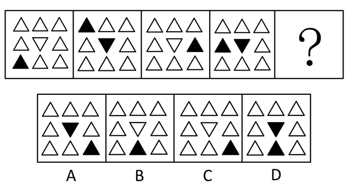

A. A

B. B

C. C

D. D

第 101 题 · 答案与解析

**参考答案（粉笔题库参考内容）**

C

**解析**

观察发现，图1中的黑色三角形按照顺时针方向沿外圈每次移动2、3、4、5格，中心三角形颜色分别为白色、黑色、白色、黑色，交替出现，故？处中心三角形的颜色应为白色，只有C项符合。

故正确答案为C。

**考点**：样式规律-遍历、位置规律-平移

**来源**：2011年浙江省公务员录用考试《行测》题第101题

### 第 102 题

请从所给的四个选项中，选择最合适的一个填在问号处，使之呈现一定的规律性：

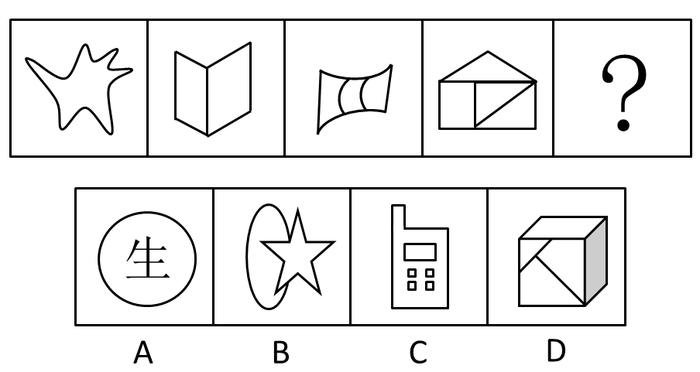

A. A

B. B

C. C

D. D

第 102 题 · 答案与解析

**参考答案（粉笔题库参考内容）**

D

**解析**

元素组成凌乱，考查数数。

数面（封闭空间），图形中含有的封闭空间数分别为1、2、3、4、（5），选项中封闭空间的数量依次为1、2、6、5 。

故正确答案为D。

**考点**：数量规律-面

**来源**：2011年浙江省公务员录用考试《行测》题第102题

### 第 103 题

请从所给的四个选项中，选择最合适的一个填在问号处，使之呈现一定的规律性：

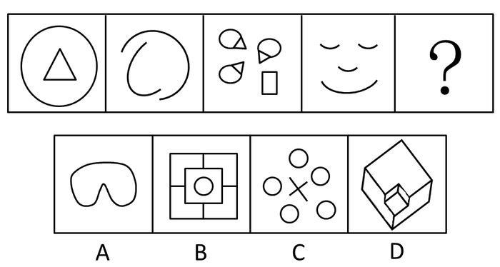

A. A

B. B

C. C

D. D

第 103 题 · 答案与解析

**参考答案（粉笔题库参考内容）**

C

**解析**

元素组成凌乱，考查数数。

数曲线数，已知图形曲线数分别是1、2、3、4、（5），呈等差数列，选项中的曲线数分别为1、1、5、0 。

故正确答案为C。

**考点**：数量规律-线

**来源**：2011年浙江省公务员录用考试《行测》题第103题

### 第 104 题

把下面的六个图形分为两类，使每一类图形都有各自的共同特征或规律，分类正确的一项是：

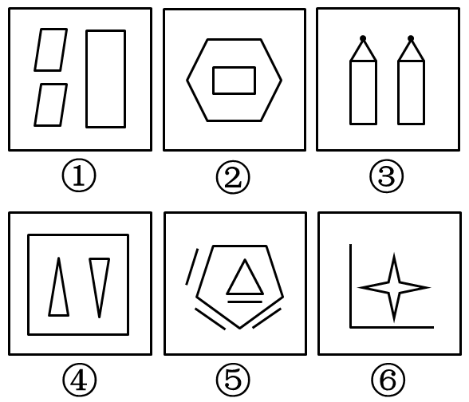

A. ①②⑤，③④⑥

B. ①③⑤，②④⑥

C. ①④⑤，②③⑥

D. ①④⑥，②③⑤

第 104 题 · 答案与解析

**参考答案（粉笔题库参考内容）**

B

**解析**

元素组成凌乱，但呈现明显的线条数量。

①③⑤中图形的线条数目均为12，②④⑥中图形的线条数目均为10。

故正确答案为B。

**考点**：数量规律-线

**来源**：2011年浙江省公务员录用考试《行测》题第104题

### 第 105 题

把下面六个图形分为两类，使每一类图形都有各自的共同特征或规律，分类正确的一项是：

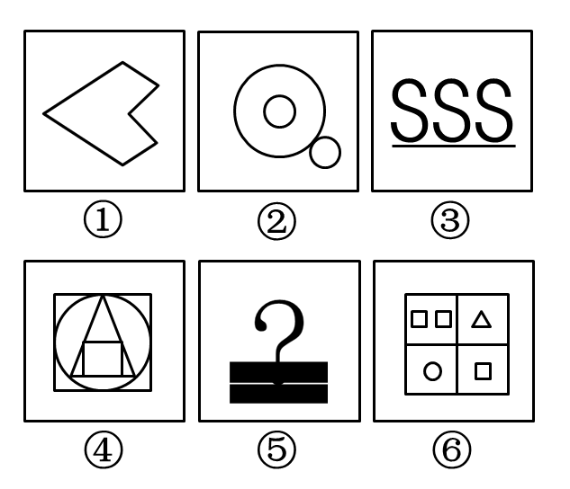

A. ①②④，③⑤⑥

B. ①⑤⑥，②③④

C. ①③④，②⑤⑥

D. ①④⑤，②③⑥

第 105 题 · 答案与解析

**参考答案（粉笔题库参考内容）**

A

**解析**

①②④图形均为轴对称图形，③⑤⑥均为非轴对称图形。

故正确答案为A。

注意：分组分类一定优先考虑两组分别具有不同的规律，实在没有才分成一组有一组没有，但非常少，因为不是很严谨。个别自主命题省份如浙江、吉林、江苏等省份的考生需注意，可能会考查，但这么分一定也是建立在分不出两组分别具有规律的基础之上。

**考点**：属性规律-对称性

**来源**：2011年浙江省公务员录用考试《行测》题第105题

### 第 106 题

请从所给的四个选项中，选择最合适的一个填在问号处，使之呈现一定的规律性：

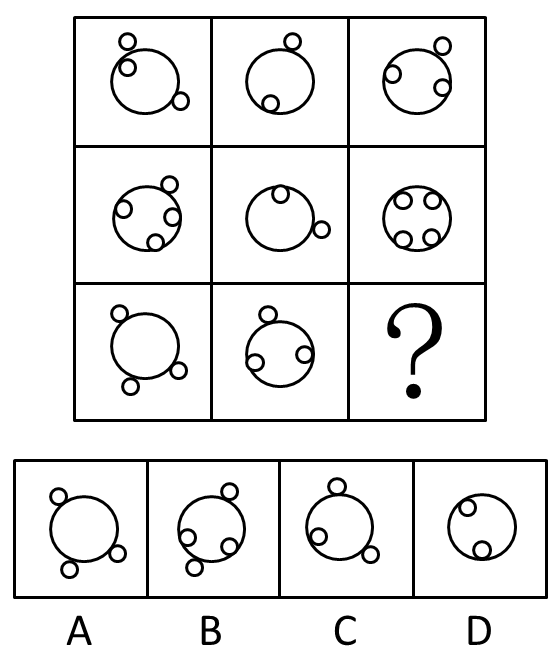

A. A

B. B

C. C

D. D

第 106 题 · 答案与解析

**参考答案（粉笔题库参考内容）**

B

**解析**

每一行前两个图形外部小圆数量之差等于第三个图形的外部小圆数，内部小圆数量之和等于第三个图形的内部小圆数，依此规律，问号处的图形外部小圆数为2，内部小圆数为2。

故正确答案为B。

**考点**：数量规律-素

**来源**：2011年浙江省公务员录用考试《行测》题第106题

### 第 107 题

请从所给的四个选项中，选择最合适的一个填在问号处，使之呈现一定的规律性：

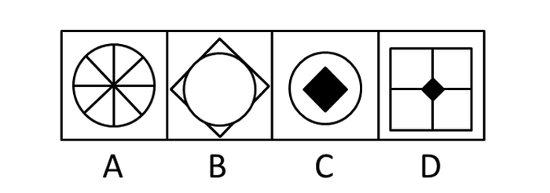

A. A

B. B

C. C

D. D

第 107 题 · 答案与解析

**参考答案（粉笔题库参考内容）**

C

**解析**

元素组成相似，以行为单位考虑遍历。每一行的所有图形（包括正方形、圆、实心黑色方形、实心黑色圆形、四条直线），在下一行均出现一遍，观察第三行，相比第一行和第二行而言，缺少的元素为圆与实心黑色方形，则问号处的图形一定是由这两种元素组成的。

故正确答案为C。

**考点**：样式规律-遍历

**来源**：2011年浙江省公务员录用考试《行测》题第107题

### 第 108 题

请从所给的四个选项中，选择最合适的一个填在问号处，使之呈现一定的规律性：

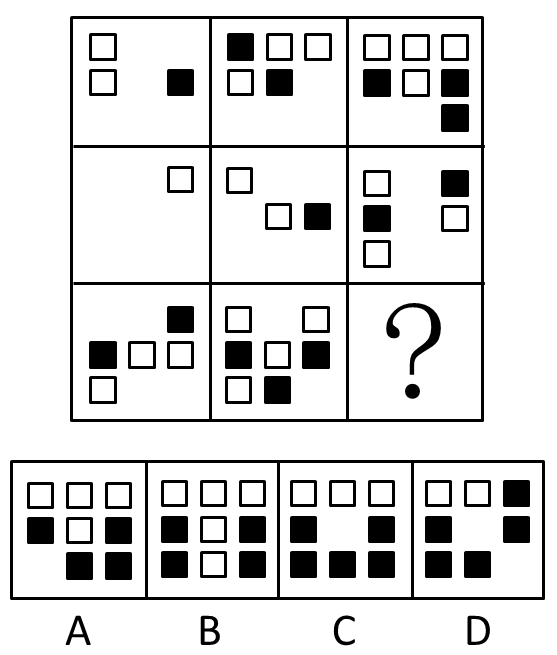

A. A

B. B

C. C

D. D

第 108 题 · 答案与解析

**参考答案（粉笔题库参考内容）**

B

**解析**

第一行的白色方块分别为2、3、4，黑色方块分别为1、2、3，呈等差数列；第二行白色方块分别为1、2、3，黑色方块分别为0、1、2，呈等差数列；则第三行白色方块分别为3、4、（5），黑色方块分别为2、3、（4）。

故正确答案为B。

**考点**：数量规律-素

**来源**：2011年浙江省公务员录用考试《行测》题第108题

### 第 109 题

请从所给的四个选项中，选择最合适的一个填在问号处，使之呈现一定的规律性：

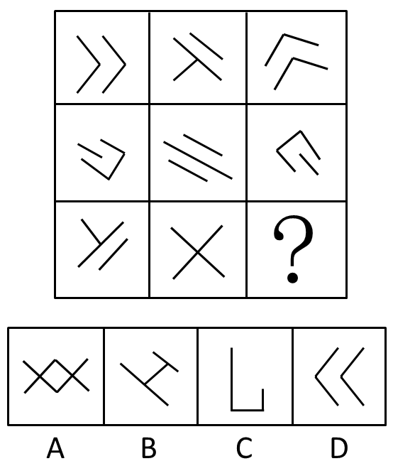

A. A

B. B

C. C

D. D

第 109 题 · 答案与解析

**参考答案（粉笔题库参考内容）**

B

**解析**

元素组成相同，考查位置规律。第一行图形均由四条长度相同的线段组成，对图一右下角的线段进行移动，可得图二。同理，图二移动一条线段，即可得到图三。第二行、第三行同样遵循该规律。

故正确答案为B。

**考点**：位置规律-平移

**来源**：2011年浙江省公务员录用考试《行测》题第109题

### 第 110 题

请从所给的四个选项中，选择最合适的一个填在问号处，使之呈现一定的规律性：

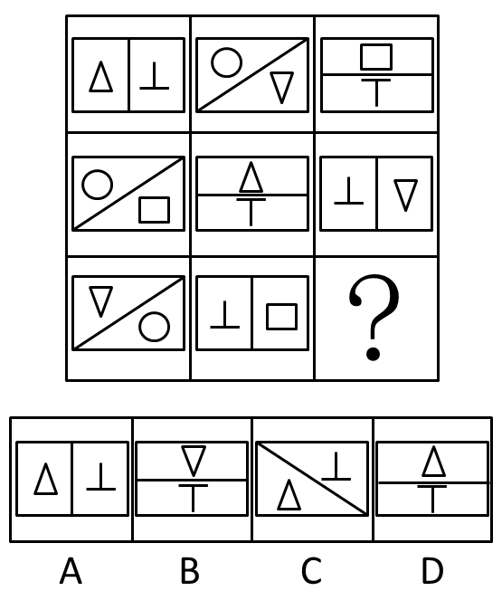

A. A

B. B

C. C

D. D

第 110 题 · 答案与解析

**参考答案（粉笔题库参考内容）**

D

**解析**

元素组成相似，元素周遍。每一行方框的三种情况均出现一遍，每一行六个小图形均出现一遍。

依此规律观察可知，最后一行缺“△”和“┬”。

故正确答案为D。

**考点**：样式规律-遍历

**来源**：2011年浙江省公务员录用考试《行测》题第110题

### 第 111 题

地缘政治学是地理和政治的结合体，又称地理政治学。它关注地理学对国际政治的特征、历史、结构尤其是与他国关系的影响，把地理因素视为影响甚至决定国家对外政治决策的一个基本因素，并依据这些地理因素和政治格局的地域形成，分析预测世界或地区范围的战略形势及有关国家的政治行为。

根据上述定义，下列不属于地缘政治学的观点的是：

A. 德国海陆兼备，具有争夺世界霸主地位的有利条件

B. 一个国家要想发展“海权”，首先必须在地理上便于进入世界的海洋

C. 谁统治东欧，谁就控制了心脏地带

D. 文明冲突将左右全球政治，文明之间的断层线将成为未来的战斗线

第 111 题 · 答案与解析

**参考答案（粉笔题库参考内容）**

D

**解析**

第一步：找出定义关键词。

“把地理因素视为影响甚至决定国家对外政治决策的一个基本因素”。

第二步：逐一分析选项。

A、B、C三项中均有地理位置的名词，这些地理位置在政治中起到了重要的作用，符合“把地理因素视为影响甚至决定国家对外政治决策的一个基本因素”，均符合定义，排除；

D项中是文明在全球政治中的重要性，没有地理，不符合“把地理因素视为影响甚至决定国家对外政治决策的一个基本因素”，不符合定义，当选。

本题为选非题，故正确答案为D。

**考点**：拆词

**来源**：2011年浙江省公务员录用考试《行测》题第111题

### 第 112 题

行政许可是指行政机关根据公民、法人或者其他组织的申请，经依法审查，准予其从事特定活动的行为。

根据上述定义，下列属于行政许可的是：

A. 甲省政府批准了某市政府提交的土地征收申报材料

B. 乙公司任命孙强为全权代表，让其负责与外方的业务洽谈

C. 丙工商局根据某学校食堂的申请向其颁发了营业执照

D. 丁公安局根据某犯罪嫌疑人的申请同意其取保候审

第 112 题 · 答案与解析

**参考答案（粉笔题库参考内容）**

C

**解析**

第一步：抓住定义中的关键词。

关键词强调“行政机关”，“公民、法人或者其他组织”，“从事特定活动”。

第二步：逐一判断选项。

A、D两项中没有从事特定活动；

B项中审查机关乙公司，不是行政机关；

C项中，“丙工商局”是行政机关，“某学校食堂”是其他组织，从事特定活动，符合定义。

A、B、D三项均不符合定义。

故正确答案为C。

**考点**：方式目的

**来源**：2011年浙江省公务员录用考试《行测》题第112题

### 第 113 题

边际效应：消费者在逐次增加一个单位消费品的时候，带来的单位效用是逐渐递减的。根据上述定义，下列属于边际效应的是（ ）。

A. 洪某下海创业，第一年赚了六十万，第二年赚了二十万，第三年赔了钱

B. 程某第一次带孩子逛博物馆时孩子非常好奇，第二次去的时候孩子还是很开心，但是第五、第六次去的时候，孩子就有点厌倦的感觉了

C. 郭某是资深集邮爱好者，前天终于集齐了他那套宝贝邮票的最后一张，那兴奋劲儿简直比抱孙子还要开心

D. 范某请朋友吃饭，酒一瓶一瓶下去，越喝越高兴，越喝越香

第 113 题 · 答案与解析

**参考答案（粉笔题库参考内容）**

B

**解析**

第一步：判断题干中的关键词。

主体：消费者。

结果：逐次增加单位消费品时，单位效用逐渐递减。

第二步：逐一分析选项。

A项，洪某下海创业，不是消费者，不符合题干。

B项，程某的孩子在多次去博物馆的过程中对博物馆的兴趣明显降低了，属于单位效用递减，符合题干。

C项，郭某集齐了邮票很开心，单位效用没有递减，不符合题干。

D项，范某请朋友吃饭，酒越喝越香，单位效用没有递减，不符合题干。

故正确答案为B。

**考点**：故事类

**来源**：2011年浙江省公务员录用考试《行测》题第113题

### 第 114 题

三段论是以包含三个不同词项的两个直言命题为前提，推出一个直言命题为结论，而且每两个直言命题都有一个共同词项的推理。

根据上述定义，下列属于三段论推理的是：

A. 或者你说错了，或者我听错了，我没有听错表明你说错了

B. 如果寒潮到来，气温就会下降，气温没有下降说明寒潮没有到来

C. 水银是金属，金属是能导电的物体，所以有的能导电的物体是水银

D. 老张是画家，老李是音乐家，他们是朋友，所以画家和音乐家可以做好朋友

第 114 题 · 答案与解析

**参考答案（粉笔题库参考内容）**

C

**解析**

第一步：抓住定义中的关键词。

关键词强调“三个不同词项的两个直言命题为前提”，“一个直言命题为结论”。

第二步：逐一判断选项。

A、B项的前提都不是直言命题；

D项有三个直言命题为前提，但是前两个直言命题不包含共同的词项。

故正确答案为C。

注释：直言命题是反映事物是否具有某种性质的简单命题，又称为性质命题。直言命题的一般表示为：所有（有的）S是（不是）P。

**考点**：单定义-其他句式

**来源**：2011年浙江省公务员录用考试《行测》题第114题

### 第 115 题

抢劫罪是指以非法占有为目的，以暴力、胁迫或者其他方法，强行劫取公私财物的行为。

根据上述定义，下列行为属于抢劫罪的是：

A. 甲在路上放了很多铁钉，乙骑自行车路过，车胎被扎破，甲趁乙下车查看时，迅速将乙车筐里的包拿走

B. 甲伙同乙在夜间闯入丙家中，用猎枪胁迫丙拿出现金和银行卡

C. 甲见乙手上拿着手机，上前将乙的手一碰，乙的手机掉在地上，甲迅速拿起手机逃走

D. 甲对乙怀恨在心，趁天黑时将乙打昏后逃跑，后来甲返回发现乙还未醒来，又将乙的手表拿走

第 115 题 · 答案与解析

**参考答案（粉笔题库参考内容）**

B

**解析**

第一步：抓住定义中的关键词。

关键词强调“非法占有”，“暴力、胁迫或者其他方法”，“强行劫取公私财物”。

第二步：逐一判断选项。

A、C两项中的甲没有强行劫取财物；

D项中的甲将乙打晕时不是以非法占有乙的财物为目的，返回拿走乙的财物时没有“强行劫取”。

则A、C、D三项均不符合定义。

故正确答案为B。

**考点**：方式目的

**来源**：2011年浙江省公务员录用考试《行测》题第115题

## 材料 1

**所给出的图、表、文字或综合性资料均有5个问题要你回答，根据提供的信息进行分析、比较、计算和判断处理。**

请开始答题：

一、根据下列资料，回答116～120题。

2009年度全国“农民工总量”为22978万人，比上年增加436万人。其中“外出农民工”14533万人，比上年增加492万人。在外出农民工中，“住户中外出农民工”11567万人，比上年增加385万人；“举家外出农民工”2966万人，比上年增加107万人。

从输出地看，2009年东部地区农民工10017万人，同比增长3.1%，东部地区农民工占全国农民工总量的比重为43.6%；中部地区农民工7146万人，同比增长0.9%，中部地区农民工占全国农民工总量的31.1%；西部地区农民工5815万人，同比增长1.2%，西部地区农民工占全国农民工总量的25.3%。

从输入地看，2009年在东部地区务工的外出农民工为9076万人，比上年减少888万人，下降8.9%，占全国外出农民工人数的62.5%，比上年降低8.5个百分点；在中部地区务工的外出农民工为2477万人，比上年增加618万人，增长33.2%，占全国外出农民工人数的17%，比上年提高3.8个百分点；在西部地区务工的外出农民工为2940万人，比上年增加775万人，增长35.8%，占全国外出农民工人数的20.2%，比上年提高4.8个百分点。

从性别看，男性外出农民工占65.1%，女性占34.9%。从年龄看，外出农民工以青壮年为主。其中，16～25岁占41.6%，26～30岁占20%，31～40岁占22.3%，41～50岁占11.9%，50岁以上的农民工占4.2%。从婚姻状况看，已婚的外出农民工占56%，未婚的占41.5%，其他占2.5%。

在外出农民工中，文盲占1.1%，小学文化程度占10.6%，初中文化程度占64.8%，高中文化程度占13.1%，中专及以上文化程度占10.4%。高中及以上文化程度比重比上年提高1.7个百分点，占23.5%。分年龄组看，低年龄组中高学历比例要明显高于高年龄组，30岁以下各年龄组中，接受过高中及以上教育的比例均在26%以上，其中，21～25岁年龄组中接受过高中及以上教育的比例达到31.1%。

2009年，外出农民工月平均收入为1417元，比上年增加77元，增长5.7%。外出农民工月均收入在600元以下的占2.1%；600～800元的占5.2%；800～1200元的占31.5%，1200～1600元的占33.9%；1600～2400元的占19.7%；2400元以上的农民工占7.6%。

### 第 116 题

与上年相比，2009年以下四项的增长率最低的是：

A. “农民工总量”

B. “外出农民工”

C. “住户中外出农民工”

D. “举家外出农民工”

第 116 题 · 答案与解析

**参考答案（粉笔题库参考内容）**

A

**解析**

2009年农民工总量增长率为，外出农民工增长率为，住户中外出

农民工增长率为，举家外出农民工增长率为，显然前两项较小，则有。

故正确答案为A。

**考点**：一般增长率、文字资料

**来源**：2011年浙江省公务员录用考试《行测》题第116题

### 第 117 题

从输入地看，2008年在东部地区务工的外出农民工约是在西部地区务工的：

A. 3.4倍

B. 3.8倍

C. 4.2倍

D. 4.6倍

第 117 题 · 答案与解析

**参考答案（粉笔题库参考内容）**

D

**解析**

2009年在东部地区务工的外出农民工为9076万人，比上年减少888万人；在西部地区务工的外出农民工为2940万人，比上年增加775万人。则可得，根据估算法，原式，与D项最接近。

故正确答案为D。

**考点**：基期倍数、文字资料

**来源**：2011年浙江省公务员录用考试《行测》题第117题

### 第 118 题

2009年，全国“岁”的外出农民工约为：

A. 8000万人

B. 5000万人

C. 3000万人

D. 1000万人

第 118 题 · 答案与解析

**参考答案（粉笔题库参考内容）**

B

**解析**

2009年外出农民工为14533万人，其中岁占22.3%，岁占11.9%，因此31～50岁的外出农民工约为万人，最接近B项。

故正确答案为B。

**考点**：现期比重、文字资料

**来源**：2011年浙江省公务员录用考试《行测》题第118题

### 第 119 题

2008年，高中及以上文化程度的外出农民工约为：

A. 5000万人

B. 4000万人

C. 3000万人

D. 2000万人

第 119 题 · 答案与解析

**参考答案（粉笔题库参考内容）**

C

**解析**

2008年外出农民工为14533-492=14041万人，高中及以上文化程度占23.5%-1.7%=21.8%，因此2008年高中及以上文化程度的外出农民工为万人，最接近C选项。

故正确答案为C。

**考点**：基期比重、文字资料

**来源**：2011年浙江省公务员录用考试《行测》题第119题

### 第 120 题

以下说法中，不正确的一项是：

A. 从输出地看，2008年东部地区农民工不足1亿

B. 2009年，全国男性外出农民工超过9千万人

C. 2009年，全国外出农民工中，已婚的与未婚的人数之差大于2千万人

D. 2009年，月工资在1200元以上的外出农民工不足8千万人

第 120 题 · 答案与解析

**参考答案（粉笔题库参考内容）**

D

**解析**

A选项，2008年东部地区农民工为，故A项正确；

B选项，万人，故B项正确；

C选项，2009年外出农民工中已婚与未婚的人数之差为，故C项正确；

D选项，2009年月工资在1200元以上的外出农民工为，故D项错误。

本题为选非题，故正确答案为D。

**考点**：综合分析、文字资料

**来源**：2011年浙江省公务员录用考试《行测》题第120题

## 材料 2

根据下列资料，完成121～125题。

2009年H省年末常住人口达到7034.4万人，出生人口90.7万人，出生率为12.93‰；死亡人口45.1万人，死亡率为6.43‰；净增人口45.6万人。

2009年城镇居民人均可支配收入达14718.3元。其中，工资性收入9830.6元，增长10.66%；转移性收入4674.2元，增长18.4%。农民人均纯收入达5150元，增长7.4%。其中，工资性收入2251元，增长13.7%。城镇居民人均消费支出9678.8元，增长6.5%；农民人均生活消费支出3350元，增长7.2%。城镇居民家庭恩格尔系数（即居民家庭食品消费支出占家庭消费支出的比重）为33.6%，农村居民家庭恩格尔系数为35.7%，分别比上年下降1.1和2.5个百分点。城镇居民人均建筑面积29.95平方米，农民人均居住面积31.9平方米，分别增长1.5%和4.0%。

2003～2009年H省城乡居民收入（元）

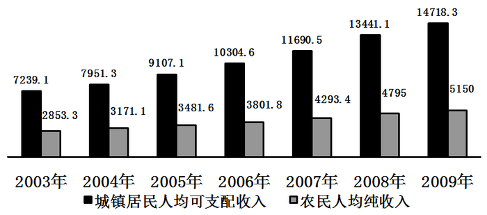

### 第 121 题

2009年H省的人口自然增长率为：

A. 6.5‰

B. 6.9‰

C. 7.2‰

D. 12.6‰

第 121 题 · 答案与解析

**参考答案（粉笔题库参考内容）**

A

**解析**

2009年H省的人口自然增长率为出生率-死亡率，为12.93‰-6.43‰=6.5‰。

故正确答案为A。

**考点**：综合资料、简单加减计算

**来源**：2011年浙江省公务员录用考试《行测》题第121题

### 第 122 题

2009年H省城镇居民人均可支配收入比上年约增长：

A. 8.7%

B. 9.2%

C. 9.5%

D. 9.8%

第 122 题 · 答案与解析

**参考答案（粉笔题库参考内容）**

C

**解析**

观察柱形图，可知2009年H省城镇居民人均可支配收入比上年增长。

故正确答案为C。

**考点**：一般增长率、综合资料

**来源**：2011年浙江省公务员录用考试《行测》题第122题

### 第 123 题

2003年至2009年H省城镇居民人均可支配收入和农民人均纯收入差距最大的年份是：

A. 2005年

B. 2006年

C. 2008年

D. 2009年

第 123 题 · 答案与解析

**参考答案（粉笔题库参考内容）**

D

**解析**

观察柱形图，根据城镇居民人均可支配收入和农民人均纯收入的两个柱形图高度差可以得出，2009年两者差距最大。

故正确答案为D。

**考点**：直接找数、综合资料

**来源**：2011年浙江省公务员录用考试《行测》题第123题

### 第 124 题

2008年H省城镇居民人均建筑面积约比农民人均居住面积：

A. 少1.62平方米

B. 少1.17平方米

C. 多0.23平方米

D. 多0.85平方米

第 124 题 · 答案与解析

**参考答案（粉笔题库参考内容）**

B

**解析**

2008年H省城镇居民人均建筑面积比农民人均居住面积少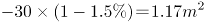。乘除法转换公式：，，适用情形为且选项间的差距较大，比较容易区分，可以将除法转换成乘法降低计算难度。

故正确答案为B。

**考点**：基期和差、综合资料

**来源**：2011年浙江省公务员录用考试《行测》题第124题

### 第 125 题

根据材料，下列表述不正确的是：

A. 从2003年至2009年H省农民人均纯收入增加最多的是2008年

B. 2009年H省农村居民家庭恩格尔系数比城镇居民家庭恩格尔系数高2.1个百分点

C. 2008年H省城镇居民人均消费支出不足9000元

D. 除2009年外，H省城镇居民人均可支配收入增加额逐年递增

第 125 题 · 答案与解析

**参考答案（粉笔题库参考内容）**

C

**解析**

A项正确，观察柱形图可知2008年农民人均纯收入增加最多；

B项正确，H省农村居民家庭恩格尔系数比城镇居民家庭高35.7%-33.6%=2.1%；

C项错误，2008年H省城镇居民人均消费支出为；

D项，根据柱形图可知只有2009年的增加额是有所下降。

根据材料中的数据，只能计算出2004年——2009年H省城镇居民人均可支配收入的增加额，部分同学因此认为由于没有给2002年的数据，不能求得2003年收入的增加额，从而无法判断2004增加额是否比2003年多。但是D选项并未说明时间起始范围，所以不能说D项一定是错的，但C选项明显错误，根据择优原则，选择错误的一项应该选C。

本题为选非题，故正确答案为C。

**考点**：综合分析、综合资料

**来源**：2011年浙江省公务员录用考试《行测》题第125题

## 材料 3

根据下列资料，完成126～130题。

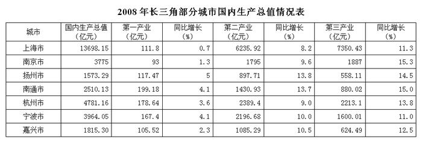

### 第 126 题

下列四个城市2008年国内生产总值的同比增长率最高的是：

A. 上海市

B. 扬州市

C. 杭州市

D. 宁波市

第 126 题 · 答案与解析

**参考答案（粉笔题库参考内容）**

B

**解析**

根据题干“·····国内生产总值的同比增长率最高······”，结合材料只给出了第一、二、三产业的增长率，可判定本题为混合增长率问题。定位表格可知2008年第一、二、三产业的产业产值及增长率。结合混合增长率口诀：混合之后居中，偏向基期大的那一边。分析数据可知，本题由于第一产业的基期产值远小于第二、三产业，所以主要考虑第二、三产业即可。

根据材料所给增速可判断出上海市国内生产总值的增长率介于8.2%~11.3%之间、扬州市介于13.8%~14.5%之间、杭州市介于9.0%~13.8%之间且更接近于9.0%、宁波市介于10%~11%之间，所以扬州市国内生产总值增长率最大。

故正确答案为B。

**考点**：统计表、混合增长率

**来源**：2011年浙江省公务员录用考试《行测》题第126题

### 第 127 题

2008年，第二产业增加值占国内生产总值的比重超过50%的城市有：

A. 2个

B. 3个

C. 4个

D. 5个

第 127 题 · 答案与解析

**参考答案（粉笔题库参考内容）**

C

**解析**

根据题干“2008年······占······的比重······”，结合材料时间为2008年，可判定本题为现期比重问题。定位统计表可得2008年长三角部分城市第二产业增加值和生产总值。结合公式：比重，即题目要求的城市，满足第二产业增加值×2>生产总值即可。上海市：，南京市：，扬州市：，南通市：，杭州市：，宁波市：，嘉兴市：。即有扬州、南通、宁波、嘉兴这四个城市满足要求。

故正确答案为C。

**考点**：现期比重、统计表

**来源**：2011年浙江省公务员录用考试《行测》题第127题

### 第 128 题

2008年，第三产业增加值的同比增长率最快的两个城市的增加值之和约比最慢的两个城市之和：

A. 少3800亿元

B. 少4700亿元

C. 少5200亿元

D. 少6200亿元

第 128 题 · 答案与解析

**参考答案（粉笔题库参考内容）**

D

**解析**

2008年，第三产业增加值的同比增长率最快的两个城市为南京市和南通市，最慢的是上海市和宁波市，两者之和相差。

故正确答案为D。

**考点**：统计表、简单加减计算

**来源**：2011年浙江省公务员录用考试《行测》题第128题

### 第 129 题

表中七个城市2008年的国内生产总值之和与以下哪个最接近：

A. 3.2万亿元

B. 3.4万亿元

C. 3.6万亿元

D. 3.8万亿元

第 129 题 · 答案与解析

**参考答案（粉笔题库参考内容）**

A

**解析**

2008年七个城市国内生产总值之和为4700+4000+1800=32000亿元。

故正确答案为A。

**考点**：统计表、简单加减计算

**来源**：2011年浙江省公务员录用考试《行测》题第129题

### 第 130 题

以下说法中，正确的有几个：

①2008年，上海市三个产业增加值的同比增长率都是最低的

②2007年，杭州市的国内生产总值超过4000亿元

③2007年，南京市第三产业增加值大于宁波市

④2008年，七个城市第一产业增加值的总和不足1000亿元

A. 1个

B. 2个

C. 3个

D. 4个

第 130 题 · 答案与解析

**参考答案（粉笔题库参考内容）**

C

**解析**

①错误，2008年上海第三产业同比增长率11.3%高于宁波的11.0%；

②正确，根据公式：基期量，则2007年杭州的国内生产总值为；

③正确，根据公式：基期量，则2007年南京第三产业增加值：，宁波的第三产业增加值：，故2007年南京市第三产业增加值明显大于宁波市；

④正确，2008年七个城市第一产业增加值的总和为+170+100=970<1000。共3个正确。

故正确答案为C。

**考点**：综合分析、统计表

**来源**：2011年浙江省公务员录用考试《行测》题第130题

