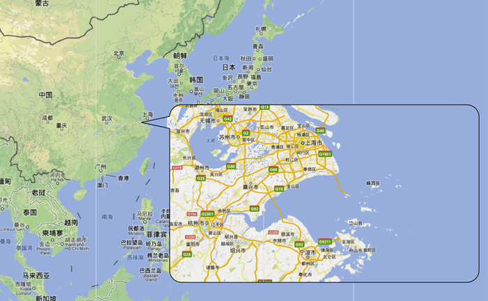

# 2012年浙江省公考《申论》题

<!-- gwy:overview:start -->
> **浙江 · 2012 · 申论 · 统考** ｜ 3 题 · 图片 1 处 · 答案随题折叠

导航：[题目](#题目) · [材料 1](#材料-1)
<!-- gwy:overview:end -->

> 候选采集稿。参考答案及解析来自粉笔页面，不代表官方答案或真实高分答卷；来源使用许可与原卷对应关系仍需人工核实。

## 给定材料

### 材料 1

进入21世纪，世界人口急剧增长，人类对食物的需求量越来越大，但可耕地面积、森林和牧场反而在大幅缩减，物种灭绝的速度越来越快。据预测：全世界现有陆地资源量仅可供人类使用500年，如果按消耗资源速度每年递增2.5%计算的话，则只能使用90年；全球石油生产剩余可采储量加上待发现的石油资源可用53年；天然气和煤炭可用分别是63年和90年。我国资源环境的约束更加突出：矿产资源人均占有量不到世界人均量的1/2，在世界上名列第53位。水资源总量占全球水资源的6%，人均占有水资源量仅为世界人均量的1/4，在世界上名列第110位，是全球13个人均水资源最贫乏的国家之一。我国人口众多，预计到2020年，人口数量将突破15亿，而保证粮食安全的耕地却在大幅度减少，现有人均耕地面积1.38亩，不足世界平均水平的40%。在现有的耕地中，受干旱、陡坡、瘠薄、洪涝、盐碱等多种因素影响，质量相对较差的中低产田约占2/3。另外，土地沙化、土壤退化、水土流失、“三废”污染等也导致耕地减少。农业生产在广泛使用化肥、农药、农用薄膜等化学品，造成大量有害物质残留在土壤中，导致土壤板结、农田减产，这又刺激农民使用更多的化肥来提高产量，造成恶性循环。

### 材料 2

我们居住的地球分为大陆和海洋两部分，海洋面积占了70.8%，陆地面积只占29.2%，所以，宇航员从太空看到的地球，是一个蓝色的“水球”，人类居住的陆地像是点缀在汪洋中的几片“岛屿”。蔚蓝的大海是一个巨大宝藏。据统计，海底岩层中埋藏的石油可采储量大约为3000亿吨，约占世界石油总储量的40%。海洋中含有大量的铀、氘、氚，它们能为人类提供充足的核燃料资源。海洋中汹涌的波涛、起伏的潮汐、不息的海流都蕴藏着巨大的动能。海洋中的矿产资源更为丰富，最具代表性的锰结核含有76种元素，把全世界海底的锰结核冶炼出来，可提炼出来的锰、镍、铜、钴四种金属的储量分别相当于陆地储量的200倍、120倍、15倍和1250倍。海洋是一个生物资源宝库，那里生长着藻类近万种、鱼类1.9万种、甲壳类2万多种，可为人类提供极为丰富的蛋白质。海洋给人类提供食物的能力，约为陆地上所能种植的全部农产品的1000倍，而现在人们对海洋生物的利用还不到1%。

### 材料 3

1405年，明成祖朱棣开始派遣宦官郑和率领强大海船队远航他国。当时，中国的造船技术已相当成熟，建造的郑和宝船长达137米，宽56米，有9桅12帆，是当时世界上最大、最先进的海船。郑和在30年内率领船队七下西洋，足迹踏遍37个国家，遍及东南亚、波斯湾、红海沿岸及北非一带海域，最远到了东非的索马里，开创了人类航海史上前无古人、规模巨大的远洋航程。郑和船队不畏艰险地远播华夏“蓝色文明”，充分展现了中华民族的高超智慧和非凡勇气；郑和船队为文明礼仪之师，既未强行占领别国一寸土地，也未掠夺当地一分一毫的财产，充分体现了中国人民酷爱和平、睦邻友好的精神；郑和船队打通了中西海上航道，将明朝“礼治”外交推向了全盛时代，提高了中国的国际威望。

郑和的航海始于15世纪之初，比葡萄牙人迪亚士1487年发现好望角要早82年，比哥伦布1492年发现美洲要早87年，比达伽马1498年到达印度科泽科德要早93年。郑和下西洋为中国提供了重要发展机会，然而中国未能把握这一机遇，从明朝宣德之后，统治集团经营海洋意识淡薄。郑和第七次出使西洋后，遭到一些守旧廷臣的攻讦,指责七下西洋是劳民伤财，得不偿失。至此，明朝大规模的航海活动结束了。此后，明清两朝闭关自守，放弃经营海洋的权利，饱受海上列强的侵略欺凌，割地赔款，甚至沦为半殖民地，这即是辉煌与衰落的强烈反差。美国《国际先驱论坛报》评论：当年中国统治者没有将历史悠久的文明古国转变为商业化、外交化的贸易和知识国家，留下历史遗憾，然而现在中国的发展完全有可能弥补这个缺陷。

### 材料 4

20世纪90年代初，美国成立了由30多个海洋机构参加的“海洋联盟”，为联邦政府与民间企业、海洋科技机构与企业间的伙伴合作提供组织保证。2000年美国通过了海洋法案，成立国家海洋政策委员会，审议、制定美国新的海洋政策。2007年发布《规划美国今后十年海洋科学事业：海洋研究优先计划和实施战略》。据报道，美国政府现有海洋研究与开发实验室700多个，政府每年投资270亿美元，有针对性地建设科学研究机构，并根据不同区域的海洋资源兴办不同形式的海洋科技园区。

20世纪80年代初，日本的海洋产业主要是渔业资源开发和海洋运输。1990年日本制定了一系列推进海洋开发的战略规划，将开发海洋纳入重点跟踪项目和振兴产业计划。1992年形成“海洋和日本——21世纪海洋政策建议”。2007年日本通过《海洋基本法》，2008年出台《海洋基本计划草案》，将日本海洋经济发展的规划通过法律形式予以规范。近年来，日本加强国际合作与交流，形成了以沿海旅游业、港口及海运业、海洋渔业、海洋油气业为支柱的海洋产业；集中地方优势，发展适合本地特点的海洋开发，形成了海洋土木工程、船舶修造业、海底通讯电缆制造与铺设、海水淡化等集科技、环保、公共服务为一体的海洋经济产业。同时，集中高新技术开发的优势，建立官、产、学一体化的联合开发体系，把科技研究成果推向市场。

位于北欧斯堪的纳维亚半岛的挪威是一个海洋渔业大国，70%的国家财政来自对海洋资源的开发利用。1946年挪威建立了渔业部，具体负责渔业活动、海岸安全、海洋科研及渔业资金的具体管理，形成了渔业管理上一整套法律、法规；集聚资金建立具有针对性的海洋经济研究所；积极开展国际海洋经济开发的合作及国际市场的开拓；注重海洋技术的研发与科研成果的商业化和技术转让；设置良好的私营企业投资系统，通过一定的激励政策，鼓励私营企业投资海洋开发项目。

开发海洋的竞争是科技与人才的竞争，谁拥有人才谁就掌控海洋开发的钥匙、掌控海洋开发的话语权。世界主要沿海大国都高度重视海洋科技发展与人才建设。澳大利亚在综合性大学都开设海洋方向的学科，有针对性地进行海洋专业的设置，德国的基尔大学进行海洋人才培养与研究已有100多年的历史，美国的缅因大学和日本的东北大学等都大力发展海洋类学科专业，培养了大批的海洋类高层次人才，为其海洋经济发展作出了贡献。

### 材料 5

改革开放以来，浙江省的经济社会发展一直居全国前列。2011年，全省生产总值突破3万亿大关；城镇居民人均可支配收入超过3万元，农村居民人均纯收入接近1.3万元；农业、工业、服务业三次产业结构2010年为5.0∶51.9∶43.1，城市化率为61.62%，已处于工业化的中后期阶段。但浙江省是一个人多地少、陆地资源贫乏、能源短缺的小省，土地面积仅占全国总面积的1.06%，是中国面积最小的省份之一。浙江有“七山一水两分田”之说，人均耕地仅有0.5亩。浙江省能源总消耗量绝大多数依靠省外调入或进口，从长期看，浙江能源原材料对外依存度还将持续上升。从工业产业内部结构看，浙江传统工业领域的纺织、化纤、服装、皮革、造纸等高污染排放的产业比重偏高，高新技术产业所占比重偏低。从总体上看，浙江目前仍属外延扩张的粗放型经济发展方式，资源过度消耗，环境污染严重。

浙江省有全国最长的海岸线，达6696公里。规划可建万吨以上泊位的深水岸线506公里，占全国的30.7%，500平方米以上的海岛2878个，约占全国的44%，均居全国第一。宁波—舟山港域是我国建设世界级深水港群的首选。舟山渔场是全球四大渔场之一，海洋捕捞量居全国第一。浙江海域海洋生物资源种类多、数量大，近岸海域共有浮游植物394种，浮游动物170种，底栖生物131种。东海石油资源主体部分位于浙江海域，储量居全国第二。海洋新能源主要包括海洋风能、波浪能、潮汐能，还有海洋生物能等。浙江省可开发潮汐能装机容量占全国40.8%，潮汐能占全国1/2以上，海洋能源十分丰富，利用价值极高。浙江沿海气候温和湿润、地貌形态多样，人类活动历史悠久、文化积淀深厚，自然禀赋与人类活动的叠加，形成了丰富多彩的自然和人文旅游资源。

### 材料 6

舟山是我国唯一的以群岛建制的地级市，有1390个岛屿。舟山群岛所在的西北太平洋地区是东北亚通向太平洋走向世界的要道。舟山作为祖国前沿要塞和东海前哨，一直承担着站岗放哨的海防任务，为国防安全作出了巨大的贡献。长期以来，因一水相隔，舟山海岛经济受到极大制约，在国家有关部门和浙江省委、省政府的高度重视下，1999年舟山大陆连岛工程正式启动。2009年底，由岑港大桥、响礁门大桥、桃夭门大桥、西堠门大桥和金塘大桥5座大桥连接起来的舟山连岛跨海大桥正式通车。舟山跨海大桥构筑出一条全天候的舟山—大陆通道，使舟山本岛变成与大陆相连的半岛，成为大陆通向海洋的港口城市。舟山跨海大桥把发展海岛特色经济与比较完善的基础设施网络密切结合起来，把中国最好的深水岸线资源与广大腹地密切结合起来，对进一步开发舟山海洋资源，推动浙江省、长江三角洲乃至中国经济发展都具有深远的意义。

2010年5月，国务院批准实施的《长江三角洲地区区域规划》提出“建设浙江舟山海洋综合开发试验区”。2011年2月，国务院批复了《浙江海洋经济发展示范区规划》，首次提出“探索设立浙江舟山群岛新区”。十一届全国人大四次会议审议通过的国家《“十二五”规划纲要》再次明确提出推进浙江舟山群岛新区发展。2011年3月，在交通运输部与浙江省人民政府举行的战略合作签约仪式上，浙江“三位一体”港航物流体系建设项目推介手笔巨大，共有26家国内外大型企业，与宁波—舟山港、温州港集团等签下了20个项目，投资总金额达650亿元。按照“三位一体”港航物流服务体系的战略定位，浙江将打造亚太地区重要的综合性国际枢纽港，即构建大宗商品交易平台、海陆联动集疏运网络、金融和信息支撑系统。2011年6月，国务院正式批准设立浙江舟山群岛新区，这是继上海浦东新区、天津滨海新区和重庆两江新区后我国设立的又一个国家级新区。2011年7月，浙江省委、省政府制定下发了《关于加快海洋经济发展的若干意见》，对我省当前和今后一个时期加快发展海洋经济作出了全面部署。

### 材料 7

### 材料 8

浙江省的民营经济号称“五分天下有其四”。2011中国500强民营企业，浙江占了144席，连续13年居全国之首。浙江省的民间资本十分雄厚，但是许多民资因为苦于找不到合适的项目而让巨额资金“躺着睡觉”。近年来，随着行业垄断的打破、开放领域的增多、限制政策的减少，浙江省民间资本进入的领域正在日益扩大。民间投资已不再局限于传统制造业和服务业领域，而开始在基础设施建设、科教文卫、金融保险及旅游业等领域寻找新的发展空间。总投资118亿元、全长36公里的杭州湾跨海大桥是我国第一座跨海大桥，也是国务院批准立项的国家特大型基础建设项目。“跨海大桥”自建设以来一直有个引人关注的话题：跨海大桥的资金，一大半来自浙江的民营企业。在跨海大桥的资本金中，由17家民营企业组成的5个投资公司的民间资本占到了资本金投入的50.25%。专家指出，民资大规模进入大型基础设施领域，不仅解决了建设资金的来源问题，更重要的是在很大程度上促进了大型基础设施建设中市场机制的形成和完善，有助于解决基础设施建设领域长期存在的投资效率低下的顽症。

改革开放以来，浙江经济发展持续强势，在全国颇为引人注目。在此番局面的背后，是什么样的文化精神在支撑？是“自强不息、坚忍不拔、勇于创新、讲求实效”的浙江精神。浙江人不畏艰险、勇于拼搏、敢于冒险，在浙江大地上书写了一幅“农民变居民、老乡变老板、晒场变市场、会场变工厂、集市变城市”的感人历史画卷。而全球1000多万浙商，用生动实践锤炼了“踏尽千山万水、说尽千言万语、想尽千方百计、吃尽千辛万苦”的“四千”精神，塑造了“特别能吃苦、特别能创业、特别能创新”的浙商品格。可以说，浙商的奋斗，浙商的成功，淋漓尽致地体现了浙江人永不言败、永不满足、永不停步的精神，展现了浙江人的智慧和力量。

### 材料 9

中国国家海洋局编制的国家标准《海洋及相关产业分类》对海洋经济的定义是：开发、利用和保护海洋的各类产业活动，以及与之相关联活动的总和。同时把海洋产业定义为开发、利用和保护海洋所进行的生产和服务活动。

目前，世界海洋旅游业总收入占全球旅游业总收入的一半，全世界40个最大知名旅游目的地中有37个在沿海国家或地区，这37个国家和地区的旅游总收入占全球旅游总收入的81%。就中国而言，滨海旅游业稳居中国海洋经济总产值前列，占比高达31.2%，可见滨海旅游业是海洋经济的核心产业之一。

浙江省有甬舟、温台、杭州湾三大滨海旅游区，与佛音缭绕的普陀山、大名鼎鼎的桃花岛同处一隅的舟山市六横岛，虽然在旅游开发上逊色不少，但其得天独厚的深水良港优势，为六横镇大力发展船舶修造、港口物流等临港产业插上了翅膀，现在建的有矿石中转码头、PX储运、新能源燃料乙醇、电厂等项目。然而，岛上淡水资源匮乏，已成为严重制约六横镇经济社会可持续发展的瓶颈。2008年，浙江省在岛上启动了全国最大的10万吨级反渗透海水淡化项目。目前一期工程已经达到一天2.25万吨的海水淡化处理能力，即三四天淡化一座小二型水库的蓄水量。

在海水淡化项目中，提取淡水后剩余的浓海水，一般都通过浓海水排放管道引至深海区排放，但是大量排放后会改变区域海水浓度，从而影响海洋生物生长。六横水务有限公司想到了与盐场联姻，一边是海水淡化，一边是盐场晒盐，中间连上一根水管，浓海水直接成为盐场的原料，从而保护海洋生态环境，达到海水综合利用的目标。“这只是海水综合利用的第一步。”六横水务有限公司负责人介绍，除了利用盐场晒盐，浓海水还可用于提取钾、溴等元素，今后还能进行盐化工、特种养殖等深度开发，如条件适合，他们将利用浓海水在附近建设类似“人工死海”的旅游项目，从而使海水淡化与海水综合利用形成良性发展的产业链。

### 材料 10

2011年4月13日上午，国家海洋局联合沿海有关省、自治区海洋厅（局）在北京人民大会堂召开新闻发布会，公布我国首批开发利用无居民海岛名录，入选名录的海岛将面向社会出让使用权，最高使用年限为50年。此次国家集中公布的第一批开发利用无居民海岛名录涉及浙江、山东、江苏、福建、广东等8个省区，共计176个无居民海岛，其中浙江有31个。海岛开发利用涉及旅游娱乐、交通运输、工业、仓储、渔业、农林牧业、可再生能源、城乡建设、公共服务等多个领域。2011年11月12日，全国无人海岛在宁波展开第一拍，浙江象山县的大羊屿以2000万元的价格顺利找到“岛主”。浙江省海洋与渔业局相关人士介绍：“我省此次推出的第一批31个无居民海岛，相对来说其开发条件较好，与陆地距离比较近，岛型岛貌比较适合进行开发和利用。海岛是海洋开发的前沿阵地，无居民海岛本身具有很大的发展前景，无居民海岛的开发、利用吸引浙江丰厚的民间资本来投资，必将推动我省海洋经济的发展。”

2011年11月，国家发改委核准批复了黄泽山石油中转储运项目。该项目是我国第一个民营企业进入原油（燃料油）中转储运的项目。黄泽山项目建成后，不仅能够为各大炼化企业和油品使用单位提供服务，对降低炼化企业的运输成本、保障炼化企业的原油供应安全具有重要作用，而且对舟山逐步建成大宗商品储运中转加工中心、提升我国在大宗商品交易中的话语权也有作用。根据舟山海洋经济的规划，10年后舟山群岛新区将建成全国重要的油品中转贸易储存、铁矿砂中转贸易、煤炭中转加工配送、粮食中转加工配送等六大基地，为解决国家能源安全提供支撑。

### 材料 11

夏宝龙省长在2012年浙江省政府工作报告中指出：“推进浙江海洋经济发展示范区、舟山群岛新区和义乌国际贸易综合改革试点建设，是党中央、国务院从全局出发作出的战略部署，是我省加快经济转型升级的重要引擎。要举全省之力抓落实，先行先试求突破，促进海洋经济与山区经济联动发展，加快城乡经济社会一体化进程，努力形成推动区域协调发展的新增长极。”

根据浙江海洋经济发展示范区的规划，到2015年，示范区地区生产总值突破2.6万亿元，海洋生产总值接近7000亿元，三次产业结构比为6∶41∶53，海洋新兴产业增加值比重提高到30%以上，科技贡献率达70%以上，清洁海域面积达15%以上，沿海港口货物吞吐量达9.2亿吨，形成较为完善的“三位一体”港航物流服务体系，港航服务水平大幅提高，海洋经济转型升级成效显著，海洋科教文化全国领先，海洋生态环境明显改善，海洋经济综合实力明显增强，基本实现海洋经济强省目标。到2020年，全省海洋生产总值力争突破12000亿元，三次产业结构为5∶40∶55，科技贡献率达80%左右，海洋新兴产业增加值占海洋生产总值比重达35%左右，全面建成海洋经济强省。

浙江海洋经济发展示范区建设，将有效提升浙江在全国发展中的地位。中央对浙江发展海洋经济的定位是“海洋经济发展示范区”，对舟山的定位是“舟山群岛新区”。示范就是探索引领，新区就要先行先试。“示范区”和“新区”这5个字是中央赋予浙江的大政策，中央期望浙江在发展海洋经济的征程中出新招、闯新路、攀新高。

## 题目

### 第 1 题

**根据给定资料，概括浙江省发展海洋经济的优势条件。（25分）**

关联材料：材料 1、材料 2、材料 3、材料 4、材料 5、材料 6、材料 7、材料 8、材料 9、材料 10、材料 11

作答要求：

要求：准确，全面，有条理。字数不超过500字。

第 1 题 · 答案与解析

**参考答案（粉笔题库参考内容）**

一、自然资源优势：气候温和湿润、沿海地貌形态多样；海岸线长、泊位水深，深水港群分布广；无居民海岛数量多，条件好，距陆地近，适合开发利用；海洋生物资源种类多，矿产资源储量大，海洋新能源十分丰富，利用价值极高；滨海旅游区多。

二、地理区位优势：地理位置优越，区域内外交通便利，地处长江黄金水道入海口；位于长江三角洲的南翼腹地、毗邻台湾海峡和日本海域；对内是江海联运枢纽，对外是远东国际航线要冲，航道较多、分布集中；

三、人文历史优势：人类活动历史悠久、文化积淀深厚，自然人文旅游资源丰富；浙江精神、“四千”精神、浙商品格为海洋经济发展提供强大的精神动力和支撑。

四、政策体制优势：浙江海洋开发上升为国家战略，建设综合开发实验区，探索设立国家级新区；省政府抓住经济转型升级的战略机遇，推进海洋经济发展示范区和改革试点区建设；已建立健全的深水岸线、海岛、滩涂等海洋资源开发与管理体制；

五、民间资本优势：海洋经济开发融资渠道拓宽，民间资本十分雄厚，投资效率高；促进海洋基础设施建设市场机制形成和完善。

**解析**

本题是概括类题目，要求概括“浙江省海洋经济优势条件”，题目先要反馈材料，材料5-11都谈到了浙江海洋经济的优势，要求考生进行归纳整理。考生可以从自然资源、人文历史、地理区位、政策体制、产业集聚五大优势出发，以保证题目“全面、有条理”的基本要求。“准确”则要求迅速从材料中索取答案。本题目要求“字数不超过500字”，考察了对浙江发展海洋经济的背景材料的熟悉和把握，要求考生将以往准备的知识从记忆库里提取出来，按类进行划分整合，将答案进行完善和丰富。

**来源**：2012年浙江省公考《申论》题

### 第 2 题

**“推进浙江海洋经济发展示范区建设，是浙江省加快经济转型升级的重要引擎。”请谈谈你对这句话的理解。（25分）**

关联材料：材料 1、材料 2、材料 3、材料 4、材料 5、材料 6、材料 7、材料 8、材料 9、材料 10、材料 11

作答要求：

要求：准确，全面，有深度。字数不超过600字。

第 2 题 · 答案与解析

**参考答案（粉笔题库参考内容）**

一、浙江省正处于经济转型升级的关键时期，转变经济发展方式过程中面临的国内外背景和主要问题：

1.陆地经济发展面临困境。全球陆地资源使用有限，过度开采严重；我国受资源环境约束形势严峻，人均耕地减少，水资源紧张，农业生产恶性循环。

2.海洋经济发展滞后。海洋资源、能源丰富，开发利用率极低；

3.浙江人口资源矛盾突出。土地贫乏，能源稀少，原材料价格持续上涨，对外依赖性强。

二、海洋经济示范区建设对于加快经济转型升级具有重要作用：

1.促进海洋与山区经济联动发展，加快城乡经济社会一体化进程，努力形成推动区域协调发展的新增长极；

2.优化产业结构，提高投资效率和科技贡献率，改善海洋生态环境。

三、推进浙江海洋经济发展示范区建设的建议：

1.政策支持。坚持改革开放政策，把握机遇，大力发展海外贸易，弥补历史缺憾；制定海洋科学研究优先发展计划和战略规划；

2.资金保障。加大国家资金持续性投入比重，鼓励民营投资，开拓民营融资的合理渠道；

3.法律法规。完善海洋开发法律，完善渔业管理法规，规范海洋经济有序、合理开发；

4.科技人才。建立海洋科技园区，培养海洋类高层次专业型人才，推动科技成果转化，提高国际竞争力；

5.国际合作。结合当地需求，强化国际交流与合作，学习先进经验，建立与国际接轨的一体化海洋联合开发体系。

**解析**

1.语句理解题，首先要理解字面意思。“引擎”意味着机遇、动力。

2.其次要综合分析。一是转型的必要性；二是对于“加快经济转型升级”的作用

3.考虑到答题的完整性，此题要适当提出对策。

**来源**：2012年浙江省公考《申论》题

### 第 3 题

**围绕给定资料主旨，联系浙江实际，自拟标题，自选角度，写一篇议论文。（50分）**

关联材料：材料 1、材料 2、材料 3、材料 4、材料 5、材料 6、材料 7、材料 8、材料 9、材料 10、材料 11

作答要求：

要求：

（1）观点正确，结构完整；

（2）论述深刻，条理清晰；

（3）字数1000—1200字。

第 3 题 · 答案与解析

**参考答案（粉笔题库参考内容）**

《论海洋经济发展的三个转变》

一直蓬勃发展的浙江经济麻烦不断，内外部环境都不容乐观。国际经济形势严峻，金融危机刚过不久，欧债危机又接踵而来，外向型经济模式遇到瓶颈；国内信贷紧缩，中小企业融资难，企业债台高筑，企业家外逃……。屋漏偏逢连夜雨，浙江经济内忧未了外患不断，如何突出重围，为浙江经济杀出一条血路，这是我们需要思考的问题。

——浙江经济必须完成由“小”到“大”的转变。

浙江经济最大的优点和缺点都是一个字——小。绝大部分的企业都是中小微企业，这些企业的优势是灵活，转型快。缺点也很明显：规模小，资金少，很难集中力量办大事。

上规模、拓空间、促升级、树品牌是浙江经济解困的必然选择。海洋经济最大的特点就是规模大，要求高，技术新，这恰恰能够弥补浙江经济发展的不足。这个特点决定了发展海洋经济需要大量资金，更高的平台，单纯的靠民间力量是解决不了问题的。要转变单纯依靠企业家，依靠民间力量的懒汉思想，积极发挥政府的主导作用，建设有为政府。要从战略高度重视海洋经济。要争取中央政府的支持，通过完善制度，开放政策，制定规划为企业发展提供平台。减轻负担，加强服务，要通过完善基础设施，出台优惠政策等吸引投资。促进合作，发挥集中优势。努力推动海洋经济示范区建设，大力引进技术，孵化一批具有世界影响的大企业。

——浙江经济必须完成由“旧”到“新”的转变。

浙江不是没有大企业，五金、水泥、钢材，这些大企业都是一些传统“旧”企业，是一些高能耗的粗放型的企业。能源的匮乏是浙江经济的先天缺陷，而这个能源小省偏偏是一个资源消耗大省。海洋经济为解决能源问题找到一条新路。

海洋经济为发展新能源、新技术、新产业提供了历史契机。第一，发展新能源浙江有地域优势，风能、潮汐能、波浪能等蕴藏量均居全国前列；第二，发展新能源有时间优势，新能源研发全世界都处于起步阶段，浙江人才资源丰富，财力丰厚，在欧美经济都不景气的情况下，完全可以在新能源领域有所作为。第三，在新产业方面，努力促进海洋勘探，海洋生物制药，港口机械等新兴产业，改变浙江的产业结构。第四，要从重视质量到重服务的转变。搭建大宗商品交易平台、大力发展海洋海陆联动集疏运网络、金融和信息支撑系统“三位一体”的港航物流服务体系。

——发展海洋经济还必须转变观念，提高认识。

作为一个农业文明的国家，从古至今中国文化就不太重视海洋。近代有闭关锁国的政策，即便是现在，九百六十万平方公里的国土中没有计算海洋。尽管我们有郑和下西洋的豪迈壮举，却没有抓住历史机遇，这次错失给我们带来的是一百多年的屈辱和辛酸。痛定思痛，我们绝对不能让历史悲剧重演！

海洋不仅是浙江的希望，也是中国的希望，更是二十一世纪人类的希望。浙江人一向具有敏锐眼光、开创精神和担当意识，让我们一起保护、利用、开发好海洋，为包括浙江人民在内的人类幸福开创千秋基业！

**解析**

浙江发展海洋经济是既定战略，材料中谈到浙江海洋经济优势，战略机遇、已取成就，浙江最大的实际是民营经济强大。转变经济发展方式，促进产业结构升级，发展海洋经济就必须转变传统发展思路，集“小”力量为“大”实力。文章的主旨是考查考生对浙江经济发展思路的认识和分析。

**来源**：2012年浙江省公考《申论》题

