# 2012年浙江省公务员录用考试《行测》题

<!-- gwy:overview:start -->
> **浙江 · 2012 · 行测 · 统考** ｜ 130 题 · 图片 136 处 · 答案随题折叠

| 题型模块 | 题量 | 题号 |
| --- | ---: | ---: |
| 言语理解与表达 | 35 | 1–35 |
| 数量关系 | 25 | 36–60 |
| 判断推理 | 35 | 61–95 |
| 综合知识 | 20 | 96–115 |
| 资料分析 | 15 | 116–130 |
| **合计** | **130** | |

导航：[题型与作答说明](#题型与作答说明) · [题目](#题目) · [材料 1](#材料-1)
<!-- gwy:overview:end -->

> 候选采集稿。参考答案及解析来自粉笔页面，不代表官方答案或真实高分答卷；来源使用许可与原卷对应关系仍需人工核实。

## 题型与作答说明

言语理解与表达

（35题）

根据题目要求，在每个选项中选出一个正确答案。

数量关系

（25题）

本部分包括数字推理与数学运算两种类型的试题。

判断推理

（35题）

本部分包括类比推理、定义判断、图形推理与逻辑判断四种类型的试题。

综合知识

（20题）

根据题目要求，在每个选项中选出一个正确答案。

资料分析

（15题）

所给出的图、表或一段文字均有5个问题要你回答。你应根据资料所提供的信息进行分析、比较、计算和判断处理。

## 题目

### 第 1 题

房产税并非能直接降低房价，但是能对房价预期起作用，\_\_\_\_\_\_在于建立合理的长效税收机制，对促进商品房市场机制的形成必不可少。今后应征收存量房的房产税，以逐步\_\_\_\_\_\_土地出让金，这一步应及早进行。

依次填入画横线部分最恰当的一项是：

A. 目的 废除

B. 意义 取代

C. 影响 废止

D. 价值 取消

第 1 题 · 答案与解析

**参考答案（粉笔题库参考内容）**

B

**解析**

此题考查近义实词的辨析。首句是说房产税对房价产生的作用，包括“建立长效税收”“促进市场机制形成”。第一空需填与“作用”意思相近的词，故排除A项“目的”、C项“影响”。在B项和D项中，第二句提到“房产税”和“土地出让金”的关系，从句意理解二者都是征收行为，只能是新的取代旧的，而不是取消、废除、废止。

故正确答案为B。

**考点**：实词填空、对应关系-前后呼应

**来源**：2012年浙江省公务员录用考试《行测》题第1题

### 第 2 题

收藏家从来不是将艺术品作为商品来对待的人，对他们而言，收藏        是一种暂时性的投资，        是一种激情：艺术的激情，物质的激情，历史的激情，占有的激情。正是这种激情重新改写了艺术品的意义。

填入划横线部分最恰当的一项是：

A. 与其说 不如说

B. 不仅 而且

C. 尽管 然而

D. 哪怕 也

第 2 题 · 答案与解析

**参考答案（粉笔题库参考内容）**

A

**解析**

此题考查虚词的辨析。

本题关键是理解“一种暂时性投资”和“一种激情”两个分句间的关系。从后面对激情的解释，并且下结论说“激情改写了艺术品的意义”可知，作者赞同后者的说法，对前者是否定的，也就是两种观点之间选择后一种，选项A符合选择关系。

故正确答案为A。

**考点**：对应关系-前后呼应

**来源**：2012年浙江省公务员录用考试《行测》题第2题

### 第 3 题

一个人拥有包容心态，在为人处事时就不会\_\_\_\_\_\_，也不会卑躬屈膝，他会平心静气，拒绝浮华，兼收并蓄，包容万物。

填入画横线部分最恰当的一项是：

A. 目空一切

B. 盛气凌人

C. 狂妄自大

D. 仗势欺人

第 3 题 · 答案与解析

**参考答案（粉笔题库参考内容）**

B

**解析**

本题从“不会……也不会”入手，可知填入词汇与“卑躬屈膝”是并列关系，且意思相反，同样含贬义。“卑躬屈膝”形容没有骨气，低声下气地讨好奉承。与之相对应的应该是形容傲慢自大，而且与讨好奉承相对应的是气势压迫旁人。因此，结合选项应该选择B项。

A项与C项也表示极端骄傲，但更多强调个人状态，而非与周围的关系；D项强调凭借权势欺压人，但权势前后文均没有提到。

故正确答案为B。

**考点**：成语填空、关联关系-并列关系

**来源**：2012年浙江省公务员录用考试《行测》题第3题

### 第 4 题

关于兰州拉面用“食用胶”使面条筋道的报道，再一次\_\_\_\_\_\_了公众对于“食品添加剂”敏感的神经。“吃一碗面等于吃掉一只塑料袋”的恐吓，成功地煽起了公众的\_\_\_\_\_\_，这再次凸显，我们的记者急需提升基本的科学素养。

依次填入画横线部分最恰当的一项是：

A. 震动 惊慌

B. 触动 慌乱

C. 拨动 恐慌

D. 惊动 恐惧

第 4 题 · 答案与解析

**参考答案（粉笔题库参考内容）**

C

**解析**

本题考查实词语境的搭配。第一空，“神经”是线性的，对于线性的东西一般不用“震动”和“惊动”，搭配不恰当，故先排除A、D两项。

第二空要填“煽起”的宾语，应填一个名词，“慌乱”是形容词，不能作名词用，排除B项。“恐慌”的词义比“慌乱”更深，与“恐吓”形成对应，填在此处更为恰当。

故正确答案为C。

**考点**：词的辨析-搭配对象、实词填空

**来源**：2012年浙江省公务员录用考试《行测》题第4题

### 第 5 题

似曾相识的故事，只要你静心观察，就在我们生活周遭日复一日　　　地演出。人生旅途看起来纷繁纷沓，置身其中才知那是独来独往的终身体验——沿途的浮光掠影，何尝不是为了成就我们或丰饶或　　　的内在？

填入划横线部分最恰当的一项是：

A. 单一式 单薄

B. 木偶式 贫穷

C. 平面化 骨感

D. 机械化 贫瘠

第 5 题 · 答案与解析

**参考答案（粉笔题库参考内容）**

D

**解析**

此题考查实词语境搭配的能力。

第一空所填词要与“日复一日”的状态意思相近，“木偶式”主要形容没有思想，呆滞，“平面化”是说不生动，刻板，这两个均不符合题意，先排除B项、C项。

第二空“或……或……”表明此处要填“丰饶”的反义词，“贫瘠”显然比“单薄”合适。

故正确答案为D。

**考点**：实词填空、对应关系-前后呼应、关联关系-并列关系

**来源**：2012年浙江省公务员录用考试《行测》题第5题

### 第 6 题

在深刻变化的社会转型期，思想观念多样多元多变，一些领域道德\_\_\_\_\_\_，一些社会成员人生观、价值观扭曲，这是文艺工作者必须面对的时代\_\_\_\_\_\_。如何实现文艺的社会价值，净化心灵、烛照前行，这是文艺工作者必须回答的时代\_\_\_\_\_\_。

填入画横线部分最恰当的一项是：

A. 失当 背景 主题

B. 缺失 环境 议题

C. 失范 场景 命题

D. 缺乏 境况 问题

第 6 题 · 答案与解析

**参考答案（粉笔题库参考内容）**

C

**解析**

第一空，搭配道德，A项“失当”指不适宜、不恰当，与“道德”搭配不当，道德是否恰当无法评价，排除；根据“一些社会成员人生观、价值观扭曲”可知，此处要表达“一些领域道德没有发挥正确价值引导作用，导致一些人价值观‘变形、歪曲’”之意。B项“缺失”指缺少、失去 。用在此处语义过重，文段并非强调这些领域没有道德参与，而是强调道德没有发挥积极作用，排除B项 ；D项“缺乏”后面常接宾语，例如：缺乏锻炼、缺乏勇气、缺乏资金等，不能说“道德缺乏”，故用法不当，排除。 C项“失范”更突出道德价值的缺少不能对社会生活及个人生活发挥正常的调节和引导作用，用在此处更合适。

第二空代入验证， “时代场景” 为常见搭配，符合文意。

第三空代入验证，“时代命题”搭配恰当。

故正确答案为C。

**考点**：词的辨析-搭配对象、实词填空、词的辨析-程度轻重

**来源**：2012年浙江省公务员录用考试《行测》题第6题

### 第 7 题

这首\_\_\_\_\_\_的山西民歌，将男女至爱、离情别绪与人生苦情一并抒发，以凄婉的歌声，揭开了移民史上\_\_\_\_\_\_的一页，饱含着时代的沧桑。

填入画横线部分最恰当的一项是：

A. 脍炙人口 波澜壮阔

B. 脍炙人口 气势磅礴

C. 喜闻乐见 浩浩荡荡

D. 喜闻乐见 沧海桑田

第 7 题 · 答案与解析

**参考答案（粉笔题库参考内容）**

A

**解析**

第一空，“脍炙人口”比喻好的诗文或者事物为众人所喜爱而广为称赞和传诵。

“喜闻乐见”形容很受大众欢迎，没有口头称赞和传诵的意思，显然修饰“民歌”用“脍炙人口”更合适，排除 C、D 两项；

第二空，“气势磅礴”侧重于“气势”，“波澜壮阔”侧重于“声势、规模”，从“揭开了移民史上……的一页”可以看出，此处是指规模宏大，应当选择“波澜壮阔”。用“波澜壮阔”形容历史也是较为常见的固定搭配。

故正确答案为A。

**考点**：词的辨析-搭配对象、成语填空

**来源**：2012年浙江省公务员录用考试《行测》题第7题

### 第 8 题

领导人下台只是欧债危机的一个后果，并非医治危机的良药。欧洲依然在艰难\_\_\_\_\_\_，并试图寻求外界的援助，但是大西洋对岸的美国盟友已经\_\_\_\_\_\_，有实力施以援手的是在欧亚大陆另一端的中国。

依次填入画横线部分最恰当的一项是：

A. 挣扎 形影相吊

B. 踯躅 焦头烂额

C. 突围 自顾不暇

D. 徘徊 分身乏术

第 8 题 · 答案与解析

**参考答案（粉笔题库参考内容）**

C

**解析**

此题考查成语和实词的混搭填空。第一空用“艰难”作修饰语，说明欧洲的状态，B项与D项都有徘徊不前的意思，不能与“艰难”搭配，排除B、D项。文中以“试图向外界求助”解释前文，说明虽然困难但还在自救，C项“突围”比较合适。第二空意思是说美国救不了欧洲，有实力施救的是中国，因此分析美国救不了的原因；“形影相吊”是说非常孤单，没有伴侣，与文意不符，可排除A项，美国是因为自身难保才不救的。

故正确答案为C。

**考点**：词的辨析-搭配对象、对应关系-前后呼应、混搭填空

**来源**：2012年浙江省公务员录用考试《行测》题第8题

### 第 9 题

亚当•斯密认为，人们只有享有参与到市场经济进程的\_\_\_\_\_\_，才会增加财富。只有在这样的背景下，人们才能寻找到自身的比较优势，才能\_\_\_\_\_\_每个人身上的企业家禀赋。因此有人说，其实每个人都是企业家，每个人都在创新，\_\_\_\_\_\_是我们的制度设计是否给每个人这样的机会。

填入画横线部分最恰当的一项是：

A. 自由 激活 关键

B. 保障 引发 前提

C. 权利 驱动 主要

D. 保证 释放 条件

第 9 题 · 答案与解析

**参考答案（粉笔题库参考内容）**

A

**解析**

此题考查实词辨析。本题从第二空入手，要填入“禀赋”（人的品性、智力、体魄等方面的整体素质）的谓语动词，选项中“引发”、“驱动”、“释放”都不能与之搭配。“引发”后面多接表示后果的词语，“驱动”是驱使，使之行动；“释放”多修饰感情，故B、C、D三项均可排除。第一空要填入“享有”的宾语，“保障”和“保证”均无法搭配，A项与C项合适。第三空“制度设计是否给每个人这样的机会”与首句“人们只有享有参与到市场经济进程”意思一致，首句用了“只有”，表明这是绝对必要条件，而非C项的“主要”。

故正确答案为A。

**考点**：词的辨析-搭配对象、实词填空

**来源**：2012年浙江省公务员录用考试《行测》题第9题

### 第 10 题

革命免不了使用暴力，免不了造成社会一定的破坏和震荡，这是\_\_\_\_\_\_的客观事实。有人据此否定革命，认为革命的代价太大，不如采取和平渐进的改良方式为好，这种观点貌似有理，但它脱离具体情况抽象地议论改良和革命孰优孰劣，实则毫无意义。

填入画横线部分最恰当的一项是：

A. 不可否认

B. 毋庸讳言

C. 不言而喻

D. 无可争辩

第 10 题 · 答案与解析

**参考答案（粉笔题库参考内容）**

B

**解析**

横线处所填词语修饰“客观事实”，且根据“免不了造成社会一定的破坏和震荡”可知，横线处应体现出对“革命负面代价”的态度，即革命带来的负面代价是客观存在的，不应回避、隐瞒，应直接承认之意，B项“毋庸讳言”指用不着隐讳，可以直说，符合文意，当选。

A项“不可否认”侧重“不能否认、必须承认事实存在”，仅强调承认事实，相较而言无法体现出“不隐瞒、可以直说”之意，排除；

C项“不言而喻”指不用说就可以明白，多用于形容“道理”“逻辑”等，无法用于修饰“客观事实”，排除；

D项“无可争辩”指事实确凿、没有争论余地，文段并未体现“有人争论该事实是否存在”之意，排除。

故正确答案为B。

**考点**：词的辨析-搭配对象、成语填空、对应关系-前后呼应

**来源**：2012年浙江省公务员录用考试《行测》题第10题

### 第 11 题

有的人藐视一切他们弄不懂的事物，以      来掩盖自己的       。

填入画横线部分最恰当的一项是：

A. 无畏 平庸

B. 愚昧 自负

C. 轻蔑 无知

D. 不屑 自卑

第 11 题 · 答案与解析

**参考答案（粉笔题库参考内容）**

C

**解析**

此题考查实词辨析。

题干中的两句话是并列的关系，两者意思相呼应，因此第一个空所填的词应与“藐视”一致，选项中只有C项“轻蔑”、D项“不屑”有蔑视的意思，排除A、B项；

第二个空所填的词语与“弄不懂的事物”能形成呼应，“无知”正好意思与之相同。“自卑”无法与之对应，排除D项。

故正确答案为C。

**考点**：实词填空、对应关系-前后呼应

**来源**：2012年浙江省公务员录用考试《行测》题第11题

### 第 12 题

我国传统法律文化中确实存在大量与现代法治\_\_\_\_\_\_的消极因素，它们严重阻碍了法律文化传统的自我更新。但同时，我们不能因此就简单否定其全部价值，毕竟，“传统是历史和文化的积淀，只能更新，不能铲除，失去传统就失去了民族文化的特点，就失去了前进的历史与文化的基础。”

填入画横线部分最恰当的一项是：

A. 大相径庭

B. 扞格不入

C. 背道而驰

D. 截然不同

第 12 题 · 答案与解析

**参考答案（粉笔题库参考内容）**

B

**解析**

此题主要考查成语的语义轻重及语境运用。首先要理解传统法律文化的消极因素对现代法治的影响是“严重阻碍”。“背道而驰”比喻彼此的方向和目的完全相反；“截然不同”是说两件事物毫无共同之处。本题的消极因素与现代法治的关系并非完全相反或完全不同，由此排除C、D两项。“大相径庭”是说两者相差很远，大不相同；“扞格不入”的“扞格”是指相互抵触，格格不入，形容彼此意见完全不合。由上文可知，差距不会造成阻碍，只有意见不合，有抵触才会阻碍，B项与句意符合。

故正确答案为B。

**考点**：成语填空、对应关系-前后呼应

**来源**：2012年浙江省公务员录用考试《行测》题第12题

### 第 13 题

有人总是把工作当成一种负担，得过且过，搪塞敷衍，这是很可怕的，因为慢慢地你的理想就会被\_\_\_\_\_\_，志气就会被蚕食，最终难免迷失方向，沦为平庸之辈。

填入画横线部分最恰当的一项是：

A. 磨灭

B. 摧毁

C. 丢弃

D. 消磨

第 13 题 · 答案与解析

**参考答案（粉笔题库参考内容）**

A

**解析**

所填空要与“志气被蚕食”相对应，主语是“理想”，“磨灭”与之搭配更符合题意，有一点一点慢慢被掠夺的意味。“摧毁”与“丢弃”是整体消灭，不符合题意，先排除B、C两项。“磨灭”比“消磨”更能突出最终消逝，完全不剩的结果。“消磨”通常是和时间、光阴相搭配的。因此本题选“磨灭”更合适。

故正确答案为A。

**考点**：词的辨析-搭配对象、实词填空、词的辨析-程度轻重

**来源**：2012年浙江省公务员录用考试《行测》题第13题

### 第 14 题

扬善必须抑恶，扶正自应祛邪，一个健康、文明的社会当然不应让横行一方为非作歹的黑恶势力逍遥法外，不应为毒害健康\_\_\_\_\_\_暴利的无良企业庇护，不应对权钱勾结贪婪摄取的腐败现象\_\_\_\_\_\_，不应让\_\_\_\_\_\_侵夺他人权益的缺德行为无所制约。

填入画横线部分最恰当的一项是：

A. 获取 漠然置之 随意

B. 获取 不闻不问 恣意

C. 牟取 置之不理 任意

D. 牟取 麻木不仁 肆意

第 14 题 · 答案与解析

**参考答案（粉笔题库参考内容）**

D

**解析**

此题主要考查实词与成语混搭辨析。第一空要填入毒害健康的无良企业的所作所为，“牟取”是贬义词，比“获取”更合适，排除A、B两项。第二空对应前面的“扬善必须抑恶”，因此第二空应该是不应该让腐败、贪婪无所制约，C项与D项相比，“麻木不仁”语义更重，更符合语境。

故正确答案为D。

**考点**：词的辨析-感情色彩、对应关系-前后呼应、混搭填空

**来源**：2012年浙江省公务员录用考试《行测》题第14题

### 第 15 题

下列词语中，划线字读音不正确的一项是：

A. 湍（tuān)急

B. 谲（jué)诈

C. 木讷（nè)

D. 牛虻（máng)

第 15 题 · 答案与解析

**参考答案（粉笔题库参考内容）**

D

**解析**

此题属于字音辨析题。

D项“虻”字的读音为méng。

本题为选非题，故正确答案为D。

**来源**：2012年浙江省公务员录用考试《行测》题第15题

### 第 16 题

下列词语中，没有错别字的一项是：

A. 范筹 抉择 棉里藏针 望风披靡

B. 防害 亟待 徇私枉法 挺而走险

C. 枯躁 脉络 投鼠忌器 因噎费食

D. 怂恿 羁绊 阴谋诡计 同仇敌忾

第 16 题 · 答案与解析

**参考答案（粉笔题库参考内容）**

D

**解析**

此题属于字形辨析题。

A项中应该是“范畴”和“绵里藏针”；

B项中应该是“妨害”和“铤而走险”；

C项中应该是“枯燥”和“因噎废食”；

D项中没有错别字。

故正确答案为D。

**来源**：2012年浙江省公务员录用考试《行测》题第16题

### 第 17 题

下列句子中，带括号的成语使用不恰当的一项是：

A. 不到实际中去调查，光靠少数人（苦心孤诣），是解决不了问题的。

B. 假如每个人都能（见贤思齐），以人之长补已之短，那么我们的生活将变得愈加美好。

C. 永远不要对他人的苦难（无动于衷），因为谁也无法保证下一个不是你。

D. 顶尖人才大多不是培养出来的，这是一个（耳顺之年）的老教师最爱讲的话。

第 17 题 · 答案与解析

**参考答案（粉笔题库参考内容）**

A

**解析**

此题主要考查成语语境搭配问题。

A项“苦心孤诣”是褒义词，指用心良苦，造诣极其深，用在此处形容少数人的普遍状况语义过重；

B项“见贤思齐”指见到德才兼备的人就想赶上他，与句意吻合；

C项“无动于衷”指心里一点儿不受感动，对应该关心、注意的事情毫不关心，也指面对诱惑能够坚守自己，与句意吻合；

D项“耳顺”变称作“耳顺之年”，是指听得进不同的意见或是清楚理解听到的话，今用耳顺或耳顺之年指人到了六十岁的年龄，也符合题意。

本题为选非题，故正确答案为A。

**来源**：2012年浙江省公务员录用考试《行测》题第17题

### 第 18 题

下列句子中，句意明确，没有语病的一项是：

A. 王教授仔细分析了那两套应急方案，反复斟酌后说：“要是如果让我选择的话，我选第一套方案。”

B. 郭美美事件引发了社会对红十字会如何化解危机、信息透明化的重要性以及商界的社会责任等各方面问题的广泛讨论。

C. 要是一个共产党员的理想信念不坚定，那么他即使工作能力很强，也不应该被委以重任，因为他迟早会出大问题。

D. 不同民族对“龙”的认识和联想各不相同，在很大程度上是受地理环境、民情风俗和宗教信仰等因素的影响造成的。

第 18 题 · 答案与解析

**参考答案（粉笔题库参考内容）**

B

**解析**

此题属于病句辨析题。

A项中“要是”和“如果”重复；

C项可改为“一个共产党员要是理想信念不坚定，那么他即使工作能力很强，也不应该被委以重任，因为他迟早会出大问题”；

D项可改为“在很大程度上是受地理环境、民情风俗和宗教信仰等因素的影响”或者“在很大程度上是由地理环境、民情风俗和宗教信仰等因素造成的”。

故正确答案为B。

**来源**：2012年浙江省公务员录用考试《行测》题第18题

### 第 19 题

判断下列句子中使用的修辞手法，不正确的一项是：

A. 墙上芦苇，头重脚轻根底浅；山间竹笋，嘴尖皮厚腹中空。(对偶)

B. 雷锋说：“大嫂，别问了，我叫解放军，就住在中国。”(借代)

C. 古老的神州是一头沉睡未醒的睡狮，一旦觉醒，定会横空出世。(比拟)

D. 燕子去了，有再来的时候；杨柳枯了，有再青的时候；桃花谢了，有再开的时候。(排比)

第 19 题 · 答案与解析

**参考答案（粉笔题库参考内容）**

C

**解析**

题目要求找出修辞手法使用不正确的选项。

A项“墙上芦苇”与“山间竹笋”两句结构对称、字数相等，是对偶；B项用“解放军”代指自己，属于借代手法；D项三个“有······的时候”句式相同，构成排比，三项修辞均对应无误，排除。

C项将“神州”比作“睡狮”，虽有“沉睡”“觉醒”等拟人化词语，但整体是通过“是”明确比喻，属于比喻中的暗喻，而非比拟。比拟需直接赋予物以人的特征或行为，此处更侧重比喻，故修辞对应错误，当选。

本题为选非题，故正确答案为C。

**来源**：2012年浙江省公务员录用考试《行测》题第19题

### 第 20 题

①我的食物基本都不是我自己做的，衣服更是一件都没做过。

②用我们的专长来表达是唯一的方式——因为我们不会写鲍勃·迪伦的歌或汤姆·斯托帕德的戏剧。

③我想大多数创造者都想为我们得以利用前人取得的成就表达感激。

④我并没有发明我用的语言或数学。

⑤我们很多人都想回馈社会，在这股洪流中再添上一笔。

⑥我所做的每一件事都有赖于我们人类的其他成员，以及他们的贡献和成就。

将以上6个句子重新排列，语序正确的是：

A. ③⑥①④⑤②

B. ⑥④③①②⑤

C. ③④①⑥⑤②

D. ⑥⑤②①④③

第 20 题 · 答案与解析

**参考答案（粉笔题库参考内容）**

C

**解析**

对比选项，确定首句。③句论述创造者想对前人取得的成就表达感激，⑥句指出自身所有事都依靠他人贡献，按照逻辑顺序，应先提出创造者心怀感激的观点，再用自身事例具体论证所做之事都依赖前人成果，因此③句更适合作首句，排除B、D两项。

继续观察A、C两项，判断③句后接④句还是⑥句。④句指出我并没有发明我用的语言或数学，是对③句“前人取得的成就”的具体举例，说明我们依托前人成果，衔接得当；⑥句指出自身所有事都依靠他人贡献，相当于对多个具体事例的总结，逻辑上应当先列举语言等具体例子，再进行总结，故④句和⑥句存在先后顺序，应该先④句再⑥句，排除A项，C项当选。

故正确答案为C。

**考点**：确定顺序、确定捆绑

**来源**：2012年浙江省公务员录用考试《行测》题第20题

### 第 21 题

①这其中一脉相承地贯穿了中国传统山水文化的精神和理念，体现了天人合一的历史文化的延续性。

②主要原因在于历史上的杭州人将传统山水文化的理念和西湖的治理融合在一起，并将这种融合延续下来，两者缺一不可。

③中国拥有湖泊的城市很多，但为什么城市发展与景观和谐并存的鲜而有之，而尤以杭州与西湖这一例凸显了出来?

④这种天人合一的延续性，是中国其他城市普遍缺失的。

⑤我们翻阅西湖的历史，那就是一部保护与治理的历史，就是城市建设与景观建设相辅相成的历史。

将以上5个句子重新排列，语序正确的是：

A. ①④③⑤②

B. ③⑤④①②

C. ⑤①④③②

D. ③②④①⑤

第 21 题 · 答案与解析

**参考答案（粉笔题库参考内容）**

C

**解析**

此题考查语句排序。

①句有指示代词“这”，不能放在段首，排除A项；②句比较特殊，有“主要原因在于”，则其前面应该是提出问题的一句，按此思路对句子进行梳理。观察各句，发现③句为一个疑问句，与②句相连，一问一答为③②，排除B项；①句和④句中都含有“天人合一”一词，其逻辑顺序应该为“······体现了天人合一······这种天人合一······，是中国其他城市普遍缺失的”，则排序为①④，排除D项。

故正确答案为C。

**考点**：确定首句-非首句特征、确定顺序

**来源**：2012年浙江省公务员录用考试《行测》题第21题

### 第 22 题

①他们保存历史的唯一办法是将历史当作传说讲述，由讲述人一代接一代地将史实描述为传奇故事口传下来

②但是，没有人能把他们当时做的事情记载下来

③这些传说是很有用的，因为它们能告诉我们以往人们迁居的情况

④我们从书籍中可以读到5000年前近东发生的事情，那里的人最早学会了写字

⑤但直到现在，世界上仍然有些地方，人们还不会书写

将以上5个句子重新排列，语序正确的是：

A. ①③②④⑤

B. ④①③②⑤

C. ④⑤①③②

D. ①②③④⑤

第 22 题 · 答案与解析

**参考答案（粉笔题库参考内容）**

C

**解析**

对比选项，确定首句。①句介绍了他们保存历史的唯一方法，④句介绍了我们可以从书籍中读到5000年前近东发生的事情，那里的人最早学会了写字，对比可知，①句出现指代词“他们”且指代不清，故①句不适合做首句，A、D两项排除，B、C两项保留。

继续观察选项，寻找其他线索。⑤句出现转折词“但”，并指出直到现在世界上仍然有些地方的人们不会书写，⑤句前应介绍人们的书写情况，结合选项，⑤句前分别为②、④两句，②句通过转折词“但是”指出没有人能记载下来他们当时做的事情，④句介绍了我们可以从书籍中读到5000年前近东发生的事情，那里的人最早学会了写字，对比可知，④句介绍了“写字”相关的内容，且可与⑤句构成转折关系捆绑，而②句无法与⑤句构成转折关系捆绑，B项排除，C项当选。

故正确答案为C。

**考点**：确定首句-非首句特征、确定捆绑

**来源**：2012年浙江省公务员录用考试《行测》题第22题

### 第 23 题

①虽然在诸多布衣之士那里，把功成身退视为理想的结局，但无可否认，在他们的内心深处，亦有渴望乃至留恋荣华富贵的虚荣感和现世享受的功利观念。

②因为在他们的思想中，出而为仕的主要目的是为了推行他们理想中的道，而荣华富贵是附着于上的次生品。

③渴望遇合，达则兼济天下，救国难，解民困，建不朽之功、永世之业，这是布衣之士共同的理想目标。

④乐道安贫是布衣之士在长时期的历史过程中形成的可贵的精神气节。

⑤然而，在荣华富贵与道之间，布衣之士首先选择的还是道。

⑥当其与道不违时，他们可以而且也乐于接受;反之，就会毫不犹豫地舍弃它。

将以上6个句子重新排列，语序正确的是：

A. ③①④②⑥⑤

B. ③②⑤④⑥①

C. ④①⑤⑥②③

D. ④③①⑤②⑥

第 23 题 · 答案与解析

**参考答案（粉笔题库参考内容）**

D

**解析**

此题考查语句排序。

先看选项，发现③或者④是组成文段的段首，如果能确定其中一个就可以先排除两个选项。先观察六个句子，发现①、②、⑤三个句子的句首都有关联词，根据关联词判断句子的先后关系。②句比较特殊，由“因为”引导解释“布衣之士出而为仕的原因是道，而非荣华富贵”，因此②前后应该提供结论，其中⑤提到“布衣之士在荣华富贵和道之间还是选择道”，因此⑤②应该相衔接，据此排除A、C项；

⑥是说与道不违时的做法，“其”指代词应该是②中提到的“荣华富贵”。故⑥应该在②后面。

故正确答案为D。

**考点**：确定顺序、确定捆绑

**来源**：2012年浙江省公务员录用考试《行测》题第23题

### 第 24 题

政府的信息发布在定位上应当有所不同，重在体现政务微博的“公共性”。在“卷心菜”事件中，“上海发布”的“公共性”体现为着意搭建城市供应与市民需求之间的关联：要让一个特大城市巨量的市民得到稳定的日常供应保障，不容易；而要让供应市民的蔬菜种植者，在“看天吃饭”生产状态还无法改变的情况下，利益得到保障，从而维持种菜积极性和稳定性，更不容易——\_\_\_\_\_\_，而不是仅仅关心吃菜市民的便宜、方便，正是“卷心菜”信息发布时的公共定位。

填入画横线部分最恰当的一句是：

A. 切实维护好广大种菜农民的利益

B. 同时着眼生产和消费两方面

C. 建立起吃菜市民和种菜农民的情感关联

D. 全面考虑“卷心菜”信息发布的作用

第 24 题 · 答案与解析

**参考答案（粉笔题库参考内容）**

B

**解析**

此题考查语句填空。首先要注意文段中较特殊的标点符号，即冒号和破折号。冒号后面的内容是对“‘上海发布’的‘公共性’体现为着意搭建城市供应与市民需求之间的关联”的解释，也就是回答关联是什么，答案用两个分句“要让……要让……”的并列关系点出“供应有保障”和“种植者利益得到保障”都不容易。破折号后面的内容是对冒号后面两个分句的总结，也就是要同时保证市民需求和供应者利益，“城市供应”对应的是“生产”，“市民需求”对应的是“消费”，简而言之就是这个平台应该“着眼生产和消费两方面”。

故正确答案为B。

**考点**：横线在中间

**来源**：2012年浙江省公务员录用考试《行测》题第24题

### 第 25 题

科学是认识客观世界的动态过程。科学活动特别是现代科学活动，可以根据社会需要、已有知识的指导、前人的经验和学科的预测而设定目标，安排计划。然而，与按既定规程动作的物质生产过程不同，\_\_\_\_\_\_，因而难以完全按预定的目的和计划进行，有其不确定性和强烈的探索性。

填入画横线部分最恰当的一句是：

A. 科学活动面对的是未知的或知之较少的世界

B. 科学活动是社会的一种精神生产

C. 科学活动的具体形式多种多样

D. 科学活动需要不断创新

第 25 题 · 答案与解析

**参考答案（粉笔题库参考内容）**

A

**解析**

本题的解题关键是转折词“然而”。根据“与按既定规程运作的物质生产过程不同”可知，下文要讲的内容与其有“相反”之意，首句中的“动态过程”和尾句中的“有其不确定性和强烈的探索性”可知，科学活动是一项艰难的任务，充满了未知与探索。因此，结合选项应该选择A项。

B项中的“精神生产”、C项中的“形式多种多样”、D项中的“需要创新”在文段中均没有相关内容，故排除。

故正确答案为A。

**考点**：横线在中间

**来源**：2012年浙江省公务员录用考试《行测》题第25题

### 第 26 题

在现代民主制国家中，法律至少在形式上追求六个方面的价值目标，即平等、民主、秩序、自由和效率以及程序的正义，为了实现上述的价值或协调上述价值以充分发挥其调整社会关系的功能和效率，法律必须首先确立其在社会成员中的权威，使人们自愿接受它所确立的行为规范，而要促成这种结果，就一定要依靠民主制度自身的建设，民主愈发达，就愈能有效地控制权力的滥用和特权的滋生。这将会为法律的使用和遵守提供良好的政治环境和社会环境，法律也因此而更加具有权威性和有效性。

这段文字意在说明：

A. 民主是现代法最核心的价值目标

B. 民主是实现现代法价值的前提和基础

C. 民主决定现代法的发展方向

D. 民主是现代法的威力与作用的保障

第 26 题 · 答案与解析

**参考答案（粉笔题库参考内容）**

D

**解析**

文段开篇话题引入，论述法律追求六个方面的价值目标，随后指出为实现这些价值需确立法律权威，并提出要确立法律权威一定要依靠民主制度自身的建设，并解释原因。最后通过指代词“这”及结论引导词“因此”再次强调民主制度的建设是法律真正发挥功能和效率的保障，故文段意在强调民主对现代法的权威性和有效性的意义，对应D项。

A项“价值目标”及B项“现代法价值”均对应文段首句，为话题引入部分，非文段重点，排除；

C项“决定现代法的发展方向”文段未提及，无中生有，排除。

故正确答案为D。

**考点**：关联词-因果

**来源**：2012年浙江省公务员录用考试《行测》题第26题

### 第 27 题

文化“必定有异”，文明“难免有异”；文化“必须存异”，文明“可以有异”。这就是文化与文明的区别。所以，文化可以交流，甚至融合，但最终“存异”。文明的趋向，却是“求同”。因为文明的背后，是核心价值；而只有人类共同的价值，才最有价值。由此可见，只要把握了全人类的共同价值，又能兼收并蓄各民族的不同文化，那就能打造出自己的“文化航母”。

根据这段文字，不能得出的观点是：

A. “求同”是打造文化航母的根本

B. 文化对“异”的包容程度要宽于文明

C. 世界文明存在着不同价值取向

D. 文化即使融合也难以消除差异

第 27 题 · 答案与解析

**参考答案（粉笔题库参考内容）**

A

**解析**

A项，根据“只要把握了全人类的共同价值，又能兼收并蓄各民族的不同文化，那就能打造出自己的‘文化航母’。”可知，“求同”的时候还应“求异”，仅强调“求同”表述过于片面，无法得出该观点，当选；

B项，根据“文化‘必定有异’，文明‘难免有异’；文化‘必须有异’，文明‘可以有异’”可知，文化对于“异”的包容程度相比文明更为宽泛，可以得出该观点，排除；

C项，根据“文明‘难免有异’”可知，世界文明之间存在着不同的价值取向，可以得出该观点，排除；

D项，根据“文化可以交流、甚至融合，但最终‘存异’”可知，文化即便融合也难以消除差异，可以得出该观点，排除。

本题为选非题，故正确答案为A。

**考点**：细节判断题

**来源**：2012年浙江省公务员录用考试《行测》题第27题

### 第 28 题

在信仰崩溃的时代，那些佯癫装疯的狂人倒是一些太严肃地对待其信仰的人。鲁迅深知此中之理，说嵇康、阮籍表面上毁坏礼教，实则倒是太相信礼教，因为不满意当权者利用和亵渎礼教，才以反礼教的过激行为发泄内心愤怒。其实，在任何信仰体制之下，多数人并非真有信仰，只是做出相信的样子罢了。于是，过分认真的人就起而论究是非，阐释信仰之真谛，结果被视为异端。

对这段文字主要意思概括最恰当的一项是：

A. 真正有信仰的人并不多

B. 真正的信仰者往往是那些被视为异端的人

C. 把信仰太当回事会使人行为不正常

D. 很多自称有信仰的人只是徒有其名

第 28 题 · 答案与解析

**参考答案（粉笔题库参考内容）**

B

**解析**

文段首先指出佯癫装疯的人是严肃对待信仰的人，接着介绍了鲁迅对于嵇康等人的看法，并指出“多数人并非真有信仰，只是做出相信的样子”。后文通过“于是”对前文内容进行总结，即认真的人会被视为异端，对应B 项。

A、D 两项为“于是”总结之前的内容，非重点，排除；C 项无中生有，文段中并不涉及这一因果关系，排除。

故正确答案为B。

**考点**：关联词-因果

**来源**：2012年浙江省公务员录用考试《行测》题第28题

### 第 29 题

纵然有一百个理由为职业“光环”褪色而辩解，更有一万个理由要求这个职业不能踩踏底线。弃守底线，不管是搬出为了生存的经济理由，还是将良知的缺失归咎为体制的束缚，将一切推责给外部的环境，都是对职业伦理的戕害。

这段文字意在说明：

A. 体制的束缚是职业伦理的主因

B. 职业伦理受损一般源于职业“光环”的褪色

C. 任何时候都不能突破职业道德底线

D. 弃守底线者总会给自己找借口

第 29 题 · 答案与解析

**参考答案（粉笔题库参考内容）**

C

**解析**

据提问知此题属于中心理解题。

从文段的结构上分析，属于总分结构。文段主旨句是“纵然……职业不能踩踏底线”。首句由递进关联词“更”引导主旨句“更有一万个理由要求这个职业不能踩踏底线”。

因此，结合选项应该选择C，因为C项是主旨句的同义替换。

A项“主因”原文没有提及；B项文章没有提及；D项文中有提到，但作者的结论是这些理由都是对职业伦理的戕害，都不应该是理由，因此这也不是文字本意。

故正确答案为C。

**考点**：分述句特征-其他

**来源**：2012年浙江省公务员录用考试《行测》题第29题

### 第 30 题

在几千年的历史中，我们始终没有断过敌人，东西南北，四面都有。虽然有的当年的敌人今天可能已融入中华民族之中，但是在当年，他们只能算是敌人。我们决不能把古代史现代化，否则我们的苏武、岳飞、文天祥等一大批著名的爱国者，就都被剥去了爱国的光环，成为内战的牺牲者。

这段文字的主旨是：

A. 民族英雄都是爱国者

B. 内战和统一交替是历史发展的规律

C. 不同时期的爱国主义都具有狭隘性

D. 不能因历史变迁而否定民族英雄事迹

第 30 题 · 答案与解析

**参考答案（粉笔题库参考内容）**

D

**解析**

据提问知此题属于中心理解题。

文段是分总结构，前两句分析原因，作者在尾句用极其强烈的否定句强调了重点，即“不能把古代史现代化，否则爱国者会成为内战的牺牲者”，文段的主体是“爱国者”，其主旨是不能否定“爱国者”的英雄事迹。

因此，结合选项应该选择D。

A项不是文章主要意思；B项“统一规律”文章没有证明；C项“狭隘性”的论述原文也未提及。

故正确答案为D。

**考点**：关联词-对策

**来源**：2012年浙江省公务员录用考试《行测》题第30题

### 第 31 题

现在的学术发言环境比过去好多了，可知识分子中存在一种奇怪的犬儒主义，不敢把自己的思想讲出来，唯恐得罪什么人。之所以存在这种情况，有些是过去搞怕了，有些是胆小，但你在学术界，不把真正的问题讲出来，看脸色行事，是做不成学问、搞不成研究的。

对这段文字的主要意思概括最恰当的一项是：

A. 做学问要敢于挑战权威

B. 没有骨气的人成不了学术大家

C. 敢于表达自己的思想才能做好学问

D. 学术环境是影响学术成就的重要因素

第 31 题 · 答案与解析

**参考答案（粉笔题库参考内容）**

C

**解析**

本题为中心理解题。首句转折词“可”表明，知识分子中存在犬儒主义。后面解释了存在的原因，“但”后面引出文章重点，作者的观点是不讲真问题是做不成学问、搞不成研究的。因此，结合选项应该选择C项，因为这个核心意思的表达与C选项较为接近。

A项“敢于挑战权威”文中并没有说到，犬儒只是不敢讲自己的思想；B项“骨气”原文也没提及；D项学术成就在于个人，而非环境，与原文意思不符。

故正确答案为C。

**考点**：关联词-转折

**来源**：2012年浙江省公务员录用考试《行测》题第31题

### 第 32 题

第二次世界大战后，多数先行国家的行政重心逐渐向社会福利管理转移，它们的人口基础管理，普遍形成了一种以“人口服务”为主的新体制。这种体制并没有放弃人口的管控，只是这种管控的核心目标是人口服务，基本手段是人口服务，表现形式也是人口服务。它将管控寓于服务之中，而不是相反。我国社会转型的人口管理，显然也面临着类似的调整。

以下表述与这段文字意思不相符的是：

A. 我国的人口管理应确立人口服务的管理宗旨

B. 人口管控与人口服务是完全不同的两种模式

C. 先行国家的人口管理转型是行政重心转移的结果

D. 人口管理的新体制通过人口服务实现人口管控

第 32 题 · 答案与解析

**参考答案（粉笔题库参考内容）**

B

**解析**

A项：根据“我国社会转型下的人口管理，显然也面临着类似的调整”可知，“类似的调整”即确立人口服务的管理宗旨，选项表述正确，排除；

B项：由整个文段可知，“人口服务”是手段，在“人口服务”过程中实现“人口管控”，因此“人口服务”和“人口管控”之间有着密切的关系，“完全不同”表述过于绝对，当选；

C项：根据“行政重心向社会福利管理转移，人口管理转向以‘人口服务’为主的新体制”可知，选项表述正确，排除；

D 项：根据“以人口服务为主的新体制并没有放弃人口的管控”可知，选项表述正确，排除。

本题为选非题，故正确答案为B。

**考点**：细节判断题

**来源**：2012年浙江省公务员录用考试《行测》题第32题

### 第 33 题

世界是由无数具体事物及联系构成的有机整体。按照认识的顺序，人们的认识是从具体的、个别的、有限的事物开始。然而人的思维本性总是不满足于对具体事物的个别方面或局部的支离破碎的认识，不愿意停留在“管中窥豹，只见一斑”的状态。人们孜孜不倦地探索诸多看似孤立的事物背后的内在联系，苦苦寻找那种把自然界、人类社会和人的精神世界统一起来并起支配作用的内在联系。这种形而上的思考就是哲学思考，自古至今，从未中断。

对这段文字的主要意思概括最恰当的一项是：

A. 哲学思考追求整体性

B. 哲学思考意在揭示事物的本质

C. 哲学思考具有连续性

D. 哲学思考以抽象思维为主导

第 33 题 · 答案与解析

**参考答案（粉笔题库参考内容）**

B

**解析**

文段首先指出人们的认识是从具体的、个别的、有限的事物开始，接着通过转折词“然而”表明人的思维不满足于对具体事物局部的认识，而是致力于去探索事物背后的内在联系，故文段重在强调哲学思考对事物的认识更加透彻深入，对应B项。

A项，文中虽提到“整体”，但重点不是“整体”，而是事物背后的内在联系、支配性规律，排除；

C项“连续性”，仅对应文段尾句“从未中断”的表述，属于哲学思考的外在特点，非文段重点，排除；

D项“以抽象思维为主导”文段未提及，无中生有，排除。

故正确答案为B。

**考点**：关联词-转折

**来源**：2012年浙江省公务员录用考试《行测》题第33题

### 第 34 题

在中国文化的剧烈冲击下，佛教如果不能适应现实情况，必然不能在中国立定脚跟，于是佛教只能做出一些伪装，以求得生存。早期佛典中有些地方特别强调“孝”字，就是歪曲原文含义以适应中国具有浓厚纲纪色彩文化的要求。

对这段文字的主要意思概括最恰当的一项是：

A. 佛教是一个适应性很强的宗教

B. “孝”是佛典发展过程衍生出来的要义之一

C. 佛学在中国传统文化传承中的影响较深

D. 传统文化的力量迫使佛教在传播中采取了变通策略

第 34 题 · 答案与解析

**参考答案（粉笔题库参考内容）**

D

**解析**

据提问知本题属于中心理解题。文段是总分结构，首句是文段主题句，即“在中国文化冲击下，佛教必须做出某些伪装”。第二句是举例说明“佛教做出的伪装”。因此，结合选项应该选择D项。

A项适应性很强并没有证据；B项“孝”的发展过程仅仅是事例，不是主要意思；C项文章没有提到。

故正确答案为D。

**考点**：关联词-因果、分述句特征-其他

**来源**：2012年浙江省公务员录用考试《行测》题第34题

### 第 35 题

君子所见无不善，小人所见无不恶。拾荒的陈阿姨并不像一些人那样，将帮助别人这种再简单不过的事情想象得那样复杂、可怕。作为一个真正富有正义感的人，不会在助人为乐之前就考虑自己做了好事是不是会被冤枉，为自己寻找一个不作为的借口。举手之劳怎么却变得如此艰难，要不要扶起倒地的弱者似乎成了今天一个重要的社会问题。

这段文字意在说明：

A. 要积极营造助人为乐的社会环境

B. 有正义感的人做好事时不会考虑得失

C. 遇到弱者需要帮助时，我们应伸出援助之手

D. 当今社会缺乏正义感，出现了道德危机

第 35 题 · 答案与解析

**参考答案（粉笔题库参考内容）**

D

**解析**

文段开篇援引古文“君子所见无不善，小人所见无不恶”，接着以陈阿姨为例进行论证，指出真正富有正义感的人在助人前不会先算计得失、为自己寻找不作为的借口，尾句将举手之劳变得艰难，要不要扶起倒地的弱者升华为当今的社会问题。故文段意在强调当今社会正义感缺失，对应D项。

A项“营造助人为乐的社会环境”无法解决正义感缺失的社会问题，排除；

B项，为文段非重点内容，排除；

C项“遇到弱者伸出援助之手”对应文段例子部分的内容，非重点，排除。

故正确答案为D。

**考点**：分述句特征-举例子

**来源**：2012年浙江省公务员录用考试《行测》题第35题

### 第 36 题

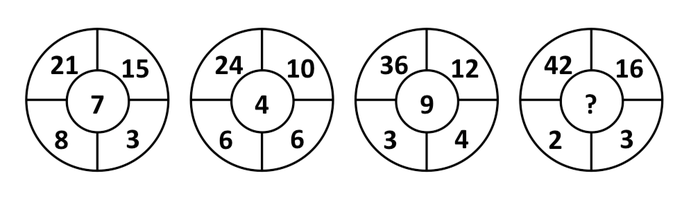

A. 14

B. 15

C. 16

D. 17

第 36 题 · 答案与解析

**参考答案（粉笔题库参考内容）**

A

**解析**

36.

单选题

-   A

    14

-   B

    15

-   C

    16

-   D

    17

A正确答案

未作答你的答案

91 %全站正确率

C易错项

<svg _ngcontent-ng-c978091351="" xmlns="http://www.w3.org/2000/svg" xmlns:xlink="http://www.w3.org/1999/xlink" width="18" height="14" viewBox="0 0 18 14" class="solution-title-icon"><path _ngcontent-ng-c978091351="" transform="matrix(1 0 0 1 0.5 2)" d="M5 0C7.76142 0 10 2.23858 10 5C10 7.76142 7.76142 10 5 10C2.23858 10 0 7.76142 0 5C0 2.23858 2.23858 0 5 0Z" fill-rule="nonzero" class="solution-title-icon-1"></path><path _ngcontent-ng-c978091351="" transform="matrix(1 0 0 1 7.50005 2)" d="M5 0C7.76142 0 10 2.23858 10 5C10 7.76142 7.76142 10 5 10C2.23858 10 0 7.76142 0 5C0 2.23858 2.23858 0 5 0Z" fill-rule="nonzero" class="solution-title-icon-2"></path></svg>

解析

。

因此。

故正确答案为A。

<svg _ngcontent-ng-c978091351="" xmlns="http://www.w3.org/2000/svg" xmlns:xlink="http://www.w3.org/1999/xlink" width="18" height="14" viewBox="0 0 18 14" class="solution-title-icon"><path _ngcontent-ng-c978091351="" transform="matrix(1 0 0 1 0.5 2)" d="M5 0C7.76142 0 10 2.23858 10 5C10 7.76142 7.76142 10 5 10C2.23858 10 0 7.76142 0 5C0 2.23858 2.23858 0 5 0Z" fill-rule="nonzero" class="solution-title-icon-1"></path><path _ngcontent-ng-c978091351="" transform="matrix(1 0 0 1 7.50005 2)" d="M5 0C7.76142 0 10 2.23858 10 5C10 7.76142 7.76142 10 5 10C2.23858 10 0 7.76142 0 5C0 2.23858 2.23858 0 5 0Z" fill-rule="nonzero" class="solution-title-icon-2"></path></svg>

来源

2012年浙江省公务员录用考试《行测》题第36题

<svg _ngcontent-ng-c978091351="" xmlns="http://www.w3.org/2000/svg" xmlns:xlink="http://www.w3.org/1999/xlink" width="18" height="14" viewBox="0 0 18 14" class="solution-title-icon"><path _ngcontent-ng-c978091351="" transform="matrix(1 0 0 1 0.5 2)" d="M5 0C7.76142 0 10 2.23858 10 5C10 7.76142 7.76142 10 5 10C2.23858 10 0 7.76142 0 5C0 2.23858 2.23858 0 5 0Z" fill-rule="nonzero" class="solution-title-icon-1"></path><path _ngcontent-ng-c978091351="" transform="matrix(1 0 0 1 7.50005 2)" d="M5 0C7.76142 0 10 2.23858 10 5C10 7.76142 7.76142 10 5 10C2.23858 10 0 7.76142 0 5C0 2.23858 2.23858 0 5 0Z" fill-rule="nonzero" class="solution-title-icon-2"></path></svg>

笔记

**来源**：2012年浙江省公务员录用考试《行测》题第36题

### 第 37 题

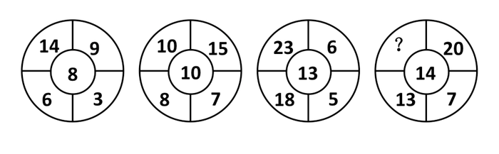

A. 6

B. 12

C. 16

D. 24

第 37 题 · 答案与解析

**参考答案（粉笔题库参考内容）**

C

**解析**

观察第二个图形容易得出：，再对第一、三个图形加以验证，结论正确，因此。

故正确答案为C。

**来源**：2012年浙江省公务员录用考试《行测》题第37题

### 第 38 题

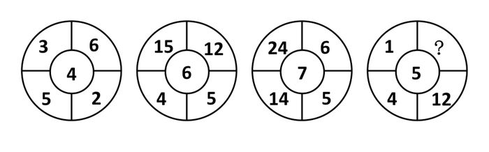

A. 6

B. 8

C. 10

D. 12

第 38 题 · 答案与解析

**参考答案（粉笔题库参考内容）**

B

**解析**

中心数字的平方等于周围数字之和，因此?=25-1-4-12=8。

故正确答案为B。

**来源**：2012年浙江省公务员录用考试《行测》题第38题

### 第 39 题

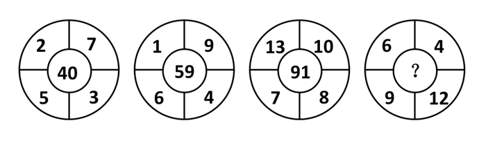

A. 54

B. 63

C. 85

D. 108

第 39 题 · 答案与解析

**参考答案（粉笔题库参考内容）**

A

**解析**

39.

单选题

-   A

    54

-   B

    63

-   C

    85

-   D

    108

A正确答案

未作答你的答案

78 %全站正确率

C易错项

<svg _ngcontent-ng-c978091351="" xmlns="http://www.w3.org/2000/svg" xmlns:xlink="http://www.w3.org/1999/xlink" width="18" height="14" viewBox="0 0 18 14" class="solution-title-icon"><path _ngcontent-ng-c978091351="" transform="matrix(1 0 0 1 0.5 2)" d="M5 0C7.76142 0 10 2.23858 10 5C10 7.76142 7.76142 10 5 10C2.23858 10 0 7.76142 0 5C0 2.23858 2.23858 0 5 0Z" fill-rule="nonzero" class="solution-title-icon-1"></path><path _ngcontent-ng-c978091351="" transform="matrix(1 0 0 1 7.50005 2)" d="M5 0C7.76142 0 10 2.23858 10 5C10 7.76142 7.76142 10 5 10C2.23858 10 0 7.76142 0 5C0 2.23858 2.23858 0 5 0Z" fill-rule="nonzero" class="solution-title-icon-2"></path></svg>

解析

，因此。

故正确答案为A。

<svg _ngcontent-ng-c978091351="" xmlns="http://www.w3.org/2000/svg" xmlns:xlink="http://www.w3.org/1999/xlink" width="18" height="14" viewBox="0 0 18 14" class="solution-title-icon"><path _ngcontent-ng-c978091351="" transform="matrix(1 0 0 1 0.5 2)" d="M5 0C7.76142 0 10 2.23858 10 5C10 7.76142 7.76142 10 5 10C2.23858 10 0 7.76142 0 5C0 2.23858 2.23858 0 5 0Z" fill-rule="nonzero" class="solution-title-icon-1"></path><path _ngcontent-ng-c978091351="" transform="matrix(1 0 0 1 7.50005 2)" d="M5 0C7.76142 0 10 2.23858 10 5C10 7.76142 7.76142 10 5 10C2.23858 10 0 7.76142 0 5C0 2.23858 2.23858 0 5 0Z" fill-rule="nonzero" class="solution-title-icon-2"></path></svg>

来源

2012年浙江省公务员录用考试《行测》题第39题

<svg _ngcontent-ng-c978091351="" xmlns="http://www.w3.org/2000/svg" xmlns:xlink="http://www.w3.org/1999/xlink" width="18" height="14" viewBox="0 0 18 14" class="solution-title-icon"><path _ngcontent-ng-c978091351="" transform="matrix(1 0 0 1 0.5 2)" d="M5 0C7.76142 0 10 2.23858 10 5C10 7.76142 7.76142 10 5 10C2.23858 10 0 7.76142 0 5C0 2.23858 2.23858 0 5 0Z" fill-rule="nonzero" class="solution-title-icon-1"></path><path _ngcontent-ng-c978091351="" transform="matrix(1 0 0 1 7.50005 2)" d="M5 0C7.76142 0 10 2.23858 10 5C10 7.76142 7.76142 10 5 10C2.23858 10 0 7.76142 0 5C0 2.23858 2.23858 0 5 0Z" fill-rule="nonzero" class="solution-title-icon-2"></path></svg>

笔记

**来源**：2012年浙江省公务员录用考试《行测》题第39题

### 第 40 题

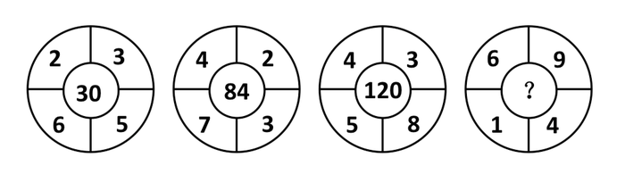

A. 24

B. 36

C. 54

D. 108

第 40 题 · 答案与解析

**参考答案（粉笔题库参考内容）**

B

**解析**

中心数字为周围数字的最小公倍数，因此？为1、4、6、9的最小公倍数为36。

故正确答案为B。

**来源**：2012年浙江省公务员录用考试《行测》题第40题

### 第 41 题

2，4，3，7，16，107，（ ）

A. 1594

B. 1684

C. 1707

D. 1856

第 41 题 · 答案与解析

**参考答案（粉笔题库参考内容）**

C

**解析**

从第三项开始，每项等于前两项的乘积再减去5，3＝2×4－5，7＝4×3－5，16＝3×7－5，107＝7×16－5，因此原数列未知项应为16×107－5=1707。

故正确答案为C。

**来源**：2012年浙江省公务员录用考试《行测》题第41题

### 第 42 题

，，1，，，，

A. 

B. 

C. 

D. 

第 42 题 · 答案与解析

**参考答案（粉笔题库参考内容）**

A

**解析**

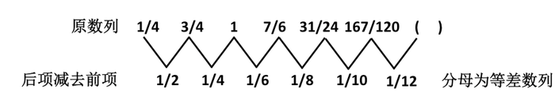

因此原数列未知项应为。

故正确答案为A。

**来源**：2012年浙江省公务员录用考试《行测》题第42题

### 第 43 题

243，162，108，72，48，（ ）

A. 26

B. 28

C. 30

D. 32

第 43 题 · 答案与解析

**参考答案（粉笔题库参考内容）**

D

**解析**

原数列为公比为的等比数列，因此未知项为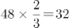。

故正确答案为D。

**来源**：2012年浙江省公务员录用考试《行测》题第43题

### 第 44 题

3，－2，1，3，8，61，（ ）

A. 3692

B. 3713

C. 3764

D. 3816

第 44 题 · 答案与解析

**参考答案（粉笔题库参考内容）**

B

**解析**

从第三项开始，每项等于前一项的平方减去更前一项，，，，因此原数列未知项为，根据尾数法，可直接确定B项正确。

故正确答案为B。

**来源**：2012年浙江省公务员录用考试《行测》题第44题

### 第 45 题

1，6，5，7，2，8，6，9，（ ）

A. 1

B. 2

C. 3

D. 4

第 45 题 · 答案与解析

**参考答案（粉笔题库参考内容）**

C

**解析**

偶数项为6、7、8、9，成等差数列，且每项都等于其两侧相邻奇数列之和，因此原数列未知项为9－6＝3。

故正确答案为C。

**来源**：2012年浙江省公务员录用考试《行测》题第45题

### 第 46 题

，，，以上这四个数中，最大的数为最小的数的几倍：

A. 

B. 

C. 

D. 

第 46 题 · 答案与解析

**参考答案（粉笔题库参考内容）**

D

**解析**

将，改写成，，则、、、四个数中最大，最小，是的倍，分子分母均不能约分，根据尾数法可知，分母的个位数为4。

故正确答案为D。

**来源**：2012年浙江省公务员录用考试《行测》题第46题

### 第 47 题

已知，问x的整数部分为多少：

A. 182

B. 186

C. 194

D. 196

第 47 题 · 答案与解析

**参考答案（粉笔题库参考内容）**

A

**解析**

解析一：

解析二：

因为，所以，和的整数部分都为182，因此x的整数部分也为182。

故正确答案为A。

**来源**：2012年浙江省公务员录用考试《行测》题第47题

### 第 48 题

如果方程有一个根为1，则a等于多少：

A. 3

B. 4

C. 5

D. 6

第 48 题 · 答案与解析

**参考答案（粉笔题库参考内容）**

C

**解析**

将x＝1代入，2＋a－5－2＝0，解得a＝5。

故正确答案为C。

**来源**：2012年浙江省公务员录用考试《行测》题第48题

### 第 49 题

四个连续奇数的和为32，则它们的积为多少：

A. 945

B. 1875

C. 2745

D. 3465

第 49 题 · 答案与解析

**参考答案（粉笔题库参考内容）**

D

**解析**

解析1：

四个连续奇数成等差数列，和为32，则中位数为8，因此这四个奇数为5、7、9、11，乘积为5×7×9×11＝3465。

解析2：

设这四个连续奇数为x-3、x-1、x+1、x+3，则他们的和为(x-3)+(x-1)+(x+1)+(x+3)=4x=32，x＝8，因此这四个奇数为5、7、9、11，乘积为5×7×9×11＝3465。

故正确答案为D。

**考点**：数列问题

**来源**：2012年浙江省公务员录用考试《行测》题第49题

### 第 50 题

某班级去超市采购体育用品时发现买4个篮球和2个排球共需560元，而买2个排球和4个足球则共需500元。问如果篮球、排球和足球各买1个，共需多少元？

A. 250元

B. 255元

C. 260元

D. 265元

第 50 题 · 答案与解析

**参考答案（粉笔题库参考内容）**

D

**解析**

将两次购买合并，4个篮球、2个排球和2个排球、4个足球刚好能组成4个篮球、4个排球、4个足球，共计560＋500＝1060元，因此篮球、排球、足球各买一个需要1060÷4＝265元。

故正确答案为D。

**考点**：和差倍比问题

**来源**：2012年浙江省公务员录用考试《行测》题第50题

### 第 51 题

有一个长方体容器，长40厘米，宽30厘米，高10厘米，里面的水深6厘米（最大面为底面）。如果把这个容器盖紧，再竖起来（最小面为底面），里面的水深是多少厘米：

A. 15厘米

B. 18厘米

C. 24厘米

D. 30厘米

第 51 题 · 答案与解析

**参考答案（粉笔题库参考内容）**

C

**解析**

根据题意，容器中有水40×30×6立方厘米，竖起来后底面积为30×10平方厘米，因此，此时水深为厘米。

故正确答案为C。

**考点**：几何公式类-立体图形

**来源**：2012年浙江省公务员录用考试《行测》题第51题

### 第 52 题

一容器内有浓度为30%的糖水，若再加入30千克水与6千克糖，则糖水的浓度变为25%。问原来糖水中含糖多少千克：

A. 15

B. 18

C. 21

D. 24

第 52 题 · 答案与解析

**参考答案（粉笔题库参考内容）**

B

**解析**

假设容器内原有糖水x千克，则根据题意可得，解得x＝60，因此原来糖水中含糖18千克。

故正确答案为B。

**来源**：2012年浙江省公务员录用考试《行测》题第52题

### 第 53 题

A、B两地间有条公路，甲、乙两人分别从A、B两地出发相向而行，甲先走半小时后，乙才出发，一小时后两人相遇，甲的速度是乙的2/3。问甲、乙所走的路程之比是多少：

A. 5：6

B. 1：1

C. 6：5

D. 4：3

第 53 题 · 答案与解析

**参考答案（粉笔题库参考内容）**

B

**解析**

解析1：

根据题意，甲乙两人用时分别为1.5小时、1小时，时间比为3:2，速度比为2:3，因此路程比为1:1。

解析2：

甲的速度是乙的，设甲、乙的速度分别为2、3，则甲走过的路程为，乙为3×1＝3，因此路程比为1:1。

故正确答案为B。

**考点**：普通行程

**来源**：2012年浙江省公务员录用考试《行测》题第53题

### 第 54 题

南阳中学有语文教师8名、数学教师7名、英语教师5名和体育教师2名。现要从以上四科教师中各选出1名教师去参加培训，问共有几种不同的选法：

A. 96种

B. 124种

C. 382种

D. 560种

第 54 题 · 答案与解析

**参考答案（粉笔题库参考内容）**

D

**解析**

根据乘法原理，有种选法。

故正确答案为D。

**考点**：基础排列组合

**来源**：2012年浙江省公务员录用考试《行测》题第54题

### 第 55 题

有一个上世纪80年代出生的人，如果他能活到80岁，那么有一年他的年龄的平方数正好等于那一年的年份。问此人生于哪一年：

A. 1980年

B. 1983年

C. 1986年

D. 1989年

第 55 题 · 答案与解析

**参考答案（粉笔题库参考内容）**

A

**解析**

根据题意可知该人出生年份介于1980与2060之间，其中能满足年份数为平方数的仅2025年，2025＝45×45，因此该人出生年份为2025－45＝1980。

故正确答案为A。

**考点**：年龄问题

**来源**：2012年浙江省公务员录用考试《行测》题第55题

### 第 56 题

有编号为1～13的卡片，每个编号有4张，共52张卡片。问至少摸出多少张，就可保证一定有3张卡片编号相连？

A. 27张

B. 29张

C. 33张

D. 37张

第 56 题 · 答案与解析

**参考答案（粉笔题库参考内容）**

D

**解析**

抽屉原理，考虑最差的情况，抽出的卡片都是两张卡片编号相连，即编号为1、2、4、5、7、8、10、11、13的卡片各抽出4张，共36张，此时抽出任意一张就能保证一定有3张卡片编号相连，故最少抽出36＋1＝37张。

故正确答案为D。

**考点**：最不利构造

**来源**：2012年浙江省公务员录用考试《行测》题第56题

### 第 57 题

某演唱会检票前若干分钟就有观众开始排队等候入场，而每分钟来的观众人数一样多。从开始检票到等候队伍消失，若同时开4个入场口需50分钟，若同时开6个入场口则需30分钟。问如果同时开7个入场口需几分钟：

A. 18

B. 20

C. 22

D. 25

第 57 题 · 答案与解析

**参考答案（粉笔题库参考内容）**

D

**解析**

设原有观众y，每分钟到达观众为x，则可得，解得x=1，y=150。那么同时开放7个入口时全部完成入场需要时间为分钟。

故正确答案为D。

**来源**：2012年浙江省公务员录用考试《行测》题第57题

### 第 58 题

一个班里有30名学生，有12人会跳拉丁舞，有8人会跳肚皮舞，有10人会跳芭蕾舞。问至多有几人会跳两种舞蹈：

A. 12人

B. 14人

C. 15人

D. 16人

第 58 题 · 答案与解析

**参考答案（粉笔题库参考内容）**

C

**解析**

解析1：

要使会跳两种舞蹈的人最多，则尽量在三种舞蹈之间进行匹配，使得两两匹配的人数之和最多。因此就不能将一种舞蹈只与另一种舞蹈进行全额匹配，例如不能将会跳肚皮舞的8人全部与拉丁舞匹配。实际上，为实现两两匹配的最多，则每组用于匹配的人数应相等或接近。从最少人数出发，会跳肚皮舞的8人，将其划分时要考虑拉丁舞和芭蕾舞人数相差2，故在划分此8人时注意这一点，可将8人划分为5人和3人。其中5人除了会肚皮舞之外，还会拉丁舞；3人会肚皮舞之外还会芭蕾舞。此时拉丁舞与芭蕾舞还各自剩7人、7人，又可以匹配得到7人既会拉丁舞又会芭蕾舞。因此会跳两种舞的人数至多为15人。

解析2：

如果让会跳两种舞的人最多，则需要让会跳舞的人尽量都跳两种舞，此时会跳两种舞的人为人。

故正确答案为C。

**考点**：三集合、非典型最值问题

**来源**：2012年浙江省公务员录用考试《行测》题第58题

### 第 59 题

有一架天平，只有5克和30克的砝码各一个。现在要用这架天平把300克味精分成3等份，那么至少需要称多少次：

A. 3次

B. 4次

C. 5次

D. 6次

第 59 题 · 答案与解析

**参考答案（粉笔题库参考内容）**

A

**解析**

第一步，在天平左侧放入30克砝码，然后将300克味精分别放入左右两侧使天平平衡，此时左侧有味精330÷2－30＝135克；第二步，用5克和30克砝码称出135克中的35克，则此时还剩100克；第三步，利用称出的100克味精当作砝码再称出100克，此时已将300克味精分成3等份。

故正确答案为A。

**考点**：统筹规划问题

**来源**：2012年浙江省公务员录用考试《行测》题第59题

### 第 60 题

如右图所示，正方形ABCD的边长为5cm，AC、BD分别是以点D和点C为圆心、5cm为半径作的圆弧。问阴影部分a的面积比阴影部分b小：（π取3.14）

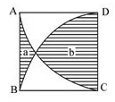

A. 

B. 

C. 

D. 

第 60 题 · 答案与解析

**参考答案（粉笔题库参考内容）**

B

**解析**

阴影a和b分别加上上部空白部分成为闭合区域ABD和ACD，ab的面积差即为ABD和ACD的面积差，ABD的面积为正方形减个圆，ACD的面积为个圆，因此。

故正确答案为B。

**考点**：几何公式类-平面图形

**来源**：2012年浙江省公务员录用考试《行测》题第60题

### 第 61 题

眼睛：虹膜

A. 骨头：关节

B. 乔木：白桦

C. 衣服：丝绸

D. 手表：表带

第 61 题 · 答案与解析

**参考答案（粉笔题库参考内容）**

D

**解析**

第一步：判断题干词语间逻辑关系。

虹膜是眼睛的一部分，二者为组成关系。

第二步：判断选项词语间逻辑关系。

A项：“骨头”和“关节”，骨头与骨头间连接称骨关节，二者是并列关系，与题干逻辑关系不一致，排除；

B项：“白桦”是“乔木”的一种，二者是种属关系，与题干逻辑关系不一致，排除；

C项：“丝绸”可以作为“衣服”的原材料，二者是原材料对应关系，与题干逻辑关系不一致，排除；

D项：“表带”是“手表”的一部分，二者为组成关系，与题干逻辑关系一致，当选。

故正确答案为D。

**考点**：逻辑关系-包容关系

**来源**：2012年浙江省公务员录用考试《行测》题第61题

### 第 62 题

蝴蝶：蟋蟀

A. 桑葚：鲜花

B. 海棠：海参

C. 鹦鹉：海鸥

D. 恒星：太阳

第 62 题 · 答案与解析

**参考答案（粉笔题库参考内容）**

C

**解析**

第一步：判断题干词语间逻辑关系。

题干两词是并列关系，蝴蝶和蟋蟀都是昆虫。

第二步：判断选项词语间逻辑关系。

与题干相同的逻辑关系即为C，鹦鹉和海鸥都是鸟类。

A项桑葚是桑树的果实，和鲜花不是同类，不是并列关系；

B项海棠是植物，海参是动物，不是并列关系；

D项是包容中的种属关系。

故正确答案为C。

**考点**：逻辑关系-并列关系

**来源**：2012年浙江省公务员录用考试《行测》题第62题

### 第 63 题

土地：农民

A. 资本：商人

B. 药方：医生

C. 晚会：歌手

D. 课本：教师

第 63 题 · 答案与解析

**参考答案（粉笔题库参考内容）**

A

**解析**

第一步：判断题干词语间逻辑关系。

题干两词是对应关系，且前者是后者的必要条件。

第二步：判断选项词语间逻辑关系。

与题干相同的逻辑关系即为A项，资本是商人经商的必要条件。

B、C、D三项都是对应关系，但并不满足前者是后者的必要条件。

故正确答案为A。

**考点**：逻辑关系-对应关系

**来源**：2012年浙江省公务员录用考试《行测》题第63题

### 第 64 题

创造：历史

A. 发展：经济

B. 和谐：社会

C. 发扬：光大

D. 生产：积累

第 64 题 · 答案与解析

**参考答案（粉笔题库参考内容）**

A

**解析**

第一步：判断题干词语间逻辑关系。

题干两词是语法关系，构成动宾结构。

第二步：判断选项词语间逻辑关系。

A项中，“发展经济”是动宾关系，与题干逻辑关系相同，正确；

B项为偏正关系；

C项中的“发扬光大”是成语；

D项前后不是动宾关系。

故正确答案为A。

**考点**：语法关系

**来源**：2012年浙江省公务员录用考试《行测》题第64题

### 第 65 题

票友：业余

A. 专家：肤浅

B. 运动员：瘦弱

C. 教师：慈祥

D. 艺术大师：著名

第 65 题 · 答案与解析

**参考答案（粉笔题库参考内容）**

D

**解析**

第一步：判断题干词语间逻辑关系。

题干两词是属性关系，后一个词是前一个词的属性特征。

第二步：判断选项词语间逻辑关系。

与题干相同逻辑关系的即为D，艺术大师一般都著名。

A项中专家应该是专业的而不是肤浅；

B项中运动员应该是健壮的而不是瘦弱；

C项中描述教师应该用和蔼，慈祥一般描述老人。

故正确答案为D。

**考点**：逻辑关系-对应关系

**来源**：2012年浙江省公务员录用考试《行测》题第65题

### 第 66 题

出人头地：苏轼

A. 东山再起：谢安

B. 多多益善：项羽

C. 投笔从戎：班固

D. 指鹿为马：李林甫

第 66 题 · 答案与解析

**参考答案（粉笔题库参考内容）**

A

**解析**

第一步：判断题干词语间逻辑关系。

题干两词间是对应关系，即历史典故与其对应的人物。“出人头地”出自欧阳修的《与梅圣俞书》。欧阳修在其中写道：“读轼书，不觉汗出，快哉快哉！老夫当避路，放他出一头之地也。”其中“读轼书”意即“读苏轼的书”，涉及到苏轼。

第二步：判断选项词语间逻辑关系。

A项：“东山再起”对应的是谢安，当选；

B项：“多多益善”对应的是韩信；

C项：“投笔从戎”对应的是班超；

D项：“指鹿为马”对应的是赵高。

故正确答案为A。

**考点**：逻辑关系-对应关系

**来源**：2012年浙江省公务员录用考试《行测》题第66题

### 第 67 题

百发百中：百步穿杨

A. 门可罗雀：班门弄斧

B. 深思熟虑：优柔寡断

C. 不求甚解：囫囵吞枣

D. 白日做梦：梦想成真

第 67 题 · 答案与解析

**参考答案（粉笔题库参考内容）**

C

**解析**

第一步：判断题干词语间逻辑关系。

题干两词是近义关系，“百发百中”和“百步穿杨”都是形容箭法高明。

第二步：判断选项词语间逻辑关系。

与题干相同的逻辑关系即为C，“不求甚解”和“囫囵吞枣”都是形容理解事物含混模糊或学习上不求充分理解。

A项中“门可罗雀”用来形容门庭十分冷落，宾客稀少，“班门弄斧”比喻在行家面前卖弄本领，不自量力，A项不是近义词；

B项“优柔寡断”指做事犹豫，缺乏决断，“深思熟虑”的意思是反复深入细致地考虑，二者不是近义词；

D项“白日做梦”比喻幻想根本不能实现，“梦想成真”是指渴望、梦想的事情实现了，二者不是近义词。

故正确答案为C。

**考点**：语义关系-近义关系

**来源**：2012年浙江省公务员录用考试《行测》题第67题

### 第 68 题

道德：行为：约束

A. 权力：人民：服务

B. 信仰：图腾：崇拜

C. 教师：教育：学生

D. 法律：犯罪：惩治

第 68 题 · 答案与解析

**参考答案（粉笔题库参考内容）**

D

**解析**

第一步：判断题干词语间逻辑关系。

题干词语间是对应关系，第一个词是后两个词的主体，且题干三词间可造成句子，即道德约束行为。

第二步：判断选项词语间逻辑关系。

与题干相同的逻辑关系即为D，法律惩治犯罪。

A项中权力服务于人民，与题干的句子构成方式不同；

B项的三个词语间不构成对应关系；

C项的教师教育学生，与题干词语间的顺序不一致。

故正确答案为D。

**考点**：语法关系

**来源**：2012年浙江省公务员录用考试《行测》题第68题

### 第 69 题

煤气灶：主妇：做饭

A. 车间：工程师：生产

B. 炼丹：道士：修行

C. 剪刀：理发师：美发

D. 马路：清洁工：打扫

第 69 题 · 答案与解析

**参考答案（粉笔题库参考内容）**

C

**解析**

第一步：判断题干词语间逻辑关系。

题干词语间是对应关系，且符合人物利用对应工具进行对应活动的一一对应关系，即主妇利用煤气灶做饭。

第二步：判断选项词语间逻辑关系。

与题干相同的逻辑关系即为C，理发师用剪刀进行美发。

A项中的“车间”是地点，不符合“对应工具”；

B项中的“炼丹”不符合“对应工具”；

D项中的“马路”是场所，也不符合“对应工具”。

故正确答案为C。

**考点**：语法关系、逻辑关系-对应关系

**来源**：2012年浙江省公务员录用考试《行测》题第69题

### 第 70 题

微博：媒体：消息

A. 股票：有价证券：金融

B. 护照：证件：身份

C. 长城：景点：北京

D. 债权：权利：债务

第 70 题 · 答案与解析

**参考答案（粉笔题库参考内容）**

B

**解析**

第一步：判断题干词语间逻辑关系。

题干中前两词之间是包容关系中的种属关系，且第三个词是对第一个词作用的描述，即微博是一种媒体，可以传递信息。

第二步：判断选项词语间逻辑关系。

A项：金融并不是对股票作用的描述，不符合题干逻辑关系，排除；

B项：护照是一种证件，可以证明身份，符合题干逻辑关系，当选；

C项：北京是地点，不符合第三个词是对第一个词作用的描述，排除；

D项：债务并不是对债权作用的描述，不符合题干逻辑关系，排除。

故正确答案为B。

**考点**：逻辑关系-包容关系、逻辑关系-对应关系

**来源**：2012年浙江省公务员录用考试《行测》题第70题

### 第 71 题

附条件的民事法律行为：在意思表示当中附有决定该行为效力发生或者消灭条件的民事法律行为。

下列哪一项属于附条件的民事法律行为：

A. 甲、乙订立房屋租赁合同，约定出租人甲的儿子一旦结婚需要布置新房时，就终止合同

B. 甲对乙说：“如果我儿子考上名牌大学，我一定请你吃饭。”

C. 甲与乙签订夏粮买卖合同，约定11月中旬生效

D. 甲与乙约定：如果甲晚上帮乙一起去打乙的仇人，乙就付给甲1000元钱

第 71 题 · 答案与解析

**参考答案（粉笔题库参考内容）**

A

**解析**

第一步：抓住定义中的关键词。

关键词强调“附有决定该行为效力发生或者消灭条件”。

第二步：逐一判断选项。

A项中“一旦结婚需要布置新房时，就终止合同”，符合“附有决定该行为效力发生或者消灭条件”，属于附条件的民事法律行为；

B项中甲对乙说的话只是口头承诺，不符合“民事法律行为”，不属于附条件的民事法律行为；

C项中的“约定11月”是时间，而时间不是条件，C不属于附条件的民事法律行为；

D项中甲与乙的约定不具有法律效力，不属于附条件的民事法律行为。

故正确答案为A。

**考点**：单定义-其他句式

**来源**：2012年浙江省公务员录用考试《行测》题第71题

### 第 72 题

行政成本：政府为了社会的公共管理和为公众提供公共服务付出的代价，包括直接行政成本和间接行政成本。

下列没有涉及行政成本的一项是：

A. 某政府部门为了提高工作效率合并机构、精简工作人员

B. 某区政府为应对私家车增多的问题，新建了两个地下公共停车场

C. 某商业银行为方便广大用户处理业务，耗费巨资开通了手机银行业务

D. 某公安局招聘交通协管员协助交警维护交通秩序

第 72 题 · 答案与解析

**参考答案（粉笔题库参考内容）**

C

**解析**

第一步：找出定义关键词。

“政府”“公共管理”“公共服务”。

第二步：逐一分析选项。

A项：政府要合并机构、精简工作人员，必然要付出一定的代价，符合定义中的关键词，涉及行政成本；

B项：区政府新建了两个地下公共停车场，符合“政府为公众提供公共服务付出的代价”，涉及行政成本；

C项：主体是“商业银行”不是“政府”，不涉及行政成本；

D项：公安局招聘交通协管员协助交警维护交通秩序是“政府为了社会的公共管理而付出的代价”，涉及行政成本。

本题为选非题，故正确答案为C。

**考点**：方式目的

**来源**：2012年浙江省公务员录用考试《行测》题第72题

### 第 73 题

无因管理：没有法律规定或者约定的义务而为他人管理事务。

下列行为中不属于无因管理的一项是：

A. 甲收留了一位迷路的儿童，一边让他在自己家吃住，一边四处打听儿童父母的住址

B. 甲失踪后，其财产代管人乙对甲的财产进行管理

C. 甲看见有几个人在殴打乙，立即上前制止

D. 甲的邻居乙家失火，甲怕火烧伤乙家的小孩，于是实施救火

第 73 题 · 答案与解析

**参考答案（粉笔题库参考内容）**

B

**解析**

第一步：抓住定义中的关键词。

关键词强调“没有法律规定”、“义务”、“为他人管理”。

第二步：逐一判断选项。

A项中甲对迷路儿童没有任何义务，但他却一边让他在自己家吃住，一边四处打听儿童父母的住址，符合“没有法律规定”、“义务”、“为他人管理”，属于无因管理；

B项中的乙是甲的财产代管人，他有义务为甲管理财产，故不属于无因管理；

C项中的甲上前制止，目的是帮助乙，符合定义中的关键词，属于无因管理；

D项中的甲对乙没有义务，但他实施救火，属于为乙管理事务，属于无因管理。

本题为选非题，故正确答案为B。

**考点**：单定义-其他句式

**来源**：2012年浙江省公务员录用考试《行测》题第73题

### 第 74 题

简单命题：不包含其他命题的命题，只能把它分析为不同的词项，不能再把它分析为其他命题，因此又叫作“原子命题”。

下列哪项不是简单命题：

A. 小明和小红是朋友

B. 生命在于运动

C. 掷骰子4点朝上的概率是1/6

D. 小张既高且胖

第 74 题 · 答案与解析

**参考答案（粉笔题库参考内容）**

D

**解析**

第一步：找出定义关键词。

“不包含其他命题”。

第二步：逐一分析选项。

A、B、C三项都不能再分解为其他命题，符合“不包含其他命题”，符合定义，排除。

而D项可以再分解为小张高、小张胖两个命题，不符合“不包含其他命题”，不符合定义，当选。

本题为选非题，故正确答案为D。

**考点**：单定义-其他句式

**来源**：2012年浙江省公务员录用考试《行测》题第74题

### 第 75 题

角色冲突：当一个人扮演一个角色或同时扮演几个不同角色时，由于不能胜任，造成不合时宜而发生的矛盾和冲突。

下列情形中不属于角色冲突的一项是：

A. 一些大一新生入学后，面对新的生活环境很不适应

B. 某公司一职员由于业绩出众，被公司提拔为销售经理，但是他感到力不从心

C. 假期里，张某的妻子想让他陪她出去旅游，而他母亲想让他回家陪陪父母

D. 在边远山区的一所小学里，某位老师既教数学，又教语文，但学生们的两门功课成绩都很好

第 75 题 · 答案与解析

**参考答案（粉笔题库参考内容）**

D

**解析**

第一步：找出定义关键词。

“不能胜任”、“矛盾和冲突”。

第二步：逐一分析选项。

A项：大一新生由于面对新生活环境而不适应，符合“不能胜任”“矛盾和冲突”，属于角色冲突。

B项：该职员由于被提拔为销售经理，感到力不从心，符合定义中的关键词，属于角色冲突。

C项：张某面对妻子和父母两方面的问题，由于不能同时满足，会造成一些矛盾和冲突，属于角色冲突。

D项：老师虽然同时扮演数学老师和语文老师的角色，但学生两门功课成绩都很好，并没有发生矛盾和冲突，不属于角色冲突。

本题为选非题，故正确答案为D。

**考点**：原因结果

**来源**：2012年浙江省公务员录用考试《行测》题第75题

### 第 76 题

从所给的四个选项中，选择最合适的一个填入问号处，使之呈现一定的规律性：

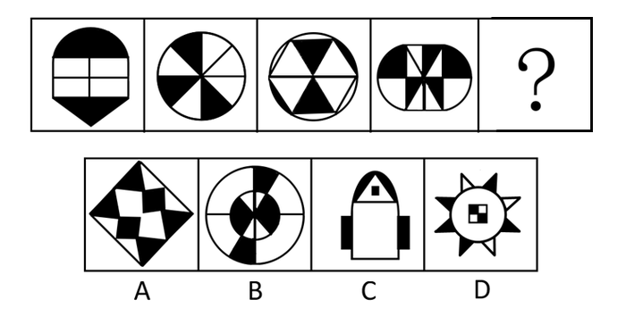

A. A

B. B

C. C

D. D

第 76 题 · 答案与解析

**参考答案（粉笔题库参考内容）**

A

**解析**

元素组成凌乱，考查数数。题干前四个图中，阴影部分的数量分别为2、3、4、5。故应该选择含有6个阴影部分的图形。A项中含有6个阴影部分，B项中含有4个阴影部分，C项中含有5个阴影部分，D项中含有7个阴影部分。

故正确答案为A。

**考点**：数量规律-素

**来源**：2012年浙江省公务员录用考试《行测》题第76题

### 第 77 题

从所给四个选项中，选择最合适的一个填入问号处，使之呈现一定的规律性：

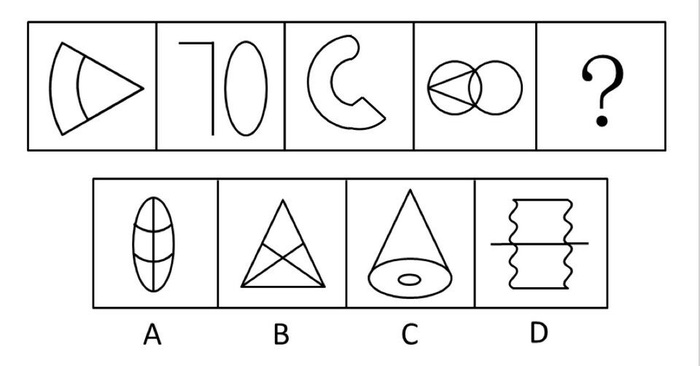

A. A

B. B

C. C

D. D

第 77 题 · 答案与解析

**参考答案（粉笔题库参考内容）**

C

**解析**

元素组成凌乱，考数数。考查直线数量，前四个图中每个图形都含有两条直线。

A中有一条直线，B中有5条直线，C中有2条直线，D中有3条直线。

故正确答案为C。

**考点**：数量规律-线

**来源**：2012年浙江省公务员录用考试《行测》题第77题

### 第 78 题

左边给定的是纸盒的外表面展开图，下面哪一项能由它折叠而成：

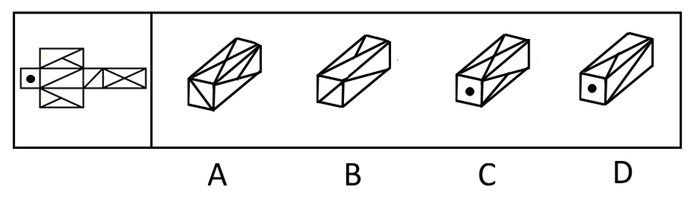

A. A

B. B

C. C

D. D

第 78 题 · 答案与解析

**参考答案（粉笔题库参考内容）**

A

**解析**

本题为空间重构题，对原图进行标识，如图所示：

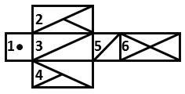

逐一分析选项。

A项：由面4、面5、面6组成，且面上线的位置与原图一致，当选。

B 项：原图中面3与面5上的对角线没有相交，但选项中两条对角线相交，排除。

C、D 两项采用画边法，面2与面4的形状较为特殊，由面2、面4画边如图所示：

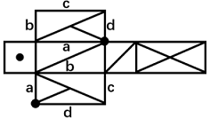

其中面2与面4最特殊点如黑点所示，由此点出发顺时针画边，分别为边a、b、c、d。

C项：画边如图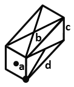，选项中的边b对应面6，但原图中面2的边b对应面1，面4的边b对应面3，由此可知选项面既不是面2也不是面4，排除。

D项：画边如图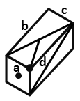，选项中的边d对应面3，但原图中面2的边d对应面5，面4的边d对应面6，由此可知选项面既不是面2也不是面4，排除。

故正确答案为A。

**考点**：空间类-空间重构-六面体

**来源**：2012年浙江省公务员录用考试《行测》题第78题

### 第 79 题

把下面的六个图形分为两类，使每一类图形都有各自的共同性或规律，分类正确的一项是：

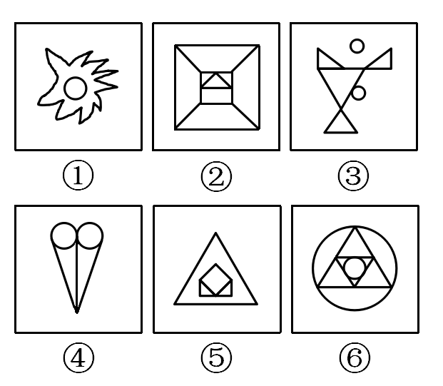

A. ①②④，③⑤⑥

B. ①③⑤，②④⑥

C. ①③⑥，②④⑤

D. ①④⑥，②③⑤

第 79 题 · 答案与解析

**参考答案（粉笔题库参考内容）**

B

**解析**

元素组成凌乱，考数数。①③⑤都由两个不相连的部分组成，②④⑥都由一个部分组成。

故正确答案为B。

**考点**：数量规律-素

**来源**：2012年浙江省公务员录用考试《行测》题第79题

### 第 80 题

把下面的六个图形分为两类，使每一类图形都有各自的共同特征或规律，分类正确的一项是：

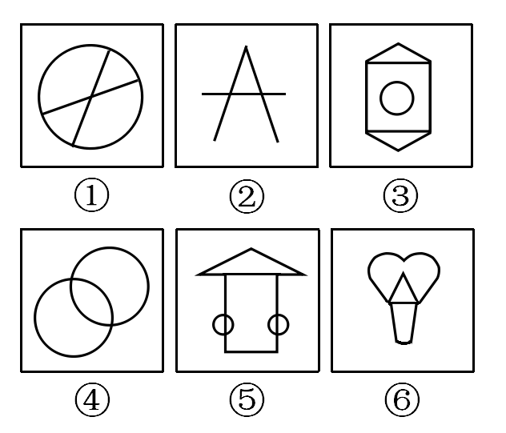

A. ①②④，③⑤⑥

B. ①③④，②⑤⑥

C. ①③⑤，②④⑥

D. ①④⑤，②③⑥

第 80 题 · 答案与解析

**参考答案（粉笔题库参考内容）**

B

**解析**

①③④都有两条对称轴，且既是轴对称图形又是中心对称图形，②⑤⑥只有一条对称轴，不是中心对称图形。

故正确答案为B。

**考点**：属性规律-对称性

**来源**：2012年浙江省公务员录用考试《行测》题第80题

### 第 81 题

从所给四个选项中，选择最合适的一个填入问号处，使之呈现一定的规律性：

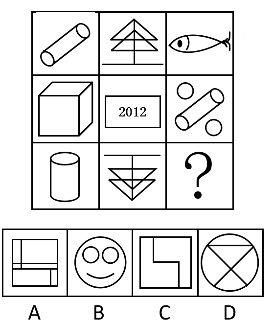

A. A

B. B

C. C

D. D

第 81 题 · 答案与解析

**参考答案（粉笔题库参考内容）**

C

**解析**

元素组成凌乱，考查封闭区域数量。以行为单位，第一行封闭区域的数目总和为3+6+1＝10；第二行封闭区域的数目总和为3+2+5＝10；第三行前两个图形封闭区域之和为2+6＝8，需要选择有2个封闭区域的图形，选项的面数量分别为6、3、2、5 。

故正确答案为C。

**考点**：数量规律-面

**来源**：2012年浙江省公务员录用考试《行测》题第81题

### 第 82 题

从所给四个选项中，选择最合适的一个填入问号处，使之呈现一定的规律性：

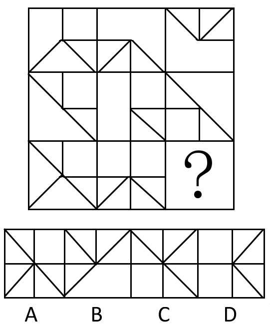

A. A

B. B

C. C

D. D

第 82 题 · 答案与解析

**参考答案（粉笔题库参考内容）**

C

**解析**

以列为单位，上面两个图叠加，保留所有的线条，得到第三个图形。

故正确答案为C。

**考点**：样式规律-加减同异

**来源**：2012年浙江省公务员录用考试《行测》题第82题

### 第 83 题

请从所给的四个选项中，选择最合适的一项填在问号处，使之呈现一定的规律性：

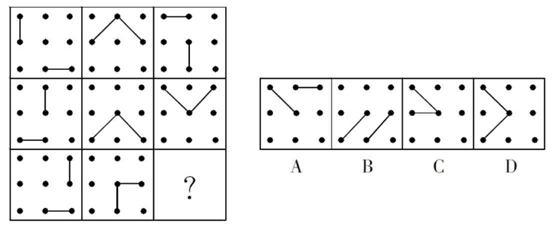

A. A

B. B

C. C

D. D

第 83 题 · 答案与解析

**参考答案（粉笔题库参考内容）**

D

**解析**

元素组成相同，看位置。两条线段的静态位置关系，所给的八个图形中，两条线段都是垂直关系，只有D选项的两条线段垂直。

故正确答案为D。

**考点**：特殊规律-图形间关系

**来源**：2012年浙江省公务员录用考试《行测》题第83题

### 第 84 题

从所给四个选项中，选择最合适的一个填入问号处，使之呈现一定的规律性：

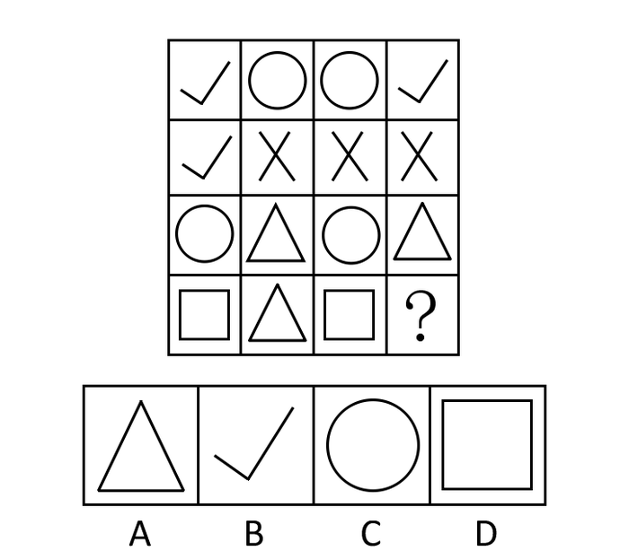

A. A

B. B

C. C

D. D

第 84 题 · 答案与解析

**参考答案（粉笔题库参考内容）**

A

**解析**

考查元素种类数。每行有2种元素，每列有3种元素，对角线上有4种元素。

故正确答案为A。

**考点**：数量规律-素

**来源**：2012年浙江省公务员录用考试《行测》题第84题

### 第 85 题

请从所给的四个选项中，选择最合适的一项填在问号处，使之呈现一定的规律性：

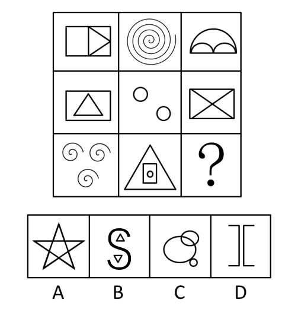

A. A

B. B

C. C

D. D

第 85 题 · 答案与解析

**参考答案（粉笔题库参考内容）**

B

**解析**

元素组成凌乱，考查数数。第一行各图形至少由一笔画成；第二行各图形至少由两笔画成；第三行各图形至少由三笔画成。A、C两项由一笔画成，B项由三笔画成，D项由两笔画成。

故正确答案为B。

**考点**：数量规律-线

**来源**：2012年浙江省公务员录用考试《行测》题第85题

### 第 86 题

“不可能所有深圳人都很有钱。”

以下哪项断定的涵义，与上述断定最为接近？

A. 可能有的深圳人不是很有钱

B. 可能有的深圳人很有钱

C. 必然有的深圳人不是很有钱

D. 必然大部分深圳人都很有钱

第 86 题 · 答案与解析

**参考答案（粉笔题库参考内容）**

C

**解析**

第一步：翻译题干。

不可能所有深圳人都很有钱，由模态命题的转换关系，“不可能所有”=“必然不是所有”=“必然有的不是”。

第二步：逐一翻译选项并判断正确选项。

A、B、D都不能从模态命题的转换关系推理得到。

只有C中“必然有的不是”符合转换关系。

故正确答案为C。

**考点**：常规翻译

**来源**：2012年浙江省公务员录用考试《行测》题第86题

### 第 87 题

“小孙并非既会游泳又会打网球。”

根据以上表述，下列哪项断定必然为真：

A. 如果小孙不会打网球，那么他一定会游泳

B. 如果小孙会打网球，那么他一定不会游泳

C. 小孙既不会游泳，也不会打网球

D. 小孙会游泳，但不会打网球

第 87 题 · 答案与解析

**参考答案（粉笔题库参考内容）**

B

**解析**

第一步：翻译题干。

题干可翻译为：-（游泳 且 网球），根据德摩根定律，可等价为：-游泳 或 -网球。

第二步：逐一翻译选项并判断选项正确与否。

A项：翻译为：-打网球游泳，或关系的推理规则为否一推一，“-打网球”是对或关系其中一项的肯定，肯定其中一项无法推出另外一项，无法推出，排除；

B项：翻译为：打网球游泳，为题干条件关系的否一推一，可以推出，当选；

C项：翻译为：-游泳 且 -打网球，为-游泳 或 -网球的一种可能性结果，可能为真，无法推出，排除；

D项：翻译为：游泳 且 -打网球，为-游泳 或 -网球的一种可能性结果，可能为真，无法推出，排除。

故正确答案为B。

**考点**：常规翻译

**来源**：2012年浙江省公务员录用考试《行测》题第87题

### 第 88 题

以“如果孙强、李超不是优秀共青团员，那么周红是优秀共青团员”为一前提，若要必然推出“李超是优秀共青团员”，则需要增加下列哪项作为前提：

A. 周红不是优秀共青团员

B. 孙强是优秀共青团员

C. 周红是优秀共青团员，而孙强不是优秀共青团员

D. 孙强和周红都不是优秀共青团员

第 88 题 · 答案与解析

**参考答案（粉笔题库参考内容）**

D

**解析**

第一步：翻译题干。

前提：-孙强 且 -李超周红。

第二步：逐一分析选项。

A项，翻译为“-周红”。属于否定题干的后件，可以得到：孙强 或 李超，可能推出“李超是优秀共青团员”，而不能必然推出，不是成立的前提，排除；

B项，翻译为“孙强”。属于否定题干前件中的一支，在不知道周红是不是优秀共青团员的情况下，不能推出“李超是优秀共青团员”，不是成立的前提，排除；

C项，翻译为“周红 且 -孙强”。“周红”肯定了题干的后件，但肯后无必然结论，因此无法推出“李超是优秀共青团员”，不是成立的前提，排除；

D项，翻译为“-周红 且 -孙强”。“-周红”属于否定题干的后件，否后必否前，必然能得出-（-孙强 且 -李超），即“孙强或李超”。又已知“-孙强”，根据或命题否一推一，所以必然能推出“李超”，即“李超是优秀共青团员”，是成立的前提，当选。

故正确答案为D。

**考点**：常规翻译

**来源**：2012年浙江省公务员录用考试《行测》题第88题

### 第 89 题

暑假里，小张的父母给小张报了摄影兴趣班和美术兴趣班。小张知道后说，以后我又不想成为摄影家，何必学摄影。以下哪项是小张的回答中包含的前提：

A. 学摄影的不一定能成为摄影家

B. 小张更想成为一名画家，而不是摄影家

C. 只有想成为摄影家，才需要学摄影

D. 与摄影相比，小张更喜欢画画

第 89 题 · 答案与解析

**参考答案（粉笔题库参考内容）**

C

**解析**

第一步：找到论点和论据。

本题的论点是“不必学摄影”。论据是“不想成为摄影家”。

第二步：判断加强方式。

论点和论据间没有因果联系，需加强论证，在论点和论据间搭桥。

第三步：逐一判断选项的作用。

A项，“学摄影的不一定能成为摄影家”使论点和论据不搭桥，A削弱了论证，A错误；

B项，“小张更想成为一名画家，而不是摄影家”加强了论据，未在论据和论点间搭桥，B错误；

C项，“只有想成为摄影家，才需要学摄影”在论点和论据间建立了逻辑关系，加强了论证，C正确；

D项，“与摄影相比，小张更喜欢画画”与B相似，也加强了论据，未在论据和论点间搭桥，D错误。

故正确答案为C。

**考点**：搭桥

**来源**：2012年浙江省公务员录用考试《行测》题第89题

### 第 90 题

某大学寝室有8个人，三个是广东人，一个是北京人，有两个是北方人，一个是保送生，三个是贫困生。假设上述介绍涉及该寝室的所有同学，则下列关于该寝室同学的判断与题干有矛盾的是：

A. 保送的学生来自北方

B. 北京人既不是保送生也不是贫困生

C. 有两个贫困生是广东人

D. 没有一个来自黑龙江的学生

第 90 题 · 答案与解析

**参考答案（粉笔题库参考内容）**

C

**解析**

第一步：观察题干。

北京人也是北方人，那么两个北方人中包括了一个北京人，三个广东人+两个北方人+一个保送生+三个贫困生=9人，比总量8个人多了一个人，因此必定有一个人拥有两种身份。

第二步：选项排除。

选项A：保送生属于北方人，符合题意，正好8人；

选项B：北京人既不是保送生也不是贫困生，那么三个广东人中有一个人拥有两种身份即可以符合题意；

选项C：有两个贫困生是广东人，3个广东人+2个北方人+1保送生+1贫困生=7人，与寝室有8个人不相符，与题干信息矛盾；

选项D：“没有一个来自黑龙江”并不影响3个广东人或者1个北京人中有一个人拥有两种身份，与题干信息并不矛盾。

故正确答案为C。

**考点**：日常结论

**来源**：2012年浙江省公务员录用考试《行测》题第90题

### 第 91 题

宏达公司管理人员的平均年薪为20万元，而销售人员的平均年薪是18万元，公司所有员工的平均年薪是12万元。

如果以上信息是正确的，能够推出以下哪一项结论：

A. 至少有一位员工的年薪比销售人员的平均年薪低

B. 没有一位销售人员的年薪比管理人员高

C. 至少有一半管理人员的年薪比销售人员的平均年薪高

D. 宏达公司的管理人员少于销售人员

第 91 题 · 答案与解析

**参考答案（粉笔题库参考内容）**

A

**解析**

第一步：抓住每句话中的对象及其关系。

题干给出管理人员的平均年薪为20万元；销售人员的平均年薪是18万元；公司所有员工的平均年薪是12万元。

第二步：逐一判断选项的作用。

由公司所有员工的平均年薪低于销售人员的平均年薪，可以推出A项，正确；

因为平均年薪并不能直接反映个人的薪水，销售人员和管理人员的年薪都可能有高有低，所以B、C两项过于绝对，错误；

由于题干仅给出各类人员的平均年薪，条件不够充分，所以不能够推出各类人员数量的多少，D项错误。

故正确答案为A。

**考点**：日常结论

**来源**：2012年浙江省公务员录用考试《行测》题第91题

### 第 92 题

如果一个人在A城市乱扔垃圾就会被认为没有道德；一个人如果没有道德，A城市里就没有人和他做朋友；一个人如果在A城市没有朋友就寸步难行，无法继续留在这里。

从上述叙述中，可以推出以下哪项结论：

A. 一个人在B城市乱扔垃圾但是仍然可以留在A城市

B. 如果一个人道德修养很高，那么他就能留在A城市

C. 生活在A城市的小李在过马路时将西瓜皮扔在地上，那么他将难以再留在A城市

D. 小王没有留在A城市说明他缺乏道德修养

第 92 题 · 答案与解析

**参考答案（粉笔题库参考内容）**

C

**解析**

第一步：翻译题干。

第一句：A城市乱扔垃圾⇒没道德。

第二句：没道德⇒没朋友。

第三句：没朋友⇒无法留。

第二步：判断整体关系。

题干中三句话的推导可以连起来：A城市乱扔垃圾⇒没道德⇒没朋友⇒无法留。

第三步：逐一判断选项。

A项，题干中并不涉及某人在B城市乱扔垃圾会有什么后果，所以A不能推出；

B项，“道德修养高”否定题干的前件，不能够得到否定后件的结论，所以B不能推出；

C项，小李在A城市乱扔垃圾⇒没道德⇒没朋友⇒无法留在A城市，所以C能够推出；

D项，“没留在A城市”肯定题干的后件，不能够得到肯定前件的结论，所以D不能推出。

故正确答案为C。

**考点**：常规翻译

**来源**：2012年浙江省公务员录用考试《行测》题第92题

### 第 93 题

北方某地区为了应对干旱，居民用水量已经受到了严重限制。不过，目前水库蓄水量与5年前该地区干旱的蓄水量持平。既然当时居民用水量并未受到限制，所以现在也不应该受到限制。

下列哪一陈述为真，将最严重地削弱作者的主张：

A. 居民用水量占总用水量的比重很大

B. 自上次干旱以来，当地政府采取了一些节水措施

C. 5年来该地区的人口数量显著增加

D. 自上次干旱以来，该地区并没有建造新的水库

第 93 题 · 答案与解析

**参考答案（粉笔题库参考内容）**

C

**解析**

第一步：找到论点和论据。

论点：现在的用水量不应该受到限制。

论据：“目前水库蓄水量与5年前该地区干旱的蓄水量持平”，且“当时居民用水量并未受到限制”。

第二步：逐一判断选项的作用。

A项，题干中并未涉及“总用水量”，属无关项，无法削弱，排除；

B项，上次干旱以来政府采取了一些节水措施，比如利用中水等，但是现在是否要限制居民用水量，并不明确，无法削弱，排除；

C项，“人口数量显著增加”说明用水形势比5年前严峻，从而应该限制用水量，削弱了论点，当选；

D项，“该地区并没有建造新的水库”说明蓄水量确实持平，加强了论据，无法削弱，排除。

故正确答案为C。

**考点**：拆桥

**来源**：2012年浙江省公务员录用考试《行测》题第93题

### 第 94 题

科学家研究发现，由能承担部分母亲角色的机器替代母亲“养育”的雌性大猩猩幼崽，当它们有后代时，难以承担母亲的角色。而人类与大猩猩具有很大的相似性，所以婴儿不应该由保姆或日托中心来管，而只应该由他们的亲生母亲来抚育。

下列哪一陈述为真，最能加强作者的结论：

A. 研究表明大猩猩的个体差异不显著

B. 当由机器替代母亲“养育”长大的雌性大猩猩有后代时，可以教会它们一些抚育技能

C. 即使由亲生母亲抚育较短一段时间的大猩猩幼崽，长大后也能承担母亲的角色

D. 由亲生母亲之外的其他雌性大猩猩抚育的大猩猩幼崽，当它们有后代时，都不能承担母亲的角色

第 94 题 · 答案与解析

**参考答案（粉笔题库参考内容）**

D

**解析**

第一步：分析题干，找到论点和论据。

论点：婴儿不应该由保姆或日托中心来管，而只应该由他们的亲生母亲来抚育。

论据：人与大猩猩很相似，由能承担部分母亲角色的机器替代母亲“养育”的雌性大猩猩幼崽，当它们有后代时，难以承担母亲的角色。

第二步：逐一分析选项。

A项：“个体差异不显著”与题干无关，错误，排除；

B项：“可以教会它们一些抚育技能”说明“它们”可以承担母亲的角色，所以“它们”不用亲生母亲养育，是削弱项，错误，排除；

C项：该项如果为真，婴儿只需亲生母亲抚养较短时间，削弱了论点，错误，排除；

D项：“由亲生母亲之外的其他雌性大猩猩抚育的大猩猩幼崽，当它们有后代时，都不能承担母亲的角色”说明只有由亲生母亲养育长大，它们将来才能承担母亲的角色，是加强项，当选。

故正确答案为D。

**考点**：补充论据

**来源**：2012年浙江省公务员录用考试《行测》题第94题

### 第 95 题

甲、乙、丙、丁、戊、己是一个家族的兄弟姐妹。已知：甲是男孩，有三个姐姐；乙有一个哥哥和一个弟弟；丙是女孩，有一个姐姐和一个妹妹；丁的年龄在所有人当中是最大的；戊是女孩，但是她没有妹妹；己既没有弟弟也没有妹妹。

从上述叙述中，可以推出以下哪项结论：

A. 己是女的且年龄最小

B. 丁是女的

C. 六个兄弟姐妹中女孩的数量多于男孩的数量

D. 甲在六个兄弟姐妹中排行第三

第 95 题 · 答案与解析

**参考答案（粉笔题库参考内容）**

B

**解析**

第一步：观察题干。

本题信息复杂，难以快速推断出甲、乙、丙、丁、戊、己的年龄及性别，适合用排除法。

第二步：根据题干信息逐一排除选项。

由“丙是女孩，有一个姐姐和一个妹妹”可以得知六个人中一共有三个男孩三个女孩，因此可以排除C。

由“甲是男孩，有3个姐姐”可知三个女孩都排在甲之前，因此排除A、D。

故正确答案为B。

**考点**：排除法

**来源**：2012年浙江省公务员录用考试《行测》题第95题

### 第 96 题

马克思主义哲学认为，认识一旦形成，就会反作用于实践，指导实践的全过程。

这是因为：

①实践是检验认识正确与否的唯一标准

②实践目标的确立，需要认识的指导

③对实践手段、方法、道路、步骤的取舍，需要认识的指导

④对实践结果的评价，需要认识的指导

⑤认识在不断发展过程中，需要实践提供动力

A. ①③⑤

B. ②③④

C. ①②③⑤

D. ②③④⑤

第 96 题 · 答案与解析

**参考答案（粉笔题库参考内容）**

B

**解析**

本题可以用排除法得到答案。第⑤“认识在不断发展过程中，需要实践提供动力”表达的是实践对认识的作用，而没有体现出认识对实践的指导。A、C、D选项中皆有⑤，予以排除，只有B项是正确答案。

故正确答案为B。

本题相关知识点：

马克思主义哲学认为，认识活动及其成果具有相对独立性，遵循其特有的活动方式和发展规律，它一经形成，便能反作用于实践，这种指导作用表现在许多方面：认识可以使主体了解、把握主体和客体及其相互作用的规律性，指导主体自觉地按照客观规律去从事改造世界的活动；认识可以使主体在实践活动前，既确定符合自身需要，又符合客观实际的目标、方案、步骤和措施，对实践活动作出预测和规划；认识可以指导主体将局部经验上升为理论；认识还可以使主体实现对自身的认识，并自觉调整自己的活动，以适应改造客观的需要。所以，我们认为，首先理论是对事物本质和规律的认识，它可以而且应该走在实践的前头，指导实践活动的进程；其次，科学理论能预见未来， 指明实践的方向。

**考点**：认识论

**来源**：2012年浙江省公务员录用考试《行测》题第96题

### 第 97 题

辛亥革命后屡遭挫折的孙中山先生，把中国共产党人当成亲密朋友，毅然改组国民党，实行          、           、          三大政策。

A. 联美 溶共 扶助农工

B. 联俄 联共 扶助农工

C. 民族 民权 民生

D. 民族 民主 民生

第 97 题 · 答案与解析

**参考答案（粉笔题库参考内容）**

B

**解析**

1923年1月1日孙中山发表《中国国民党宣言》，对三民主义作了新的解释，这是国民党第一次提出修改不平等条约的纲领和扶助农工的政策，从而为国共合作奠定了初步的政治基础。同月下旬，孙中山与苏俄政府特命全权大使越飞会见，并发表了《孙文越飞联合宣言》，标志着孙中山正式联俄的开始，由此逐渐形成了“联俄、联共、扶助农工”的三大政策。

故正确答案为B。

**考点**：中国历史

**来源**：2012年浙江省公务员录用考试《行测》题第97题

### 第 98 题

在毛泽东思想形成和发展的过程中，毛泽东同志发表过很多著名的文章，以下四篇文章中发表最早的是：

A. 《矛盾论》

B. 《论持久战》

C. 《中国社会各阶级的分析》

D. 《星星之火，可以燎原》

第 98 题 · 答案与解析

**参考答案（粉笔题库参考内容）**

C

**解析**

本题考查毛中特。

A项《矛盾论》于1937年发表；

B项《论持久战》于1938年发表；

C项《中国社会各阶级的分析》于1925年发表；

D项《星星之火，可以燎原》于1930年发表。

故正确答案为C。

**来源**：2012年浙江省公务员录用考试《行测》题第98题

### 第 99 题

1992年初，邓小平在南方谈话中提出了判断改革和各方面工作是非得失的“三个有利于”标准，是指是否有利于发展社会主义社会的生产力和          。

A. 是否有利于增强社会主义国家的综合国力，是否有利于提高人民的生活水平

B. 是否有利于提高人民的生活水平，是否有利于巩固中国共产党的执政地位

C. 是否有利于增强社会主义国家的国际影响力，是否有利于提高人民的生活水平

D. 是否有利于发展社会主义民主政治，是否有利于发展社会主义先进文化

第 99 题 · 答案与解析

**参考答案（粉笔题库参考内容）**

A

**解析**

本题考查毛中特。

1992年年初，邓小平在视察南方时（著名的南方谈话），针对一段时期以来，中国共产党内和国内不少人在改革开放问题上迈不开步子，不敢闯，以及理论界对改革开放性质的争论，指出：“要害是姓‘资’还是姓‘社’的问题。判断的标准，应该主要看是否有利于发展社会主义社会的生产力，是否有利于增强社会主义国家的综合国力，是否有利于提高人民的生活水平。”从此，三个“有利于”成为人们评判一切工作是非得失的根本标准。

故正确答案为A。

**来源**：2012年浙江省公务员录用考试《行测》题第99题

### 第 100 题

“金砖四国”（BRIC)引用了巴西、俄罗斯、印度和中国四国英文的首字母。由于该词与英语单词的砖（Brick）类似，因此被称为“金砖四国”。后来（ ）加入，“金砖四国”的英文单词变为“BRICS”，并改称为“金砖国家”。

A. 沙特阿拉伯

B. 苏丹

C. 南非

D. 西班牙

第 100 题 · 答案与解析

**参考答案（粉笔题库参考内容）**

C

**解析**

本题考查新思想。

2010年11月，二十国集团会议在首尔举行，南非在此次会议上申请加入“金砖四国”。

2010年12月，中国作为“金砖国家”合作机制轮值主席国，与俄罗斯、印度、巴西一致商定，吸收南非作为正式成员加入“金砖国家”合作机制，“金砖四国”即将变成“金砖五国”，并更名为“金砖国家”（BRICS）。

故正确答案为C。

**考点**：其他建设

**来源**：2012年浙江省公务员录用考试《行测》题第100题

### 第 101 题

2011年12月举行的中央经济工作会议认为，推动2012年经济社会发展，要突出把握好         的工作总基调。

A. 调整结构

B. 加速转型

C. 稳中求进

D. 平稳较快发展

第 101 题 · 答案与解析

**参考答案（粉笔题库参考内容）**

C

**解析**

中央经济工作会议于2011年12月10日至12日在北京举行，会议明确指出“推动明年经济社会发展，要突出把握好稳中求进的工作总基调”。

故正确答案为C。

**考点**：宏观经济与调控政策

**来源**：2012年浙江省公务员录用考试《行测》题第101题

### 第 102 题

以下哪项最不可能是政府实施最低价控制的原因：

A. 避免价格上的恶性竞争

B. 保护某行业的收入

C. 避免某些商品出现短缺

D. 防止垄断行业索取高额利润

第 102 题 · 答案与解析

**参考答案（粉笔题库参考内容）**

D

**解析**

最低的价格控制也称为最低限价，它是政府制定的高于市场价格的限制价格，不允许市场价格跌至这一最低限价。政府实施最低价控制，主要出于以下原因：（1）保护某行业的收入。（2）避免价格上的恶性竞争。（3）避免某些商品可能出现短缺。

A、B、C三项均正确；

D项错误，是最高限价的原因。最高价格又称最高限价，是政府制定的低于市场均衡价格的限制价格，政府不允许市场价格涨至该限价。政府采取最高价格的目的主要是出于公平的考虑，限制某些行业的发展，防止一些垄断行业索取高额利润。

本题为选非题，故正确答案为D。

**考点**：宏观经济与调控政策

**来源**：2012年浙江省公务员录用考试《行测》题第102题

### 第 103 题

（ ）指出：在一个家庭或在一个国家中，食物支出在收入中所占的比例随着收入的增加而减少。

A. 恩格尔定律

B. 科斯定理

C. 凯恩斯主义

D. 相对收入消费理论

第 103 题 · 答案与解析

**参考答案（粉笔题库参考内容）**

A

**解析**

A项正确，恩格尔定律，是19世纪德国统计学家恩格尔根据统计资料，对消费结构的变化得出一个规律，即：随着家庭和个人收入的增加，收入中用于食品方面的支出比例将逐渐减小，这一定律被称为恩格尔定律，反映这一定律的系数被称为恩格尔系数；

B项错误，科斯定理，是产权经济学研究的基础，其核心内容是关于交易费用的论断。该定理的通俗解释是：在交易费用为零和对产权充分界定并加以实施的条件下，外部性因素不会引起资源的不当配置。因为在此场合，当事人（外部性因素的生产者和消费者）将受一种市场里的驱使去就互惠互利的交易进行谈判，也就是说，是外部性因素内部化；

C项错误，凯恩斯主义，是根据凯恩斯的著作《就业、利息和货币通论》（凯恩斯，1936）的思想基础上的经济理论，主张国家采用扩张性的经济政策，通过增加需求促进经济增长；

D项错误，相对收入消费理论，由美国经济学家杜森贝利创立，这一理论因认为消费习惯和消费者周围的消费水平决定消费者的消费、当期消费是相对地被决定的而得名。这一理论的基本观点是：长期内，消费与收入保持较为固定的比率，故而长期消费曲线是从原点出发的直线；短期内，消费随收入的增加而增加但难以随收入的减少而减少，故短期消费曲线是具有正截距的曲线。

故正确答案为A。

**考点**：宏观经济与调控政策

**来源**：2012年浙江省公务员录用考试《行测》题第103题

### 第 104 题

根据我国宪法规定，下列哪项权利属于公民的基本权利中的政治权利和自由：

A. 平等权

B. 言论自由

C. 宗教信仰自由

D. 批评、建议和检举权

第 104 题 · 答案与解析

**参考答案（粉笔题库参考内容）**

B

**解析**

政治权利和自由是指公民依法享有的参加国家政治生活方面的权利和自由。具体包括两大方面：第一，选举权和被选举权；第二，政治自由。包括言论、出版、集会、结社、游行、示威的自由。

故正确答案为B。

**考点**：宪法

**来源**：2012年浙江省公务员录用考试《行测》题第104题

### 第 105 题

下列选项中，哪一行为构成正当防卫：

A. 甲到商场购物时将自己的汽车停在商场门口，买完东西出来时发现乙打碎了车窗玻璃，在偷车内的东西，于是上前将乙抓住，并趁乙不注意将其打晕，送往派出所。

B. 甲持枪闯进某单位财务室，逼着财务室工作人员乙打开保险柜，在甲让乙往口袋里装钱时，乙的同事进来趁甲不注意将其砸成重伤。

C. 甲对乙心存怨恨，故意辱骂乙，乙气急要动手打甲，甲拿起准备好的棍子将乙手臂打伤。

D. 甲在大街上打电话，被乙抢走了手机，甲追赶乙未果。第二天甲在大街上发现了乙，于是偷偷在其背后将其打倒，抢走了乙身上的财物。

第 105 题 · 答案与解析

**参考答案（粉笔题库参考内容）**

B

**解析**

《刑法》第20条规定，为了使国家、公共利益、本人或者他人的人身、财产和其他权利免受正在进行的不法侵害，而采取的制止不法侵害的行为，对不法侵害人造成损害的，属于正当防卫，不负刑事责任。正当防卫的构成条件如下：

起因条件：不法侵害现实存在

时间条件：不法侵害正在进行

主观条件：具有防卫意识

对象条件：针对侵害人防卫

限度条件：没有明显超过必要限度

A项错误，是甲的财产正在受到不法侵害，但防卫过程中已经将乙抓住，即可避免侵害继续，这时候将其打昏属于明显超过必要限度，排除；

C项错误，乙气急要动手打甲，这是不法侵害并非正在进行，且甲的棍子是准备好，联系到前述心存怨恨表明这不是防卫意识，排除；

D项错误，第二天表明不法侵害已经结束，不符合要求，排除。

故正确答案为B。

**考点**：刑法

**来源**：2012年浙江省公务员录用考试《行测》题第105题

### 第 106 题

行政诉讼的一审程序由起诉、受理、审理和裁判四个相互衔接的阶段构成，以下关于该四个阶段的相关表述中，不正确的一项是：

A. 原告起诉，应当有明确的被告和具体的诉讼请求

B. 人民法院对起诉作审查后，认为符合行政诉讼的受理条件的，应在7日内立案受理

C. 行政诉讼一审审理的方式为书面审理

D. 经审理，人民法院认为行政处罚显失公正的，可以判决变更

第 106 题 · 答案与解析

**参考答案（粉笔题库参考内容）**

C

**解析**

本题考查法律常识。

A项正确，根据《行政诉讼法》第四十九条规定：“提起诉讼应当符合下列条件： （一）原告是符合本法第二十五条规定的公民、法人或者其他组织； （二）有明确的被告； （三）有具体的诉讼请求和事实根据； （四）属于人民法院受案范围和受诉人民法院管辖。”

B项正确，根据《行政诉讼法》第五十一条规定：“人民法院在接到起诉状时对符合本法规定的起诉条件的，应当登记立案。 对当场不能判定是否符合本法规定的起诉条件的，应当接收起诉状，出具注明收到日期的书面凭证，并在七日内决定是否立案······”

C项错误，行政诉讼审理一审行政案件的方式是开庭审理，行政复议的审查方式为书面审查。

D项正确，根据《行政诉讼法》第七十七条第一款规定：“行政处罚明显不当，或者其他行政行为涉及对款额的确定、认定确有错误的，人民法院可以判决变更。”

本题为选非题，故正确答案为C。

**考点**：行政法

**来源**：2012年浙江省公务员录用考试《行测》题第106题

### 第 107 题

根据我国公务员制度的相关规定，录用担任（ ）及其他相当职级层次的公务员，采取公开考试、严格考察、平等竞争、择优录取的办法。

A. 科员以上

B. 主任科员以上

C. 科员以下

D. 一级主任科员以下

第 107 题 · 答案与解析

**参考答案（粉笔题库参考内容）**

D

**解析**

根据《公务员法》第二十三条：“录用担任一级主任科员以下及其他相当职级层次的公务员，采取公开考试、严格考察、平等竞争、择优录取的办法。民族自治地方依照前款规定录用公务员时，依照法律和有关规定对少数民族报考者予以适当照顾。”

故正确答案为D。

**考点**：行政法

**来源**：2012年浙江省公务员录用考试《行测》题第107题

### 第 108 题

以下是中国古代一位帝王改革的内容：①推行均田制；②迁都洛阳；③革除鲜卑旧俗，接受汉族先进文化；④改革官制、严惩贪污。

请问这位帝王是谁：

A. 北魏孝文帝拓跋宏

B. 辽太祖耶律阿保机

C. 元太祖铁木真

D. 金太祖完颜阿骨打

第 108 题 · 答案与解析

**参考答案（粉笔题库参考内容）**

A

**解析**

本题考查人文历史。

北魏孝文帝改革是古代的一项重要改革，改革的主要内容是：推行均田制；实行官吏俸禄制，严惩贪污；迁都洛阳；革除鲜卑旧俗，接受汉族先进文化。北魏孝文帝改革促进了民族大融合以及北魏的繁荣。

故正确答案为A。

**考点**：中国历史

**来源**：2012年浙江省公务员录用考试《行测》题第108题

### 第 109 题

下列哪一战役是第二次世界大战的转折点，使德国法西斯军队被迫转入战略防御：

A. 不列颠之战

B. 莫斯科保卫战

C. 斯大林格勒保卫战

D. 空袭珍珠港

第 109 题 · 答案与解析

**参考答案（粉笔题库参考内容）**

C

**解析**

斯大林格勒保卫战——二战中前苏联卫国战争的主要转折点，是第二次世界大战的转折点，也是人类历史上最为血腥和规模最大的战役之一。

故正确答案为C。

斯大林格勒保卫战役包括下述部分：1942年5月德军横扫苏联西南地区，逼近斯大林格勒；德国空军对苏联南部城市斯大林格勒的大规模轰炸行动；德军攻入市区；市区巷战；苏联红军反击；最终合围全歼轴心国部队。法西斯集团损失官兵近150万人，约占其苏德战场总兵力的1/4。苏军斯大林格勒会战的胜利扭转了苏德战场的局势，不仅成为苏德战争的转折点，而且也是第二次世界大战历史性转折的主要标志。

不列颠之战——二战期间，英德空军在英伦上空上演了世界上规模最大的一次空战。1940年6月，法西斯德国军队席卷西欧。英国驻欧远征军败退敦刻尔克。英军虽用“发电机计划”将军队撤回了本土，但却丢失了全部重装备。英国皇家空军在法国上空与德国空军交战中亦损失了1000架以上的飞机。

莫斯科保卫战——第二次世界大战，苏德战争中一次会战，于1941年10月至1942年1月期间，苏联军队保卫其首都莫斯科及其后反攻德军的战役。

偷袭珍珠港——由日本政府策划的一起偷袭美国军事基地的事件。1941年12月7日清晨，日本海军的航空母舰舰载飞机和微型潜艇突然袭击美国海军太平洋舰队在夏威夷基地珍珠港以及美国陆军和海军在欧胡岛上的飞机场的事件。

**来源**：2012年浙江省公务员录用考试《行测》题第109题

### 第 110 题

下列关于我国国情的表述中，不正确的一项是：

A. 计划生育是我国的基本国策

B. 民兵是我国武装力量的组成部分

C. 我国的耕地面积不足陆地面积的5%

D. 根据全国第六次人口普查，我国的人口已达13.7亿

第 110 题 · 答案与解析

**参考答案（粉笔题库参考内容）**

C

**解析**

C项错误，我国耕地面积不少于18亿亩，陆地面积960万平方公里。应大于12%。

本题为选非题，故正确答案为C。

本题相关知识点：

耕地红线，是指经常进行耕种的土地面积的最低值。它是一个具有低限含义的数字，有国家耕地红线和地方耕地红线。现行中国耕地红线是18亿亩。2009年6月23日国务院新闻办公室举行新闻发布会，国土资源部提出“保经济增长、保耕地红线”行动，坚持实行最严格的耕地保护制度，耕地保护的红线不能碰。

**考点**：中国地理

**来源**：2012年浙江省公务员录用考试《行测》题第110题

### 第 111 题

人类科技发展的历程中，先后出现了下列科技词语：①电子计算机②量子力学③航天器④转基因水稻。按时间先后顺序排列正确的是：

A. ①②③④

B. ②①③④

C. ②③④①

D. ③①②④

第 111 题 · 答案与解析

**参考答案（粉笔题库参考内容）**

B

**解析**

1946年，世界上出现了第一台电子数字计算机“ENIAC”，用于计算弹道；

量子力学本身是在1923—1927年这段时间中建立起来的；

世界上第一个航天器是苏联于1957年10月4日发射的“人造地球卫星1号”；

转基因工程是20世纪70年代诞生的。

因此，电子计算机、量子力学、航天器、转基因水稻的先后顺序为②①③④。

故正确答案为B。

**考点**：科技理论与成就

**来源**：2012年浙江省公务员录用考试《行测》题第111题

### 第 112 题

下列关于公文知识的表述中，不正确的一项：

A. 附件即附注，是公文正文的重要组成部分

B. 请示应当一文一事，一般只写一个主送机关

C. 不相隶属机关之间相互商洽工作、询问和答复问题可以用函

D. 保密公文的密级分为绝密、机密和秘密三种

第 112 题 · 答案与解析

**参考答案（粉笔题库参考内容）**

A

**解析**

附件：是正文的补充材料或参考材料，是公文的重要组成部分。

附注有别于附件，位于成文日期的左下方，主题词之上，用以说明公文中在其他地方不便说明的各种事项，如需要加以解释的名词术语或用于表示公文的传达范围、使用方法等内容。

故正确答案为A。

**来源**：2012年浙江省公务员录用考试《行测》题第112题

### 第 113 题

下列四个节日中，杭州市白昼最长的是：

A. 元旦

B. 劳动节

C. 儿童节

D. 国庆节

第 113 题 · 答案与解析

**参考答案（粉笔题库参考内容）**

C

**解析**

夏至是二十四节气之一，在每年公历6月21日或22日。夏至这天，太阳直射地面的位置到达一年的最北端，几乎直射北回归线，此时，北半球的白昼达最长，且越往北越长。

元旦是1月1日，劳动节是5月1日，儿童节是6月1日，国庆节是10月1日，因此，儿童节时间离夏至最近，是四个选项中白昼最长的一天。

故正确答案为C。

**考点**：自然地理

**来源**：2012年浙江省公务员录用考试《行测》题第113题

### 第 114 题

下列名言与作者的对应关系不正确的一项是：

A. “朝闻道，夕死可矣。”－孔子

B. “生于忧患，死于安乐。”－孟子

C. “天行有常，不以尧存，不以桀亡。”－荀子

D. “兼相爱，交相利。”－老子

第 114 题 · 答案与解析

**参考答案（粉笔题库参考内容）**

D

**解析**

“兼相爱，交相利”是墨家的思想，墨子提出的，不是老子。

本题为选非题，故正确答案为D。

**考点**：文学常识

**来源**：2012年浙江省公务员录用考试《行测》题第114题

### 第 115 题

下列有关书画知识的说法中，不正确的是：

A. “书圣”指王羲之，其代表作《兰亭序》被称为“天下第一行书”

B. “颜筋柳骨”指的两位楷书家是颜真卿和柳公权；而“颠张醉素”指的两位草书家是张旭和怀素

C. 我国古代绘画常以朱红色和青色为主色调，故称绘画为“丹青”

D. 黄公望是明代著名画家，与沈周、仇英、文征明并称“明四家”，著名的《富春山居图》为其代表作

第 115 题 · 答案与解析

**参考答案（粉笔题库参考内容）**

D

**解析**

黄公望是元代画家，不是明代。

本题为选非题，故正确答案为D。

**本题相关知识点：**

《富春山居图》，始画于至正七年(1347)，于至正十年完成。是黄公望82岁时为无用师所绘，用三、四年时间才画成，画面表现出秀润淡雅的风貌，气度不凡，以浙江富春江为背景，是黄公望的代表作。

明朝末年《富春山居图》传到收藏家吴洪裕手中，吴洪裕极为喜爱此画，每天不思茶饭地观赏临摹。甚至在临死前下令将此画焚烧殉葬，幸被吴洪裕的侄子及时从火中抢救出，但此时画已被烧成一大一小两段，前段较小，称“剩山图”；后段画幅较长，称“无用师卷”。

“剩山图”今天收藏于浙江省博物馆，而《富春山居图》“无用师卷”则藏于台北故宫博物院。

**考点**：文化常识

**来源**：2012年浙江省公务员录用考试《行测》题第115题

## 材料 1

“十一五”期间，我国农村居民人均纯收入由2005年的3255元提高到2010年的5919元，增加2664元，年均增长12.7％；扣除价格因素后，实际年均增长8.9％。比“十五”期间农村居民收入年均实际增长速度高3.6个百分点。

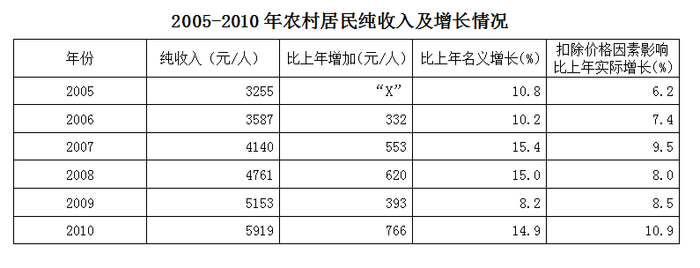

2010年农村居民的工资性收入人均2431元，比2005年增加1257元，增长1.1倍，年均增长15.7％。在工资性收入中，在本乡地域内劳动得到的收入人均1178元，比2005年增加610元，增长1.1倍，年均增长15.7％;外出务工收入人均1015元，比2005年增加557元，增长1.2倍，年均增长17.2％。

2010年农村居民家庭生产经营纯收入人均2833元，比2005年增加988元，增长53.6％，年均增长9.0％，其中，农村居民家庭经营第一产业纯收入人均2231元，比2005年增加761元，增长51.8％，年均增长8.7％。农村居民家庭从事第二产业生产经营得到的纯收入人均182元，比2005年增加74元，增长68.2％；从事第三产业生产经营得到的纯收入人均420元，比2005年增加153元，增长57.4％。

2010年农村居民得到的转移性收入人均453元，比2005年增加305元，增长2.1倍，其中，2010年各级政府给予的农业生产补贴收入人均118元，比2005年增加100元，增长5.5倍；2010年农村居民领取的离退休金、养老金人均113元，比2005年增加82元，增长2.7倍;2010年农村居民报销医疗费人均27元，比2005年增加24元，增长8.7倍；2010年农村居民领取最低生活保障收入人均12元，比2008年增加7元，增长1.5倍。

2010年农村居民的财产性收入人均202元，比2005年增加114元，增长1.3倍，年均增长18.0％，年均增速比“十五”期间高3.5个百分点。

### 第 116 题

“十一五”期间，我国农村居民人均纯收入的名义增长率约为：

A. 58.2%

B. 63.7%

C. 74.5%

D. 81.8%

第 116 题 · 答案与解析

**参考答案（粉笔题库参考内容）**

D

**解析**

由题干“我国农村居民人均纯收入的名义增长率约为”判定本题为增长率问题。定位表格材料可知：农村居民纯收入2005年为3255元/人，2010年为5919元/人。根据公式代入相关数据，。可得名义增长率为，由于选项首位不同，应用直除法，首位为8。

故正确答案为D。

**考点**：一般增长率、综合资料

**来源**：2012年浙江省公务员录用考试《行测》题第116题

### 第 117 题

材料中“X”的值与以下哪项最为接近？

A. 280

B. 320

C. 360

D. 400

第 117 题 · 答案与解析

**参考答案（粉笔题库参考内容）**

B

**解析**

由题干的“X”对应表格内容为“比上年增加（元/人）”可判定本题为增长量问题，定位表中数据，可知2005年农村居民纯收入为3255元/人，增长率为10.8%。根据公式代入相关数据，，最接近B项。

故正确答案为B。

**考点**：增长量计算、综合资料

**来源**：2012年浙江省公务员录用考试《行测》题第117题

### 第 118 题

“十一五”期间，我国农村居民人均工资性收入的增加值对农村居民人均纯收入增加的贡献率约为：

A. 37.1%

B. 43.6%

C. 47.2%

D. 50.4%

第 118 题 · 答案与解析

**参考答案（粉笔题库参考内容）**

C

**解析**

由题干“…对…的贡献率”可知为比重问题，结合时间，判定本题为现期比重问题。定位表格与文字材料第二段可知：“2010年农村居民的工资性收入人均2431元，比2005年增加1257元。2010年与2005年农村居民人均纯收入分别为5919元与3255元”。 根据公式代入相关数据，。

故正确答案为C。

相关知识点：

贡献率是分析经济效益的一个指标。它是指有效或有用成果数量与资源消耗及占用量之比，即产出量与投入量之比，或所得量与所费量之比。

计算公式：

**考点**：现期比重、综合资料

**来源**：2012年浙江省公务员录用考试《行测》题第118题

### 第 119 题

2005年，我国农村居民家庭从事二、三产业生产经营得到的纯收入人均为：

A. 375元

B. 446元

C. 528元

D. 602元

第 119 题 · 答案与解析

**参考答案（粉笔题库参考内容）**

A

**解析**

定位材料第三段内容可知，2005年，我国农村居民家庭从事二、三产业生产经营得到的纯收入人均为(182-74)+(420-153)，根据尾数法可知375符合题意。

故正确答案为A。

**考点**：综合资料、简单加减计算

**来源**：2012年浙江省公务员录用考试《行测》题第119题

### 第 120 题

“十一五”期间，我国农村居民人均转移性收入的年均增长率约为：

A. 10%

B. 15%

C. 20%

D. 25%

第 120 题 · 答案与解析

**参考答案（粉笔题库参考内容）**

D

**解析**

由题干“年均增长率”可判定此题为年均增长率问题。定位文字材料第四段可知：2010年农村居民得到的转移性收入人均453元，比2005年增加305元。由年均增长率的公式为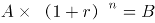，代入数据，即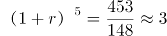，取值试算，若r=20%，,不满足，故r应取值25%。

故正确答案为D。

**考点**：年均增长率、综合资料

**来源**：2012年浙江省公务员录用考试《行测》题第120题

## 材料 2

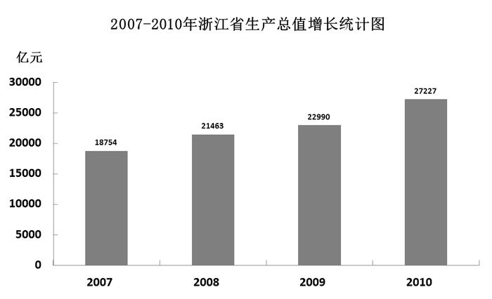

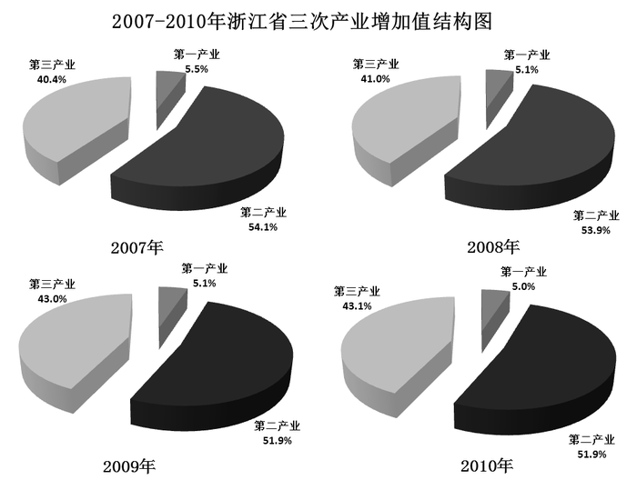

### 第 121 题

2010年，浙江第一产业的增加值约为：

A. 1361亿元

B. 1425亿元

C. 1476亿元

D. 1493亿元

第 121 题 · 答案与解析

**参考答案（粉笔题库参考内容）**

A

**解析**

由题干求2010年，浙江第一产业增加值，结合材料两图可判定本题为现期比重问题。定位柱形图可知，2010年浙江生产总值增长27227亿元，而定位三次产业增加值结构饼状图可知，2010年第一产业增加值所占比例为5%，根据公式代入相关数据，部分=总量×比重=27227×5%=1361.35亿元。

故正确答案为A。

**考点**：现期比重、统计图

**来源**：2012年浙江省公务员录用考试《行测》题第121题

### 第 122 题

2008年，浙江省第三产业的增加值约比第一产业多：

A. 7675亿元

B. 7705亿元

C. 7745亿元

D. 7765亿元

第 122 题 · 答案与解析

**参考答案（粉笔题库参考内容）**

B

**解析**

由题干求“2008年，浙江省第三产业的增加值约比第一产业多”，结合材料两图，可判定本题为现期比重问题。定位柱形图可知，2008年浙江生产总值增长21463亿元，而定位饼状图可知2008年第一、三产业增加值所占比例分别为5.1%、41%，由于两项比重总量一致，因此2008年浙江第三产业增加值比第一产业多，与B项最接近。

故正确答案为B。

**考点**：现期比重、统计图

**来源**：2012年浙江省公务员录用考试《行测》题第122题

### 第 123 题

2010年，浙江省第二产业的增加值约为2007年的：

A. 1.1倍

B. 1.2倍

C. 1.3倍

D. 1.4倍

第 123 题 · 答案与解析

**参考答案（粉笔题库参考内容）**

D

**解析**

由题干“2010年，浙江省第二产业的增加值约为2007年”，结合时间，可判定本题为现期倍数问题。定位材料可知，2010年浙江第二产业的增加值为亿元，2007年为亿元，前者是后者的倍，与D项最接近。

故正确答案为D。

**考点**：现期倍数、统计图

**来源**：2012年浙江省公务员录用考试《行测》题第123题

### 第 124 题

2007－2010年，浙江省第一产业的增加值大于1000亿元的年份有：

A. 1个

B. 2个

C. 3个

D. 4个

第 124 题 · 答案与解析

**参考答案（粉笔题库参考内容）**

D

**解析**

由题干“2007－2010年，浙江省第一产业的增加值大于1000亿元的年份”，结合材料，可判定本题为现期比重问题。

根据材料可知，浙江第一产业增加值：

2007年为18754×5.5%＝1031.47＞1000亿元；

2008年为21463×5.1%＞20000×5%＝1000亿元；

2009年为22990×5.1%＞1000亿元；

2010年为27227×5%＞1000亿元。

因此第一产业增加值大于1000亿元的年份有4个。

故正确答案为D。

**考点**：现期比重、统计图

**来源**：2012年浙江省公务员录用考试《行测》题第124题

### 第 125 题

根据资料，下列表述中不正确的一项是：

A. 2007－2010年，第三产业的增加值只有2010年超过1万亿元

B. 2009年，第二产业增加值与第一产业增加值之差超过1万亿元

C. 2010年，第三产业增加值与第一产业增加值之差不足1万亿元

D. 2008年，第一产业增加值与第三产业增加值之和不足1万亿元

第 125 题 · 答案与解析

**参考答案（粉笔题库参考内容）**

C

**解析**

A计算过于复杂，可跳过，先验证其他选项；

B选项正确，定位图形，2009年第二产业与第一产业增加值之差为；

C选项错误，定位图形，2010年第三产业与第一产业增加值之差为；

D选项正确，定位图形，2008年第三产业与第一产业增加值之和为。

本题为选非题，故正确答案为C。

**考点**：综合分析、统计图

**来源**：2012年浙江省公务员录用考试《行测》题第125题

## 材料 3

2010年，我国共投入研究与试验发展(R&D，以下简称R&D)经费7062.6亿元，比上年增长21.7%;R&D经费投入强度(与国内生产总值之比)为1.76%，比上年的1.70%有所提高。

分活动类型看，全国用于基础研究的经费投入为324.5亿元，比上年增长20.1%;应用研究经费893.8亿元，增长22.3%;试验发展经费5844.3亿元，增长21.7%。

分执行部门看，各类企业投入R&D经费5185.5亿元，比上年增长22.1%;政府属研究机构投入1186.4亿元，增长19.1%;高等学校投入597.3亿元，增长27.6%。企业、政府属研究机构、高等学校经费所占比重分别为73.4%、16.8%、8.5%。

分产业部门看，R&D经费投入强度(与主营业务收入之比)最高的行业是专用设备制造业，为2.04%;投入强度在1.5%-2%的有4个行业，分别是医药制造业(1.82%)、通用设备制造业(1.59%)，电气机械及器标制造业(1.59%)和仪器仪表及文化、办公用机械制造业(1.5%)。

分地区看，R&D经费超过300亿元的有江苏、广东、北京、山东、浙江和上海6个省(市)，共投入经费4136.5亿元，占全国经费投入总量的58.6%。R&D经费投入强度(与地区生产总值之比)达到或超过全国水平的有北京、上海、天津、陕西、江苏、浙江和广东7个省(市)。

### 第 126 题

2009年我国共投入R&D经费约多少亿元：

A. 5960亿元

B. 5880亿元

C. 5800亿元

D. 5780亿元

第 126 题 · 答案与解析

**参考答案（粉笔题库参考内容）**

C

**解析**

由题干问“2009年我国共投入R&D经费”，结合材料时间为2010年，可判定本题为基期计算问题。本题选项十分接近，需要较为精确的计算。定位材料第一段可知，2010年，我国共投入R&D经费7062.6亿元，比上年增长21.7%，因此2009年我国共投入R&D经费亿元。

故正确答案为C。

**考点**：文字资料、基期计算

**来源**：2012年浙江省公务员录用考试《行测》题第126题

### 第 127 题

分执行部门看，2010年企业投入R&D经费约是政府属研究机构和高等学校经费总和的：

A. 2.9倍

B. 2.6倍

C. 2.5倍

D. 2.2倍

第 127 题 · 答案与解析

**参考答案（粉笔题库参考内容）**

A

**解析**

由题干“2010年企业投入R&D经费约是政府属研究机构和高等学校经费总和的”，结合选项与材料时间，可判定此题为现期倍数问题。定位材料第三段可知，2010年企业投入R&D经费为5185.5亿元，政府属研究机构投入1186.4亿元，高等学校经费597.3亿元，则可列式，由于选项首位相同，次位差小于首位，截三位计算，商首位为2，次位为9。

故正确答案为A。

**考点**：现期倍数、文字资料

**来源**：2012年浙江省公务员录用考试《行测》题第127题

### 第 128 题

2010年全国用于试验发展的经费约占全国R&D经费的：

A. 85.4%

B. 84.7%

C. 83.5%

D. 82.7%

第 128 题 · 答案与解析

**参考答案（粉笔题库参考内容）**

D

**解析**

由题干“…占…”，结合选项与时间，可判定本题为现期比重问题。定位材料第一段与第二段可知，2010年全国用于试验发展的经费为5844.3亿元，全国R&D经费为7062.6亿元，可列式，由于选项首位相同，次位差小于首位，截三位计算。商首位为8，次位为2，第三位为7。

故正确答案为D。

**考点**：现期比重、文字资料

**来源**：2012年浙江省公务员录用考试《行测》题第128题

### 第 129 题

分地区看，2010年R&D经费超过300亿且R&D经费投入强度达到或超过全国水平的省（市）有：

A. 6个

B. 5个

C. 4个

D. 3个

第 129 题 · 答案与解析

**参考答案（粉笔题库参考内容）**

B

**解析**

定位材料最后一段可知，R&D经费超过300亿元的有江苏、广东、北京、山东、浙江和上海6个省（市），R&D经费投入强度达到或超过全国水平的有北京、上海、天津、陕西、江苏、浙江和广东7个省（市），因此同时满足以上两个条件的省（市）有江苏、北京、广东、浙江、上海共5个。

故正确答案为B。

**考点**：文字资料、直接找数

**来源**：2012年浙江省公务员录用考试《行测》题第129题

### 第 130 题

根据资料，下列表述中不正确的一项是：

A. 2009年全国用于基础研究的经费投入超过265亿元

B. 2010年我国R&D经费投入强度第二高的行业是医药制造业

C. 2009年全国高等学校投入R&D经费超过480亿元

D. 2010年R&D经费未超过300亿元的省(市)投入经费之和不足全国总量的45%

第 130 题 · 答案与解析

**参考答案（粉笔题库参考内容）**

C

**解析**

A选项正确，定位材料第二段可知，2009年全国用于基础研究的经费投入为亿元；

B选项正确，定位材料第四段可知，R&D经费投入强度最高的行业为专用设备制造业，第二位为医药制造业；

C选项错误，定位材料第三段可知，2009年全国高等学校投入R&D经费为亿元；

D选项正确，定位材料最后一段可知，全国R&D经费超过300亿元的地区总投入占全国经费投入总量的58.6%，则未超过的占1－58.6%＝41.4%＜45%。

本题为选非题，故正确答案为C。

**考点**：综合分析、文字资料

**来源**：2012年浙江省公务员录用考试《行测》题第130题

