# 2013年浙江省公务员录用考试《行测》题（A类）

<!-- gwy:overview:start -->
> **浙江 · 2013 · 行测 · A类** ｜ 130 题 · 图片 131 处 · 答案随题折叠

| 题型模块 | 题量 | 题号 |
| --- | ---: | ---: |
| 言语理解与表达 | 35 | 1–35 |
| 数量关系 | 25 | 36–60 |
| 判断推理 | 35 | 61–95 |
| 常识判断 | 20 | 96–115 |
| 资料分析 | 15 | 116–130 |
| **合计** | **130** | |

导航：[题型与作答说明](#题型与作答说明) · [题目](#题目) · [材料 1](#材料-1)
<!-- gwy:overview:end -->

> 候选采集稿。参考答案及解析来自粉笔页面，不代表官方答案或真实高分答卷；来源使用许可与原卷对应关系仍需人工核实。

## 题型与作答说明

言语理解与表达

（35题）

每道题包含一个句子或一段话，后面是一个不完整的陈述，要求是从四个选项中选出一个来完成陈述。你的选择应与所提要求最相符合。

数量关系

（25题）

本部分包括数字推理与数学运算两种类型的试题。

判断推理

（35题）

本部分包括图形推理、类比推理、逻辑判断与定义判断四种类型的试题。

常识判断

（20题）

根据题目要求，在四个选项中选出一个正确答案。

资料分析

（15题）

所给出的图、表或一段文字均有5个问题要你回答。你应根据资料所提供的信息进行分析、比较、计算和判断处理。

## 题目

### 第 1 题

真正的信息公开，当然要求政府要在第一时间发布信息，但更重要的是，不能\_\_\_\_\_\_信息的发布渠道，而必须尊重媒体多渠道地报道、展现事实，在多元的信息和声音的“竞争”中由公众判断事实在哪里。政府调查的能力有限，可能被假象所\_\_\_\_\_\_，所以需要媒体调查的跟进，这对政府的调查是一个有益的信息补充；更重要的是，政府在利益的绑架下，可能会习惯性地瞒报虚报、掩盖事实，这就需要媒体的报道与政府的调查相互\_\_\_\_\_\_，从而在信息的竞争和交叉中逼出真相。

依次填入画横线部分最恰当的一项是：

A. 主导 迷惑 证明

B. 垄断 蒙蔽 印证

C. 操纵 瞒骗 检验

D. 控制 遮掩 验证

第 1 题 · 答案与解析

**参考答案（粉笔题库参考内容）**

B

**解析**

第一空，搭配“渠道”，且与后文“多渠道地······”形成反义对应。A项“主导”与“渠道”搭配不当，排除；C项“操纵”多指在暗地、幕后进行，与“多渠道地······”无法形成反义对应，且与前文主体“政府”搭配不当，排除。

第二空，搭配“假象”。D项“遮掩”可搭配“事实”或“真相”，与“假象”搭配不当，排除。B项“蒙蔽”指欺骗、隐瞒，与“假象”搭配得当，符合文意，保留。

第三空，代入验证，B项“印证”指证明与事实相符，符合语境，当选。

故正确答案为B。

**考点**：词的辨析-搭配对象、实词填空、关联关系-转折关系

**来源**：2013年浙江省公务员录用考试《行测》题（B类）第1题

### 第 2 题

古人提倡“吾日三省吾身”，\_\_\_\_\_\_，而今天有些人则不然，总是\_\_\_\_\_\_，对比之下，实在不应该。

依次填入画横线部分最恰当的一项是：

A. 修身养性 瑕不掩瑜

B. 兢兢业业 好大喜功

C. 闻过则喜 讳疾忌医

D. 博采众长 刚愎自用

第 2 题 · 答案与解析

**参考答案（粉笔题库参考内容）**

C

**解析**

本题考查成语的应用。第一空与“吾日三省吾身”相对应，表达“省吾身”这一含义。“闻过则喜”形容虚心接受意见，承接“吾日三省吾身”，符合语境，对应C项。修身养性：修身指使身体健康，养性指使心智本性不受损害，上文强调反省，故A项不正确；兢兢业业：形容做事小心谨慎，认真踏实，B项不符合文意；博采众长：博采意为广泛搜集采纳，从多方面吸取各家的长处，无法反映“省吾身”的状态，故不正确，D项排除。

第二空，代入验证，根据“古人”“今天”可知，“而”在此处表转折，前后文意相反，所以该空应表达不愿反省之意，C项“讳疾忌医”比喻掩饰自己的缺点和错误，不愿改正，符合语境，当选。

故正确答案为C。

【词汇拓展】

瑕不掩瑜：瑕：玉上面的斑点，比喻缺点；掩：遮盖；瑜：美玉的光泽，比喻优点。比喻缺点掩盖不了优点，缺点是次要的，优点是主要的。

好大喜功：好：爱好，喜欢；功：功绩，成就。指不管条件是否允许，一心想做大事立大功。多用以形容浮夸的作风。

刚愎自用：形容一个人过分自信，完全听取不了别人的意见，十分固执，任何人的谈话，都听不进。

**考点**：关联关系-转折关系、成语填空、对应关系-前后呼应

**来源**：2013年浙江省公务员录用考试《行测》题（B类）第2题

### 第 3 题

当前的中国，利益多元、观念多样、思想多变，这让道德领域呈现复杂\_\_\_\_\_\_，也让人们面临更艰难的选择。在扶起跌倒老人或许惹上官司、爱心捐赠恐被挪作他用的疑虑中，善念在负面的想象中\_\_\_\_\_\_，善行因利益的考量而\_\_\_\_\_\_。一个经历着深刻转型的社会，有这样的道德困惑可以理解，但更应主动正视、积极引导。

依次填入画横线部分最恰当的一项是：

A. 景象 迟钝 拖延

B. 图景 迟疑 延宕

C. 景观 生疑 延缓

D. 景况 消失 延误

第 3 题 · 答案与解析

**参考答案（粉笔题库参考内容）**

B

**解析**

第一空，C项“景观”一般指自然景观，与“道德领域”搭配不当，排除。

第二、三空，根据填入词语所属短句“善念在负面的想象中······”“善行因利益的考量而······”可知，两短句的句式相同，形成了并列关系，则两空所填词语词义应相近。

第三空“拖延”“延宕”“延误”均可体现“延迟”之意，故第二空所填词语应与“延迟”词义相近，B项“迟疑”即犹豫，符合语境，当选。A项“迟钝”强调不灵活，无法体现延迟之意，排除；D项“消失”指不复存在，无法体现延迟之意，且程度过重，排除。

故正确答案为B。

**考点**：词的辨析-搭配对象、实词填空、词的辨析-程度轻重

**来源**：2013年浙江省公务员录用考试《行测》题（B类）第3题

### 第 4 题

在近代中国的历史上，各种思想呈现一种“你方唱罢我登场”的流动局面，似乎没有什么思想观念可以\_\_\_\_\_\_。

填入画横线部分最恰当的一项是：

A. 脱颖而出

B. 一以贯之

C. 不绝如缕

D. 鹤立鸡群

第 4 题 · 答案与解析

**参考答案（粉笔题库参考内容）**

B

**解析**

根据“似乎没有”可知，横线处所填成语应与前文“你方唱罢我登场”形成反义对应。B项“一以贯之”指用一种思想贯穿始终，体现“思想”的连续性，可与前文“你方唱罢我登场”形成反义对应，当选。A项“脱颖而出”比喻才能完全显露出来，C项“不绝如缕”指声音微弱但未中断，比喻情势危急，D项“鹤立鸡群”比喻超出一般，与众不同，均无法与“你方唱罢我登场”形成反义对应，排除。

故正确答案为B。

**考点**：成语填空、对应关系-前后呼应

**来源**：2013年浙江省公务员录用考试《行测》题（B类）第4题

### 第 5 题

时下几乎所有的西方博物馆都处于虚拟化的完成或进行当中。当然，大多数虚拟博物馆仍处在2D的传统网页模式，“文字+图片”的初级阶段，更多是对实体博物馆信息的发布与补充，数字化储存做到了，但在网上浏览的\_\_\_\_\_\_方面远远不够。真正的虚拟博物馆应该是能模拟人们的观展体验的，强调观众是展览的核心，为他们营造出更富想像力与互动性的空间。

填入画横线部分最恰当的一项是：

A. 生动性

B. 及时性

C. 丰富性

D. 便捷性

第 5 题 · 答案与解析

**参考答案（粉笔题库参考内容）**

A

**解析**

根据前文“仍处在2D的传统网页模式”及尾句“营造出更富想像力与互动性的空间”可知，现阶段网上浏览的生动性不足，故横线处应体现虚拟博物馆在生动性方面的不足，对应A项。B项“及时性”与时间有关，文段并没有提及时间，排除；C项“丰富性”强调种类多，而文段强调的是网上浏览需要更生动，与文意不符，排除；D项“便捷性”强调方便、便利，与文意不符，排除。

故正确答案为A。

**考点**：实词填空、对应关系-前后呼应

**来源**：2013年浙江省公务员录用考试《行测》题（B类）第5题

### 第 6 题

品格与情怀是治学的思想\_\_\_\_\_\_，一些学者之所以受到世人敬仰，不惟其取得了丰硕的学术成果，更因其具有高尚的精神品格。学者高尚的精神品格有着丰富内涵，其中忧乐情怀是一个核心元素。忧乐情怀是儒家文化的重要精神，自古为学人所\_\_\_\_\_\_。

依次填入画横线部分最恰当的一项是：

A. 源泉 宣扬

B. 前提 珍重

C. 保证 向往

D. 根基 推崇

第 6 题 · 答案与解析

**参考答案（粉笔题库参考内容）**

D

**解析**

本题可从第二空入手。“珍重”“向往”均与“精神”搭配不当，排除B、C两项。根据“忧乐情怀是儒家文化的重要精神”可知，横线处所填词语应为积极的感情色彩，A项“宣扬”指广泛宣传，为中性词，D项“推崇”指十分推重，为褒义词，与A项相比更符合文段感情色彩，保留。

第一空，代入验证，D项“根基”指基础，与“治学”搭配恰当，当选。

故正确答案为D。

**考点**：词的辨析-搭配对象、实词填空

**来源**：2013年浙江省公务员录用考试《行测》题（B类）第6题

### 第 7 题

知识分子与权力之间应该保持一种怎样的关系？拥抱还是抵制？胡适的选择很特别，他在大方向上不反对国民党政权，但他终生不愿当官，他看重的是知识分子独立发表见解的\_\_\_\_\_\_。翻遍《胡适年谱》，不难发现，作为知识分子领袖，他一生与知识分子往来最多，其次是与国民党高层颇多交流，但几乎从无和新兴的企业家阶层交往的记录。抛开中产阶级而欲求民主、自由，无异于\_\_\_\_\_\_，这大概是胡适的局限，也是其他自由主义者应该深思的问题。

依次填入画横线部分最恰当的一项是：

A. 权力 刻舟求剑

B. 自由 南辕北辙

C. 权利 缘木求鱼

D. 权益 水中捞月

第 7 题 · 答案与解析

**参考答案（粉笔题库参考内容）**

C

**解析**

第一空，A项“权力”指政治上的强制力量，也指职责范围内的支配力量，与“独立发表见解”搭配不当，排除。

第二空，“无异于”为解释类对应标志词，故横线前分句即是对横线处所填成语的解释。根据“抛开中产阶级而欲求民主、自由”可知，是自由主义者没有用恰当的方式方法去追求民主、自由，C项“缘木求鱼”比喻做事方法不对，符合文意，当选。B项“南辕北辙”比喻行动和目的正好相反，D项“水中捞月”比喻不可能达到目的，徒劳无益，强调结果，而文段强调的是方法不对，均与文意不符，排除。

故正确答案为C。

**考点**：词的辨析-搭配对象、对应关系-解释说明、混搭填空

**来源**：2013年浙江省公务员录用考试《行测》题（B类）第7题

### 第 8 题

“制作粗糙”，\_\_\_\_\_\_，某文艺评论家这样点评当下国内的许多多媒体舞蹈作品。把几段现成的图像符号式地投射在背景屏幕上充当画外音，充其量只是布景道具的升级版。多媒体效果太过目眩神迷，与舞蹈\_\_\_\_\_\_，有一种独立于表达之外的野心。比如有一个多媒体舞蹈，投射在大屏幕上的图案随着演员的每个动作变幻：演员伸展双臂，身后便出现万丈光芒，演员抱住身体，灯光也随之黯淡，看上去是在配合表演，其实是在和演员争夺观众的眼球，舞蹈彻底沦为了配角。

依次填入画横线部分最恰当的一项是：

A. 哗众取宠 失枝脱节

B. 喧宾夺主 貌合神离

C. 主次颠倒 亦步亦趋

D. 避重就轻 格格不入

第 8 题 · 答案与解析

**参考答案（粉笔题库参考内容）**

B

**解析**

第一空，根据“和演员争夺观众的眼球，舞蹈彻底沦为了配角”可知，横线处应表达次要事物占据主要事物位置之意。A项“哗众取宠”指以浮夸的言行迎合众人，用来博取好感和拥护，D项“避重就轻”指避开重要繁难的而选择轻松容易的，均不符合文意，故排除A、D两项。

第二空，根据“独立于表达之外的野心”可知，横线处应体现表达与本心不同之意。B项“貌合神离”形容表面看上去关系很亲密，实际上内心却不一致，各有各的打算和想法，符合文意，当选。C项“亦步亦趋”比喻没有主见，事事都模仿、追随别人，与文意相悖，排除。

故正确答案为B。

**考点**：成语填空、对应关系-前后呼应

**来源**：2013年浙江省公务员录用考试《行测》题（B类）第8题

### 第 9 题

文学评论中，对形式的模仿与内容的抄袭，不应\_\_\_\_\_\_；对早期的作品和现在的创作，不可\_\_\_\_\_\_。

依次填入画横线部分最恰当的一项是：

A. 相提并论 等量齐观

B. 等量齐观 混为一谈

C. 混为一谈 同日而语

D. 同日而语 相提并论

第 9 题 · 答案与解析

**参考答案（粉笔题库参考内容）**

C

**解析**

本题可从第二空入手。根据“早期的作品和现在的创作”可知，横线处应体现与时间的相关性。C项“同日而语”指同一事物或情况放到不同时期谈论，多用于否定句，填入可表达时期不同的作品不可一同比较之意，符合文意，保留。A项“等量齐观”指把不同的事物一律同等看待，B项“混为一谈”指把不同的事物混在一起，说成是同样的事物，D项“相提并论”指把不同的或差距悬殊的事物放在一起看待，均无法体现与时间的相关性，排除。

第一空，代入验证，根据“对形式的模仿与内容的抄袭”可知，横线处应体现把不同事物同等看待之意，C项“混为一谈”与文意相符，当选。

故正确答案为C。

**考点**：词的辨析-词义侧重、成语填空

**来源**：2013年浙江省公务员录用考试《行测》题（B类）第9题

### 第 10 题

真正伟大的历史人物，他所展现出来的价值和意义，绝不是他所处的那个时代所能够局限的，一定可以超越他所在的那个具体的时代和具体的生存环境，超越时空，焕发出            的永恒的价值。

填入画横线部分最恰当的一项是：

A. 历久弥新

B. 日新月异

C. 亘古不变

D. 与日俱增

第 10 题 · 答案与解析

**参考答案（粉笔题库参考内容）**

A

**解析**

文段意指伟大的人物不受时代的局限，超越时空焕发永恒的价值。B项“日新月异”指发展或进步迅速，不断出现新事物、新气象，D项“与日俱增”形容不断增长，且增长得很快，均不符合语境，可排除；根据前文“超越”可知，横线处应体现一种上升的状态，C项“亘古不变”指经历了很久都没有变化，与文意不符，且与后文“永恒”语义重复，可排除。A项“历久弥新”指事物经历长久的时间反而更加鲜活，比新的还要好，符合文意，当选。

故正确答案为A。

**考点**：词的辨析-词义侧重、成语填空、对应关系-前后呼应

**来源**：2013年浙江省公务员录用考试《行测》题（B类）第10题

### 第 11 题

欧债危机在2012年继续恶化，\_\_\_\_\_\_了世界其他国家的经济增长。美国虽然没有像欧洲那样陷入第二轮的经济衰退，但美国的经济增长仍然非常\_\_\_\_\_\_，只有2%左右。欧债危机、美国的“财政悬崖”及由于钓鱼岛问题导致的日趋恶化的中日经贸关系，有可能\_\_\_\_\_\_一场新的全球性衰退。

依次填入画横线部分最恰当的一项是：

A. 阻碍 脆弱 诱发

B. 影响 缓慢 导致

C. 拖累 疲软 引发

D. 逆转 乏力 催生

第 11 题 · 答案与解析

**参考答案（粉笔题库参考内容）**

C

**解析**

第一空，根据“像欧洲那样陷入经济第二轮的经济衰退”可知，欧债危机继续恶化使得其他国家的经济增长受到了阻碍，横线处应填入含消极色彩的词。A项“阻碍”指使不能顺利通过或发展，C项“拖累”指使受牵累，均含有消极色彩，符合文意，保留。B项“影响”指对人或事所起的作用，中性词，填入横线处没有明显的消极色彩，与文段感情色彩不符，排除；D项“逆转”指向相反的方向转变，填入横线处表达由恶化向好的方面转变，不符合文意，排除。

第二空，由“只有2%左右”可知，横线处要体现美国的经济增长非常少之意，C项“疲软”指疲乏无力，符合文意，保留。A项“脆弱”指禁不起挫折，不坚强，多用于形容人，与“经济增长”搭配不当，排除。

第三空，代入验证，C项“引发”与“一场新的全球性衰退”搭配恰当，当选。

故正确答案为C。

**考点**：词的辨析-搭配对象、实词填空、对应关系-前后呼应

**来源**：2013年浙江省公务员录用考试《行测》题（B类）第11题

### 第 12 题

信任，是一种简化复杂性的机制，也是对冲风险的途径。在一个没有信任的社会里，个体的权利很难得到尊重，权利的边界也很难\_\_\_\_\_\_。由于滥用个人权利，社会难免会沦为“你死我活”的角斗场。背信弃义的行为也很难受到法律和道德的\_\_\_\_\_\_，个体之间的互不信赖又必然会给整个社会带来莫大的风险。

依次填入画横线部分最恰当的一项是：

A. 确定 限制

B. 廓清 惩罚

C. 确认 声讨

D. 厘清 约束

第 12 题 · 答案与解析

**参考答案（粉笔题库参考内容）**

D

**解析**

第一空，根据后文“由于滥用个人权利”可知，横线处要表达权利的边界很难弄清楚之意，D项“厘清”指整理清楚，符合文意，保留。A项“确定”、 C项“确认”为明确之意，B项“廓清”指澄清、肃清、清除，三项均与文意不符，排除。

第二空，代入验证。由同时搭配“法律”和“道德”可知，D项“约束”符合文意，当选。

故正确答案为D。

**考点**：词的辨析-搭配对象、实词填空、对应关系-前后呼应

**来源**：2013年浙江省公务员录用考试《行测》题（B类）第12题

### 第 13 题

自文艺复兴以来，特别是第一次世界大战期间，因为民族主义和阶级斗争等意识形态作祟产生了一系列伤亡惨重的战争。其中，许多知识分子起到了\_\_\_\_\_\_的作用，他们或打扮成青年导师和精神领袖\_\_\_\_\_\_种族差异、民族至上和阶级对立，或投笔从戎，直接参与战争。对这一现象，哲学家班达不以为然，认为知识分子假借种族主义、民族主义和阶级斗争\_\_\_\_\_\_了知识分子的价值理想。

依次填入画横线部分最恰当的一项是：

A. 助纣为虐 膜拜 击碎

B. 中流砥柱 批判 展现

C. 推波助澜 鼓吹 背叛

D. 力挽狂澜 抨击 彰显

第 13 题 · 答案与解析

**参考答案（粉笔题库参考内容）**

C

**解析**

本题考查成语和实词的应用。

第一空，由“不以为然”可知，哲学家班达对知识分子所起到的作用持否定态度，所以第一空应为贬义，排除B、D两项。

第二空，前面的“打扮成青年导师和精神领袖”，说明知识分子是在宣扬“种族主义、民族主义和阶级斗争”，C项“鼓吹”更契合文意，保留。

第三空，C项“背叛”更显示价值理想与所作所为的对立，当选。

故正确答案为C。

**考点**：词的辨析-感情色彩、对应关系-前后呼应、混搭填空

**来源**：2013年浙江省公务员录用考试《行测》题（B类）第13题

### 第 14 题

改进文风，           是语言问题、技术问题，           是思想问题、感情问题，那些居高临下的呆板表述，固然与文字水平有关，但本质上反映的却是对待读者、对待群众的态度；那些了无新意的应景报道，           是创新能力不强，           是对世情党情国情缺乏深刻认识；那些穿靴戴帽的官样文章，看似热闹，但却令人生厌，让人反感。

依次填入画横线部分最恰当的一项是：

A. 既 又 要么 要么

B. 既 又 与其说 不如说

C. 不仅 更 要么 要么

D. 不仅 更 与其说 不如说

第 14 题 · 答案与解析

**参考答案（粉笔题库参考内容）**

D

**解析**

根据“固然······但本质上······”可知，首句为递进关系，故可排除A、B两项。

第三空、第四空所属的两个分句并非选择关系，而是更为强调“世情党情国情······”。C项“要么······要么······”为选择关系，与文段语境不符，排除。D项“与其说······不如说······”强调的是“不如说”之后的内容，符合语境，当选。

故正确答案为D。

**来源**：2013年浙江省公务员录用考试《行测》题（B类）第14题

### 第 15 题

中国自古就有浓烈的宗法传统，\_\_\_\_\_\_宗族血亲之内的彼此关照，互相提携，并一致对外，上自帝王下至百姓，\_\_\_\_\_\_。

依次填入画横线部分最恰当的一项是：

A. 讲究 前赴后继

B. 讲求 概莫能外

C. 寻求 无一幸免

D. 追求 百喙如一

第 15 题 · 答案与解析

**参考答案（粉笔题库参考内容）**

B

**解析**

本题可从第二空入手。根据“上自······下至······”可知，横线处要表达全面包含之意。B项“概莫能外”指全部包括在内，没有例外，符合文意。A项“前赴后继”形容勇往直前，连续不断，C项“无一幸免”指没有一个能侥幸地避免，D项“百喙如一”指许多人都说同样的话，看法或意见一致，均无法表达全面包含之意，排除。

第一空，代入验证，B项“讲求”与后文搭配恰当，当选。

故正确答案为B。

**考点**：对应关系-前后呼应、混搭填空

**来源**：2013年浙江省公务员录用考试《行测》题（B类）第15题

### 第 16 题

对于历史学家来说，有责任把人物的原貌和事件的真相尽可能准确、完整地向读者讲清楚。说“尽可能”，是因为受史料的局限，有些人物和事件无法核实，难以恢复事实真相，只能根据掌握的史料作出\_\_\_\_\_\_。历史不是自然科学，不能通过公式计算获得精确的数据和结论，对人物和事件的叙述，对动机和起因的推论，对结果和影响的分析，都需要作出主观的评判。有些学者倒果为因，先设论点，再找论据，有些学者，为了推倒他人的成论，也挖掘史料以\_\_\_\_\_\_自己的观点，这就涉及史家的指导思想和治学态度问题。

依次填入画横线部分最恰当的一项是：

A. 推断 支撑

B. 假设 树立

C. 判断 证实

D. 猜测 支持

第 16 题 · 答案与解析

**参考答案（粉笔题库参考内容）**

A

**解析**

第一空，表达根据掌握的史料对事情的真相进行推测，B项“假设”指凭空构想，D项“猜测”指猜度、揣测，文段是根据掌握的史料而非凭空构想、猜测，故B、D两项与文意不符，排除。

第二空，横线处表达学者用史料来补充、支持自己的观点之意，对应A项“支撑”。C项“证实”为证明其确实之意，文段并不是说学者的观点就一定是事实，故C项“证实”与文意不符，排除。

故正确答案为A。

**考点**：词的辨析-词义侧重、实词填空、对应关系-前后呼应

**来源**：2013年浙江省公务员录用考试《行测》题（B类）第16题

### 第 17 题

下列词语中，没有错别字的一项是：

A. 逸闻轶事

B. 剑拨弩张

C. 忧柔寡断

D. 纷至踏来

第 17 题 · 答案与解析

**参考答案（粉笔题库参考内容）**

A

**解析**

B项中应为“剑拔弩张”；

C项中应为“优柔寡断”；

D项中应为“纷至沓来”。

故正确答案为A。

**来源**：2013年浙江省公务员录用考试《行测》题（B类）第17题

### 第 18 题

下列词语中，划线字的读音全都正确的一项是：

A. 蹊（xī）跷 卖官鬻（yù）爵

B. 对峙（zhì） 模棱（léng）两可

C. 追溯（shuò） 户枢不蠹（dù）

D. 市侩（kuài） 万马齐喑（àn）

第 18 题 · 答案与解析

**参考答案（粉笔题库参考内容）**

B

**解析**

A项，“蹊（xī）跷”读音错误，应修改为“蹊（qī）跷”，排除；

B项，读音全部正确，当选；

C项，“追溯（shuò）”读音错误，应修改为“追溯（sù）”，排除；

D项，“万马产喑（àn）”读音错误，应修改为“万马产喑（yīn）”，排除。

故正确答案为B。

**来源**：2013年浙江省公务员录用考试《行测》题（B类）第18题

### 第 19 题

下列句子中，句意明确，没有语病的一项是：

A. 必须严厉打击食品安全违法违规行为的高压态势，及时消除各环节领域的隐患，创新食品安全监管惩处体制机制。

B. 通过实施应对国际金融危机冲击的一揽子计划，我国经济呈现回升向好态势，经济增长的质量和效益进一步提高。

C. 这所大学的一些学生语文水平实在低下，传扬出去，肯定会被人贻笑大方，影响学校声誉。

D. 对采用电脑摇号择校的做法，社会各界褒贬不一，不少有识之士建议实行结合学生综合素质和所处学区来确定。

第 19 题 · 答案与解析

**参考答案（粉笔题库参考内容）**

B

**解析**

A项，缺少谓语，应为必须“保持严厉打击食品安全违法违规行为的高压态势”，排除；

B项，表述正确，没有语病，当选；

C项，“贻笑大方”本身含有被内行人笑话的意思，与前面的“被人”重复，应删去“被人”，排除；

D项，缺少宾语，应在句末加上“的方法”或“的做法”，排除。

故正确答案为B。

**来源**：2013年浙江省公务员录用考试《行测》题（B类）第19题

### 第 20 题

①以知识为主导所得出的美丑的概念，是不真实的，也是没有意义的

②即如美丑而言，当天下人知道追求美的时候，就有了美丑的区分，就有了各自的见解

③在老子看来，相反相成，是知识构成的特性，但并非世界本身所具有

④老子并非反对人们追求美，但他认为这种追求美的方式，并不能得到真正的美

⑤人为世界分出高下美丑，是在下判断，以人的理性确定世界的意义，这样的知识并不符合世界的特性

将以上5个句子重新排列，语序正确的是：

A. ③⑤②①④

B. ②④③①⑤

C. ①③⑤④②

D. ⑤④②③①

第 20 题 · 答案与解析

**参考答案（粉笔题库参考内容）**

A

**解析**

对比选项，确定首句。①句论述以知识为主导所得出的美丑的概念没有意义，③句提到了老子的观点，⑤句讲了人为世界分出高下美丑不符合世界的特性，三句均适合作为首句，②句中的“即如”即“正如”，前文应先论述相关内容，再进行举例，故②句不适合作为首句，排除B项。

继续观察选项，④句指出“老子并非反对人们追求美”，故应先引出老子论述的这个话题，之后再进一步具体论述老子的观点，故④要在③之后，排除D项。对比A、C两项，①②④⑤都是围绕美丑来说的，话题一致，应捆绑在一起，故排除C项，锁定A项。

故正确答案为A。

**考点**：确定顺序

**来源**：2013年浙江省公务员录用考试《行测》题（B类）第20题

### 第 21 题

①一个人的表情能改变容颜，特别是日积月累的表情，具有滴水穿石的效果。

②一个人的面容是先天生好的。

③你看那些老年夫妻，经过多年饮食和趣味的磨合，表情越来越趋相同，一颦一笑都相仿。

④这种美除了有姣好的面容作底子，更重要的是表情和气度在起作用。

⑤少年的美或许是惊艳的，但只称得上漂亮，只有过了成年，甚至到了色衰的中老年，才可称得上美。

将以上5个句子重新排列，语序正确的是：

A. ①③⑤④②

B. ⑤③①②④

C. ⑤③②①④

D. ②⑤④①③

第 21 题 · 答案与解析

**参考答案（粉笔题库参考内容）**

D

**解析**

第一步，对比选项，判断首句。①句说表情可以改变容颜，②句说先天的面容，应先讲先天的面容再讲表情可以改变容颜，故②句应在①句之前，故排除A、B两项。⑤句介绍过了成年才称得上美，②、⑤不好判断谁更适合作为首句，再找其他线索。

第二步，④句中出现指代词“这种美”，可知④句前应提到“美”，故可确定⑤④捆绑，答案锁定D项。①句中没有提到“美”，故不能与④句捆绑，排除C项。

故正确答案为D。

**考点**：确定顺序、确定捆绑

**来源**：2013年浙江省公务员录用考试《行测》题（B类）第21题

### 第 22 题

①因此把才学比作剑，当使用的时候就拿出来，而不用的时候就藏入鞘中，不将其把玩炫耀，否则，很少有不因此而得祸的。

②自古以来，才学外露的都遭到灾祸，没有一个幸免，怎么不令人为此忧心忡忡呢?

③才学是君子用来进行身心的修养，而并非用来自负骄矜的工具；君子是以才学来治理社会，而并非用以自夸炫耀的。

④之所以这样说，并非才能和学识本身有什么过错，而是错误应用造成的。

⑤没有才能和学识，士人会感到羞耻；具备才能和学识，士人会因此而担忧。

将以上5个句子重新排列，语序正确的是：

A. ⑤④③②①

B. ②①④③⑤

C. ②④①③⑤

D. ③⑤④②①

第 22 题 · 答案与解析

**参考答案（粉笔题库参考内容）**

A

**解析**

第一步，对比选项，判断首句。②说“自古以来，才学外露的都遭到灾祸，没有一个幸免，怎么不令人为此忧心忡忡呢?”，③阐述了才学和君子的用途，⑤说“没有才能和学识，士人会感到羞耻；具备才能和学识，士人会因此而担忧”，谁更适合作为首句不好判断，故去文段当中找其他的线索。

第二步，①句出现了结论词“因此”，更适合作为文段的尾句，对应A、D两项，故排除B、C两项。

第三步，对比A、D两项。④句说是才学错误应用造成的，③句说才学的正确用途，故④③两句话题连接紧密，答案锁定A项，排除D项。

故正确答案为A。

**考点**：确定尾句、确定捆绑

**来源**：2013年浙江省公务员录用考试《行测》题（B类）第22题

### 第 23 题

①再比如财产公开不需要保护隐私，但香港把保护隐私作为财产申报公示制度的基本原则，保护申报人隐私也是一项国际惯例

②但在如何公开，何时公开，怎样公开等问题上还远没达到共识的程度

③有人分析称，各界在认识上存在不少误区，比如认为所有公务员都要公开，但香港就并非如此

④从现实情况看，就官员财产要不要公开的问题，早有基本共识

⑤这就需要我们冷静下来研究问题，而不是流于情绪的宣泄

⑥这样的冷静分析不是没有道理

将以上6个句子重新排列，语序正确的是：

A. ④③②①⑤⑥

B. ③①④②⑤⑥

C. ④②③①⑥⑤

D. ③②④①⑥⑤

第 23 题 · 答案与解析

**参考答案（粉笔题库参考内容）**

C

**解析**

第一步，对比选项，判断首句。③说有人分析称，各界在认识上存在不少误区。④从现实情况看，就官员财产要不要公开的问题，早有基本共识。④引出官员财产公开这一话题，③说存在误区，表述不明确。故④句应在③句之前，A、C两项符合，排除B、D两项。

第二步，②句出现转折词“但”，转折前后语意相反，②说如何公开，何时公开，怎样公开等问题上还远没达到共识的程度，故前文应说有共识，④句符合，故根据转折词捆绑，确定④②应捆绑在一起，锁定C项，排除A项。

故正确答案为C。

**考点**：确定顺序、确定捆绑

**来源**：2013年浙江省公务员录用考试《行测》题（B类）第23题

### 第 24 题

罗尔斯曾有一段关于如何读书的自白，颇足发人深省。他说：“我读前人的著作，如休谟或康德，有一个视为当然的假定，即这些作者比我聪明得多。如果不然，我又何必浪费自己和学生的时间去研读他们的著作呢?如果我偶尔在他们的论证中见到了一点错误，我的第一个反应是：他们自己一定早已见到了这个错误，并且处理过了。总之，他们的著作中绝没有简单的一般错误，也没有关系重大的错误。”

这段文字意在表明：

A. 读书要有怀疑精神

B. 读书须持谦逊态度

C. 读书最忌不求甚解

D. 读书不能人云亦云

第 24 题 · 答案与解析

**参考答案（粉笔题库参考内容）**

B

**解析**

文段开篇阐述了罗尔斯在读书时会做一个假定，即作者都比他聪明。尾句通过结论词“总之”引出文段重点，说“他们的著作中绝没有简单的一般错误，也没有关系重大的错误”，故可知文段重点意在强调，别人的著作都是对的，我们在读书的时候要保持谦逊的态度，对应B项。

A项与文意相反，C、D两项文中没有提到，无中生有，故排除A、C、D三项。

故正确答案为B。

**考点**：关联词-因果

**来源**：2013年浙江省公务员录用考试《行测》题（B类）第24题

### 第 25 题

政府当然应该接受批评，但批评的基础应该是事实，而不是谣言。如城管，你可以批评授权过度，也可以批评一些地区没有将城管纳入体制编制带来的执法倾向的不当。但在网上整天发一些没有时间、没有地点、没有准确事实描述的图片故事，就不是一种正常的批评了。

这段文字意在说明：

A. 政府应该接受人民的合理批评

B. 只有走正规的渠道，批评政府才能奏效

C. 批评政府应该有理有据，遵循事实

D. 批评政府不能靠煽动民众情绪

第 25 题 · 答案与解析

**参考答案（粉笔题库参考内容）**

C

**解析**

本题考查中心理解。文段为总分结构。首句提出论点“政府当然应该接受批评，但批评的基础应该是事实，而不是谣言”，后面是对这个论点的具体阐述。C项最符合论点。

故正确答案为C。

**考点**：分述句特征-举例子

**来源**：2013年浙江省公务员录用考试《行测》题（B类）第25题

### 第 26 题

经典会被一代代人重读，这样文化、尤其是作为精髓的文化就有了传承。当然有些也是隔代遗传，甚至经过世纪尘封。有些经典的命运非常孤独，有些好得多。经典是时间的造物。在时间中它又有了自己的历史，一些读者会把自己的生命又加入进来。经典不怎么时髦，经典是安静的，经典等待着。它必须等到一个好的读者才能复活。这个读者有多好，它就能够复活得多好。

对这段文字意思概括最准确的是：

A. 重读经典有利于文化传承

B. 经典的生命需要读者来重塑

C. 尘封的经典更值得去品味

D. 经典的命运各不相同

第 26 题 · 答案与解析

**参考答案（粉笔题库参考内容）**

B

**解析**

文段开篇阐述了重读经典的重要性，紧接着介绍了经典是安静的，经典等待着。后文通过一个指代词“它”指代经典，又通过一个对策引导词“必须”引导出对策，即“经典必须等到一个好的读者才能复活”。尾句是对对策的进一步补充说明。故文段的重点应为“必须”引导的对策，重点强调经典需要好的读者复活，对应B项。A、C、D三项均对应文段对策之前的内容，非重点，排除。

故正确答案为B。

**考点**：关联词-对策

**来源**：2013年浙江省公务员录用考试《行测》题（B类）第26题

### 第 27 题

中国中古政治制度有秦汉与隋唐两大典型，其组织与运用截然不同，然秦汉型又何以变为隋唐型，则由魏晋南北朝三百数十年间政治社会情势之积渐演变有以致之，非出某一人物之特意革创者。故魏晋南北朝时代之制度，其本身虽不成一典型，然欲观秦汉制度如何没落，隋唐制度如何新生，则必当于此一纷乱时代求之。

这段文字意在说明：

A. 研究魏晋南北朝历史的意义重大

B. 中国中古政治制度发展脉络较为模糊

C. 魏晋南北朝是秦汉与隋唐的过渡时期

D. 政治制度的沿革不以人的意志为转移

第 27 题 · 答案与解析

**参考答案（粉笔题库参考内容）**

A

**解析**

文段开篇阐述中国中古政治制度由秦汉型何以变为隋唐型，由魏晋南北朝演变导致。紧接着通过结论词“故”引导出结论，魏晋南北朝时代的制度，虽然本身不成一个典型，但是要研究“秦汉制度如何没落，隋唐制度如何新生”这一问题，那么“此一纷乱时代”是不可或缺的，转折词“然”后为重点，表明了研究魏晋南北朝历史的重大意义。故文段重在强调魏晋南北朝很重要，对应A项。

B项说“中国中古政治制度”，但文段重点强调的是“魏晋南北朝”，故范围扩大，排除；

C项，文段论述的重点是魏晋南北朝在历史研究中的重要性，而“过渡期”文中未提及，无中生有，排除；

D项对应结论词之前的内容，非重点，排除。

故正确答案为A。

**考点**：主题词

**来源**：2013年浙江省公务员录用考试《行测》题（B类）第27题

### 第 28 题

孟子曰：“民为贵，社稷次之，君为轻。是故得乎丘民而为天子，得乎天子为诸侯，得乎诸侯为大夫。”

这段文字体现了：

A. 民主思想

B. 民粹思想

C. 民本思想

D. 民生思想

第 28 题 · 答案与解析

**参考答案（粉笔题库参考内容）**

C

**解析**

文段大意为，孟子说：“人民最为宝贵，土神和谷神次要，君主为轻。因此得到群聚的人民的承认者就可以成为天子，得到天子承认的就可以成为诸侯，得到诸侯承认的就可以成为大夫。”故文段主要强调了人民是国家的根本。C项“民本思想”即中国古代以民众为治国安邦根本的政治学说，与文段表达意思相符，当选。

A项“民主思想”即人民享有参与国家事务和社会事务管理或对国事自由发表意见的权利的思想，B项“民粹思想”即主张人民所拥有的权力，反对精英政治与贵族统治的思想，D项“民生思想”即以人民生活为中心的思想，三者均与文意不符，排除。

故正确答案为C。

【文段出处】《孟子》

**来源**：2013年浙江省公务员录用考试《行测》题（B类）第28题

### 第 29 题

1994年到1997年4年时间，财政收入占GDP的比重仅10%多一点，到2011年接近22%，如果考虑到土地出让和其他政府基金性收入，有专家估计政府收入占GDP的比重超过30%。而同期，企业或者是资本收入占比也大幅度提高。一个佐证是，2002年底，企业存款为64298.47亿元，低于当时的个人存款，而到2011年底，企业存款（央行新的统计科目为“单位存款”，口径相当）上升到423086.61亿元，增长了5.58倍，远超同期个人存款2.68倍的增幅。

通过这段文字，作者想表达的观点是：

A. 收入越来越向政府和资本倾斜

B. 政府应适当降低税收

C. 我国经济增长的速度较快

D. 政府收入过高会成为企业的负担

第 29 题 · 答案与解析

**参考答案（粉笔题库参考内容）**

A

**解析**

文段首先列举数据表明从1994 - 2011年财政收入占GDP的比重不断上升，接着指出同期企业或资本收入占比也大幅度提高，并以企业存款增长幅度远超个人存款增幅作为佐证。故文段为并列结构，重点讨论收入越来越向政府和资本倾斜，对应A项。

B项“政府应适当降低税收”，文段未提及，无中生有，排除；

C项“我国经济增长速度较快”文段并未提及，无中生有，排除；

D项“政府收入过高会成为企业的负担”文段未阐述两者关系，无中生有，排除。

故正确答案为A。

**考点**：分述句特征-举例子、关联词-并列

**来源**：2013年浙江省公务员录用考试《行测》题（B类）第29题

### 第 30 题

虽然我国农村一对夫妇大多生育二胎以上，但几乎所有的年轻人都一拨一拨到城市打工。因此，年轻的高素质移民将不断对冲大城市老龄人口，使人口年龄相对下降或持平，大城市的活力就会保持下去。而在一些地方，老年人支撑农村，已显端倪，甚至可能成为常态。日本的偏僻农村就是前车之鉴。

这段文字说明：

A. 中国的人口老龄化问题与日本同样严重

B. 农村可能比大都市更早进入老龄化时代

C. 人口状况直接决定一个地区的发展

D. 人口流动将加剧城乡发展的不均衡性

第 30 题 · 答案与解析

**参考答案（粉笔题库参考内容）**

B

**解析**

文段开篇指出我国农村夫妇虽大多生育较多子女，但大量年轻人却涌入城市打工。并指出大城市因年轻人的涌入对冲了老龄人口而保持活力，年龄结构相对年轻。随后又指出农村则因年轻人的流失而由老年人支撑，并以日本为例进行说明。故文段重点讨论农村可能比大城市更早面临老龄化问题，对应B项。

A项，“日本”对应举例说明部分，非重点，且文段并未将中国与日本的人口老龄化严重程度作对比，无中生有，排除；

C项，“直接决定”表述过于绝对，且文段重点并非讨论人口状况与地区发展的关系，排除；

D项，文段重点是城乡老龄化问题，而非人口流动，偏离文段核心话题，排除。

故正确答案为B。

**考点**：分述句特征-举例子、关联词-因果、分述句特征-引入铺垫

**来源**：2013年浙江省公务员录用考试《行测》题（B类）第30题

### 第 31 题

西藏的一些高僧往往以经年累月的光阴用五彩细砂砌成巧夺天工的曼荼罗图案，整个过程中，作业者口诵经文、心存敬意、屏息凝视、一丝不苟。几经辛苦，到了功行完满的一刻，却会毫不留恋地一手抹掉。这一种态度，对惯于享用先进科技和讲求功效的现代人来说，骤看简直不可思议，但细心省察下，却寓意深远。

最能准确表达这段文字中“寓意”的意思的是：

A. 人生的一切繁华景象归根到底都是无常的

B. 应对生命保持高度的敬畏感

C. 应认真庄严地投入生活又不为生活中的得失所累

D. 生命的意义在于追寻精神上的安顿

第 31 题 · 答案与解析

**参考答案（粉笔题库参考内容）**

C

**解析**

“寓意”对应“这一种态度”，而这种“态度”是“毫不留恋地一手抹掉”，即不为得失所累。C项符合文意。

故正确答案为C。

**考点**：实词

**来源**：2013年浙江省公务员录用考试《行测》题（B类）第31题

### 第 32 题

其实，我们都是成功者，因为成功只是一种感受，一种自我意识的主观感受。如果我们把自己的每一点进步，哪怕只是微小的进步，都看作是一次成功，都认认真真地品味一番，那么，幸福和快乐就会常伴在我们身边，我们的人生也就会因此而变得格外的丰富和生动。

通过这段文字，作者想表达的观点是：

A. 世界上没有绝对的失败者

B. 成功的人生少有挫折和失败

C. 成功是一种心理感受，与现实的物质无关

D. 成功可以自己定义，不用将其看得过于神圣

第 32 题 · 答案与解析

**参考答案（粉笔题库参考内容）**

D

**解析**

文段开篇指出成功只是主观上的感受，我们都是成功者，接着进行具体的解释说明，阐述我们把自己的每一点进步都看成成功，就会更加快乐，人生也更丰富。故文段重点强调成功可以自己定义，不用将其看得过于神圣，对应D项。

A项“失败者”、B项“挫折和失败”、C项“与现实的物质无关”文段均未提及，无中生有，排除。

故正确答案为D。

**考点**：分述句特征-其他

**来源**：2013年浙江省公务员录用考试《行测》题（B类）第32题

### 第 33 题

古希腊学者亚里斯多德在《政治学》中指出，在埃及，医师依成法处方，如果到第四日而不见疗效，他就可以改变药剂，只是他倘使在第四日之前急于改变成法，这要由他自己负责。从同样的理由来论证，完全按照成文法律统治的政体不会是最优良的政体，但也必须注意到，一个统治者的心中仍然是存在通则的，而且凡是不凭感情因素治事的统治者总比感情用事的人们较为优良，法律恰正是全没有感情的，人类的本性却是谁都难免有感情。

通过这段文字，作者想表达的观点是：

A. 法治优于人治

B. 人性决定政治

C. 法律是过滤了情感的通则

D. 最优良的政体是不存在的

第 33 题 · 答案与解析

**参考答案（粉笔题库参考内容）**

A

**解析**

文段开篇通过一个故事阐述了“完全按照成文法律统治的政体不会是最优良的政体”，紧接着用转折词“但”引出重点，即用没有感情的法律去治理比有感情的人去治理要好。对应A项“法治优于人治”。

B项与文意相悖，排除；

C项“法律是过滤了情感的通则”，给法律下定义，偏离文段中心，排除；

D项文段未提及，无中生有，排除。

故正确答案为A。

**考点**：关联词-转折

**来源**：2013年浙江省公务员录用考试《行测》题（B类）第33题

### 第 34 题

民众的不理解和利益相关方的围攻，是改革者永远的深渊。               。所以很多改革者成了悲壮的先驱，他们启迪了民智，开启了新局，却都已是“寂寞身后事”。改革者的远见与彷徨总是相伴而生，“虽千万人，吾往矣”，需要巨大的智慧和勇气。

填入划横线部分最恰当的一句是：

A. 在理想主义日益稀薄的年代，改革者弥足珍贵

B. 改革都不可能是一帆风顺的

C. 伟大的人永远是孤独的，不被大多数人理解

D. 为了国家的长远发展，改革是值得付出代价的

第 34 题 · 答案与解析

**参考答案（粉笔题库参考内容）**

C

**解析**

“弥足珍贵”在文中没有体现，排除A项；

文段一直在讲改革者，从前后主体一致性来看，填入横线的句子的主语应该是“人”而不是“改革”，因此排除B、D两项；

“启迪了民智”说明“不被大多数人理解”，“围攻”“寂寞身后事”等说明“孤独”，同时点出“很多改革者成了悲壮的先驱”的原因，衔接最为恰当。

故正确答案为C。

**考点**：横线在中间

**来源**：2013年浙江省公务员录用考试《行测》题（B类）第34题

### 第 35 题

改革开放30多年来，我国城镇化进程不断加快，城镇化率以年均1%的速度增长，从1978年的17.9%上升至51.27%，城镇人口从1.72亿增加到6.9亿。尽管如此，与发达国家城镇化率78%相比，还有很大的发展空间。按照城镇化率年增长1%的速度，我国的城镇化率真要达到发达国家水平，仍有30年左右的发展期。城镇化在统筹城乡发展，改变二元经济结构，实现城乡人口转移，优化城镇空间布局，助推产业结构、消费结构升级，加快生产要素流动和集聚等方面具有积极的意义。

这段文字传递的主要信息是：

A. 我国城镇化有很大的发展空间，潜力巨大

B. 城镇化是推动未来中国经济增长的重要引擎

C. 改革开放以来是我国城镇化发展最迅速的时期

D. 城镇化是加快推进城乡统筹发展的必由之路

第 35 题 · 答案与解析

**参考答案（粉笔题库参考内容）**

A

**解析**

文段开篇论述我国城镇化速度不断加快，接着通过转折标志词“尽管”及指代词“此”总结前文，引出文段的重点，表明我国城镇化还有很大的发展空间，后文是对“大有发展空间”的详细展开。因此文段重点是我国城镇化的发展有很大的空间，对应到A项。A项中“发展空间”对应前文内容，“潜力巨大”对应后文说到的诸多好处，并且现在还有发展空间，所以对应的潜力也是巨大的。

B项“经济增长”只是后面诸多好处的其中一个，表述片面，排除；C项表述并非文段重点，排除；D项“城乡统筹发展”只是其中的一个方面，表述片面，排除。

故正确答案为A。

**考点**：关联词-转折

**来源**：2013年浙江省公务员录用考试《行测》题（B类）第35题

### 第 36 题

4，1，0，2，10，29，66，（ ）

A. 101

B. 116

C. 125

D. 130

第 36 题 · 答案与解析

**参考答案（粉笔题库参考内容）**

D

**解析**

数列无明显特征，优先考虑多级数列。后项减前项得到新数列：-3，-1，2，8，19，37，（ ），新数列无明显特征，再次作差得：2，3，6，11，18，（ ），继续作差得：1，3，5，7，（ ），是公差为2的等差数列，下一项为9。故反推所求项为66+（37+18+9）=130。

故正确答案为D。

**来源**：2013年浙江省公务员录用考试《行测》题（B类）第36题

### 第 37 题

11，12，16，39，67，122，（ ）

A. 228

B. 230

C. 336

D. 340

第 37 题 · 答案与解析

**参考答案（粉笔题库参考内容）**

A

**解析**

数列无明显特征，且作差、作和均无规律，考虑递推数列。相邻三项递推无规律，考虑四项递推。观察发现，11+12+16=39；12+16+39=67；16+39+67=122。可得数列相邻四项之间满足规律：第一项+第二项+第三项=第四项，故所求项为39+67+122=228。

故正确答案为A。

**来源**：2013年浙江省公务员录用考试《行测》题（B类）第37题

### 第 38 题

145，120，101，80，65，（ ）

A. 48

B. 49

C. 50

D. 51

第 38 题 · 答案与解析

**参考答案（粉笔题库参考内容）**

A

**解析**

数列各项均在幂次数附近，优先考虑幂次数列。原数列可转化为：，，，9^2-1，8^2+1，（ ）。底数部分为：12，11，10，9，8，（ ），是公差为-1的等差数列，下一项为7；指数部分均为2；修正项是以+1、-1为周期的循环数列，故所求项为。

故正确答案为A。

**来源**：2013年浙江省公务员录用考试《行测》题（B类）第38题

### 第 39 题

3，7，12，15，9，-18，（ ）

A. \-27

B. \-45

C. \-81

D. \-102

第 39 题 · 答案与解析

**参考答案（粉笔题库参考内容）**

C

**解析**

数列无明显特征，且作差、作和均无规律，考虑递推数列。观察发现：（7-3）×3=12；（12-7）×3=15；（15-12）×3=9；（9-15）×3=-18。可得数列相邻三项之间满足规律：（第二项-第一项）×3=第三项，故所求项为（-18-9）×3=-81。

故正确答案为C。

**来源**：2013年浙江省公务员录用考试《行测》题（B类）第39题

### 第 40 题

1，2，6，30，210，（ ）

A. 1890

B. 2310

C. 2520

D. 2730

第 40 题 · 答案与解析

**参考答案（粉笔题库参考内容）**

B

**解析**

数列相邻两项之间存在明显倍数关系，优先考虑作商数列。后项除以前项得到新数列：2，3，5，7，（ ），为连续质数列，下一项为11，故所求项为210×11=2310。

故正确答案为B。

**来源**：2013年浙江省公务员录用考试《行测》题（B类）第40题

### 第 41 题

2，2，7，9，16，20，（ ）

A. 28

B. 29

C. 30

D. 31

第 41 题 · 答案与解析

**参考答案（粉笔题库参考内容）**

B

**解析**

原数列为二级作和数列。数列中相邻两项作和构成新数列：4，9，16，25，36，（49），为平方数列，所以未知项为49-20=29。

故正确答案为B。

**来源**：2013年浙江省公务员录用考试《行测》题（B类）第41题

### 第 42 题

1，-3，3，3，9，（ ）

A. 28

B. 36

C. 45

D. 52

第 42 题 · 答案与解析

**参考答案（粉笔题库参考内容）**

C

**解析**

原数列为二级作商数列。

数列中相邻两项之间，后项除以前项构成新数列：-3、-1、1、3、（5），为等差数列，所以未知项为9×5＝45。

故正确答案为C。

**来源**：2013年浙江省公务员录用考试《行测》题（B类）第42题

### 第 43 题

2，5，9，19，37，75，（ ）

A. 140

B. 142

C. 146

D. 149

第 43 题 · 答案与解析

**参考答案（粉笔题库参考内容）**

D

**解析**

数列中相邻两项之间，前项的2倍加上后项等于下一项，所以未知项为。

故正确答案为D。

**来源**：2013年浙江省公务员录用考试《行测》题（B类）第43题

### 第 44 题

6，3，5，13，2，63，（ ）

A. \-36

B. \-37

C. \-38

D. \-39

第 44 题 · 答案与解析

**参考答案（粉笔题库参考内容）**

B

**解析**

数列中相邻四项，前两项之积等于后两项之和。具体规律如下：，，，所以未知项为。

故正确答案为B。

**来源**：2013年浙江省公务员录用考试《行测》题（B类）第44题

### 第 45 题

3/2，1/2，1/4，3/20，1/10，（ ）

A. 1/14

B. 1/15

C. 1/16

D. 1/17

第 45 题 · 答案与解析

**参考答案（粉笔题库参考内容）**

A

**解析**

原数列可变形为3/2、3/6、3/12、3/20、3/30、3/( )；

分母构成新数列：2、6、12、20、30、（42）为二级等差数列；

可得未知项为3/42，即1/14。

故正确答案为A。

**来源**：2013年浙江省公务员录用考试《行测》题（B类）第45题

### 第 46 题

用1，2，3，4，5，6这6个数字组成不同的六位数，所有这些六位数的平均值是：

A. 350000

B. 355550

C. 355555.5

D. 388888.5

第 46 题 · 答案与解析

**参考答案（粉笔题库参考内容）**

D

**解析**

这样的数字共有个，6个数字在各个数位上出现的次数均为次，可得总和为，平均数为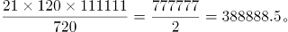

故正确答案为D。

**考点**：基础排列组合

**来源**：2013年浙江省公务员录用考试《行测》题（B类）第46题

### 第 47 题

已知3个质数的倒数和为671/1022，则这三个质数的和为：

A. 80

B. 82

C. 84

D. 86

第 47 题 · 答案与解析

**参考答案（粉笔题库参考内容）**

B

**解析**

方法一：设三个质数为x、y、z，且x>y>z，由题意得①，因x、y、z互质，则对①式左边通分，可得，即xyz=1022，因x、y、z均为质数，则最小的z=2（2是唯一的偶质数），将z=2代入①式，可得，化简得，因x、y互质，则x+y=80，又z=2，所以x+y+z=80+2=82。

方法二：设三个质数分别为x、y、z，且x>y>z，由题意得①，因x、y、z互质，则对①式左边通分，可得，即xyz=1022，因x、y、z均为质数，则最小的z=2（2是唯一的偶质数），即xy=1022÷2=511，尝试对511进行因式分解，可得511=7×73，所以x+y+z=73+7+2=82。

故正确答案为B。

**来源**：2013年浙江省公务员录用考试《行测》题（B类）第47题

### 第 48 题

从1，2，3，······，30这30个数中，取出若干个数，使其中任意两个数的积都不能被4整除。问最多可取几个数？

A. 14个

B. 15个

C. 16个

D. 17个

第 48 题 · 答案与解析

**参考答案（粉笔题库参考内容）**

C

**解析**

任意两个数之积不能被4整除，那么所取数中最多只能有一个偶数，且该偶数不能为4的倍数；30个数中共有15个奇数，所以最多可以取15+1=16个数。

故正确答案为C。

**考点**：最不利构造

**来源**：2013年浙江省公务员录用考试《行测》题（B类）第48题

### 第 49 题

某商店的两件商品成本价相同，一件按成本价多25%出售，一件按成本价少13%出售，则两件商品各售出一件时盈利为多少?

A. 6%

B. 8%

C. 10%

D. 12%

第 49 题 · 答案与解析

**参考答案（粉笔题库参考内容）**

A

**解析**

设每件成本为100，则售价为125+87=212，利润率为212÷200×100%－1＝6%。

故正确答案为A。

**考点**：经济利润问题

**来源**：2013年浙江省公务员录用考试《行测》题（B类）第49题

### 第 50 题

某市场运来苹果、香蕉、柚子和梨四种水果。其中苹果和柚子共30吨，香蕉、柚子和梨共50吨，柚子占水果总数的1/4。问一共运来水果多少吨？

A. 36吨

B. 64吨

C. 80吨

D. 170吨

第 50 题 · 答案与解析

**参考答案（粉笔题库参考内容）**

B

**解析**

设总吨数为n，由题意可得如下等式：

n=苹果+柚子+香蕉+梨=(苹果+柚子)+(柚子+香蕉，解得n=64。

故正确答案为B。

**考点**：和差倍比问题

**来源**：2013年浙江省公务员录用考试《行测》题（B类）第50题

### 第 51 题

瓶中装有浓度为20%的酒精溶液1000克，现在又分别倒入200克和400克的A、B两种酒精溶液，瓶里的溶液浓度变为15%，已知A种酒精溶液的浓度是B种酒精溶液浓度的2倍。那么A种酒精溶液的浓度是多少?

A. 5%

B. 6%

C. 8%

D. 10%

第 51 题 · 答案与解析

**参考答案（粉笔题库参考内容）**

D

**解析**

设A浓度为n，则B浓度为n/2。由题意可得如下等式：，解得n=10%。

故正确答案为D。

**来源**：2013年浙江省公务员录用考试《行测》题（B类）第51题

### 第 52 题

3点19分时，时钟上的时针与分针所构成的锐角为几度？

A. 14°

B. 14.5°

C. 15°

D. 15.5°

第 52 题 · 答案与解析

**参考答案（粉笔题库参考内容）**

B

**解析**

钟表问题中，12个点数将钟表分成了12份，每一份的度数为。分针每分钟走的度数为，时针每分钟走的度数为，即分针每分钟可追及时针6-0.5=5.5度。3点钟时，时针和分针所形成角的度数是90度，到3点19分时，即从3点开始，分针追及时针追了19分钟，共追及了。因此，3点19分时，时钟上的时针与分针所构成的锐角度数为104.5-90=14.5度。

故正确答案为B。

**来源**：2013年浙江省公务员录用考试《行测》题（B类）第52题

### 第 53 题

甲、乙两地相距210公里，a、b两辆汽车分别从甲、乙两地同时相向出发并连续往返于两地，从甲地出发的a汽车的速度为90公里/小时，从乙地出发的b汽车的速度为120公里/小时。问a汽车第二次从甲地出发后与b汽车相遇时，b汽车共行驶了多少公里？

A. 560公里

B. 600公里

C. 620公里

D. 630公里

第 53 题 · 答案与解析

**参考答案（粉笔题库参考内容）**

B

**解析**

a汽车第二次从甲地出发前，经过一个往返的路程，即420公里，所用时间为小时；与此同时，b汽车经过路程为公里，即一个往返路程加上140公里，此时a、b两车位置如图所示。

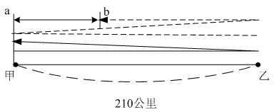

此时a、b两车相距210－140＝70公里，可知二者相遇于小时之后。整个过程中b汽车共走过公里。

故正确答案为B。

**考点**：相遇追及

**来源**：2013年浙江省公务员录用考试《行测》题（B类）第53题

### 第 54 题

某班对50名学生进行体检，有20人近视，12人超重，4人既近视又超重。该班有多少人既不近视又不超重?

A. 22人

B. 24人

C. 26人

D. 28人

第 54 题 · 答案与解析

**参考答案（粉笔题库参考内容）**

A

**解析**

根据二集合容斥原理可知，近视和超重的人数共有20+12-4=28人，则既不近视也不超重的人数为50-28=22人。

故正确答案为A。

**考点**：两集合

**来源**：2013年浙江省公务员录用考试《行测》题（B类）第54题

### 第 55 题

某工厂原来每天生产100个零件，现在工厂要在12天内生产一批零件，只有每天多生产10%才能按时完成工作，第一天和第二天由于部分工人缺勤，每天只生产了100个，那么以后10天平均每天要多生产百分之几才能按时完成工作?

A. 12%

B. 13%

C. 14%

D. 15%

第 55 题 · 答案与解析

**参考答案（粉笔题库参考内容）**

A

**解析**

设两天之后平均每天生产零件个数为x。由题意可得：工厂原来每天生产100个零件，若每天多生产10%，则每天可生产个零件，12天可生产个零件。因此，解得x=112，因此比原来多生产。

故正确答案为A。

**考点**：给具体单位型

**来源**：2013年浙江省公务员录用考试《行测》题（B类）第55题

### 第 56 题

某班有70%的学生喜欢打羽毛球，75%的学生喜欢打乒乓球，问喜欢打乒乓球的学生中至少有百分之几喜欢打羽毛球？

A. 30%

B. 45%

C. 60%

D. 70%

第 56 题 · 答案与解析

**参考答案（粉笔题库参考内容）**

C

**解析**

设该班共有100人，则喜欢打羽毛球的有70人，喜欢打乒乓球的有75人；要使喜欢打羽毛球的人中喜欢打乒乓球的最少，那么所有不喜欢打羽毛球的人都喜欢打乒乓球，即100－70＝30人，此时喜欢打乒乓球的学生中喜欢打羽毛球的人数为75－30＝45人，为最少，即45÷75＝60%。

故正确答案为C。

**考点**：两集合、非典型最值问题

**来源**：2013年浙江省公务员录用考试《行测》题（B类）第56题

### 第 57 题

一个总额为100万的项目分给甲、乙、丙、丁四个公司共同来完成，甲、乙、丙、丁分到项目额的比例为1/2：1/3：1/4：1/6，请问甲分到的项目额为多少万：

A. 35万

B. 40万

C. 45万

D. 50万

第 57 题 · 答案与解析

**参考答案（粉笔题库参考内容）**

B

**解析**

方法一：

由题意可得甲分到的项目额为万。

方法二：

可以先通分甲:乙:丙:丁=6:4:3:2，所以甲分到的项目额为万。

故正确答案为B。

**考点**：和差倍比问题

**来源**：2013年浙江省公务员录用考试《行测》题（B类）第57题

### 第 58 题

将自然数1—100分别写在完全相同的100张卡片上，然后打乱卡片，先后随机取出4张，问这4张先后取出的卡片上的数字呈增序的几率是多少？

A. 1/16

B. 1/24

C. 1/32

D. 1/7

第 58 题 · 答案与解析

**参考答案（粉笔题库参考内容）**

B

**解析**

从100张卡片中随机抽到4张，这4张大小不等，随机排列共有种方法，其中符合增序的排列只有1种，可得概率为1/24。

故正确答案为B。

**考点**：给情况求概率

**来源**：2013年浙江省公务员录用考试《行测》题（B类）第58题

### 第 59 题

两根同样长的蜡烛，点完粗蜡烛要3小时，点完细蜡烛要1小时。同时点燃两根蜡烛，一段时间后，同时熄灭，发现粗蜡烛的长度是细蜡烛的3倍。问两根蜡烛燃烧了多长时间？

A. 30分钟

B. 35分钟

C. 40分钟

D. 45分钟

第 59 题 · 答案与解析

**参考答案（粉笔题库参考内容）**

D

**解析**

粗蜡烛每小时燃烧1/3，细蜡烛每小时燃烧1。设时间为n小时，则有，解得n=3/4，即45分钟。

故正确答案为D。

**考点**：给完工时间型、和差倍比问题

**来源**：2013年浙江省公务员录用考试《行测》题（B类）第59题

### 第 60 题

一口水井，在不渗水的情况下，甲抽水机用4小时可将水抽完，乙抽水机用6小时可将水抽完。现用甲、乙两台抽水机同时抽水，但由于渗水，结果用了3小时才将水抽完。

问在渗水的情况下，用乙抽水机单独抽，需几小时抽完？

A. 12

B. 13

C. 14

D. 15

第 60 题 · 答案与解析

**参考答案（粉笔题库参考内容）**

A

**解析**

设工程量为12，则甲效率为3，乙效率为2；设渗水效率为x，则有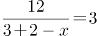，解得：x＝1；则用乙单独抽需要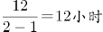。

故正确答案为A。

**考点**：给完工时间型

**来源**：2013年浙江省公务员录用考试《行测》题（B类）第60题

### 第 61 题

树枝：柴火

A. 舞蹈：节奏

B. 活性炭：除臭剂

C. 电脑：信息

D. 毒品：海洛因

第 61 题 · 答案与解析

**参考答案（粉笔题库参考内容）**

B

**解析**

第一步：判断题干两词间的逻辑关系。

题干两词是种属关系，树枝是柴火的一种，活性炭是除臭剂的一种。

第二步：逐一判断其它选项。

A项舞蹈有节奏，对应关系；C项两词是功能属性，电脑的功能之一是储存信息；D项两词是种属关系，海洛因是一种毒品，但顺序与题干相反。

故正确答案为B。

**考点**：逻辑关系-包容关系

**来源**：2013年浙江省公务员录用考试《行测》题（B类）第61题

### 第 62 题

精湛：手艺

A. 关系：暧昧

B. 差异：视野

C. 温柔：抒情

D. 深邃：思想

第 62 题 · 答案与解析

**参考答案（粉笔题库参考内容）**

D

**解析**

第一步：判断题干词语间逻辑关系。

精湛的手艺，二者是偏正关系。

第二步：判断选项词语间逻辑关系。

A项：暧昧的关系，但两词顺序颠倒，与题干逻辑关系不一致，排除；

B项：视野可以或开阔或狭隘，但不是差异，差异不能用来形容视野，与题干逻辑关系不一致，排除；

C项：温柔不能用来形容抒情，与题干逻辑关系不一致，排除；

D项：深邃的思想，二者是偏正关系，与题干逻辑关系一致，当选。

故正确答案为D。

**考点**：语法关系

**来源**：2013年浙江省公务员录用考试《行测》题（B类）第62题

### 第 63 题

中国：杭州

A. 美国：匹兹堡

B. 法国：法兰克福

C. 英国：瓦伦西亚

D. 阿联酋：沙特

第 63 题 · 答案与解析

**参考答案（粉笔题库参考内容）**

A

**解析**

第一步：判断题干词语间的逻辑关系。

杭州是中国的组成部分，二者为包容关系中的组成关系。

第二步：判断选项词语间的逻辑关系。

A项：匹兹堡是美国的组成部分，二者为包容关系中的组成关系，与题干逻辑关系一致，当选；

B项：法兰克福是德国的组成部分，而不是法国，二者为反向组成关系，与题干逻辑关系不一致，排除；

C项：瓦伦西亚是西班牙的组成部分，而不是英国，二者为反向组成关系，与题干逻辑关系不一致，排除；

D项：阿联酋和沙特是两个不同的国家，二者为并列关系，与题干逻辑关系不一致，排除。

故正确答案为A。

**考点**：逻辑关系-包容关系

**来源**：2013年浙江省公务员录用考试《行测》题（B类）第63题

### 第 64 题

解放：束缚

A. 犯罪：惩罚

B. 蜕变：堕落

C. 伶俐：笨拙

D. 黎明：拂晓

第 64 题 · 答案与解析

**参考答案（粉笔题库参考内容）**

C

**解析**

第一步：判断题干两词间的逻辑关系。

解放的反义词为束缚，二者为反义关系。

第二步：逐一判断其它选项。

A项：犯罪导致惩罚，二者为因果关系，与题干逻辑关系不一致，排除；

B项：蜕变比喻事物由一种状态转变成另一种状态，与堕落不是反义关系，与题干逻辑关系不一致，排除；

C项：伶俐的反义词为笨拙，二者为反义关系，与题干逻辑关系一致，当选；

D项：黎明又称拂晓，二者是全同关系，与题干逻辑关系不一致，排除。

故正确答案为C。

**考点**：语义关系-反义关系

**来源**：2013年浙江省公务员录用考试《行测》题（B类）第64题

### 第 65 题

雕塑：绘画

A. 政体：民主

B. 政治：信仰

C. 力学：光学

D. 样本：范例

第 65 题 · 答案与解析

**参考答案（粉笔题库参考内容）**

C

**解析**

第一步：判断题干两词间的逻辑关系。

题干两词是并列关系，雕塑和绘画是两种不同的艺术形式，与之关系相同的是C项，力学和光学是两个不同的物理学分支。

第二步：逐一判断其它选项。

A项两词是对应关系，政体可能是民主的；B项政治和信仰不存在明显的逻辑关系；D项样本和范例是近义词。

故正确答案为C。

**考点**：逻辑关系-并列关系

**来源**：2013年浙江省公务员录用考试《行测》题（B类）第65题

### 第 66 题

岳父：丈人

A. 舅舅：外甥

B. 姨妈：婶婶

C. 伯父：侄子

D. 祖母：奶奶

第 66 题 · 答案与解析

**参考答案（粉笔题库参考内容）**

D

**解析**

第一步：判断题干两词间的逻辑关系。

题干两词是全同关系，岳父和丈人是同义词，与之关系相同的是D项，祖母和奶奶是同义词。

第二步：逐一判断其它选项。

A项舅舅和外甥，B项姨妈和婶婶，C项伯父和侄子都是不同的亲属称谓。故排除A、B、C三项。

故正确答案为D。

**考点**：逻辑关系-全同关系

**来源**：2013年浙江省公务员录用考试《行测》题（B类）第66题

### 第 67 题

救助站：乞丐

A. 敬老院：护工

B. 监狱：罪犯

C. 加油站：业务员

D. 研究所：研究员

第 67 题 · 答案与解析

**参考答案（粉笔题库参考内容）**

B

**解析**

第一步：判断题干两词间的逻辑关系。

题干两词是对应关系，救助站主要是收容乞丐，与之关系相同的是B项，监狱主要是关押罪犯。

第二步：逐一判断其它选项。

A项护工在敬老院工作，D项研究员在研究所工作，A项和D项中是工作人员与工作场所的对应关系，C项加油站和业务员不存在明显的逻辑关系。

故正确答案为B。

**考点**：逻辑关系-对应关系

**来源**：2013年浙江省公务员录用考试《行测》题（B类）第67题

### 第 68 题

管乐器：笛

A. 哺乳动物：鲸鱼

B. 寒冬：大雪

C. 国庆节：纪念日

D. 中医：草药

第 68 题 · 答案与解析

**参考答案（粉笔题库参考内容）**

A

**解析**

第一步：判断题干词语间的逻辑关系。

笛是一种管乐器，二者是种属关系。

第二步：判断选项词语间的逻辑关系。

A项：鲸鱼是一种哺乳动物，二者是种属关系，与题干逻辑关系一致，当选；

B项：寒冬时可能会下大雪，二者是对应关系，与题干逻辑关系不一致，排除；

C项：国庆节是一个纪念日，两者也是种属关系，但两词顺序颠倒，与题干逻辑关系不一致，排除；

D项：中医和草药不是种属关系，与题干逻辑关系不一致，排除。

故正确答案为A。

**考点**：逻辑关系-包容关系

**来源**：2013年浙江省公务员录用考试《行测》题（B类）第68题

### 第 69 题

本分：职责

A. 羁绊：障碍

B. 奇葩：宝库

C. 蓝图：想象

D. 傲慢：偏见

第 69 题 · 答案与解析

**参考答案（粉笔题库参考内容）**

A

**解析**

第一步：判断题干两词间的逻辑关系。

本分和职责是近义词，与之关系相同的是A项，羁绊和障碍也是近义词。

第二步：逐一判断其它选项。

B项奇葩指事物特别或出众，与宝库不构成近义词；C项是因果关系，蓝图是想象的结果；D项傲慢指人的态度，偏见指人的判断，两者不是近义词。

故正确答案为A。

**考点**：语义关系-近义关系

**来源**：2013年浙江省公务员录用考试《行测》题（B类）第69题

### 第 70 题

程门立雪：尊师敬道

A. 草木皆兵：泰然自若

B. 按图索骥：事半功倍

C. 扑朔迷离：错综复杂

D. 叶公好龙：情有独钟

第 70 题 · 答案与解析

**参考答案（粉笔题库参考内容）**

C

**解析**

第一步：判断题干两词间的逻辑关系。

题干两词是近义关系，“程门立雪”和“尊师敬道”是近义词，与之关系相同的是C项，“扑朔迷离”和“错综复杂”是近义词。

第二步：逐一判断其它选项。

A项“草木皆兵”和“泰然自若”是反义词，排除；B项“按图索骥”指墨守成规，与“事半功倍”不是近义关系，排除；D项“叶公好龙”指表里不一，与“情有独钟”不是近义关系，排除。

故正确答案为C。

**考点**：语义关系-近义关系

**来源**：2013年浙江省公务员录用考试《行测》题（B类）第70题

### 第 71 题

变化视盲指在短时间内物体表面特征明显改变但人类却无法察觉的现象。

根据上述定义，下列不属于变化视盲的是：

A. 电视剧中出现穿帮镜头，同一场戏由于不同时间拍了两次，结果主要演员穿了不同的衣服，但是大部分观众都没有发现

B. 一个学生在向小李问路，恰巧有人抬黑板从两人之间经过，之后小李告诉对方如何走，但是他没有发现那个人已经不是刚刚问路的那个学生了

C. 小王听了朋友在南非的一次冒险经历，极有感触，经常回想这件事，后来他竟然认为这件事是自己的亲身经历

D. 小张看见一个男人走进对面的房子，紧接着又走出来，但是他没有发现其实走出来的是一个女人

第 71 题 · 答案与解析

**参考答案（粉笔题库参考内容）**

C

**解析**

第一步：找到定义关键词。

短时间内物体表面特征明显改变，人类却无法察觉。

第二步：逐一分析选项。

C项小王回想朋友的冒险经历，与“短时间内物品表面特征明显改变”无关，不符合定义，是本题答案。

A项主要演员穿了不同的衣服而观众没发现；B项小李没有发现问路学生已不是原来的学生；D项小张没发现走出来的不是原来看到的那个男人，都满足关键词。

本题为选非题，故正确答案为C。

**考点**：单定义-其他句式

**来源**：2013年浙江省公务员录用考试《行测》题（B类）第71题

### 第 72 题

行政强制措施：指行政机关在行政管理过程中，为制止违法行为、防止证据销毁、避免危害发生、控制危险扩大等情形，依法对公民的人身自由实施暂时性限制，或者对公民、法人或者其他组织的财物实施暂时性控制的行为。

根据上述定义，下列属于行政强制措施的是：

A. 公安机关在刑事诉讼中限令犯罪嫌疑人在规定的期限内不得离开住处或者指定的居所

B. 交通管理部门对某货车散落在高速公路上的西瓜进行及时清理

C. 公安消防部门为了阻止火势蔓延而拆除与着火处相连的房屋

D. 医疗机构为防止某精神病人病情发作伤害他人而将其强制约束

第 72 题 · 答案与解析

**参考答案（粉笔题库参考内容）**

C

**解析**

第一步：找到定义关键词。

关键词包括：“行政机关”“在行政管理过程中”“为制止违法行为、防止证据销毁、避免危害发生、控制危险扩大等情形”“暂时性限制”“暂时性控制”。

第二步：逐一分析选项。

A项，主体为公安机关，公安机关在刑事诉讼中限制犯罪嫌疑人不得离开住处或者指定的居所，属于刑事强制措施，排除；

B项，及时清理高速路上的西瓜不是在行政管理过程中，也不是对公民的人身自由或人身财务的暂时性控制，排除；

C项，“公安消防部门”是行政机关，“为了阻止火势蔓延”对“与着火处相连的房屋”进行暂时控制，符合行政强制措施定义，当选；

D项，医疗机构不属于行政机关，排除。

故正确答案为C。

**考点**：大前提

**来源**：2013年浙江省公务员录用考试《行测》题（B类）第72题

### 第 73 题

就业平等权：指公民不论其民族、种族、性别、宗教信仰、家庭背景等的不同和差异，均享有平等获得就业机会的权利。

根据上述定义，下列没有侵犯求职者的就业平等权的是：

A. 女大学生小刘，本科学历，在几次应聘中，都因为是女性而落聘

B. 某公司招聘时，明确规定本公司员工的亲属比其他应聘者优先录用

C. 小李的父亲是某县政府领导，在该县事业单位公开招聘中，小李未和其他应聘者一样参加考试，就直接被录用了

D. 某食品加工厂在招聘员工过程中，以食品安全为由，拒绝录用一名乙肝患者

第 73 题 · 答案与解析

**参考答案（粉笔题库参考内容）**

D

**解析**

第一步：找到定义关键词。

不论其民族、种族、性别、宗教信仰、家庭背景等的不同和差异，平等获得就业机会。

第二步：逐一分析选项。

D项，加工厂出于食品安全的考虑拒绝乙肝患者，不在定义列举的“民族、种族、性别、宗教信仰、家庭背景”的情况中，故没有侵犯求职者的就业平等权，是本题答案。

A项小刘因性别问题落聘，其就业平等权被侵犯；B项的招聘与家庭背景挂钩，C项小李依靠家庭背景不参加考试就直接被录用，B、C两项都侵犯了其他求职者的就业平等权。

故正确答案为D。

**考点**：单定义-其他句式

**来源**：2013年浙江省公务员录用考试《行测》题（B类）第73题

### 第 74 题

破窗现象：一个房子如果窗户破了，没有人去修补，隔不久，其他的窗户也会莫名其妙地被人打破。所以环境中的不良现象如果被放任存在，会诱使人们仿效，甚至变本加厉。

根据上述定义，下列不属于破窗现象的是：

A. 一面墙出现了一些涂鸦没有被清除，很快，墙上就布满了乱七八糟、不堪入目的东西

B. 一个干净的地方，人们不好意思丢垃圾，但是一旦地上有垃圾出现，人们就会毫不犹豫地跟着丢，丝毫不会惭愧

C. 一个村里发生了传染性疾病，由于没有及时隔离，结果很快整个村落的人都被传染上了

D. 一个教室里，有两个学生偷偷讲话，老师没有制止，很快大半个班级的学生都在聊天了

第 74 题 · 答案与解析

**参考答案（粉笔题库参考内容）**

C

**解析**

第一步：找到定义关键词。

“环境中的不良现象”、“被放任存在”、“诱使人们仿效”。

第二步：逐一分析选项。

C项传染性疾病的传播并非是人们仿效造成的结果，不满足定义，是本题答案。

A项墙上的涂鸦、B项地上的垃圾、D项教室学生讲话都是不良现象被放任存在后，别人仿效形成的结果，满足关键词。

本题为选非题，故正确答案为C。

**考点**：故事类

**来源**：2013年浙江省公务员录用考试《行测》题（B类）第74题

### 第 75 题

诈骗罪：指以非法占有为目的，用虚构事实或者隐瞒真相的方法，骗取数额较大的公私财物的行为。

根据上述定义，下列可以构成诈骗罪的是：

A. 甲假装在商场购买西装，售货员乙让其试穿，甲穿上西装后声称去照镜子，趁乙接待其他顾客之际偷偷穿走

B. 某加油站负责人通过在计价器上动手脚，使得实际加油量少于机器显示数量，据此获取大笔收益

C. 某甲在低价出手其别墅时隐瞒其中曾发生凶杀案的事实，致某乙因不知情而购买

D. 某售楼小姐甲向客户乙推销地铁口的楼盘，称楼盘的升值空间很大，乙购房后两个月，房价大跌，致乙遭受惨重损失

第 75 题 · 答案与解析

**参考答案（粉笔题库参考内容）**

B

**解析**

第一步：找到定义关键词。

“以非法占有为目的，虚构事实或隐瞒真相，骗取数额较大的公私财物”。

第二步：逐一分析选项。

A项：甲声称去照镜子实际将西装偷偷穿走，属于盗窃，并不是用虚构事实或者隐瞒真相的方法骗取财物，不符合定义，排除；

B项：加油站负责人在计价器上动手脚，是用隐瞒真相的方法非法占有本该属于消费者的加油量，获得大笔收益，符合定义，保留；

C项：隐瞒发生凶案的事实是为了出售自己的别墅，并不是以非法占有他人财物为目的，不符合定义，排除；

D项：售楼小姐声称楼盘升值大是为了卖出房子，没有以非法占有他人财物为目的，不符合定义，排除。

比较AB，A项没有体现是否是骗取数额较大的公私财物的行为，B项明确指出获得了大笔收益，B项比A项更明确。

故正确答案为B。

**考点**：方式目的

**来源**：2013年浙江省公务员录用考试《行测》题（B类）第75题

### 第 76 题

从所给的四个选项中，选择最合适的一个填入问号处，使之呈现一定的规律性：

A. A

B. B

C. C

D. D

第 76 题 · 答案与解析

**参考答案（粉笔题库参考内容）**

D

**解析**

本题考查每组图形内部的规律，考元素。已知每组图形中的黑色阴影部分与其中一个图案的形状相同，大小不同，只有D项符合这一规律。

故正确答案为D。

**考点**：特殊规律-图形间关系

**来源**：2013年浙江省公务员录用考试《行测》题（B类）第76题

### 第 77 题

请从所给的四个选项中，选择最合适的一个填入问号处，使之呈现一定的规律性：

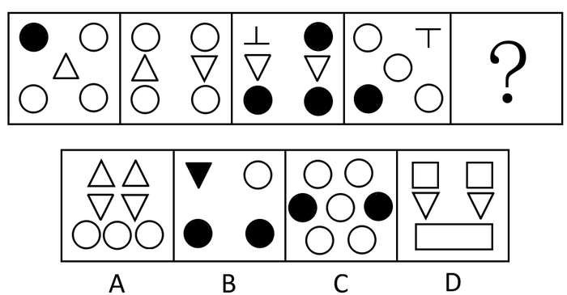

A. A

B. B

C. C

D. D

第 77 题 · 答案与解析

**参考答案（粉笔题库参考内容）**

B

**解析**

本题元素是集合形式，考查元素数量。已知每个图形中都包含三种不同的元素，且后一个图形包含了一种前面图形都没有的新元素，符合这一规律的只有B项。A项包含的元素在前面的图形中都出现过；C项只有两种元素；D项包含两种新的元素。

故正确答案为B。

**考点**：数量规律-素、样式规律-遍历

**来源**：2013年浙江省公务员录用考试《行测》题（B类）第77题

### 第 78 题

从所给的四个选项中，选择最合适的一个填入问号处，使之呈现一定的规律性：

A. A

B. B

C. C

D. D

第 78 题 · 答案与解析

**参考答案（粉笔题库参考内容）**

A

**解析**

图形元素组成不同，窟窿较明显，优先考虑数面。题干每个图形的面数量均为6，所以问号处也应该选一个有6个面的图形。A项6个，B项5个，C项4个，D项4个，只有A项符合。

故正确答案为A。

**考点**：数量规律-面

**来源**：2013年浙江省公务员录用考试《行测》题（B类）第78题

### 第 79 题

从所给的四个选项中，选择最合适的一个填入问号处，使之呈现一定的规律性：

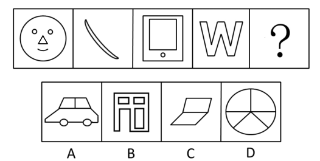

A. A

B. B

C. C

D. D

第 79 题 · 答案与解析

**参考答案（粉笔题库参考内容）**

D

**解析**

图形元素组成不同，优先考虑属性规律。题干每个图形都是轴对称图形，四个选项中只有D项是轴对称图形。

故正确答案为D。

**考点**：属性规律-对称性

**来源**：2013年浙江省公务员录用考试《行测》题（B类）第79题

### 第 80 题

左边给定的是纸盒的外表面，下列哪一项能由它折叠而成：

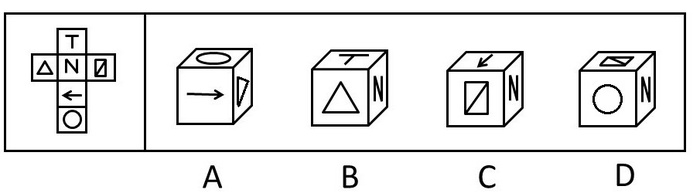

A. A

B. B

C. C

D. D

第 80 题 · 答案与解析

**参考答案（粉笔题库参考内容）**

A

**解析**

本题属于空间重构类。

A项：与题干相符，当选；

B项：面T的竖线应该指向面N，而不是选项中的，排除；

C项：箭头尖部应该指向，而不是四边形，排除；

D项：面N和面在展开图中相隔一个面，是一组相对面，相对面不能同时出现，排除。

故正确答案为A。

**考点**：空间类-空间重构-六面体

**来源**：2013年浙江省公务员录用考试《行测》题（B类）第80题

### 第 81 题

把下面的六个小图形分为两类，使每一类图形都有各自的共同特征或规律，分类正确的一项是：

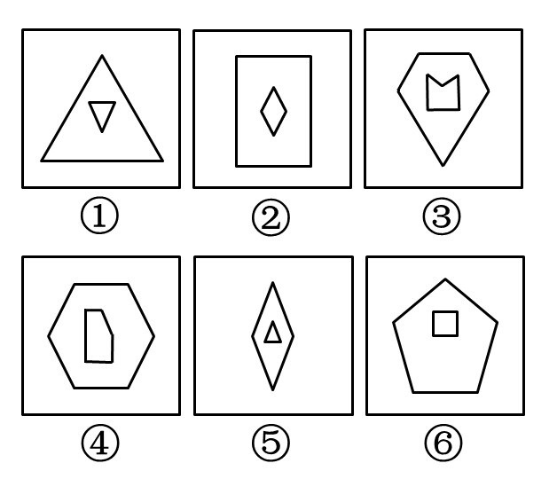

A. ①②③，④⑤⑥

B. ①②⑤，③④⑥

C. ①③⑥，②④⑤

D. ①③⑤，②④⑥

第 81 题 · 答案与解析

**参考答案（粉笔题库参考内容）**

A

**解析**

本题元素组成凌乱，考数数。本题数内部图形和外部图形的边数。第1、2、3组图形中，内、外部图形的边数一样多，第4、5、6组图形中，内部图形的边数比外部图形的边数少一条。

故正确答案为A。

**考点**：数量规律-线

**来源**：2013年浙江省公务员录用考试《行测》题（B类）第81题

### 第 82 题

把下面的六个小图形分为两类，使每一类图形都有各自的共同特征或规律，分类正确的一项是：

A. ①②④，③⑤⑥

B. ①②⑤，③④⑥

C. ①③⑤，②④⑥

D. ①②⑥，③④⑤

第 82 题 · 答案与解析

**参考答案（粉笔题库参考内容）**

B

**解析**

解析1：本题元素组成凌乱，考属性。第3、4、6组图形为中心对称图形，第1、2、5组图形都是非对称图形。

故正确答案为B。

解析2：本题元素组成凌乱，考数数。本题考查图形的笔画数。第1、2、5组图形都是一笔画，第3、4、6组图形为多笔画。

故正确答案为B。

这种分类形式并不常见，也不够严谨，更好的应该是每一组都具有各自的规律。

**考点**：属性规律-对称性

**来源**：2013年浙江省公务员录用考试《行测》题（B类）第82题

### 第 83 题

把下面的六个小图形分为两类，使每一类图形都有各自的共同特征或规律，分类正确的一项是：

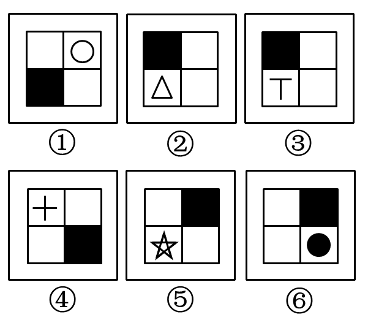

A. ①②③，④⑤⑥

B. ①③⑤，②④⑥

C. ①④⑤，②③⑥

D. ①④⑥，②③⑤

第 83 题 · 答案与解析

**参考答案（粉笔题库参考内容）**

C

**解析**

本题考查每组图形内部的规律，具体是位置的相对和相邻。第1、4、5组图形中，两个白色方块是相对的，第2、3、6组图形中，两个白色方块是相邻的。

故正确答案为C。

**考点**：数量规律-素

**来源**：2013年浙江省公务员录用考试《行测》题（B类）第83题

### 第 84 题

从所给的四个选项中，选择最合适的一个填入问号处，使之呈现一定的规律性：

A. A

B. B

C. C

D. D

第 84 题 · 答案与解析

**参考答案（粉笔题库参考内容）**

C

**解析**

本题只由三角形构成，所以数三角形的个数。九宫图中，与最中间的图形相邻的另外两个图形所包含的三角形个数总和为9个，如下图所示。四个选项中，只有C项的个数满足这一规律。

故正确答案为C。

**考点**：数量规律-素

**来源**：2013年浙江省公务员录用考试《行测》题（B类）第84题

### 第 85 题

从所给的四个选项中，选择最合适的一个填入问号处，使之呈现一定的规律性：

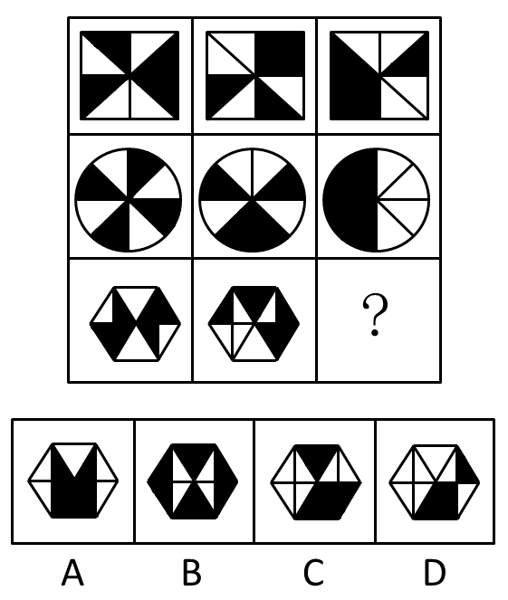

A. A

B. B

C. C

D. D

第 85 题 · 答案与解析

**参考答案（粉笔题库参考内容）**

D

**解析**

元素组成相似，优先考虑样式。图形都是由黑白块组成，考虑黑白运算。九宫格中，每一行中的前两幅图叠加形成第三幅图，叠加时遵循以下规律：白+白=黑，黑+黑=黑，黑+白=白，白+黑=白。依此规律，第三行前两幅图叠加后形成的图形应为D项。

故正确答案为D。

**考点**：样式规律-黑白运算

**来源**：2013年浙江省公务员录用考试《行测》题（B类）第85题

### 第 86 题

品学兼优的学生不都读研究生。

如果以上论述为真，则下列命题能判断真假的有几个?

Ⅰ.有些品学兼优的学生读研究生

Ⅱ.有些品学兼优的学生不读研究生

Ⅲ.所有品学兼优的学生都读研究生

Ⅳ.所有品学兼优的学生都不读研究生

A. 1

B. 2

C. 3

D. 4

第 86 题 · 答案与解析

**参考答案（粉笔题库参考内容）**

B

**解析**

第一步：翻译题干。

品学兼优的学生不都读研究生，等价于：有些品学兼优的学生不读研究生。

第二步：逐一分析选项。

Ⅰ.通过题干“有些品学兼优的学生不读研究生”，其中“有些”无法判定具体是多少，因此无法判定“有些品学兼优的学生读研究生”的真假情况，故Ⅰ无法判断真假；

Ⅱ.“有些品学兼优的学生不读研究生”，与题干一致，故可判断Ⅱ为真；

Ⅲ.“所有品学兼优的学生都读研究生”与题干“有些品学兼优的学生不读研究生”为矛盾关系，矛盾关系必有一真必有一假，题干条件为真，故可判断Ⅲ为假；

Ⅳ.通过题干“有些品学兼优的学生不读研究生”，其中“有些”无法判定具体是多少，因此无法判定“所有品学兼优的学生都不读研究生”的真假情况，故Ⅳ无法判断真假。

综上分析，可判断Ⅱ为真，Ⅲ为假，Ⅰ和Ⅳ无法判断真假，即可确定真假的有两个。

故正确答案为B。

**考点**：集合推理

**来源**：2019年福建省选调生考试《行政职业能力测验》第83题

### 第 87 题

20世纪60年代，加州大学伯克利分校进行了一系列关于小鼠认知能力的实验。在实验中，一组小鼠被放在摆满各种玩具、转轮和隧道的笼子里，另一组小鼠则在空无一物的笼子里长大。实验结果显示，前一组小鼠大脑的体积更大，认知能力也显著高于后一组。研究人员因此作出推论：充分的外界刺激可以改变大脑的结构和能力。

下列哪项如果为真，最能加强研究人员的推论：

A. 实验中，前一组小鼠的食物营养更丰富

B. 实验后，后一组小鼠的运动能力更强

C. 后来，两组小鼠的平均寿命差不多

D. 实验前，两组小鼠的个体差异不大

第 87 题 · 答案与解析

**参考答案（粉笔题库参考内容）**

D

**解析**

本题属于类比加强题型。

第一步：找出论点论据。

论点：充分的外界刺激可以改变大脑的结构和能力；

论据：研究人员对两组小白鼠进行的实验。

第二步：逐一判断选项的作用。

题干中的实验是对比实验。对比实验研究的是笼子里放置玩具、转轮和隧道是否对小鼠的认知能力有影响，因此除了这个条件外，实验组的其他方面应该有相同或相近的实验状态。

D项对实验组的小鼠的条件进行限定，使对比实验在实验前具有相近的状态，从而验证了笼子中放置的物品对小鼠的影响，有助于加强研究人员的结论，为本题答案。

A项说明实验对象存在某些差异，不利于说明变量对实验对象的影响，削弱了论证；B项是否定结论；C项小鼠后来的平均寿命如何，跟对比实验无直接关系，属于无关选项。

故正确答案为D。

**考点**：必要条件、加强-实验类

**来源**：2013年浙江省公务员录用考试《行测》题（B类）第87题

### 第 88 题

因为规定“黄灯亮时，已越过停止线的车辆可以继续通行”。所以黄灯亮时，未越过停止线的车辆不能继续通行。

下列哪项的论述逻辑与此最为不同？

A. 因为规定“间歇性的精神病人在精神正常的时候犯罪，应当负刑事责任”。所以，间歇性的精神病人在精神不正常的时候犯罪，不应负刑事责任

B. 因为规定“尚未制定法律的，行政法规可以设定行政许可”。所以，已经制定法律的，行政法规不可以设定行政许可

C. 因为规定“申请小型汽车驾驶证的年龄条件为18周岁以上、70周岁以下”。所以，不满18周岁以及超过70周岁的公民不能申请小型汽车驾驶证

D. 因为规定“18周岁以上的公民，可以独立进行民事活动”。所以，不满18周岁的公民，不能独立进行民事活动

第 88 题 · 答案与解析

**参考答案（粉笔题库参考内容）**

C

**解析**

本题属关联词推导中的推出方式类似题型，需要逐一分析题干和选项的结构。

题干结构为前提：黄灯亮，已越过停止线的车辆→可以继续通行；结论：黄灯亮，没有越过停止线的车辆→不可以继续通行，其论证结构为a→b得出－a→－b。

A项前提：间歇性的精神病人，精神正常的时候犯罪→应当负刑事责任；结论：间歇性的精神病人，精神不正常的时候犯罪→不应当负刑事责任；

B项前提：尚未制定法律的→行政法规可以设定行政许可；结论：已经制定法律的→行政法规不可以设定行政许可；

C项前提：申请小型汽车驾驶证→年龄条件为18周岁以上、70周岁以下；结论：不满18周岁以及超过70周岁的公民→不能申请小型汽车驾驶证；

D项前提：18周岁以上→可以独立进行民事活动；结论：不满18周岁→不可以独立进行民事活动。

经对比，A、B、D三项的论述结构与题干一致，均为a→b得出－a→－b，而C项的论述结构为a→b得出－b→－a，与题干结构不同。

本题为选非题，故正确答案为C。

**考点**：推理形式

**来源**：2013年浙江省公务员录用考试《行测》题（B类）第88题

### 第 89 题

亲生父母双方都有高血压的人，得高血压的几率是亲生父母都没有高血压的人的5倍。所以，高血压可能是一种遗传病。

下列哪项如果为真，最能支持上述结论：

A. 亲生父母都有高血压的人，无论如何注意生活方式，得高血压的几率仍然很高

B. 亲生父母没有高血压的人，在和患高血压的养父母生活一段时间后，得高血压的几率会增高

C. 亲生父母都有高血压的人，在承受巨大生活压力时，更易得高血压

D. 亲生父母患有高血压的人，在没有出现高血压病症前，做些预防性治疗，可以降低得高血压的几率

第 89 题 · 答案与解析

**参考答案（粉笔题库参考内容）**

A

**解析**

本题属于加强题型。

第一步：找出论点论据。

论点：高血压可能是一种遗传病；

论据：亲生父母双方都有高血压的人，得高血压的几率是亲生父母都没有高血压的人的5倍。

第二步：逐一分析选项。

A项说明，与生活方式相比，遗传因素对一个人是否患高血压有更大的影响，加强了论点；B项说明生活方式对患高血压有影响，C项说明生活压力大更易导致高血压，B、C两项都削弱了论点；D项说的是降低得高血压的几率的办法，没有说明高血压与遗传之间的关系，属于无关选项。

故正确答案为A。

**考点**：补充论据

**来源**：2013年浙江省公务员录用考试《行测》题（B类）第89题

### 第 90 题

西双版纳傣族的竹楼都用方形柱子将房子架空来防止潮湿及蚊虫骚扰，之所以用方形柱子而不是圆形柱子，是为了防止蛇攀爬进入竹楼。

下列哪项最有可能是上述陈述的假设：

A. 傣族人喜欢把东西做成方形的

B. 蛇喜欢攀爬圆形的柱子

C. 西双版纳热带雨林中有很多蛇

D. 蛇不能缠绕着方形的柱子爬行

第 90 题 · 答案与解析

**参考答案（粉笔题库参考内容）**

D

**解析**

本题属于加强题型。

第一步：找出论点论据。

论点：西双版纳傣族的竹楼都用方形柱子将房子架空来防止潮湿及蚊虫骚扰；

论据：用方形柱子而不是圆形柱子，是为了防止蛇攀爬进入竹楼。

第二步：逐一分析选项。

D项加强论点，如果蛇能够缠绕方形的柱子爬行，那么用方形柱子也无法防止蛇攀爬进入竹楼，因此要使论点成立，必须以蛇不能缠绕方形的柱子爬行为前提。

A项傣族人喜欢把东西做成什么形状，跟方形柱子是否能起到防止蛇爬入竹楼无关；B项蛇喜欢爬圆形柱子和C项蛇很多，都无法说明方形柱子是否能防止蛇攀爬。A、B、C都属于无关选项。

故正确答案为D。

**考点**：必要条件

**来源**：2013年浙江省公务员录用考试《行测》题（B类）第90题

### 第 91 题

甲、乙、丙、丁四人对四个抽屉中的物品进行预测。甲：有些抽屉中没有书本；乙：所有抽屉中都有书本；丙：第二个抽屉中没有钢笔；丁：第三个抽屉中有信件。如果四人的断定中只有一项为真，那么以下哪项一定为真？

A. 第二个抽屉中有钢笔

B. 第三个抽屉中有信件

C. 四个抽屉中都有书本

D. 四个抽屉中都没有书本

第 91 题 · 答案与解析

**参考答案（粉笔题库参考内容）**

A

**解析**

第一步：找突破口。

本题考查矛盾关系，四句话中，甲、乙的话矛盾。

第二步：看其余的话。

丙、丁的话为假，因此第二个抽屉中有钢笔，第三个抽屉中没有信件。甲的话为真，乙的话为假。

根据上述推论，可知A项一定为真，B项一定为假，C项一定为假，而D项无法判断真假。

第三步：再次标注答案。

故正确答案为A。

**考点**：只有一真/一假

**来源**：2013年浙江省公务员录用考试《行测》题（B类）第91题

### 第 92 题

耐甲氧西林金黄色葡萄球菌（MRSA）、克雷伯氏菌等细菌能引起多种疾病和感染。同时各种抗生素往往又对它们无可奈何，这些令人色变的细菌因而被称为超级细菌。近年来，研究人员通过微生物的全基因组测序技术不仅能追踪MRSA的源头，而且能追踪到其他耐药细菌的源头。因此，全基因组测序技术可以解决MRSA等超级细菌给人类带来的疾病困扰。

下列哪项为真，最能削弱上述论证：

A. 超级细菌会随着环境的变化而变异

B. 进行全基因组测序的费用比较高

C. 全基因组技术可为寻找抑制超级细菌的药物提供线索

D. 全基因组测序技术无法杀灭超级细菌

第 92 题 · 答案与解析

**参考答案（粉笔题库参考内容）**

D

**解析**

本题为削弱题型。

第一步：找出论点和论据。

论点：全基因组测序技术可以解决MRSA等超级细菌给人类带来的疾病困扰.

论据：近年来，研究人员通过微生物的全基因组测序技术不仅能追踪MRSA的源头，而且能追踪到其他耐药细菌的源头。

第二步：逐一分析选项。

D项直接否定论点，说明全基因组测序技术不能解决超级细菌给人类带来的疾病困扰，属于削弱项；

A项超级细菌会随环境的变化而变异，B项全基因组测序的费用高，无法证明全基因组测序技术能杀灭超级细菌，均属于无关项；

C项说明全基因组测序技术有助于消灭超级细菌，支持论点，属于加强项。

故正确答案为D。

**考点**：削弱论点

**来源**：2013年浙江省公务员录用考试《行测》题（B类）第92题

### 第 93 题

张红、李聪、王敏，一个是江苏人，一个是浙江人，一个是广东人。浙江人比李聪年龄小，张红和浙江人不同岁，王敏的年龄比广东人大。根据上述断定，可以推出：

A. 张红是江苏人，李聪是浙江人，王敏是广东人

B. 张红是广东人，李聪是江苏人，王敏是浙江人

C. 张红是浙江人，李聪是广东人，王敏是江苏人

D. 张红是浙江人，李聪是江苏人，王敏是广东人

第 93 题 · 答案与解析

**参考答案（粉笔题库参考内容）**

B

**解析**

本题属于排列组合题。

第一步：找突破口。

本题突破口为信息量最大的对象，即浙江人。由“浙江人比李聪年龄小，张红和浙江人不同岁”，可知浙江人既不是李聪，也不是张红，而是王敏。

第二步：将信息列于表中，即将题干和第一步的信息抄到一个表里。

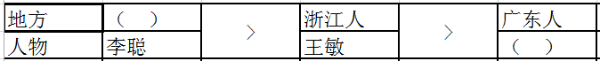

第三步：填空，即填上每一个集合的空格。

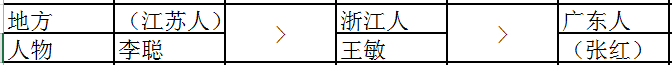

由上表可知，张红是广东人，李聪是江苏人，王敏是浙江人。

故正确答案为B。

**考点**：从最大信息开始推

**来源**：2013年浙江省公务员录用考试《行测》题（B类）第93题

### 第 94 题

对某班学生喜欢的体育活动进行调查后发现：该班的学生或者喜欢打篮球，或者喜欢打羽毛球，如果喜欢打排球，则不喜欢打羽毛球，该班的班长喜欢打排球，因此他也喜欢打乒乓球。

以下哪项最可能是上述论证的假设？

A. 该班的班长至少喜欢三项体育活动

B. 喜欢打乒乓球的学生都喜欢打羽毛球

C. 喜欢打篮球的学生都喜欢打乒乓球

D. 该班学生喜欢的体育活动只有篮球、羽毛球、排球和乒乓球四项

第 94 题 · 答案与解析

**参考答案（粉笔题库参考内容）**

C

**解析**

第一步：分析题干，找到论点和论据。

论点：喜欢打排球→喜欢打乒乓球。

论据①：喜欢打篮球 或 喜欢打羽毛球。

论据②：喜欢打排球→-喜欢打羽毛球。

①是一个选言命题，等价于：-喜欢打羽毛球→喜欢打篮球。

第二步：逐一分析选项。

A项：该班的班长至少喜欢三项体育活动，并不能得到喜欢打排球就一定喜欢打乒乓球，排除；

B项：喜欢打乒乓球的学生都喜欢打羽毛球，喜欢打乒乓球→喜欢打羽毛球，喜欢打羽毛球→-喜欢打排球，所以喜欢打乒乓球→-喜欢打排球，跟论点相反，是削弱论点，排除；

C项：在论点和论据中间搭桥，起加强作用；

D项：该班学生喜欢的体育活动只有篮球、羽毛球、排球和乒乓球四项，跟A项一样并不能推出喜欢打排球就一定喜欢打乒乓球，排除。

故正确答案为C。

**考点**：搭桥

**来源**：2013年浙江省公务员录用考试《行测》题（B类）第94题

### 第 95 题

新加坡国立大学社会学家波林·斯特劳恩副教授对当地已婚者和离婚者展开的调查发现，恋爱时间较长的夫妻，婚后闹分手的几率会比那些恋爱时间较短的夫妻低。于是有人得出结论，要想以后的婚姻更稳固，必须延长恋爱时间。

下列哪项为真，最能削弱上述结论：

A. 恋爱谈得越长，两人结婚的可能性会越低

B. 情侣在恋爱期是否深入了解彼此比恋爱时间长短更重要

C. “一见钟情式”的速成婚姻容易破碎

D. 恋爱时间长的人，往往会忘记恋爱的目的是婚姻

第 95 题 · 答案与解析

**参考答案（粉笔题库参考内容）**

B

**解析**

第一步：分析题干，找到论点和论据。

论点：要想以后的婚姻更稳固，必须延长恋爱时间。

论据：调查发现，恋爱时间越长的夫妻，婚后闹分手的几率会比那些恋爱时间较短的夫妻低。

第二步：逐一分析选项。

A 项：结婚的可能性低与婚姻是否牢固无关，与论点话题不一致，无法削弱；

B 项：选项说深入了解彼此比恋爱时间更重要，说明延长了恋爱时间并不是使得婚姻稳固的必要条件，只要你在恋爱期深入了解了彼此就也可以使婚姻更稳固，削弱了题干的论点；

C 项：“速成婚姻容易破碎”，说明婚姻牢固与恋爱时间长短有关，属于加强选项；

D 项：恋爱目的与婚姻是否牢固无关，属于无关选项。

故正确答案为B。

**考点**：削弱论点

**来源**：2013年浙江省公务员录用考试《行测》题（B类）第95题

### 第 96 题

党的十八大报告指出，         是中国特色社会主义的内在要求，         是中国特色社会主义的根本原则，         是中国特色社会主义的本质属性。

A. 公平正义 共同富裕 社会和谐

B. 共同富裕 公平正义 社会和谐

C. 社会和谐 共同富裕 公平正义

D. 社会和谐 公平正义 共同富裕

第 96 题 · 答案与解析

**参考答案（粉笔题库参考内容）**

A

**解析**

本题考查新思想。

党的十八大报告指出，公平正义是中国特色社会主义的内在要求，共同富裕是中国特色社会主义的根本原则，社会和谐是中国特色社会主义的本质属性。

故正确答案为A。

**考点**：新思想总论

**来源**：2013年浙江省公务员录用考试《行测》题（A类）第96题

### 第 97 题

下列关于新民主主义革命时期的大事件的表述，不正确的是：

A. 五四运动标志着中国新民主主义革命的开始，中国工人阶级也第一次以独立的姿态登上政治舞台

B. 中共二大第一次提出了明确的反帝反封建的民主革命纲领

C. 中共三大正确估计了国民党的革命立场，决定共产党员以个人身份加入国民党，标志第一次国共合作正式开始

D. 南昌起义标志着中国共产党独立领导革命战争，创建人民军队和武装夺取政权的开始

第 97 题 · 答案与解析

**参考答案（粉笔题库参考内容）**

C

**解析**

本题考查人文历史。

A项正确，五四运动发生于1919年，是一次彻底地反对帝国主义和封建主义的爱国运动，是中国新民主主义的开始；青年学生起了先锋作用；中国无产阶级开始登上政治舞台；传播了马克思主义。

B项正确，中共二大于1922年7月16日至23日在上海英租界南成都路辅德里625号举行。此次大会制定了党的最高纲领和最低纲领，在中国近代历史上第一次明确提出了彻底地反帝反封建的民主革命任务。

C项错误，中共三大正确估计了孙中山和国民党的革命立场，决定共产党员以个人身份加入国民党，正式确定了建立国共合作统一战线的策略方针和政策。中共三大是第一次国共合作的历史序幕。标志着第一次国共合作正式形成的是1924年国民党一大的召开。

D项正确，南昌起义指在1927年8月1日中共联合国民党左派，打响了武装反抗国民党反动派的第一枪，揭开了中国共产党独立领导武装斗争和创建革命军队的序幕。八一南昌起义是中国共产党独立领导武装革命战争和创建人民军队的开始的标志。

本题为选非题，故正确答案为C。

**考点**：中国历史

**来源**：2013年浙江省公务员录用考试《行测》题（A类）第97题

### 第 98 题

科学发展观的核心是           ，基本要求是          。

A. 以人为本 全面协调可持续

B. 发展 全面协调可持续

C. 以人为本 统筹兼顾

D. 发展 统筹兼顾

第 98 题 · 答案与解析

**参考答案（粉笔题库参考内容）**

A

**解析**

本题考查科学发展观的要点。科学发展观的第一要务是发展，核心是以人为本，基本要求是全面协调可持续，根本方法是统筹兼顾。

故正确答案为A。

**来源**：2013年浙江省公务员录用考试《行测》题（A类）第98题

### 第 99 题

下列关于我国公务员制度的表述，不正确的是：

A. 根据《公务员法》，我国公务员职位类别划分为综合管理类、专业技术类和行政执法类等类别

B. 已被开除的公职人员，不得录用为公务员

C. 工作年限满三十年的公务员，可以申请提前退休

D. 对公务员考核的内容包括德、能、勤、绩、廉五个方面，重点考核思想道德与工作能力

第 99 题 · 答案与解析

**参考答案（粉笔题库参考内容）**

D

**解析**

本题考查法律常识。

A项正确，《公务员法》第十六条规定：“国家实行公务员职位分类制度。 公务员职位类别按照公务员职位的性质、特点和管理需要，划分为综合管理类、专业技术类和行政执法类等类别。根据本法，对于具有职位特殊性，需要单独管理的，可以增设其他职位类别。各职位类别的适用范围由国家另行规定。”

B项正确，根据《公务员法》第二十六条：“下列人员不得录用为公务员：（一）因犯罪受过刑事处罚的；（二）被开除中国共产党党籍的；（三）被开除公职的；（四）被依法列为失信联合惩戒对象的；（五）有法律规定不得录用为公务员的其他情形的。”曾被开除公职的人不得录用为公务员。

C项正确，根据《公务员法》第九十三条：“公务员符合下列条件之一的，本人自愿提出申请，经任免机关批准，可以提前退休：（一）工作年限满三十年的；（二）距国家规定的退休年龄不足五年，且工作年限满二十年的；（三）符合国家规定的可以提前退休的其他情形的。”

D项错误，根据《公务员法》第三十五条：“公务员的考核应当按照管理权限，全面考核公务员的德、能、勤、绩、廉，重点考核政治素质和工作实绩。考核指标根据不同职位类别、不同层级机关分别设置。”

本题为选非题，故正确答案为D。

**考点**：行政法

**来源**：2013年浙江省公务员录用考试《行测》题（A类）第99题

### 第 100 题

下列不属于完全竞争市场的特征的是：

A. 买者卖者很多

B. 产品差别很大

C. 要素自由流动

D. 没有交易成本

第 100 题 · 答案与解析

**参考答案（粉笔题库参考内容）**

B

**解析**

完全竞争市场又叫作纯粹竞争市场，是指竞争充分而不受任何阻碍和干扰的一种市场结构。完全竞争市场的特点包括买者卖者很多，产品是无差别的，资源自由流动，市场信息是完全和对称的，不存在交易成本。综上可知，B项“产品差别很大”不属于完全竞争市场的特征。

本题为选非题，故正确答案为B。

**考点**：微观经济

**来源**：2013年浙江省公务员录用考试《行测》题（A类）第100题

### 第 101 题

经济学上，狭义的货币（M1）是指：

A. 现金

B. 现金和存款

C. 现金和活期存款

D. 现金、存款和债券

第 101 题 · 答案与解析

**参考答案（粉笔题库参考内容）**

C

**解析**

狭义货币是宏观经济学的概念，与广义货币相对应。狭义货币又称为交易货币，包括现金和所有活期存款；广义货币包括狭义货币以及定期存款与储蓄存款。

故正确答案为C。

**考点**：宏观经济与调控政策

**来源**：2013年浙江省公务员录用考试《行测》题（A类）第101题

### 第 102 题

三沙市位于中国南海，是目前我国最年轻的地级市，下辖西沙群岛、南沙群岛、中沙群岛的岛礁及其海域，三沙市的设立是由哪一机关批准：

A. 全国人大

B. 全国人大常委

C. 国务院

D. 海南省人大

第 102 题 · 答案与解析

**参考答案（粉笔题库参考内容）**

C

**解析**

本题考查宪法对国家机构职权的相关规定。根据宪法的规定，全国人大批准省、自治区和直辖市的建置。国务院批准省、自治区、直辖市的区域划分，批准自治州、县、自治县、市的建置和区域划分。三沙市属于地级市，其设立由国务院批准。

故正确答案为C。

**考点**：宪法

**来源**：2013年浙江省公务员录用考试《行测》题（A类）第102题

### 第 103 题

某化工厂将废水直接排入河道，流入张某的鱼塘，造成绝大部分鱼死亡。该厂承认其侵权，但不能接受张某提出的赔偿数额。

对此，下列哪一表述是不正确的：

A. 张某请求损害赔偿的诉讼时效为3年

B. 张某可以请求环境保护行政主管部门处理

C. 张某对环境保护行政主管部门的处理决定不服的，可以向法院起诉

D. 张某必须先经过环境保护行政主管部门处理，不能直接向法院起诉

第 103 题 · 答案与解析

**参考答案（粉笔题库参考内容）**

D

**解析**

本题考查《环境保护法》。

A项正确，《环境保护法》第四十二条规定：“因环境污染损害赔偿提起诉讼的时效期为三年，从当事人知道或者应当知道受到污染损害时起计算。”

B、C两项正确，D项错误，《环境保护法》第四十一条规定：“造成环境污染危害的，有责任排除危害，并对直接受到损害的单位或者个人赔偿损失。赔偿责任和赔偿金额的纠纷，可以根据当事人的请求，由环境保护行政主管部门或者其他依照法律规定行使环境监督管理权的部门处理；当事人对处理决定不服的，可以向人民法院起诉。当事人也可以直接向人民法院起诉。”结合本题情况，张某可以请求环境保护行政主管部门处理，也可直接向人民法院起诉。

本题为选非题，故正确答案为D。

**考点**：其他法律法规

**来源**：2013年浙江省公务员录用考试《行测》题（A类）第103题

### 第 104 题

某甲共育有三儿一女，2000年甲在公证机关公证下立a遗嘱将其财产给予其小儿子所有，后因与小儿子关系恶化，甲又自书b遗嘱决定将财产给予二儿子所有。

根据我国《民法典》的相关规定，下列表述正确的是：

A. a遗嘱因经公证而效力优先，故应以a遗嘱为准

B. b遗嘱为后立遗嘱，故应以b遗嘱为准

C. a、b遗嘱均因侵犯其他继承人的合法权利而无效

D. a、b遗嘱均因可能侵犯其他继承人的合法权利而效力待定

第 104 题 · 答案与解析

**参考答案（粉笔题库参考内容）**

B

**解析**

《民法典》第一千一百四十二条第三款规定：“立有数份遗嘱，内容相抵触的，以最后的遗嘱为准。”本题中，b遗嘱是最后的遗嘱，因此应当以b遗嘱为准。

故正确答案为B。

**考点**：民法典

**来源**：2013年浙江省公务员录用考试《行测》题（A类）第104题

### 第 105 题

甲开汽车到单位后，因疏忽忘记拔出车钥匙，被乙发现，乙发动甲的汽车刚要离开时，甲正好回来，将乙抓获。

关于乙的行为，下列说法正确的是：

A. 构成抢夺罪未遂

B. 构成侵占罪未遂

C. 构成抢劫罪未遂

D. 构成盗窃罪未遂

第 105 题 · 答案与解析

**参考答案（粉笔题库参考内容）**

D

**解析**

本题考查法律常识。

A项错误，抢夺罪，是指以非法占有为目的，直接夺取他人紧密占有的数额较大的公私财物，或者多次夺取他人紧密占有的公私财物的行为。抢夺罪的典型特征就是直接夺取财物，即在被害人当场可得知财物被抢的情况下实施抢夺行为，仅针对物采用暴力夺取。而本题中乙是趁甲离开之际，想用和平的手段窃取汽车，没有对物使用暴力，不构成抢夺罪。

B项错误，侵占罪，是指以非法占有为目的，将代为他人保管的财物、他人的遗忘物、埋藏物占为己有，拒不退还的。侵占罪针对三种物，即保管物、遗忘物和埋藏物非法占为己有，拒不归还。本题中，乙窃取的汽车并非这三种物，因而不构成侵占罪。

C项错误，抢劫罪，是指以非法占有为目的，对财物的所有人、保管人当场使用暴力、胁迫或其他方法，强行将公私财物抢走的行为。即通过压制反抗，达到强行取财的目的。本题中乙并未压制甲反抗，故不构成抢劫罪。

D项正确，盗窃罪，是指以非法占有为目的，秘密窃取数额较大的公私财物或者多次秘密窃取公私财物的行为。乙趁甲离开之际，通过和平手段窃取汽车，构成盗窃罪。又因犯罪未遂，是指犯罪分子已经着手实施犯罪，由于意志以外的原因未得逞。本题中，乙已经发动汽车，已经在着手犯罪，由于被甲发现，属于意志以外的原因未得逞，故乙属于盗窃罪未遂。

故本题答案为D。

**考点**：刑法

**来源**：2013年浙江省公务员录用考试《行测》题（A类）第105题

### 第 106 题

科学管理学派的核心思想是指导人们用科学理性的思维来进行管理，它的奠基人“科学管理之父”泰勒提出要使管理走向科学化。

以下哪项不是泰勒的观点：

A. 科学管理的中心问题是提高效率

B. 为工作挑选一流的人员

C. 实行标准化管理

D. 重视人的因素，改进领导方式，强调工业民主和管理科学人性化

第 106 题 · 答案与解析

**参考答案（粉笔题库参考内容）**

D

**解析**

被誉为“科学管理之父”的弗雷德里克·泰勒是美国著名管理学家、经济学家。他在其代表作《科学管理原理》中提出了科学管理理论，主要观点包括：①管理的中心问题是提高效率；②为提高效率，必须挑选一流员工；③只有实行标准化管理，使工人采用更有效的工作方法，才能达到提高效率的目的。A、B、C三项都是泰勒的管理学观点。D项是亨利·甘特提出的管理学理论，不是泰勒的观点。

本题为选非题，故正确答案为D。

**来源**：2013年浙江省公务员录用考试《行测》题（A类）第106题

### 第 107 题

下列关于管理学知识的表述，不正确的是：

A. 行政监督的对象是行政相对人

B. 扇形结构的行政分权较多，下属自主权较大，但容易出现无政府主义

C. 管理学中，激励原理的核心是以人们的各种需要为基本内容的动力问题

D. 质询是人大监督政府的一种方式

第 107 题 · 答案与解析

**参考答案（粉笔题库参考内容）**

A

**解析**

行政监督主要是针对行政行为和行政权力的监督，而行政行为和行政权力的载体是国家行政机关及其国家公务员，因此行政监督的对象是国家行政机关及其国家公务员。行政相对人是指行政管理法律关系中与行政主体相对应的另一方当事人，即行政主体的行政行为影响其权益的个人或组织。所以A项表述错误。B、C、D三项均正确。

本题为选非题，故正确答案为A。

**来源**：2013年浙江省公务员录用考试《行测》题（A类）第107题

### 第 108 题

下列关于科技常识的表述，不正确的是：

A. 纳米是一种长度单位，1纳米＝10的负十次方米

B. 光纤通信具有传输损耗低、抗干扰能力强、保密性能好等优点

C. 物联网的核心和基础是互联网

D. 电子计算机的发展已进入人工智能计算机时代

第 108 题 · 答案与解析

**参考答案（粉笔题库参考内容）**

A

**解析**

纳米是一种长度单位，一纳米等于10的负九次方米，即10亿分之一米，也即是100万分之一毫米，A项表述有误。B、C、D三项均表述正确。

本题为选非题，故正确答案为A。

**考点**：科技理论与成就

**来源**：2013年浙江省公务员录用考试《行测》题（A类）第108题

### 第 109 题

下列关于公文常识的表述，不正确的是：

A. 特殊情况下，下级机关可以越级上行文

B. 通报按内容分为表彰性通报、批评性通报和情况通报

C. 签发是制文阶段的最后决定性环节

D. 批办是指对来文如何办理预先提出建议和初步意见

第 109 题 · 答案与解析

**参考答案（粉笔题库参考内容）**

D

**解析**

批办是指机关或部门的领导人对来文办理提出指示性意见的决策性活动。对来文如何办理预先提出建议和初步意见的是拟办，D项表述错误。

本题为选非题，故正确答案为D。

**来源**：2013年浙江省公务员录用考试《行测》题（A类）第109题

### 第 110 题

下列作品与作者的对应关系，不正确的是：

A. 《梦溪笔谈》—沈括

B. 《水经注》—徐霞客

C. 《清明上河图》—张择端

D. 《步辇图》—阎立本

第 110 题 · 答案与解析

**参考答案（粉笔题库参考内容）**

B

**解析**

《水经注》是我国古代较完整的一部以记载河道水系为主的综合性地理著作，其作者是郦道元。徐霞客的代表作是以日记体为主的中国地理名著《徐霞客游记》。B项的对应关系不正确。

本题为选非题，故正确答案为B。

**考点**：文学常识

**来源**：2013年浙江省公务员录用考试《行测》题（A类）第110题

### 第 111 题

下列春秋战国时期发生的大事按照时间先后顺序排列正确的是：

A. 齐桓公称霸 商鞅变法 勾践灭吴 三家分晋

B. 商鞅变法 齐桓公称霸 勾践灭吴 三家分晋

C. 齐桓公称霸 勾践灭吴 三家分晋 商鞅变法

D. 勾践灭吴 齐桓公称霸 三家分晋 商鞅变法

第 111 题 · 答案与解析

**参考答案（粉笔题库参考内容）**

C

**解析**

本题考查中国历史。齐桓公（前716~前643年）是春秋五霸之首，齐桓公称霸指的是他在位期间选贤任能，改革齐政，使国富民强，“九合诸侯，一匡天下”成为春秋时期的第一个霸主。

勾践灭吴讲的是春秋末期吴越争战的历史事件，时间跨度为公元前496年至公元前473年。

三家分晋指的是春秋末年（公元前403年~前376年），晋国被韩、赵、魏三家瓜分的事件。

商鞅变法是指商鞅在公元前356年至前350年大规模地推行的两次变法。商鞅变法不仅推动了秦国社会的发展，而且推动了宗法分封制向中央集权制转型，为秦始皇建立大一统帝国奠定了基础。

综上可知，这四个事件的先后顺序为齐桓公称霸、勾践灭吴、三家分晋、商鞅变法，C项的排序正确。

故正确答案为C。

**考点**：中国历史

**来源**：2013年浙江省公务员录用考试《行测》题（A类）第111题

### 第 112 题

“乱花渐欲迷人眼，浅草才能没马蹄。最爱湖东行不足，绿杨阴里白沙堤。”这首名诗的作者是谁？描写的是哪里的美景？

A. 白居易 洞庭湖

B. 白居易 西湖

C. 苏东坡 洞庭湖

D. 苏东坡 西湖

第 112 题 · 答案与解析

**参考答案（粉笔题库参考内容）**

B

**解析**

“乱花渐欲迷人眼，浅草才能没马蹄，最爱湖东行不足，绿杨阴里白沙堤。”出自唐代诗人白居易的《钱塘湖春行》，描写的是西湖的早春风光。

故正确答案为B。

**考点**：文学常识

**来源**：2013年浙江省公务员录用考试《行测》题（A类）第112题

### 第 113 题

下列表述正确的是：

A. 父母的血型分为A和O型，其子女只会是A或O型

B. 吸气时，人肺容积增大，肺内气压高于大气压

C. 含酸味的水果一般为酸性食品，而乳酸、甜点一般是碱性食品

D. 艾滋病病毒能在蚊虫体内生存繁殖，会通过蚊虫叮咬传播给人类

第 113 题 · 答案与解析

**参考答案（粉笔题库参考内容）**

A

**解析**

A项正确，由血型遗传规律表可知，父母的血型为A型和O型，子女的血型只会是A型或O型，不可能是B型或AB型；

B项错误，人在吸气时，肺容量增大，肺内的气压低于外界大气压；

C项错误，判断食物的酸碱性，依据的是食物进入人体后所形成的最终代谢物的酸碱性，而不是根据人们的味觉或根据食物溶于水中的化学性。水果大多数是碱性食品，乳酪、甜点则是强酸性食品；

D项错误，艾滋病病毒在蚊虫体内会被蚊虫消化掉，无法在蚊虫体内生存、繁殖，因此蚊虫叮咬不会把艾滋病病毒传播给人类。

故正确答案为A。

**考点**：生活常识

**来源**：2013年浙江省公务员录用考试《行测》题（A类）第113题

### 第 114 题

下列关于气候常识的表述，不正确的是：

A. 大量砍伐森林会导致全球变暖

B. 地球大气对流层的气温呈上冷下热的状态

C. 台风、沙尘暴和泥石流均为我国主要气象灾害

D. 梅雨发生季节正是我国梅子的黄熟季节

第 114 题 · 答案与解析

**参考答案（粉笔题库参考内容）**

C

**解析**

我国主要的气象灾害为干旱、洪涝、台风、暴雨、冰雹等，泥石流不属于我国主要的气象灾害，C项表述有误。

本题为选非题，故正确答案为C。

**考点**：其他

**来源**：2013年浙江省公务员录用考试《行测》题（A类）第114题

### 第 115 题

下列关于地理常识的表述，不正确的是：

A. 苏伊士运河沟通了地中海与红海

B. 格陵兰岛是世界上最大的岛屿，位于北美洲

C. 地球仪上纬线圈的纬度越小，长度越长

D. 西藏是我国陆地邻国最多的省（自治区）

第 115 题 · 答案与解析

**参考答案（粉笔题库参考内容）**

D

**解析**

我国面积最大、国境线最长、交界邻国最多的省区是新疆而非西藏，D项表述错误。

本题为选非题，故正确答案为D。

**考点**：其他

**来源**：2013年浙江省公务员录用考试《行测》题（A类）第115题

## 材料 1

2011年我国全部工业增加值188572亿元。规模以上工业增加值增长13.9%，在规模以上工业中，国有及国有控股企业增长9.9%；集体企业增长9.3%，股份制企业增长15.8%，外商及港澳台商投资企业增长10.4%；私营企业增长19.5%，轻工业增长13.0%，重工业增长14.3%。

全年规模以上工业中，农副食品加工业增加值比上年增长14.1%，纺织业增长8.3%，通用设备制造业增长8.3%，专用设备制造业增长8.3%，交通运输设备制造业增长8.3%，通信设备、计算机及其他电子设备制造业增长15.9%，电气机械及器材制造业增长14.5%。六大高耗能行业增加值比上年增长12.3%，其中，非金属矿物制品业增长18.4%，化学原料及化学制品制造业增长14.7%，有色金属冶炼及压延加工业增长13.6%，黑色金属冶炼及压延加工业增长9.7%，电子、热力的生产和供应业增长10.1%，石油加工、炼焦及核燃料加工业增长7.6%。高技术制造业增加值比上年增长16.5%。

全年规模以上工业企业实现利润54544亿元，比上年增长25.4%。

### 第 116 题

2008-2011年，全部工业增加值增加最多的是：

A. 2008年

B. 2009年

C. 2010年

D. 2011年

第 116 题 · 答案与解析

**参考答案（粉笔题库参考内容）**

D

**解析**

根据题干“2008-2011年······增加值增加最多的是”，可判定本题为增长量比较问题。定位图形材料可知：2007-2011年工业增加值分别为110535亿元、130260亿元、135240亿元、160722亿元、188572亿元。根据公式：增长量=现期量-基期量，可得2008-2011年工业增加值的增长量分别为：

2008年：；

2009年：；

2010年：；

2011年：。

比较可得，2011年工业增加值增加最多。

故正确答案为D。

**考点**：增长量比较、综合资料

**来源**：2013年浙江省公务员录用考试《行测》题（B类）第106题

### 第 117 题

2011年，在规模以上工业中，下列企业的增加值增长最快的是：

A. 国有及国有控股企业

B. 股份制企业

C. 外商及港澳台商投资企业

D. 私营企业

第 117 题 · 答案与解析

**参考答案（粉笔题库参考内容）**

D

**解析**

定位文字材料第一段可得：2011年，在规模以上工业中，国有及国有控股企业增长9.9%，股份制企业增长15.8%，外商及港澳台商投资企业增长10.4%，私营企业增长19.5%。比较可知，私营企业增加值增长19.5%，增长最快。

故正确答案为D。

**考点**：直接找数、综合资料

**来源**：2013年浙江省公务员录用考试《行测》题（B类）第107题

### 第 118 题

2011年，六大高耗能行业增加值的增长速度大于10%的有：

A. 3个

B. 4个

C. 5个

D. 6个

第 118 题 · 答案与解析

**参考答案（粉笔题库参考内容）**

B

**解析**

定位文字材料第二段可得：2011年六大高耗能行业中，非金属矿物制品业增长18.4%，化学原料及化学制品制造业增长14.7%，有色金属冶炼及压延加工业增长13.6%，黑色金属冶炼及压延加工业增长9.7%，电子、热力的生产和供应业增长10.1%，石油加工、炼焦及核燃料加工业增长7.6%。其中增速大于10%的有4个。

故正确答案为B。

**考点**：直接找数、综合资料

**来源**：2013年浙江省公务员录用考试《行测》题（B类）第108题

### 第 119 题

2010年，规模以上工业企业实现利润约为：

A. 43500亿元

B. 43800亿元

C. 44100亿元

D. 44500亿元

第 119 题 · 答案与解析

**参考答案（粉笔题库参考内容）**

A

**解析**

根据题干“2010年，规模以上工业企业实现利润······”，结合材料时间为2011年，可判定本题为基期计算问题。定位表格材料可知：2011年规模以上工业企业实现利润54544亿元，增长率为25.4%。根据公式：，可得2010年规模以上工业企业实现利润，与A项最接近。

故正确答案为A。

**考点**：综合资料、基期计算

**来源**：2013年浙江省公务员录用考试《行测》题（B类）第109题

### 第 120 题

根据资料，下列表述不正确的是：

A. 2011年，轻工业增加值的增长速度比重工业慢

B. 2010年，在规模以上工业企业中，私营企业实现利润多于外商及港澳台商投资企业

C. 2006年，我国全部工业增加值不足2011年的一半

D. 2011年，在规模以上工业企业中，股份制企业实现利润是国有及国有控股企业的2倍多

第 120 题 · 答案与解析

**参考答案（粉笔题库参考内容）**

B

**解析**

A项：定位文字材料第一段可得：2011年，轻工业增加值增长13.0%，重工业增加值增长14.3%，轻工业增加值增长速度比重工业慢，正确；

B项：定位表格材料可得：2011年，私营企业利润总额为16620亿元，增长率为46%；外商及港澳台商投资企业利润总额为14038亿元，增长率为10.6%。根据公式：，可得：亿元；外商及港澳台商投资企业实现利润亿元，前者小于后者，错误；

C项：定位图形材料可知：2006年我国全部工业增加值为91311亿元，2011年我国全部工业增加值为188572亿元。，即2006年我国全部工业增加值不足2011年的一半，正确；

D项：定位表格材料可知：2011年股份制企业实现利润为31651亿元，国有及国有控股企业实现利润为14989亿元。，即2011年股份制企业实现利润是国有及国有控股企业实现利润的两倍多，正确。

本题为选非题，故正确答案为B。

**考点**：综合分析、综合资料

**来源**：2013年浙江省公务员录用考试《行测》题（B类）第110题

## 材料 2

截至2011年末，T市城镇职工基本医疗保险参保人员474.52万人，城乡居民基本医疗保险参保人员498.30万人，城镇职工基本养老保险参保人员458.70万人，城乡居民基本养老保险参保人员97.80万人，失业保险参保职工258.75万人，工伤保险参保职工320.42万人。职工五项社会保险基金总收入510.6亿元，增长18.1%；其中，养老保险基金收入335.8亿元，增长20.4%。

T市全年保障性住房投资完成306.77亿元，占房地产开发投资的28.4%。全年开工建设保障性住房1600万平方米、23.9万套，发放租房补贴8.5万户。年末城市人均住宅建筑面积32.77平方米，同比增长4.8%。

T市城镇低保标准由450元调整为480元，农村低保标准由250元调整为280元，优抚抚恤、特困救助、农村五保供养、老年人生活补贴标准等都有新的提高。政府抚恤，补助各类优抚对象3.02万人；城乡低保对象27.77万人，其中城镇17.98万人。完善价格补助联动机制，受益群众由18.4万人增加到33.7万人。年末全市各类福利院有床位3.28万张，同比增长14.5%；在院收养2.04万人，增长15.5%。当年新安排残疾人就业3070人。全市11个救助站全年救助5046人。接受社会捐赠2790.6万元，销售社会福利彩票16.07亿元，筹集彩票公益金4.86亿元。

### 第 121 题

截至2011年末，T市下列哪种保险的参保人数最多？

A. 工伤保险

B. 城镇职工基本医疗保险

C. 城乡居民基本医疗保险

D. 城镇职工基本养老保险

第 121 题 · 答案与解析

**参考答案（粉笔题库参考内容）**

C

**解析**

定位文字材料第一段可得：截至2011年末，T市城镇职工基本医疗保险参保人员474.52万人，城乡居民基本医疗保险参保人员498.30万人，城镇职工基本养老保险参保人员458.70万人，城乡居民基本养老保险参保人员97.80万人，······工伤保险参保职工320.42万人。比较可知，城乡居民基本医疗保险参保人员（498.30万人）最多。

故正确答案为C。

**考点**：文字资料、直接找数

**来源**：2013年浙江省公务员录用考试《行测》题（B类）第111题

### 第 122 题

如按2011年的增长速度估算，2012年T市职工五项社会保险基金总收入约为：

A. 580亿元

B. 600亿元

C. 620亿元

D. 640亿元

第 122 题 · 答案与解析

**参考答案（粉笔题库参考内容）**

B

**解析**

根据题干“如按2011年的增长速度······2012年T市职工五项社会保险基金总收入约为”，可判定本题为现期计算问题。定位文字材料第一段可得：截至2011年末，职工五项社会保险基金总收入510.6亿元，增长18.1%”。根据公式：，可得：，与B项最接近。

故正确答案为B。

**考点**：现期计算、文字资料

**来源**：2013年浙江省公务员录用考试《行测》题（B类）第112题

### 第 123 题

2011年，T市房地产开发投资总额约为：

A. 1080亿元

B. 1160亿元

C. 1240亿元

D. 1290亿元

第 123 题 · 答案与解析

**参考答案（粉笔题库参考内容）**

A

**解析**

根据题干“2011年，T市房地产开发投资总额约为”，结合材料给出2011年T市全年保障性住房投资额及占房地产开发投资比重，可判定本题为现期比重问题。根据公式：，可得：2011年，只有A项符合。

故正确答案为A。

**考点**：现期比重、文字资料

**来源**：2013年浙江省公务员录用考试《行测》题（B类）第113题

### 第 124 题

2011年，T市城镇低保对象人数约为农村低保对象的：

A. 1.7倍

B. 1.8倍

C. 1.9倍

D. 2.1倍

第 124 题 · 答案与解析

**参考答案（粉笔题库参考内容）**

B

**解析**

根据题干“2011年······约为······的”，结合材料时间为2011年，且选项为倍数，可判定本题为现期倍数问题。定位文字材料第三段可得：2011年城乡低保对象27.77万人，其中城镇17.98万人。则2011年农村低保对象为27.77-17.98=9.79万人，故。

故正确答案为B。

**考点**：现期倍数、文字资料

**来源**：2013年浙江省公务员录用考试《行测》题（B类）第114题

### 第 125 题

根据资料，下列表述正确的是：

A. 2011年，T市养老保险基金收入比去年增加超过60亿元

B. 2010年末，T市城市人均住宅建筑面积不足30平方米

C. 2011年，T市农村低保标准上调超过15%

D. 2010年末，T市各类福利院的床位不足3万张

第 125 题 · 答案与解析

**参考答案（粉笔题库参考内容）**

D

**解析**

A项：定位文字材料第一段可得：2011年养老保险基金收入335.8亿元，增长20.4%。根据公式：增长量，可得2011年T市养老保险基金收入增长量为亿元＜60亿元，即未超过60亿元，错误；

B项：定位文字材料第二段可得：2011年末城市人均住宅建筑面积32.77平方米，同比增长4.8%。根据公式：，可得2010年末城市人均住宅建筑面积为平方米，即超过30平方米，错误；

C项：定位文字材料第三段可得：2011年，T市农村低保标准由250元调整为280元。根据公式：，可得：2011年，T市农村低保标准上调，未超过15%，错误；

D项：定位文字材料第三段可得：2011年末，全市各类福利院有床位3.28万张，同比增长14.5%。根据公式：，可得2010年末全市各类福利院床位数万张，即不足3万张，正确。

故正确答案为D。

**考点**：综合分析、文字资料

**来源**：2013年浙江省公务员录用考试《行测》题（B类）第115题

## 材料 3

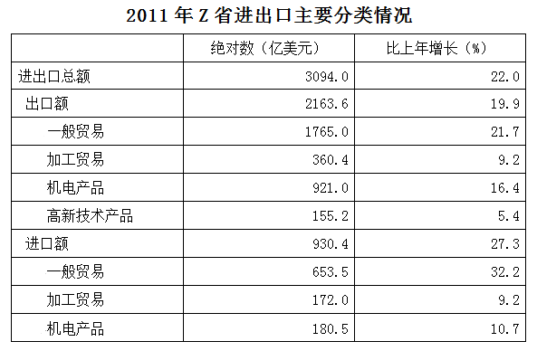

### 第 126 题

2010年，该省的出口额比进口额约多：

A. 1070亿美元

B. 1140亿美元

C. 1190亿美元

D. 1230亿美元

第 126 题 · 答案与解析

**参考答案（粉笔题库参考内容）**

A

**解析**

根据题干“2010年，该省的出口额比进口额约多”，结合材料数据为2011年，可判定本题为基期和差问题。定位表格材料1可知：2011年出口额为2163.6亿美元，增长率为19.9%；进口额为930.4亿美元，增长率为27.3%。根据公式：基期量，可得2010年出口额比进口额多2160/1.2，与A项最接近。

故正确答案为A。

**考点**：基期和差、统计表

**来源**：2013年浙江省公务员录用考试《行测》题（B类）第116题

### 第 127 题

下列饼图中，阴影部分最能体现2011年Z省对欧盟的出口额占当年Z省对8个主要市场出口总额比重的是：

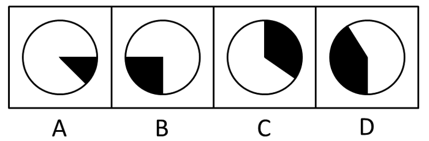

A. A

B. B

C. C

D. D

第 127 题 · 答案与解析

**参考答案（粉笔题库参考内容）**

D

**解析**

根据题干“下列饼图中，阴影部分最能体现2011年······占······比重的是”，结合材料时间为2011年，可判定本题为现期比重问题。定位表格材料2可知：2011年Z省对欧盟、东盟、美国、日本、俄罗斯、韩国、中国香港、中国台湾的出口额分别为557.7亿美元、147.5亿美元、349.2亿美元、133.4亿美元、70.1亿美元、54.5亿美元、59.4亿美元、23.7亿美元。根据公式：，可得：2011年Z省对欧盟的出口额占8个主要市场出口总额比重为≈，与D项最接近。

故正确答案为D。

**考点**：现期比重、统计表

**来源**：2013年浙江省公务员录用考试《行测》题（B类）第117题

### 第 128 题

2011年，机电产品的出口额占Z省出口额的比重比高新技术产品约高：

A. 31个百分点

B. 33个百分点

C. 35个百分点

D. 37个百分点

第 128 题 · 答案与解析

**参考答案（粉笔题库参考内容）**

C

**解析**

根据题干“2011年······占······的比重”，结合材料时间为2011年，可判定本题为现期比重问题。定位表格材料1可知：2011年，Z省总出口额为2163.6亿美元，机电产品的出口额为921.0亿美元，高新技术产品的出口额为155.2亿美元。由，可得：2011年机电产品的出口额占Z省出口额的比重比高新技术产品高，即约高35个百分点。

故正确答案为C。

**考点**：现期比重、统计表

**来源**：2013年浙江省公务员录用考试《行测》题（B类）第118题

### 第 129 题

2011年，Z省对8个主要市场的进口额增速最快的三个国家或地区的进口额之和为：

A. 168亿美元

B. 212亿美元

C. 287亿美元

D. 343亿美元

第 129 题 · 答案与解析

**参考答案（粉笔题库参考内容）**

B

**解析**

定位表格材料2最后一列可知：进口额增速最快的三个国家或地区为东盟、俄罗斯和韩国，其进口额分别为106.5亿美元、18.3亿美元、87.2亿美元，三者进口额之和亿美元，与B项最接近。

故正确答案为B。

**考点**：统计表、简单加减计算

**来源**：2013年浙江省公务员录用考试《行测》题（B类）第119题

### 第 130 题

下列表述与资料相符的有几个？

Ⅰ. 2010年，Z省一般贸易的进口额不足500亿美元

Ⅱ. 2010年，Z省对韩国的进出口总额超过100亿美元

Ⅲ. 2011年，Z省对中国香港的进出口总额比2010年下降了

Ⅳ. 2011年，Z省对8个主要市场的出口额与进口额最接近的是日本

A. 1个

B. 2个

C. 3个

D. 4个

第 130 题 · 答案与解析

**参考答案（粉笔题库参考内容）**

D

**解析**

Ⅰ：定位表格材料1可知：2011年Z省一般贸易的进口额为653.5亿美元，增长率为32.2%。根据公式：，可得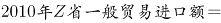亿美元，不足500亿美元，正确；

Ⅱ：定位表格材料2可知：2011年Z省对韩国的出口额为54.5亿美元，增长率为20.1%；对韩国的进口额为87.2亿美元，增长率为37.3%。根据公式：，可得2010年Z省对韩国进出口总额=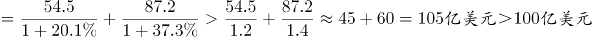，即超过100亿美元，正确；

Ⅲ：定位表格材料2可知：2011年，Z省对中国香港的出口额为59.4亿美元，增长率为-7.8%；进口额为3.3亿美元，增长率为30.8%。根据公式：增长量，可得2011年Z省对中国香港进出口总额增长量，即2011年进出口总额同比下降了，正确；

Ⅳ：定位表格材料2可知2011年Z省对8个主要市场的出口额与进口额。则Z省对8个主要市场的出口额与进口额的差值分别为：

，，，，，，，。

比较可知，Z省对日本出口额与进口额的差值最小，故出口额与进口额最接近的是日本，正确。

故正确答案为D。

**考点**：综合分析、统计表

**来源**：2013年浙江省公务员录用考试《行测》题（B类）第120题

