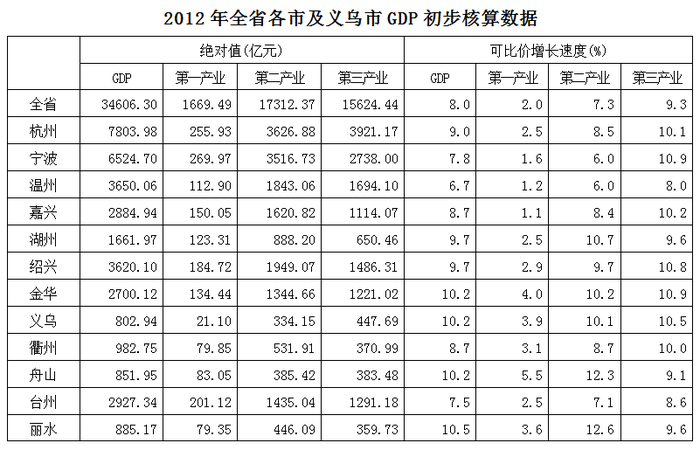
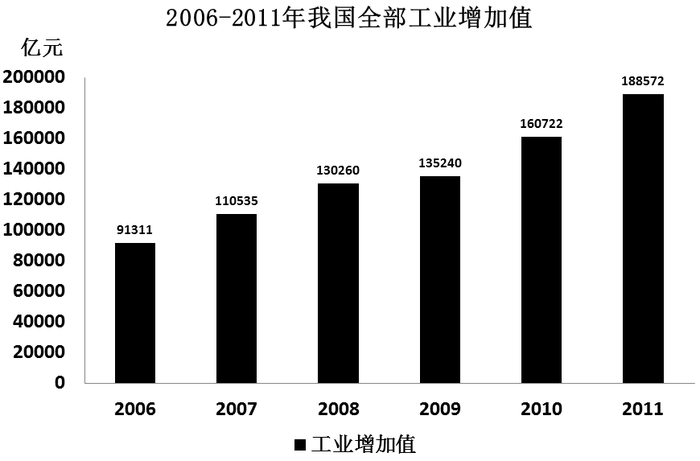
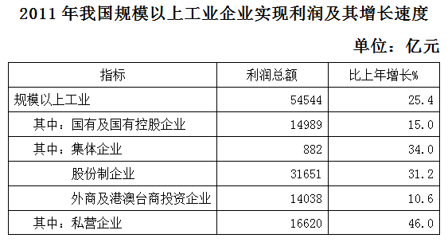
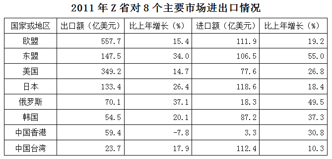
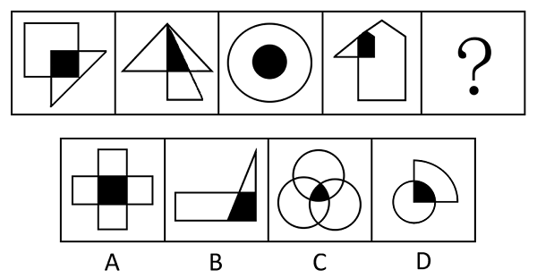
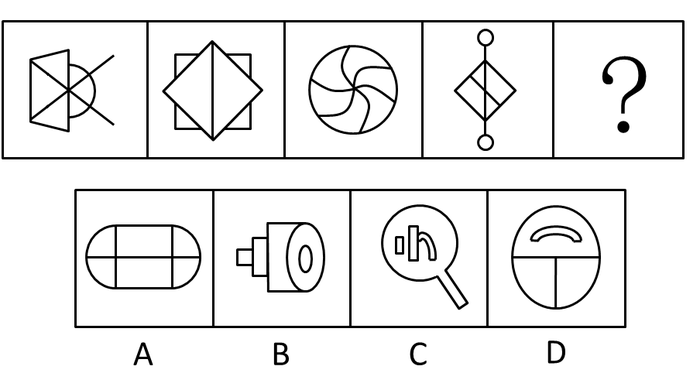
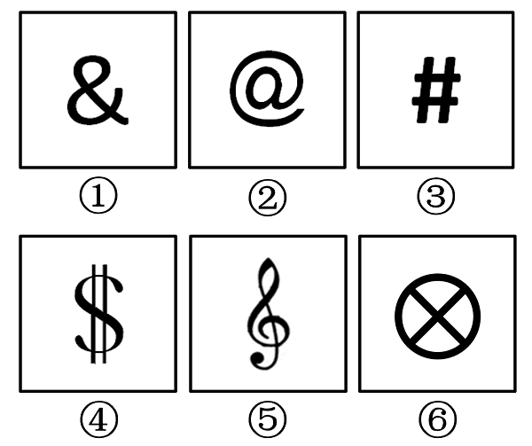
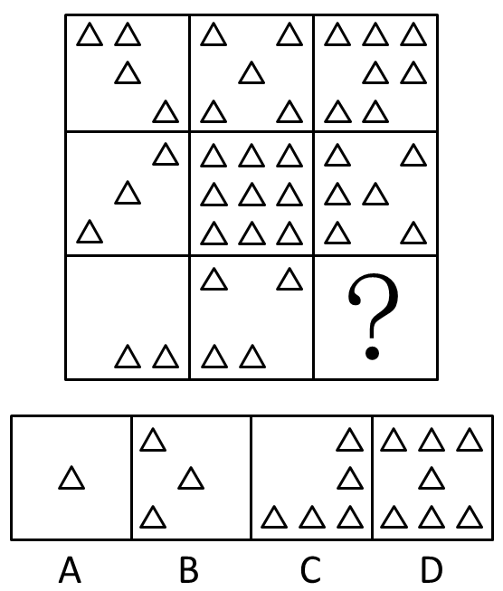

# 2013年浙江省公务员录用考试《行测》题（B类）

> 候选采集稿。参考答案及解析来自粉笔页面，不代表官方答案或真实高分答卷；来源使用许可与原卷对应关系仍需人工核实。

## 题型与作答说明

言语理解与表达

（35题）

每道题包含一个句子或一段话，后面是一个不完整的陈述，要求是从四个选项中选出一个来完成陈述。你的选择应与所提要求最相符合。

数量关系

（25题）

本部分包括数字推理与数学运算两种类型的试题。

判断推理

（40题）

本部分包括图形推理、类比推理、逻辑判断、定义判断与事件排序等五种类型的试题。

资料分析

（20题）

所给出的图、表或一段文字均有5个问题要你回答。你应根据资料所提供的信息进行分析、比较、计算和判断处理。

## 给定材料

### 材料 dom-material-3aad60aae2c190c7

### 材料 dom-material-a26677d6cfebd797

2011年我国全部工业增加值188572亿元。规模以上工业增加值增长13.9%，在规模以上工业中，国有及国有控股企业增长9.9%；集体企业增长9.3%，股份制企业增长15.8%，外商及港澳台商投资企业增长10.4%；私营企业增长19.5%，轻工业增长13.0%，重工业增长14.3%。  

全年规模以上工业中，农副食品加工业增加值比上年增长14.1%，纺织业增长8.3%，通用设备制造业增长8.3%，专用设备制造业增长8.3%，交通运输设备制造业增长8.3%，通信设备、计算机及其他电子设备制造业增长15.9%，电气机械及器材制造业增长14.5%。六大高耗能行业增加值比上年增长12.3%，其中，非金属矿物制品业增长18.4%，化学原料及化学制品制造业增长14.7%，有色金属冶炼及压延加工业增长13.6%，黑色金属冶炼及压延加工业增长9.7%，电子、热力的生产和供应业增长10.1%，石油加工、炼焦及核燃料加工业增长7.6%。高技术制造业增加值比上年增长16.5%。

全年规模以上工业企业实现利润54544亿元，比上年增长25.4%。

### 材料 dom-material-9e660bbf82ea771f

截至2011年末，T市城镇职工基本医疗保险参保人员474.52万人，城乡居民基本医疗保险参保人员498.30万人，城镇职工基本养老保险参保人员458.70万人，城乡居民基本养老保险参保人员97.80万人，失业保险参保职工258.75万人，工伤保险参保职工320.42万人。职工五项社会保险基金总收入510.6亿元，增长18.1%；其中，养老保险基金收入335.8亿元，增长20.4%。  

T市全年保障性住房投资完成306.77亿元，占房地产开发投资的28.4%。全年开工建设保障性住房1600万平方米、23.9万套，发放租房补贴8.5万户。年末城市人均住宅建筑面积32.77平方米，同比增长4.8%。

T市城镇低保标准由450元调整为480元，农村低保标准由250元调整为280元，优抚抚恤、特困救助、农村五保供养、老年人生活补贴标准等都有新的提高。政府抚恤，补助各类优抚对象3.02万人；城乡低保对象27.77万人，其中城镇17.98万人。完善价格补助联动机制，受益群众由18.4万人增加到33.7万人。年末全市各类福利院有床位3.28万张，同比增长14.5%；在院收养2.04万人，增长15.5%。当年新安排残疾人就业3070人。全市11个救助站全年救助5046人。接受社会捐赠2790.6万元，销售社会福利彩票16.07亿元，筹集彩票公益金4.86亿元。

### 材料 dom-material-8b6dcf9a0194e20b

## 题目

### 第 1 题

真正的信息公开，当然要求政府要在第一时间发布信息，但更重要的是，不能\_\_\_\_\_\_信息的发布渠道，而必须尊重媒体多渠道地报道、展现事实，在多元的信息和声音的“竞争”中由公众判断事实在哪里。政府调查的能力有限，可能被假象所\_\_\_\_\_\_，所以需要媒体调查的跟进，这对政府的调查是一个有益的信息补充；更重要的是，政府在利益的绑架下，可能会习惯性地瞒报虚报、掩盖事实，这就需要媒体的报道与政府的调查相互\_\_\_\_\_\_，从而在信息的竞争和交叉中逼出真相。

依次填入画横线部分最恰当的一项是：

A. 主导 迷惑 证明

B. 垄断 蒙蔽 印证

C. 操纵 瞒骗 检验

D. 控制 遮掩 验证

### 第 2 题

古人提倡“吾日三省吾身”，\_\_\_\_\_\_，而今天有些人则不然，总是\_\_\_\_\_\_，对比之下，实在不应该。

依次填入画横线部分最恰当的一项是：

A. 修身养性 瑕不掩瑜

B. 兢兢业业 好大喜功

C. 闻过则喜 讳疾忌医

D. 博采众长 刚愎自用

### 第 3 题

当前的中国，利益多元、观念多样、思想多变，这让道德领域呈现复杂\_\_\_\_\_\_，也让人们面临更艰难的选择。在扶起跌倒老人或许惹上官司、爱心捐赠恐被挪作他用的疑虑中，善念在负面的想象中\_\_\_\_\_\_，善行因利益的考量而\_\_\_\_\_\_。一个经历着深刻转型的社会，有这样的道德困惑可以理解，但更应主动正视、积极引导。

依次填入画横线部分最恰当的一项是：

A. 景象 迟钝 拖延

B. 图景 迟疑 延宕

C. 景观 生疑 延缓

D. 景况 消失 延误

### 第 4 题

在近代中国的历史上，各种思想呈现一种“你方唱罢我登场”的流动局面，似乎没有什么思想观念可以\_\_\_\_\_\_。

填入画横线部分最恰当的一项是：

A. 脱颖而出

B. 一以贯之

C. 不绝如缕

D. 鹤立鸡群

### 第 5 题

时下几乎所有的西方博物馆都处于虚拟化的完成或进行当中。当然，大多数虚拟博物馆仍处在2D的传统网页模式，“文字+图片”的初级阶段，更多是对实体博物馆信息的发布与补充，数字化储存做到了，但在网上浏览的\_\_\_\_\_\_方面远远不够。真正的虚拟博物馆应该是能模拟人们的观展体验的，强调观众是展览的核心，为他们营造出更富想像力与互动性的空间。

填入画横线部分最恰当的一项是：

A. 生动性

B. 及时性

C. 丰富性

D. 便捷性

### 第 6 题

品格与情怀是治学的思想\_\_\_\_\_\_，一些学者之所以受到世人敬仰，不惟其取得了丰硕的学术成果，更因其具有高尚的精神品格。学者高尚的精神品格有着丰富内涵，其中忧乐情怀是一个核心元素。忧乐情怀是儒家文化的重要精神，自古为学人所\_\_\_\_\_\_。

依次填入画横线部分最恰当的一项是：

A. 源泉 宣扬

B. 前提 珍重

C. 保证 向往

D. 根基 推崇

### 第 7 题

知识分子与权力之间应该保持一种怎样的关系？拥抱还是抵制？胡适的选择很特别，他在大方向上不反对国民党政权，但他终生不愿当官，他看重的是知识分子独立发表见解的\_\_\_\_\_\_。翻遍《胡适年谱》，不难发现，作为知识分子领袖，他一生与知识分子往来最多，其次是与国民党高层颇多交流，但几乎从无和新兴的企业家阶层交往的记录。抛开中产阶级而欲求民主、自由，无异于\_\_\_\_\_\_，这大概是胡适的局限，也是其他自由主义者应该深思的问题。

依次填入画横线部分最恰当的一项是：

A. 权力 刻舟求剑

B. 自由 南辕北辙

C. 权利 缘木求鱼

D. 权益 水中捞月

### 第 8 题

“制作粗糙”，\_\_\_\_\_\_，某文艺评论家这样点评当下国内的许多多媒体舞蹈作品。把几段现成的图像符号式地投射在背景屏幕上充当画外音，充其量只是布景道具的升级版。多媒体效果太过目眩神迷，与舞蹈\_\_\_\_\_\_，有一种独立于表达之外的野心。比如有一个多媒体舞蹈，投射在大屏幕上的图案随着演员的每个动作变幻：演员伸展双臂，身后便出现万丈光芒，演员抱住身体，灯光也随之黯淡，看上去是在配合表演，其实是在和演员争夺观众的眼球，舞蹈彻底沦为了配角。

依次填入画横线部分最恰当的一项是：

A. 哗众取宠 失枝脱节

B. 喧宾夺主 貌合神离

C. 主次颠倒 亦步亦趋

D. 避重就轻 格格不入

### 第 9 题

文学评论中，对形式的模仿与内容的抄袭，不应\_\_\_\_\_\_；对早期的作品和现在的创作，不可\_\_\_\_\_\_。

依次填入画横线部分最恰当的一项是：

A. 相提并论 等量齐观

B. 等量齐观 混为一谈

C. 混为一谈 同日而语

D. 同日而语 相提并论

### 第 10 题

真正伟大的历史人物，他所展现出来的价值和意义，绝不是他所处的那个时代所能够局限的，一定可以超越他所在的那个具体的时代和具体的生存环境，超越时空，焕发出            的永恒的价值。

填入画横线部分最恰当的一项是：

A. 历久弥新

B. 日新月异

C. 亘古不变

D. 与日俱增

### 第 11 题

欧债危机在2012年继续恶化，\_\_\_\_\_\_了世界其他国家的经济增长。美国虽然没有像欧洲那样陷入第二轮的经济衰退，但美国的经济增长仍然非常\_\_\_\_\_\_，只有2%左右。欧债危机、美国的“财政悬崖”及由于钓鱼岛问题导致的日趋恶化的中日经贸关系，有可能\_\_\_\_\_\_一场新的全球性衰退。

依次填入画横线部分最恰当的一项是：

A. 阻碍 脆弱 诱发

B. 影响 缓慢 导致

C. 拖累 疲软 引发

D. 逆转 乏力 催生

### 第 12 题

信任，是一种简化复杂性的机制，也是对冲风险的途径。在一个没有信任的社会里，个体的权利很难得到尊重，权利的边界也很难\_\_\_\_\_\_。由于滥用个人权利，社会难免会沦为“你死我活”的角斗场。背信弃义的行为也很难受到法律和道德的\_\_\_\_\_\_，个体之间的互不信赖又必然会给整个社会带来莫大的风险。

依次填入画横线部分最恰当的一项是：

A. 确定 限制

B. 廓清 惩罚

C. 确认 声讨

D. 厘清 约束

### 第 13 题

自文艺复兴以来，特别是第一次世界大战期间，因为民族主义和阶级斗争等意识形态作祟产生了一系列伤亡惨重的战争。其中，许多知识分子起到了\_\_\_\_\_\_的作用，他们或打扮成青年导师和精神领袖\_\_\_\_\_\_种族差异、民族至上和阶级对立，或投笔从戎，直接参与战争。对这一现象，哲学家班达不以为然，认为知识分子假借种族主义、民族主义和阶级斗争\_\_\_\_\_\_了知识分子的价值理想。

依次填入画横线部分最恰当的一项是：

A. 助纣为虐 膜拜 击碎

B. 中流砥柱 批判 展现

C. 推波助澜 鼓吹 背叛

D. 力挽狂澜 抨击 彰显

### 第 14 题

改进文风，           是语言问题、技术问题，           是思想问题、感情问题，那些居高临下的呆板表述，固然与文字水平有关，但本质上反映的却是对待读者、对待群众的态度；那些了无新意的应景报道，           是创新能力不强，           是对世情党情国情缺乏深刻认识；那些穿靴戴帽的官样文章，看似热闹，但却令人生厌，让人反感。

依次填入画横线部分最恰当的一项是：

A. 既 又 要么 要么

B. 既 又 与其说 不如说

C. 不仅 更 要么 要么

D. 不仅 更 与其说 不如说

### 第 15 题

中国自古就有浓烈的宗法传统，\_\_\_\_\_\_宗族血亲之内的彼此关照，互相提携，并一致对外，上自帝王下至百姓，\_\_\_\_\_\_。

依次填入画横线部分最恰当的一项是：

A. 讲究 前赴后继

B. 讲求 概莫能外

C. 寻求 无一幸免

D. 追求 百喙如一

### 第 16 题

对于历史学家来说，有责任把人物的原貌和事件的真相尽可能准确、完整地向读者讲清楚。说“尽可能”，是因为受史料的局限，有些人物和事件无法核实，难以恢复事实真相，只能根据掌握的史料作出\_\_\_\_\_\_。历史不是自然科学，不能通过公式计算获得精确的数据和结论，对人物和事件的叙述，对动机和起因的推论，对结果和影响的分析，都需要作出主观的评判。有些学者倒果为因，先设论点，再找论据，有些学者，为了推倒他人的成论，也挖掘史料以\_\_\_\_\_\_自己的观点，这就涉及史家的指导思想和治学态度问题。

依次填入画横线部分最恰当的一项是：

A. 推断 支撑

B. 假设 树立

C. 判断 证实

D. 猜测 支持

### 第 17 题

下列词语中，没有错别字的一项是：

A. 逸闻轶事

B. 剑拨弩张

C. 忧柔寡断

D. 纷至踏来

### 第 18 题

下列词语中，划线字的读音全都正确的一项是：

A. 蹊（xī）跷 卖官鬻（yù）爵

B. 对峙（zhì） 模棱（léng）两可

C. 追溯（shuò） 户枢不蠹（dù）

D. 市侩（kuài） 万马齐喑（àn）

### 第 19 题

下列句子中，句意明确，没有语病的一项是：

A. 必须严厉打击食品安全违法违规行为的高压态势，及时消除各环节领域的隐患，创新食品安全监管惩处体制机制。

B. 通过实施应对国际金融危机冲击的一揽子计划，我国经济呈现回升向好态势，经济增长的质量和效益进一步提高。

C. 这所大学的一些学生语文水平实在低下，传扬出去，肯定会被人贻笑大方，影响学校声誉。

D. 对采用电脑摇号择校的做法，社会各界褒贬不一，不少有识之士建议实行结合学生综合素质和所处学区来确定。

### 第 20 题

①以知识为主导所得出的美丑的概念，是不真实的，也是没有意义的

②即如美丑而言，当天下人知道追求美的时候，就有了美丑的区分，就有了各自的见解

③在老子看来，相反相成，是知识构成的特性，但并非世界本身所具有

④老子并非反对人们追求美，但他认为这种追求美的方式，并不能得到真正的美

⑤人为世界分出高下美丑，是在下判断，以人的理性确定世界的意义，这样的知识并不符合世界的特性

将以上5个句子重新排列，语序正确的是：

A. ③⑤②①④

B. ②④③①⑤

C. ①③⑤④②

D. ⑤④②③①

### 第 21 题

①一个人的表情能改变容颜，特别是日积月累的表情，具有滴水穿石的效果。

②一个人的面容是先天生好的。

③你看那些老年夫妻，经过多年饮食和趣味的磨合，表情越来越趋相同，一颦一笑都相仿。

④这种美除了有姣好的面容作底子，更重要的是表情和气度在起作用。

⑤少年的美或许是惊艳的，但只称得上漂亮，只有过了成年，甚至到了色衰的中老年，才可称得上美。

将以上5个句子重新排列，语序正确的是：

A. ①③⑤④②

B. ⑤③①②④

C. ⑤③②①④

D. ②⑤④①③

### 第 22 题

①因此把才学比作剑，当使用的时候就拿出来，而不用的时候就藏入鞘中，不将其把玩炫耀，否则，很少有不因此而得祸的。

②自古以来，才学外露的都遭到灾祸，没有一个幸免，怎么不令人为此忧心忡忡呢?

③才学是君子用来进行身心的修养，而并非用来自负骄矜的工具；君子是以才学来治理社会，而并非用以自夸炫耀的。

④之所以这样说，并非才能和学识本身有什么过错，而是错误应用造成的。

⑤没有才能和学识，士人会感到羞耻；具备才能和学识，士人会因此而担忧。

将以上5个句子重新排列，语序正确的是：

A. ⑤④③②①

B. ②①④③⑤

C. ②④①③⑤

D. ③⑤④②①

### 第 23 题

①再比如财产公开不需要保护隐私，但香港把保护隐私作为财产申报公示制度的基本原则，保护申报人隐私也是一项国际惯例

②但在如何公开，何时公开，怎样公开等问题上还远没达到共识的程度

③有人分析称，各界在认识上存在不少误区，比如认为所有公务员都要公开，但香港就并非如此

④从现实情况看，就官员财产要不要公开的问题，早有基本共识

⑤这就需要我们冷静下来研究问题，而不是流于情绪的宣泄

⑥这样的冷静分析不是没有道理

将以上6个句子重新排列，语序正确的是：

A. ④③②①⑤⑥

B. ③①④②⑤⑥

C. ④②③①⑥⑤

D. ③②④①⑥⑤

### 第 24 题

罗尔斯曾有一段关于如何读书的自白，颇足发人深省。他说：“我读前人的著作，如休谟或康德，有一个视为当然的假定，即这些作者比我聪明得多。如果不然，我又何必浪费自己和学生的时间去研读他们的著作呢?如果我偶尔在他们的论证中见到了一点错误，我的第一个反应是：他们自己一定早已见到了这个错误，并且处理过了。总之，他们的著作中绝没有简单的一般错误，也没有关系重大的错误。”

这段文字意在表明：

A. 读书要有怀疑精神

B. 读书须持谦逊态度

C. 读书最忌不求甚解

D. 读书不能人云亦云

### 第 25 题

政府当然应该接受批评，但批评的基础应该是事实，而不是谣言。如城管，你可以批评授权过度，也可以批评一些地区没有将城管纳入体制编制带来的执法倾向的不当。但在网上整天发一些没有时间、没有地点、没有准确事实描述的图片故事，就不是一种正常的批评了。

这段文字意在说明：

A. 政府应该接受人民的合理批评

B. 只有走正规的渠道，批评政府才能奏效

C. 批评政府应该有理有据，遵循事实

D. 批评政府不能靠煽动民众情绪

### 第 26 题

经典会被一代代人重读，这样文化、尤其是作为精髓的文化就有了传承。当然有些也是隔代遗传，甚至经过世纪尘封。有些经典的命运非常孤独，有些好得多。经典是时间的造物。在时间中它又有了自己的历史，一些读者会把自己的生命又加入进来。经典不怎么时髦，经典是安静的，经典等待着。它必须等到一个好的读者才能复活。这个读者有多好，它就能够复活得多好。

对这段文字意思概括最准确的是：

A. 重读经典有利于文化传承

B. 经典的生命需要读者来重塑

C. 尘封的经典更值得去品味

D. 经典的命运各不相同

### 第 27 题

中国中古政治制度有秦汉与隋唐两大典型，其组织与运用截然不同，然秦汉型又何以变为隋唐型，则由魏晋南北朝三百数十年间政治社会情势之积渐演变有以致之，非出某一人物之特意革创者。故魏晋南北朝时代之制度，其本身虽不成一典型，然欲观秦汉制度如何没落，隋唐制度如何新生，则必当于此一纷乱时代求之。

这段文字意在说明：

A. 研究魏晋南北朝历史的意义重大

B. 中国中古政治制度发展脉络较为模糊

C. 魏晋南北朝是秦汉与隋唐的过渡时期

D. 政治制度的沿革不以人的意志为转移

### 第 28 题

孟子曰：“民为贵，社稷次之，君为轻。是故得乎丘民而为天子，得乎天子为诸侯，得乎诸侯为大夫。”

这段文字体现了：

A. 民主思想

B. 民粹思想

C. 民本思想

D. 民生思想

### 第 29 题

1994年到1997年4年时间，财政收入占GDP的比重仅10%多一点，到2011年接近22%，如果考虑到土地出让和其他政府基金性收入，有专家估计政府收入占GDP的比重超过30%。而同期，企业或者是资本收入占比也大幅度提高。一个佐证是，2002年底，企业存款为64298.47亿元，低于当时的个人存款，而到2011年底，企业存款（央行新的统计科目为“单位存款”，口径相当）上升到423086.61亿元，增长了5.58倍，远超同期个人存款2.68倍的增幅。

通过这段文字，作者想表达的观点是：

A. 收入越来越向政府和资本倾斜

B. 政府应适当降低税收

C. 我国经济增长的速度较快

D. 政府收入过高会成为企业的负担

### 第 30 题

虽然我国农村一对夫妇大多生育二胎以上，但几乎所有的年轻人都一拨一拨到城市打工。因此，年轻的高素质移民将不断对冲大城市老龄人口，使人口年龄相对下降或持平，大城市的活力就会保持下去。而在一些地方，老年人支撑农村，已显端倪，甚至可能成为常态。日本的偏僻农村就是前车之鉴。

这段文字说明：

A. 中国的人口老龄化问题与日本同样严重

B. 农村可能比大都市更早进入老龄化时代

C. 人口状况直接决定一个地区的发展

D. 人口流动将加剧城乡发展的不均衡性

### 第 31 题

西藏的一些高僧往往以经年累月的光阴用五彩细砂砌成巧夺天工的曼荼罗图案，整个过程中，作业者口诵经文、心存敬意、屏息凝视、一丝不苟。几经辛苦，到了功行完满的一刻，却会毫不留恋地一手抹掉。这一种态度，对惯于享用先进科技和讲求功效的现代人来说，骤看简直不可思议，但细心省察下，却寓意深远。

最能准确表达这段文字中“寓意”的意思的是：

A. 人生的一切繁华景象归根到底都是无常的

B. 应对生命保持高度的敬畏感

C. 应认真庄严地投入生活又不为生活中的得失所累

D. 生命的意义在于追寻精神上的安顿

### 第 32 题

其实，我们都是成功者，因为成功只是一种感受，一种自我意识的主观感受。如果我们把自己的每一点进步，哪怕只是微小的进步，都看作是一次成功，都认认真真地品味一番，那么，幸福和快乐就会常伴在我们身边，我们的人生也就会因此而变得格外的丰富和生动。

通过这段文字，作者想表达的观点是：

A. 世界上没有绝对的失败者

B. 成功的人生少有挫折和失败

C. 成功是一种心理感受，与现实的物质无关

D. 成功可以自己定义，不用将其看得过于神圣

### 第 33 题

古希腊学者亚里斯多德在《政治学》中指出，在埃及，医师依成法处方，如果到第四日而不见疗效，他就可以改变药剂，只是他倘使在第四日之前急于改变成法，这要由他自己负责。从同样的理由来论证，完全按照成文法律统治的政体不会是最优良的政体，但也必须注意到，一个统治者的心中仍然是存在通则的，而且凡是不凭感情因素治事的统治者总比感情用事的人们较为优良，法律恰正是全没有感情的，人类的本性却是谁都难免有感情。

通过这段文字，作者想表达的观点是：

A. 法治优于人治

B. 人性决定政治

C. 法律是过滤了情感的通则

D. 最优良的政体是不存在的

### 第 34 题

民众的不理解和利益相关方的围攻，是改革者永远的深渊。               。所以很多改革者成了悲壮的先驱，他们启迪了民智，开启了新局，却都已是“寂寞身后事”。改革者的远见与彷徨总是相伴而生，“虽千万人，吾往矣”，需要巨大的智慧和勇气。

填入划横线部分最恰当的一句是：

A. 在理想主义日益稀薄的年代，改革者弥足珍贵

B. 改革都不可能是一帆风顺的

C. 伟大的人永远是孤独的，不被大多数人理解

D. 为了国家的长远发展，改革是值得付出代价的

### 第 35 题

改革开放30多年来，我国城镇化进程不断加快，城镇化率以年均1%的速度增长，从1978年的17.9%上升至51.27%，城镇人口从1.72亿增加到6.9亿。尽管如此，与发达国家城镇化率78%相比，还有很大的发展空间。按照城镇化率年增长1%的速度，我国的城镇化率真要达到发达国家水平，仍有30年左右的发展期。城镇化在统筹城乡发展，改变二元经济结构，实现城乡人口转移，优化城镇空间布局，助推产业结构、消费结构升级，加快生产要素流动和集聚等方面具有积极的意义。

这段文字传递的主要信息是：

A. 我国城镇化有很大的发展空间，潜力巨大

B. 城镇化是推动未来中国经济增长的重要引擎

C. 改革开放以来是我国城镇化发展最迅速的时期

D. 城镇化是加快推进城乡统筹发展的必由之路

### 第 36 题

4，1，0，2，10，29，66，（ ）

A. 101

B. 116

C. 125

D. 130

### 第 37 题

11，12，16，39，67，122，（ ）

A. 228

B. 230

C. 336

D. 340

### 第 38 题

145，120，101，80，65，（ ）

A. 48

B. 49

C. 50

D. 51

### 第 39 题

3，7，12，15，9，-18，（ ）

A. \-27

B. \-45

C. \-81

D. \-102

### 第 40 题

1，2，6，30，210，（ ）

A. 1890

B. 2310

C. 2520

D. 2730

### 第 41 题

2，2，7，9，16，20，（ ）

A. 28

B. 29

C. 30

D. 31

### 第 42 题

1，-3，3，3，9，（ ）

A. 28

B. 36

C. 45

D. 52

### 第 43 题

2，5，9，19，37，75，（ ）

A. 140

B. 142

C. 146

D. 149

### 第 44 题

6，3，5，13，2，63，（ ）

A. \-36

B. \-37

C. \-38

D. \-39

### 第 45 题

，，，，，（ ）

A. 

B. 

C. 

D. 

### 第 46 题

用1，2，3，4，5，6这6个数字组成不同的六位数，所有这些六位数的平均值是：

A. 350000

B. 355550

C. 355555.5

D. 388888.5

### 第 47 题

已知3个质数的倒数和为，则这三个质数的和为：

A. 80

B. 82

C. 84

D. 86

### 第 48 题

从1，2，3，······，30这30个数中，取出若干个数，使其中任意两个数的积都不能被4整除。问最多可取几个数？

A. 14个

B. 15个

C. 16个

D. 17个

### 第 49 题

某商店的两件商品成本价相同，一件按成本价多25%出售，一件按成本价少13%出售，则两件商品各售出一件时盈利为多少?

A. 6%

B. 8%

C. 10%

D. 12%

### 第 50 题

某市场运来苹果、香蕉、柚子和梨四种水果。其中苹果和柚子共30吨，香蕉、柚子和梨共50吨，柚子占水果总数的。问一共运来水果多少吨？

A. 36吨

B. 64吨

C. 80吨

D. 170吨

### 第 51 题

瓶中装有浓度为20%的酒精溶液1000克，现在又分别倒入200克和400克的A、B两种酒精溶液，瓶里的溶液浓度变为15%，已知A种酒精溶液的浓度是B种酒精溶液浓度的2倍。那么A种酒精溶液的浓度是多少?

A. 5%

B. 6%

C. 8%

D. 10%

### 第 52 题

3点19分时，时钟上的时针与分针所构成的锐角为几度？

A. 

B. 

C. 

D. 

### 第 53 题

甲、乙两地相距210公里，a、b两辆汽车分别从甲、乙两地同时相向出发并连续往返于两地，从甲地出发的a汽车的速度为90公里/小时，从乙地出发的b汽车的速度为120公里/小时。问a汽车第二次从甲地出发后与b汽车相遇时，b汽车共行驶了多少公里？

A. 560公里

B. 600公里

C. 620公里

D. 630公里

### 第 54 题

某班对50名学生进行体检，有20人近视，12人超重，4人既近视又超重。该班有多少人既不近视又不超重?

A. 22人

B. 24人

C. 26人

D. 28人

### 第 55 题

某工厂原来每天生产100个零件，现在工厂要在12天内生产一批零件，只有每天多生产10%才能按时完成工作，第一天和第二天由于部分工人缺勤，每天只生产了100个，那么以后10天平均每天要多生产百分之几才能按时完成工作?

A. 12%

B. 13%

C. 14%

D. 15%

### 第 56 题

某班有70%的学生喜欢打羽毛球，75%的学生喜欢打乒乓球，问喜欢打乒乓球的学生中至少有百分之几喜欢打羽毛球？

A. 30%

B. 45%

C. 60%

D. 70%

### 第 57 题

一个总额为100万的项目分给甲、乙、丙、丁四个公司共同来完成，甲、乙、丙、丁分到项目额的比例为：：：，请问甲分到的项目额为多少万：

A. 35万

B. 40万

C. 45万

D. 50万

### 第 58 题

将自然数1—100分别写在完全相同的100张卡片上，然后打乱卡片，先后随机取出4张，问这4张先后取出的卡片上的数字呈增序的几率是多少？

A. 

B. 

C. 

D. 

### 第 59 题

两根同样长的蜡烛，点完粗蜡烛要3小时，点完细蜡烛要1小时。同时点燃两根蜡烛，一段时间后，同时熄灭，发现粗蜡烛的长度是细蜡烛的3倍。问两根蜡烛燃烧了多长时间？

A. 30分钟

B. 35分钟

C. 40分钟

D. 45分钟

### 第 60 题

一口水井，在不渗水的情况下，甲抽水机用4小时可将水抽完，乙抽水机用6小时可将水抽完。现用甲、乙两台抽水机同时抽水，但由于渗水，结果用了3小时才将水抽完。

问在渗水的情况下，用乙抽水机单独抽，需几小时抽完？

A. 12

B. 13

C. 14

D. 15

### 第 61 题

树枝：柴火

A. 舞蹈：节奏

B. 活性炭：除臭剂

C. 电脑：信息

D. 毒品：海洛因

### 第 62 题

精湛：手艺

A. 关系：暧昧

B. 差异：视野

C. 温柔：抒情

D. 深邃：思想

### 第 63 题

中国：杭州

A. 美国：匹兹堡

B. 法国：法兰克福

C. 英国：瓦伦西亚

D. 阿联酋：沙特

### 第 64 题

解放：束缚

A. 犯罪：惩罚

B. 蜕变：堕落

C. 伶俐：笨拙

D. 黎明：拂晓

### 第 65 题

雕塑：绘画

A. 政体：民主

B. 政治：信仰

C. 力学：光学

D. 样本：范例

### 第 66 题

岳父：丈人

A. 舅舅：外甥

B. 姨妈：婶婶

C. 伯父：侄子

D. 祖母：奶奶

### 第 67 题

救助站：乞丐

A. 敬老院：护工

B. 监狱：罪犯

C. 加油站：业务员

D. 研究所：研究员

### 第 68 题

管乐器：笛

A. 哺乳动物：鲸鱼

B. 寒冬：大雪

C. 国庆节：纪念日

D. 中医：草药

### 第 69 题

本分：职责

A. 羁绊：障碍

B. 奇葩：宝库

C. 蓝图：想象

D. 傲慢：偏见

### 第 70 题

程门立雪：尊师敬道

A. 草木皆兵：泰然自若

B. 按图索骥：事半功倍

C. 扑朔迷离：错综复杂

D. 叶公好龙：情有独钟

### 第 71 题

变化视盲指在短时间内物体表面特征明显改变但人类却无法察觉的现象。

根据上述定义，下列不属于变化视盲的是：

A. 电视剧中出现穿帮镜头，同一场戏由于不同时间拍了两次，结果主要演员穿了不同的衣服，但是大部分观众都没有发现

B. 一个学生在向小李问路，恰巧有人抬黑板从两人之间经过，之后小李告诉对方如何走，但是他没有发现那个人已经不是刚刚问路的那个学生了

C. 小王听了朋友在南非的一次冒险经历，极有感触，经常回想这件事，后来他竟然认为这件事是自己的亲身经历

D. 小张看见一个男人走进对面的房子，紧接着又走出来，但是他没有发现其实走出来的是一个女人

### 第 72 题

行政强制措施：指行政机关在行政管理过程中，为制止违法行为、防止证据销毁、避免危害发生、控制危险扩大等情形，依法对公民的人身自由实施暂时性限制，或者对公民、法人或者其他组织的财物实施暂时性控制的行为。

根据上述定义，下列属于行政强制措施的是：

A. 公安机关在刑事诉讼中限令犯罪嫌疑人在规定的期限内不得离开住处或者指定的居所

B. 交通管理部门对某货车散落在高速公路上的西瓜进行及时清理

C. 公安消防部门为了阻止火势蔓延而拆除与着火处相连的房屋

D. 医疗机构为防止某精神病人病情发作伤害他人而将其强制约束

### 第 73 题

就业平等权：指公民不论其民族、种族、性别、宗教信仰、家庭背景等的不同和差异，均享有平等获得就业机会的权利。

根据上述定义，下列没有侵犯求职者的就业平等权的是：

A. 女大学生小刘，本科学历，在几次应聘中，都因为是女性而落聘

B. 某公司招聘时，明确规定本公司员工的亲属比其他应聘者优先录用

C. 小李的父亲是某县政府领导，在该县事业单位公开招聘中，小李未和其他应聘者一样参加考试，就直接被录用了

D. 某食品加工厂在招聘员工过程中，以食品安全为由，拒绝录用一名乙肝患者

### 第 74 题

破窗现象：一个房子如果窗户破了，没有人去修补，隔不久，其他的窗户也会莫名其妙地被人打破。所以环境中的不良现象如果被放任存在，会诱使人们仿效，甚至变本加厉。

根据上述定义，下列不属于破窗现象的是：

A. 一面墙出现了一些涂鸦没有被清除，很快，墙上就布满了乱七八糟、不堪入目的东西

B. 一个干净的地方，人们不好意思丢垃圾，但是一旦地上有垃圾出现，人们就会毫不犹豫地跟着丢，丝毫不会惭愧

C. 一个村里发生了传染性疾病，由于没有及时隔离，结果很快整个村落的人都被传染上了

D. 一个教室里，有两个学生偷偷讲话，老师没有制止，很快大半个班级的学生都在聊天了

### 第 75 题

诈骗罪：指以非法占有为目的，用虚构事实或者隐瞒真相的方法，骗取数额较大的公私财物的行为。

根据上述定义，下列可以构成诈骗罪的是：

A. 甲假装在商场购买西装，售货员乙让其试穿，甲穿上西装后声称去照镜子，趁乙接待其他顾客之际偷偷穿走

B. 某加油站负责人通过在计价器上动手脚，使得实际加油量少于机器显示数量，据此获取大笔收益

C. 某甲在低价出手其别墅时隐瞒其中曾发生凶杀案的事实，致某乙因不知情而购买

D. 某售楼小姐甲向客户乙推销地铁口的楼盘，称楼盘的升值空间很大，乙购房后两个月，房价大跌，致乙遭受惨重损失

### 第 76 题

从所给的四个选项中，选择最合适的一个填入问号处，使之呈现一定的规律性：

A. A

B. B

C. C

D. D

### 第 77 题

请从所给的四个选项中，选择最合适的一个填入问号处，使之呈现一定的规律性：

A. A

B. B

C. C

D. D

### 第 78 题

从所给的四个选项中，选择最合适的一个填入问号处，使之呈现一定的规律性：

A. A

B. B

C. C

D. D

### 第 79 题

从所给的四个选项中，选择最合适的一个填入问号处，使之呈现一定的规律性：

A. A

B. B

C. C

D. D

### 第 80 题

左边给定的是纸盒的外表面，下列哪一项能由它折叠而成：

A. A

B. B

C. C

D. D

### 第 81 题

把下面的六个小图形分为两类，使每一类图形都有各自的共同特征或规律，分类正确的一项是：

A. ①②③，④⑤⑥

B. ①②⑤，③④⑥

C. ①③⑥，②④⑤

D. ①③⑤，②④⑥

### 第 82 题

把下面的六个小图形分为两类，使每一类图形都有各自的共同特征或规律，分类正确的一项是：

A. ①②④，③⑤⑥

B. ①②⑤，③④⑥

C. ①③⑤，②④⑥

D. ①②⑥，③④⑤

### 第 83 题

把下面的六个小图形分为两类，使每一类图形都有各自的共同特征或规律，分类正确的一项是：

A. ①②③，④⑤⑥

B. ①③⑤，②④⑥

C. ①④⑤，②③⑥

D. ①④⑥，②③⑤

### 第 84 题

从所给的四个选项中，选择最合适的一个填入问号处，使之呈现一定的规律性：

A. A

B. B

C. C

D. D

### 第 85 题

从所给的四个选项中，选择最合适的一个填入问号处，使之呈现一定的规律性：

A. A

B. B

C. C

D. D

### 第 86 题

品学兼优的学生不都读研究生。

如果以上论述为真，则下列命题能判断真假的有几个?

Ⅰ.有些品学兼优的学生读研究生

Ⅱ.有些品学兼优的学生不读研究生

Ⅲ.所有品学兼优的学生都读研究生

Ⅳ.所有品学兼优的学生都不读研究生

A. 1

B. 2

C. 3

D. 4

### 第 87 题

20世纪60年代，加州大学伯克利分校进行了一系列关于小鼠认知能力的实验。在实验中，一组小鼠被放在摆满各种玩具、转轮和隧道的笼子里，另一组小鼠则在空无一物的笼子里长大。实验结果显示，前一组小鼠大脑的体积更大，认知能力也显著高于后一组。研究人员因此作出推论：充分的外界刺激可以改变大脑的结构和能力。

下列哪项如果为真，最能加强研究人员的推论：

A. 实验中，前一组小鼠的食物营养更丰富

B. 实验后，后一组小鼠的运动能力更强

C. 后来，两组小鼠的平均寿命差不多

D. 实验前，两组小鼠的个体差异不大

### 第 88 题

因为规定“黄灯亮时，已越过停止线的车辆可以继续通行”。所以黄灯亮时，未越过停止线的车辆不能继续通行。

下列哪项的论述逻辑与此最为不同？

A. 因为规定“间歇性的精神病人在精神正常的时候犯罪，应当负刑事责任”。所以，间歇性的精神病人在精神不正常的时候犯罪，不应负刑事责任

B. 因为规定“尚未制定法律的，行政法规可以设定行政许可”。所以，已经制定法律的，行政法规不可以设定行政许可

C. 因为规定“申请小型汽车驾驶证的年龄条件为18周岁以上、70周岁以下”。所以，不满18周岁以及超过70周岁的公民不能申请小型汽车驾驶证

D. 因为规定“18周岁以上的公民，可以独立进行民事活动”。所以，不满18周岁的公民，不能独立进行民事活动

### 第 89 题

亲生父母双方都有高血压的人，得高血压的几率是亲生父母都没有高血压的人的5倍。所以，高血压可能是一种遗传病。

下列哪项如果为真，最能支持上述结论：

A. 亲生父母都有高血压的人，无论如何注意生活方式，得高血压的几率仍然很高

B. 亲生父母没有高血压的人，在和患高血压的养父母生活一段时间后，得高血压的几率会增高

C. 亲生父母都有高血压的人，在承受巨大生活压力时，更易得高血压

D. 亲生父母患有高血压的人，在没有出现高血压病症前，做些预防性治疗，可以降低得高血压的几率

### 第 90 题

西双版纳傣族的竹楼都用方形柱子将房子架空来防止潮湿及蚊虫骚扰，之所以用方形柱子而不是圆形柱子，是为了防止蛇攀爬进入竹楼。

下列哪项最有可能是上述陈述的假设：

A. 傣族人喜欢把东西做成方形的

B. 蛇喜欢攀爬圆形的柱子

C. 西双版纳热带雨林中有很多蛇

D. 蛇不能缠绕着方形的柱子爬行

### 第 91 题

甲、乙、丙、丁四人对四个抽屉中的物品进行预测。甲：有些抽屉中没有书本；乙：所有抽屉中都有书本；丙：第二个抽屉中没有钢笔；丁：第三个抽屉中有信件。如果四人的断定中只有一项为真，那么以下哪项一定为真？

A. 第二个抽屉中有钢笔

B. 第三个抽屉中有信件

C. 四个抽屉中都有书本

D. 四个抽屉中都没有书本

### 第 92 题

耐甲氧西林金黄色葡萄球菌（MRSA）、克雷伯氏菌等细菌能引起多种疾病和感染。同时各种抗生素往往又对它们无可奈何，这些令人色变的细菌因而被称为超级细菌。近年来，研究人员通过微生物的全基因组测序技术不仅能追踪MRSA的源头，而且能追踪到其他耐药细菌的源头。因此，全基因组测序技术可以解决MRSA等超级细菌给人类带来的疾病困扰。

下列哪项为真，最能削弱上述论证：

A. 超级细菌会随着环境的变化而变异

B. 进行全基因组测序的费用比较高

C. 全基因组技术可为寻找抑制超级细菌的药物提供线索

D. 全基因组测序技术无法杀灭超级细菌

### 第 93 题

张红、李聪、王敏，一个是江苏人，一个是浙江人，一个是广东人。浙江人比李聪年龄小，张红和浙江人不同岁，王敏的年龄比广东人大。根据上述断定，可以推出：

A. 张红是江苏人，李聪是浙江人，王敏是广东人

B. 张红是广东人，李聪是江苏人，王敏是浙江人

C. 张红是浙江人，李聪是广东人，王敏是江苏人

D. 张红是浙江人，李聪是江苏人，王敏是广东人

### 第 94 题

对某班学生喜欢的体育活动进行调查后发现：该班的学生或者喜欢打篮球，或者喜欢打羽毛球，如果喜欢打排球，则不喜欢打羽毛球，该班的班长喜欢打排球，因此他也喜欢打乒乓球。

以下哪项最可能是上述论证的假设？

A. 该班的班长至少喜欢三项体育活动

B. 喜欢打乒乓球的学生都喜欢打羽毛球

C. 喜欢打篮球的学生都喜欢打乒乓球

D. 该班学生喜欢的体育活动只有篮球、羽毛球、排球和乒乓球四项

### 第 95 题

新加坡国立大学社会学家波林·斯特劳恩副教授对当地已婚者和离婚者展开的调查发现，恋爱时间较长的夫妻，婚后闹分手的几率会比那些恋爱时间较短的夫妻低。于是有人得出结论，要想以后的婚姻更稳固，必须延长恋爱时间。

下列哪项为真，最能削弱上述结论：

A. 恋爱谈得越长，两人结婚的可能性会越低

B. 情侣在恋爱期是否深入了解彼此比恋爱时间长短更重要

C. “一见钟情式”的速成婚姻容易破碎

D. 恋爱时间长的人，往往会忘记恋爱的目的是婚姻

### 第 96 题

①达成房屋买卖协议

②交付定金

③房价上涨，反悔

④实地看房

⑤向人民法院起诉

A. ①②③④⑤

B. ①④②③⑤

C. ④①②③⑤

D. ④②①⑤③

### 第 97 题

①业绩优秀

②大学毕业

③应聘工作

④评为先进

⑤升为部门经理

A. ①②③④⑤

B. ②①③⑤④

C. ②③④①⑤

D. ②③①④⑤

### 第 98 题

①收银员少收一本书的价钱

②到书店买书

③回到家中发现少付书钱

④得到书店的表扬

⑤到书店付了书钱

A. ①②③⑤④

B. ②①③⑤④

C. ②①⑤③④

D. ②⑤①④③

### 第 99 题

①恋爱三年

②调解矛盾

③登记结婚

④和好如初

⑤感情出现问题

A. ①⑤②③④

B. ①③②⑤④

C. ①③⑤②④

D. ①⑤③②④

### 第 100 题

①商场店铺起火

②店铺挽回损失

③消防人员及时救火

④路人电话报警

⑤店铺赠送锦旗表示感谢

A. ①④③②⑤

B. ①③④②⑤

C. ④①②③⑤

D. ①③④⑤②

### 第 101 题

全省第一产业增加值约占GDP的：

关联材料：dom-material-3aad60aae2c190c7

A. 3.2%

B. 4.1%

C. 4.8%

D. 5.3%

### 第 102 题

第二产业增加值占GDP的比重最高的是：

关联材料：dom-material-3aad60aae2c190c7

A. 湖州市

B. 宁波市

C. 嘉兴市

D. 绍兴市

### 第 103 题

全省第三产业增加值第二多的市约是最少的：

关联材料：dom-material-3aad60aae2c190c7

A. 7.6倍

B. 7.8倍

C. 10.5倍

D. 10.9倍

### 第 104 题

第一产业增加值可比价增长速度最快的市的第一产业增加值比最慢的市：

关联材料：dom-material-3aad60aae2c190c7

A. 多67亿元

B. 多2032.99亿元

C. 少67亿元

D. 少2032.99亿元

### 第 105 题

根据资料，下列表述正确的是：

关联材料：dom-material-3aad60aae2c190c7

A. 各市第三产业增加值可比价增长速度均大于9%

B. 各市中，宁波市的第一产业增加值最多

C. 第二产业增加值大于第三产业的市有9个

D. 杭州市的GDP不足全省的

### 第 106 题

2008-2011年，全部工业增加值增加最多的是：

关联材料：dom-material-a26677d6cfebd797

A. 2008年

B. 2009年

C. 2010年

D. 2011年

### 第 107 题

2011年，在规模以上工业中，下列企业的增加值增长最快的是：

关联材料：dom-material-a26677d6cfebd797

A. 国有及国有控股企业

B. 股份制企业

C. 外商及港澳台商投资企业

D. 私营企业

### 第 108 题

2011年，六大高耗能行业增加值的增长速度大于10%的有：

关联材料：dom-material-a26677d6cfebd797

A. 3个

B. 4个

C. 5个

D. 6个

### 第 109 题

2010年，规模以上工业企业实现利润约为：

关联材料：dom-material-a26677d6cfebd797

A. 43500亿元

B. 43800亿元

C. 44100亿元

D. 44500亿元

### 第 110 题

根据资料，下列表述不正确的是：

关联材料：dom-material-a26677d6cfebd797

A. 2011年，轻工业增加值的增长速度比重工业慢

B. 2010年，在规模以上工业企业中，私营企业实现利润多于外商及港澳台商投资企业

C. 2006年，我国全部工业增加值不足2011年的一半

D. 2011年，在规模以上工业企业中，股份制企业实现利润是国有及国有控股企业的2倍多

### 第 111 题

截至2011年末，T市下列哪种保险的参保人数最多？

关联材料：dom-material-9e660bbf82ea771f

A. 工伤保险

B. 城镇职工基本医疗保险

C. 城乡居民基本医疗保险

D. 城镇职工基本养老保险

### 第 112 题

如按2011年的增长速度估算，2012年T市职工五项社会保险基金总收入约为：

关联材料：dom-material-9e660bbf82ea771f

A. 580亿元

B. 600亿元

C. 620亿元

D. 640亿元

### 第 113 题

2011年，T市房地产开发投资总额约为：

关联材料：dom-material-9e660bbf82ea771f

A. 1080亿元

B. 1160亿元

C. 1240亿元

D. 1290亿元

### 第 114 题

2011年，T市城镇低保对象人数约为农村低保对象的：

关联材料：dom-material-9e660bbf82ea771f

A. 1.7倍

B. 1.8倍

C. 1.9倍

D. 2.1倍

### 第 115 题

根据资料，下列表述正确的是：

关联材料：dom-material-9e660bbf82ea771f

A. 2011年，T市养老保险基金收入比去年增加超过60亿元

B. 2010年末，T市城市人均住宅建筑面积不足30平方米

C. 2011年，T市农村低保标准上调超过15%

D. 2010年末，T市各类福利院的床位不足3万张

### 第 116 题

2010年，该省的出口额比进口额约多：

关联材料：dom-material-8b6dcf9a0194e20b

A. 1070亿美元

B. 1140亿美元

C. 1190亿美元

D. 1230亿美元

### 第 117 题

下列饼图中，阴影部分最能体现2011年Z省对欧盟的出口额占当年Z省对8个主要市场出口总额比重的是：

关联材料：dom-material-8b6dcf9a0194e20b

A. A

B. B

C. C

D. D

### 第 118 题

2011年，机电产品的出口额占Z省出口额的比重比高新技术产品约高：

关联材料：dom-material-8b6dcf9a0194e20b

A. 31个百分点

B. 33个百分点

C. 35个百分点

D. 37个百分点

### 第 119 题

2011年，Z省对8个主要市场的进口额增速最快的三个国家或地区的进口额之和为：

关联材料：dom-material-8b6dcf9a0194e20b

A. 168亿美元

B. 212亿美元

C. 287亿美元

D. 343亿美元

### 第 120 题

下列表述与资料相符的有几个？

Ⅰ. 2010年，Z省一般贸易的进口额不足500亿美元

Ⅱ. 2010年，Z省对韩国的进出口总额超过100亿美元

Ⅲ. 2011年，Z省对中国香港的进出口总额比2010年下降了

Ⅳ. 2011年，Z省对8个主要市场的出口额与进口额最接近的是日本

关联材料：dom-material-8b6dcf9a0194e20b

A. 1个

B. 2个

C. 3个

D. 4个

## 答案与解析

第 1 题

**答案状态：unknown（来源未提供）**

**解析状态：unknown（来源未提供）**

第 2 题

**答案状态：unknown（来源未提供）**

**解析状态：unknown（来源未提供）**

第 3 题

**答案状态：unknown（来源未提供）**

**解析状态：unknown（来源未提供）**

第 4 题

**答案状态：unknown（来源未提供）**

**解析状态：unknown（来源未提供）**

第 5 题

**答案状态：unknown（来源未提供）**

**解析状态：unknown（来源未提供）**

第 6 题

**答案状态：unknown（来源未提供）**

**解析状态：unknown（来源未提供）**

第 7 题

**答案状态：unknown（来源未提供）**

**解析状态：unknown（来源未提供）**

第 8 题

**答案状态：unknown（来源未提供）**

**解析状态：unknown（来源未提供）**

第 9 题

**答案状态：unknown（来源未提供）**

**解析状态：unknown（来源未提供）**

第 10 题

**答案状态：unknown（来源未提供）**

**解析状态：unknown（来源未提供）**

第 11 题

**答案状态：unknown（来源未提供）**

**解析状态：unknown（来源未提供）**

第 12 题

**答案状态：unknown（来源未提供）**

**解析状态：unknown（来源未提供）**

第 13 题

**答案状态：unknown（来源未提供）**

**解析状态：unknown（来源未提供）**

第 14 题

**答案状态：unknown（来源未提供）**

**解析状态：unknown（来源未提供）**

第 15 题

**答案状态：unknown（来源未提供）**

**解析状态：unknown（来源未提供）**

第 16 题

**答案状态：unknown（来源未提供）**

**解析状态：unknown（来源未提供）**

第 17 题

**答案状态：unknown（来源未提供）**

**解析状态：unknown（来源未提供）**

第 18 题

**答案状态：unknown（来源未提供）**

**解析状态：unknown（来源未提供）**

第 19 题

**答案状态：unknown（来源未提供）**

**解析状态：unknown（来源未提供）**

第 20 题

**答案状态：unknown（来源未提供）**

**解析状态：unknown（来源未提供）**

第 21 题

**答案状态：unknown（来源未提供）**

**解析状态：unknown（来源未提供）**

第 22 题

**答案状态：unknown（来源未提供）**

**解析状态：unknown（来源未提供）**

第 23 题

**答案状态：unknown（来源未提供）**

**解析状态：unknown（来源未提供）**

第 24 题

**答案状态：unknown（来源未提供）**

**解析状态：unknown（来源未提供）**

第 25 题

**答案状态：unknown（来源未提供）**

**解析状态：unknown（来源未提供）**

第 26 题

**答案状态：unknown（来源未提供）**

**解析状态：unknown（来源未提供）**

第 27 题

**答案状态：unknown（来源未提供）**

**解析状态：unknown（来源未提供）**

第 28 题

**答案状态：unknown（来源未提供）**

**解析状态：unknown（来源未提供）**

第 29 题

**答案状态：unknown（来源未提供）**

**解析状态：unknown（来源未提供）**

第 30 题

**答案状态：unknown（来源未提供）**

**解析状态：unknown（来源未提供）**

第 31 题

**答案状态：unknown（来源未提供）**

**解析状态：unknown（来源未提供）**

第 32 题

**答案状态：unknown（来源未提供）**

**解析状态：unknown（来源未提供）**

第 33 题

**答案状态：unknown（来源未提供）**

**解析状态：unknown（来源未提供）**

第 34 题

**答案状态：unknown（来源未提供）**

**解析状态：unknown（来源未提供）**

第 35 题

**答案状态：unknown（来源未提供）**

**解析状态：unknown（来源未提供）**

第 36 题

**答案状态：unknown（来源未提供）**

**解析状态：unknown（来源未提供）**

第 37 题

**答案状态：unknown（来源未提供）**

**解析状态：unknown（来源未提供）**

第 38 题

**答案状态：unknown（来源未提供）**

**解析状态：unknown（来源未提供）**

第 39 题

**答案状态：unknown（来源未提供）**

**解析状态：unknown（来源未提供）**

第 40 题

**答案状态：unknown（来源未提供）**

**解析状态：unknown（来源未提供）**

第 41 题

**答案状态：unknown（来源未提供）**

**解析状态：unknown（来源未提供）**

第 42 题

**答案状态：unknown（来源未提供）**

**解析状态：unknown（来源未提供）**

第 43 题

**答案状态：unknown（来源未提供）**

**解析状态：unknown（来源未提供）**

第 44 题

**答案状态：unknown（来源未提供）**

**解析状态：unknown（来源未提供）**

第 45 题

**答案状态：unknown（来源未提供）**

**解析状态：unknown（来源未提供）**

第 46 题

**答案状态：unknown（来源未提供）**

**解析状态：unknown（来源未提供）**

第 47 题

**答案状态：unknown（来源未提供）**

**解析状态：unknown（来源未提供）**

第 48 题

**答案状态：unknown（来源未提供）**

**解析状态：unknown（来源未提供）**

第 49 题

**答案状态：unknown（来源未提供）**

**解析状态：unknown（来源未提供）**

第 50 题

**答案状态：unknown（来源未提供）**

**解析状态：unknown（来源未提供）**

第 51 题

**答案状态：unknown（来源未提供）**

**解析状态：unknown（来源未提供）**

第 52 题

**答案状态：unknown（来源未提供）**

**解析状态：unknown（来源未提供）**

第 53 题

**答案状态：unknown（来源未提供）**

**解析状态：unknown（来源未提供）**

第 54 题

**答案状态：unknown（来源未提供）**

**解析状态：unknown（来源未提供）**

第 55 题

**答案状态：unknown（来源未提供）**

**解析状态：unknown（来源未提供）**

第 56 题

**答案状态：unknown（来源未提供）**

**解析状态：unknown（来源未提供）**

第 57 题

**答案状态：unknown（来源未提供）**

**解析状态：unknown（来源未提供）**

第 58 题

**答案状态：unknown（来源未提供）**

**解析状态：unknown（来源未提供）**

第 59 题

**答案状态：unknown（来源未提供）**

**解析状态：unknown（来源未提供）**

第 60 题

**答案状态：unknown（来源未提供）**

**解析状态：unknown（来源未提供）**

第 61 题

**答案状态：unknown（来源未提供）**

**解析状态：unknown（来源未提供）**

第 62 题

**答案状态：unknown（来源未提供）**

**解析状态：unknown（来源未提供）**

第 63 题

**答案状态：unknown（来源未提供）**

**解析状态：unknown（来源未提供）**

第 64 题

**答案状态：unknown（来源未提供）**

**解析状态：unknown（来源未提供）**

第 65 题

**答案状态：unknown（来源未提供）**

**解析状态：unknown（来源未提供）**

第 66 题

**答案状态：unknown（来源未提供）**

**解析状态：unknown（来源未提供）**

第 67 题

**答案状态：unknown（来源未提供）**

**解析状态：unknown（来源未提供）**

第 68 题

**答案状态：unknown（来源未提供）**

**解析状态：unknown（来源未提供）**

第 69 题

**答案状态：unknown（来源未提供）**

**解析状态：unknown（来源未提供）**

第 70 题

**答案状态：unknown（来源未提供）**

**解析状态：unknown（来源未提供）**

第 71 题

**答案状态：unknown（来源未提供）**

**解析状态：unknown（来源未提供）**

第 72 题

**答案状态：unknown（来源未提供）**

**解析状态：unknown（来源未提供）**

第 73 题

**答案状态：unknown（来源未提供）**

**解析状态：unknown（来源未提供）**

第 74 题

**答案状态：unknown（来源未提供）**

**解析状态：unknown（来源未提供）**

第 75 题

**答案状态：unknown（来源未提供）**

**解析状态：unknown（来源未提供）**

第 76 题

**答案状态：unknown（来源未提供）**

**解析状态：unknown（来源未提供）**

第 77 题

**答案状态：unknown（来源未提供）**

**解析状态：unknown（来源未提供）**

第 78 题

**答案状态：unknown（来源未提供）**

**解析状态：unknown（来源未提供）**

第 79 题

**答案状态：unknown（来源未提供）**

**解析状态：unknown（来源未提供）**

第 80 题

**答案状态：unknown（来源未提供）**

**解析状态：unknown（来源未提供）**

第 81 题

**答案状态：unknown（来源未提供）**

**解析状态：unknown（来源未提供）**

第 82 题

**答案状态：unknown（来源未提供）**

**解析状态：unknown（来源未提供）**

第 83 题

**答案状态：unknown（来源未提供）**

**解析状态：unknown（来源未提供）**

第 84 题

**答案状态：unknown（来源未提供）**

**解析状态：unknown（来源未提供）**

第 85 题

**答案状态：unknown（来源未提供）**

**解析状态：unknown（来源未提供）**

第 86 题

**答案状态：unknown（来源未提供）**

**解析状态：unknown（来源未提供）**

第 87 题

**答案状态：unknown（来源未提供）**

**解析状态：unknown（来源未提供）**

第 88 题

**答案状态：unknown（来源未提供）**

**解析状态：unknown（来源未提供）**

第 89 题

**答案状态：unknown（来源未提供）**

**解析状态：unknown（来源未提供）**

第 90 题

**答案状态：unknown（来源未提供）**

**解析状态：unknown（来源未提供）**

第 91 题

**答案状态：unknown（来源未提供）**

**解析状态：unknown（来源未提供）**

第 92 题

**答案状态：unknown（来源未提供）**

**解析状态：unknown（来源未提供）**

第 93 题

**答案状态：unknown（来源未提供）**

**解析状态：unknown（来源未提供）**

第 94 题

**答案状态：unknown（来源未提供）**

**解析状态：unknown（来源未提供）**

第 95 题

**答案状态：unknown（来源未提供）**

**解析状态：unknown（来源未提供）**

第 96 题

**答案状态：unknown（来源未提供）**

**解析状态：unknown（来源未提供）**

第 97 题

**答案状态：unknown（来源未提供）**

**解析状态：unknown（来源未提供）**

第 98 题

**答案状态：unknown（来源未提供）**

**解析状态：unknown（来源未提供）**

第 99 题

**答案状态：unknown（来源未提供）**

**解析状态：unknown（来源未提供）**

第 100 题

**答案状态：unknown（来源未提供）**

**解析状态：unknown（来源未提供）**

第 101 题

**答案状态：unknown（来源未提供）**

**解析状态：unknown（来源未提供）**

第 102 题

**答案状态：unknown（来源未提供）**

**解析状态：unknown（来源未提供）**

第 103 题

**答案状态：unknown（来源未提供）**

**解析状态：unknown（来源未提供）**

第 104 题

**答案状态：unknown（来源未提供）**

**解析状态：unknown（来源未提供）**

第 105 题

**答案状态：unknown（来源未提供）**

**解析状态：unknown（来源未提供）**

第 106 题

**答案状态：unknown（来源未提供）**

**解析状态：unknown（来源未提供）**

第 107 题

**答案状态：unknown（来源未提供）**

**解析状态：unknown（来源未提供）**

第 108 题

**答案状态：unknown（来源未提供）**

**解析状态：unknown（来源未提供）**

第 109 题

**答案状态：unknown（来源未提供）**

**解析状态：unknown（来源未提供）**

第 110 题

**答案状态：unknown（来源未提供）**

**解析状态：unknown（来源未提供）**

第 111 题

**答案状态：unknown（来源未提供）**

**解析状态：unknown（来源未提供）**

第 112 题

**答案状态：unknown（来源未提供）**

**解析状态：unknown（来源未提供）**

第 113 题

**答案状态：unknown（来源未提供）**

**解析状态：unknown（来源未提供）**

第 114 题

**答案状态：unknown（来源未提供）**

**解析状态：unknown（来源未提供）**

第 115 题

**答案状态：unknown（来源未提供）**

**解析状态：unknown（来源未提供）**

第 116 题

**答案状态：unknown（来源未提供）**

**解析状态：unknown（来源未提供）**

第 117 题

**答案状态：unknown（来源未提供）**

**解析状态：unknown（来源未提供）**

第 118 题

**答案状态：unknown（来源未提供）**

**解析状态：unknown（来源未提供）**

第 119 题

**答案状态：unknown（来源未提供）**

**解析状态：unknown（来源未提供）**

第 120 题

**答案状态：unknown（来源未提供）**

**解析状态：unknown（来源未提供）**

