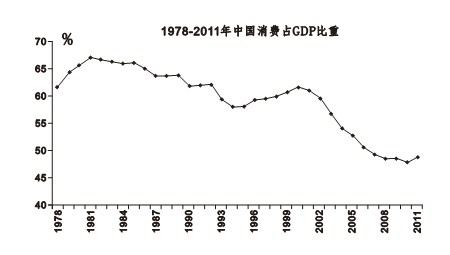
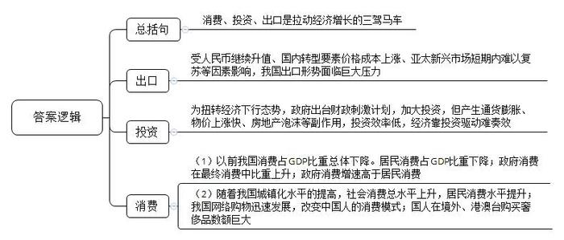
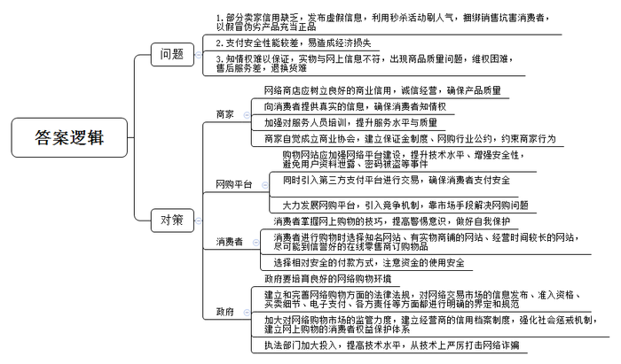
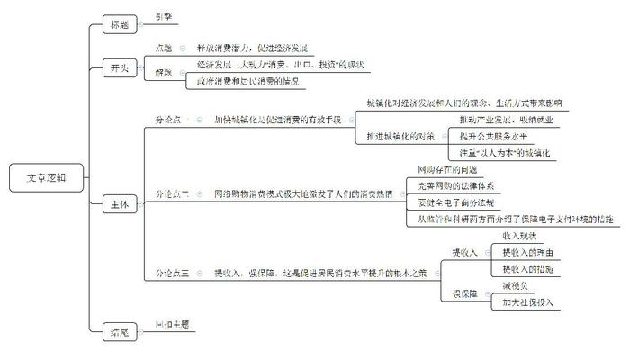

# 2014年浙江省公考《申论》题（B卷）

<!-- gwy:overview:start -->
> **浙江 · 2014 · 申论 · B类** ｜ 3 题 · 图片 4 处 · 答案随题折叠

导航：[题目](#题目) · [材料 1](#材料-1)
<!-- gwy:overview:end -->

> 候选采集稿。参考答案及解析来自粉笔页面，不代表官方答案或真实高分答卷；来源使用许可与原卷对应关系仍需人工核实。

## 给定材料

### 材料 1

自2008年全球金融危机以来，我国的出口形势面临巨大的压力。2009—2012年，我国的贸易顺差占当年外贸进出口总值的比例分别为5.9%、6.2%、4.3%和5.9%，远远低于之前两位数的顺差比例。2013年，我国货物贸易的出口额达22096亿美元，增长7.9%，未达到年初制定的8%的目标。有专家预计，2014年我国的出口状况会略好一些，但由于受人民币继续升值、国内转型要素价格成本继续上涨以及亚太新兴市场短期内难以复苏等因素的影响，总体而言，今年我国的出口形势仍难有较大的改观。

2009年，为扭转经济下行态势，努力推动经济向好的方向发展，我国政府出台了4万亿财政刺激计划。由于政府向基础设施和建筑业投入巨资，并向工业领域注入低息贷款，我国的经济增势一度颇为迅猛，2009年和2010年分别增长8.7%和10.3%。但如今4万亿财政刺激计划执行后，产生了如通货膨胀、物价上涨过快、房地产泡沫等副作用。同时，相关研究表明，当前我国的投资效率明显下降，原来投入2元钱能产生1元钱的经济效益，现在只能产生0.7元钱的经济效益。

### 材料 2

消费、投资、出口是拉动经济增长的三驾马车，其中消费又是最主要的马车，是GDP增长的主导因素。从国民经济统计的角度看，最终消费包含两部分，一部分是居民消费，另一部分是政府消费。有学者对1999—2008年我国31个省（市、自治区）的相关数据进行了分析，实证表明，从全国范围来看，无论是城镇、农村居民消费还是政府消费，对经济增长的影响都是显著的，但三者对经济增长的拉动程度不同，城镇、农村居民消费和政府消费每增长1个单位，分别可以促进经济增长0.59、0.49和0.23个单位，从我国居民消费占GDP的比重来看，近十年来不升反降，仅为35%，而世界其他主要经济体中，这个数字都大于50%，欧洲是58%，日本是55%，美国高达72%。而自1978年以来，我国政府消费在最终消费中的占比几乎每隔10年就要上一个台阶：80年代大约稳定在21%~23%；90年代上升并稳定在24%~25%；2000—2010年进一步提高到26%~27%；2011年已爬上28%。在1978—2011年的34年中，有22年政府消费的增速高于居民消费。

### 材料 3

2013年末，我国的城镇化率达到了53.7%，比上年提高了1.1个百分点，但按户籍人口计算仅为35.7%左右，不仅明显低于发达国家近80%的水平，也低于许多同等发展阶段国家的水平。差距也是潜力。未来10年，中国城镇化率年均提高1.2个百分点，将再有2亿农民进入城镇，加上现有的农民工，新增城镇人口将达到4亿左右。按照现有城镇化速度，社会消费总水平可以从现在的10万亿级上升到20万亿级，与此同时，居民的消费水平也将大幅增长。

近年来，我国的网络购物迅速发展，2013年，我国网络购物用户规模达3.02亿人，团购用户规模达1.41亿人；网络购物市场交易规模达1.85万亿元，同比增长42.0%，网络购物交易额占社会消费品零售总额的比重达到7.8%，同比提高1.6个百分点。网络购物正在改变中国人的消费模式。2013年11月11日，阿里巴巴集团公布的数据显示，天猫、淘宝“双十一”网购狂欢节开场55秒后，活动通过支付宝支付的交易额便突破1亿元，截止到当日24时，交易额突破350亿元，打破了集团董事局主席马云此前300亿元的预期。

2011年的“十一”黄金周，中国人出境，包括在港澳台地区购买消费奢侈品，累计消费大约240亿元人民币，超越了日本人和欧洲人，成为全球奢侈品消费市场的最大买家。现在很多人出国的目的除了旅游，还有购物。龙女士是某企业的一名高管，经常出国，但她对异国的历史文化和风景名胜并不太感兴趣，更喜欢购物。有一次，她在国外某商场看中了一块手表，与国内价格反复对比后，最终用8万元人民币买下。

### 材料 4

今天的中国，网络购物已成为大势所趋。看似便捷的网购途径，却处处存在陷阱。“秒杀”是指由网络卖家发布一些超低价格的商品，约定时间让买家抢购。某些商品由于价格低廉，一上架就被抢购一空，有时甚至只用一秒钟。2010年，肯德基一度陷入“秒杀门”。当时肯德基推出全家桶半价销售活动，声称优惠券只有300张，结果被“秒杀”到的优惠券远远超出这一数字。肯德基一度发表声明称有不少优惠券是假的，活动停止，引来消费者一片声讨。不少商家推出的“秒杀”活动更多的是为了刷人气；也存在某些商家别有用心，捆绑销售坑人钱，更有甚者以假冒伪劣产品充当正品。

王先生想到网上买一条裤子，店家发了一个报价166元的商品链接过来，王先生通过网银支付购买后，却看不到交易记录。王先生向店家询问时，店家让王先生与一个客服QQ号联系。客服QQ给王先生提供了一个“退款链接”，王先生按照客服提示，进入“授权银行账户支付协议签约”的界面，并完成授权，几分钟后，王先生就收到银行短信，提示账户中有1万元被转走；之后，又收到一条新的银行短信，提示又有1万元被转走。王先生立即挂失银行卡，但最终没能追回损失。

某高校的女大学生小李说：“网络购物最怕买到质量差的东西。”小李平时经常网购，但有时会买到与网上图片不符的东西。有一次，她为了买一条手链和卖主讨价还价，终于以一个较便宜的价格成交，货到后却发现实物和图片完全不同，图上金属的部分被换成了塑料不说，还破了，根本不能戴。小李要求退换，但卖主不同意，卖主坚持说东西不会破，可能是小李自己弄坏的。最后，在小李的一再坚持下，卖主才同意退货。

### 材料 5

马斯洛的需要层次理论认为，人有五大类需要：生理需要、安全需要、社交需要、尊重需要、自我实现的需要。一般来说，五种需要从低到高，逐渐递升，某一层次的需要相对满足了，就会向高一层次发展。与人的需要相对应，可以把人们的消费分为生存—发展—享受三种形态。近年来，随着我国经济的迅速发展，人们的生活水平不断提高，消费的内容和品质也随之升级。

2014年春节期间，全国城市电影市场呈现火爆现象，各项市场指标全面攀升。据统计，大年初一至初七全国电影票房突破14.34亿元，观影人次3945万，放映场次82万场，同比分别增长62.2%、73.3%和46.4%，创下历史同期最高。其中，在初一上映的国产影片《西游记之大闹天宫》和《爸爸去哪儿》，票房收入分别达到7.98亿元和5.92亿元。2013年，中国内地的电影票房已经成功突破200亿元。从2010年的破百亿元到2013年的过200亿元，中国电影市场只用了短短三年时间，相关人士预测，中国电影市场将持续保持增长，或将于七年后超过美国，成为全球最大的电影市场。

根据国际经验，通常一个国家的人均国民收入达到1000美元时，国内旅游开始兴旺，并进入到一个快速发展的轨道；当人均GDP超过2000美元时，休闲旅游需求急剧增长，形成对休闲旅游的多样化需求和多元化选择；当人均GDP达到3000美元时，将出现周边出国旅游的热潮；当人均GDP达到5000美元时，洲际旅游将有所加快。2012年我国的人均GDP已超过6000美元，我国的旅游行业已进入旅游消费升级阶段。2013年，全年国内游客32.6亿人次，比上年增长10.3%；国内旅游收入26276亿元，增长15.7%。国内居民出境9819万人次，增长18%。其中因私出境9197万人次，增长19.3%。

随着科技的不断创新，手机更新换代的速度越来越快。当新机型推向市场，许多消费者迅速追赶潮流，掀起订购、抢购之风。2013年，苹果公司连续第七年推出新手机iPhone5S、5C，并第一次选择在中国首批发售，这让众多中国的“果粉”们欣喜不已。9月20日，iPhone5S、5C开始在南京全面发售，当日凌晨有大量的“果粉”在专卖店门前排队抢购，等候的人中既有20多岁的年轻人，也有上了年纪的长者。刚退休的贾老师告诉记者：“我看我孙子玩iPad玩得可开心了，我刚退休闲着也是闲着，就赶一把时髦，买个5S，多了解一些年轻人的东西。”不少人则是冲着苹果漂亮的外观来的，一位穿着时尚的女孩说：“性能对我影响不大，关键是新iPhone的颜色很好看，而且拍照功能又进一步增强。”当然也有一些所谓的“技术控”男生在耐心等待，其中一位白先生说：“我一直都是性能控，这次5S配备了64位的处理器，相当强大，我就是冲这个来的！”

### 材料 6

在一家民企做财务的刘先生本想在马年春节前买一辆10万元左右的家用轿车，但当不足5000元的年终奖发下来时，他知道买车的希望又泡汤了。“工资几年都没涨，去年公司效益不错，原以为奖金会有较大的增长，最后只是小涨几百，都不够对冲通胀。”刘先生无奈地说：“收入不涨不敢花钱，还要留点钱防个大病小灾的，买车只好以后再说了。”

2012年，我国城镇居民人均可支配收入达到24565元。其中，上海、北京、浙江、广东、江苏、天津、福建、山东这8个地区的城镇居民人均可支配收入超过了全国水平。江西、宁夏、贵州、西藏、新疆、黑龙江、青海、甘肃这8个地区的收入处于“1万元梯队”，甘肃以17156.9元排名末位。2013年，我国城镇居民人均可支配收入26955元，扣除价格因素实际增长7.0%，“跑输”7.7%的GDP增速；农村居民人均纯收入达到8896元，扣除价格因素实际增长9.3%；若加权农村居民收入汇总，全国居民收入增速“跑赢”了GDP增速，然而，7%的增幅与广大百姓的期望仍存在一定差距。

### 材料 7

在居民的各项基本消费中，住房消费尤为重要。1998年全国公房改革之后，中国城镇住宅全面商品化。自2003年到2013年，全国城镇平均房价从2381元上涨到5791元，十年平均上涨143%。而一些主要城市的房价涨幅更大；北京2003年一手楼均价4456元/平方米，2012年20700元/平方米，涨幅365%；上海2003年一手楼均价5118元/平方米，2012年22595元/平方米，涨幅341%；深圳2003年一手楼均价5680元/平方米，2012年18900元/平方米，涨幅233%。随着房价的快速上涨，80%以上的家庭都无能力购房了，而有些家庭为了有一套属于自己的住房，也不得不挤压其他方面的消费来满足购房的需要。有对30年前到北京打工的老夫妻，妻子做保姆，丈夫做环卫工作，现在他们的儿子都20岁了。之前租住在北京城乡结合部，目前越住越远，已经住到清河（河北地界）了，而他们上班的地方却位于北京三环的中关村。在这种情况下，他们几乎挤压了所有日常必需消费之外的消费。

在美国，一个中等家庭每年用于抚养孩子的钱，大约占家庭税前年收入的20%左右，而在中国普通工薪家庭，这个比例可能高达35%，甚至50%以上。“在城市，把孩子养到22岁大学毕业，即便是节省的情况下，也需要50万左右。”在一家会计师事务所任职的郭先生，向记者展示了他对儿子成长费用的估算：“从出生到满两岁，已花销4.6万元；今后吃穿用住行，每月1200元，20年预计29万元；幼儿园每月1000元，4年4.8万元；小学到高中，12年正常教育支出6万元；大学4万元，合计48.4万元。”“如果儿子将来读硕士，加4万元；如果出国留学，又要几十万元。把这些都包括在内的话，到儿子基本独立那一天，我们花在他身上的钱将达100万元左右。”

卫生部某官员表示，我国将逐步减少个人承担看病费用的比例，计划到“十二五”时期末，把个人承担看病费用的比例减至30%以下，达到国际平均水平。个人承担看病费用的比例减至30%以下，确实为老百姓减轻了不小的负担，但并不能完全解决看病贵的问题。据2010年“两会”医改调查：75.8%的受访者都认为看病越来越贵。许多受访者说，现在生个感冒，只要一踏进医院的大门，就得花上几十元甚至几百元，住院费用更是惊人，小住都得花上近万元，大住十几万元、几十万元也是常事。

### 材料 8

我国政府消费高与政府公务活动中的公款吃喝、公车消费和公款出国有密切关系。2012年12月4日，习近平总书记主持召开中共中央政治局会议，审议通过了中央政治局关于改进工作作风、密切联系群众的八项规定，其中有“简化接待”“不安排宴请”“精简会议”“规范出访活动”等要求。“八项规定”实施后，“三公”消费立即得到有效遏制。公款消费表面上能提高GDP，带动经济增长，但是长期看，过度的公款消费易导致市场行为的扭曲，挤出相当规模的居民消费，造成资源的浪费。来自贵州的老王在杭州做小生意，每晚喜欢喝白酒，但买的都是便宜的低端酒，老王说，很想喝53度飞天茅台酒，但价格太高，根本喝不起。茅台酒在2011年5月卖1280元，到2012年1月卖2130元，价格疯涨最高时曾卖2300多元一瓶。党中央的“八项规定”出台后，53度飞天茅台酒曾降到800多元一瓶，老王买了几瓶。

2008年，为了进一步发挥家电下乡政策在扩大内需特别是农村消费中的作用，国务院决定尽快在全国推广家电下乡工作。财政部、商务部、工业和信息化部印发了《关于全国推广家电下乡工作的通知》。在相关政策的影响下，我国的家电销售迅速增长。2010年，通过政策刺激的家电销售额接近3000亿元，巨大的市场爆发力让国内家电企业享受到了前所未有的销售盛宴，包括海尔、格力、海信、美的、创维等家电企业均在其列。以海尔为例，它在2010年借助家电下乡的政策共实现了超过500亿元的销售额，不仅如此，它还借助家电下乡政策成功扩大了销售网络。

2011年，商务部、财政部和中国人民银行联合下发《关于“十二五”时期做好扩大消费工作的意见》，《意见》明确了“十二五”时期扩大消费的指导思想、基本原则、主要任务和财政金融支持政策，指出扩大消费是我国经济发展的长期战略，并计划每年确定一个月为“消费促进月”，在全国范围内统一开展以“扩消费、促发展、惠民生”为主题的促销活动。

党的“十八大”指出，“要牢牢把握扩大内需这一战略基点，加快建立扩大消费需求长效机制，释放居民消费潜力”，“使经济发展更多依靠内需特别是消费需求拉动”。

## 题目

### 第 1 题

**概括“资料**1**~**3**”的主要内容并作简要分析。（20分）**

关联材料：材料 1、材料 2、材料 3

作答要求：

要求：准确、全面、有条理；字数不超过350字。

第 1 题 · 答案与解析

**参考答案（粉笔题库参考内容）**

消费、投资、出口是拉动经济增长的三驾马车。

1.出口。受人民币继续升值、国内转型要素价格成本上涨、亚太新兴市场短期内难以复苏等因素影响，我国出口形势面临巨大压力。

2.投资。为扭转经济下行态势，政府出台财政刺激计划，加大投资，但产生通货膨胀、物价上涨快、房地产泡沫等副作用，投资效率低，经济靠投资驱动难奏效。

3.消费。（1）以前我国消费占GDP比重总体下降。居民消费占GDP比重下降；政府消费在最终消费中比重上升；政府消费增速高于居民消费。（2）随着我国城镇化水平的提高，社会消费总水平上升，居民消费水平提升；我国网络购物迅速发展，改变中国人的消费模式；国人在境外、港澳台购买奢侈品数额巨大。

**参考答案说明：**本参考答案从“消费”“投资”“出口”三个不同的方面进行了分条撰写。各条要点之间在内容上是并列的，没有交叉，且按照一定的逻辑进行呈现。撰写每条要点时，都提炼出了概括性强的总结句并前置。

**解析状态：unknown（来源未提供）**

### 第 2 题

**结合“资料**7**”，联系实际，谈谈网络购物消费模式中存在的问题，并提出相应的对策。（30分）**

关联材料：材料 4

作答要求：

要求：观点正确；条理清晰；侧重于对策的论述；字数不超过600字。

第 2 题 · 答案与解析

**参考答案（粉笔题库参考内容）**

问题：1.部分卖家信用缺乏，发布虚假信息，利用秒杀活动刷人气，捆绑销售坑害消费者，以假冒伪劣产品充当正品。2.支付安全性能较差，易造成经济损失。3.知情权难以保证，实物与网上信息不符，出现商品质量问题，维权困难，售后服务差，退换货难。

对策：1.网络商店应树立良好的商业信用，诚信经营，确保产品质量；向消费者提供真实的信息，确保消费者知情权；加强对服务人员培训，提升服务水平与质量；商家自觉成立商业协会，建立保证金制度、网购行业公约，约束商家行为。2.购物网站应加强网络平台建设，提升技术水平、增强安全性，避免用户资料泄露、密码被盗等事件。同时引入第三方支付平台进行交易，确保消费者支付安全。大力发展网购平台，引入竞争机制，靠市场手段解决网购问题。3.消费者掌握网上购物的技巧，提高警惕意识，做好自我保护。消费者进行购物时选择知名网站、有实物商铺的网站、经营时间较长的网站，尽可能到信誉好的在线零售商订购物品。选择相对安全的付款方式，注意资金的使用安全。4.政府要培育良好的网络购物环境。建立和完善网络购物方面的法律法规，对网络交易市场的信息发布、准入资格、买卖细节、电子支付、各方责任等方面都进行明确的界定和规范。加大对网络购物市场的监管力度，建立经营商的信用档案制度，强化社会惩戒机制，建立网上购物的消费者权益保护体系。执法部门加大投入，提高技术水平，从技术上严厉打击网络诈骗。

**参考答案说明：**本参考答案宏观上分成了“问题”和“对策”两个要素。在“问题”内部，又从“商家信用”“支付安全”“消费者权益”等不同的方面进行了分条撰写。各条要点之间在内容上相互并列，没有交叉。在“对策”内部，又从“商家”“购物平台”“消费者”“政府”等不同的主体出发，进行了分条撰写。各条要点之间在内容上相互并列，没有交叉。

**解析状态：unknown（来源未提供）**

### 第 3 题

**围绕“给定资料”反映的主旨，以《引擎》为题，联系实际，写一篇议论文。（50分）**

关联材料：材料 1、材料 2、材料 3、材料 5、材料 6、材料 7、材料 4、材料 8

作答要求：

要求：

（1）主旨明确，内容充实；

（2）结构完整，论述深刻；

（3）条理清晰，语句流畅；

（4）字数在1000-1200字。

第 3 题 · 答案与解析

**参考答案（粉笔题库参考内容）**

**引擎**

消费、出口、投资是拉动经济增长的三驾马车，是经济发展的三大动力。而目前我国出口需求乏力、投资增速趋缓，依靠出口、投资拉动消费疲软，因此消费作为驱动经济发展的驱动力，作为经济发展发动机的作用更加明显。但近年来我国居民消费占GDP比重逐年下降，且政府消费增速一直高于居民消费。面对如此严峻的经济形势，**我们要牢牢把握扩大内需这一战略基点，加快建立扩大消费需求长效机制，释放居民消费潜力，点燃消费这一发动机，依靠消费这一引擎拉动经济发展**。

**加快城镇化是促进消费的有效手段**。我国目前仍处在城镇化快速推进时期，这既对经济持续增长起了重要保障作用，同时也对改变人们的观念和生活方式产生重要影响，成为扩大内需的重要平台。要积极稳妥推进城镇化，大力推动产业发展，有效吸纳就业，稳定消费基础；提升城镇基本公共服务水平，逐步覆盖常住人口，提高消费倾向；注重“以人为本”的城镇化，完善户籍制度、社会管理体制改革和土地管理制度，加快农民工及其家属的市民化，创造数量可观的新消费群体。

**网络购物消费模式极大地激发了人们的消费热情**，而由于法律法规不健全、监管不力等因素，网络购物存在欺诈、商品质量、支付安全性差等问题，要进一步优化网络购物环境，为电子商务大发展奠定物质基础。要进一步完善网络购物的法律体系，规范网络购物市场的运行。借鉴发达地区的经验，出台规范网络购物市场健康运行的法规条例，进一步规范交易程序和行为，保障交易公平和安全，清晰界定责任的法律功效。要建立健全电子商务法规，尽快建立健全适应目前环境的新法规、政策条例，才能使网购经济在法治轨道上健康有序地发展。要营造安全便捷的电子支付环境。相关部门一方面加大监管力度，严厉打击不法行为，提高电子支付的安全性和可靠性；另一方面要加大科研力度，研究和创新提高电子商务安全性的新技术和新措施。

**提收入，强保障，这是促进居民消费水平提升的根本之策**。一方面，普通劳动者的工资收入水平较低，另一方面，住房、教育、医疗，巨大的支出让人们背上了沉重的负担，口袋里的钱根本就不敢花。如果城乡居民消费潜力能得到有效释放，就足够支撑未来我国经济平稳较快增长，因此要尽快建立合理的工资增长机制，提高城乡居民的经营性收入和财产收入比重，为扩大消费、提高消费贡献率奠定基础。继续努力减轻中、低收入者的税负，缩小收入差距。要继续加大社保投入，进一步扩大社会保障体系的覆盖范围，在合理确定保障水平的同时实现社会保障的可持续性，加快建立统筹城乡、覆盖广大劳动者的多层次社会保障体系，完善养老、医疗、失业、工伤、生育保险等社会保障措施，积极推进教育、医疗体系改革，逐渐减轻或消除居民消费的后顾之忧。

**建立健全扩大消费需求长效机制是长期的过程**，需要从战略层面不断完善促进消费的顶层设计，逐步实现“一时一策”“一事一策”，**向长期稳定的消费政策转变，科学制定扩大内需政策，综合运用扩大内需举措，使居民消费潜力充分释放，国民消费指数持续平稳增长**。

**文章分析**

**引擎**

【**标题的优点：**严格按照题目的要求，以“引擎”为标题。】

消费、出口、投资是拉动经济增长的三驾马车，是经济发展的三大动力。（1）而目前我国出口需求乏力、投资增速趋缓，依靠出口、投资拉动消费疲软，因此消费作为驱动经济发展的驱动力，作为经济发展发动机的作用更加明显。（2）但近年来我国居民消费占GDP比重逐年下降，且政府消费增速一直高于居民消费。面对如此严峻的经济形势，**我们要牢牢把握扩大内需这一战略基点，加快建立扩大消费需求长效机制，释放居民消费潜力，点燃消费这一发动机，依靠消费这一引擎拉动经济发展**。

【**开头的优点：**★内容方面：范文的开头是紧扣“释放消费潜力，促进经济发展”这一主题展开的。首先，开头第二句话点出主题，做到了主题明确。其次，对主题进行了分析阐述，指出了（1）经济发展三大动力“消费、出口、投资”的现状。（2）政府消费和居民消费的情况。★文字表达方面：使用了“而”“因此”“且”等关联词，使语言表达有逻辑性。】

**加快城镇化是促进消费的有效手段**。（1）我国目前仍处在城镇化快速推进时期，这既对经济持续增长起了重要保障作用，同时也对改变人们的观念和生活方式产生重要影响，成为扩大内需的重要平台。（2）要积极稳妥推进城镇化，大力推动产业发展，有效吸纳就业，稳定消费基础；提升城镇基本公共服务水平，逐步覆盖常住人口，提高消费倾向；注重“以人为本”的城镇化，完善户籍制度、社会管理体制改革和土地管理制度，加快农民工及其家属的市民化，创造数量可观的新消费群体。

【**论述段****1的优点：**★观点句：范文的观点句是紧扣“释放消费潜力，促进经济发展”这一文章主题提出的。形式上，它在段首处直接写出，位置突出，容易发现。内容上，关键词突出，内容要点明确，可以明显看出它是从“对策”入手，指出了要“加快城镇化”。★论述内容：（1）先介绍了“城镇化对经济发展和人们的观念、生活方式带来影响”；（2）接着从三个方面介绍了推进城镇化的对策，一是推动产业发展、吸纳就业，二是提升公共服务水平，三是注重“以人为本”的城镇化。注意：以上两个方面的内容都是紧扣“加快城镇化是促进消费的有效手段”这个观点句进行分析论述的，论述的针对性强，内容层次丰富。最后，在论述方法和论据的选取上做到了讲道理，论述有力。】

**网络购物消费模式极大地激发了人们的****消费热情**，（1）而由于法律法规不健全、监管不力等因素，网络购物存在欺诈、商品质量、支付安全性差等问题，要进一步优化网络购物环境，为电子商务大发展奠定物质基础。（2）要进一步完善网络购物的法律体系，规范网络购物市场的运行。借鉴发达地区的经验，出台规范网络购物市场健康运行的法规条例，进一步规范交易程序和行为，保障交易公平和安全，清晰界定责任的法律功效。（3）要建立健全电子商务法规，尽快建立健全适应目前环境的新法规、政策条例，才能使网购经济在法治轨道上健康有序地发展。（4）要营造安全便捷的电子支付环境。相关部门一方面加大监管力度，严厉打击不法行为，提高电子支付的安全性和可靠性；另一方面要加大科研力度，研究和创新提高电子商务安全性的新技术和新措施。

【**论述段****2****的优点：**★观点句：范文的观点句是紧扣“释放消费潜力，促进经济发展”这一文章主题提出的。形式上，它在段首处直接写出，位置突出，容易发现。内容上，关键词突出，内容要点明确，可以明显看出它是从“对策”入手，指出了“网购模式能激发消费热情”。★论述内容：（1）先介绍了“网购存在的问题”；（2）接着介绍了要完善网购的法律体系；（3）然后介绍了要健全电子商务法规；（4）最后从监管和科研两方面介绍了保障电子支付环境的措施。注意：以上四个方面的内容都是紧扣“网络购物消费模式极大地激发了人们的消费热情”这个观点句进行分析论述的，论述的针对性强，内容层次丰富。最后，在论述方法和论据的选取上做到了讲道理和举例子相结合，有理有据。】

**提收入，强保障，这是促进居民消费水平提升的根本****之策**。（1）一方面，普通劳动者的工资收入水平较低，另一方面，住房、教育、医疗，巨大的支出让人们背上了沉重的负担，口袋里的钱根本就不敢花。如果城乡居民消费潜力能得到有效释放，就足够支撑未来我国经济平稳较快增长，因此要尽快建立合理的工资增长机制，提高城乡居民的经营性收入和财产收入比重，为扩大消费、提高消费贡献率奠定基础。（2）继续努力减轻中、低收入者的税负，缩小收入差距。要继续加大社保投入，进一步扩大社会保障体系的覆盖范围，在合理确定保障水平的同时实现社会保障的可持续性，加快建立统筹城乡、覆盖广大劳动者的多层次社会保障体系，完善养老、医疗、失业、工伤、生育保险等社会保障措施，积极推进教育、医疗体系改革，逐渐减轻或消除居民消费的后顾之忧。

【**论述段****3****的优点：**★观点句：范文的观点句是紧扣“释放消费潜力，促进经济发展”这一文章主题提出的。形式上，它在段首处直接写出，位置突出，容易发现。内容上，关键词突出，内容要点明确，可以明显看出它是从“对策”入手，指出了要“提收入、强保障”。★论述内容：（1）先介绍了提收入方面的内容，从收入现状、提收入的理由、提收入的措施等方面展开论述；（2）接着介绍了强保障方面的内容，从减税负、加大社保投入等方面展开论述。注意：以上两个方面的内容都是紧扣“提收入，强保障，这是促进居民消费水平提升的根本之策”这个观点句进行分析论述的，论述的针对性强，内容层次丰富。最后，在论述方法和论据的选取上做到了讲道理和举例子相结合，有理有据。】

【**论述段之间的关系**：★内容的内在逻辑：范文的论述段之间是依照“并列”的逻辑展开的。论述段1先写了“加快城镇化是促进消费的有效手段”，论述段2再写了“网络购物消费模式极大地激发了人们的消费热情”，论述段3最后写了“提收入，强保障，这是促进居民消费水平提升的根本之策”。】

**建立健全扩大消费需求长效机制是长期的过程**，需要从战略层面不断完善促进消费的顶层设计，逐步实现“一时一策”“一事一策”，**向长期稳定的消费政策转变，科学制定扩大内需政策，综合运用扩大内需举措，使居民消费潜力充分释放，国民消费指数持续平稳增长**。

【**结尾的优点**：范文的结尾回扣了“释放消费潜力，促进经济发展”这一主题。并总结了对策。】

**解析状态：unknown（来源未提供）**

