# 2014年浙江省公务员录用考试《行测》题（A类）

<!-- gwy:overview:start -->
> **浙江 · 2014 · 行测 · A类** ｜ 130 题 · 图片 127 处 · 答案随题折叠

| 题型模块 | 题量 | 题号 |
| --- | ---: | ---: |
| 言语理解与表达 | 35 | 1–35 |
| 数量关系 | 25 | 36–60 |
| 判断推理 | 35 | 61–95 |
| 常识判断 | 20 | 96–115 |
| 资料分析 | 15 | 116–130 |
| **合计** | **130** | |

导航：[题型与作答说明](#题型与作答说明) · [题目](#题目) · [材料 1](#材料-1)
<!-- gwy:overview:end -->

> 候选采集稿。参考答案及解析来自粉笔页面，不代表官方答案或真实高分答卷；来源使用许可与原卷对应关系仍需人工核实。

## 题型与作答说明

言语理解与表达

（35题）

每道题包含一个句子或一段话，后面是一个不完整的陈述，要求是从四个选项中选出一个来完成陈述。你的选择应与所提要求最相符合。

数量关系

（25题）

本部分包括数字推理与数学运算两种类型的试题。

判断推理

（35题）

本部分包括图形推理、类比推理、逻辑判断与定义判断四种类型的试题。

常识判断

（20题）

根据题目要求，在四个选项中选出一个正确答案。

资料分析

（15题）

所给出的图、表或一段文字均有5个问题要你回答。你应根据资料所提供的信息进行分析、比较、计算和判断处理。

## 题目

### 第 1 题

从芦山回望玉树，回望汶川，那举国动员的生死营救、那生命至上的国家理念、那\_\_\_\_\_\_的民族精神，\_\_\_\_\_\_的坚韧品格，定格为无数震撼心灵的画面。有这些坚实的内核，中华民族历经苦难而又生生不息。

依次填入画横线部分最恰当的一项是：

A. 众志成城 视死如归

B. 万众一心 百折不挠

C. 临危不惧 不屈不挠

D. 无私无畏 勇往直前

第 1 题 · 答案与解析

**参考答案（粉笔题库参考内容）**

B

**解析**

第一空用来修饰“民族精神”，根据“玉树”“汶川”“举国动员的生死营救”可知，民族精神应体现出全国人民一起行动的“凝聚力”，故横线应体现出“团结”之意。A项“众志成城”、B项“万众一心”均可体现众人团结一致，一起面对困难，符合文意，保留。C项“临危不惧”指遇到危难毫不畏惧，D项“无私无畏”指在无私的情况下，才能够无所畏惧，强调“无私”，均与“团结”无关，排除。

第二空，文段先是回忆玉树、汶川举国动员的生死营救，最后得到“中华民族历经苦难而又生生不息”的结论，前后照应，说明中华民族历经苦难，不屈服的坚韧品格。B项“百折不挠”比喻意志坚强，无论受到多少次挫折，毫不动摇退缩，与语境相符，当选。A项“视死如归”指为了正义事业不怕牺牲生命，语意过重，排除。

故正确答案为B。

**考点**：成语填空、对应关系-前后呼应

### 第 2 题

沿着新修的国道从呼伦市出发一直向北，如果是在冬季，沿途草原大雪覆盖，松林点缀，白雪皑皑。间或有驯鹿从密林中迁徙，\_\_\_\_\_\_雪原，黑白相间，宛如格林童话的冰雪世界。车行敖鲁古雅的布冬霞部落，驻足静听阵阵哨笛，鄂温克族人驯养的角鹿从四方密林中飞疾汇聚，场面\_\_\_\_\_\_。

依次填入画横线部分最恰当的一项是：

A. 纵观 宏伟

B. 横贯 宏大

C. 穿越 壮观

D. 穿过 雄伟

第 2 题 · 答案与解析

**参考答案（粉笔题库参考内容）**

C

**解析**

第一空，搭配“雪原”，且主体为“驯鹿”。A项“纵观”指放眼观察，多搭配“形势”，B项“横贯”指横向贯穿，常形容山脉、河流、道路等，均与“驯鹿”搭配不当，排除。

第二空，搭配“场面”，“场面壮观”为常见固定搭配，C项当选。D项“雄伟”形容壮丽、高大，多与山峰、建筑搭配，文段说的是驯鹿在密林汇聚的场面，搭配不当，排除。

故正确答案为C。

**考点**：词的辨析-搭配对象、实词填空

### 第 3 题

文化的整合功能是指它在协调群体成员的行动方面所发挥的作用。社会群体中不同成员都是\_\_\_\_\_\_的行动者，他们基于自己的需要，根据对情形的判断和理解采取行动。文化是他们之间沟通的中介，如果他们能够\_\_\_\_\_\_文化，就能有效沟通，消除隔阂，促进\_\_\_\_\_\_。

依次填入画横线部分最恰当的一项是：

A. 特别 认识 进步

B. 单独 分享 行动

C. 孤独 认同 融合

D. 独立 共享 合作

第 3 题 · 答案与解析

**参考答案（粉笔题库参考内容）**

D

**解析**

第一空，横线处修饰“行动者”，根据“他们基于自己的需要，根据对情形的判断和理解采取行动”，可知此处强调行动者们非常有主见，根据自己的需要采取行动。B项“单独”、D项“独立”均符合文意，保留；A项“特别”强调与众不同，C项“孤独”多形容人们内心的情感，均无法体现出“个人很有主见”，排除。

第二空，选项均可，可暂时不排除。

第三空，对应前文“文化的整合功能”，文化作为沟通的中介，是希望通过“有效沟通，消除隔阂”为了让不同的个体可以达成协议，共同合作，对应D项。B项“行动”，与文意无关，排除。

故正确答案为D。

**考点**：实词填空、对应关系-前后呼应

### 第 4 题

虽然政府与企业、家庭一起共同参与国民经济，但其行为方式和目的\_\_\_\_\_\_。企业和居民是以收益最大化为前提和目标。而政府的经济活动一方面不能\_\_\_\_\_\_收益和成本，另一方面又必须以全社会的公正和公平为前提。

依次填入画横线部分最恰当的一项是：

A. 大相径庭 忽视

B. 截然相反 忽略

C. 不尽相同 无视

D. 泾渭分明 轻视

第 4 题 · 答案与解析

**参考答案（粉笔题库参考内容）**

A

**解析**

第一空考查成语辨析。“大相径庭”表示彼此相差很远或矛盾很大，指事物区别明显，意见、看法截然不同；“截然相反”形容事物或事件毫无共同之处；“不尽相同”指不完全相同，不一定只是两个事物之间，也可以指多个事物之间不完全相同。简而言之，“截然相反”与“大相径庭”“不尽相同”存在程度上的差别，根据语意应选择词义程度较轻者，故排除B项。“泾渭分明”指界限清楚，是非分明，与文段表述不符，故排除D项。

第二空考查实词的辨析。“忽视”指不重视；“无视”指不放在眼里，不认真对待。此处强调政府既要重视收益和成本，又要促进社会公正和公平，“无视”程度过重，故排除C项，应选A项“忽视”。

故正确答案为A。

**考点**：关联关系-转折关系、词的辨析-程度轻重、混搭填空

### 第 5 题

传统的超级计算机，强项是处理“计算密集型”的任务，比如预测天气。这只要求按照某个成熟的算法模型，\_\_\_\_\_\_地算就行了。但在大数据时代，要从海量，特别是缺乏直接相关性的数据中，\_\_\_\_\_\_出有价值的内容，超级计算机的系统设计需要创新，以适应新的计算模式。

依次填入画横线部分最恰当的一项是：

A. 一板一眼 整理

B. 按部就班 挖掘

C. 循规蹈矩 提炼

D. 周而复始 搜寻

第 5 题 · 答案与解析

**参考答案（粉笔题库参考内容）**

B

**解析**

本题考查实词与成语的混搭。

第一空，根据“按照某个成熟的算法模型”可知，传统的超级计算机按照算法模型的步骤顺序计算。B项“按部就班”指按照一定的步骤、顺序进行，符合文意，保留。A项“一板一眼”比喻言语、行动有条理符合规矩，有时也比喻做事死板，不懂得灵活掌握，C项“循规蹈矩”指遵守规矩，不敢违反，现也指拘守旧准则，不敢稍做变动，均强调守规矩、做事不够灵活，与文意无关，排除。D项“周而复始”指不断循环，强调周期性，与文意无关，排除。

第二空，代入验证，根据“海量”“缺乏直接相关性的数据”可知，有价值的内容要从大量无关联性的数据中寻找，B项“挖掘”指深入开发、探索，符合文意，当选。

故正确答案为B。

**考点**：对应关系-前后呼应、混搭填空

### 第 6 题

在这里，作家的人格显得\_\_\_\_\_\_。无论是历史还是现实或者是最普遍的底层生活，都在他们的笔下幻化为一种真实人生的存在，一种精神的存在，一种被称为“心灵史”的存在。他们\_\_\_\_\_\_于历史与现实之间，心甘情愿地进行着漫长而苦涩的精神之旅，既充实又富有。

依次填入画横线部分最恰当的一项是：

A. 微乎其微 踯躅

B. 举足轻重 徜徉

C. 至关重要 彷徨

D. 无关大局 徘徊

第 6 题 · 答案与解析

**参考答案（粉笔题库参考内容）**

B

**解析**

本题考查实词与成语的混搭。

第一空考查成语辨析。

通读文段，可熟知第一空强调作家人格十分重要。微乎其微：形容非常小；举足轻重：处于重要地位；至关重要：相当的重要；无关大局：比喻并不要紧；经辨析可排除A、D两项。

第二空考查实词辨析。

徜徉：陶醉于某事物当中；彷徨：犹豫不决；从后文的“心甘情愿地进行着漫长而苦涩的精神之旅”可以看出，作者是陶醉于历史与现实的精神之旅，徜徉还有一层安闲自在地步行的意思，彷徨并没有徜徉符合语境。故排除C项。

故正确答案为B。

**考点**：对应关系-前后呼应、混搭填空

### 第 7 题

人世间的美好梦想，只有通过诚实劳动才能实现；发展中的各种难题，只有通过诚实劳动才能\_\_\_\_\_\_；生命里的一切辉煌，只有通过诚实劳动才能铸就。必须牢固树立劳动最光荣、劳动最崇高、劳动最伟大、劳动最美丽的观念，崇尚劳动，造福劳动者，让全体人民进一步焕发劳动热情、\_\_\_\_\_\_创造潜能，通过劳动创造更加美好的生活。

依次填入画横线部分最恰当的一项是：

A. 破解 释放

B. 完成 激发

C. 化解 开发

D. 解决 发挥

第 7 题 · 答案与解析

**参考答案（粉笔题库参考内容）**

A

**解析**

第一空，与“难题”搭配。A项“破解”意思是揭破，解开，解决，C项“化解”指溶化消解，D项“解决”意思是梳理清楚，作出决断，均可与“难题”搭配，保留。B项“完成”指事情按预定目标做成，搭配不当，排除。

第二空，搭配“潜能”并且与“焕发”形成并列，根据前文“进一步”可知，横线需强调将“创造潜能”全部放出来的意思，C项“开发”指通过研究或努力，开拓、发现、利用新的资源或新的领域，侧重发现，文段侧重强调将潜能“放出来”，排除。对比A、D两项，A项“释放”意思是散放、放出；D项“发挥”意思是把内在的性质或能力表现出来，两项对比，A项“释放”比D项“发挥”更能形象生动的体现出潜能全部放出来，与“焕发”对应更恰当，因此排除D项。

故正确答案为A。

**考点**：词的辨析-搭配对象、实词填空

### 第 8 题

从曾经的自行车王国，到今天的车轮上的国家，中国仅用了一代人时间，就实现了欧美几代人的梦想。更多人能开上汽车，这是\_\_\_\_\_\_；更多车主会遵守规则，这是\_\_\_\_\_\_。

依次填入画横线部分最恰当的一项是：

A. 趋势 前提

B. 必然 进步

C. 发展 文明

D. 目标 基础

第 8 题 · 答案与解析

**参考答案（粉笔题库参考内容）**

C

**解析**

本题可从第二空入手，“更多车主会遵守规则”属于精神领域，可以是“进步”或“文明”，故可保留B、C项。但不应是“前提”和“基础”，文中更多人能开上汽车的前提是“从曾经的自行车王国，到今天的车轮上的国家”，即中国人有了汽车，而非遵守交通规则，故排除A、D两项。

第一空，“中国仅用了一代人时间，就实现了欧美几代人的梦想”，这是通过努力实现的结果，因此，“更多人能开上汽车”这应当是“发展”，锁定C项。B项“必然”指客观事物的发展确定不移的趋势，应是不以人的意志为转移，一定会发生的。但中国的汽车转变依靠的是中国人自己的努力，是以人的意志为转移的，故与文意矛盾，排除B项。

故正确答案为C。

**考点**：实词填空、对应关系-解释说明

### 第 9 题

如果说清末的红学还只是一种开玩笑式的诨号，1921年后红学则确实已成为一种\_\_\_\_\_\_的专门之学，由于胡适的提倡，《红楼梦》的考证工作已和中国近代学术的主流——从乾嘉考据学到“五四”之后的国故整理——汇合了。因此，从学术史的观点来看，“红学”无疑可以和其他当代的显学如“甲骨学”或“敦煌学”等\_\_\_\_\_\_，而毫无愧色。

依次填入画横线部分最恰当的一项是：

A. 严格 平分秋色

B. 严谨 三足鼎立

C. 严密 等量齐观

D. 严肃 并驾齐驱

第 9 题 · 答案与解析

**参考答案（粉笔题库参考内容）**

D

**解析**

本题可从第二空入手，根据文意可知，文段将“红学”与“甲骨文”“敦煌学”等“其他当代的显学”进行对比，且根据“毫无愧色”可知，文段强调“红学”与“其他当代的显学”相比并不逊色，同样优秀，D项“并驾齐驱”比喻彼此的力量或才能不分高下或地位相当，符合文意，保留。A项“平分秋色”比喻双方各得一半，不分高低，表示平局，强调“两个主体”之间的对比，B项“三足鼎立”比喻三方面对立的局势，但文段是对多个主体的比较，均排除；C项“等量齐观”指对有差别的事物同等看待，文段侧重强调同样优秀而非如何看待，与文意不符，排除。

第一空，代入验证，文段前半段说红学只是“开玩笑式的诨号”，而后成为专门的学派，与“开玩笑”对应，D项“严肃”合适，当选。

故正确答案为D。

**考点**：关联关系-因果关系、关联关系-转折关系、对应关系-前后呼应、混搭填空

### 第 10 题

从历史的角度看，生态问题只有通过不断重建天人之间的统一才能解决，仅仅赞美自然的原初形态，一味讴歌、缅怀天人之间的原始统一，只能得到某种抽象、空泛的满足，而无法真正解决生态的问题。生态的危机因人而起，也只有通过人自己的合理活动来克服。单纯地由于人的作用导致生态困境而拒斥人的活动，无异于\_\_\_\_\_\_。

填入画横线部分最恰当的一项是：

A. 因小失大

B. 因噎废食

C. 等因奉此

D. 因循守旧

第 10 题 · 答案与解析

**参考答案（粉笔题库参考内容）**

B

**解析**

“无异于”为解释类对应标志词，故横线前的分句是对横线处所填成语的解释。根据“单纯地由于人的作用导致生态困境而拒斥人的活动”可知，是人的活动使环境遭到破坏，但是人类不能因此放弃自身活动。B 项“因噎废食”比喻要做的事情由于出了点小毛病或怕出问题就索性不去干，符合文意，当选。

A 项“因小失大”出现大、小两个方面，文段没有体现，排除； C 项“等因奉此”相当于此致敬礼，是官样文章中的固定格式，与语境不符，排除；D 项“因循守旧”指死守老一套，缺乏创新的精神，文段强调放弃了本应该做的事情，不符合文意，排除。

故正确答案为 B。

【文段出处】求是理论网：《天人共美：一种生态的理念》

**考点**：成语填空、对应关系-解释说明

### 第 11 题

“扶老人”的争议背后有深刻的社会道德因素，也\_\_\_了医保制度的不完善带来的养老之痛，老人们“摔不起”“病不起”，一些老人及其亲属承担不了老人住院的后果，加剧了一些无责任人的“扶不起”\_\_\_。

填入划横线部分最恰当的一项是：

A. 影射 窘迫

B. 揭露 尴尬

C. 折射 窘境

D. 暴露 困境

第 11 题 · 答案与解析

**参考答案（粉笔题库参考内容）**

C

**解析**

第一空，强调“扶老人”与“养老之痛”之间的关系，根据“‘扶老人’的争议背后有深刻的社会道德因素”可知，“扶老人”可以直接反映出的是社会道德问题，而“养老之痛”应是间接反映出来的。A项“影射”、C项“折射”均符合文意，保留。B项“揭露”和D项“暴露”一般是通过事件去反映主要问题，或通过事件直接反映背后的问题，不符合文意，排除。

第二空，此空是对上文所述的种种现状所导致的结果的阐述，且与“加剧”搭配。文字所述“扶不起”的无责任人应该是受到社会大众谴责和唾弃，而陷入难堪的窘迫处境。此空应该是对其处境的描述。若使用A项“窘迫”，后面应接其他成分，如窘迫处境，尴尬境地，故此空C项最为合适。

故正确答案为C。

**考点**：词的辨析-搭配对象、实词填空、对应关系-前后呼应

### 第 12 题

近些年，传统文化，尤其是儒家经典，正在重新出场，有人对此\_\_\_\_\_\_，觉得儒家的这种出场违背自由与文明的现代趋势。他们的理据是，从周的封建式家天下到秦汉以来的皇权帝制式家天下，儒家学说与之\_\_\_\_\_\_。有人认为，讲究民本、限制君权的儒家与绝对尊君的法家皆为皇权专制的一体两面。

依次填入画横线部分最恰当的一项是：

A. 颇有微词 相濡以沫

B. 忧心忡忡 如影随形

C. 左顾右盼 亦步亦趋

D. 惴惴不安 并行不悖

第 12 题 · 答案与解析

**参考答案（粉笔题库参考内容）**

B

**解析**

第一空，由文中的“违背自由与文明的现代趋势”可以看出人们对儒家思想重新出现的担忧、反对。C项“左顾右盼”指向左右两边看，形容得意、犹豫等神态，并不能体现“担忧、反对”，故排除C项。A项“颇有微词”表示对某人某事不满；B项“忧心忡忡”指心事重重；D项“惴惴不安”形容因害怕或担心而不安，A、B、D三项均可。

第二空，此空中的“之”字为代词，指代前文中的“封建式家天下”的封建统治模式，则此空应与“儒家学说”相对应，说明其与封建制度间的关系。具体是何种关系，下文指出其关系是“一体两面”，即同一事物相对相反的两个方面放在一起描述，表示两者间的关系相伴相生，十分紧密。A项中“相濡以沫”指在困难中相互帮助，文段没有困难的语境，排除A项；“并行不悖”强调不干扰，不符合文意，故排除D项；“如影随形”强调伴生，关系紧密，因此选项B符合文意。

故正确答案为B。

**考点**：成语填空、对应关系-前后呼应

### 第 13 题

由于所处的“制度地位”以及“市场地位”非常低，在利益结构已        的当下，他们对于改变命运并无多少机会和预期，于是转而        运气，期待奇迹发生，买彩票就是如此。

依次填入画横线部分最恰当的一项是：

A. 稳固 依赖

B. 稳定 诉诸

C. 定型 投靠

D. 固化 祈求

第 13 题 · 答案与解析

**参考答案（粉笔题库参考内容）**

D

**解析**

第一空，根据“对于改变命运并无多少机会和预期”体现出“利益结构”应出现问题，带有消极感情色彩，C项“定型”和D项“固化”可体现出利益结构的僵化，均符合文意，保留。A项“稳固”、B项“稳定”均是偏褒义的词语，排除。

第二空，横线处所填词语搭配“运气”且要和后文“期待奇迹发生”构成并列，故横线处所填词语要与“期待”意思相近，“期待”指期盼，强调一种主观的状态，D项“祈求”指恳切地希望得到，填入文段语意合适，当选。C项“投靠”指投奔到别人处，通常搭配人，与“运气”搭配不当，排除。

故正确答案为D。

**考点**：词的辨析-搭配对象、实词填空、词的辨析-感情色彩、关联关系-并列关系

### 第 14 题

但凡在动荡的社会里，汉字的          比较大，当一个社会稳定的时候，就会出现对汉字的整理和        ，比如战国时期文字就比较乱，出现很多的异体，秦统一之后，就开始整理文字，这就是社会发展提出的要求。

填入划横线部分最恰当的一项是：

A. 变化 干预

B. 自主性 统一

C. 改变 规定

D. 随意性 规范

第 14 题 · 答案与解析

**参考答案（粉笔题库参考内容）**

D

**解析**

本题可从第二空入手，根据后文“秦统一文字”可知，社会稳定的时候，汉字会“统一”“规范”，保留B、D两项。

第一空，文段可以分为两个部分，第一部分是对动荡社会和稳定时期文字变化的综述，后半部分是用秦朝统一文字的例子来印证前文。由文章结构可知，第一空与战国时代的文字现状对应，说明其不稳定、乱，D项“随意性”可体现汉字随意使用，符合文意，当选。B项“自主性”侧重强调主体按自己意愿行事，不受外界左右，不一定会带来“乱”这一结果，排除。

故正确答案为D。

【出处】《汉字的历史与现实》——专访北京师范大学古代汉语研究所所长李运富

**考点**：实词填空、对应关系-解释说明

### 第 15 题

流行总是在轮回，“怀旧情结”的流行趋势大大激发了设计灵感。人们都愿意将一些能        流逝时光、让人静下心来欣赏的艺术品搬回家。生活节奏更快，生活环境更新换代也更快，企盼昨日重现的心情自然而然地高涨。过去最平常的物件，如今却变得异常新奇和珍贵，比如电风扇、煤油灯、红灯笼，从这些曾经的日常生活用品中捕捉灵感，设计出一款款具有“怀旧情结”的艺术精品，是艺术设计            的新现象。

依次填入画横线部分最恰当的一项是：

A. 怀念 别出心裁

B. 憧憬 推陈出新

C. 留恋 标新立异

D. 追忆 返璞归真

第 15 题 · 答案与解析

**参考答案（粉笔题库参考内容）**

D

**解析**

第一空，搭配“流逝时光”，A项“怀念”、C项“留恋”、D项“追忆”，均搭配得当，保留。B项“憧憬”是对未来美好生活的期待和向往。与“流逝时光”搭配不恰当，排除；

第二空，根据“过去最平常的物件，如今却变得异常新奇和珍贵”，说明是对过去事物的怀念和珍惜，并且还说艺术设计上运用“怀旧情结”的现象可知，这里所表现的对旧事物的回归，D项“返璞归真”指去掉外在的装饰，恢复原来的质朴状态，符合文意，当选。A项“别出心裁”表示与众不同的新观念或办法，用来形容诗文、美术、建筑等的构思设想独具一格；C项“标新立异”通常指提出新的主张、见解或创造出新奇的样式，也指为了显示自己，故意显出自己的与众不同或者用往常不同的表达方式来吸引人。这两个成语均与文段“怀旧情结”不符，且与文段后面的“新现象”表意重复，排除。

故本题答案为D。

**考点**：词的辨析-搭配对象、对应关系-解释说明、混搭填空

### 第 16 题

下列词语中画横线的字，读音全部正确的一组是：

A. 商榷（què） 掮（qián） 掎（jǐ）角之势

B. 悲怆（chuàng） 哨卡（kǎ） 提纲挈（qiè）领

C. 拘泥（nì） 熟稔（rěn） 面面相觑（xù）

D. 作梗（gěng） 粗糙（zāo） 虚与委（wēi）蛇

第 16 题 · 答案与解析

**参考答案（粉笔题库参考内容）**

A

**解析**

错误的读音分别是：B项哨卡（qiǎ）；C项面面相觑（qù）；D项粗糙（cāo），均排除。

故正确答案为A。

### 第 17 题

下列词语中没有错别字的一组是：

A. 精兵减政 问心无愧

B. 人所不耻 竭泽而渔

C. 恃强凌弱 屈打成招

D. 迫不急待 防微杜渐

第 17 题 · 答案与解析

**参考答案（粉笔题库参考内容）**

C

**解析**

A项，“精兵减政”存在错别字，应修改为“精兵简政”，排除；

B项，“人所不耻”存在错别字，应修改为“人所不齿”，排除；

C项，不存在错别字，当选；

D项，“迫不急待”存在错别字，应修改为“迫不及待”，排除。

本题为选非题，故正确答案为C。

### 第 18 题

①为了储存足够的水分，多肉植物的根、茎、叶部进化成富有大量浆液的组织
②多肉植物来自高山、沙漠等气候干燥的环境
③不用太多浇水和打理，它们就能存活
④以帮助它们在干旱恶劣的气候环境中得以生存
⑤因此，它们非常适合室内种植
⑥它们有特别的代谢方式，它们会在夜间吸收，产生苹果酸，白天放出，进行光合作用

将以上6个句子重新排列，语序正确的一项是：

A. ②①④③⑥⑤

B. ②③①④⑥⑤

C. ①④⑥②③⑤

D. ①⑥②③⑤④

第 18 题 · 答案与解析

**参考答案（粉笔题库参考内容）**

A

**解析**

对比选项，确定首句。①句介绍多肉植物为了储存足够的水分进化出富有大量浆液的组织，对多肉植物具体阐释，②句介绍多肉植物的生长环境，引出多肉植物的话题，按照行文逻辑，应先引出话题再具体阐释，因此②句更适合作首句，保留A、B两项，排除C、D两项。

对比A、B两项，其区别在于③句位于①④两句之前还是之后。①④两句介绍多肉植物进化出储水组织以帮助它们在干旱恶劣的气候环境中得以生存，③句介绍不用太多浇水和打理多肉植物就能存活，即介绍多肉植物好养活，按照逻辑顺序，应先介绍多肉植物进化出储水组织能在恶劣气候环境中生存再介绍其好养活，故③句应在①④两句后，排除B项。

故正确答案为A。

**考点**：确定顺序

### 第 19 题

①事实上，在耕田之外也几乎没有其他的选择

②同样地，生活上的大小事情，除了可以遵循风俗习惯之外，也由宗亲长老按祖训家法裁夺

③在传统的农业社会里，绝大多数的人以农业为生

④在某一层意义上来说，一个人几乎没有什么机会要他自己做决定，在少数需要他自己做决定的时候，也有现成的规矩习惯等可以作为参考

⑤农作上的点点滴滴，除了靠自己经年累月的积累，也由宗亲长老口耳相传

⑥这些经验、规矩、风俗、习惯、祖训、家法，可以说涵盖了一个人生老病死、婚丧嫁娶的每一个环节

将以上6个句子重新排列，语序正确的是：

A. ①③⑤④②⑥

B. ③①⑤②⑥④

C. ①③⑤②⑥④

D. ③①⑤④②⑥

第 19 题 · 答案与解析

**参考答案（粉笔题库参考内容）**

B

**解析**

本题考查语句排序。①句中“事实上”不适合开头，排除A、C两项；②中“同样地”与⑤句相连，围绕“宗亲长老”展开，因此⑤②两句构成捆绑，⑥中“这些经验”既有农作经验又有生活经验，是对⑤②两句的总结，放在⑤②两句之后，B项当选。

故正确答案为B。

**考点**：确定首句-非首句特征、确定捆绑

### 第 20 题

①楼市远未到健康发展的程度，然而这并不妨碍我们认识一个真实的中国楼市格局

②而长期来看，让市场起决定性作用，无可避免地将成为中国楼市发展的方向

③无论看涨者和看跌者找到多少理由支持自己的观点，楼市的大格局就摆在那里

④于是乎，各色看法、判断甚至惊人言论无不是裹挟着民意打“影响政策”的主意

⑤中国楼市的参与者都知道，楼市趋势的继续或反转并非来自市场或他们的预测，而是来自政策

⑥事实清楚不过，在认清楼市格局的基础上，保持政策连续性、稳定性是当前稳预期稳房价的关键一招

将以上6个句子重新排列，语序正确的是：

A. ①③⑤④⑥②

B. ①⑤③④⑥②

C. ⑤③①②④⑥

D. ⑤⑥①②④③

第 20 题 · 答案与解析

**参考答案（粉笔题库参考内容）**

A

**解析**

观察选项，判断首句。①句提出我们可以认识真实的中国楼市格局，⑤句指出楼市的继续或反转来自政策，二者均可作为首句，不好判断。

继续寻找其他线索，④句出现因果关联词“于是乎”，指出各色看法、判断都裹挟民意打“影响政策”的主意，故④句之前应出现与“政策”相关的内容。④句前有②句、③句、⑤句，②句论述长期楼市发展方向，③句强调楼市格局客观存在，均未提及“政策”，无法与④句构成因果关系，排除B、C、D三项。⑤句指出楼市趋势来自政策，可与④句形成因果关系，A项当选。

故正确答案为A。

**考点**：确定捆绑

### 第 21 题

总体上看，我国是一个资源紧缺的国家，资源紧缺愈益成为我国经济社会发展的瓶颈。我国人均水资源、耕地资源、森林资源，石油、天然气、铜和铝等重要矿产资源都远低于世界人均水平。虽然我国粮食连续第10年实现增产，但供需仍处于紧平衡。我国人民生活水平总体上还不富裕，全国还有近一亿农村扶贫对象、两千多万城市低保人口以及其他众多的困难群体，我们没有任何理由奢侈浪费。

这段文字意在说明：

A. 我国是一个资源紧缺的国家

B. 现实国情决定了我们必须节俭

C. 我国人民的生活水平还需进一步提高

D. 能源紧缺已成为我国经济发展的瓶颈

第 21 题 · 答案与解析

**参考答案（粉笔题库参考内容）**

B

**解析**

文段开篇指出我国是资源紧缺的国家并指出其成为我国经济社会发展的瓶颈，随后列举我国人均多种资源远低于世界人均水平，接着又指出粮食供需仍处于紧平衡、人民生活水平总体不富裕，还有众多困难群体，最后给出对策，“我们没有任何理由奢侈浪费”。故文段重点强调我们不应奢侈浪费，即应该节俭，对应B项。

A项“资源紧缺的国家”对应文段开头引入部分，非重点，排除；

C项，文段重在强调在现实国情下，我们需要节俭，而非“生活水平还需进一步提高”，且“生活水平还需进一步提高”仅涉及人民生活水平部分内容，表述片面，排除；

D项“经济发展的瓶颈”为问题的表述，非重点，排除。

故正确答案为B。

**考点**：关联词-对策、分述句特征-引入铺垫

### 第 22 题

中国人对知识与思想、文风与人品、政治与学术，向来很难划开一道理性的界限，把本来只是经验和感觉的判断，常常当成评价一切的铁律。其实，元好问早就说“心画心声总失真，文章宁复见为人”，刘因也曾说“若将字字论心术，恐有无边受屈人”。

以下观点与原文意思最相符的是：

A. “文如其人”式的说法过于武断

B. 凭感觉去评价人是不可靠的

C. 知人知面不知心

D. 识人的标准应多元化

第 22 题 · 答案与解析

**参考答案（粉笔题库参考内容）**

A

**解析**

第二句中转折词“其实”引出文段的主旨“心画心声总失真，文章宁复见为人”“若将字字论心术，恐有无边受屈人”，由诗中的“文章”“见为人”“字字”“受屈人”可知，文段重点在论述文章和人的关系，即文章所表达的观点并不与作者的意图完全一致。分析选项可以得知，A项与文段的主旨表达的内容是一致的，当选。

B、C、D三项均未谈及文章和人的关系，排除。

故正确答案为A。

**考点**：关联词-转折

### 第 23 题

在深化改革过程中，调整利益分配方式，必然触动既有利益格局，削弱一部分人获取利益的权利和机会。这就难免使深化改革举措引起反弹，产生阻力。然而，改革的攻坚期、深水区绕不开、躲不过，必须以啃硬骨头、涉险滩的勇气，勇往直前。瞻前顾后、畏葸不前不仅不能前进，而且可能前功尽弃。

这段文字的主旨是：

A. 改革已进入关键时期

B. 既得利益者是阻碍改革的重要因素

C. 改革的本质是利益的重新分配

D. 深化改革就要去触动利益

第 23 题 · 答案与解析

**参考答案（粉笔题库参考内容）**

D

**解析**

文段第一句引出问题，即深化改革会触动既有利益格局；第二句阐述了深化改革引起反弹，产生阻力；第三句中“然而”强调重点在后面，“必须”引导对策，即要触动利益。对应选项，D项符合文段中心意思。

A项，为背景表述，并未给出解决对策，表述不明确，且非重点，排除；

B项，为问题表述，排除；

C项，“改革的本质”文中没有提到，无中生有，排除。

故正确答案为D。

**考点**：关联词-转折

### 第 24 题

既然人是社会性的动物，做任何事情都无法脱离人际环境，那么，在单位时间内，谁能够以最低的沟通成本、最快地赢得他人的信任与配合，自然获得成功的几率就大——古今中外，凡能成就大事者，往往胜出在沟通、组织与行动的综合素质。进入工业时代的社会化大生产，以及市场经济环境下的商业竞争，无不需要将这类“人际型知识”贯穿于每一个“经济人”的行为之中。

下列说法与上述文字相符的是：

A. 沟通对于成功很重要

B. 降低沟通成本才能成功

C. 沟通、组织与行动能够成大事

D. 得到他人信任的关键在于沟通

第 24 题 · 答案与解析

**参考答案（粉笔题库参考内容）**

A

**解析**

A项，根据“谁能够以最低的沟通成本、最快地赢得他人的信任与配合，自然获得成功的几率就大”“凡能成就大事者，往往胜出在沟通、组织与行动的综合素质”可知，表述正确，当选；

B项，根据“谁能够以最低的沟通成本、最快地赢得他人的信任与配合，自然获得成功的几率就大”可知，“才能”表述过于绝对，排除；

C项，根据“凡能成就大事者，往往胜出在沟通、组织与行动的综合素质”可知，“沟通、组织与行动”偷换概念，且“能够”表述过于绝对，排除；

D项，根据“谁能够以最低的沟通成本、最快地赢得他人的信任与配合”可知，得到他人信任和沟通之间是并列关系，不是必要条件关系，无中生有，排除。

故正确答案为A。

**考点**：细节判断题

### 第 25 题

使市场在资源配置中起决定性作用，决不是说市场是万能的，可以把一切交给市场；更不是认为政府对市场可以撒手不管。更好发挥政府作用，一方面是要解决政府越位，即对市场干预过多和干预不当问题；另一方面是要解决政府缺位，政府要把该做的事做好，把该管的事管好。政府“有形的手”有效配合市场“无形的手”发挥作用，才能保证市场经济健康发展。

对这段文字的主旨理解最准确的是：

A. 政府要把该管的事管牢管好

B. 要正确处理政府与市场的关系

C. 市场在资源配置中具有天然优势

D. 政府的监管是对市场失灵的矫正

第 25 题 · 答案与解析

**参考答案（粉笔题库参考内容）**

B

**解析**

文段首先指出市场并非万能，政府需要发挥相应作用，之后提出应如何发挥政府作用，既不能缺位，也不能越位。最后通过必要条件关系强调政府“有形的手”需要有效配合市场“无形的手”发挥作用。故整个文段重在强调政府需要在市场经济中发挥相应作用，对应B项。

A项、C项分别围绕政府、市场一个话题展开，而文段强调的是两者的关系，偏离文段核心话题，排除；

D项，“政府的监管”表述不严谨，文段除提及政府不能缺位，还提及政府不能越位，“市场失灵”文段并未提交，无中生有，排除。

故正确答案为B。

**考点**：关联词-对策

### 第 26 题

数据表明，我国目前团购网站数量不到2000家，去年高峰时期曾有10000家。但不到一年的时间就淘汰了40%的网站。分析师认为，经过两年的竞争，资源逐渐掌握在少数几家手里，市场集中度还将进一步提高，只有极少数网站能够存活下来。活下来的网站会逐渐捡回话语权，毛利会逐渐上抬。

这段文字主要介绍了团购行业的：

A. 竞争方式

B. 经营现状

C. 发展趋势

D. 市场前景

第 26 题 · 答案与解析

**参考答案（粉笔题库参考内容）**

C

**解析**

文段开篇论述团购行业的发展现状，接着分析师通过数据分析对团购行业的未来进行了预测，“市场集中度还将进一步提高，只有极少数网站能够存活下来”，即团购行业的发展趋势。尾句进一步解释说明此趋势带来的结果，加强论证“市场集中度还将进一步提高”。故文段旨在强调团购行业的发展趋势，对应C项。

A项：“竞争方式”一般分为价格竞争和非价格竞争，文段并未提及，排除；

B项：“经营现状”可包含经营策略、政策、行业限制等，而文段只论述了网站的数量，排除；

D项：“ 市场前景”指产品未来在市场上的发展结果，对应尾句解释说明的内容，非重点，排除。

故正确答案为C。

**考点**：分述句特征-引入铺垫

### 第 27 题

对于个体和一个国家来说，人的生存是首先要解决的头等大事。虽然环境保护已越来越多地被提及和关注，但比起解决“吃饭”问题，始终要屈居第二。这也是发展中国家多重复走发达国家先污染后治理的老路的原因，并非看不到教训，而是谋求发展的艰巨任务使得各国不得不走捷径，优先选择煤炭这种低廉可靠、提高贫困人口生活水平还能促进就业的发展型能源。

这段文字的主要意思是：

A. 环境保护和经济发展同样重要

B. 发展中国家为了生存和发展不得不先污染后治理

C. 解决温饱问题比保护环境更重要

D. 发展中国家谋求发展忽略了环境保护

第 27 题 · 答案与解析

**参考答案（粉笔题库参考内容）**

B

**解析**

文段开篇指出人的生存是头等大事，且环境保护比起解决“吃饭”问题，始终要屈居第二，接着以指代词“这”指代前文，得出结论，即发展中国家选择走先污染后治理的老路，然后进一步解释说明，所以整个文段强调的是发展中国家为了生存不得不走先污染后治理的老路，对应B项。

A项：“同样重要”表述错误，文段强调经济发展更加重要，排除；

C项：为结论词前内容，非重点，排除；

D项：文段并非忽略保护环境，而且由于生存问题，不得不暂时搁置环境保护工作，排除。

故正确答案为B。

**考点**：关联词-因果

### 第 28 题

吃鱼的时候，小刺要比大刺麻烦，因为大刺很容易被发现，小刺则必须下很大功夫才能清除。做人，小毛病要比大毛病难改正，因为大的差错很容易被发现，小缺点则必须格外留意才会被发现，虽然有小刺的鱼往往肉都特别细腻而鲜美，但许多人就因为怕小刺而不愿意吃那种鱼。虽然脾气怪异、不拘小节的人常有特殊的才华，但是许多人就因为讨厌这些小毛病而不愿意与这些人打交道。

这段文字意在说明：

A. 要学会如何与人相处

B. 小毛病会让人敬而远之

C. 情商与智商同等重要

D. 小毛病可能产生大影响

第 28 题 · 答案与解析

**参考答案（粉笔题库参考内容）**

D

**解析**

文段通过吃鱼的时候，小刺比大刺麻烦，接着提出做人，小毛病比大毛病难改。第三句说明多数人不愿意与有脾气怪异、不拘小节等小毛病的人打交道，即为本段的主旨句，对应D项。

A、C项偏离“小毛病”这一中心，排除；

B项“敬而远之”，根据“许多人就因为讨厌这些小毛病而不愿意与这些人打交道”可知，文段仅指出人们远离有小毛病的人，并未提及“尊敬”，排除。

故正确答案为D。

**考点**：关联词-转折

### 第 29 题

低利率政策的初衷是刺激美国人迅速消费，以弥补危机带来的需求萎缩。但经历了数年的储蓄资产贬值后，相信低利率的刺激作用的边际效应已缩减到了几近于无。危机之初，开启低利率的另一个目的是为流动性紧张的金融机构提供“免费”资金，并帮助金融业补充资本。凭借零利率的借贷，银行可投资于政府债券，获得稳定而无风险的回报。可正因为此，银行丧失了为企业提供信贷这一风险和收益并存的业务和动力，从而未能够帮助中小企业创造就业岗位。

这段文字主要是：

A. 暗示低利率政策必须做出调整

B. 分析实行低利率政策的弊端

C. 强调应鼓励银行开展企业信贷业务

D. 说明低利率政策刺激消费的作用有限

第 29 题 · 答案与解析

**参考答案（粉笔题库参考内容）**

B

**解析**

文段首先介绍了低利率政策的初衷，接着通过转折关联词“但”指出低利率政策的刺激作用已经几近于无，后文指出其另外一个目的是提供“免费”资金，随后通过转折词“可”指出其不良结果，即“丧失了为企业提供信贷这一风险和收益并存的业务和动力”，所以文段是并列结构，从两个方面说明低利率政策的不良结果，对应B项。

A项“必须做出调整”对策无中生有，文段重点在于从两个方面揭示低利率政策存在的问题，并未提到解决问题的对策，排除；C项“开展企业信贷业务”、D项“刺激消费的作用有限”仅对应文段一个方面的信息，表述片面，排除。

故正确答案为B。

【小贴士】本题为2014年题目，当年的命题思路与如今考查对策的思路略有不同，重在考查对文段字面意思的概括，本文重点论述低利率政策的问题，故B项契合中心。在此提醒各位纠结A项的小伙伴，结合最新的考情和命题思路来看，如果文段论述某一问题，则重在考查针对问题提对策的能力，A项更匹配当今的命题思路，但结合当年的考情来看，B项则更优。小伙伴们不必过多纠结此题，把握如今的命题及解题思路即可。

**考点**：关联词-对策

### 第 30 题

可能多数人都会认为，我们的五官是感知外部世界的窗口，五官感觉非常真实而精确地反映着外部世界的现实。殊不知，我们信赖有加的感官事实上也会“欺骗”我们，我们所感知的有可能并非真实世界的反映，各种感官知觉，特别是视觉，有时只是大脑的幻觉和虚构。加拿大不列颠哥伦比亚大学心理学家罗恩•雷恩辛克指出，“你的体验在很大程度上是大脑活动的产物，大脑通过眼睛来获取视觉信息，但这并不是现实的直接反映。”

这段文字意在：

A. 批驳普遍存在的关于“感知”的错误认识

B. 说明我们所感知的有可能并非真实的世界

C. 揭示我们信赖有加的感官事实上一直在“欺骗”我们

D. 介绍加拿大不列颠哥伦比亚大学心理学家的研究成果

第 30 题 · 答案与解析

**参考答案（粉笔题库参考内容）**

B

**解析**

文段开篇介绍多数人的观点，“五官感觉非常真实而精确地反映着外部世界的现实”，紧接着通过转折词“殊不知”引出文段的重点，“ 我们所感知的有可能并非真实世界的反映”， 最后通过援引心理学家的观点来加强论证。故文段旨在强调我们所感知的有可能并非真实世界的反映，对应B项。

A项：“批驳”无中生有，在文段中没有体现，排除。

C项：“一直”表述过于绝对，文段表述为“可能”，排除。

D项：“加拿大心理学家”是例子，非重点，排除。

故正确答案为B。

**考点**：关联词-转折

### 第 31 题

“阅读是纯个人的事，非常自觉的事。”阅读本是一件很美好的事，在阅读中心灵能够自由地驰骋在各种时空、各个国度，在书本中寻得心灵的共鸣或是思想的碰撞，从而引发对时代、对人生的思考。但是现在真正沉醉在阅读中的人却不多，过度重视物质生活而看不起精神生活，只从网络上读取碎片化、表面化的信息，只停留在获取信息没有引发思考，心态浮躁，难以静下心慢慢读一本书。如今很多书本，过分重视实用主义，过分强调阅读效果，如“3个月练成××”，“10天可以当××”。

这段文字意在说明：

A. 阅读需要深入思考

B. 阅读应该是一种精神享受

C. 阅读是一个潜移默化的过程

D. 实用主义过分强调阅读的效果

第 31 题 · 答案与解析

**参考答案（粉笔题库参考内容）**

A

**解析**

文段开篇指出，阅读很美好，阅读可以引发“对时代、对人生的思考”，随后通过转折词“但”，提出现在阅读存在的问题，即人们的阅读不深入，没有引发思考，故文段重点强调的是阅读应该深入思考，对应A项。

B项“精神享受”为转折之前的内容，非重点，排除；

C项“是”强调阅读的含义，但文段强调对阅读的做法，故偏离中心，排除；

D项“实用主义”对应文段最后一句，非重点，排除。

故正确答案为A。

**考点**：关联词-对策、关联词-转折

### 第 32 题

中国服饰被引入日本并制度化，应该是从奈良时代开始的。日本的奈良时代正值中国盛唐时期，日本派出大批学者、僧侣到中国学习，这些遣唐使者把唐代文化艺术、律令制度都带回了日本，“衣服令”就是奈良时代模仿唐代制定的制度之一，韩服则是受汉服和蒙古服饰的影响从古代演变到现代的传统服装，形制上更多模仿明朝服饰。

下列说法与上述文字相符的是：

A. 日本奈良时代派出的遣唐使者都是一些著名僧侣

B. 韩服在形制上更多模仿中国汉朝与元朝时期的服饰

C. 日本从奈良时代开始引进中国服饰并且使之制度化

D. “衣服令”是日本奈良时代模仿明朝制定的服饰制度

第 32 题 · 答案与解析

**参考答案（粉笔题库参考内容）**

C

**解析**

A项，根据“日本派出大批学者、僧侣到中国学习”可知，“都是”表述过于绝对，排除；

B项，根据“韩服则是受汉服和蒙古服饰的影响从古代演变到现代的传统服装，形制上更多模仿明朝服饰”可知，“与元朝时期的服饰”表述错误，排除；

C项，根据“中国服饰被引入日本并制度化，应该是从奈良时代开始的”可知，表述正确，当选；

D项，根据“‘衣服令’就是奈良时代模仿唐代制定的制度之一”可知，“模仿明朝”偷换概念，排除。

故正确答案为C。

**考点**：细节判断题

### 第 33 题

红米手机里有一个“老人模式”，就是根据论坛里的用户反馈倒逼出来的创新，“我们最早听到大量用户抱怨，老人不敢用智能手机，因为安卓系统太复杂了，让老人无所适从。技术人员着重在这些问题上研发产品，现在的红米手机‘老人模式’去除了所有的信息聚合，以卡片式的界面为主，将老人会用的短信、电话、新闻、拍照等功能铺排在桌面上，反响非常好。”

上述案例印证了下面哪句话：

A. 市场需要什么，应该由消费者来决定，而不是企业

B. 用户不知道他们想要什么，直到你把产品放在他们面前

C. 在一个充分竞争的市场上，创新可以颠覆一切

D. 在购买时，你可以用任何语言；但在销售时，你必须使用购买者的语言

第 33 题 · 答案与解析

**参考答案（粉笔题库参考内容）**

A

**解析**

文段首句强调红米手机里面的“老人模式”是根据论坛里的用户反馈倒逼出来的创新，接着就具体解释了怎么样倒逼创新的，最后说明这种模式受到消费者的欢迎，反响非常好。故“老人模式”这一创新就是根据用户的需要实现的，故“市场需要什么，应该由消费者来决定”是这个案例印证的，答案选择A项。

B项“用户不知道他们想要什么”，根据“我们最早听到大量用户抱怨”“反响非常好”可知，用户是知道自己需要什么产品的，故排除；

C项“创新可以颠覆一切”表述过于绝对，排除；

D项谈论的是“销售”的话题，原文强调的是产品设计，故应排除。

故正确答案为A。

**考点**：特殊问法

### 第 34 题

刚刚开学一个多星期，一名正在参加军训的大学生就将一大包衣服和七双袜子打包寄回家，让家人帮着洗，然后再寄回去。这则消息毫无悬念地引发了舆论的一阵喧哗，与以往类似的事情一样，痛心疾首者铺天盖地，上纲上线痛批中国教育的也不在少数。中国的校园总能不断地制造类似的奇闻轶事，高考和入学前后是集中爆发和展示期，年复一年，学校、孩子和家长似乎被符号化：学校一定是僵化冷漠且糟蹋人的，学生一定是娇生惯养未来要“垮掉”的，而家长多半是无原则地一味溺爱的。这样的符号化思维大大简化了中国社会以及中国教育的复杂性。
这段文字意在说明：

A. 符号化的批评无助于教育和社会的进步

B. 中国社会和学校的教育使学生缺乏独立性

C. 社会舆论易对校园个别事例夸大宣传报道

D. 大学生的独立性并不像媒体说的那么差

第 34 题 · 答案与解析

**参考答案（粉笔题库参考内容）**

A

**解析**

文段首先用一则消息：参加军训的大学生将衣物寄回家让家人帮忙洗，从而引出符号化思维，接下来重点阐述符号化的思维大大简化了中国社会以及中国教育的复杂性。所以文段的主旨是在批判符号化的不合理性。A项符合文段主旨。

B、C、D三项可以利用主体排除法予以排除。

故正确答案为A。

**考点**：分述句特征-举例子、关联词-因果

### 第 35 题

PM2.5是指大气中直径小于或等于2.5微米的颗粒物，也称为可入肺颗粒物。直径相当于人的头发粗细的1/20。PM2.5的主要来源是发电、工业生产、汽车尾气排放等过程中燃烧产生的残留物。因为这些颗粒物太轻，很难自然降落在地面上，而长期悬浮在空气中，可直接通过呼吸进入肺部甚至融入血液。PM2.5直径小，在大气中的停留时间长，输送距离远，多含有二氧化硫、氮氧化物、硫酸铵等有害物质，因而对人体健康和大气环境质量的影响很大。

根据上述文字，下列表述不正确的是：

A. 只要控制各种燃烧释放的残留物就能有效减少PM2.5

B. PM2.5能长时间悬浮在空气中

C. 只要能使PM2.5降落到地面，就能避免其伤害

D. PM2.5会直接将二氧化硫等有害物质带入人体内影响健康

第 35 题 · 答案与解析

**参考答案（粉笔题库参考内容）**

C

**解析**

A项，根据“PM2.5的主要来源是发电、工业生产、汽车尾气排放等过程中燃烧产生的残留物”可知，表述正确，排除；

B项，根据“因为这些颗粒物太轻，很难自然降落在地面上，而长期悬浮在空气中”可知，表述正确，排除；

C项，“只要······就”表述过于绝对，且文段未提及如何避免伤害，无中生有，当选；

D项，根据“长期悬浮在空气中，可直接通过呼吸进入肺部······对人体健康和大气环境质量的影响很大”可知，表述正确，排除。

本题为选非题，故正确答案为C。

**考点**：细节判断题

### 第 36 题

52 32 20 12 8 （ ）

A. 3

B. 4

C. 5

D. 6

第 36 题 · 答案与解析

**参考答案（粉笔题库参考内容）**

B

**解析**

数列起伏不大，优先考虑作差。作差后无明显规律，考虑递推数列。圈三个相邻数字，如20，12，8，观察数项间有加和规律：20=12+8，进一步验证：52=32+20，32=20+12，发现数列呈现和递推规律：第一项=第二项+第三项。则题干所求12=8+（ ），（ ）内为12-8=4。

故正确答案为B。

### 第 37 题

143 59 25 9 7 （ ）

A. \-2

B. \-3

C. \-4

D. \-5

第 37 题 · 答案与解析

**参考答案（粉笔题库参考内容）**

D

**解析**

数列起伏较大，但并无幂次与倍数规律，考虑递推。观察可以发现：143-59×2=25，59-25×2=9，25-9×2=7，则所求项应为9-7×2=-5。

故正确答案为D。

### 第 38 题

2 3 7 34 50 175 （ ）

A. 211

B. 213

C. 215

D. 217

第 38 题 · 答案与解析

**参考答案（粉笔题库参考内容）**

A

**解析**

数列起伏较大，但并无幂次特性，考虑两两作差查找规律。作差后得到新数列为：，分别为，则下一项应为。故题干所求为175+36=211。

故正确答案为A。

### 第 39 题

1 1 5 7 13 （ ）

A. 15

B. 17

C. 19

D. 21

第 39 题 · 答案与解析

**参考答案（粉笔题库参考内容）**

B

**解析**

数列起伏不大，考虑作差后并无规律，考虑两两相加。作和后得到新数列为：，继续作差后为：，为公差为2的等差数列，故下一项为10，则二级数列括号内应为20+10=30，原数列所求应为30-13=17。

故正确答案为B。

### 第 40 题

11 6 21 -16 1 36 （ ）

A. \-53

B. \-21

C. 21

D. 53

第 40 题 · 答案与解析

**参考答案（粉笔题库参考内容）**

A

**解析**

数列差距不大且起伏不定，首先考虑递推。三项递推缺乏规律，考虑四项递推。观察可以发现：11-6-21=-16，6-21-（-16）=1，21-（-16）-1=36，则所求下一项应为-16-1-36=-53。

故正确答案为A。

### 第 41 题

\-3 3 6 30 240 （ ）

A. 480

B. 1200

C. 1920

D. 2640

第 41 题 · 答案与解析

**参考答案（粉笔题库参考内容）**

D

**解析**

数列起伏较大，并无幂次规律，但相邻两项之间均为倍数关系，考虑作商。作商后得到新数列为：，是公差为3的等差数列，则下一项应为8+3=11，题干所求应为。

故正确答案为D。

### 第 42 题

3 4 6 12 36 ( )

A. 72

B. 108

C. 216

D. 288

第 42 题 · 答案与解析

**参考答案（粉笔题库参考内容）**

C

**解析**

数列起伏不大，优先考虑作差，作差后得到的规律并无答案，考虑递推，综合多种递推规律，可以发现，，即：；；，则所求项为。

故正确答案为C。

### 第 43 题

\-23 -3 20 44 72 105 147 ( )

A. 203

B. 218

C. 275

D. 296

第 43 题 · 答案与解析

**参考答案（粉笔题库参考内容）**

A

**解析**

数列起伏平缓，无幂次与倍数特征，考虑作差寻找规律。作差后得到新数列为：20、23、24、28、33、42、( )，再次作差后得：3、1、4、5、9、( )，为递推和数列，则下一项应为5+9=14。故题干所求为42+14+147=203。

故正确答案为A。

### 第 44 题

2 6 21 43 82 ( )

A. 130

B. 134

C. 144

D. 156

第 44 题 · 答案与解析

**参考答案（粉笔题库参考内容）**

B

**解析**

数列起伏平缓，无幂次与倍数特征，作差后无规律，考虑和数列。两两相加后，得到新数列为：8、27、64、125、( )，分别为、、、、( )，为连续立方数列，故下一项应为，则题干所求为216-82=134。

故正确答案为B。

### 第 45 题

1 2 7 23 76 （ ）

A. 206

B. 218

C. 239

D. 251

第 45 题 · 答案与解析

**参考答案（粉笔题库参考内容）**

D

**解析**

数列起伏较大，但并无幂次与倍数关系，考虑运算递推。可以推出：，，，则题干所求下一项应为：。

故正确答案为D。

### 第 46 题

的值为：

A. 

B. 

C. 

D. 

第 46 题 · 答案与解析

**参考答案（粉笔题库参考内容）**

A

**解析**

46.

单选题

的值为：

-   A

    

-   B

    

-   C

    

-   D

    

A正确答案

未作答你的答案

34 %全站正确率

D易错项

<svg _ngcontent-ng-c978091351="" xmlns="http://www.w3.org/2000/svg" xmlns:xlink="http://www.w3.org/1999/xlink" width="18" height="14" viewBox="0 0 18 14" class="solution-title-icon"><path _ngcontent-ng-c978091351="" transform="matrix(1 0 0 1 0.5 2)" d="M5 0C7.76142 0 10 2.23858 10 5C10 7.76142 7.76142 10 5 10C2.23858 10 0 7.76142 0 5C0 2.23858 2.23858 0 5 0Z" fill-rule="nonzero" class="solution-title-icon-1"></path><path _ngcontent-ng-c978091351="" transform="matrix(1 0 0 1 7.50005 2)" d="M5 0C7.76142 0 10 2.23858 10 5C10 7.76142 7.76142 10 5 10C2.23858 10 0 7.76142 0 5C0 2.23858 2.23858 0 5 0Z" fill-rule="nonzero" class="solution-title-icon-2"></path></svg>

解析视频

粉笔 行测 会员

21667984人已开通

<svg _ngcontent-ng-c978091351="" xmlns="http://www.w3.org/2000/svg" xmlns:xlink="http://www.w3.org/1999/xlink" width="18" height="14" viewBox="0 0 18 14" class="solution-title-icon"><path _ngcontent-ng-c978091351="" transform="matrix(1 0 0 1 0.5 2)" d="M5 0C7.76142 0 10 2.23858 10 5C10 7.76142 7.76142 10 5 10C2.23858 10 0 7.76142 0 5C0 2.23858 2.23858 0 5 0Z" fill-rule="nonzero" class="solution-title-icon-1"></path><path _ngcontent-ng-c978091351="" transform="matrix(1 0 0 1 7.50005 2)" d="M5 0C7.76142 0 10 2.23858 10 5C10 7.76142 7.76142 10 5 10C2.23858 10 0 7.76142 0 5C0 2.23858 2.23858 0 5 0Z" fill-rule="nonzero" class="solution-title-icon-2"></path></svg>

解析

原式可转化为。

故正确答案为A。

<svg _ngcontent-ng-c978091351="" xmlns="http://www.w3.org/2000/svg" xmlns:xlink="http://www.w3.org/1999/xlink" width="18" height="14" viewBox="0 0 18 14" class="solution-title-icon"><path _ngcontent-ng-c978091351="" transform="matrix(1 0 0 1 0.5 2)" d="M5 0C7.76142 0 10 2.23858 10 5C10 7.76142 7.76142 10 5 10C2.23858 10 0 7.76142 0 5C0 2.23858 2.23858 0 5 0Z" fill-rule="nonzero" class="solution-title-icon-1"></path><path _ngcontent-ng-c978091351="" transform="matrix(1 0 0 1 7.50005 2)" d="M5 0C7.76142 0 10 2.23858 10 5C10 7.76142 7.76142 10 5 10C2.23858 10 0 7.76142 0 5C0 2.23858 2.23858 0 5 0Z" fill-rule="nonzero" class="solution-title-icon-2"></path></svg>

来源

2014年浙江省公务员录用考试《行测》题（B类）第41题

<svg _ngcontent-ng-c978091351="" xmlns="http://www.w3.org/2000/svg" xmlns:xlink="http://www.w3.org/1999/xlink" width="18" height="14" viewBox="0 0 18 14" class="solution-title-icon"><path _ngcontent-ng-c978091351="" transform="matrix(1 0 0 1 0.5 2)" d="M5 0C7.76142 0 10 2.23858 10 5C10 7.76142 7.76142 10 5 10C2.23858 10 0 7.76142 0 5C0 2.23858 2.23858 0 5 0Z" fill-rule="nonzero" class="solution-title-icon-1"></path><path _ngcontent-ng-c978091351="" transform="matrix(1 0 0 1 7.50005 2)" d="M5 0C7.76142 0 10 2.23858 10 5C10 7.76142 7.76142 10 5 10C2.23858 10 0 7.76142 0 5C0 2.23858 2.23858 0 5 0Z" fill-rule="nonzero" class="solution-title-icon-2"></path></svg>

笔记

### 第 47 题

对分数进行操作，每次分母加15，分子加7，问至少经过几次这样的操作能使得到的分数不小于：

A. 46

B. 47

C. 48

D. 49

第 47 题 · 答案与解析

**参考答案（粉笔题库参考内容）**

C

**解析**

设至少经过x次这样的操作能使得到的分数不小于，根据题意，可列式为：，化简后得：，，则x至少为48。因此，至少经过48次操作才可满足要求。

故正确答案为C。

**考点**：非典型最值问题

### 第 48 题

合唱团成员排练时站在一个五级的台阶上，最上面一级站N个人。若上面一级比下面一级多站一个人，则多了7个人；若上面一级比下面一级少站一个人，则少多少个人：

A. 4

B. 7

C. 10

D. 13

第 48 题 · 答案与解析

**参考答案（粉笔题库参考内容）**

D

**解析**

根据第一种站法，总人数可表示为：5N-10+7；根据第二种站法，设少了x人，则总人数可表示为：5N+10-x。总人数保持不变，则可列式为5N-10+7=5N+10-x，解得x=13。

故正确答案为D。

**考点**：数列问题

### 第 49 题

某班有56名学生，每人都参加了A、B、C、D、E五个兴趣班中的其中一个。已知有27人参加A兴趣班，参加B兴趣班的人数第二多，参加C、D兴趣班的人数相同，E兴趣班的参加人数最少，只有6人，问参加B兴趣班的学生有多少个：

A. 7

B. 8

C. 9

D. 10

第 49 题 · 答案与解析

**参考答案（粉笔题库参考内容）**

C

**解析**

设参加B兴趣班的有x人，参加C、D兴趣班的各有y人，则根据题意可列式为：27＋x＋2y＋6＝56，推出x＋2y＝23。2y必为偶数，则推出x必为奇数，排除B、D两项；代入A项，假设x＝7，则解得y＝8，与“参加B兴趣班的人数第二多”相矛盾，排除A项。

故正确答案为C。

### 第 50 题

有A、B、C三种浓度不同的溶液，按A与B的质量比为5:3混合，得到的溶液浓度为13.75%；按A与B的质量比为3:5混合，得到的溶液浓度为16.25%；按A、B、C的质量比为1:2:5混合，得到的溶液浓度为31.25%。问溶液C的浓度为多少：

A. 35%

B. 40%

C. 45%

D. 50%

第 50 题 · 答案与解析

**参考答案（粉笔题库参考内容）**

B

**解析**

设溶液A的浓度为A%，溶液B的浓度为B%，溶液C的浓度为C%。根据浓度问题公式，第一种混合情况可列式为（5A＋3B）÷8＝13.75；第二种混合情况可列式为（3A＋5B）÷8＝16.25，解得A＝10，B＝20；则第三种混合情况可列式为（1×10＋2×20+5C）÷8＝31.25，解得C＝40。

故正确答案为B。

注：计算过程省略百分号。

### 第 51 题

两支篮球队打一个系列赛，三场两胜制，第一场和第三场在甲队的主场，第二场在乙队的主场。已知甲队主场赢球概率为0.7，客场赢球概率为0.5。问甲队赢得这个系列赛的概率为多少：

A. 0.3

B. 0.595

C. 0.7

D. 0.795

第 51 题 · 答案与解析

**参考答案（粉笔题库参考内容）**

C

**解析**

首先应分类讨论甲队赢得系列赛的情况数，可知甲队赢得系列赛有两种情况：比赛前二场赢得系列赛或比赛三场赢得系列赛。比赛前二场均胜利的概率为：0.7×0.5=0.35；比赛三场赢得系列赛，可分为二种情况，仅输第一场或仅输第二场，其概率分别为：0.3×0.5×0.7=0.105，0.7×0.5×0.7=0.245，则甲队赢得系列赛的总概率为：0.35+0.105+0.245=0.7。

故正确答案为C。

**考点**：给概率求概率

### 第 52 题

有30名学生，参加一次满分为100分的考试，每位学生的成绩均为整数，已知该次考试的平均分是85分，问不及格（小于60分）的学生最多有几人？

A. 9

B. 10

C. 11

D. 12

第 52 题 · 答案与解析

**参考答案（粉笔题库参考内容）**

B

**解析**

题目涉及平均分混合问题，可以考虑通过线段法求解。结合题意画出如下线段：

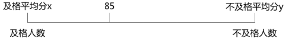

总人数30人，问不及格学生人数最多，则及格人数应最少。根据线段法“距离与量成反比”，量（人数）及格尽可能少、不及格尽可能多，因此距离（平均分与85的差距）及格平均分x与85的差应尽量大，不及格平均分y与85的差应尽量小，故x取与85最远的值且不超过满分可以取值100，y取与85最近且不及格的值可以取值59。由此可计算及格和不及格的平均分（距离）的比（x-85）：（85-y）=（100-85）：（85-59）=15:26，则计算及格和不及格的人数（量）的比为26:15。总人数为30人，不及格人数为，所求得10.98为不及格的学生人数最多的情况，因此人数需向下取整为10人。

故正确答案为B。

**考点**：非典型最值问题

### 第 53 题

四对情侣排成一队买演唱会门票，已知每对情侣必须排在一起，问共有多少种不同的排队顺序：

A. 24

B. 96

C. 384

D. 40320

第 53 题 · 答案与解析

**参考答案（粉笔题库参考内容）**

C

**解析**

每对情侣必须排在一起，故可将每对情侣捆绑起来，4对情侣全排列有种排法；每对情侣又可以互相调换位置，即每对情侣又有2种排列方式，4对情侣互相调换有种排法，故一共有种排法。

故正确答案为C。

**考点**：相邻问题

### 第 54 题

甲、乙、丙三人跑步比赛，从跑道起点出发，跑了20分钟，甲超过乙一圈，又跑了10分钟，甲超过丙一圈，问再过多长时间，丙超过乙一圈：

A. 30分钟

B. 40分钟

C. 50分钟

D. 60分钟

第 54 题 · 答案与解析

**参考答案（粉笔题库参考内容）**

A

**解析**

根据追及公式：，可列式：，，联立①②两式解得：，故丙超过乙一圈需要60分钟，已过30分钟，还需30分钟丙可超过乙一圈。

故正确答案为A。

**考点**：相遇追及

### 第 55 题

用a、b、c三种不同型号的客车送一批会议代表到火车站，用6辆a型车，5趟可以送完；用5辆a型车和10辆b型车，3趟可以送完；用3辆b型车和8辆c型车，4趟可以送完。问先由3辆a型车和6辆b型车各送4趟，剩下的代表还要由2辆c型车送几趟：

A. 3

B. 4

C. 5

D. 6

第 55 题 · 答案与解析

**参考答案（粉笔题库参考内容）**

B

**解析**

根据题意代表人数不变，可列式为：，化简后得：a:b:c=4:2:3；则可求出代表一共有人。3辆a型与6辆b型车各运4趟，共运了，还剩下120-96=24人，故还需2辆c型车运。

故正确答案为B。

**考点**：给效率比例型

### 第 56 题

夏天干旱，甲、乙两家请人来挖井，阴天时，甲家挖井需要8天，乙家需要10天；晴天时，甲家工作效率下降40%，乙家工作效率下降20%，两家同时开工并同时挖好井，问甲家挖了几个晴天：

A. 2

B. 8

C. 10

D. 12

第 56 题 · 答案与解析

**参考答案（粉笔题库参考内容）**

C

**解析**

依据题意，设井深40，则阴天时甲的效率为5，乙的效率为4；晴天时甲效率下降40%，为；乙效率下降20%，为。设晴天有x天，阴天有y天，由条件“两家同时开工并同时挖好井”可列方程：5y+3x=4y+3.2x，化简得：y=0.2x，即5y=x，则可知晴天数x为5的倍数，查看选项只有C项符合要求。

故正确答案为C。

**考点**：给完工时间型

### 第 57 题

商店进了100件同样的衣服，售价定为进价的150%，一段时间后价格下降20%继续销售，换季时剩下的衣服按照售价的一半处理，最后这批衣服盈利超过25%。如果处理的衣服不少于20件，问至少有多少件衣服是按照原售价卖出的：

A. 7

B. 14

C. 34

D. 47

第 57 题 · 答案与解析

**参考答案（粉笔题库参考内容）**

D

**解析**

赋值衣服进价为100元，则衣服售价为元，则原价售出时单件利润为150-100=50元；下降20%时，其单件利润为元；处理时其单件利润为元。设原价售出的件数为x件，处理售出的件数为y件，总数为100件，则下降20%售出的件数为（100-x-y）件。根据“最后这批衣服盈利超过25%”可得：，化简得6x＞100+9y，则，因题目所求为“至少有多少件衣服是按照原售价卖出”，即x最小，则y要最小，又“如果处理的衣服不少于20件”，则y最小为20，所以，则x最小为47件。

故正确答案为D。

**考点**：经济利润问题、非典型最值问题

### 第 58 题

某委员会有成员465人，对2个提案进行表决，要求必须对2个提案分别提出赞成或反对意见。其中赞成第一个提案的有364人，赞成第二个提案的有392人，两个提案都反对的有17人。问赞成第一个提案且反对第二个提案的有几人：

A. 56

B. 67

C. 83

D. 84

第 58 题 · 答案与解析

**参考答案（粉笔题库参考内容）**

A

**解析**

根据两集合容斥原理公式，可列式为364＋392－两者都赞同的人数=465－17=448人，解得两者都赞同的人数＝364＋392－448＝308人，则赞成第一个提案且反对第二个提案的人数为364－308＝56人。

故正确答案为A。

**考点**：两集合

### 第 59 题

某小区有40%的住户订阅日报，有15%的住户同时订阅日报和时报，有75%的住户至少订阅两种报纸中的一种，问订阅时报的比例至少为多少：

A. 35%

B. 50%

C. 55%

D. 60%

第 59 题 · 答案与解析

**参考答案（粉笔题库参考内容）**

B

**解析**

根据二集合容斥原理公式，可列式为：0.75=0.4+订阅时报的比例-0.15，解得订阅时报的比例=0.75+0.15-0.4=0.5。

故正确答案为B。

**考点**：两集合

### 第 60 题

一门课程的满分为100分，由个人报告成绩与小组报告成绩组成，其中个人报告成绩占70%，小组报告成绩占30%。已知小明的个人报告成绩与同一小组的小欣的个人报告成绩之比为7：6，小明该门课程的成绩为91分，则小欣的成绩最低为多少分：

A. 78

B. 79

C. 81

D. 82

第 60 题 · 答案与解析

**参考答案（粉笔题库参考内容）**

C

**解析**

假设小明的个人成绩为x，小组成绩为y，则根据题意可列式为：0.7x+0.3y=91。小明与小欣的个人成绩之比为7:6，则小欣的个人成绩为，那么小欣的总成绩为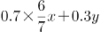，即91-0.1x。要想让小欣的总成绩最低，可知x最大时，小欣的个人成绩最低，x最大可取满分100。那么小欣的成绩最低可为：91-0.1×100=81分。

故正确答案为C。

**考点**：非典型最值问题

### 第 61 题

物质：匮乏：补给

A. 知识：渊博：传授

B. 政府：廉洁：监督

C. 体型：臃肿：减肥

D. 走私：猖獗：打击

第 61 题 · 答案与解析

**参考答案（粉笔题库参考内容）**

D

**解析**

第一步：判断题干词语间逻辑关系。

“物质”如果“匮乏”需要被“补给”，属于条件关系。

第二步：判断选项词语间逻辑关系。

A项，“知识”如果“渊博”就不需要被“传授”，可以把知识传授给其他人，逻辑关系与题干不一致，排除；

B项，“政府”如果保持“廉洁”就不需要群众“监督”，逻辑关系与题干不一致，排除；

C项，“体型”如果“臃肿”不一定需要“减肥”，“臃肿”也可以指衣服穿得多，行动不便，逻辑关系与题干不一致，排除；

D项，“走私”如果“猖獗”则需要被打击，是条件关系，逻辑关系与题干一致，当选。

故正确答案为D。

**考点**：逻辑关系-对应关系

### 第 62 题

雨：雪

A. 热水瓶：盘子

B. 加热器：电容器

C. 音响：显示器

D. 电视机：游戏机

第 62 题 · 答案与解析

**参考答案（粉笔题库参考内容）**

D

**解析**

第一步：判断题干词语间逻辑关系。

“雨”和“雪”是并列关系，并且“雨”在一定条件下可以转化成“雪”。

第二步：判断选项词语间逻辑关系。

D项“电视机”和“游戏机”也是一组并列关系，且“电视机”在某种条件下也可以用作“游戏机”，与题干逻辑关系一致，当选。

A、B、C三项虽然都是并列关系，但是相互之间不能转化，与题干逻辑关系不一致，故排除。

故正确答案为D。

**考点**：逻辑关系-并列关系

### 第 63 题

中国：熊猫

A. 美国：白头鹰

B. 南非：企鹅

C. 澳大利亚：考拉

D. 英国：狮子

第 63 题 · 答案与解析

**参考答案（粉笔题库参考内容）**

C

**解析**

第一步：判断题干词语间逻辑关系。

熊猫是中国的国宝。

第二步：逐一分析其他选项。

白头鹰是美国的国宝级动物，与题干逻辑关系一致，A项保留；

南非的国宝级动物是狮子，与题干逻辑关系不一致，B项排除；

考拉是澳大利亚的国宝，与题干逻辑关系一致，C项保留；

英国的国宝级动物是红胸鸲，与题干逻辑关系不一致，D项排除。

比较A、C选项，白头鹰是鸟类，而熊猫和考拉都是哺乳动物，因此C项比A项更贴近题干。

故正确答案为C。

**考点**：逻辑关系-对应关系

### 第 64 题

未雨绸缪：临阵磨枪

A. 曲高和寡：阳春白雪

B. 忠贞不渝：朝三暮四

C. 瑕不掩瑜：差强人意

D. 今非昔比：物是人非

第 64 题 · 答案与解析

**参考答案（粉笔题库参考内容）**

B

**解析**

第一步：判断题干词语间逻辑关系。

“未雨绸缪”表示趁着天没下雨，先把门窗绑牢，比喻事先做准备。

“临阵磨枪”比喻事到临头才做准备。题干为一组反义成语。

第二步：判断选项词语间逻辑关系。

B项“忠贞不渝”表示忠诚坚定，永不改变；“朝三暮四”原比喻聪明的人善于使用手段，愚笨的人不善于辨别事情，后来比喻反复无常。这两个成语是反义关系，当选。

A、C、D三项都没有反义关系，排除。

故正确答案为B。

【成语积累】

曲高和寡：曲调越高深，能跟着唱的人就越少。旧指知音难得，现比喻言论或作品不通俗，能了解的人很少。

阳春白雪：原指战国时期楚国的一种较高级的歌曲，现比喻高深的、不通俗的文学艺术。

瑕不掩瑜：比喻缺点掩盖不了优点，缺点是次要的，优点是主要的。

差强人意：原指勉强还能振奋人的意志，表示大体上还能使人满意。

今非昔比：现在不是过去能比得上的，多指形势、自然面貌等发生了巨大的变化。

物是人非：东西还是原来的东西，可是人已不是原来的人了，多用于表达时过境迁，因而怀念故人。

**考点**：语义关系-反义关系

### 第 65 题

上元节：赏花灯

A. 七夕节：鹊桥相会

B. 端午节：插茱萸

C. 重阳节：登高

D. 中秋节：游湖

第 65 题 · 答案与解析

**参考答案（粉笔题库参考内容）**

C

**解析**

第一步：判断题干词语间逻辑关系。

选项词语要满足传统节日与习俗的对应关系，即上元节的习俗是赏花灯。

第二步：判断选项词语间逻辑关系。

A项：“七夕节”的习俗是乞巧活动，对应错误，排除；

B项：“端午节”的习俗是插艾叶，对应错误，排除；

C项：“重阳节”的习俗是登高，符合题干逻辑关系，当选；

D项：“中秋节”的习俗是赏月、吃月饼，对应错误，排除。

故正确答案为C。

**考点**：逻辑关系-对应关系

### 第 66 题

七窍生烟：气愤

A. 同流合污：腐败

B. 百口莫辩：复杂

C. 手舞足蹈：高兴

D. 鹏程万里：遥远

第 66 题 · 答案与解析

**参考答案（粉笔题库参考内容）**

C

**解析**

“七窍生烟”用来比喻十分气愤。

A项：“同流合污”指跟着坏人一起做坏事，与“腐败”没有明显逻辑关系，排除；

B项：“百口莫辩”形容有口难辩，与“复杂”没有明显逻辑关系，排除；

C项：“手舞足蹈”用来比喻十分高兴，与题干逻辑关系一致，当选；

D项：“鹏程万里”形容前程远大，与“遥远”没有明显逻辑关系，排除。

故正确答案为C。

**考点**：语义关系-比喻象征义

### 第 67 题

路程：时间：速度

A. 压强：面积：压力

B. 功率：电流：电压

C. 本金：利率：利息

D. 原价：折扣：现价

第 67 题 · 答案与解析

**参考答案（粉笔题库参考内容）**

B

**解析**

第一步：判断题干词语间逻辑关系。

路程等于时间乘以速度。

第二步：分析选项词语间逻辑关系。

压强等于压力除以面积，与题干逻辑关系不一致，A项错误；

功率等于电流乘以电压，与题干逻辑关系一致，B项正确；

利息等于本金乘以利率，与题干逻辑关系不一致，C项错误；

现价等于原价乘以折扣，与题干逻辑关系不一致，D项错误。

故正确答案为B。

**考点**：逻辑关系-对应关系

### 第 68 题

婚礼：司仪：宾客

A. 教学：学生：教师

B. 诉讼：法官：原告

C. 新闻：主持人：记者

D. 球赛：裁判：球迷

第 68 题 · 答案与解析

**参考答案（粉笔题库参考内容）**

D

**解析**

第一步：判断题干词语间逻辑关系。

司仪主持婚礼，宾客作为旁观者参加婚礼。

第二步：判断选项词语间逻辑关系。

A项：学生不能主持教学，与题干逻辑关系不一致，排除；

B项：法官主持诉讼，但原告是本次诉讼的直接参与者，不是旁观者，与题干逻辑关系不一致，排除；

C项：主持人主持新闻，但记者不是新闻的旁观者，不是参加新闻，记者应该是去采访新闻，与题干逻辑关系不一致，排除；

D项：裁判主持球赛，球迷作为观众旁观球赛，与题干逻辑关系一致，当选。

故正确答案为D。

**考点**：逻辑关系-对应关系

### 第 69 题

（ ）对于 蜜蜂 相当于 产品 对于（ ）

A. 蜂蜜 工人

B. 昆虫 企业

C. 鲜花 商店

D. 蝴蝶 原料

第 69 题 · 答案与解析

**参考答案（粉笔题库参考内容）**

A

**解析**

将选项逐一代入，判断各选项前后部分的逻辑关系。

A项，蜜蜂产蜂蜜，工人制作产品，逻辑关系一致，当选；

B项，蜜蜂是昆虫的一种，但企业不是产品的一种，逻辑关系不一致，排除；

C项，蜜蜂采鲜花，但产品和商店无此对应关系，逻辑关系不一致，排除；

D项，蜜蜂和蝴蝶是并列关系，但产品和原料不是并列关系，后者经过加工得到前者，逻辑关系不一致，排除。

故正确答案是A。

**考点**：逻辑关系-对应关系

### 第 70 题

计划 对于（ ）相当于（ ）对于 操作

A. 实施 规程

B. 调研 方法

C. 方案 制定

D. 改变 失误

第 70 题 · 答案与解析

**参考答案（粉笔题库参考内容）**

B

**解析**

逐一代入选项。

A项，按照计划来实施，计划是实施的依据；按照规程来操作，规程是操作的依据，前后逻辑关系一致，保留；

B项，按照计划来调研，计划是调研的依据；按照方法来操作，方法是操作的依据，前后逻辑关系一致，保留；

C项，方案是指进行工作的具体计划或对某一问题制定的规划，所以计划和方案是种属关系，制定和操作无明显逻辑关系。前后逻辑关系不一致，排除；

D项，改变计划是动宾短语，操作失误并非动宾短语，前后逻辑关系不一致，排除。

比较A、B两项，如果看语法结构，A项实施计划是动宾短语，操作规程是并列名词短语，前后逻辑关系不一致，排除；而B项调研计划和操作方法都是并列名词短语，前后逻辑关系一致，当选。

故正确答案为B。

**考点**：语法关系、逻辑关系-对应关系

### 第 71 题

刻板印象是将对一类人行为的整体印象推广到个体的过程。它是由于人们在种族（或民族）、宗教、性别、年龄等方面的差异而形成的。对一个人的刻板印象可导致知觉错误。

根据上述定义，下列不属于刻板印象的是：

A. 东北人都是活雷锋，有事找东北人没错

B. 俗话说“家贫出孝子”，老李家境贫寒，他的孩子肯定孝敬父母

C. 某企业觉得有些地方的人不诚实，因此没有录用来自这一地区的小张

D. 经理认为小王在工作中经常出错，所以今后对他的任用要谨慎

第 71 题 · 答案与解析

**参考答案（粉笔题库参考内容）**

D

**解析**

第一步：找出定义关键词。

关键词强调的是将对一类人行为的整体印象推广到个体。

第二步：逐一分析选项。

A、B、C三项都是将一类人行为的整体印象推广到个体，符合定义，排除；

D项中经理对小王的印象是个人对个人的看法，不是对一类人的整体印象，因此不属于刻板印象，当选。

本题为选非题，故正确答案为D。

**考点**：单定义-其他句式

### 第 72 题

园林是指在一定地域运用工程技术和艺术手段，通过改造地形（或进一步筑山、叠石、理水），种植花草，营造建筑和布置园路等途径，创作而成的优美自然环境和游憩境域。

根据上述定义，下列属于园林的是：

A. 某企业为了打造良好的工作环境，在厂房前后种植了大量的树木和花草

B. 老张承包一片山林，建造餐厅和客舍，吸引城市游客前来休闲观光

C. 某区专辟一块地供市民休闲，修建回廊亭阁，假山喷泉，以树木花草环绕

D. 某地树木葱茏，山清水秀，且遗留许多奇特的民俗，很多游客慕名前往

第 72 题 · 答案与解析

**参考答案（粉笔题库参考内容）**

C

**解析**

第一步：找出定义关键词。

关键词强调的是运用工程技术和艺术手段对自然环境进行人为改造。

第二步：逐一分析选项。

A项，厂房不是自然环境，排除；

B项，没有应用艺术手段，排除；

C项，符合定义，当选；

D项，没有进行人为改造，排除。

故正确答案为C。

**考点**：方式目的

### 第 73 题

主观唯心主义把个人的某种主观精神如感觉、经验、心灵、意识、观念、意志等看作世界上一切事物产生和存在的根源与基础，而世界上的一切事物则是由这些主观精神所派生的，是这些主观精神的显现。

根据上述定义，下列观点不属于主观唯心主义的是：

A. 生死有命，富贵在天

B. 对象和感觉是同一个东西

C. 有条件要上，没条件也要上

D. 万物森然于方寸之间，满心而发，充塞宇宙

第 73 题 · 答案与解析

**参考答案（粉笔题库参考内容）**

A

**解析**

第一步：找出定义关键词。

“把个人的某种主观精神如感觉、经验、心灵、意识、观念、意志等看作世界上一切事物产生和存在的根源与基础”。

第二步：逐一分析选项。

A项：指人的生死等一切遭遇都由天命决定，不以人的意志为转移，不受人的主观精神影响，所以不是“个人的主观精神”，从哲学上来讲，这是客观唯心主义，不符合定义，当选；

B项：这个命题是巴克莱唯心主义经验论三大命题中的最后一个，可概括为客观存在的对象是由人的感觉来感知的，所以能够对应“个人主观精神”中的“感觉”，体现了受人的主观精神影响，符合定义，排除；

C项：强调不管是否有条件都要去做的“意志”，体现了人的主观精神的影响，符合定义，排除；

D项：是宋明两代“心学”的开山之祖陆九渊思想的主要内容，即我的心就是整个宇宙，“满心”能够对应“个人主观精神”中的“心灵”，体现了人的主观精神的影响，符合定义，排除。

本题为选非题，故正确答案为A。

**考点**：单定义-其他句式

### 第 74 题

蘑菇长在阴暗的角落，得不到阳光，也没有肥料，自生自灭，只有长到足够高的时候才会开始被人类关注，可此时它自己已经能够接受阳光了。人们将这种现象称为“蘑菇效应”。

根据上述定义，下列属于蘑菇效应的是：

A. 小刘是留学归来的MBA，一进公司就担任了部门经理

B. 演员小王初入行时常常几个月只演一个小角色，后来终于成名，每天片约不断

C. 某单位给每个层级的管理者规定了一项制度，没有预先培养自己的接班人，就不能升迁

D. 小李工作后一直表现平平，一次偶然的机会他得到领导赏识，在后来的一个大项目中被委以重任

第 74 题 · 答案与解析

**参考答案（粉笔题库参考内容）**

B

**解析**

第一步：找出定义关键词。

关键词强调的是开始矮小长到足够高才会被关注

第二步：逐一分析选项。

A项：小刘刚开始就受到重视，不符合题意，排除；

B项：小王最初演小角色，成名后片约不断，符合题意，当选；

C项：题干没有涉及，排除；

D项：小李是偶然的机会被赏识，不符合题意，排除。

故正确答案为B。

**考点**：故事类

### 第 75 题

气象服务经济包含两层意义，一是指利用气象服务来防灾、抗灾以避免风险和损失；二是指利用有利的气象条件来创造效益。人们可以利用气象信息作为从事经济活动的决策依据之一，可以根据气象服务提供的信息，安排生产经营活动，减少经济损失，提高经济效益。

根据上述定义，下列属于气象服务经济的是：

A. 渔民根据台风警报取消出海作业

B. 大学生根据气象预报选择旅行时间

C. 电信服务商发布收费天气预报短信

D. 根据地球公转周期选择卫星最佳发射时机

第 75 题 · 答案与解析

**参考答案（粉笔题库参考内容）**

A

**解析**

第一步：找出定义关键词。

“利用气象服务来防灾、抗灾以避免风险和损失”，“利用有利的气象条件来创造效益”。

第二步：逐一分析选项。

A项：“根据台风警报取消出海作业”是利用气象服务防灾避免风险，符合定义，当选；

B项：“选择旅行时间”既没有“避免风险和损失”，又没有“创造效益”，不符合定义，排除；

C项：电信服务商是通过向人们提供信息创造收益，而不是“利用有利的气象条件”来创造收益，不符合定义，排除；

D项：“根据地球公转周期选择”，而不是利用气象，不符合定义，排除。

故正确答案为A。

**考点**：方式目的

### 第 76 题

请从所给的四个选项中，选择最合适的一个填入问号处，使之呈现一定的规律性：

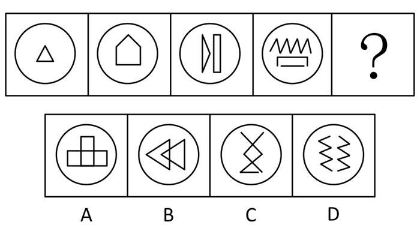

A. A

B. B

C. C

D. D

第 76 题 · 答案与解析

**参考答案（粉笔题库参考内容）**

C

**解析**

图形元素组成不同，考虑属性和数量规律，题干中出现较多折线和改造图，考虑数角。观察已知的图形，角的个数分别为3、5、7、9，形成等差数列，因此问号处的图形应该有11个角，只有C项符合。

故正确答案为C。

**考点**：数量规律-角

### 第 77 题

请从所给的四个选项中，选择最合适的一个填入问号处，使之呈现一定的规律性：

A. A

B. B

C. C

D. D

第 77 题 · 答案与解析

**参考答案（粉笔题库参考内容）**

A

**解析**

解析一：元素组成不同，且无明显属性规律，考虑数量规律。观察发现，题干中封闭空间较多，考虑数面。题干图形面数量依次为：4、5、3、5、？，无明显规律。继续观察发现，题干图形均存在相交，且图形相交产生的交点数依次为：3、4、2、4、？（如下图所示），每个图形中面数量与相交产生的交点数之差均为1，只有A项符合。

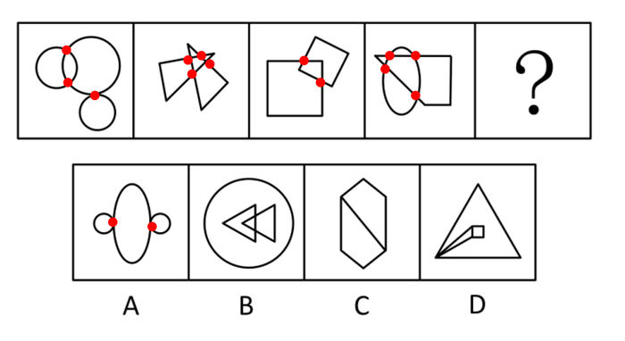

故正确答案为A。

解析二：元素组成凌乱，但题干和选项图形都是由两个或多个不同的图形组成。观察它们之间的关系，已知图形都有两个元素相交的区域，符合的只有B项。

故正确答案为B。

注：本题有两种思路，其中数量规律比较严谨，且第二种思路中，图一有三个图形，其中一个图形是相交于点，并不严谨，因此我们粉笔更倾向于根据解析一将正确答案给到A。

**考点**：数量规律-复合

### 第 78 题

从所给的四个选项中，选择最合适的一个填入问号处，使之呈现一定的规律性：

A. A

B. B

C. C

D. D

第 78 题 · 答案与解析

**参考答案（粉笔题库参考内容）**

B

**解析**

题目中的图形由两种不同的元素组成，考查元素替换关系。若将1个△换成2个□，题中图形□的个数依次为3、5、7、9，因此问号处应该等价于11个□，只有B项符合。

故正确答案为B。

**考点**：数量规律-素

### 第 79 题

把下面的六个小图形分为两类，使每一类图形都有各自的共同特征或规律，分类正确的一项是：

A. ①②③，④⑤⑥

B. ①④⑥，②③⑤

C. ①②⑤，③④⑥

D. ①⑤⑥，②③④

第 79 题 · 答案与解析

**参考答案（粉笔题库参考内容）**

D

**解析**

图形元素组成不同，优先考虑属性规律，本题对称性较为明显，优先考虑对称性。观察图形可知都是轴对称图形，考虑细化考点，数对称轴的数量，①⑤⑥三个图形均有两条对称轴，②③④三个图形均只有一条对称轴。

故正确答案为D。

**考点**：属性规律-对称性

### 第 80 题

从所给的四个选项中，选择最合适的一个填入问号处，使之呈现一定的规律性：

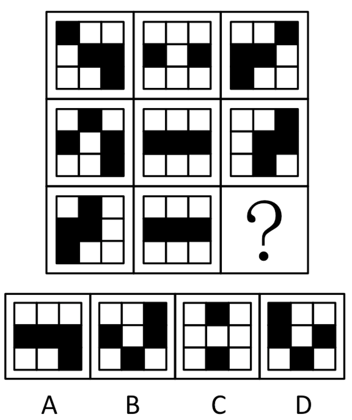

A. A

B. B

C. C

D. D

第 80 题 · 答案与解析

**参考答案（粉笔题库参考内容）**

D

**解析**

本题考查黑白块，但黑白运算没有规律，故考虑黑格位置的平移。九宫格优先横行看，每一行的九宫格上排的黑格向下移动一格，中间的黑格向右移动一格，最下排的黑格向上移动一格。

注意移动路线：黑格是按照小九宫格的每行循环移动。

故正确答案为D。

**考点**：位置规律-平移

### 第 81 题

请从所给的四个选项中，选择最合适的一个填入问号处，使之呈现一定的规律性：

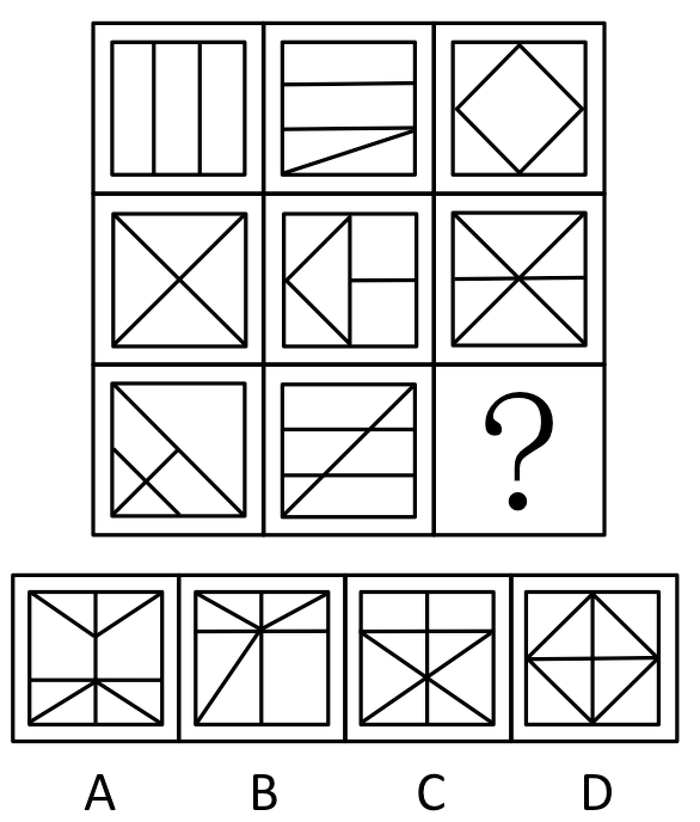

A. A

B. B

C. C

D. D

第 81 题 · 答案与解析

**参考答案（粉笔题库参考内容）**

B

**解析**

考查封闭区域数量。九宫格第一行封闭区域数为3、4、5；第二行封闭区域数为4、5、6；第三行封闭区域数为5、6、？。根据规律，问号处封闭区域数应为7，B项符合。

故正确答案为B。

**考点**：数量规律-面

### 第 82 题

从所给的四个选项中，选择最合适的一个填入问号处，使之呈现一定的规律性：

A. A

B. B

C. C

D. D

第 82 题 · 答案与解析

**参考答案（粉笔题库参考内容）**

B

**解析**

图形元素组成相似，考查元素的遍历。每列图形的外框均有三角形、圆形、方形三种，内部线条均有“—”“∣”“\\”“/”四类线条，问号处内部线条只缺少“\\”“/”两条线，所以选择B项。

故正确答案为B。

**考点**：样式规律-遍历

### 第 83 题

从所给的四个选项中，选择最合适的一个填入问号处，使之呈现一定的规律性：

A. A

B. B

C. C

D. D

第 83 题 · 答案与解析

**参考答案（粉笔题库参考内容）**

A

**解析**

考查笔画。九格宫内的图形都可以一笔画成，选项中只有A项才能一笔画成。

故正确答案为A。

**考点**：数量规律-线

### 第 84 题

从所给的四个选项中，选择最合适的一个填入问号处，使之呈现一定的规律性：

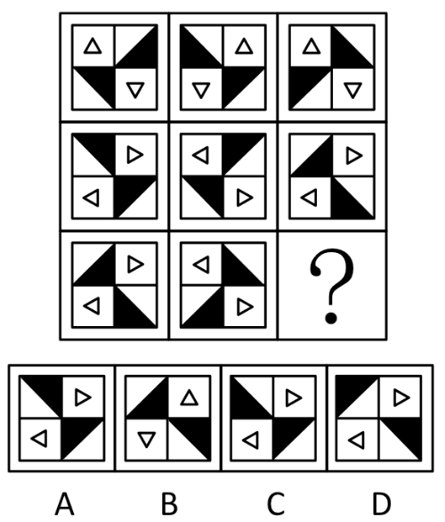

A. A

B. B

C. C

D. D

第 84 题 · 答案与解析

**参考答案（粉笔题库参考内容）**

A

**解析**

图形元素组成相同，考虑位置规律。九宫格图形优先横向观察，第一行第一个图形经过左右翻转得到第二个图形，第二个图形经过上下翻转得到第三个图形，验证第二行规律，与第一行相同，故“?”处图形应是第三行第二个图形经过上下翻转而得出，只有A项符合。

故正确答案为A。

**考点**：位置规律-翻转

### 第 85 题

下列四块纸板均由六个正方形组成，问沿虚线折叠，能形成立方体的有几个：

A. 1

B. 2

C. 3

D. 4

第 85 题 · 答案与解析

**参考答案（粉笔题库参考内容）**

D

**解析**

空间重构题。

这是很简单的一道空间重构题目，即确定平面展开图能否折成六面体。只需要用到相对面在平面展开图中的排布的知识点即可。根据“相间排列”或者“Z字形两端”的两个面是相对面，我们发现，题干中所有的图形，均能找到3组相对面，也就是4个纸板都能折成立方体。

故正确答案为D。

**考点**：空间类-空间重构-六面体

### 第 86 题

有甲、乙、丙、丁四人，如果甲炒股，那么乙、丙、丁也都炒股。如果上述断定为真，那么以下哪项一定也为真？

A. 如果甲没有炒股，那么乙、丙、丁也没有炒股

B. 如果甲没有炒股，那么乙、丙、丁中至少有一人没有炒股

C. 如果乙、丙、丁都炒股，那么甲也炒股

D. 如果丁没有炒股，那么甲和乙至少有一人没有炒股

第 86 题 · 答案与解析

**参考答案（粉笔题库参考内容）**

D

**解析**

第一步：翻译题干。甲乙且丙且丁

第二步：逐一判断选项。

A、B两项都是否定前件，得不到必然结论，错误；

C项是肯定后件，得不到必然结论，错误；

D项否定后件，则甲必然没有炒股，可以推出甲和乙至少有一人没有炒股，正确。

故正确答案为D。

**考点**：常规翻译

### 第 87 题

曹操又称魏武王，河南安阳西高穴大墓中出土了刻有“魏武王常所用格虎大戟”的石碑以及刻有“魏武王常所用慰项石”的石枕等随葬品。所以，西高穴大墓就是曹操墓。

下列哪项为真，最能加强上述推断：

A. 随葬品是证明墓穴墓主身份的重要证据

B. 如果在墓穴中没有发现刻有“魏武王”之类字样的随葬品，就不能证明该墓穴是曹操墓

C. 只有在墓穴中发现刻有“魏武王”之类的字样的随葬品，才能证明该墓穴是曹操墓

D. 只要在墓穴中发现刻有“魏武王”之类字样的随葬品，那么该墓穴就是曹操墓

第 87 题 · 答案与解析

**参考答案（粉笔题库参考内容）**

D

**解析**

第一步：找出论点和论据。

论点：西高穴大墓就是曹操墓。

论据：曹操又称魏武王，河南安阳西高穴大墓中出土了刻有“魏武王常所用格虎大戟”的石碑以及刻有“魏武王常所用慰项石”的石枕等随葬品。

本题论点指出“西高穴大墓”是“曹操墓”，论据指出“西高穴大墓”出土了刻有“魏武王”之类字样的随葬品，论点和论据话题不一致，加强优先搭桥，即建立“刻有‘魏武王’之类字样的随葬品”和“曹操墓”的联系。

第二步：逐一分析选项。

A项：选项指出随葬品是证明墓穴墓主身份的重要证据，但没有指明“刻有‘魏武王’之类字样的随葬品”和“曹操墓”的联系，不明确选项，无法加强，排除；

B项：选项可以翻译为“该墓穴是曹操墓在墓穴中发现刻有‘魏武王’之类字样的随葬品”，在论点和论据之间建立联系，可以加强，保留；

C项：选项可以翻译为“该墓穴是曹操墓在墓穴中发现刻有‘魏武王’之类字样的随葬品”，在论点和论据之间建立联系，可以加强，保留；

D项：选项可以翻译为“在墓穴中发现刻有‘魏武王’之类字样的随葬品该墓穴是曹操墓”，在论据和论点之间建立联系，可以加强，保留。

对比B、C、D三项，B和C虽然建立了论点和论据的联系，但方向为从论点到论据，搭桥方向相反，而D项建立了论据和论点的联系，且方向为从论据到论点，加强力度最强，优选D项。

故正确答案为D。

**考点**：搭桥

### 第 88 题

某工厂的生产线会排放大量废弃物导致大气污染，为了迫使该工厂改变生产流程，减少污染，当地居民决定对该厂销量最大的产品——荧光灯进行联合抵制。因为居民们认为对销售量最大的产品进行抵制能够最大程度地降低该厂的利润。

以下哪项如果为真，最能质疑上述推论：

A. 联合抵制行动仅考虑产品的销售量，无法推断其相应的利润

B. 联合抵制行动没有考虑该工厂改变生产流程的可能途径等信息

C. 联合抵制行动没有涉及可以使得该工厂改变生产流程的其他方法

D. 居民通过联合抵制的方式，想要达到目的需要花费很长时间

第 88 题 · 答案与解析

**参考答案（粉笔题库参考内容）**

A

**解析**

第一步：找到论点论据。

论点：居民决定抵制该厂销量最大的产品，迫使该工厂改变生产流程。

论据：抵制销售量最大的产品能降低该厂的利润。

第二步：判断削弱方式。

论点论据之间没有必然联系，可以考虑拆桥，但此题没有拆桥选项，故选择削弱论点或削弱论据。

第三步：逐一分析各项。

A项否认了论据的因果关系，削弱了论据，为正确选项；

B项、C项均对削弱论点论据无效，为无关选项；

D项涉及的是花费的时间长短，也为无关选项。

故正确答案为A。

**考点**：削弱论据

### 第 89 题

近年来，学术不端甚至学术腐败现象愈演愈烈。有些人剽窃他人研究成果，有些人编造实验数据，有些人私自拿患者做实验，不仅丧失了学者的底线，甚至是连最起码的做人底线都没有了。身为学者的李教授对此感到非常痛心，他认为学术腐败已经到了非惩治不可的地步，但是同样身为学者的妻子说：“我不同意你的观点，我们学院的张教授治学严谨，他从来没有学术不端的行为。”

以下哪项最能反驳李教授妻子的观点：

A. 惩治学术腐败光靠榜样的力量是不够的，更需要法律的约束

B. 张教授也可能存在学术不端行为，只是没有被发现而已

C. 作为一名公共知识分子，张教授要注意自己在公众面前的正面形象

D. 张教授的情况属于个别案例，并不能反驳带有普遍性的某种规律

第 89 题 · 答案与解析

**参考答案（粉笔题库参考内容）**

D

**解析**

第一步：找到论点和论据。

论点：学术腐败还没到非惩治不可的地步。

论据：张教授治学严谨，从来没有学术不端的行为。

第二步：判断削弱方式。

论点强调的是学术界的学术腐败问题，论据强调的是张教授没有学术不端的行为，二者对象不一致，可进行拆桥。

第三步：逐一分析选项。

A项涉及的惩治学术腐败的方式，C项涉及的张教授注意公众形象，都与论题无关，为无关选项，排除；

B项质疑了论据的正确性，削弱了论据，但力度弱于削弱论证，排除；

D项在论点论据之间进行了拆桥，削弱了论证，为正确选项，当选。

故正确答案为D。

**考点**：拆桥

### 第 90 题

雪豹属于世界级濒危物种，国家一级保护动物，已被列入动物保护白皮书。雪豹常栖息于2500～5000米人迹罕至的高原地带，但近年来它与人类邂逅的故事屡见报端，很多人觉得这无疑是雪豹种群数量上升的有力证据。

以下哪项如果为真，最能反驳上述观点：

A. 一些国家设立了保护区来保护雪豹

B. 雪豹的生存环境不断恶化，开始进入人类的生活区觅食

C. 有些雪豹白天也会出来活动

D. 人类比以前更加关注雪豹的活动

第 90 题 · 答案与解析

**参考答案（粉笔题库参考内容）**

B

**解析**

第一步：找到论点和论据。

论点：雪豹种群数量上升。

论据：雪豹栖息于无人地带，但近年常进入人类生活区。

第二步：判断拆桥。

论点强调的是种群数量，论据强调的是雪豹行踪。二者对象不一致，可以在论点和论据之间进行拆桥。

第三步：逐一分析选项。

A项补充了新论据，加强了论证，排除；

B项说明了雪豹进入人类生活区是因为生存环境恶化，不是因为种群数量上升，在论点和论据之间进行了拆桥，削弱了论证，保留；

C项的活动时间，和雪豹种群数量是否上升无关，为无关选项，排除；

D项说明是因为人们比以前更加关注雪豹，所以雪豹与人类邂逅的故事屡见报端，削弱了论证，保留。

对比B项和D项，B项直接说明雪豹的生存环境不断恶化，即雪豹种群数量不可能上升；D项人们虽然关注雪豹多了，但是和雪豹种群数量没有必然关系，所以B项更能削弱，B项当选。

故正确答案为B。

**考点**：拆桥

### 第 91 题

目前，我国新能源汽车推广的战略方向是在公共交通领域进行示范应用，截至2012年12月，全国约有27800多辆新能源汽车，其中80%是公交车，但是汽车生产商认为，新能源汽车在全社会的推广还是比较艰难的，短期内难以大规模普及。

以下哪项如果为真，不能支持厂商的观点：

A. 另外20%的新能源汽车大部分是机关单位公务用车

B. 新能源汽车的维修网点等配套设施不完善

C. 新能源汽车的性能与普通汽车无异

D. 目前公众的节能环保意识还不强

第 91 题 · 答案与解析

**参考答案（粉笔题库参考内容）**

C

**解析**

第一步：找到论点和论据。

论点：新能源汽车在全社会的推广还是比较艰难的，短期内难以大规模普及。

论据：本题没有明显论据。

第二步：逐一分析选项。

A项，强调另外20%为机关单位用车，那么新能源汽车主要应用领域为公交车和机关单位用车，通过补充论据说明新能源汽车短期内难以大规模普及，可以加强，排除；

B项，指出新能源汽车的维修网点等配套设施不完善，说明新能源汽车在推广过程中存在问题，可以加强，排除；

C项，强调新能源汽车的性能与普通汽车无异，与新能源汽车是否能够在短期内大规模推广无关，无法加强，当选；

D项，指出目前公众的节能环保意识还不强，不会想去使用新能源汽车，因此新能源汽车无法在短期内大规模推广，可以加强，排除。

本题为选非题，故正确答案为C。

**考点**：加强选非题

### 第 92 题

某国近年来放松了对销售民用枪支的管制，枪击案发生率快速上升。据统计，大多数枪击案与合法购置的民用枪支被滥用有关，所以有人提出为减少该国的枪击案发生率，政府应该加强对销售民用枪支的限制。

下列哪项最能支持上述论述：

A. 该国走私枪支的数量远远大于合法购置的枪支

B. 目前对枪击案罪犯的严厉惩罚没有足够的威慑力

C. 大多数在该国销售的民用枪支的杀伤力并不大

D. 严格限制销售民用枪支能得到国民的支持

第 92 题 · 答案与解析

**参考答案（粉笔题库参考内容）**

B

**解析**

本题是一道争议题。

第一步：找出论点和论据。

论点：政府应该加强民用枪支销售的限制以减少枪击案发生率。

论据：大多数枪击案与合法购置的民用枪支被滥用有关。

第二步：逐一分析选项。

A项：讨论的是走私枪支和合法购置枪支数量的比较，与政府应该加强限制销售民用枪支无关，无关选项，排除；

B项：“目前对罪犯的惩罚没有足够的威慑力”，排除了其他因素的影响，说明法律对减少枪击案的发生没有作用，因此，想要降低枪击案发生率，就要去限制民用枪支，通过排除他因支持了论点，可以加强，当选；

C项：讨论的是销售的民用枪支杀伤力的问题，与政府应该加强限制销售民用枪支无关，无关选项，排除；

D项：国民支持限制销售民用枪支不代表加强民用枪支销售的限制后就能减少枪击案的发生率，无法加强，排除。

故正确答案为B。

另外一种观点认为应该选D，原因如下：

论点：政府应该加强民用枪支销售限制。

B项：“目前对罪犯的惩罚没有足够的威慑力”与政府应该加强民用枪支销售没有关系，无法支持；

D项：国民支持限制销售民用枪支是政府应该加强民用枪支销售的必要条件，因此，选择D项。

粉笔认为：本题的论点不是应不应该加强民用枪支的销售限制，而是加强了民用枪支的销售限制后能否减少枪击案的发生率，因此，粉笔倾向于选择B选项。

**考点**：补充论据

### 第 93 题

某慈善基金会收到一项没有署名的捐款，经多方调查得知，是林川、吴飞、郑傅、郭博四人中一人捐的，但问他们时，

林川说：“我没捐。”

郑傅说：“是吴飞捐的。”

吴飞说：“是郭博捐的。”

郭博说：“不是我捐的。”

如果四人中只有一人说了真话，则下列哪项为真：

A. 林川说真话，是吴飞捐的

B. 林川说假话，是林川捐的

C. 吴飞说真话，是郭博捐的

D. 郑傅说假话，是郑傅捐的

第 93 题 · 答案与解析

**参考答案（粉笔题库参考内容）**

B

**解析**

第一步：翻译题干。

林：-林

郑：吴

吴：郭

郭：-郭

第二步：找突破口。

吴和郭的话矛盾，必有一真一假。

第三步：分析其他。

因为只有一真，所以林和郑都说了假话，即林捐了，吴没捐，因此吴说了假话，郭说了真话。

故正确答案为B。

**考点**：只有一真/一假

### 第 94 题

科学家研制出一种新型纳米涂层材料，能够促使任何液体从物体表面反弹出去。例如，油类、酒、有机碱和溶剂等表面张力很低的液体洒到用这种材料制作的衣物上时，会立刻被反弹，不会弄脏衣物。因此，有商业人士预测，这种材料如果大量用于生产服装，洗涤剂的销量将大幅下降。

以下哪项如果为真，不能质疑该商业人士的预测：

A. 消费者使用洗涤剂往往还因为洗涤剂具有消毒的功效

B. 这种涂层材料将影响服装穿着舒适度，从而影响服装的销量

C. 该研究成果商业化还需要相当长的一段时间

D. 人们习惯于根据穿着时间来洗衣服，无论衣服是否已经被弄脏

第 94 题 · 答案与解析

**参考答案（粉笔题库参考内容）**

C

**解析**

第一步：分析题干，找到论点和论据。

论点：新型材料如果大量用于生产服装，洗涤剂的销量将大幅下降。

论据：新型材料能反弹液体，使衣服不被液体弄脏。

第二步：逐一分析选项。

A项，指出用洗涤剂还因为其具有消毒的功能，新型材料制作的衣物只是不被弄脏不能推出该种材料影响洗涤剂的销量，削弱论证，排除；

B项，此种材料的服装影响穿着舒适度，导致其销量较低，减少了对洗涤剂的销量的影响，削弱论点，排除；

C项，题干没有提到研究成果商业化的时间，与销量无关，不能质疑该商业人士的预测，当选；

D项，指出洗衣服是由穿衣服时间决定的，弄脏与否与洗衣服没有关系，也就和洗涤剂的销量没有关系，削弱论证，排除。

本题为选非题，故正确答案为C。

**考点**：削弱选非题

### 第 95 题

某校报受学生会委托，在全校师生中进行抽样调查，推选最受欢迎的学生会干部，结果姚俊得到65%以上的支持，得票最多，据此学生会认为最受欢迎的学生会干部是姚俊。

以下哪项如果为真，最能削弱学生会的结论：

A. 这次调查大部分来自于姚俊所在的院系

B. 多数被调查者并不关注学生会成员及其工作

C. 该校师生中有部分人没有在调查中发表自己的意见

D. 这次调查问卷在设计上把姚俊放在了调查首位

第 95 题 · 答案与解析

**参考答案（粉笔题库参考内容）**

A

**解析**

第一步：找出论点和论据。

论点：姚俊是最受欢迎的学生会干部。论据：抽样调查的结果，姚俊得到65%以上的支持。

第二步：判断削弱方式。

论题中存在比例关系，已知姚俊在抽样调查中获得65%以上支持的分子，需要补充分母削弱论证。

第三步：逐一分析选项。

A项：说明了调查对象大部分来自姚俊所在的院系，故样本选择得不合理，因为大部分来自倾向于支持姚俊的学生，那么姚俊获得65%以上的支持属于正常现象，削弱了论证；

B项：涉及的多数被调查者不关注，C项：涉及的部分人没有发表意见，都与论题无关，属于无关选项，排除。

D项：涉及调查时的排位，没有解释这与最后的支持率有何关系，也是无关选项，排除。

故正确答案为A。

**考点**：削弱-实验类、拆桥

### 第 96 题

《中共中央关于全面深化改革若干重大问题的决定》指出，要完善国有资本经营预算制度，提高国有资本收益上缴公共财政比例，2020年提到（ ）。

A. 百分之二十

B. 百分之三十

C. 百分之四十

D. 百分之五十

第 96 题 · 答案与解析

**参考答案（粉笔题库参考内容）**

B

**解析**

本题考查时政相关的知识。

中共十八届三中全会通过的《中共中央关于全面深化改革若干重大问题的决定》提出，要完善国有资本经营预算制度，提高国有资本收益上缴公共财政比例，2020年提高到百分之三十，更多用于保障和改善民生。

A、C、D三项均错误，排除。

故正确答案为B。

**考点**：经济建设、重要文件

### 第 97 题

2013年12月10日至13日，中央经济工作会议在北京举行，会议提出了2014年经济工作的六大主要任务，下列不属于这六大任务的是：

A. 切实保障国家粮食安全

B. 着力防控债务风险

C. 积极促进区域协调发展

D. 完善基本公共服务

第 97 题 · 答案与解析

**参考答案（粉笔题库参考内容）**

D

**解析**

本题考查中央经济会议相关的常识。

2013年12月10日至13日，中央经济工作会议在北京举行，会议提出了2014年经济工作的六大主要任务为：①切实保障国家粮食安全；②大力调整产业结构；③着力防控债务风险；④积极促进区域协调发展；⑤着力做好保障和改善民生工作；⑥不断提高对外开放水平。

A、B、C三项均属于六大主要任务之一。

本题为选非题，故正确答案为D。

**考点**：经济建设、重要会议讲话

### 第 98 题

（ ）和（ ）获得2013年国家最高科学技术奖。

A. 吴良镛 谢家麟

B. 郑哲敏 王小谟

C. 张存浩 程开甲

D. 师昌绪 王振义

第 98 题 · 答案与解析

**参考答案（粉笔题库参考内容）**

C

**解析**

中共中央、国务院于2014年1月10日上午在北京隆重举行国家科学技术奖励大会。党和国家领导人习近平、李克强、刘云山、张高丽出席大会并为获奖代表颁奖。李克强代表党中央、国务院在大会上讲话。张高丽主持大会。著名物理化学家、中国高能化学激光奠基人、分子反应动力学奠基人之一、中国科学院院士张存浩；著名物理学家、中国核试验科学技术的创建者和领路人、“两弹一星”功勋科学家程开甲院士，共同荣获2013年度国家最高科学技术奖。

故正确答案为C。

**考点**：科技理论与成就

### 第 99 题

下列论述符合马克思主义哲学观点的是（ ）。

A. 意识是一种特殊的物质

B. 人有多大胆，地有多大产

C. 时间和空间是物质的根本属性

D. 真理既是绝对真理，又是相对真理

第 99 题 · 答案与解析

**参考答案（粉笔题库参考内容）**

D

**解析**

A项错误，在马克思唯物主义中，物质决定意识，意识是客观实在的反映，这是两个概念，无法等同；

B项错误：意思是人有多大的决心和胆量，就能让土地生产出多少斤粮食。这是完全不顾自然规律和客观事实的一句口号，过分强调人的主观能动性，而忽视客观规律的限制，不符合马克思唯物主义；

C项错误，运动是物质的根本属性与存在方式；

D项正确，任何真理都具有绝对的一面，又有相对的一面，它们之间的关系是辩证统一的。

故正确答案为D。

**考点**：认识论

### 第 100 题

根据《宪法》规定，下列表述不正确的是：

A. 农村和城市郊区的土地，除由法律规定属于国家所有的以外，属于集体所有

B. 国务院有权批准省、自治区、直辖市的建置和区域划分

C. 公民在年老、疾病或者丧失劳动能力的情况下，有从国家和社会获得物质帮助的权利

D. 地方各级人民检察院对产生它的国家权力机关和上级人民检察院负责

第 100 题 · 答案与解析

**参考答案（粉笔题库参考内容）**

B

**解析**

本题考查法律常识，主要考查我国《宪法》的内容。

A项表述正确：我国《宪法》第十条第二款规定：“农村和城市郊区的土地，除由法律规定属于国家所有的以外，属于集体所有······”

B项表述错误：我国《宪法》第八十九条规定：“国务院行使下列职权：······（十五）批准省、自治区、直辖市的区域划分，批准自治州、县、自治县、市的建置和区域划分；······”我国《宪法》第六十二条规定：“全国人民代表大会行使下列职权：······（十二）批准省、自治区和直辖市的建置······”因此，有权批准省、自治区、直辖市的建置的是全国人民代表大会。

C项表述正确：我国《宪法》第四十五条规定：“中华人民共和国公民在年老、疾病或者丧失劳动能力的情况下，有从国家和社会获得物质帮助的权利······”

D项表述正确：我国《宪法》第一百三十八条规定：“······地方各级人民检察院对产生它的国家权力机关和上级人民检察院负责。”

本题为选非题，故正确答案为B。

**考点**：宪法

### 第 101 题

根据《行政诉讼法》规定，下列有关行政诉讼的表述不正确的是：

A. 人民法院不受理对国防、外交等国家行为提起的行政诉讼

B. 被告对作出的具体行政行为负有举证责任

C. 人民法院审理行政案件，适用调解

D. 因不动产提起的行政诉讼，由不动产所在地人民法院管辖

第 101 题 · 答案与解析

**参考答案（粉笔题库参考内容）**

C

**解析**

本题考查法律常识，主要考查我国《行政诉讼法》的内容。

A项表述正确：我国《行政诉讼法》第十三条规定：“人民法院不受理公民、法人或者其他组织对下列事项提起的诉讼：（一）国防、外交等国家行为；······”

B项表述正确：我国《行政诉讼法》第三十四条第一款规定：“被告对作出的行政行为负有举证责任，应当提供作出该行政行为的证据和所依据的规范性文件。”

C项表述错误：我国《行政诉讼法》第六十条第一款规定：“人民法院审理行政案件，不适用调解。但是，行政赔偿、补偿以及行政机关行使法律、法规规定的自由裁量权的案件可以调解。”

D项表述正确：我国《行政诉讼法》第二十条规定：“因不动产提起的行政诉讼，由不动产所在地人民法院管辖。”

本题为选非题，故正确答案为C。

**考点**：行政法

### 第 102 题

王某在大街上遛狗。张某故意挑逗狗，之后跑掉，结果狗将路过的孙某咬伤，并继续追赶孙某。王某为阻止狗继续伤人，在狗不听使唤的情况下，用木棍将狗的腿打断。

对此，下列表述正确的是：

A. 孙某可以向张某或王某要求赔偿

B. 孙某只能向王某要求赔偿

C. 孙某要求王某承担赔偿责任，必须证明王某存在过错

D. 王某不能要求张某赔偿狗受伤的损失

第 102 题 · 答案与解析

**参考答案（粉笔题库参考内容）**

A

**解析**

本题考查法律常识，主要考查我国《侵权责任法》的内容。

我国《侵权责任法》第八十三条规定：“因第三人的过错致使动物造成他人损害的，被侵权人可以向动物饲养人或者管理人请求赔偿，也可以向第三人请求赔偿。动物饲养人或者管理人赔偿后，有权向第三人追偿。”此案例中张某挑逗王某的狗造成了对孙某的伤害，故孙某可以向张某或者王某请求赔偿。如孙某向王某请求赔偿，王某赔偿后可以向张某追偿。

我国《侵权责任法》第七十八条规定：“饲养的动物造成他人损害的，动物饲养人或者管理人应当承担侵权责任，但能够证明损害是因被侵权人故意或者重大过失造成的，可以不承担或者减轻责任。”故孙某要求王某承担赔偿责任，不需要证明王某存在过错，只要饲养的动物造成他人损害，动物饲养人或者管理人就应当承担侵权责任，除非能够证明损害是因被侵权人故意或者重大过失造成的。

故正确答案为A。

**考点**：民法典

### 第 103 题

编造、故意传播虚假恐怖信息，严重扰乱社会秩序，具有下列哪一情形的，应当处五年以上有期徒刑：

A. 致使航班备降或返航

B. 造成直接经济损失二十万元以上的

C. 多次编造、故意传播虚假恐怖信息

D. 造成三人以上轻伤或者一人以上重伤

第 103 题 · 答案与解析

**参考答案（粉笔题库参考内容）**

D

**解析**

为依法惩治编造、故意传播虚假恐怖信息犯罪活动，维护社会秩序，维护人民群众生命、财产安全，根据《最高人民法院关于审理编造、故意传播虚假恐怖信息刑事案件适用法律若干问题的解释》第四条规定，编造、故意传播虚假恐怖信息，严重扰乱社会秩序，具有下列情形之一的，应当认定为刑法第二百九十一条之一的“造成严重后果”，处五年以上有期徒刑：

（一）造成三人以上轻伤或者一人以上重伤的；

（二）造成直接经济损失五十万元以上的；

（三）造成县级以上区域范围居民生活秩序严重混乱的；

（四）妨碍国家重大活动进行的；

（五）造成其他严重后果的。

拓展：编造、故意传播虚假恐怖信息，严重扰乱社会秩序，具有下列情形之一的，应当依照刑法第二百九十一条之一的规定，在五年以下有期徒刑范围内酌情从重处罚：

（一）致使航班备降或返航；或者致使列车、船舶等大型客运交通工具中断运行的；

（二）多次编造、故意传播虚假恐怖信息的；

（三）造成直接经济损失二十万元以上的；

（四）造成乡镇、街道区域范围居民生活秩序严重混乱的；

（五）具有其他酌情从重处罚情节的。

故正确答案为D。

**考点**：刑法

### 第 104 题

下列有关经济学常识的表述中，不正确的是：

A. 市场经济通常由市场主体、市场体系和市场机制三个基本要素构成

B. 价格调节机制是价格机制的核心内容

C. WTO的非歧视原则要求各成员之间相互给予最惠国待遇和国民待遇

D. 减少政府支出和增加税收属于紧缩性财政政策

第 104 题 · 答案与解析

**参考答案（粉笔题库参考内容）**

B

**解析**

A项正确，市场经济是指通过市场配置社会资源的经济形势。市场经济通常由市场主体、市场体系和市场机制三个基本要素构成。

B项错误，价格机制是市场机制中的基本机制，它包括价格形成机制和价格调节机制。价格调节机制是指通过价格的升降调节商品和生产要素的供给量和需求量，引导生产、经营和消费的经济运行机制。价格调节机制是价格机制的“外在机制”和补充完善环节。价格形成机制是价格机制的核心内容。

C项正确，非歧视原则，又叫无差别原则，是指在世界贸易组织管辖的领域内，各成员国应公平、公正、平等地一视同仁地对待其他成员与贸易有关的主体和客体。在世界贸易组织中，非歧视原则主要是通过最惠国待遇和国民待遇来实现的。

D项正确，紧缩性财政政策是指通过增加财政收入或减少财政支出以抑制社会总需求增长的政策，主要包括减少政府支出、减少补贴、增加税收等。

本题为选非题，故正确答案为B。

**考点**：市场经济

### 第 105 题

下列不属于行政外部监督的是：

A. 立法监督

B. 司法监督

C. 政党监督

D. 审计监督

第 105 题 · 答案与解析

**参考答案（粉笔题库参考内容）**

D

**解析**

本题考查管理常识，主要涉及行政监督等内容。

行政监督包括行政内部监督和行政外部监督，我国行政内部监督体系包括一般监督和专门监督。其中一般监督主要包括层级行政监督、主管监督和职能监督；专门监督主要包括行政监察和审计监督。

行政外部监督主要有立法监督、司法监督、政党监督以及社会监督。

审计监督属于行政内部监督，而非行政外部监督。

本题为选非题，故正确答案为D。

**考点**：政治建设

### 第 106 题

（ ）适用于对重要事项或重大行动做出安排、奖惩有关单位及人员、变更或者撤销下级机关不适当的决定事项。

A. 决定

B. 公告

C. 通报

D. 批复

第 106 题 · 答案与解析

**参考答案（粉笔题库参考内容）**

A

**解析**

A项正确，决定：适用于对重要事项或者重大行动做出安排，奖惩有关单位及人员，变更或者撤销下级机关不适当的决定事项；

B项错误，公告：适用于向国内外宣布重要事项或者法定事项；

C项错误，通报：适用于表彰先进、批评错误、传达重要精神和告知重要情况；

D项错误，批复：适用于答复下级机关的请示事项。

故正确答案为A。

### 第 107 题

下列关于我国京剧的表述中，不正确的是：

A. 京剧已列入人类非物质文化遗产代表名录

B. 京剧中一般用黑色脸谱来表示忠勇侠义

C. 京剧“四大名旦”是指梅兰芳、程砚秋、尚小云和荀慧生

D. 唱、念、做、打是京剧表演的四种艺术手法

第 107 题 · 答案与解析

**参考答案（粉笔题库参考内容）**

B

**解析**

A项正确：2010年11月16日，京剧被列入《人类非物质文化遗产代表作名录》。

B项错误：红色的脸谱表示忠勇侠义；黑色的脸谱表示刚烈、正直、勇猛甚至鲁莽；黄色的脸谱表示凶狠残暴；蓝色或绿色的脸谱表示一些粗豪暴躁的人物；白色的脸谱一般表示奸臣、坏人。

C项正确：京剧“四大名旦”是指梅兰芳、程砚秋、尚小云和荀慧生。梅兰芳的表演，庄重深邃，气势非凡，简洁凝练；尚小云的表演，神完气足，明快俏丽；程砚秋技艺全面，昆曲、乱弹、文戏和武戏，样样精湛；荀慧生在唱、念、做、打，细微之处见神韵，见精巧。

D项正确：唱、念、做、打是京剧表演的四种艺术手法。唱，指唱功；念，指具有音乐性的念白；做，指舞蹈化的形体动作；打，指武打和翻、跌的技艺。

本题为选非题，故正确答案为B。

**考点**：文学常识

### 第 108 题

下列关于科技常识的表述中，不正确的是：

A. 弗莱明发现了青霉素

B. 魏格纳提出了大陆漂移学说

C. 爱因斯坦创立了狭义相对论

D. 麦克斯韦发现了电磁感应

第 108 题 · 答案与解析

**参考答案（粉笔题库参考内容）**

D

**解析**

A项正确，1928年9月15日，亚历山大·弗莱明发明了青霉素，这使他在全世界赢得了25个名誉学位、15个城市的荣誉市民称号以及其他140多项荣誉，其中包括诺贝尔医学奖；

B项正确，大陆漂移学说由德国科学家阿尔弗雷德·魏格纳在1912年正式提出，中文中“大陆漂移学说”“大陆漂移假说”均指同一概念；

C项正确，相对论是关于时空和引力的理论，主要由爱因斯坦创立，依其研究对象的不同可分为狭义相对论和广义相对论；

D项错误，法拉第电磁感应定律是电磁学中的一条基本定律，此定律于1831年由迈克尔·法拉第发现。

本题为选非题，故正确答案为D。

**考点**：科技理论与成就

### 第 109 题

下列有关国防基础知识的表述中，不正确的是：

A. 我国的第一任国防部长是彭德怀

B. 我国的领海宽度为12海里

C. 我国的现役部队由海军、陆军、空军三个军种组成

D. 我国义务兵服现役的期限为2年

第 109 题 · 答案与解析

**参考答案（粉笔题库参考内容）**

C

**解析**

本题考查我国国防相关的基础知识。

A项表述正确：中华人民共和国成立以来共有13届12任国防部长，第一任国防部长是彭德怀，任职时间是1954年9月一1959年7月，现任国防部长是魏凤和。

B项表述正确：依照1958年9月4日《中华人民共和国政府关于领海的声明》，“中华人民共和国的领海宽度为12海里。这项规定适用于中华人民共和国的一切领土，包括中国大陆及其沿海岛屿，和同大陆及其沿海岛屿隔有公海的台湾及其周围各岛、澎湖列岛、东沙群岛、西沙群岛、中沙群岛、南沙群岛以及其他属于中国的岛屿”。

C项表述错误：中国人民解放军现役部队由陆军、海军、空军、火箭军和战略支援部队组成。它是中华人民共和国武装力量的主体。

D项表述正确：根据《中华人民共和国兵役法》第十九条规定：义务兵服现役的期限为二年。

本题为选非题，故正确答案为C。

**考点**：其他

### 第 110 题

下列应急救护的处理方法中，不科学的是：

A. 现场救治婴儿气道异物梗塞时，将婴儿置于“头低脚高”的体位

B. 成人心肺复苏时，以60次/分钟左右的频率进行胸外心脏按压

C. 踝关节严重扭伤时，立即用冷水或冰块进行冷敷

D. 地震后，对埋压时间较长的幸存者，先喂适量含盐饮料

第 110 题 · 答案与解析

**参考答案（粉笔题库参考内容）**

B

**解析**

A项正确，现场救治婴儿气道异物梗塞时，应将婴儿置于“头低脚高”体位；

B项错误，进行胸外心脏按压要求位置为双乳头连线中点，单手掌跟覆其上，另一手从掌背交叉握紧，按压每分钟至少100次；

C项正确，踝关节扭伤则立即停止运动，使受伤脚踝得到休息，用冰（冰粒或小冰块装于塑料袋中）冷敷受伤部位20～30分钟，24小时内每2小时重复冷敷一次或当疼痛出现时重复冷敷。如果扭伤严重，冰敷处理要持续24～48小时。冷敷能够帮助收缩血管，减少受伤部位的血流量，降低内出血、积液或瘀血，并缓释疼痛。如果没有冰块就用凉水冲15～20分钟，使受伤部位彻底降温；

D项正确，对于埋压时间较长的幸存者，要先喂适量含盐饮料，不可马上给予大量食物。

本题为选非题，故正确答案为B。

**考点**：生活常识

### 第 111 题

下列外来植物按照被引入中国的时间先后顺序排列，正确的是：

①菠菜 ②玉米 ③葡萄 ④胡萝卜

A. ③②①④

B. ③①④②

C. ①④③②

D. ①②③④

第 111 题 · 答案与解析

**参考答案（粉笔题库参考内容）**

B

**解析**

①菠菜原产于波斯（今伊朗），《唐会要》上明确记载，菠菜种子是唐太宗时（公元647年）从尼泊尔作为贡品传入中国的。

②玉米原产于美洲，根据各省通志和府县志的记载，玉米最早是在1531年传到了我国的广西。

③葡萄原产于亚洲西部，于2000多年前的汉朝传入中国。

④胡萝卜原产于亚洲西南部，于13世纪经伊朗传入中国。

因此，时间先后顺序为③①④②。

故正确答案为B。

**考点**：中国历史

### 第 112 题

下列表述正确的是：

A. 古人常用“弄璋之喜”来祝贺人家生女孩

B. “一问三不知”中的三不知指的是不知“天文、地理、历史”

C. “杀青”在古代是指制作竹简的一道工序

D. 《百家姓》是按照姓氏的人口数量来排列的

第 112 题 · 答案与解析

**参考答案（粉笔题库参考内容）**

C

**解析**

A项错误，弄璋，古人把璋给男孩玩，希望他将来有玉一样的品德。旧时常用以祝贺人家生男孩；

B项错误，“三不知”，最早见于《左传》：晋国的荀瑶率兵攻打郑国，荀文子认为，对敌情不甚清楚，不可轻举妄动，就对荀瑶说：“君子之谋也，始、中、终皆举之，而后入焉。今我三不知而入之，不亦难乎？”所谓“三不知”，指对一件事的开始、经过、结局都不了解；

D项错误，百家姓成于宋代，根据当时人口数量来看，宋朝时李姓有500多万人，排在王姓之后，为宋朝的第二大姓，所以百家姓不是根据人口数量排列的。百家姓前四位“赵钱孙李”是按照当时的姓氏势力来排列的，“赵”是当时的皇姓，所以排在第一位；“钱”姓与“孙”姓在当时代表吴越国国王钱镠以及其正妃“孙”氏，所以排二、三位；“李”是南唐国主李氏，所以排第四位。剩下的其他姓氏则没有特定的排列规律。

故正确答案为C。

**考点**：文学常识

### 第 113 题

下列名句是从毛泽东的诗词中选取的，按其创作时间排序正确的是：

①恰同学少年，风华正茂；书生意气，挥斥方遒

②红军不怕远征难，万水千山只等闲

③宜将剩勇追穷寇，不可沽名学霸王

④为有牺牲多壮志，敢教日月换新天

A. ①②③④

B. ②①③④

C. ②①④③

D. ②④①③

第 113 题 · 答案与解析

**参考答案（粉笔题库参考内容）**

A

**解析**

“恰同学少年，风华正茂；书生意气，挥斥方遒”出自《沁园春•长沙》，是毛泽东于1925年秋离开故乡韶山，去广州主持农民运动讲习所，途经长沙，重游橘子洲，感慨万千，写下的一首词；

“红军不怕远征难，万水千山只等闲”于1935年10月到达陕北时写的《七律·长征》中的诗句；

“宜将剩勇追穷寇，不可沽名学霸王”出自《七律·人民解放军占领南京》，是毛泽东于1949年4月所作；

“为有牺牲多壮志，敢教日月换新天”是毛泽东于1959年6月25日到韶山所作。

故正确答案为A。

**考点**：文学常识

### 第 114 题

下列名医与著作的对应关系不正确的是：

A. 华佗—《伤寒杂病论》

B. 葛洪—《抱朴子》

C. 孙思邈—《千金方》

D. 李时珍—《本草纲目》

第 114 题 · 答案与解析

**参考答案（粉笔题库参考内容）**

A

**解析**

本题考查中国古代名医及其医学著作。

A项对应错误：华佗被称为外科鼻祖，发明了麻沸散、五禽戏。《伤寒杂病论》是东汉名医张仲景所著的一部阐述外感病治疗规律的专著。

B项对应正确：葛洪为东晋道教学者、著名炼丹家、医药学家。主要著作有《肘后方》《抱朴子》。

C项对应正确：孙思邈是唐代医药学家、道士，被后人尊称为“药王”。主要著作有《千金方》《千金翼方》。

D项对应正确：李时珍是明代著名医药学家，主要著作有《本草纲目》《濒湖脉学》《奇经八脉考》。

本题为选非题，故正确答案为A。

**考点**：文学常识

### 第 115 题

下列关于地理常识的表述中，不正确的是：

A. 北回归线和南回归线都穿过非洲

B. 南极洲是地球上平均海拔最高的大洲

C. 昆仑山脉和秦岭山脉大致均为东西走向

D. 长江是仅次于密西西比河和亚马孙河的世界第三长河

第 115 题 · 答案与解析

**参考答案（粉笔题库参考内容）**

D

**解析**

A项表述正确：南北回归线的纬度为南北纬，非洲纬度范围为南纬至北纬，因此北回归线和南回归线都穿过非洲。北回归线穿越非洲北部的埃及、利比亚、阿尔及利亚等国家，南回归线穿越非洲南部的马达加斯加、纳米比亚、莫桑比克等国家。

B项表述正确：南极洲全境为平均海拔2350米的高原，是世界上平均海拔最高的大洲。

C项表述正确：我国东西走向的山脉主要有三列，自北向南依次为：天山一阴山；昆仑山一秦岭；南岭。

D项表述错误：世界第一长河为尼罗河，世界第二长河为亚马孙河，世界第三长河为长江。密西西比河是世界第四长河。

本题为选非题，故正确答案为D。

**考点**：自然地理

## 材料 1

根据所给材料，回答116-120题。

### 第 116 题

公立医院人均住院费用中，药费最多的那一年的药费约是：

A. 2570.9元

B. 2784.5元

C. 2916.0元

D. 3025.6元

第 116 题 · 答案与解析

**参考答案（粉笔题库参考内容）**

D

**解析**

结合题干数据，药费=人均住院费用额×药费占比，提问公立医院人均住院费用，定位第一个表格后半部分，查找数据，观察发现，2008年人均住院费用和药费占比均小于2009年，因此2008年药费一定小于2009年，药费最大的年份可以排除2008年；2009年～2012年人均住院费用逐渐增大，而药费占比逐渐减小，无法直接判断药费的大小关系，估算比较：2009年：；2010年：；2011年：；2012年：；2012年药费2993元最大，D项最接近。

故正确答案为D。

**考点**：现期比重、统计表

### 第 117 题

2008—2012年，公立医院次均门诊费用的年均增长率与下列哪个最接近：

A. 8.6%

B. 9.2%

C. 9.7%

D. 10.2%

第 117 题 · 答案与解析

**参考答案（粉笔题库参考内容）**

A

**解析**

根据题干“······年均增长率······”，可判定本题为年均增长率计算问题。定位表1，可知2008年和2012年公立医院次均门诊费用分别为138.8元和193.4元。根据公式：基期量现期量，代入数据，可得，即。取值试算，若r=10%，，不满足；若r=9%，，不满足。故r取值应小于9%，只有A项满足。

故正确答案为A。

**考点**：统计表、年均增长率

### 第 118 题

2012年，社区卫生服务中心的次均门诊费比乡镇卫生院多：

A. 14.3元

B. 26.8元

C. 35.4元

D. 39.6元

第 118 题 · 答案与解析

**参考答案（粉笔题库参考内容）**

C

**解析**

由材料可知，社区卫生服务中心的次均门诊费为84.6元，乡镇卫生院次均门诊费为49.2元，直接相减，84.6－49.2＝35.4元，看尾数得到答案为C项。

故正确答案为C。

**考点**：统计表、简单加减计算

### 第 119 题

2009—2012年，乡镇卫生院人均住院费同比增长超过9%的有：

A. 1个

B. 2个

C. 3个

D. 4个

第 119 题 · 答案与解析

**参考答案（粉笔题库参考内容）**

B

**解析**

同比增长超过9%，即上年量×（1+9%）<本年量，依次要求：

790.8×(1＋9%)<800×(1＋9%)＝872<897.2（2009年），满足；

897.2×(1＋9%)<900×(1＋9%)＝981<1004.6（2010年），满足；

1004.6×(1＋9%)>1000×(1＋9%)＝1090>1051.3（2011年），不满足；

1051.3×(1＋9%)>1050×(1＋9%)＝1144.5>1140.7（2012年），不满足。

满足条件的年份只有2个。

故正确答案为B。

**考点**：一般增长率、统计表

### 第 120 题

下列说法不正确的一项是：

A. 公立医院次均门诊费用中的检查费呈逐年上升趋势

B. 公立医院人均住院费用中的检查费呈逐年上升趋势

C. 2008年，社区卫生服务中心的人均住院费是乡镇卫生院的3倍多

D. 社区卫生服务中心人均住院费中药费最多的年份与最少的年份的费用相差不足100元

第 120 题 · 答案与解析

**参考答案（粉笔题库参考内容）**

D

**解析**

直接查看所给表格资料，可知A、B、C三项正确。通过观察可知，2008年住院费中药费最多，元，2011年药费最少，元，相差1204.3-1060.3=144元，所以D项错误。

本题为选非题，故正确答案为D。

**考点**：综合分析、统计表

## 材料 2

根据所给材料，回答121—123题。

2013年1—10月，全国汽车商品累计进出口总额为1307.15亿美元，同比增长2.16%，同比年内首次呈现增长。其中进口金额664.72亿美元，同比增长0.18%，结束了9月下降趋势；出口金额642.43亿美元，同比增长4.29%，增幅较前9月有所提升。

进口整车方面，1—10月，汽车整车共进口95.39万辆，同比下降1.68%；进口金额391.61亿美元，同比下降4.40%，降幅较前9月分别减缓4.39个百分点和5.30个百分点。在汽车主要进口品种中，越野车进口40.21万辆，同比增长4.80%；轿车进口34.65万辆，同比下降10.51%；小型客车进口17.70万辆，同比增长17.77%。上述三大类汽车品种共进口92.56万辆，占汽车进口总量的97.03%。

出口整车方面，1—10月，汽车整车共出口78.12万辆，同比下降8.25%；出口金额104.97亿美元，同比下降7.67%。在汽车主要出口品种中，轿车出口34.44万辆，同比下降17.40%；载货车出口24.16万辆，同比下降10.50%；客车出口13.69万辆，同比增长33.36%。上述三大类汽车品种共出口72.29万辆，占汽车出口总量的92.54%。

此外，1—10月摩托车累计出口829.86万辆，同比增长2.70%；累计出口金额44.20亿美元，同比增长4.80%。

### 第 121 题

2012年1—10月，全国汽车商品累计进口额约为：

A. 616亿美元

B. 664亿美元

C. 666亿美元

D. 1280亿美元

第 121 题 · 答案与解析

**参考答案（粉笔题库参考内容）**

B

**解析**

基期量求值。2013年1—10月，进口金额为664.72亿美元，同比增长0.18%，故2012年其值为，B项答案最接近，当选。（注：增长率过于小，可忽略不计。）

故正确答案为B。

**考点**：文字资料、基期计算

### 第 122 题

2013年1—10月，越野车进口数量约占汽车整车进口量的：

A. 19%

B. 36%

C. 42%

D. 48%

第 122 题 · 答案与解析

**参考答案（粉笔题库参考内容）**

C

**解析**

比重计算。1—10月，汽车整车共进口95.39万辆，越野车进口40.21万辆，故所占其比重为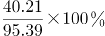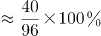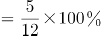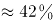。

故正确答案为C。

**考点**：现期比重、文字资料

### 第 123 题

2013年1—10月，全国汽车整车出口金额比整车进口金额：

A. 多22.29亿美元

B. 少22.29亿美元

C. 多286.64亿美元

D. 少286.64亿美元

第 123 题 · 答案与解析

**参考答案（粉笔题库参考内容）**

D

**解析**

查看材料可知，汽车整车出口金额为104.97亿美元，整车进口金额为391.61亿美元，可知汽车整车出口金额比进口金额少200多亿美元。

故正确答案为D。

**考点**：文字资料、简单加减计算

### 第 124 题

2013年1—10月，汽车整车出口的平均单价约为：

A. 1.34万美元

B. 2.29万美元

C. 3.61万美元

D. 4.1万美元

第 124 题 · 答案与解析

**参考答案（粉笔题库参考内容）**

A

**解析**

查看材料可知，1—10月，汽车整车共出口78.12万辆，出口金额104.97亿美元，故平均单价为万美元，根据各选项首位不同，用直除法，首位商1。

故正确答案为A。

**考点**：文字资料、现期平均数

### 第 125 题

以下说法不正确的一项是：

A. 2013年1—10月，轿车进口数量比出口数量略多

B. 2013年1—10月，摩托车出口的平均单价同比有所下降

C. 2013年1—10月，汽车整车的进出口数量同比都有所下降

D. 2013年1—10月，摩托车累计出口数量比上年同期约增加了22万辆

第 125 题 · 答案与解析

**参考答案（粉笔题库参考内容）**

B

**解析**

A项：定位文字材料第二、三段，轿车进口数量为34.65万辆，出口数量为34.44万辆，前者比后者略多，正确；

B项：两期平均数比较，只需看a（分子增长率）与b（分母增长率），a>b，则平均数上升。定位文字材料第四段，摩托车出口金额同比增速为4.80%（a），出口数量同比增速为2.70%（b），a>b，则平均数上升，错误；

C项：定位文字材料第二、三段，汽车整车进口数量（同比下降1.68%）、出口数量（同比下降8.25%），都有所下降，正确；

D项：定位文字材料第四段：2013年1—10月摩托车累计出口829.86万辆，同比增长2.70%。则其增长量为万辆，正确。

本题为选非题，故正确答案为B。

**考点**：综合分析、文字资料

## 材料 3

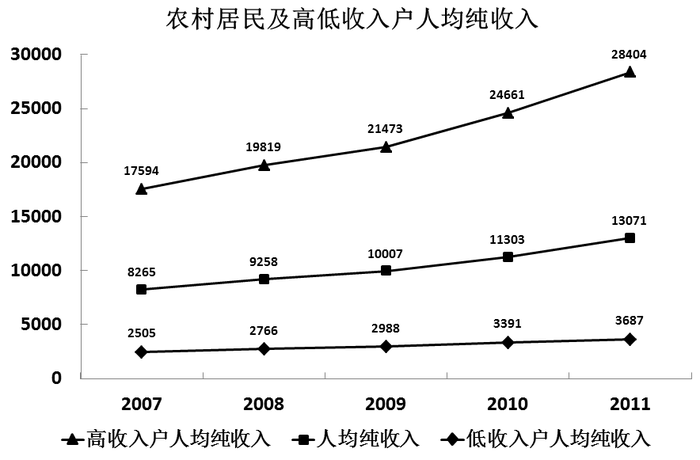

### 第 126 题

2011年，农村居民高收入户人均纯收入的同比增长幅度约比低收入户人均纯收入的同比增长幅度高：

A. 6个百分点

B. 9个百分点

C. 12个百分点

D. 15个百分点

第 126 题 · 答案与解析

**参考答案（粉笔题库参考内容）**

A

**解析**

由增长率计算公式可知，高收入户人均纯收入的同比增长幅度为，低收入户人均纯收入的同比增长幅度为，因此结果大约为7%。

故正确答案为A。

**考点**：一般增长率、综合资料

### 第 127 题

2011年，农村居民高收入户的人均工资性收入约是低收入户的：

A. 4.68倍

B. 4.95倍

C. 5.12倍

D. 5.37倍

第 127 题 · 答案与解析

**参考答案（粉笔题库参考内容）**

B

**解析**

查看表格，2011年，农村居民高收入户的人均工资性收入为11439元，低收入户的为2309元，故高收入户是低收入户的倍，答案比5略小，答案为B项，也可用直除法判断。

故正确答案为B。

**考点**：现期倍数、综合资料

### 第 128 题

2008—2011年内，低收入户人均纯收入与上年相比增长最快的年份是：

A. 2008年

B. 2009年

C. 2010年

D. 2011年

第 128 题 · 答案与解析

**参考答案（粉笔题库参考内容）**

C

**解析**

由题干“······增长最快······”，可判定本题为一般增长率比较问题。定位图形材料，可得到2007-2011年的数据。根据增长率，可计算出：

2008年增长率；

2009年增长率；

2010年增长率；

2011年增长率。

比较可知，2008—2011年内，低收入户人均纯收入与上年相比增长最快的年份是2010年。

故正确答案为C。

**考点**：一般增长率、综合资料

### 第 129 题

2011年，低收入户与高收入户相比，收入结构中，相差最大的是：

A. 人均工资性收入

B. 人均家庭经营收入

C. 人均财产性收入

D. 人均转移性收入

第 129 题 · 答案与解析

**参考答案（粉笔题库参考内容）**

B

**解析**

观察表格第三、七列数据，高收入户中数值量最大、低收入户中数值最低的收入结构是人均家庭经营收入，分别为14281元、283元。因此收入结构中，高收入户与低收入户相差最大的是人均家庭经营收入。

故正确答案为B。

**考点**：直接找数、综合资料

### 第 130 题

下列说法不正确的一项是：

A. 2007—2011年，农村低收入户的人均纯收入与高收入户的差距呈扩大趋势

B. 2011年，只有高收入户的人均转移性收入超过了农村家庭的人均转移性收入

C. 2011年，各收入等级分组中，人均工资性收入占人均纯收入的比例均为最大

D. 2011年，在低收入户中，人均家庭经营收入占人均纯收入的比例最低

第 130 题 · 答案与解析

**参考答案（粉笔题库参考内容）**

C

**解析**

A项：观察折线，2007—2011年，农村低收入户的人均纯收入与高收入户的差距越来越大，正确；

B项：观察表格，2011年超过农村家庭人均转移性收入（767元）的只有高收入户（1174元），正确；

C项：观察表格中四个收入结构的数据，高收入户收入最高的人均家庭经营收入，其占人均纯收入的比例也为最大，错误；

D项：观察表格第三列，低收入户中，人均家庭经营收入最低，占人均纯收入比例也最低，正确。

本题为选非题，故正确答案为C。

**考点**：综合分析、综合资料

