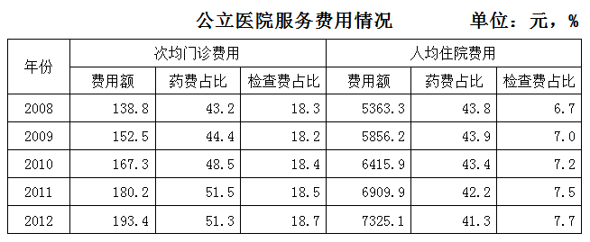
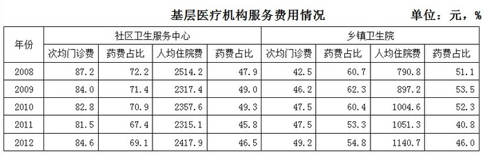
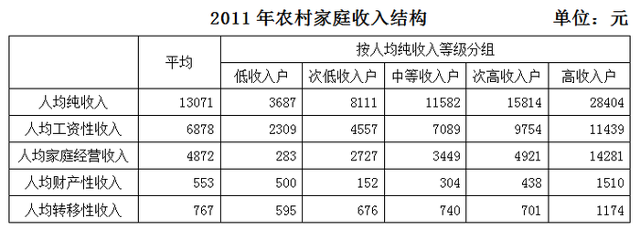
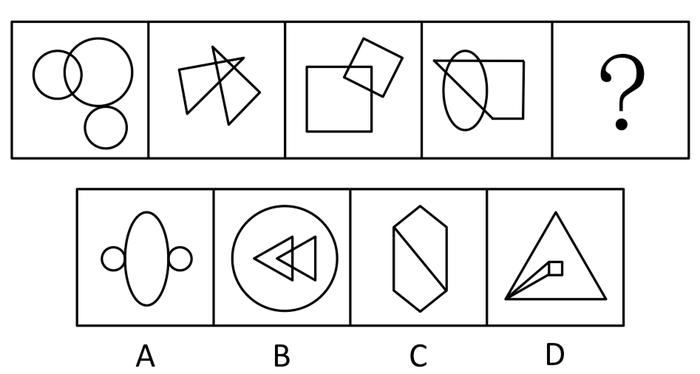
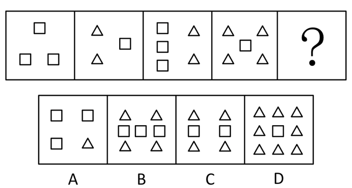
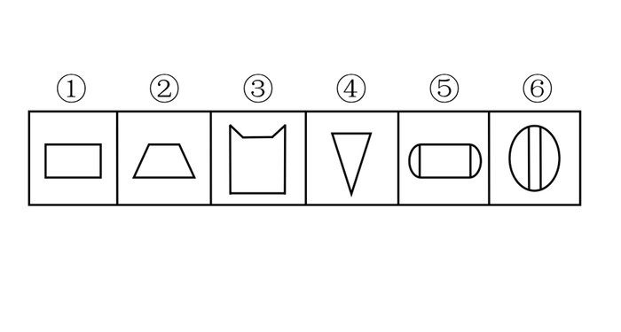
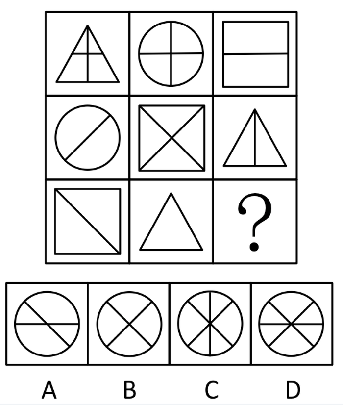
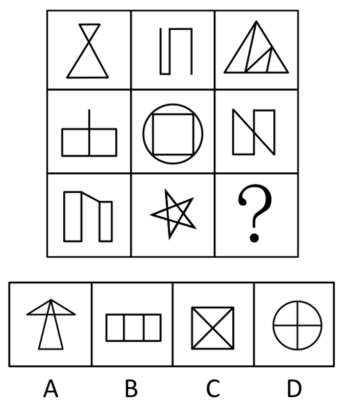
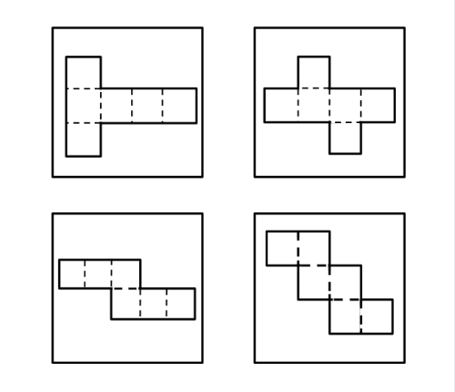

# 2014年浙江省公务员录用考试《行测》题（B类）

> 候选采集稿。参考答案及解析来自粉笔页面，不代表官方答案或真实高分答卷；来源使用许可与原卷对应关系仍需人工核实。

## 题型与作答说明

言语理解与表达

（35题）

每道题包含一个句子或一段话，后面是一个不完整的陈述，要求是从四个选项中选出一个来完成陈述。你的选择应与所提要求最相符合。

数量关系

（20题）

本部分包括数字推理与数学运算两种类型的试题。

判断推理

（30题）

本部分包括图形推理、类比推理、逻辑判断、定义判断与事件排序等五种类型的试题。

常识判断

（20题）

根据题目要求，在四个选项中选出一个正确答案。

资料分析

（15题）

所给出的图、表或一段文字均有5个问题要你回答。你应根据资料所提供的信息进行分析、比较、计算和判断处理。

## 给定材料

### 材料 dom-material-80ed9a4f4710241f

根据所给材料，回答116-120题。

### 材料 dom-material-b14b2b926b6536b6

根据所给材料，回答121—123题。

2013年1—10月，全国汽车商品累计进出口总额为1307.15亿美元，同比增长2.16%，同比年内首次呈现增长。其中进口金额664.72亿美元，同比增长0.18%，结束了9月下降趋势；出口金额642.43亿美元，同比增长4.29%，增幅较前9月有所提升。

进口整车方面，1—10月，汽车整车共进口95.39万辆，同比下降1.68%；进口金额391.61亿美元，同比下降4.40%，降幅较前9月分别减缓4.39个百分点和5.30个百分点。在汽车主要进口品种中，越野车进口40.21万辆，同比增长4.80%；轿车进口34.65万辆，同比下降10.51%；小型客车进口17.70万辆，同比增长17.77%。上述三大类汽车品种共进口92.56万辆，占汽车进口总量的97.03%。

出口整车方面，1—10月，汽车整车共出口78.12万辆，同比下降8.25%；出口金额104.97亿美元，同比下降7.67%。在汽车主要出口品种中，轿车出口34.44万辆，同比下降17.40%；载货车出口24.16万辆，同比下降10.50%；客车出口13.69万辆，同比增长33.36%。上述三大类汽车品种共出口72.29万辆，占汽车出口总量的92.54%。

此外，1—10月摩托车累计出口829.86万辆，同比增长2.70%；累计出口金额44.20亿美元，同比增长4.80%。

### 材料 dom-material-b0978998e656d95e

## 题目

### 第 1 题

从芦山回望玉树，回望汶川，那举国动员的生死营救、那生命至上的国家理念、那\_\_\_\_\_\_的民族精神，\_\_\_\_\_\_的坚韧品格，定格为无数震撼心灵的画面。有这些坚实的内核，中华民族历经苦难而又生生不息。

依次填入画横线部分最恰当的一项是：

A. 众志成城 视死如归

B. 万众一心 百折不挠

C. 临危不惧 不屈不挠

D. 无私无畏 勇往直前

### 第 2 题

沿着新修的国道从呼伦市出发一直向北，如果是在冬季，沿途草原大雪覆盖，松林点缀，白雪皑皑。间或有驯鹿从密林中迁徙，\_\_\_\_\_\_雪原，黑白相间，宛如格林童话的冰雪世界。车行敖鲁古雅的布冬霞部落，驻足静听阵阵哨笛，鄂温克族人驯养的角鹿从四方密林中飞疾汇聚，场面\_\_\_\_\_\_。

依次填入画横线部分最恰当的一项是：

A. 纵观 宏伟

B. 横贯 宏大

C. 穿越 壮观

D. 穿过 雄伟

### 第 3 题

文化的整合功能是指它在协调群体成员的行动方面所发挥的作用。社会群体中不同成员都是\_\_\_\_\_\_的行动者，他们基于自己的需要，根据对情形的判断和理解采取行动。文化是他们之间沟通的中介，如果他们能够\_\_\_\_\_\_文化，就能有效沟通，消除隔阂，促进\_\_\_\_\_\_。

依次填入画横线部分最恰当的一项是：

A. 特别 认识 进步

B. 单独 分享 行动

C. 孤独 认同 融合

D. 独立 共享 合作

### 第 4 题

虽然政府与企业、家庭一起共同参与国民经济，但其行为方式和目的\_\_\_\_\_\_。企业和居民是以收益最大化为前提和目标。而政府的经济活动一方面不能\_\_\_\_\_\_收益和成本，另一方面又必须以全社会的公正和公平为前提。

依次填入画横线部分最恰当的一项是：

A. 大相径庭 忽视

B. 截然相反 忽略

C. 不尽相同 无视

D. 泾渭分明 轻视

### 第 5 题

传统的超级计算机，强项是处理“计算密集型”的任务，比如预测天气。这只要求按照某个成熟的算法模型，\_\_\_\_\_\_地算就行了。但在大数据时代，要从海量，特别是缺乏直接相关性的数据中，\_\_\_\_\_\_出有价值的内容，超级计算机的系统设计需要创新，以适应新的计算模式。

依次填入画横线部分最恰当的一项是：

A. 一板一眼 整理

B. 按部就班 挖掘

C. 循规蹈矩 提炼

D. 周而复始 搜寻

### 第 6 题

在这里，作家的人格显得\_\_\_\_\_\_。无论是历史还是现实或者是最普遍的底层生活，都在他们的笔下幻化为一种真实人生的存在，一种精神的存在，一种被称为“心灵史”的存在。他们\_\_\_\_\_\_于历史与现实之间，心甘情愿地进行着漫长而苦涩的精神之旅，既充实又富有。

依次填入画横线部分最恰当的一项是：

A. 微乎其微 踯躅

B. 举足轻重 徜徉

C. 至关重要 彷徨

D. 无关大局 徘徊

### 第 7 题

人世间的美好梦想，只有通过诚实劳动才能实现；发展中的各种难题，只有通过诚实劳动才能\_\_\_\_\_\_；生命里的一切辉煌，只有通过诚实劳动才能铸就。必须牢固树立劳动最光荣、劳动最崇高、劳动最伟大、劳动最美丽的观念，崇尚劳动，造福劳动者，让全体人民进一步焕发劳动热情、\_\_\_\_\_\_创造潜能，通过劳动创造更加美好的生活。

依次填入画横线部分最恰当的一项是：

A. 破解 释放

B. 完成 激发

C. 化解 开发

D. 解决 发挥

### 第 8 题

从曾经的自行车王国，到今天的车轮上的国家，中国仅用了一代人时间，就实现了欧美几代人的梦想。更多人能开上汽车，这是\_\_\_\_\_\_；更多车主会遵守规则，这是\_\_\_\_\_\_。

依次填入画横线部分最恰当的一项是：

A. 趋势 前提

B. 必然 进步

C. 发展 文明

D. 目标 基础

### 第 9 题

如果说清末的红学还只是一种开玩笑式的诨号，1921年后红学则确实已成为一种\_\_\_\_\_\_的专门之学，由于胡适的提倡，《红楼梦》的考证工作已和中国近代学术的主流——从乾嘉考据学到“五四”之后的国故整理——汇合了。因此，从学术史的观点来看，“红学”无疑可以和其他当代的显学如“甲骨学”或“敦煌学”等\_\_\_\_\_\_，而毫无愧色。

依次填入画横线部分最恰当的一项是：

A. 严格 平分秋色

B. 严谨 三足鼎立

C. 严密 等量齐观

D. 严肃 并驾齐驱

### 第 10 题

从历史的角度看，生态问题只有通过不断重建天人之间的统一才能解决，仅仅赞美自然的原初形态，一味讴歌、缅怀天人之间的原始统一，只能得到某种抽象、空泛的满足，而无法真正解决生态的问题。生态的危机因人而起，也只有通过人自己的合理活动来克服。单纯地由于人的作用导致生态困境而拒斥人的活动，无异于\_\_\_\_\_\_。

填入画横线部分最恰当的一项是：

A. 因小失大

B. 因噎废食

C. 等因奉此

D. 因循守旧

### 第 11 题

“扶老人”的争议背后有深刻的社会道德因素，也\_\_\_了医保制度的不完善带来的养老之痛，老人们“摔不起”“病不起”，一些老人及其亲属承担不了老人住院的后果，加剧了一些无责任人的“扶不起”\_\_\_。

填入划横线部分最恰当的一项是：

A. 影射 窘迫

B. 揭露 尴尬

C. 折射 窘境

D. 暴露 困境

### 第 12 题

近些年，传统文化，尤其是儒家经典，正在重新出场，有人对此\_\_\_\_\_\_，觉得儒家的这种出场违背自由与文明的现代趋势。他们的理据是，从周的封建式家天下到秦汉以来的皇权帝制式家天下，儒家学说与之\_\_\_\_\_\_。有人认为，讲究民本、限制君权的儒家与绝对尊君的法家皆为皇权专制的一体两面。

依次填入画横线部分最恰当的一项是：

A. 颇有微词 相濡以沫

B. 忧心忡忡 如影随形

C. 左顾右盼 亦步亦趋

D. 惴惴不安 并行不悖

### 第 13 题

由于所处的“制度地位”以及“市场地位”非常低，在利益结构已        的当下，他们对于改变命运并无多少机会和预期，于是转而        运气，期待奇迹发生，买彩票就是如此。

依次填入画横线部分最恰当的一项是：

A. 稳固 依赖

B. 稳定 诉诸

C. 定型 投靠

D. 固化 祈求

### 第 14 题

但凡在动荡的社会里，汉字的          比较大，当一个社会稳定的时候，就会出现对汉字的整理和        ，比如战国时期文字就比较乱，出现很多的异体，秦统一之后，就开始整理文字，这就是社会发展提出的要求。

填入划横线部分最恰当的一项是：

A. 变化 干预

B. 自主性 统一

C. 改变 规定

D. 随意性 规范

### 第 15 题

流行总是在轮回，“怀旧情结”的流行趋势大大激发了设计灵感。人们都愿意将一些能        流逝时光、让人静下心来欣赏的艺术品搬回家。生活节奏更快，生活环境更新换代也更快，企盼昨日重现的心情自然而然地高涨。过去最平常的物件，如今却变得异常新奇和珍贵，比如电风扇、煤油灯、红灯笼，从这些曾经的日常生活用品中捕捉灵感，设计出一款款具有“怀旧情结”的艺术精品，是艺术设计            的新现象。

依次填入画横线部分最恰当的一项是：

A. 怀念 别出心裁

B. 憧憬 推陈出新

C. 留恋 标新立异

D. 追忆 返璞归真

### 第 16 题

下列词语中画横线的字，读音全部正确的一组是：

A. 商榷（què） 掮（qián） 掎（jǐ）角之势

B. 悲怆（chuàng） 哨卡（kǎ） 提纲挈（qiè）领

C. 拘泥（nì） 熟稔（rěn） 面面相觑（xù）

D. 作梗（gěng） 粗糙（zāo） 虚与委（wēi）蛇

### 第 17 题

下列词语中没有错别字的一组是：

A. 精兵减政 问心无愧

B. 人所不耻 竭泽而渔

C. 恃强凌弱 屈打成招

D. 迫不急待 防微杜渐

### 第 18 题

①为了储存足够的水分，多肉植物的根、茎、叶部进化成富有大量浆液的组织  
②多肉植物来自高山、沙漠等气候干燥的环境  
③不用太多浇水和打理，它们就能存活  
④以帮助它们在干旱恶劣的气候环境中得以生存  
⑤因此，它们非常适合室内种植  
⑥它们有特别的代谢方式，它们会在夜间吸收，产生苹果酸，白天放出，进行光合作用

将以上6个句子重新排列，语序正确的一项是：

A. ②①④③⑥⑤

B. ②③①④⑥⑤

C. ①④⑥②③⑤

D. ①⑥②③⑤④

### 第 19 题

①事实上，在耕田之外也几乎没有其他的选择

②同样地，生活上的大小事情，除了可以遵循风俗习惯之外，也由宗亲长老按祖训家法裁夺

③在传统的农业社会里，绝大多数的人以农业为生

④在某一层意义上来说，一个人几乎没有什么机会要他自己做决定，在少数需要他自己做决定的时候，也有现成的规矩习惯等可以作为参考

⑤农作上的点点滴滴，除了靠自己经年累月的积累，也由宗亲长老口耳相传

⑥这些经验、规矩、风俗、习惯、祖训、家法，可以说涵盖了一个人生老病死、婚丧嫁娶的每一个环节

将以上6个句子重新排列，语序正确的是：

A. ①③⑤④②⑥

B. ③①⑤②⑥④

C. ①③⑤②⑥④

D. ③①⑤④②⑥

### 第 20 题

①楼市远未到健康发展的程度，然而这并不妨碍我们认识一个真实的中国楼市格局

②而长期来看，让市场起决定性作用，无可避免地将成为中国楼市发展的方向

③无论看涨者和看跌者找到多少理由支持自己的观点，楼市的大格局就摆在那里

④于是乎，各色看法、判断甚至惊人言论无不是裹挟着民意打“影响政策”的主意

⑤中国楼市的参与者都知道，楼市趋势的继续或反转并非来自市场或他们的预测，而是来自政策

⑥事实清楚不过，在认清楼市格局的基础上，保持政策连续性、稳定性是当前稳预期稳房价的关键一招

将以上6个句子重新排列，语序正确的是：

A. ①③⑤④⑥②

B. ①⑤③④⑥②

C. ⑤③①②④⑥

D. ⑤⑥①②④③

### 第 21 题

总体上看，我国是一个资源紧缺的国家，资源紧缺愈益成为我国经济社会发展的瓶颈。我国人均水资源、耕地资源、森林资源，石油、天然气、铜和铝等重要矿产资源都远低于世界人均水平。虽然我国粮食连续第10年实现增产，但供需仍处于紧平衡。我国人民生活水平总体上还不富裕，全国还有近一亿农村扶贫对象、两千多万城市低保人口以及其他众多的困难群体，我们没有任何理由奢侈浪费。

这段文字意在说明：

A. 我国是一个资源紧缺的国家

B. 现实国情决定了我们必须节俭

C. 我国人民的生活水平还需进一步提高

D. 能源紧缺已成为我国经济发展的瓶颈

### 第 22 题

中国人对知识与思想、文风与人品、政治与学术，向来很难划开一道理性的界限，把本来只是经验和感觉的判断，常常当成评价一切的铁律。其实，元好问早就说“心画心声总失真，文章宁复见为人”，刘因也曾说“若将字字论心术，恐有无边受屈人”。

以下观点与原文意思最相符的是：

A. “文如其人”式的说法过于武断

B. 凭感觉去评价人是不可靠的

C. 知人知面不知心

D. 识人的标准应多元化

### 第 23 题

在深化改革过程中，调整利益分配方式，必然触动既有利益格局，削弱一部分人获取利益的权利和机会。这就难免使深化改革举措引起反弹，产生阻力。然而，改革的攻坚期、深水区绕不开、躲不过，必须以啃硬骨头、涉险滩的勇气，勇往直前。瞻前顾后、畏葸不前不仅不能前进，而且可能前功尽弃。

这段文字的主旨是：

A. 改革已进入关键时期

B. 既得利益者是阻碍改革的重要因素

C. 改革的本质是利益的重新分配

D. 深化改革就要去触动利益

### 第 24 题

既然人是社会性的动物，做任何事情都无法脱离人际环境，那么，在单位时间内，谁能够以最低的沟通成本、最快地赢得他人的信任与配合，自然获得成功的几率就大——古今中外，凡能成就大事者，往往胜出在沟通、组织与行动的综合素质。进入工业时代的社会化大生产，以及市场经济环境下的商业竞争，无不需要将这类“人际型知识”贯穿于每一个“经济人”的行为之中。

下列说法与上述文字相符的是：

A. 沟通对于成功很重要

B. 降低沟通成本才能成功

C. 沟通、组织与行动能够成大事

D. 得到他人信任的关键在于沟通

### 第 25 题

使市场在资源配置中起决定性作用，决不是说市场是万能的，可以把一切交给市场；更不是认为政府对市场可以撒手不管。更好发挥政府作用，一方面是要解决政府越位，即对市场干预过多和干预不当问题；另一方面是要解决政府缺位，政府要把该做的事做好，把该管的事管好。政府“有形的手”有效配合市场“无形的手”发挥作用，才能保证市场经济健康发展。

对这段文字的主旨理解最准确的是：

A. 政府要把该管的事管牢管好

B. 要正确处理政府与市场的关系

C. 市场在资源配置中具有天然优势

D. 政府的监管是对市场失灵的矫正

### 第 26 题

数据表明，我国目前团购网站数量不到2000家，去年高峰时期曾有10000家。但不到一年的时间就淘汰了40%的网站。分析师认为，经过两年的竞争，资源逐渐掌握在少数几家手里，市场集中度还将进一步提高，只有极少数网站能够存活下来。活下来的网站会逐渐捡回话语权，毛利会逐渐上抬。

这段文字主要介绍了团购行业的：

A. 竞争方式

B. 经营现状

C. 发展趋势

D. 市场前景

### 第 27 题

对于个体和一个国家来说，人的生存是首先要解决的头等大事。虽然环境保护已越来越多地被提及和关注，但比起解决“吃饭”问题，始终要屈居第二。这也是发展中国家多重复走发达国家先污染后治理的老路的原因，并非看不到教训，而是谋求发展的艰巨任务使得各国不得不走捷径，优先选择煤炭这种低廉可靠、提高贫困人口生活水平还能促进就业的发展型能源。

这段文字的主要意思是：

A. 环境保护和经济发展同样重要

B. 发展中国家为了生存和发展不得不先污染后治理

C. 解决温饱问题比保护环境更重要

D. 发展中国家谋求发展忽略了环境保护

### 第 28 题

吃鱼的时候，小刺要比大刺麻烦，因为大刺很容易被发现，小刺则必须下很大功夫才能清除。做人，小毛病要比大毛病难改正，因为大的差错很容易被发现，小缺点则必须格外留意才会被发现，虽然有小刺的鱼往往肉都特别细腻而鲜美，但许多人就因为怕小刺而不愿意吃那种鱼。虽然脾气怪异、不拘小节的人常有特殊的才华，但是许多人就因为讨厌这些小毛病而不愿意与这些人打交道。

这段文字意在说明：

A. 要学会如何与人相处

B. 小毛病会让人敬而远之

C. 情商与智商同等重要

D. 小毛病可能产生大影响

### 第 29 题

低利率政策的初衷是刺激美国人迅速消费，以弥补危机带来的需求萎缩。但经历了数年的储蓄资产贬值后，相信低利率的刺激作用的边际效应已缩减到了几近于无。危机之初，开启低利率的另一个目的是为流动性紧张的金融机构提供“免费”资金，并帮助金融业补充资本。凭借零利率的借贷，银行可投资于政府债券，获得稳定而无风险的回报。可正因为此，银行丧失了为企业提供信贷这一风险和收益并存的业务和动力，从而未能够帮助中小企业创造就业岗位。

这段文字主要是：

A. 暗示低利率政策必须做出调整

B. 分析实行低利率政策的弊端

C. 强调应鼓励银行开展企业信贷业务

D. 说明低利率政策刺激消费的作用有限

### 第 30 题

可能多数人都会认为，我们的五官是感知外部世界的窗口，五官感觉非常真实而精确地反映着外部世界的现实。殊不知，我们信赖有加的感官事实上也会“欺骗”我们，我们所感知的有可能并非真实世界的反映，各种感官知觉，特别是视觉，有时只是大脑的幻觉和虚构。加拿大不列颠哥伦比亚大学心理学家罗恩•雷恩辛克指出，“你的体验在很大程度上是大脑活动的产物，大脑通过眼睛来获取视觉信息，但这并不是现实的直接反映。”

这段文字意在：

A. 批驳普遍存在的关于“感知”的错误认识

B. 说明我们所感知的有可能并非真实的世界

C. 揭示我们信赖有加的感官事实上一直在“欺骗”我们

D. 介绍加拿大不列颠哥伦比亚大学心理学家的研究成果

### 第 31 题

“阅读是纯个人的事，非常自觉的事。”阅读本是一件很美好的事，在阅读中心灵能够自由地驰骋在各种时空、各个国度，在书本中寻得心灵的共鸣或是思想的碰撞，从而引发对时代、对人生的思考。但是现在真正沉醉在阅读中的人却不多，过度重视物质生活而看不起精神生活，只从网络上读取碎片化、表面化的信息，只停留在获取信息没有引发思考，心态浮躁，难以静下心慢慢读一本书。如今很多书本，过分重视实用主义，过分强调阅读效果，如“3个月练成××”，“10天可以当××”。

这段文字意在说明：

A. 阅读需要深入思考

B. 阅读应该是一种精神享受

C. 阅读是一个潜移默化的过程

D. 实用主义过分强调阅读的效果

### 第 32 题

中国服饰被引入日本并制度化，应该是从奈良时代开始的。日本的奈良时代正值中国盛唐时期，日本派出大批学者、僧侣到中国学习，这些遣唐使者把唐代文化艺术、律令制度都带回了日本，“衣服令”就是奈良时代模仿唐代制定的制度之一，韩服则是受汉服和蒙古服饰的影响从古代演变到现代的传统服装，形制上更多模仿明朝服饰。

下列说法与上述文字相符的是：

A. 日本奈良时代派出的遣唐使者都是一些著名僧侣

B. 韩服在形制上更多模仿中国汉朝与元朝时期的服饰

C. 日本从奈良时代开始引进中国服饰并且使之制度化

D. “衣服令”是日本奈良时代模仿明朝制定的服饰制度

### 第 33 题

红米手机里有一个“老人模式”，就是根据论坛里的用户反馈倒逼出来的创新，“我们最早听到大量用户抱怨，老人不敢用智能手机，因为安卓系统太复杂了，让老人无所适从。技术人员着重在这些问题上研发产品，现在的红米手机‘老人模式’去除了所有的信息聚合，以卡片式的界面为主，将老人会用的短信、电话、新闻、拍照等功能铺排在桌面上，反响非常好。”

上述案例印证了下面哪句话：

A. 市场需要什么，应该由消费者来决定，而不是企业

B. 用户不知道他们想要什么，直到你把产品放在他们面前

C. 在一个充分竞争的市场上，创新可以颠覆一切

D. 在购买时，你可以用任何语言；但在销售时，你必须使用购买者的语言

### 第 34 题

刚刚开学一个多星期，一名正在参加军训的大学生就将一大包衣服和七双袜子打包寄回家，让家人帮着洗，然后再寄回去。这则消息毫无悬念地引发了舆论的一阵喧哗，与以往类似的事情一样，痛心疾首者铺天盖地，上纲上线痛批中国教育的也不在少数。中国的校园总能不断地制造类似的奇闻轶事，高考和入学前后是集中爆发和展示期，年复一年，学校、孩子和家长似乎被符号化：学校一定是僵化冷漠且糟蹋人的，学生一定是娇生惯养未来要“垮掉”的，而家长多半是无原则地一味溺爱的。这样的符号化思维大大简化了中国社会以及中国教育的复杂性。  
这段文字意在说明：

A. 符号化的批评无助于教育和社会的进步

B. 中国社会和学校的教育使学生缺乏独立性

C. 社会舆论易对校园个别事例夸大宣传报道

D. 大学生的独立性并不像媒体说的那么差

### 第 35 题

PM2.5是指大气中直径小于或等于2.5微米的颗粒物，也称为可入肺颗粒物。直径相当于人的头发粗细的1/20。PM2.5的主要来源是发电、工业生产、汽车尾气排放等过程中燃烧产生的残留物。因为这些颗粒物太轻，很难自然降落在地面上，而长期悬浮在空气中，可直接通过呼吸进入肺部甚至融入血液。PM2.5直径小，在大气中的停留时间长，输送距离远，多含有二氧化硫、氮氧化物、硫酸铵等有害物质，因而对人体健康和大气环境质量的影响很大。

根据上述文字，下列表述不正确的是：

A. 只要控制各种燃烧释放的残留物就能有效减少PM2.5

B. PM2.5能长时间悬浮在空气中

C. 只要能使PM2.5降落到地面，就能避免其伤害

D. PM2.5会直接将二氧化硫等有害物质带入人体内影响健康

### 第 36 题

52 32 20 12 8 （ ）

A. 3

B. 4

C. 5

D. 6

### 第 37 题

2 3 7 34 50 175 （ ）

A. 211

B. 213

C. 215

D. 217

### 第 38 题

1 1 5 7 13 （ ）

A. 15

B. 17

C. 19

D. 21

### 第 39 题

\-3 3 6 30 240 （ ）

A. 480

B. 1200

C. 1920

D. 2640

### 第 40 题

1 2 7 23 76 （ ）

A. 206

B. 218

C. 239

D. 251

### 第 41 题

的值为：

A. 

B. 

C. 

D. 

### 第 42 题

对分数进行操作，每次分母加15，分子加7，问至少经过几次这样的操作能使得到的分数不小于：

A. 46

B. 47

C. 48

D. 49

### 第 43 题

合唱团成员排练时站在一个五级的台阶上，最上面一级站N个人。若上面一级比下面一级多站一个人，则多了7个人；若上面一级比下面一级少站一个人，则少多少个人：

A. 4

B. 7

C. 10

D. 13

### 第 44 题

某班有56名学生，每人都参加了A、B、C、D、E五个兴趣班中的其中一个。已知有27人参加A兴趣班，参加B兴趣班的人数第二多，参加C、D兴趣班的人数相同，E兴趣班的参加人数最少，只有6人，问参加B兴趣班的学生有多少个：

A. 7

B. 8

C. 9

D. 10

### 第 45 题

有A、B、C三种浓度不同的溶液，按A与B的质量比为5:3混合，得到的溶液浓度为13.75%；按A与B的质量比为3:5混合，得到的溶液浓度为16.25%；按A、B、C的质量比为1:2:5混合，得到的溶液浓度为31.25%。问溶液C的浓度为多少：

A. 35%

B. 40%

C. 45%

D. 50%

### 第 46 题

两支篮球队打一个系列赛，三场两胜制，第一场和第三场在甲队的主场，第二场在乙队的主场。已知甲队主场赢球概率为0.7，客场赢球概率为0.5。问甲队赢得这个系列赛的概率为多少：

A. 0.3

B. 0.595

C. 0.7

D. 0.795

### 第 47 题

四对情侣排成一队买演唱会门票，已知每对情侣必须排在一起，问共有多少种不同的排队顺序：

A. 24

B. 96

C. 384

D. 40320

### 第 48 题

有30名学生，参加一次满分为100分的考试，每位学生的成绩均为整数，已知该次考试的平均分是85分，问不及格（小于60分）的学生最多有几人？

A. 9

B. 10

C. 11

D. 12

### 第 49 题

甲、乙、丙三人跑步比赛，从跑道起点出发，跑了20分钟，甲超过乙一圈，又跑了10分钟，甲超过丙一圈，问再过多长时间，丙超过乙一圈：

A. 30分钟

B. 40分钟

C. 50分钟

D. 60分钟

### 第 50 题

用a、b、c三种不同型号的客车送一批会议代表到火车站，用6辆a型车，5趟可以送完；用5辆a型车和10辆b型车，3趟可以送完；用3辆b型车和8辆c型车，4趟可以送完。问先由3辆a型车和6辆b型车各送4趟，剩下的代表还要由2辆c型车送几趟：

A. 3

B. 4

C. 5

D. 6

### 第 51 题

夏天干旱，甲、乙两家请人来挖井，阴天时，甲家挖井需要8天，乙家需要10天；晴天时，甲家工作效率下降40%，乙家工作效率下降20%，两家同时开工并同时挖好井，问甲家挖了几个晴天：

A. 2

B. 8

C. 10

D. 12

### 第 52 题

商店进了100件同样的衣服，售价定为进价的150%，一段时间后价格下降20%继续销售，换季时剩下的衣服按照售价的一半处理，最后这批衣服盈利超过25%。如果处理的衣服不少于20件，问至少有多少件衣服是按照原售价卖出的：

A. 7

B. 14

C. 34

D. 47

### 第 53 题

某委员会有成员465人，对2个提案进行表决，要求必须对2个提案分别提出赞成或反对意见。其中赞成第一个提案的有364人，赞成第二个提案的有392人，两个提案都反对的有17人。问赞成第一个提案且反对第二个提案的有几人：

A. 56

B. 67

C. 83

D. 84

### 第 54 题

某小区有40%的住户订阅日报，有15%的住户同时订阅日报和时报，有75%的住户至少订阅两种报纸中的一种，问订阅时报的比例至少为多少：

A. 35%

B. 50%

C. 55%

D. 60%

### 第 55 题

一门课程的满分为100分，由个人报告成绩与小组报告成绩组成，其中个人报告成绩占70%，小组报告成绩占30%。已知小明的个人报告成绩与同一小组的小欣的个人报告成绩之比为7：6，小明该门课程的成绩为91分，则小欣的成绩最低为多少分：

A. 78

B. 79

C. 81

D. 82

### 第 56 题

中国：熊猫

A. 美国：白头鹰

B. 南非：企鹅

C. 澳大利亚：考拉

D. 英国：狮子

### 第 57 题

上元节：赏花灯

A. 七夕节：鹊桥相会

B. 端午节：插茱萸

C. 重阳节：登高

D. 中秋节：游湖

### 第 58 题

七窍生烟：气愤

A. 同流合污：腐败

B. 百口莫辩：复杂

C. 手舞足蹈：高兴

D. 鹏程万里：遥远

### 第 59 题

婚礼：司仪：宾客

A. 教学：学生：教师

B. 诉讼：法官：原告

C. 新闻：主持人：记者

D. 球赛：裁判：球迷

### 第 60 题

计划 对于（ ）相当于（ ）对于 操作

A. 实施 规程

B. 调研 方法

C. 方案 制定

D. 改变 失误

### 第 61 题

刻板印象是将对一类人行为的整体印象推广到个体的过程。它是由于人们在种族（或民族）、宗教、性别、年龄等方面的差异而形成的。对一个人的刻板印象可导致知觉错误。

根据上述定义，下列不属于刻板印象的是：

A. 东北人都是活雷锋，有事找东北人没错

B. 俗话说“家贫出孝子”，老李家境贫寒，他的孩子肯定孝敬父母

C. 某企业觉得有些地方的人不诚实，因此没有录用来自这一地区的小张

D. 经理认为小王在工作中经常出错，所以今后对他的任用要谨慎

### 第 62 题

园林是指在一定地域运用工程技术和艺术手段，通过改造地形（或进一步筑山、叠石、理水），种植花草，营造建筑和布置园路等途径，创作而成的优美自然环境和游憩境域。

根据上述定义，下列属于园林的是：

A. 某企业为了打造良好的工作环境，在厂房前后种植了大量的树木和花草

B. 老张承包一片山林，建造餐厅和客舍，吸引城市游客前来休闲观光

C. 某区专辟一块地供市民休闲，修建回廊亭阁，假山喷泉，以树木花草环绕

D. 某地树木葱茏，山清水秀，且遗留许多奇特的民俗，很多游客慕名前往

### 第 63 题

主观唯心主义把个人的某种主观精神如感觉、经验、心灵、意识、观念、意志等看作世界上一切事物产生和存在的根源与基础，而世界上的一切事物则是由这些主观精神所派生的，是这些主观精神的显现。

根据上述定义，下列观点不属于主观唯心主义的是：

A. 生死有命，富贵在天

B. 对象和感觉是同一个东西

C. 有条件要上，没条件也要上

D. 万物森然于方寸之间，满心而发，充塞宇宙

### 第 64 题

蘑菇长在阴暗的角落，得不到阳光，也没有肥料，自生自灭，只有长到足够高的时候才会开始被人类关注，可此时它自己已经能够接受阳光了。人们将这种现象称为“蘑菇效应”。

根据上述定义，下列属于蘑菇效应的是：

A. 小刘是留学归来的MBA，一进公司就担任了部门经理

B. 演员小王初入行时常常几个月只演一个小角色，后来终于成名，每天片约不断

C. 某单位给每个层级的管理者规定了一项制度，没有预先培养自己的接班人，就不能升迁

D. 小李工作后一直表现平平，一次偶然的机会他得到领导赏识，在后来的一个大项目中被委以重任

### 第 65 题

气象服务经济包含两层意义，一是指利用气象服务来防灾、抗灾以避免风险和损失；二是指利用有利的气象条件来创造效益。人们可以利用气象信息作为从事经济活动的决策依据之一，可以根据气象服务提供的信息，安排生产经营活动，减少经济损失，提高经济效益。

根据上述定义，下列属于气象服务经济的是：

A. 渔民根据台风警报取消出海作业

B. 大学生根据气象预报选择旅行时间

C. 电信服务商发布收费天气预报短信

D. 根据地球公转周期选择卫星最佳发射时机

### 第 66 题

请从所给的四个选项中，选择最合适的一个填入问号处，使之呈现一定的规律性：

A. A

B. B

C. C

D. D

### 第 67 题

请从所给的四个选项中，选择最合适的一个填入问号处，使之呈现一定的规律性：

A. A

B. B

C. C

D. D

### 第 68 题

从所给的四个选项中，选择最合适的一个填入问号处，使之呈现一定的规律性：

A. A

B. B

C. C

D. D

### 第 69 题

把下面的六个小图形分为两类，使每一类图形都有各自的共同特征或规律，分类正确的一项是：

A. ①②③，④⑤⑥

B. ①④⑥，②③⑤

C. ①②⑤，③④⑥

D. ①⑤⑥，②③④

### 第 70 题

从所给的四个选项中，选择最合适的一个填入问号处，使之呈现一定的规律性：

A. A

B. B

C. C

D. D

### 第 71 题

请从所给的四个选项中，选择最合适的一个填入问号处，使之呈现一定的规律性：

A. A

B. B

C. C

D. D

### 第 72 题

从所给的四个选项中，选择最合适的一个填入问号处，使之呈现一定的规律性：

A. A

B. B

C. C

D. D

### 第 73 题

从所给的四个选项中，选择最合适的一个填入问号处，使之呈现一定的规律性：

A. A

B. B

C. C

D. D

### 第 74 题

从所给的四个选项中，选择最合适的一个填入问号处，使之呈现一定的规律性：

A. A

B. B

C. C

D. D

### 第 75 题

下列四块纸板均由六个正方形组成，问沿虚线折叠，能形成立方体的有几个：

A. 1

B. 2

C. 3

D. 4

### 第 76 题

有甲、乙、丙、丁四人，如果甲炒股，那么乙、丙、丁也都炒股。如果上述断定为真，那么以下哪项一定也为真？

A. 如果甲没有炒股，那么乙、丙、丁也没有炒股

B. 如果甲没有炒股，那么乙、丙、丁中至少有一人没有炒股

C. 如果乙、丙、丁都炒股，那么甲也炒股

D. 如果丁没有炒股，那么甲和乙至少有一人没有炒股

### 第 77 题

曹操又称魏武王，河南安阳西高穴大墓中出土了刻有“魏武王常所用格虎大戟”的石碑以及刻有“魏武王常所用慰项石”的石枕等随葬品。所以，西高穴大墓就是曹操墓。

下列哪项为真，最能加强上述推断：

A. 随葬品是证明墓穴墓主身份的重要证据

B. 如果在墓穴中没有发现刻有“魏武王”之类字样的随葬品，就不能证明该墓穴是曹操墓

C. 只有在墓穴中发现刻有“魏武王”之类的字样的随葬品，才能证明该墓穴是曹操墓

D. 只要在墓穴中发现刻有“魏武王”之类字样的随葬品，那么该墓穴就是曹操墓

### 第 78 题

某工厂的生产线会排放大量废弃物导致大气污染，为了迫使该工厂改变生产流程，减少污染，当地居民决定对该厂销量最大的产品——荧光灯进行联合抵制。因为居民们认为对销售量最大的产品进行抵制能够最大程度地降低该厂的利润。

以下哪项如果为真，最能质疑上述推论：

A. 联合抵制行动仅考虑产品的销售量，无法推断其相应的利润

B. 联合抵制行动没有考虑该工厂改变生产流程的可能途径等信息

C. 联合抵制行动没有涉及可以使得该工厂改变生产流程的其他方法

D. 居民通过联合抵制的方式，想要达到目的需要花费很长时间

### 第 79 题

雪豹属于世界级濒危物种，国家一级保护动物，已被列入动物保护白皮书。雪豹常栖息于2500～5000米人迹罕至的高原地带，但近年来它与人类邂逅的故事屡见报端，很多人觉得这无疑是雪豹种群数量上升的有力证据。

以下哪项如果为真，最能反驳上述观点：

A. 一些国家设立了保护区来保护雪豹

B. 雪豹的生存环境不断恶化，开始进入人类的生活区觅食

C. 有些雪豹白天也会出来活动

D. 人类比以前更加关注雪豹的活动

### 第 80 题

目前，我国新能源汽车推广的战略方向是在公共交通领域进行示范应用，截至2012年12月，全国约有27800多辆新能源汽车，其中80%是公交车，但是汽车生产商认为，新能源汽车在全社会的推广还是比较艰难的，短期内难以大规模普及。

以下哪项如果为真，不能支持厂商的观点：

A. 另外20%的新能源汽车大部分是机关单位公务用车

B. 新能源汽车的维修网点等配套设施不完善

C. 新能源汽车的性能与普通汽车无异

D. 目前公众的节能环保意识还不强

### 第 81 题

某国近年来放松了对销售民用枪支的管制，枪击案发生率快速上升。据统计，大多数枪击案与合法购置的民用枪支被滥用有关，所以有人提出为减少该国的枪击案发生率，政府应该加强对销售民用枪支的限制。

下列哪项最能支持上述论述：

A. 该国走私枪支的数量远远大于合法购置的枪支

B. 目前对枪击案罪犯的严厉惩罚没有足够的威慑力

C. 大多数在该国销售的民用枪支的杀伤力并不大

D. 严格限制销售民用枪支能得到国民的支持

### 第 82 题

某慈善基金会收到一项没有署名的捐款，经多方调查得知，是林川、吴飞、郑傅、郭博四人中一人捐的，但问他们时，

林川说：“我没捐。”

郑傅说：“是吴飞捐的。”

吴飞说：“是郭博捐的。”

郭博说：“不是我捐的。”

如果四人中只有一人说了真话，则下列哪项为真：

A. 林川说真话，是吴飞捐的

B. 林川说假话，是林川捐的

C. 吴飞说真话，是郭博捐的

D. 郑傅说假话，是郑傅捐的

### 第 83 题

科学家研制出一种新型纳米涂层材料，能够促使任何液体从物体表面反弹出去。例如，油类、酒、有机碱和溶剂等表面张力很低的液体洒到用这种材料制作的衣物上时，会立刻被反弹，不会弄脏衣物。因此，有商业人士预测，这种材料如果大量用于生产服装，洗涤剂的销量将大幅下降。

以下哪项如果为真，不能质疑该商业人士的预测：

A. 消费者使用洗涤剂往往还因为洗涤剂具有消毒的功效

B. 这种涂层材料将影响服装穿着舒适度，从而影响服装的销量

C. 该研究成果商业化还需要相当长的一段时间

D. 人们习惯于根据穿着时间来洗衣服，无论衣服是否已经被弄脏

### 第 84 题

某校报受学生会委托，在全校师生中进行抽样调查，推选最受欢迎的学生会干部，结果姚俊得到65%以上的支持，得票最多，据此学生会认为最受欢迎的学生会干部是姚俊。

以下哪项如果为真，最能削弱学生会的结论：

A. 这次调查大部分来自于姚俊所在的院系

B. 多数被调查者并不关注学生会成员及其工作

C. 该校师生中有部分人没有在调查中发表自己的意见

D. 这次调查问卷在设计上把姚俊放在了调查首位

### 第 85 题

近年来，学术不端甚至学术腐败现象愈演愈烈。有些人剽窃他人研究成果，有些人编造实验数据，有些人私自拿患者做实验，不仅丧失了学者的底线，甚至是连最起码的做人底线都没有了。身为学者的李教授对此感到非常痛心，他认为学术腐败已经到了非惩治不可的地步，但是同样身为学者的妻子说：“我不同意你的观点，我们学院的张教授治学严谨，他从来没有学术不端的行为。”

以下哪项最能反驳李教授妻子的观点：

A. 惩治学术腐败光靠榜样的力量是不够的，更需要法律的约束

B. 张教授也可能存在学术不端行为，只是没有被发现而已

C. 作为一名公共知识分子，张教授要注意自己在公众面前的正面形象

D. 张教授的情况属于个别案例，并不能反驳带有普遍性的某种规律

### 第 86 题

《中共中央关于全面深化改革若干重大问题的决定》指出，要完善国有资本经营预算制度，提高国有资本收益上缴公共财政比例，2020年提到（ ）。

A. 百分之二十

B. 百分之三十

C. 百分之四十

D. 百分之五十

### 第 87 题

2013年12月10日至13日，中央经济工作会议在北京举行，会议提出了2014年经济工作的六大主要任务，下列不属于这六大任务的是：

A. 切实保障国家粮食安全

B. 着力防控债务风险

C. 积极促进区域协调发展

D. 完善基本公共服务

### 第 88 题

（ ）和（ ）获得2013年国家最高科学技术奖。

A. 吴良镛 谢家麟

B. 郑哲敏 王小谟

C. 张存浩 程开甲

D. 师昌绪 王振义

### 第 89 题

下列论述符合马克思主义哲学观点的是（ ）。

A. 意识是一种特殊的物质

B. 人有多大胆，地有多大产

C. 时间和空间是物质的根本属性

D. 真理既是绝对真理，又是相对真理

### 第 90 题

根据《宪法》规定，下列表述不正确的是：

A. 农村和城市郊区的土地，除由法律规定属于国家所有的以外，属于集体所有

B. 国务院有权批准省、自治区、直辖市的建置和区域划分

C. 公民在年老、疾病或者丧失劳动能力的情况下，有从国家和社会获得物质帮助的权利

D. 地方各级人民检察院对产生它的国家权力机关和上级人民检察院负责

### 第 91 题

根据《行政诉讼法》规定，下列有关行政诉讼的表述不正确的是：

A. 人民法院不受理对国防、外交等国家行为提起的行政诉讼

B. 被告对作出的具体行政行为负有举证责任

C. 人民法院审理行政案件，适用调解

D. 因不动产提起的行政诉讼，由不动产所在地人民法院管辖

### 第 92 题

王某在大街上遛狗。张某故意挑逗狗，之后跑掉，结果狗将路过的孙某咬伤，并继续追赶孙某。王某为阻止狗继续伤人，在狗不听使唤的情况下，用木棍将狗的腿打断。

对此，下列表述正确的是：

A. 孙某可以向张某或王某要求赔偿

B. 孙某只能向王某要求赔偿

C. 孙某要求王某承担赔偿责任，必须证明王某存在过错

D. 王某不能要求张某赔偿狗受伤的损失

### 第 93 题

编造、故意传播虚假恐怖信息，严重扰乱社会秩序，具有下列哪一情形的，应当处五年以上有期徒刑：

A. 致使航班备降或返航

B. 造成直接经济损失二十万元以上的

C. 多次编造、故意传播虚假恐怖信息

D. 造成三人以上轻伤或者一人以上重伤

### 第 94 题

下列有关经济学常识的表述中，不正确的是：

A. 市场经济通常由市场主体、市场体系和市场机制三个基本要素构成

B. 价格调节机制是价格机制的核心内容

C. WTO的非歧视原则要求各成员之间相互给予最惠国待遇和国民待遇

D. 减少政府支出和增加税收属于紧缩性财政政策

### 第 95 题

下列不属于行政外部监督的是：

A. 立法监督

B. 司法监督

C. 政党监督

D. 审计监督

### 第 96 题

（ ）适用于对重要事项或重大行动做出安排、奖惩有关单位及人员、变更或者撤销下级机关不适当的决定事项。

A. 决定

B. 公告

C. 通报

D. 批复

### 第 97 题

下列关于我国京剧的表述中，不正确的是：

A. 京剧已列入人类非物质文化遗产代表名录

B. 京剧中一般用黑色脸谱来表示忠勇侠义

C. 京剧“四大名旦”是指梅兰芳、程砚秋、尚小云和荀慧生

D. 唱、念、做、打是京剧表演的四种艺术手法

### 第 98 题

下列关于科技常识的表述中，不正确的是：

A. 弗莱明发现了青霉素

B. 魏格纳提出了大陆漂移学说

C. 爱因斯坦创立了狭义相对论

D. 麦克斯韦发现了电磁感应

### 第 99 题

下列有关国防基础知识的表述中，不正确的是：

A. 我国的第一任国防部长是彭德怀

B. 我国的领海宽度为12海里

C. 我国的现役部队由海军、陆军、空军三个军种组成

D. 我国义务兵服现役的期限为2年

### 第 100 题

下列应急救护的处理方法中，不科学的是：

A. 现场救治婴儿气道异物梗塞时，将婴儿置于“头低脚高”的体位

B. 成人心肺复苏时，以60次/分钟左右的频率进行胸外心脏按压

C. 踝关节严重扭伤时，立即用冷水或冰块进行冷敷

D. 地震后，对埋压时间较长的幸存者，先喂适量含盐饮料

### 第 101 题

下列外来植物按照被引入中国的时间先后顺序排列，正确的是：

①菠菜 ②玉米 ③葡萄 ④胡萝卜

A. ③②①④

B. ③①④②

C. ①④③②

D. ①②③④

### 第 102 题

下列表述正确的是：

A. 古人常用“弄璋之喜”来祝贺人家生女孩

B. “一问三不知”中的三不知指的是不知“天文、地理、历史”

C. “杀青”在古代是指制作竹简的一道工序

D. 《百家姓》是按照姓氏的人口数量来排列的

### 第 103 题

下列名句是从毛泽东的诗词中选取的，按其创作时间排序正确的是：

①恰同学少年，风华正茂；书生意气，挥斥方遒

②红军不怕远征难，万水千山只等闲

③宜将剩勇追穷寇，不可沽名学霸王

④为有牺牲多壮志，敢教日月换新天

A. ①②③④

B. ②①③④

C. ②①④③

D. ②④①③

### 第 104 题

下列名医与著作的对应关系不正确的是：

A. 华佗—《伤寒杂病论》

B. 葛洪—《抱朴子》

C. 孙思邈—《千金方》

D. 李时珍—《本草纲目》

### 第 105 题

下列关于地理常识的表述中，不正确的是：

A. 北回归线和南回归线都穿过非洲

B. 南极洲是地球上平均海拔最高的大洲

C. 昆仑山脉和秦岭山脉大致均为东西走向

D. 长江是仅次于密西西比河和亚马孙河的世界第三长河

### 第 106 题

公立医院人均住院费用中，药费最多的那一年的药费约是：

关联材料：dom-material-80ed9a4f4710241f

A. 2570.9元

B. 2784.5元

C. 2916.0元

D. 3025.6元

### 第 107 题

2008—2012年，公立医院次均门诊费用的年均增长率与下列哪个最接近：

关联材料：dom-material-80ed9a4f4710241f

A. 8.6%

B. 9.2%

C. 9.7%

D. 10.2%

### 第 108 题

2012年，社区卫生服务中心的次均门诊费比乡镇卫生院多：

关联材料：dom-material-80ed9a4f4710241f

A. 14.3元

B. 26.8元

C. 35.4元

D. 39.6元

### 第 109 题

2009—2012年，乡镇卫生院人均住院费同比增长超过9%的有：

关联材料：dom-material-80ed9a4f4710241f

A. 1个

B. 2个

C. 3个

D. 4个

### 第 110 题

下列说法不正确的一项是：

关联材料：dom-material-80ed9a4f4710241f

A. 公立医院次均门诊费用中的检查费呈逐年上升趋势

B. 公立医院人均住院费用中的检查费呈逐年上升趋势

C. 2008年，社区卫生服务中心的人均住院费是乡镇卫生院的3倍多

D. 社区卫生服务中心人均住院费中药费最多的年份与最少的年份的费用相差不足100元

### 第 111 题

2012年1—10月，全国汽车商品累计进口额约为：

关联材料：dom-material-b14b2b926b6536b6

A. 616亿美元

B. 664亿美元

C. 666亿美元

D. 1280亿美元

### 第 112 题

2013年1—10月，越野车进口数量约占汽车整车进口量的：

关联材料：dom-material-b14b2b926b6536b6

A. 19%

B. 36%

C. 42%

D. 48%

### 第 113 题

2013年1—10月，全国汽车整车出口金额比整车进口金额：

关联材料：dom-material-b14b2b926b6536b6

A. 多22.29亿美元

B. 少22.29亿美元

C. 多286.64亿美元

D. 少286.64亿美元

### 第 114 题

2013年1—10月，汽车整车出口的平均单价约为：

关联材料：dom-material-b14b2b926b6536b6

A. 1.34万美元

B. 2.29万美元

C. 3.61万美元

D. 4.1万美元

### 第 115 题

以下说法不正确的一项是：

关联材料：dom-material-b14b2b926b6536b6

A. 2013年1—10月，轿车进口数量比出口数量略多

B. 2013年1—10月，摩托车出口的平均单价同比有所下降

C. 2013年1—10月，汽车整车的进出口数量同比都有所下降

D. 2013年1—10月，摩托车累计出口数量比上年同期约增加了22万辆

### 第 116 题

2011年，农村居民高收入户人均纯收入的同比增长幅度约比低收入户人均纯收入的同比增长幅度高：

关联材料：dom-material-b0978998e656d95e

A. 6个百分点

B. 9个百分点

C. 12个百分点

D. 15个百分点

### 第 117 题

2011年，农村居民高收入户的人均工资性收入约是低收入户的：

关联材料：dom-material-b0978998e656d95e

A. 4.68倍

B. 4.95倍

C. 5.12倍

D. 5.37倍

### 第 118 题

2008—2011年内，低收入户人均纯收入与上年相比增长最快的年份是：

关联材料：dom-material-b0978998e656d95e

A. 2008年

B. 2009年

C. 2010年

D. 2011年

### 第 119 题

2011年，低收入户与高收入户相比，收入结构中，相差最大的是：

关联材料：dom-material-b0978998e656d95e

A. 人均工资性收入

B. 人均家庭经营收入

C. 人均财产性收入

D. 人均转移性收入

### 第 120 题

下列说法不正确的一项是：

关联材料：dom-material-b0978998e656d95e

A. 2007—2011年，农村低收入户的人均纯收入与高收入户的差距呈扩大趋势

B. 2011年，只有高收入户的人均转移性收入超过了农村家庭的人均转移性收入

C. 2011年，各收入等级分组中，人均工资性收入占人均纯收入的比例均为最大

D. 2011年，在低收入户中，人均家庭经营收入占人均纯收入的比例最低

## 答案与解析

第 1 题

**答案状态：unknown（来源未提供）**

**解析状态：unknown（来源未提供）**

第 2 题

**答案状态：unknown（来源未提供）**

**解析状态：unknown（来源未提供）**

第 3 题

**答案状态：unknown（来源未提供）**

**解析状态：unknown（来源未提供）**

第 4 题

**答案状态：unknown（来源未提供）**

**解析状态：unknown（来源未提供）**

第 5 题

**答案状态：unknown（来源未提供）**

**解析状态：unknown（来源未提供）**

第 6 题

**答案状态：unknown（来源未提供）**

**解析状态：unknown（来源未提供）**

第 7 题

**答案状态：unknown（来源未提供）**

**解析状态：unknown（来源未提供）**

第 8 题

**答案状态：unknown（来源未提供）**

**解析状态：unknown（来源未提供）**

第 9 题

**答案状态：unknown（来源未提供）**

**解析状态：unknown（来源未提供）**

第 10 题

**答案状态：unknown（来源未提供）**

**解析状态：unknown（来源未提供）**

第 11 题

**答案状态：unknown（来源未提供）**

**解析状态：unknown（来源未提供）**

第 12 题

**答案状态：unknown（来源未提供）**

**解析状态：unknown（来源未提供）**

第 13 题

**答案状态：unknown（来源未提供）**

**解析状态：unknown（来源未提供）**

第 14 题

**答案状态：unknown（来源未提供）**

**解析状态：unknown（来源未提供）**

第 15 题

**答案状态：unknown（来源未提供）**

**解析状态：unknown（来源未提供）**

第 16 题

**答案状态：unknown（来源未提供）**

**解析状态：unknown（来源未提供）**

第 17 题

**答案状态：unknown（来源未提供）**

**解析状态：unknown（来源未提供）**

第 18 题

**答案状态：unknown（来源未提供）**

**解析状态：unknown（来源未提供）**

第 19 题

**答案状态：unknown（来源未提供）**

**解析状态：unknown（来源未提供）**

第 20 题

**答案状态：unknown（来源未提供）**

**解析状态：unknown（来源未提供）**

第 21 题

**答案状态：unknown（来源未提供）**

**解析状态：unknown（来源未提供）**

第 22 题

**答案状态：unknown（来源未提供）**

**解析状态：unknown（来源未提供）**

第 23 题

**答案状态：unknown（来源未提供）**

**解析状态：unknown（来源未提供）**

第 24 题

**答案状态：unknown（来源未提供）**

**解析状态：unknown（来源未提供）**

第 25 题

**答案状态：unknown（来源未提供）**

**解析状态：unknown（来源未提供）**

第 26 题

**答案状态：unknown（来源未提供）**

**解析状态：unknown（来源未提供）**

第 27 题

**答案状态：unknown（来源未提供）**

**解析状态：unknown（来源未提供）**

第 28 题

**答案状态：unknown（来源未提供）**

**解析状态：unknown（来源未提供）**

第 29 题

**答案状态：unknown（来源未提供）**

**解析状态：unknown（来源未提供）**

第 30 题

**答案状态：unknown（来源未提供）**

**解析状态：unknown（来源未提供）**

第 31 题

**答案状态：unknown（来源未提供）**

**解析状态：unknown（来源未提供）**

第 32 题

**答案状态：unknown（来源未提供）**

**解析状态：unknown（来源未提供）**

第 33 题

**答案状态：unknown（来源未提供）**

**解析状态：unknown（来源未提供）**

第 34 题

**答案状态：unknown（来源未提供）**

**解析状态：unknown（来源未提供）**

第 35 题

**答案状态：unknown（来源未提供）**

**解析状态：unknown（来源未提供）**

第 36 题

**答案状态：unknown（来源未提供）**

**解析状态：unknown（来源未提供）**

第 37 题

**答案状态：unknown（来源未提供）**

**解析状态：unknown（来源未提供）**

第 38 题

**答案状态：unknown（来源未提供）**

**解析状态：unknown（来源未提供）**

第 39 题

**答案状态：unknown（来源未提供）**

**解析状态：unknown（来源未提供）**

第 40 题

**答案状态：unknown（来源未提供）**

**解析状态：unknown（来源未提供）**

第 41 题

**答案状态：unknown（来源未提供）**

**解析状态：unknown（来源未提供）**

第 42 题

**答案状态：unknown（来源未提供）**

**解析状态：unknown（来源未提供）**

第 43 题

**答案状态：unknown（来源未提供）**

**解析状态：unknown（来源未提供）**

第 44 题

**答案状态：unknown（来源未提供）**

**解析状态：unknown（来源未提供）**

第 45 题

**答案状态：unknown（来源未提供）**

**解析状态：unknown（来源未提供）**

第 46 题

**答案状态：unknown（来源未提供）**

**解析状态：unknown（来源未提供）**

第 47 题

**答案状态：unknown（来源未提供）**

**解析状态：unknown（来源未提供）**

第 48 题

**答案状态：unknown（来源未提供）**

**解析状态：unknown（来源未提供）**

第 49 题

**答案状态：unknown（来源未提供）**

**解析状态：unknown（来源未提供）**

第 50 题

**答案状态：unknown（来源未提供）**

**解析状态：unknown（来源未提供）**

第 51 题

**答案状态：unknown（来源未提供）**

**解析状态：unknown（来源未提供）**

第 52 题

**答案状态：unknown（来源未提供）**

**解析状态：unknown（来源未提供）**

第 53 题

**答案状态：unknown（来源未提供）**

**解析状态：unknown（来源未提供）**

第 54 题

**答案状态：unknown（来源未提供）**

**解析状态：unknown（来源未提供）**

第 55 题

**答案状态：unknown（来源未提供）**

**解析状态：unknown（来源未提供）**

第 56 题

**答案状态：unknown（来源未提供）**

**解析状态：unknown（来源未提供）**

第 57 题

**答案状态：unknown（来源未提供）**

**解析状态：unknown（来源未提供）**

第 58 题

**答案状态：unknown（来源未提供）**

**解析状态：unknown（来源未提供）**

第 59 题

**答案状态：unknown（来源未提供）**

**解析状态：unknown（来源未提供）**

第 60 题

**答案状态：unknown（来源未提供）**

**解析状态：unknown（来源未提供）**

第 61 题

**答案状态：unknown（来源未提供）**

**解析状态：unknown（来源未提供）**

第 62 题

**答案状态：unknown（来源未提供）**

**解析状态：unknown（来源未提供）**

第 63 题

**答案状态：unknown（来源未提供）**

**解析状态：unknown（来源未提供）**

第 64 题

**答案状态：unknown（来源未提供）**

**解析状态：unknown（来源未提供）**

第 65 题

**答案状态：unknown（来源未提供）**

**解析状态：unknown（来源未提供）**

第 66 题

**答案状态：unknown（来源未提供）**

**解析状态：unknown（来源未提供）**

第 67 题

**答案状态：unknown（来源未提供）**

**解析状态：unknown（来源未提供）**

第 68 题

**答案状态：unknown（来源未提供）**

**解析状态：unknown（来源未提供）**

第 69 题

**答案状态：unknown（来源未提供）**

**解析状态：unknown（来源未提供）**

第 70 题

**答案状态：unknown（来源未提供）**

**解析状态：unknown（来源未提供）**

第 71 题

**答案状态：unknown（来源未提供）**

**解析状态：unknown（来源未提供）**

第 72 题

**答案状态：unknown（来源未提供）**

**解析状态：unknown（来源未提供）**

第 73 题

**答案状态：unknown（来源未提供）**

**解析状态：unknown（来源未提供）**

第 74 题

**答案状态：unknown（来源未提供）**

**解析状态：unknown（来源未提供）**

第 75 题

**答案状态：unknown（来源未提供）**

**解析状态：unknown（来源未提供）**

第 76 题

**答案状态：unknown（来源未提供）**

**解析状态：unknown（来源未提供）**

第 77 题

**答案状态：unknown（来源未提供）**

**解析状态：unknown（来源未提供）**

第 78 题

**答案状态：unknown（来源未提供）**

**解析状态：unknown（来源未提供）**

第 79 题

**答案状态：unknown（来源未提供）**

**解析状态：unknown（来源未提供）**

第 80 题

**答案状态：unknown（来源未提供）**

**解析状态：unknown（来源未提供）**

第 81 题

**答案状态：unknown（来源未提供）**

**解析状态：unknown（来源未提供）**

第 82 题

**答案状态：unknown（来源未提供）**

**解析状态：unknown（来源未提供）**

第 83 题

**答案状态：unknown（来源未提供）**

**解析状态：unknown（来源未提供）**

第 84 题

**答案状态：unknown（来源未提供）**

**解析状态：unknown（来源未提供）**

第 85 题

**答案状态：unknown（来源未提供）**

**解析状态：unknown（来源未提供）**

第 86 题

**答案状态：unknown（来源未提供）**

**解析状态：unknown（来源未提供）**

第 87 题

**答案状态：unknown（来源未提供）**

**解析状态：unknown（来源未提供）**

第 88 题

**答案状态：unknown（来源未提供）**

**解析状态：unknown（来源未提供）**

第 89 题

**答案状态：unknown（来源未提供）**

**解析状态：unknown（来源未提供）**

第 90 题

**答案状态：unknown（来源未提供）**

**解析状态：unknown（来源未提供）**

第 91 题

**答案状态：unknown（来源未提供）**

**解析状态：unknown（来源未提供）**

第 92 题

**答案状态：unknown（来源未提供）**

**解析状态：unknown（来源未提供）**

第 93 题

**答案状态：unknown（来源未提供）**

**解析状态：unknown（来源未提供）**

第 94 题

**答案状态：unknown（来源未提供）**

**解析状态：unknown（来源未提供）**

第 95 题

**答案状态：unknown（来源未提供）**

**解析状态：unknown（来源未提供）**

第 96 题

**答案状态：unknown（来源未提供）**

**解析状态：unknown（来源未提供）**

第 97 题

**答案状态：unknown（来源未提供）**

**解析状态：unknown（来源未提供）**

第 98 题

**答案状态：unknown（来源未提供）**

**解析状态：unknown（来源未提供）**

第 99 题

**答案状态：unknown（来源未提供）**

**解析状态：unknown（来源未提供）**

第 100 题

**答案状态：unknown（来源未提供）**

**解析状态：unknown（来源未提供）**

第 101 题

**答案状态：unknown（来源未提供）**

**解析状态：unknown（来源未提供）**

第 102 题

**答案状态：unknown（来源未提供）**

**解析状态：unknown（来源未提供）**

第 103 题

**答案状态：unknown（来源未提供）**

**解析状态：unknown（来源未提供）**

第 104 题

**答案状态：unknown（来源未提供）**

**解析状态：unknown（来源未提供）**

第 105 题

**答案状态：unknown（来源未提供）**

**解析状态：unknown（来源未提供）**

第 106 题

**答案状态：unknown（来源未提供）**

**解析状态：unknown（来源未提供）**

第 107 题

**答案状态：unknown（来源未提供）**

**解析状态：unknown（来源未提供）**

第 108 题

**答案状态：unknown（来源未提供）**

**解析状态：unknown（来源未提供）**

第 109 题

**答案状态：unknown（来源未提供）**

**解析状态：unknown（来源未提供）**

第 110 题

**答案状态：unknown（来源未提供）**

**解析状态：unknown（来源未提供）**

第 111 题

**答案状态：unknown（来源未提供）**

**解析状态：unknown（来源未提供）**

第 112 题

**答案状态：unknown（来源未提供）**

**解析状态：unknown（来源未提供）**

第 113 题

**答案状态：unknown（来源未提供）**

**解析状态：unknown（来源未提供）**

第 114 题

**答案状态：unknown（来源未提供）**

**解析状态：unknown（来源未提供）**

第 115 题

**答案状态：unknown（来源未提供）**

**解析状态：unknown（来源未提供）**

第 116 题

**答案状态：unknown（来源未提供）**

**解析状态：unknown（来源未提供）**

第 117 题

**答案状态：unknown（来源未提供）**

**解析状态：unknown（来源未提供）**

第 118 题

**答案状态：unknown（来源未提供）**

**解析状态：unknown（来源未提供）**

第 119 题

**答案状态：unknown（来源未提供）**

**解析状态：unknown（来源未提供）**

第 120 题

**答案状态：unknown（来源未提供）**

**解析状态：unknown（来源未提供）**

