# 2015年425联考《行测》题（浙江B卷）

> 候选采集稿。参考答案及解析来自粉笔页面，不代表官方答案或真实高分答卷；来源使用许可与原卷对应关系仍需人工核实。

## 题型与作答说明

常识判断

（20题）

常识判断

言语理解

（30题）

言语理解

数量关系

（25题）

数量关系

判断推理

（30题）

判断推理

资料分析

（15题）

资料分析

## 给定材料

### 材料 dom-material-0dd7cb019ba522eb

2013年二季度，我国税收月收入同比增速逐步提高，分别为7.9%、8.3%和12.9%。截至2013年6月，全国税收总收入完成59260.61亿元，同比增长7.9%，较上年同期回落1.9个百分点。其中，国内增值税、企业所得税同比分别增长6.6%和14.2%，较上年同期增速分别回落1.5和3.1个百分点；房产税同比增长11%，比上年同期增速回落19.1个百分点；进口货物增值税消费税和关税同比分别下降17.1%和16%，比上年同期增速分别回落24.5和22.9个百分点。

### 材料 dom-material-2e345f2433846d65

2012年，全国国内旅游人数29.57亿人次，比上年增长12.0%。其中，城镇居民19.33亿人次。2012年，全国国内旅游收入22706.22亿元人民币，比上年增长17.6%。2012年全年入境外国游客人数比上年增长0.3%，其中，亚洲市场入境人数1664.88万人次，与上年基本持平，占入境外国游客人数的61.2%；欧洲市场入境人数592.16万人次，增长0.2%；美洲市场入境人数317.95万人次，减少0.7%；大洋洲市场入境人数91.49万人次，增长6.5%；非洲市场入境人数52.49万人次，增长7.4%。

### 材料 dom-material-a91227b2582adc6f

经过50多年的发展，我国台湾地区资本市场建立起由“证券交易所集中市场—上柜市场—兴柜市场”构成的完善成熟的多层级资本市场体系。今年由于金融海啸、欧债危机等因素影响，台湾多层次资本市场总体成交值从2010至2012年连续3年下降，2012年较2011年衰退23.38%。周转率也呈现逐年下降趋势，2012年证券交易所集中市场周转率为97%，上柜市场周转率为175%，兴柜市场周转率为27%。  

台湾资本市场第一层次是证券交易所集中市场。在准入门槛方面，台湾证交所要求上市企业实收资本6亿新台币以上；从设立年限来看，要求上市企业设立满3年以上；从获利能力来看，要求上市企业最近1个会计年度无累计亏损，且税前利润占财务报表中的比率最近5个年度达到3%以上，或最近2个年度都达6%。至2012年底止，上市公司有809家，资本额6.384兆新台币，台湾证券交易所总市值在世界交易所联合会（WFE）会员中排名与前一年相同，为第22名，所占比重仍为1.34%；成交值排名第15名，排名不变，所占比重由1.41%略降至1.39%；周转率排名为第9名，较2011年下降2名。

台湾资本市场第二层次是上柜市场。在准入门槛方面，上柜市场要求公司实收资本额必须在新台币5000万元以上；从获利能力来看，上柜公司要求个别及合并财务报表获利能力最近年度达4%以上，且其最近一个会计年度结算无积累亏损，或最近二个年度获利能力均达2%以上。至2012年底，上柜公司有638家，资本额0.667兆新台币，总市值1.737兆新台币。

台湾资本市场第三层次为兴柜市场。在准入门槛方面，兴柜市场没有营业利润、资本额、设立年限的限制，只需符合已经申报上市或上柜辅导且两家以上证券商书面推荐。至2012年底，兴柜公司285家，资本额0.335兆新台币，总市值0.538兆新台币。

## 题目

### 第 1 题

下列情形符合法律规定的是：

A. 甲、乙二人自由恋爱，因两人均年满20周岁，经双方父母同意，两人可以结婚

B. 丙12岁，玩火酿成火灾造成重大财产损失，但丙不承担失火罪的刑事责任

C. 丁6岁，春节收到红包若干，其母认为丁尚年幼，红包里的钱应归监护人所有

D. 19岁的大学生戊，认为父母有义务支付他的教育费及生活费至其独立工作为止

### 第 2 题

目前我国正大力推进文化制度改革，特别是对国内的动漫产业和影视剧通过内部管理的方式促进其发展，下列不属于行政手段的是：

A. 规定各级电视台每日播出境外各类影视节目时间

B. 设立专项经费用于鼓励本土作家创作优秀剧本

C. 国家出台“限娱令”规范娱乐节目播出类型

D. 每年引进的境外动漫作品同类题材数量设置上限

### 第 3 题

2014年是“和平共处五项原则”发表60周年，下列与其发表时间相同的历史事件是：

A. 东西两德统一

B. 古巴导弹危机

C. 联合国军完全撤出朝鲜

D. 越南抗美战争彻底结束

### 第 4 题

古人记月除常用的序数法外，还以物候的特点来命名，或以孟、仲、季来命名各季节的三个月。那么，下列对应关系正确的是：

A. 孟春—桃月

B. 仲夏—荷月

C. 仲秋—桂月

D. 季冬—菊月

### 第 5 题

下列雕塑作品表现唐太宗李世民生平战功的是：

A. 马踏匈奴

B. 击鼓说唱俑

C. 昭陵六骏

D. 乾陵石雕

### 第 6 题

下列诗句背景与科举制实行无关的是：

A. 慈恩塔下题名处，十七人中最少年

B. 太宗皇帝真长策，赚得英雄尽白头

C. 黑发不知勤学早，白首方悔读书迟

D. 春风得意马蹄疾，一日看尽长安花

### 第 7 题

中国古代小说塑造了很多莽汉形象，他们外表威猛阳刚，性格天真似儿童，深受读者的喜爱。下列小说中莽汉的时代顺序排列正确的是：

1、张飞 2、程咬金 3、李逵 4、牛皋

A. 2134

B. 2143

C. 4213

D. 1234

### 第 8 题

三十六计是根据我国古代卓越的军事思想和丰富的军事经验总结出来的三十六条谋略，在我国军事史上得到了充分的验证。下列战役中成功运用三十六计中以逸待劳计的是：

A. 城濮之战

B. 垓下之战

C. 猇亭之战

D. 淝水之战

### 第 9 题

下列不属于心理学效应的是：

A. 晕轮效应

B. 马太效应

C. 破窗效应

D. 配位效应

### 第 10 题

所谓硬水是指水中存在较多的矿物质成分，水的硬度指的是水中钙、镁离子的总和。下列关于硬水的说法错误的是（ ）。

A. 加入石灰能降低水的硬度

B. 可以用肥皂水鉴别软硬水

C. 将水煮沸可以降低水的硬度

D. 可以长期饮用硬度较高的水

### 第 11 题

地球自转一圈的时间是一天，地球半径为6371千米。毛泽东诗词“坐地日行八万里”是有科学依据的，人可以随着地球的自转运动，那么与诗句最吻合的可能是哪个国家的人：

A. 阿富汗

B. 南非

C. 新加坡

D. 挪威

### 第 12 题

通过云计算技术可以实现共享软硬件资源和信息。下列直接使用到云计算技术的是（ ）。

A. 将ADSL升级为光纤线路

B. 设计并制作Web网站页面

C. 向ISP申请注册网站域名

D. 使用Google App Engine服务，部署个人网站

### 第 13 题

“旅行者1号”空间探测器经过36年的人类星际探索，沿途探索①木星、②土星、③土卫二、④土卫六是否存在生命迹象，并发回资料。阅读表格，依据探测资料判断将来最有可能孕育生命的天体是：

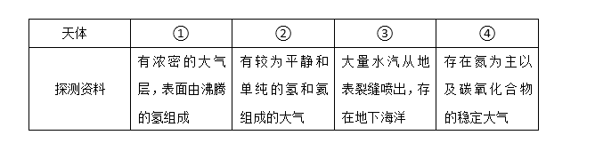

A. ①

B. ②

C. ③

D. ④

### 第 14 题

结合化学知识和生活经验，下列做法不能减少环境污染的是：

A. 将废弃的塑料袋、一次性塑料餐具等塑料制品集中堆放焚烧

B. 将汽车发动机产生的尾气通过放有氧化钯催化剂的排气管后排放

C. 在燃烧前对煤进行净化，去除原煤中的硫成分和灰成分

D. 城市公交车和出租车采用液化天然气（LNG）代替普通汽油

### 第 15 题

下列关于水生动物的说法错误的是：

A. 鲨鱼用鳃呼吸，鲨鱼属于鱼类

B. 黄鳝的鳃严重退化无法用鳃呼吸，黄鳝不属于鱼类

C. 蓝鲸没有鳃，用肺进行呼吸，蓝鲸属于哺乳动物

D. 海龟没有鳃，用肺进行呼吸，海龟不属于哺乳动物

### 第 16 题

中华民族历来崇尚“和”的理念。下列语出《尚书》的是：

A. “和为贵”

B. “和而不同”

C. “协和万邦”

D. “兼爱非攻”

### 第 17 题

人工智能是指由人工制造的系统所表现出来的智能。人工智能的核心包括推理、知识、规划、学习、交流、感知、移动和操作物体的能力等。下列论述中所描述的各项技术突破，无关人工智能的是：

A. 科学家利用数学定理证明程序，证明了“数学原理”一书第二章的38个定理

B. 中国象棋程序在人机对弈时，能够根据以往的棋局，学习到新的战术，从而避免因为类似的错误而失败

C. 小张家里新买的最新款电视机，能够根据电视机周围的环境光线强弱，自动地调整屏幕的亮度

D. 有种名为siri的手机软件，采用自然语言处理技术，使用户能用自然的对话与手机进行互动

### 第 18 题

马航MH370航班失踪之后，国际海事卫星组织试图利用多普勒原理计算出失踪航班的下落。多普勒原理，源于这样的一种物理现象（多普勒效应）：随着飞机高速接近（或远离）接受微波信号的卫星，卫星所侦测到的微波频率都会越来越高（或越来越低）。下列描述的现象中，哪一种也体现了同样的多普勒效应：

A. 站在铁轨附近的人，听到鸣笛的火车由远及近高速驶来时，汽笛的音调逐渐变得尖锐

B. 一束自然光射入三棱镜，射出时，被分解为不同的颜色

C. 向平静的湖面投入一颗小石子，激起涟漪呈圆形逐渐向周围扩散

D. 在日环食的过程中，观测到太阳黑子的存在

### 第 19 题

呼吸作用是生物体细胞把有机物氧化分解并产生能量的过程，没有氧气参与的呼吸称为无氧呼吸，无氧呼吸是指细胞在缺氧的条件下，通过酶的催化作用把葡萄糖等有机物分解为尚未彻底氧化的产物。下列现象与无氧呼吸有关的是：

A. 人剧烈运动后肌肉酸痛

B. 用糯米和酒曲酿造米酒

C. 农作物受涝时短时间内不会死亡

D. 把生水果和熟苹果放在密闭的缸里催熟

### 第 20 题

下列生活中保存食物的方法，理解错误的是：

A. 盐腌制食品是因为盐可以形成高渗环境，抑制了微生物的生理活动

B. 真空保存食物可以破坏需氧菌类的生存环境

C. 冷藏保存食物是因为低温可以将细菌冻死

D. 充入氮气保存食品是为了隔绝食品和氧气的接触

### 第 21 题

英国车，汽车工艺的代表，处处        出高贵、优雅、灵动、恒久的艺术气质。而这一切，源自于英国人一直        的传统造车技艺——始终以手工进行装嵌。

依次填入划横线部分最恰当的一项是：

A. 彰显 迷恋

B. 展示 擅长

C. 流露 秉承

D. 体现 坚守

### 第 22 题

我国著名语言学家罗常培说过：语言文字是一个民族文化的结晶。这个民族过去的文化靠着它来流传，未来的文化也仗着它来        。我们可以从诸多文字现象中，如汉字的造字、构词，汉字词义的形成和        中找寻中国文化形成与发展的理据。

依次填入划横线部分最恰当的一项是：

A. 推动 变革

B. 提升 演进

C. 弘扬 变迁

D. 推进 演变

### 第 23 题

孔子文化节不仅是一场文化盛宴，更是对“郁郁乎文哉”的文明盛象的具体呈现。从最初的“孔子诞辰故里游”到今天的“孔子文化节”，变化的不只是名称，更是不断饱满的文化        和不断厚植的文化        。

依次填入划横线部分最恰当的一项是：

A. 涵养 继承

B. 素养 传承

C. 内蕴 沉积

D. 内涵 积淀

### 第 24 题

求学者如果孜孜于衣食居住的安适，一定谈不上好学。同样，好学的目的也不是为了            ，心灵之养甚于居养之安。学习的目的是成为“有道”之人，名闻利养并非先务。这不是        物质，而是强调学习就是学习，不要附带上物质目的。

依次填入画横线部分最恰当的一项是：

A. 养尊处优 否定

B. 丰衣足食 摈斥

C. 锦衣玉食 排斥

D. 肥马轻裘 抵触

### 第 25 题

哈佛大学的一位校长曾提出这样的思考：我们培养出来的青年人该用什么样的方式来回报这所学校？是选择自己更好的生活，还是更好地为公众服务？150年过去了，这个问题仍然可以        当下。这位校长希望有朝一日能够在学校的纪念碑上，        选择后者的毕业生的名字。今天，在中国，已经有越来越多的青年人作出了这样的人生抉择。

依次填入划横线部分最恰当的一项是：

A. 叩问 雕刻

B. 质问 铭刻

C. 拷问 镌刻

D. 追问 铭记

### 第 26 题

本土的东西要想传承，一定要拥有充分的文化自信，要善于理解并\_\_\_\_\_多元的文化门类，从自己的世界走到更加丰富多彩的世界中去。毕竟，世界上没有一种文化是因为封闭和自锁而实现持久传扬的，不勇于迎接挑战，不在挑战的磕碰中\_\_\_\_\_、革新、发展，就难像浴火的凤凰一样，实现自身的\_\_\_\_\_。

依次填入划横线部分最恰当的一项是：

A. 吸收 反省 升华

B. 包容 自省 涅槃

C. 吸纳 醒悟 突破

D. 兼容 觉醒 重生

### 第 27 题

中国改革已进入攻坚期和深水区，需要解决的问题格外艰巨，都是难啃的硬骨头。这个时候就要一鼓作气，            、畏葸不前不仅不能前进，而且可能            。

依次填入画横线部分最恰当的一项是：

A. 优柔寡断 半途而废

B. 三心二意 功败垂成

C. 迟疑不决 功亏一篑

D. 瞻前顾后 前功尽弃

### 第 28 题

今年的“双十一购物节”让外界        中国热闹异常的电子商务产业。美国媒体感叹中国的“双十一”一天的销售规模已经赶超美国两大网上购物日，预计电子商务将        中国在2015年成为全球最大的零售市场。

依次填入画横线部分最恰当的一项是：

A. 惊诧 力推

B. 关注 助推

C. 热议 襄助

D. 聚焦 助力

### 第 29 题

高油价时代，如何节油成为车主们关注的焦点，于是各种节能产品\_\_\_\_\_，汽油清净剂、节油贴、节油丸、省油精等等\_\_\_\_\_。

依次填入划横线部分最恰当的一项是：

A. 应运而生 层出不穷

B. 供不应求 五花八门

C. 应接不暇 举不胜举

D. 琳琅满目 屡见不鲜

### 第 30 题

造谣传谣行为不但构成违法犯罪，更不断侵蚀社会诚信，        社会道德基础。打击网络“大谣”，净化网络环境，刻不容缓。现实中，互联网的监督涉及部门众多。要及时迅速地        网络谣言，打击“大谣”，需要进一步提高“虚拟社会”的服务和监督水平。

依次填入划横线部分最恰当的一项是：

A. 侵入 鉴别

B. 侵袭 认清

C. 瓦解 甄别

D. 渗透 破除

### 第 31 题

没有心痛的感觉，认识不到中国科学界与世界的差距，这不是科学的态度；没有        思考，对国外的获奖者一味地追捧，也不是科学的态度；没有        考证，对国内的科研人员一味求全责备，也不是科学的态度；没有        精神，对获奖者背后付出的多年努力视而不见，一味看重奖项的荣耀，更加不是科学的态度。但喧哗过后，我们更应对诺贝尔奖热多几分“冷”思考。

依次填入划横线部分最恰当的一项是：

A. 严谨的 独立的 奉献的

B. 辩证的 细致的 独立的

C. 独立的 严谨的 思辨的

D. 深刻的 思辨的 严谨的

### 第 32 题

在如今浅阅读盛行的时代，一边是快餐式、碎片式阅读的轻松，一边是慢读、细读的沉重，经典自然免不了有点            的味道。就阅读是一种学习、一种对自我的提升而言，浅阅读并不是真正的阅读，长久沉浸在浅阅读的习惯之中，也只会让人离那些最好的书籍愈来愈远。然而，只是        对经典的珍重，却不如对于经典真实的理解更为重要。

依次填入划横线部分最恰当的一项是：

A. 阳春白雪 提倡

B. 曲高和寡 呼唤

C. 孤芳自赏 强调

D. 凄风苦雨 苛求

### 第 33 题

一个国家的文学能在世界范围内引起关注，必然是因为其\_\_\_\_\_的特质，这种特质包含两个向度的价值，一是基于民族文化\_\_\_\_\_的优秀特性，二是给出开放性意义的体系。

依次填入划横线部分最恰当的一项是：

A. 不可替代 禀赋

B. 难以复制 禀性

C. 无与伦比 传统

D. 独一无二 渊源

### 第 34 题

自然界的各种物种之间，都有着\_\_\_\_\_的联系，共同编织着错综复杂的生物链条。每一根链条的断裂，都会或多或少地影响到整个生态系统的平衡，进而可能招致一些未知的灾难。生活在这个\_\_\_\_\_的世界，每一个物种都有着它独有的\_\_\_\_\_，不要等到它成了稀有物种才想着去保护。

依次填入划横线部分最恰当的一项是：

A. 千头万绪 休戚与共 意义

B. 千丝万缕 互利共荣 价值

C. 唇齿相依 互惠共赢 属性

D. 密不可分 弱肉强食 贡献

### 第 35 题

空间探测器拍摄的大量照片和探测仪器的取样分析，揭开了被测行星的大气环境和表面景观的\_\_\_\_\_，让人看到了它们的真实面目。1997年美国“探路者号”探测器及“索杰纳号”火星车拍摄的大量照片和检测结果显示，如今一片荒凉的火星曾经是一个温暖、潮湿的地方，而且可能曾是一个\_\_\_\_\_和维持过生命的星球。

依次填入画横线部分最恰当的一项是：

A. 面纱 孕育

B. 伪装 诞生

C. 谜底 萌发

D. 帷幕 繁衍

### 第 36 题

最新研究发现，几千万年前一支长有罕见怪异特征的哺乳动物家族移居地下生活，并从6500万年前的大灭绝事件中幸存下来，科学家将其命名为Necrolestes。一直以来，这个绰号为“坟墓强盗”的生物被认为是有袋类动物。然而进一步的分析发现，它其实属于生物进化树上完全出人意料的某哺乳动物分支，后者被认为早在Necrolestes生活时代前4500万年前就已经完全灭绝。这便是“拉扎勒斯效应”的一个典型例子，该效应描述了一组生物体生活的时间远比原本预料的长得多。

下列说法与原文不符的是：

A. Necrolestes是1亿多年前某哺乳动物的孑遗

B. 一直以来人类对Necrolestes的存在均不知情

C. Necrolestes的实际生活时间出人意料地长久

D. 被认定为已经灭绝的物种可能被“重新发现”

### 第 37 题

随着计算机技术向着千万亿次乃至更高的级别迈进，处理器速度已经超越了传输速度，这就在应用领域产生了一个技术瓶颈，阻碍了应用的进一步发展，任何尝试过拨号上网看流媒体视频的人都有所体会，再快的处理器也不能提高文件加载速度。而在大数据和云计算的当今，在服务器之间有大量的信息进行交互。一种激光器件——垂直腔面发射激光器，可以用来在光纤网络中高速传输数据。其相比传统电缆系统可以以更快的速度传输更大的数据量。

下列说法与原文不符的是：

A. 计算机处理器与数据传输速度不成正比

B. 计算机处理器速度已不能满足应用需求

C. 数据高速传输技术长期未取得实质突破

D. 科学家在激光通讯技术上取得重要进展

### 第 38 题

专家认为，家庭氛围不和谐、缺少父母关爱是导致青少年出现心理精神问题，继而迷上网游的原因之一。家庭是孩子体验情感，发展情商的关键场所。如果家庭中不能给孩子提供需要的安全感、尊重、亲密与爱，孩子很有可能在网游中逃避恐惧和孤独，寻求安慰。忙于工作的父亲和爱批评唠叨的母亲往往“善于”制造这样的情感生态。如果一个充满冒险精神追求刺激的男孩过着单调和一成不变的生活时，网游世界自然显得精彩无限。

这段文字的主要观点是：

A. 应尽可能地保证孩子的情感供给

B. 情感缺位容易使孩子沉迷于网游

C. 亲子关系和谐可使孩子冷落网游

D. 应创造满足孩子个性的情感生态

### 第 39 题

“商业信誉”无疑指向的就是“信用”和“名誉”。它是指社会公众对具体商业主体的经济能力、信用状况等所给予的社会评价。在刑法上，并不是所有“损害”商业信誉的行为都将构成犯罪。如该商业主体自身存在问题，经媒体曝光后信誉大跌、名誉扫地，这种损害实则是由主体自身的问题所带来的。而媒体行使舆论监督权并无违法，反而应该得到法律的保护。

这段文字意在强调：

A. 媒体曝光商家不守信誉的行为不违法

B. 商家自身问题造成信誉损害不受法律保护

C. 法律对损害商业信誉行为的认定十分审慎

D. 应出台法律保护媒体对商家进行舆论监督

### 第 40 题

在不同的时期，约有7000种植物和几百种动物被人类当作食物。物种的丧失将使食物的多样性减少，使人类仅仅依赖个别几种主要的食物，从而打破人们均衡的饮食结构。此外，随着森林、田野中物种的丧失可能导致某些病原体的增加，而这些病原体是有机体感染疾病的元凶。一些最有可能灭绝的动物、植物和微生物，实际上是传染病传播的“缓冲区”，它们在人类受到感染之前，代人类承担了很多疾病的侵袭。

下列说法与原文不符的是：

A. 特有物种能够缓冲传染病的传播

B. 生物多样性的丧失影响人类健康

C. 物种的丧失危及人类食品的安全

D. 物种多样性与疾病感染关系微妙

### 第 41 题

黏土看上去似乎是一种肥沃度差、由多种矿物质组成的混合物，但却可能是地球生命的起源地。在模拟古代的海水中，黏土会形成水凝胶——由大量可吸收液体的微小空间构成（像海绵一样）。过去几十亿年里，被禁锢在这些空间里的化学物质可能发生了复杂的反应，从而形成了蛋白质、脱氧核糖核酸以及最终生成活细胞的各种系统。黏土形成的水凝胶可能对上述化学过程起到了禁锢和保护的作用，直至发育出将活细胞包裹住的细胞膜为止。

这段文字意在说明：

A. 黏土富含生命需要的营养物质

B. 水凝胶对生化反应的保护作用

C. 黏土在地球生命起源中的作用

D. 地球生命也许最初发源于黏土

### 第 42 题

含羞草是很奇妙的：你碰它一下，它的叶子会合拢起来，又垂下去，像害羞似的。这其中，因为“含羞”的程度不一样，预示的天气也不一样：如果被触动的含羞草，叶子很快合拢、下垂，之后需经过相当长的时间才能恢复原态，则说明天气将艳阳高照，晴空万里；反之，叶子受触后收缩缓慢、下垂迟缓，或叶子稍一闭后即张开，则预示着风雨即将来临。  

上述文字意在说明：

A. 含羞草的生长习性

B. 含羞草能预测天气

C. 含羞草的奇妙之处

D. 天气会影响含羞草

### 第 43 题

相对于影响范围较小、较方便找到污染源头的水污染、噪音污染，大气污染的成因复杂，往往是跨地域的工业污染、汽车排放乃至烹饪油烟等等，再加上特定的天气因素共同造成了雾霾等灾害性天气。这就很难将某天的雾霾归因于具体的哪个、哪几个企业的污染，那么受大气污染损害的公民该向谁索赔？又如何抗辩自身罹患的疾病等是由大气污染造成，而不是其他原因造成的？如果公民真的起诉一长串的可能的污染企业，那么结果就是众多污染企业摊薄了赔偿款，不能起到震慑污染企业的作用。

作者接下来最有可能讲述的是：

A. 介绍大气污染索赔的成功案例

B. 如何规制企业的大气污染行为

C. 进行大气污染索赔的法律依据

D. 进行大气污染索赔的现实困境

### 第 44 题

①因为我与他人的关系通过对话，不是特点消失的合金式的“融合”，而是一种“面对面”的关系。

②对话的目的主要不是说服对方，同化别人，统一思想，而是要在不同思想的碰撞中产生出新的思想，这就是“生成性对话”。

③多元文化共处最核心的问题是世界不同文化之间的对话与沟通。

④事实上，也正是因为有这样一种面对面的相异性，一种文化才有可能对他种文化产生吸引力。

⑤对话最忌讳的就是“人云亦云”，“我打你通”。

将以上5个句子重新排序，语序正确的是：

A. ③④②⑤①

B. ②③⑤①④

C. ③②⑤①④

D. ⑤①②④③

### 第 45 题

①员工一般通过深层扮演和表层扮演这两种方式来实现情绪劳动

②情绪劳动是指员工为了给顾客提供更为优质的服务而表达出组织所需情绪的行为

③此时员工的情绪体验并没有改变，改变的只是对其服务对象的情绪表达

④从本质上来说，深层扮演是员工改变自己情绪体验的过程

⑤情绪劳动对组织而言有更多的积极效应，对员工个人来说则消极影响更多

⑥表层扮演是员工通过掩饰、夸大或抑制等方式来调整自己的情绪表达

将以上6个句子重新排列，语序正确的是：

A. ②③①④⑥⑤

B. ②①④⑥③⑤

C. ⑤②③①④⑥

D. ⑤①④⑥②③

### 第 46 题

近年来我国中小学音乐课程在许多地区还是没有受到足够的重视，教材内容不能与时俱进，一些音乐教师只注重技能培养而忽略了音乐教育的主旨首先应当是“树德立志”。在教授学生一部音乐作品之前，教师首先应该理解其中所表现的道德思想，然后以多样化的形式对学生的身心进行正面教育。作为音乐教师当以此为己任，使孩子们真正热爱音乐，在他们的心灵中种下一颗真、善、美的健康种子。

这段文字意在强调：

A. 音乐教育应注重作品的道德教化

B. 教师应以培养孩子真善美为己任

C. 音乐教育以强调树德立志为主旨

D. 音乐教育的内容、主旨都需转变

### 第 47 题

当我们在承受某些心理痛苦——比如孤独、社会孤立、自我怀疑、负面情绪、觉得人生无意义时，怀旧可以起到应对机制的作用。这些烦恼使大脑开始筛选自己的记忆库，总结出一些有特定叙事特色的片段。我们通过怀旧，让过去的成功经历和亲密的人际关系重新浮出水面，那些时候我们的生活有安全感也有秩序。心理学家解释道：“你在向自己重申‘我做过很棒的事情’，也希望这句话能预测未来的发展。‘虽然我现在不甚确定，但看看我的过去，就知道我是个可爱的人。我命中注定要成就大事。’”

下列说法与原文不符的是：

A. 怀旧会让我们逃避现实

B. 怀旧是我们前进的动力

C. 怀旧有情感缓冲的作用

D. 怀旧能使我们变得乐观

### 第 48 题

科学家最近成功破译白鳍豚全基因组图谱。科学家的努力当然是可贵的，30多年前中国科学家就开始了对白鳍豚的研究，其成果当然不止一张“全基因组图谱”。但其对于保护这些可怜的物种究竟起了多大的作用，恐怕还不敢断言，而且我们更多的是从白鳍豚身上找到可以“利用”的特点。如果科学家的研究不能成为保护这些生命的力量，如果有朝一日我们只能对着一个个浸泡在福尔马林里的标本来谈论它的习性，用基因图谱来证明它们的存在，这不是科学的善意，而是人类的罪恶。

这段文字意在强调：

A. 白鳍豚全基因组图谱得以成功地破译

B. 白鳍豚全基因组图谱解开生命的密码

C. 科学研究应对保护物种负起应有的责任

D. 应该反思人类活动对动物犯下的罪恶

### 第 49 题

目前，各城市的城管机构设置不尽相同，一般分为城建监察大队、城市管理局、城市管理行政执法局、城市管理委员会四种。由于城管工作实际是各自为政，没有一部专门的全国性法律来指导，各地方政府根据立法权限制定了一些地方性条例，但差异很大，难以系统化，并由此导致近年来各地不断出现一些“城管暴力执法”事件，影响到社会安定。

这段文字意在说明：

A. 当前我国城市多头管理之“乱”

B. 城管执法问题是社会关注的焦点

C. 城管纳入法制轨道是当务之急

D. 有必要制定全国性的城管法规

### 第 50 题

古文明一般形成于中纬度大河沿岸的内陆地区，适宜的气候、肥沃的土壤条件较适宜于人类活动。而随着科学技术的发展，这些要素逐渐被弱化，人类活动已经从内陆转向沿海，出现了现代沿海向内陆的经济梯度。对比古文明与现代沿海文明的环境差异，其中最核心的是交通和可接近性对相关环境要求的改变。但高速公路和铁路等陆上交通的发展，又使内陆地区发展进入新机遇。

根据文段，可以得出的结论是：

A. 不同时期文明对环境要素的要求不同

B. 环境要素是某一时期文明形成至关重要的要素

C. 科学技术的发展能改变某一时期文明对环境要素的要求

D. 交通能够在不同时期给某一区域的发展带来新机遇

### 第 51 题

1、-4、4、8、40、（ ）

A. 160

B. 240

C. 320

D. 480

### 第 52 题

5、11、-3、7、-5、（ ）

A. 6

B. 7

C. 8

D. 9

### 第 53 题

5、7、10、15、22、（ ）

A. 28

B. 30

C. 33

D. 35

### 第 54 题

2、、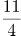、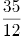、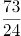、（ ）

A. 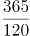

B. 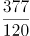

C. 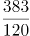

D. 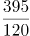

### 第 55 题

2、3、5、9、17、33、（ ）

A. 62

B. 63

C. 64

D. 65

### 第 56 题

61、60、40、41、23、（ ）

A. 22

B. 24

C. 26

D. 28

### 第 57 题

3、5、8、11、16、19、（ ）

A. 20

B. 22

C. 24

D. 26

### 第 58 题

5、63、37、511、101、（ ）

A. 1727

B. 1833

C. 1905

D. 1929

### 第 59 题

34、41、46、56、64、（ ）、88

A. 75

B. 77

C. 79

D. 81

### 第 60 题

2、3、4、9、16、45、（ ）、315

A. 90

B. 96

C. 102

D. 120

### 第 61 题

某单位共有四个科室，第一科室20人，第二科室21人，第三科室25人，第四科室34人，随机抽取一人到外地考察学习，抽到第一科室的概率是多少:

A. 0.3

B. 0.25

C. 0.2

D. 0.15

### 第 62 题

野生动物保护机构考察某圈养动物的状态，在n（n为正整数）天中观察到：（1）有7个不活跃日（一天中有出现不活跃的情况）；（2）有5个下午活跃；（3）有6个上午活跃；（4）当下午不活跃时，上午必活跃。则n等于：

A. 7

B. 8

C. 9

D. 10

### 第 63 题

每年三月某单位都要组织员工去A、B两地参加植树活动，已知去A地每人往返车费20元，人均植树5棵，去B地每人往返车费30元，人均植树3棵，设到A地有员工x人，A、B两地共植树y棵，y与x之间满足y=8x－15，若往返车费总和不超过3000元时，那么，最多可植树多少棵？

A. 498

B. 400

C. 489

D. 500

### 第 64 题

有135人参加某单位的招聘，31人有英语证书和普通话证书，37人有英语证书和计算机证书，16人有普通话证书和计算机证书，其中一部分人有三种证书，而一部分人则只有一种证书。该单位要求必须至少有两种上述证书的应聘者才有资格参加面试。问至少有多少人不能参加面试？

A. 50

B. 51

C. 52

D. 53

### 第 65 题

有A和B两个公司想承包某项工程，A公司需要300天才能完工，费用为1.5万元/天，B公司需要200天就能完工，费用为3万元/天，综合考虑时间和费用问题，在A公司开工50天后，B公司才加入工程，按以上方案，该项工程的费用为多少？

A. 475万元

B. 500万元

C. 525万元

D. 615万元

### 第 66 题

掷两个骰子，掷出的点数之和为奇数的概率为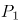，掷出的点数之和为偶数的概率为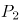，问和的大小关系？

A. \=

B. \>

C. <

D. 无法确定

### 第 67 题

一只挂钟的秒针长30厘米，分针长20厘米，当秒针的顶点走过的弧长约为9.42米时，分针的顶点走过的弧长约为多少厘米？

A. 6.98

B. 10.47

C. 15.70

D. 23.55

### 第 68 题

某果农要用绳子捆扎甘蔗，有三种规格的绳子可供使用：长绳子1米，每根能捆7根甘蔗；中等长度绳子0.6米，每根能捆5根甘蔗；短绳子0.3米，每根能捆3根甘蔗。果农最后捆扎好了23根甘蔗，则果农总共最少使用多少米的绳子？

A. 2.1米

B. 2.4米

C. 2.7米

D. 2.9米

### 第 69 题

某超市销售“双层锅”和“三层锅”两种蒸锅全套，其中“双层锅”需要2层锅身和1个锅盖，“三层锅”需要3层锅身和1个锅盖，并且每卖一个“双层锅”获利20元，每卖一个“三层锅”获利30元。现有7层锅身和4个锅盖来组合“双层锅”和“三层锅”两种蒸锅套装，那么最大获利为：

A. 50元

B. 60元

C. 70元

D. 80元

### 第 70 题

在一次航海模型展示活动中，甲乙两款模型在长100米的水池两边同时开始相向匀速航行，甲款模型航行100米要72秒，乙款模型航行100米要60秒，若调头转身时间略去不计，在12分钟内甲乙两款模型相遇次数是：

A. 9

B. 10

C. 11

D. 12

### 第 71 题

设有编号为1到10的10张背面向上的纸牌，现有10名游戏者，第1名游戏者将所有编号是1的倍数的纸牌翻成另一面向上的状态，接着第2名游戏者将所有编号是2的倍数的纸牌翻成另一面向上的状态，……，第n名（n≤10）游戏者，将所有编号是n的倍数的纸牌翻成另一面向上的状态，如此下去，当第10名游戏者翻完纸牌后，那些纸牌正面向上的最大编号与最小编号的差是：

A. 2

B. 4

C. 6

D. 8

### 第 72 题

为了国防需要，A基地要运载1480吨的战备物资到1100千米外的B基地。现在A基地只有一架“运9”大型运输机和一列“货运列车”，“运9”速度550千米每小时，载重能力为20吨，“货运列车”速度100千米每小时，运输能力为600吨，那么这批战备物资到达B基地的最短时间为：

A. 53小时

B. 54小时

C. 55小时

D. 56小时

### 第 73 题

随着台湾自由行的开放，农村农民生活质量的提高，某一农村的农民自发组织若干同村农民到台湾旅行，其旅行费用包括：个人办理赴台手续费，在台旅行的车费平均每人503元，飞机票平均每人1998元，其它费用平均每人1199元。已知这次旅行的总费用是92000元，总的平均费用是4600元。问赴台的总人数和个人办理赴台手续费分别是多少?

A. 20人，700元

B. 21人，650元

C. 20人，900元

D. 22人，850元

### 第 74 题

某场羽毛球单打比赛采取三局两胜制。假设甲选手在每局都有80%的概率赢乙选手，那么这场单打比赛甲有多大的概率战胜乙选手：

A. 0.768

B. 0.800

C. 0.896

D. 0.924

### 第 75 题

如图，某三角形展览馆由36个正三角形展室组成，每两个相邻展室（指有公共边的小三角形）都有门相通，若某参观者不愿意返回已参观过的展室（通过每个房间至多一次），那么他至多能参观多少个展室？

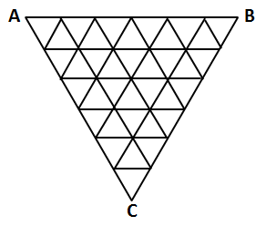

A. 33

B. 32

C. 31

D. 30

### 第 76 题

从所给四个选项中，选择最合适的一个填入问号处，使之呈现一定的规律性：

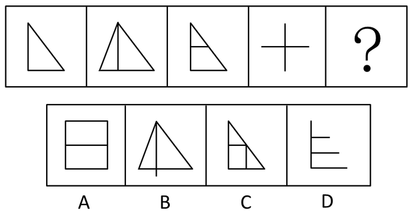

A. A

B. B

C. C

D. D

### 第 77 题

请从所给的四个选项中，选择最合适的一项填在问号处，使之呈现一定的规律性：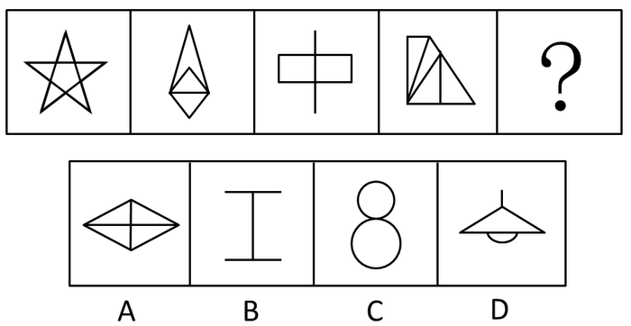

A. A

B. B

C. C

D. D

### 第 78 题

请从所给的四个选项中，选择最合适的一项填在问号处，使之呈现一定的规律性：

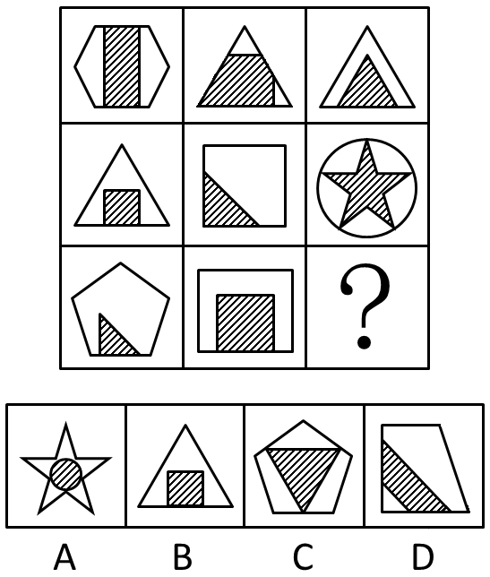

A. A

B. B

C. C

D. D

### 第 79 题

把下面的六个图形分为两类，使每一类图形都有各自的共同特征或规律，分类正确的一项是：

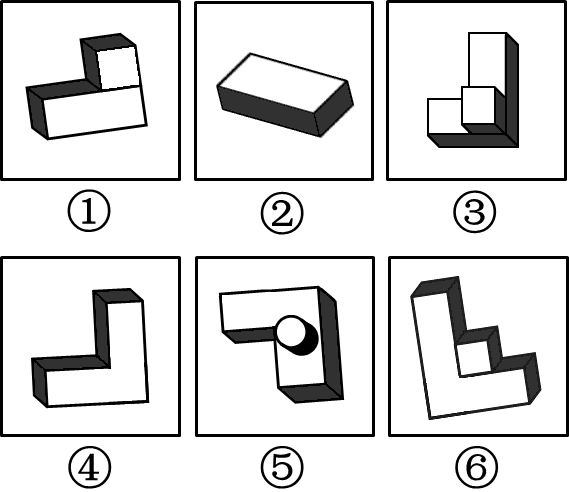

A. ①②③，④⑤⑥

B. ①④⑤，②③⑥

C. ①⑤⑥，②③④

D. ①④⑥，②③⑤

### 第 80 题

左边给定的是纸盒的外表面，下列哪一项能由它折叠而成：

A. A

B. B

C. C

D. D

### 第 81 题

行政不作为是行政机关对于公民、法人和其他组织的符合条件的申请依法应该实施某种行为或履行某种法定职责却无正当理由拒绝履行或拖延履行的行政违法行为。

根据上述定义，下列选项中行政机关行为不属于行政不作为的是：

A. 王某要求所在地交通局告知有关汽车养路费标准，三个月未答复

B. 陈某在某市建设局工作多年，符合职称评定申请，申请职称评定被拒绝

C. 林某投诉某医药公司贩卖假药，该市药监局以不属于主管范围而拒绝

D. 何某因制止违章建筑施工被打伤，公安机关以对违章建筑无权处理不理睬

### 第 82 题

反社会人格犯罪是行为人基于反社会型变态人格而实施的犯罪行为。行为人的特点是：①智力和精神上并无明显缺陷，没有妄想或其他思维障碍；②多数有劣迹前科，有多次、多类型的违纪、违法、犯罪行为；③行为冲动、缺乏深思熟虑和明确的动机；④没有悔过和自责的心理，在接受服刑以后仍然照旧违法犯罪，难以自控。

下列选项中行为人精神智力正常，其中最符合反社会人格犯罪特征的是：

A. 陈某经常怀疑有人跟踪自己，某天下班后将走在自己后面的李某刺伤

B. 林某多次上班迟到被领导当众呵斥，林某感觉受辱，将领导打成重伤

C. 吴某有偷盗前科，某天下班遭遇抢劫，与劫匪搏斗中将劫匪打成残疾

D. 王某街上闲逛，突然将陌生人郭某连刺两刀，随后将停在路边的汽车砸毁

### 第 83 题

近因原则是保险人对于承保范围的保险事故作为直接的、最接近的原因引起的损失承担保险责任，而对于承保范围以外的原因造成的损失不负赔偿责任。按照该原则，承担责任并不取决于时间上或空间上的接近，而是取决于导致保险标的损失的风险事故是否在承保范围内，如果存在多个原因导致损失，其中最直接、最有效、起决定作用的原因，以及不可避免会产生事故作用的原因就是近因。

根据上述定义，下列原因不属于近因的是：

A. 张某夜间打猎不慎摔伤，在等待救援时受凉感冒引发肺炎导致死亡，其死亡原因是摔伤

B. 王某的保险车辆遇暴雨浸泡汽缸进水，他强行启动车辆时发动机受损，受损原因是暴雨

C. 暴雨致电线杆倒塌，电线短路引发火花引燃仓库，库存商品燃烧殆尽，损失原因是暴风雨

D. 船舶进水，所载皮革进水腐烂，糜烂恶臭致邻舱的烟草变质，烟草受损原因是船舶进水

### 第 84 题

贫困的要素不仅包括物质和收入水平指标，还包括能力指标，即人类基本能力和权利的剥夺。权利贫困就是缺乏政治、经济、文化和社会基本人权的一种贫困状态。权利贫困是贫困的核心，物质贫困是贫困的具体表现，权利贫困是造成物质贫困的根本原因。

根据上述定义，下列选项不属于权利贫困的是：

A. 张某大学毕业在京成为“蚁族”一员，收入低下，蜗居城乡结合部多年

B. 王某好心救人却被讹诈，因无证据证明无辜，被判承担全部医疗费用

C. 李某在深圳私企打工多年，因工伤丧失劳动能力，却得不到任何赔偿

D. 辛某房屋被强拆，致使一家人居无定所，其申诉上访过程中多次被拘留

### 第 85 题

沉锚效应，指的是人们在对某事做出判断时，易受第一印象或第一信息支配，就像沉入海底的锚一样把人们的思想固定在某处。第一印象和先入为主是其在社会生活中的表现形式。

根据上述定义，下列选项没有应用到沉锚效应的是：

A. 一家粥店服务员为客人盛粥后总问：“加一个鸡蛋还是两个？”另一家服务员总问：“加不加鸡蛋？”头一家店日销售额总高于后一家

B. 男孩邀请心仪女生说：“出去玩好吗？”女孩觉得拒绝好像很自然，答应显得太主动，所以就说：“下次吧。”男孩认为女孩无意与他交往

C. 邻居偷走华盛顿的马被发现拒不承认，华盛顿捂住马的双眼问邻居：“马哪只眼瞎的？”邻居说“右眼”，事实上，马的两只眼睛都没毛病

D. 你去商场闲逛，导购小姐诱导说：“反正今天是出来买鞋的，甲或者乙都很适合你的气质，请选一双吧。”然后你就挑选了其中一双

### 第 86 题

港湾：停泊

A. 基因：遗传

B. 法庭：诉讼

C. 电缆：发电

D. 公路：运输

### 第 87 题

谎言：欺骗（ ）

A. 谣言：抱怨

B. 谗言：无知

C. 佯言：委婉

D. 诤言：劝诫

### 第 88 题

爆胎：事故：保险（ ）

A. 旱灾：减产：补贴

B. 前卫：时尚：流行

C. 能源：电力：生产

D. 论坛：交流：学术

### 第 89 题

舅舅：外甥

A. 祖父：父亲

B. 姑父：姑姑

C. 丈人：女婿

D. 媳妇：儿子

### 第 90 题

树根：根雕：工艺品

A. 纸张：风筝：春天

B. 粘土：唐三彩：古董

C. 消费：借贷：信用

D. 泥沙：混凝土：建筑

### 第 91 题

竞争：淘汰（ ）

A. 惊吓：失色

B. 疏忽：失算

C. 亏损：失信

D. 判断：失误

### 第 92 题

沧桑：白发

A. 清纯：酒窝

B. 稚嫩：乳牙

C. 鲁莽：健壮

D. 博学：眼镜

### 第 93 题

三顾茅庐∶刘备

A. 负荆请罪：蔺相如

B. 请君入瓮：周兴

C. 雪中送炭：宋太宗

D. 程门立雪：程颐

### 第 94 题

赛事 对于（ ）相当于（ ）对于 编辑

A. 裁判；书稿

B. 运动；校对

C. 哨子；文字

D. 进取；精确

### 第 95 题

海马 对于 （ ）相当于（ ） 对于 珊瑚

A. 海龙：海葵

B. 河马：礁石

C. 木马：海螺

D. 贝壳：海带

### 第 96 题

蚊子可传播多种疾病，如疟疾、丝虫病、乙型脑炎等。有人担心由于蚊子叮咬了HIV感染的人而在叮咬下一位时会将存在蚊子体内的HIV在人际间传播。但研究人员指出这样的担心大可不必。

如果以下各项为真，最能支持研究人员观点的是：

A. HIV感染的人血液中并不总是拥有高水平的HIV病毒

B. 蚊子叮咬HIV感染的人后不一定立即去叮咬下一个人

C. 蚊子通过食管吸入血液，这种血液的吸入总是单向的

D. 孩子容易被蚊子叮咬，但他们身上极少发生HIV感染

### 第 97 题

研究者发现细菌就像人类的简化版本，它们有自我意识，有自己的语言，群居，既交友也树敌，喜欢偷窥邻居家的隐私，还能以讹传讹，甚至杀害手足。各种细菌在自己的地盘上各司其职，相互配合，促进社会的稳定。

如果以下各项为真，最能质疑上述论断的是：

A. 通过释放某种物质，细菌可召集群体成员执行各种任务

B. 新型研制的阻断细菌交流的药物可以代替普通的抗菌素

C. 细菌的生活极其单调，不是在单独进食，就是在自我繁殖

D. 霍乱、肺炎和食物中毒，实际就是各种细菌聚集的后果

### 第 98 题

研究发现，大西洋、太平洋海面水温的微小变化与南美洲亚马逊热带雨林地区火灾的面积具有密切联系，将这种联系建立数学模型，可以用来预测亚马逊热带雨林地区来年的火灾情况。

以下哪项如果为真，最能支持上述观点：

A. 大西洋海水温度升高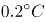，亚马逊雨林次年火灾发生面积增加11%

B. 海水温度增高会引起水分蒸发，导致降水减少，发生干旱或致火灾

C. 海水温度变化虽然微小，但可能对热带雨林生态系统造成重要影响

D. 北冰洋等海面水温可预测其附近的西伯利亚雨林火灾发生率和面积

### 第 99 题

科学就是不断接近真理的过程，我们深信不疑的事情中很大部分是会过期的，所以理解这一点的人都明白在发展过程中不断更新知识才是科学进步的正道。然而这个过程有时会令人困惑和不安。

如果以下各项为真，最能质疑上述论断的是：

A. 婴儿该仰睡还是趴着睡，孕妇抽烟喝酒是否安全，答案一代和一代不同

B. 医学院的老师会告诉学生，五年内他们所学的知识里有一半都不会适用

C. 我一直以为“雷龙”这个名字正确无误，但后来才发现根本没有雷龙

D. 吸烟有害健康被大量科学研究和事实所证实，这一结论至今难以改变

### 第 100 题

英国肯特大学的研究人员让两组志愿者分别玩益智游戏和观看关于跑车的纪录片，然后再让他们进行室内自行车耐力测试。结果，自认为筋疲力尽的第一组成员比第二组更容易放弃。然而，研究者却发现，两组志愿者的血压、耗氧量及心排血量之间并没有差异。

由此可以推出：

A. 玩益智游戏与看电视消耗的体能相同

B. 两组志愿者之间的体能素质十分相近

C. 脑力活动影响体力只是一种感觉偏差

D. 体力劳动可以激发脑力劳动者的潜能

### 第 101 题

矿产勘探人员观察发现，不同颜色和形状的矿物结晶体虽然有各自不同的名称和表象，但可能是化学组成相同的物质在不同的物理化学条件下结晶成不同结构的晶体，而且一般都有着不同的物理特征。所以说，不同的矿物种类可以有相同的化学成分。

以下选项最能支持上述论断的是：

A. 二氧化碳和干冰名称不同而且表象也不同

B. 不同颜色的矿物晶体暴露在空气中会变色

C. 分析仪器能快速判断矿物晶体的化学成分

D. 二氧化硅可以有12种不同的矿物结晶体

### 第 102 题

研究人员将人体标本低温冰冻后，用工业铣床逐层铣切、逐层照相，输入计算机获取人体连续横断面图像，然后进行人体结构的三维重建。通过计算机技术将采集的数据编辑成可解剖的数字人体，其断面与可解剖的整体人相结合，并且所有结构可以单独显示和旋转，实现了可视化虚拟人体解剖。有了这项技术，各国医学院学生再也不需要去做人体解剖实验了。

以下哪项如果为真，最能质疑上述论断?

A. 该技术涵盖了绝大部分人体的解剖结构

B. 虚拟人体解剖对计算机操作的要求很高

C. 可视虚拟人体解剖实验系统的售价很高

D. 所有的解剖学专业术语都只有英文提示

### 第 103 题

有甲、乙、丙、丁、戊五个人坐在一张圆桌上吃饭，其中有两个人是法律专业，有两个人是文学专业，有一个是历史专业。已知两个法律专业的人和两个文学专业的人都坐在相邻位置，甲与丁同一个专业，丙坐在乙和一个文学专业的人之间，戊和乙不相邻，丙和甲不相邻，则下列推断正确的是：

A. 甲是文学专业

B. 乙是法律专业

C. 丙是文学专业

D. 戊是历史专业

### 第 104 题

国外的心理学研究表明，当遇到有人冒犯你时，如果你选择原谅冒犯者，冒犯者会更有可能在心理上感到悔恨而产生内在的愧疚。因此，类似的冒犯行为再次发生的可能性将会大大降低。根据以上观点，可以推出（ ）。

A. 被冒犯者原谅冒犯者，将可能有助于感化冒犯者

B. 如果你不原谅冒犯者，类似的冒犯行为必然会增加

C. 经常原谅冒犯者，就可能减少自己被冒犯的可能性

D. 遇到冒犯者，原谅是唯一避免再次发生冒犯的方法

### 第 105 题

有关研究表明，手机比电脑更伤人，因为手机屏幕小，玩手机时注意力更投入，目不转睛，因此更伤眼。使用电脑时，人们的肢体还能活动活动，可是“手机控”往往很少活动，这对身心健康更为不利。

如果以下各项为真，最能削弱上述论断的是：

A. 电脑在使用过程中，显示屏会发出电磁、电离辐射

B. 科学研究表明使用手机与脑瘤和癌症的发病率无关

C. 电脑背景光比手机更容易引起使用者视力下降和头痛

D. 长期使用电脑人群容易患鼠标手、颈椎病等“电脑病”

### 第 106 题

2012年1-6月全国税收总收入为：

关联材料：dom-material-0dd7cb019ba522eb

A. 52973.28亿元

B. 54921.79亿元

C. 56938.68亿元

D. 63942.19亿元

### 第 107 题

2013年上半年，房产税、城镇土地使用税及契税等三项增收之和占全国税收增收比重为：

关联材料：dom-material-0dd7cb019ba522eb

A. 1.2%

B. 6.2%

C. 11.2%

D. 16.2%

### 第 108 题

2011年1—6月全国关税收入约：

关联材料：dom-material-0dd7cb019ba522eb

A. 1300亿元

B. 1350亿元

C. 1380亿元

D. 1540亿元

### 第 109 题

2013年上半年与上年同期相比，下面四个税种中增速最快的税种是：

关联材料：dom-material-0dd7cb019ba522eb

A. 企业所得税

B. 国内增值税

C. 出口货物退增值税消费税

D. 契税

### 第 110 题

下列说法与资料相符合的有几个：

①2013年第一季度我国税收总收入同比增速低于7.9%

②2013年我国税收总收入预计可以达到118520亿元

③若2013年上半年进口货物增值税消费税维持上年同期水平，那么，2013年上半年我国税收总收入同比增长将比2012年提高约0.5个百分点

④2013年我国上半年企业所得税、国内增值税两项之和超过同期税收总收入的50%

关联材料：dom-material-0dd7cb019ba522eb

A. 0

B. 1

C. 2

D. 3

### 第 111 题

2011年，全国国内旅游收入约为：

关联材料：dom-material-2e345f2433846d65

A. 15247.11亿元人民币

B. 17354.03亿元人民币

C. 18642.37亿元人民币

D. 19308.01亿元人民币

### 第 112 题

2012年，农村居民国内旅游人数占全国国内旅游人数的比例约为：

关联材料：dom-material-2e345f2433846d65

A. 30.53%

B. 32.43%

C. 34.63%

D. 38.83%

### 第 113 题

2012年，欧洲各国入境游客量占欧洲入境游客总量比例超过11%的国家有：

关联材料：dom-material-2e345f2433846d65

A. 1个

B. 2个

C. 3个

D. 4个

### 第 114 题

2011年，除美国、加拿大以外的美洲国家游客入境旅游人数约为：

关联材料：dom-material-2e345f2433846d65

A. 13.8万人次

B. 23.8万人次

C. 33.8万人次

D. 43.8万人次

### 第 115 题

根据上述资料，不能推出的是：

关联材料：dom-material-2e345f2433846d65

A. 2012年，韩国为我国第一大入境客源国

B. 2012年，在20个主要客源国中，六成来自亚洲

C. 2012年，非洲地区入境游客量占入境外国游客总量的2%

D. 2012年，越南是入境旅游人数增长最快的客源国

### 第 116 题

2012年，台湾某企业实收资本额为2亿新台币，该企业最近2个年度会计报表获利能力均为3%，该企业最适合进入台湾哪个层次资本市场：

关联材料：dom-material-a91227b2582adc6f

A. 证券交易所集中市场

B. 上柜市场

C. 兴柜市场

D. 无法进入

### 第 117 题

2012年世界交易所联合会（WFE）会员总市值为：

关联材料：dom-material-a91227b2582adc6f

A. 894.73兆新台币

B. 1593.43兆新台币

C. 1799.73兆新台币

D. 2135.22兆新台币

### 第 118 题

2012年台湾证券交易所集中市场平均每家公司成交值是兴柜市场平均每家公司成交值的倍数为：

关联材料：dom-material-a91227b2582adc6f

A. 17.6

B. 27.6

C. 37.6

D. 47.6

### 第 119 题

2011年台湾三个层次资本市场的总成交值为：

关联材料：dom-material-a91227b2582adc6f

A. 15.441兆新台币

B. 23.931兆新台币

C. 31.233兆新台币

D. 45.023兆新台币

### 第 120 题

同2011年相比，2012年台湾证券交易所在世界交易所联合会（WFE）中，发生变化的是：

关联材料：dom-material-a91227b2582adc6f

A. 总市值排名

B. 总市值比重

C. 成交值比重

D. 成交值排名

## 答案与解析

第 1 题

**答案状态：unknown（来源未提供）**

**解析状态：unknown（来源未提供）**

第 2 题

**答案状态：unknown（来源未提供）**

**解析状态：unknown（来源未提供）**

第 3 题

**答案状态：unknown（来源未提供）**

**解析状态：unknown（来源未提供）**

第 4 题

**答案状态：unknown（来源未提供）**

**解析状态：unknown（来源未提供）**

第 5 题

**答案状态：unknown（来源未提供）**

**解析状态：unknown（来源未提供）**

第 6 题

**答案状态：unknown（来源未提供）**

**解析状态：unknown（来源未提供）**

第 7 题

**答案状态：unknown（来源未提供）**

**解析状态：unknown（来源未提供）**

第 8 题

**答案状态：unknown（来源未提供）**

**解析状态：unknown（来源未提供）**

第 9 题

**答案状态：unknown（来源未提供）**

**解析状态：unknown（来源未提供）**

第 10 题

**答案状态：unknown（来源未提供）**

**解析状态：unknown（来源未提供）**

第 11 题

**答案状态：unknown（来源未提供）**

**解析状态：unknown（来源未提供）**

第 12 题

**答案状态：unknown（来源未提供）**

**解析状态：unknown（来源未提供）**

第 13 题

**答案状态：unknown（来源未提供）**

**解析状态：unknown（来源未提供）**

第 14 题

**答案状态：unknown（来源未提供）**

**解析状态：unknown（来源未提供）**

第 15 题

**答案状态：unknown（来源未提供）**

**解析状态：unknown（来源未提供）**

第 16 题

**答案状态：unknown（来源未提供）**

**解析状态：unknown（来源未提供）**

第 17 题

**答案状态：unknown（来源未提供）**

**解析状态：unknown（来源未提供）**

第 18 题

**答案状态：unknown（来源未提供）**

**解析状态：unknown（来源未提供）**

第 19 题

**答案状态：unknown（来源未提供）**

**解析状态：unknown（来源未提供）**

第 20 题

**答案状态：unknown（来源未提供）**

**解析状态：unknown（来源未提供）**

第 21 题

**答案状态：unknown（来源未提供）**

**解析状态：unknown（来源未提供）**

第 22 题

**答案状态：unknown（来源未提供）**

**解析状态：unknown（来源未提供）**

第 23 题

**答案状态：unknown（来源未提供）**

**解析状态：unknown（来源未提供）**

第 24 题

**答案状态：unknown（来源未提供）**

**解析状态：unknown（来源未提供）**

第 25 题

**答案状态：unknown（来源未提供）**

**解析状态：unknown（来源未提供）**

第 26 题

**答案状态：unknown（来源未提供）**

**解析状态：unknown（来源未提供）**

第 27 题

**答案状态：unknown（来源未提供）**

**解析状态：unknown（来源未提供）**

第 28 题

**答案状态：unknown（来源未提供）**

**解析状态：unknown（来源未提供）**

第 29 题

**答案状态：unknown（来源未提供）**

**解析状态：unknown（来源未提供）**

第 30 题

**答案状态：unknown（来源未提供）**

**解析状态：unknown（来源未提供）**

第 31 题

**答案状态：unknown（来源未提供）**

**解析状态：unknown（来源未提供）**

第 32 题

**答案状态：unknown（来源未提供）**

**解析状态：unknown（来源未提供）**

第 33 题

**答案状态：unknown（来源未提供）**

**解析状态：unknown（来源未提供）**

第 34 题

**答案状态：unknown（来源未提供）**

**解析状态：unknown（来源未提供）**

第 35 题

**答案状态：unknown（来源未提供）**

**解析状态：unknown（来源未提供）**

第 36 题

**答案状态：unknown（来源未提供）**

**解析状态：unknown（来源未提供）**

第 37 题

**答案状态：unknown（来源未提供）**

**解析状态：unknown（来源未提供）**

第 38 题

**答案状态：unknown（来源未提供）**

**解析状态：unknown（来源未提供）**

第 39 题

**答案状态：unknown（来源未提供）**

**解析状态：unknown（来源未提供）**

第 40 题

**答案状态：unknown（来源未提供）**

**解析状态：unknown（来源未提供）**

第 41 题

**答案状态：unknown（来源未提供）**

**解析状态：unknown（来源未提供）**

第 42 题

**答案状态：unknown（来源未提供）**

**解析状态：unknown（来源未提供）**

第 43 题

**答案状态：unknown（来源未提供）**

**解析状态：unknown（来源未提供）**

第 44 题

**答案状态：unknown（来源未提供）**

**解析状态：unknown（来源未提供）**

第 45 题

**答案状态：unknown（来源未提供）**

**解析状态：unknown（来源未提供）**

第 46 题

**答案状态：unknown（来源未提供）**

**解析状态：unknown（来源未提供）**

第 47 题

**答案状态：unknown（来源未提供）**

**解析状态：unknown（来源未提供）**

第 48 题

**答案状态：unknown（来源未提供）**

**解析状态：unknown（来源未提供）**

第 49 题

**答案状态：unknown（来源未提供）**

**解析状态：unknown（来源未提供）**

第 50 题

**答案状态：unknown（来源未提供）**

**解析状态：unknown（来源未提供）**

第 51 题

**答案状态：unknown（来源未提供）**

**解析状态：unknown（来源未提供）**

第 52 题

**答案状态：unknown（来源未提供）**

**解析状态：unknown（来源未提供）**

第 53 题

**答案状态：unknown（来源未提供）**

**解析状态：unknown（来源未提供）**

第 54 题

**答案状态：unknown（来源未提供）**

**解析状态：unknown（来源未提供）**

第 55 题

**答案状态：unknown（来源未提供）**

**解析状态：unknown（来源未提供）**

第 56 题

**答案状态：unknown（来源未提供）**

**解析状态：unknown（来源未提供）**

第 57 题

**答案状态：unknown（来源未提供）**

**解析状态：unknown（来源未提供）**

第 58 题

**答案状态：unknown（来源未提供）**

**解析状态：unknown（来源未提供）**

第 59 题

**答案状态：unknown（来源未提供）**

**解析状态：unknown（来源未提供）**

第 60 题

**答案状态：unknown（来源未提供）**

**解析状态：unknown（来源未提供）**

第 61 题

**答案状态：unknown（来源未提供）**

**解析状态：unknown（来源未提供）**

第 62 题

**答案状态：unknown（来源未提供）**

**解析状态：unknown（来源未提供）**

第 63 题

**答案状态：unknown（来源未提供）**

**解析状态：unknown（来源未提供）**

第 64 题

**答案状态：unknown（来源未提供）**

**解析状态：unknown（来源未提供）**

第 65 题

**答案状态：unknown（来源未提供）**

**解析状态：unknown（来源未提供）**

第 66 题

**答案状态：unknown（来源未提供）**

**解析状态：unknown（来源未提供）**

第 67 题

**答案状态：unknown（来源未提供）**

**解析状态：unknown（来源未提供）**

第 68 题

**答案状态：unknown（来源未提供）**

**解析状态：unknown（来源未提供）**

第 69 题

**答案状态：unknown（来源未提供）**

**解析状态：unknown（来源未提供）**

第 70 题

**答案状态：unknown（来源未提供）**

**解析状态：unknown（来源未提供）**

第 71 题

**答案状态：unknown（来源未提供）**

**解析状态：unknown（来源未提供）**

第 72 题

**答案状态：unknown（来源未提供）**

**解析状态：unknown（来源未提供）**

第 73 题

**答案状态：unknown（来源未提供）**

**解析状态：unknown（来源未提供）**

第 74 题

**答案状态：unknown（来源未提供）**

**解析状态：unknown（来源未提供）**

第 75 题

**答案状态：unknown（来源未提供）**

**解析状态：unknown（来源未提供）**

第 76 题

**答案状态：unknown（来源未提供）**

**解析状态：unknown（来源未提供）**

第 77 题

**答案状态：unknown（来源未提供）**

**解析状态：unknown（来源未提供）**

第 78 题

**答案状态：unknown（来源未提供）**

**解析状态：unknown（来源未提供）**

第 79 题

**答案状态：unknown（来源未提供）**

**解析状态：unknown（来源未提供）**

第 80 题

**答案状态：unknown（来源未提供）**

**解析状态：unknown（来源未提供）**

第 81 题

**答案状态：unknown（来源未提供）**

**解析状态：unknown（来源未提供）**

第 82 题

**答案状态：unknown（来源未提供）**

**解析状态：unknown（来源未提供）**

第 83 题

**答案状态：unknown（来源未提供）**

**解析状态：unknown（来源未提供）**

第 84 题

**答案状态：unknown（来源未提供）**

**解析状态：unknown（来源未提供）**

第 85 题

**答案状态：unknown（来源未提供）**

**解析状态：unknown（来源未提供）**

第 86 题

**答案状态：unknown（来源未提供）**

**解析状态：unknown（来源未提供）**

第 87 题

**答案状态：unknown（来源未提供）**

**解析状态：unknown（来源未提供）**

第 88 题

**答案状态：unknown（来源未提供）**

**解析状态：unknown（来源未提供）**

第 89 题

**答案状态：unknown（来源未提供）**

**解析状态：unknown（来源未提供）**

第 90 题

**答案状态：unknown（来源未提供）**

**解析状态：unknown（来源未提供）**

第 91 题

**答案状态：unknown（来源未提供）**

**解析状态：unknown（来源未提供）**

第 92 题

**答案状态：unknown（来源未提供）**

**解析状态：unknown（来源未提供）**

第 93 题

**答案状态：unknown（来源未提供）**

**解析状态：unknown（来源未提供）**

第 94 题

**答案状态：unknown（来源未提供）**

**解析状态：unknown（来源未提供）**

第 95 题

**答案状态：unknown（来源未提供）**

**解析状态：unknown（来源未提供）**

第 96 题

**答案状态：unknown（来源未提供）**

**解析状态：unknown（来源未提供）**

第 97 题

**答案状态：unknown（来源未提供）**

**解析状态：unknown（来源未提供）**

第 98 题

**答案状态：unknown（来源未提供）**

**解析状态：unknown（来源未提供）**

第 99 题

**答案状态：unknown（来源未提供）**

**解析状态：unknown（来源未提供）**

第 100 题

**答案状态：unknown（来源未提供）**

**解析状态：unknown（来源未提供）**

第 101 题

**答案状态：unknown（来源未提供）**

**解析状态：unknown（来源未提供）**

第 102 题

**答案状态：unknown（来源未提供）**

**解析状态：unknown（来源未提供）**

第 103 题

**答案状态：unknown（来源未提供）**

**解析状态：unknown（来源未提供）**

第 104 题

**答案状态：unknown（来源未提供）**

**解析状态：unknown（来源未提供）**

第 105 题

**答案状态：unknown（来源未提供）**

**解析状态：unknown（来源未提供）**

第 106 题

**答案状态：unknown（来源未提供）**

**解析状态：unknown（来源未提供）**

第 107 题

**答案状态：unknown（来源未提供）**

**解析状态：unknown（来源未提供）**

第 108 题

**答案状态：unknown（来源未提供）**

**解析状态：unknown（来源未提供）**

第 109 题

**答案状态：unknown（来源未提供）**

**解析状态：unknown（来源未提供）**

第 110 题

**答案状态：unknown（来源未提供）**

**解析状态：unknown（来源未提供）**

第 111 题

**答案状态：unknown（来源未提供）**

**解析状态：unknown（来源未提供）**

第 112 题

**答案状态：unknown（来源未提供）**

**解析状态：unknown（来源未提供）**

第 113 题

**答案状态：unknown（来源未提供）**

**解析状态：unknown（来源未提供）**

第 114 题

**答案状态：unknown（来源未提供）**

**解析状态：unknown（来源未提供）**

第 115 题

**答案状态：unknown（来源未提供）**

**解析状态：unknown（来源未提供）**

第 116 题

**答案状态：unknown（来源未提供）**

**解析状态：unknown（来源未提供）**

第 117 题

**答案状态：unknown（来源未提供）**

**解析状态：unknown（来源未提供）**

第 118 题

**答案状态：unknown（来源未提供）**

**解析状态：unknown（来源未提供）**

第 119 题

**答案状态：unknown（来源未提供）**

**解析状态：unknown（来源未提供）**

第 120 题

**答案状态：unknown（来源未提供）**

**解析状态：unknown（来源未提供）**

