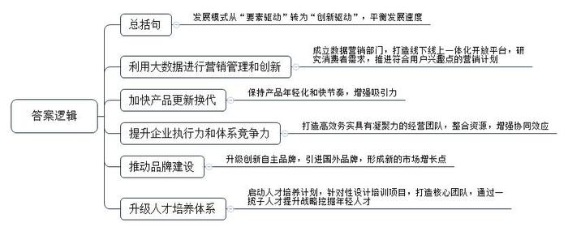
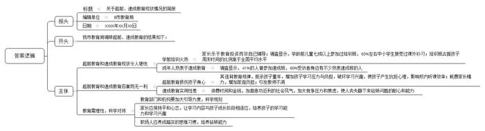
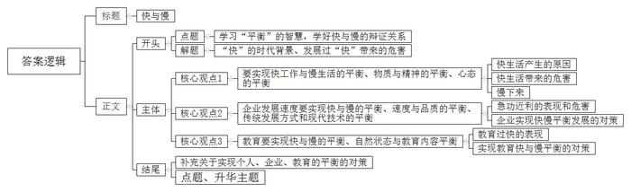
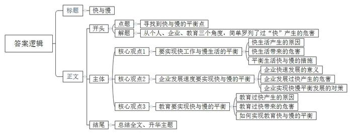

# 2017年公务员多省联考《申论》题（浙江B卷）

<!-- gwy:overview:start -->
> **浙江 · 2017 · 申论 · B类** ｜ 3 题 · 图片 4 处 · 答案随题折叠

导航：[题目](#题目) · [材料 1](#材料-1)
<!-- gwy:overview:end -->

> 候选采集稿。参考答案及解析来自粉笔页面，不代表官方答案或真实高分答卷；来源使用许可与原卷对应关系仍需人工核实。

## 给定材料

### 材料 1

中国车市在经历了迅猛扩张，成为世界最大单体市场的同时，也渐渐放慢了自己向前的步伐，如同中国经济一样，步入新常态阶段。从十二年前的白手起家，到如今已经赫然位居行业第一集团，D公司创造的速度奇迹在业界声名显赫。从最初的单一车型开始，到如今已经成功完成了主流市场区间的全产品布局；从最早只有一个工厂，到现在的四地八厂；从初始的单一合资品牌，到现在坐拥主流合资两大品牌；从零起步到600万保有客户，这一切只用了12年的时间，D公司就快速地完成了从“小字辈”到“大体系”的转变。

然而，在中国车市进入“新常态”已然不可逆转的今天，D公司过去单纯的快速发展模式已经不适用了，对此，该公司周总表示：“车市的新常态只是意味着车市进入到一个新的发展阶段，速度下了一个台阶，并不意味着车市发展的黄金时代已经结束。在新常态下，快是一种质量，慢是一种智慧。未来我们要从‘要素驱动’转化为‘创新驱动’，对企业体系进行全面的优化升级，努力实现‘快’与‘慢’的平衡，以更稳健、更具核心竞争力的姿态，去应对车市新常态。”

随着互联网、信息技术的发展，消费观念的成熟，中国车市进入了以用户为中心的精细化、个性化时代，D公司顺应时代变化，通过基于大数据分析的营销管理和创新，继续保持迅捷的市场反应速度、高效的体系反应能力、迅速的消费响应能力。公司专门成立了数据营销部门，打造国内首个汽车品牌自建的线下线上一体化开放平台，通过互联网手段持续跟踪、收集、分析消费者的需求变化趋势，根据所得结论及时制定和推进符合用户兴趣点的营销计划；同时，产品年轻化的节奏也依然保持着“快”的本色，不断推出符合年轻人口味的高颜值产品。

与此同时，为了实现企业高效的执行力，D公司在其内部进一步提升企业的全价值链体系竞争力，着力打造高效务实具有凝聚力的经营团队，整合企业及合作伙伴资源，充分挖潜，增强每个工作环节的协同效应，让所有部门为同一目标共同发力，实现体系竞争力的最大化。

如果说D公司过去的发展模式是“要素驱动”，那么如今全新体系竞争力的打造，就是以“创新驱动”为核心，推动品牌建设、产品营销、人才体系等每一个层面的发展。D公司坚持品牌向上战略，升级创新自主品牌，不断引进最新技术的国外品牌，以更具时代感、互联气质的品牌印象去赢取更多年轻用户的心。公司旗下的某品牌早已启动了以纯电动汽车为方向的新能源汽车发展战略，未来将以“用户体验”为核心，通过一系列的创新营销手段，逐步将先机转化为市场优势，全面推进该品牌的市场普及，形成新的市场增长点。人才体系的全面升级是确保体系竞争力向卓越跨越的最基础保障。对此，D公司启动了被称为“企业大学”的人才培养计划，针对不同发展阶段、不同类型的员工精心设计培训项目，努力打造核心关键人才团队，通过一揽子人才提升战略去挖掘年轻人才，充分发挥优秀年轻员工的创新活力，让新思想、新创意成为D公司下一阶段发展的核心驱动力。

### 材料 2

近年，B市经济的飞速发展，带动了超前教育、速成教育市场的快速生长，引起了B市政府的重视，市政府要求市教育部门组织人员开展相关调研工作，下面是此次调研所收集的部分材料：

（1）“B市儿童成长状况数据”的调查显示，3至6岁的孩子七成以上都参加过各种培训班，育儿支出占家庭平均收入的23%，近六成的家长把孩子的教育投资放在首位。孩子们的周末时间有41%被各类培训班所占据，留给去广场、公园和游乐场的时间仅有9%。对比26.3%的全国平均数据，B市孩子们的周末时间被培训班占据的比例偏高。

（2）一到周末，不少学龄前儿童的时间就被各种早教班、才艺班、素质拓展班等各种培训班填满。幼儿园孩子的学习压力堪比小学生，学前教育成了“超前教育”。新任妈妈李某将全部心思放在孩子的学习上，孩子从1岁开始学认字，3岁开始学外语，还有钢琴、围棋、绘画、游泳。尚未上学，孩子就每天在和时间赛跑，参加各类培训班。

（3）针对B市中小学超前教育的调查发现，65%左右的学生参加过超前教育，40%受调查的老师表明班中接受过超前教育的学生占大多数。在接受调查的学生中，约88%选择校外补习接受超前教育，仅有少数由父母辅导。调查者发现，在接受调查的学生、家长和老师中大多认为超前教育会在一定程度上增加学习负担。还有的学生不仅没学到有用的知识，甚至因为听不懂而对课程产生了抗拒心理。调查数据还表明超前学习影响了校内听课效率：64%的学生会因为已经提前学习过一遍而偶尔在课堂上开小差，11%会因此经常开小差，4%的学生甚至表示自己因此从来不听讲。

（4）调研发现，很多幼儿园和小学教师对学前教育超前之风有很大意见。一些孩子过早参加了学前教育，却因为理解力跟不上，导致似懂非懂、似学非学，反而影响了日后正常的学习，而且破坏了学习兴趣。有专家建议，教育重在激发天性、保护个性，最重要的不是学到了什么，而是培养良好的学习能力，形成浓厚的学习兴趣。学前教育也应该有科学的规划，让学习内容和成长阶段相适应。这需要家长保持平和的心态，也要求教育机构的科学引导。

（5）为满足市民们接受继续教育的强烈要求，各种速成班、速成法如雨后春笋般涌现。“欲速则不达，但现在很多人，太心浮气躁了！”一位老师说，现在市面上充斥着各种“速成法”，让人眼花缭乱。就像现在到处流传的各种减肥速成教程一样，很多人非常迷恋，见一个试一个，总抱怨没什么效果，却还是乐此不疲地去尝试。

（6）某媒体的千人在线调查显示，受访者中，41%的人曾参加速成班，60%受访者身边有不少热衷速成班的人。对于速成教育的效果，37%的人觉得有用，63%的人则认为用处不大，其中18%的人直言“完全没用”。张先生感觉工作中竞争压力较大，一直存在心理焦虑。他曾报过一个速成班，一个月课程结束后，张先生觉得自己学到不少东西，背了很多公式，但遇到实际问题，他总是想不起该用哪种方法解决。王女士认为自己知识储备不足，需要充电再教育，去年她报了一期英语速成班，在速成班里，老师确实教了很多新颖的方法记单词，但单词量一多，那些方法就全忘了，而且经常搞混。

（7）调查显示，40%的人担心速成教育盛行加剧了急功近利的社会风气；34%的人认为这会浪费大家的时间和金钱；18%的人觉得会加大人们的竞争压力和焦虑。“速成教育并不靠谱”，曾参加过某种速成班的李先生反思说。现在很多人形成了一种“速成习惯”，凡是遇到什么难题，首先总是去想有没有捷径。不能说这完全是个坏习惯，但这种思维方式如果走向极端，就会让人变得急功近利，逐渐丢掉静下来钻研问题的耐心和能力，“还是应该脚踏实地学真本事，不迷信速成法。”

### 材料 3

随着经济社会发展，越来越多的人在度假方式上，开始追求一种闲适的节奏：或是在家陪陪家人、或在田园放松心灵、或做点无用的事……而这种观念也正是社会更加成熟自信、文明进步的一种表现。

A市位于我国西部地区，具有丰富的旅游文化资源，是一座以旅游立市的小型城市。近年来，该市以休闲生活为旅游新卖点，提出“在这里正大光明地浪费光阴”“没有任何一件事情是必须做的，只需随心住下，随性闲游！”等旅游消费主张来吸引游客，受到游客们的青睐。

在黄金周假期前两天，传来了“高速免费”“景点降价”的消息。A市市民汪先生因担心人满为患，临时取消了长途出游的安排。当换种度假方式时，他很快便开始享受这种新的节奏了。汪先生携妻儿开车来到郊区一个水库，在青山绿水间垂钓，中午就地野餐，傍晚则将一天的收获带回家做成美味鱼汤。汪先生告诉记者说：“尽管只钓到七八条小鱼，但一家人在一起的亲近感让我觉得幸福不过如此，这种生活正是我向往的。”28岁的胡女士则在黄金周期间选择宅在家做卫生、看书、喝茶……她说：“刚工作时遇到假期不是在各家亲戚间奔波，就是在人山人海的景点抢镜头，不然就觉得虚度了。现在我宁愿做什么事都无需紧赶慢赶，享受悠闲的生活。最好的景致就在自己心里。”

### 材料 4

19世纪末的美国传教士雅瑟·亨·史密斯在《中国人的性格》中称中国人是“漠视时间的民族”，随着中国社会日益加快的现代化转型，中国逐渐变成了世界上最忙碌的国家之一。现在，越来越多的人开始重视从紧张的节奏中解脱出来，享受闲适。有学者表示，这种心理的变化轨迹正是社会进步的表现，体现了后工业时代的幸福导向型生活。随着这种观念的流行和它所催生的产业经济，未来人们会有更加丰富多彩的选择。

事实上，要想让人们在某一种生活状态中得到享受，那首先得是人们的自主选择，而只有依靠整体性的社会发展，人们才有充分的选择权。法国于1998年首倡“无车日”，那时法国人均GDP就已经达到24000美元，每周工作时间更是少到让人艳羡的35小时。反观中国目前的情况，2014年人均GDP刚超过7000美元，相当多的劳动者为了体面的生活，连法定的带薪休假甚至双休都放弃了，此时就谈休闲生活，未免过于奢侈了。

倡导休闲生活，要以现实为基础，尊重公众的选择权，尤其要避免给公众“添堵”。倡导要发挥作用，靠的是公众的自觉响应。如果不顾现实情况，违背人们的自主意愿，倡导活动不仅无法落地生根，甚至会因为给公众“添堵”而招致反感。职能部门工作要做得更精细，考虑要更全面，让公众真正感受到好处、享受到便利，所倡导的休闲生活就会成为人们自然而然的选择。

### 材料 5

当下社会，一切都和速度直接挂钩：飞机当天往返，火车夕发朝至，教育要趁早，就业要抢先，毕业就买房，爱情变速配。新世纪以来社会变革加快，利益结构调整，人们的经济地位被重新洗牌，对未来前景的不确定，使很多人心浮气躁，这与转型期带来的阵痛密切相关。

以往，只要是名牌大学毕业，就不愁找不到称心的工作；现在，城市化进程的不平衡性导致大城市人口拥挤，选择“好”职业的难度加大，即便是名校硕士、博士，找到的工作也不一定合意。为了在竞争激烈的就业市场占得先机，大学生纷纷成为“考证族”。王某是一名法律系在读研究生，刚刚通过国家司法考试，拿到了法律职业资格证。研究生还没毕业，为什么现在就急着参加司法考试？王某说，有了证，马上就能在律师事务所实习，就业时就能抢先一步。

在互联网时代，每天遇到海量信息，面对各种诱惑，身处不断的比较中，很多人担心被时代落下、害怕被别人超越。赵某是某IT公司软件工程师，最近刚跳槽到另一家规模更大的公司。大学毕业不到5年，他已经换了3份工作。“房价涨，收入低，晋级慢，在网上看到别的公司待遇更好，就想通过不断跳槽寻找新机会。”赵某说。

大城市居住不容易，单是房价就已经透支了很多人大半辈子的财富，再加上高昂的教育费、医疗费等，一个人不拼命工作还真不行。某微博用户晒出一张图片：“山东某知名IT公司要求员工申请自愿放弃年休假，实行6×12小时工作制：每天工作12个小时、每周工作6天，春节、国庆等长假期间也要随叫随到。”面对如此苛刻的要求，却有不少人积极响应。一位响应者说，“对我们年轻人而言，大学毕业后能前行多远，不仅仅是个人能力的问题，如果没有父辈的外部支援，自己又不使劲上位，很难在大城市站稳脚跟。”

美国发明家富兰克林说过：“时间就是生命，时间就是金钱。”这句话作为大工业时代的座右铭，影响了整个世界。快速、高效的观念深入人心，成为人们自觉不自觉的选择。现代社会物质条件的进步也加剧了人们的这种心理。电话不普及的时候，人们已经习惯了几天才收到一封信，但在手机随处可见的今天，几分钟内对方没有回短信，人们就会嫌慢；在自行车与有轨电车还是主要出行工具的时候，等半个小时的公交车不足为奇，但现在，出行越来越便捷，却连打的都还忍不住叮嘱司机开快点。互联网的出现更大大改变了人们的生活方式，速度更快，变化更多，时间的价值更宝贵。很多人习惯了24小时开机，习惯了半夜被人从梦中叫醒谈工作，习惯了长期频繁加班。这种生活给现代人带来物质回报的同时，也导致了精神的疲惫和身体的损害。某网站的调查显示，我国已成为全球工作时间最长的国家之一，人均劳动时间超过日本和韩国。一些白领虽然报酬较高，但白天夜里都要紧张工作，生活很不规律。

某互联网公司的一位员工说：“连夜加班，刚开始你也许无法适应，但是时间久了你会觉得，如果周围人都在加班，你早走了就显得很特别。虽然没有强制加班的规定，但公司里许多人都在‘抛妻弃子’、挑灯奋斗。因为你不加班，就比不过加班的人。”有人估算，我国每年因过劳去世的人多达60万，其中媒体人、科技工作者、互联网企业员工中死于过度疲劳的比例最高。

不停加班，带来了一系列健康问题，频繁跳槽、朝三暮四对心理的影响也不容小觑。比如，盲目跳槽的人在辞职过程中的无奈，重新选择时的焦虑，以及应聘新企业来回的奔波，都会极大地影响个人情绪。尤其是跨地区跳槽，从一个熟悉的环境到一个陌生的环境，前景的不确定性会给人带来更大的心理压力。不停加班还容易带来安全问题，许多货车司机为了赶着交货，疲劳驾驶，红眼赶路，由此造成的交通安全事故已数不胜数。这恰恰应验了中国人“欲速则不达”的古训。

我们还是发展中国家，很多方面不能跟发达国家比，确实需要加快发展、早日富强，而且在我国推进市场化的进程中，人民群众有改善生活的强烈需求，这是我国社会保持较快发展的内在动力，处于这样的历史阶段，想要控制发展速度并不容易。因此，根本的解决之道不在于刻意放缓发展节奏，而在于防范快速发展过程中容易出现的失衡。政府要建立健全社会保障体系，创造更畅通更多元的发展通道，减轻人们的工作和生活压力。同时，个人也要积极调整心态，特别是年轻人初涉职场，要学会找到适合自己的节奏和平衡点，留出空间去调整身心状态，审视事业的计划和目标，体会人生的意义。

### 材料 6

H集团张总在一次中层干部会议上问到：什么让石头漂在水面上？答：速度，速度能使沉甸甸的石头漂起来。H集团对“速度”的执着简直达到了无以复加的程度。贴满集团工厂、办公室各个角落的是集团的行动理念“迅速反应，马上行动”。H集团是“速度”最忠实的践行者和最大的受益者。“速度能使沉甸甸的石头漂起来”的潜台词是速度可以创造奇迹，速度可以以弱胜强。H集团诞生的时候只是一家破败的工厂，家底几乎是一穷二白，而实力强大的、国际级的竞争对手早已群雄环伺。H集团在短短二十年的时间里，在强势洋品牌的夹缝中发展壮大，成为了行业的标杆企业。一个服务商对H集团的速度感触颇深，某天下午，他刚在H集团总部确定营销方案，第二天飞回北京，吃惊地看到北京的卖场里这套方案的活动物料就已经全部布置完毕。

商场如战场，一旦错失稍纵即逝的发展机遇，就可能导致企业陷入困境。很多大公司从辉煌到暗淡的退变都让人唏嘘。在某知名电脑厂商M公司，要想将一张桌子从一楼搬到三楼需要3个月的时间。在那里，为何搬、谁来搬、怎么搬都必须层层汇报和批示。企业做大后，有时候就会出现“大公司病”，反应迟钝，行动缓慢。个人电脑的概念是由M公司首创，但当其他电脑公司的同类产品迅速崛起并占领市场后，M公司的个人电脑却几乎被人们淡忘。作为一家有着百年历史的企业，M公司曾是整个科技行业的风向标。许多电脑行业今天盛行的理念都来自于这家企业，但是它没有及时把这些理念付诸实践，后来这些理念被竞争对手借鉴并发扬光大。许多大公司并不是没有机遇和环境，但它们常常迷恋过去的辉煌，满足于既有经验，因而错失转型良机。当年某品牌手机曾盛极一时，然而它死守自己的模式，不屑于手机智能化的时代潮流，导致陡然衰落，被其他企业收购。有些失去辉煌的公司很不甘心：我们并没有做错什么，但不知为什么，我们输了。

1987年，国际餐饮巨头K公司在中国开设第一家店，5年后仅开了10家店。这5年K公司在干什么？他们在摸索中国市场规律，调研中国人的口味特点，了解中国的社会和文化，构建具有中国特色的管理架构。等到K公司的经营体系完全与中国市场磨合适应，扩张才突然加速。从100家店到400家店，从800家店到1500家店，他们仅仅用了一两年的时间。

W公司是一家互联网企业。2010年，该公司李总曾放言互联网企业的高增长可以持续10年；2013年前后，公司果然以200%、300%的年同比增长率在膨胀；2015年，李总公开宣称公司的发展策略仍然是扩张、扩张、不断扩张。但很快，李总改变了公司大举扩张的策略，他说“还是要脚踏实地，很多企业想一口吃胖，很容易‘撑死’”。该公司在主动给自己的扩张降速的同时，把订单送达的速度提高了，换取更高的客户满意度。因此，对于W公司而言，主动降速不是急流勇退，而是在为下一步的跳跃做准备。以退为进，有了助跑，才能跳得更远。

### 材料 7

以下材料是某学校暑假致家长的一封信。

尊敬的家长：

您好！

您的孩子考试结束，顺利离校返家，寒假生活已然开启。学业成绩将由班主任随后发放，敬请查收。

如果我们用庄子“无用方为大用”的观点来谈孩子的教育和成长，或许会被当下的社会斥为无稽之谈，因为实用主义哲学早已深入人心。成绩至上、目标第一的教育论或已洗去了许多人头脑中培养孩子的乐趣，现在一些父母总是在盼望孩子快点长大，快一点达成父母心中的期盼。

法国自然主义哲学家卢梭曾说：“大自然希望儿童在成人以前就要像儿童的样子。如果我们打乱了这个秩序，就会造成一些早熟的果实，既不丰满也不甜美，而且很快就会腐烂；我们将造就一些年纪轻轻的博士和老态龙钟的儿童。”当我们环视周围，不是可以看到很多实用教育导致的伪成熟的孩子么？三岁学舞蹈，四岁学钢琴，五岁学绘画，六岁背唐诗，学习是孩子们生活的唯一，丢失了童年的乐趣、少年的轻狂、青春的热情。为了成绩、名次，为了全能的素质而拼尽全力。待到毕业时他们不知道自己需要什么，不知道生活的乐趣所在，他们只会在压抑的中学之后挎着行囊朝着高校走去，却不是朝着志趣前行。孩子们在匆促的跋涉中疲于奔命，却无暇慢下来欣赏周边的风景，认真地发现自我。

我们学校从未否定学业和成绩的作用，还强调不断唤醒孩子的自律、自觉、自省，激发他们潜藏的能力、志趣、爱好，用“无用”的阅读、思考、交流来充实生命的厚度，拓展生命的宽度。当他们走出学校以后，不会因为生活的艰辛而失去创造的灵感，不会因为大学的自由而变得松散怠惰，也不会因为五光十色的诱惑而失去心中的信念。

父母养育孩子，不正是在等待、守护一朵花的盛开么？不管他们是迎春而笑、凌寒而开或是含苞待放，他们都是独一无二的孩子，我们唯一能做的就是慢慢地呵护、静静地等待。那么，我们是否也该像审视自己的生活一样去审视对孩子的教育呢？我们是否会在深沉的思索中看到生活中的无用种种，却是孩子以后人生中宝贵的点点滴滴呢？

祝您的孩子在静好的岁月中，自在生长！

## 题目

### 第 1 题

**根据资料**4**，分析D公司成功应对新常态的主要经验。（20分）**

关联材料：材料 1

作答要求：

要求：

（1）全面、准确、简明；

（2）条理清晰；

（3）不超过250字。

第 1 题 · 答案与解析

**参考答案（粉笔题库参考内容）**

发展模式从“要素驱动”转为“创新驱动”，平衡发展速度。

1.利用大数据进行营销管理和创新。成立数据营销部门，打造线下线上一体化开放平台，研究消费者需求，推进符合用户兴趣点的营销计划。

2.加快产品更新换代。保持产品年轻化和快节奏，增强吸引力。

3.提升企业执行力和体系竞争力。打造高效务实具有凝聚力的经营团队，整合资源，增强协同效应。

4.推动品牌建设。升级创新自主品牌，引进国外品牌，形成新的市场增长点。

5.升级人才培养体系。启动人才培养计划，针对性设计培训项目，打造核心团队，通过一揽子人才提升战略挖掘年轻人才。

**参考答案说明：**本参考答案整体上是“总-分”结构，先用一句话总体指出D公司成功应对新常态的经验；然后分别从“创新营销管理”“加快产品更新换代”“提升执行力和竞争力”“推动品牌建设”“升级人才培养体系”五个方面进行了分条撰写。各条要点之间在内容上相互并列，没有交叉。并且撰写每条要点时，都提炼出了概括性强的总括词并前置。

**解析状态：unknown（来源未提供）**

### 第 2 题

**假定你是B市教育部门工作人员，根据资料**6**，整理一份关于该市超前教育与速成教育现状的简报，供领导参考。（30分）**

关联材料：材料 2

作答要求：

要求：

（1）紧扣资料，内容全面；

（2）层次分明，有逻辑性；

（3）不超过500字。

第 2 题 · 答案与解析

**参考答案（粉笔题库参考内容）**

**参考答案****一**

关于超前、速成教育现状情况的简报

B市教育局 XXXX年XX月XX日

我市教育局调研超前、速成教育的结果如下：

超前教育和速成教育现状令人担忧。1.学前培训火热。家长乐于教育投资而非自己辅导；调查显示，学龄前儿童七成以上参加过培训班，65%左右中小学生接受过课外补习；培训班占据孩子周末时间的比例高于全国平均水平。2.成年人热衷于速成教育。调查显示，41%的人曾参加速成班，60%受访者身边有不少热衷速成班的人。

超前教育和速成教育百害而无一利。1.超前教育损伤孩子身心。其违背教育规律，扼杀孩子童年，增加孩子学习压力与负担，破坏学习兴趣，使孩子产生抗拒心理，影响校内听课效率；耗费家长精力，增加家庭负担；引发教师不满。2.速成教育实用性差。浪费时间和金钱，加剧急功近利的社会风气，加大竞争压力和焦虑，使人丧失静下来钻研问题的耐心和能力。

教育需理性，科学对待。1.教育部门和机构要加大引导力度，科学规划；2.家长应保持平和心态，让学习内容与孩子成长阶段相适应，培养孩子的学习能力和学习兴趣；3.职场人应养成踏实的思维习惯，培养钻研能力。

**参考答案说明：**（1）格式上，本参考答案按照“报头+正文”的格式要求展开。（2）本题在内容上，按照“开头+主体”展开，首先介绍了调研的背景，然后介绍了B市超前教育与速成教育的基本情况，再介绍了超前教育与速成教育的危害，最后提出对策。做到了分条撰写，各条要点之间没有交叉。

**参考答案****二**

关于超前、速成教育现状情况的简报

B市教育局 XXXX年XX月XX日

我市教育局调研超前、速成教育的结果如下：

超前教育：1.基本情况：学前培训火热。家长乐于教育投资而非自己辅导；调查显示，学龄前儿童七成以上参加过培训班，65%左右中小学生接受过课外补习；培训班占据孩子周末时间的比例高于全国平均水平。2.危害：损伤孩子身心。其违背教育规律，扼杀孩子童年，增加孩子学习压力与负担，破坏学习兴趣，使孩子产生抗拒心理，影响校内听课效率；耗费家长精力，增加家庭负担；引发教师不满。

速成教育：1.基本情况：成年人热衷于速成教育。调查显示，41%的人曾参加速成班，60%受访者身边有不少热衷速成班的人。2.危害：实用性差。浪费时间和金钱，加剧急功近利的社会风气，加大竞争压力和焦虑，使人丧失静下来钻研问题的耐心和能力。

教育需理性，科学对待。1.教育部门和机构要加大引导力度，科学规划；2.家长应保持平和心态，让学习内容与孩子成长阶段相适应，培养孩子的学习能力和学习兴趣；3.职场人应养成踏实的思维习惯，培养钻研能力。

**解析状态：unknown（来源未提供）**

### 第 3 题

**参考给定资料，以“快与慢”为题目，自选角度，联系实际，写一篇议论文。（50分）**

关联材料：材料 3、材料 4、材料 5、材料 1、材料 6、材料 2、材料 7

作答要求：

要求：

（1）主旨明确，内容充实；

（2）结构完整，论述深刻；

（3）思路清晰，语言流畅；

（4）字数1000-1200字。

第 3 题 · 答案与解析

**参考答案（粉笔题库参考内容）**

**参考文章1****：**

**快与慢**

知识爆炸、信息洪流，科技日新月异、社会急速变迁、经济飞速发展……这是一个变化的时代，更是一个发展的时代，凡事追求更高、更快、更强，却发现**教育失衡、经济失稳、精神失调**。其实，**越是在变革的时代，越应该学习“平衡”的智慧，学好快与慢的辩证关系**，从而把握节奏、掌握方法、优化路径、协调发展。

**快工作的同时，要学会慢生活，追求个人在物质与精神上的平衡，更要追求心态的平衡**。诚然，升职加薪、买房买车、上有老下有小的压力逼迫我们不得不努力工作，可是我们忘了，工作最终是为了生活。一个寓言说道：一群人急匆匆地赶路，突然一个人停了下来。旁边的人很奇怪：为什么不走了?停下的人一笑：走得太快，灵魂落在了后面，我要等等它。走得太快就容易忘掉心灵需要抚慰，精神需要丰富，家人需要关爱，生活需要享受。正如“慢生活”倡导者卡尔·霍诺说，“慢生活”不是支持懒惰，放慢速度不是拖延时间，而是让人们在生活中找到平衡、找到乐趣。

除了个人，很多企业也是忙东忙西、盲目跟风，什么热门做什么，什么来钱快投资什么，在经济的洪流中迷失。

**快发展已然过时，中国经济步入新常态的今天，企业应该追求速度与品质的平衡，传统发展方式和现代技术的平衡**。当前市场上存在一些急功近利不良风气，过快发展下难免出现一些粗制滥造、仿制山寨、成本低廉的产品，看似走得很快，其实束缚了长远、可持续的发展。现在呼吁的工匠精神，追求的便是精益求精、认真雕琢、臻于完美，这其实就是一种平衡的智慧。

**平衡的艺术在教育领域尤为迫切，中国的教育需要在保持自然状态与增加教育内容之间实现平衡**。教育不能只追求多、快，不能一味地追求“不输在起跑线”上，更不能不顾孩子的实际增加**教学内容、学习任务和学习负担**。教育的新常态就是要**摒弃浮躁、功利**，回归到教育规律，慢慢地、静静地、悄悄地做，不浮躁、不显摆，一定会有我们想要的结果。亚里士多德曾说过：“教育必须基于三个原则：中庸、可能和适当。”那个时候我们的孩子不管是分数、才能，还是能力都很好，他们的灵魂也很丰满。

总之，平衡不是懒惰，不是倒退，不是慢，而是一种更健康的心态，更科学地配置资源，更符合规律地促进成长。个人在快节奏下找到舒适的状态，培养积极乐观的心态，善于减压和调节情绪；企业在快发展下更加注重细节，追求品质，改善管理，善用人才；而教育要在快奔跑下主动减负，创新教育方式，为孩子提供自由、宽松、有序的成长环境。

“拳头缩回去，是为了更有力地打出去。”平衡就像中国的太极拳，不是不发展，而是更好的发展，更科学的发展，更持续的发展。让我们把握好快与慢的平衡，不急不缓、不浮不躁、循序渐进、稳稳当当地前进吧！

**文章分析**

**快与慢**

【**标题的优点：**严格按照题目的要求，以“快与慢”为标题。】

（1）知识爆炸、信息洪流，科技日新月异、社会急速变迁、经济飞速发展……这是一个变化的时代，更是一个发展的时代，凡事追求更高、更快、更强，却发现教育失衡、经济失稳、精神失调。其实，（2）越是在变革的时代，越应该学习“平衡”的智慧，学好快与慢的辩证关系，从而把握节奏、掌握方法、优化路径、协调发展。

【**开头的优点：**★内容方面。范文的开头是紧扣题目给定的“快与慢”这一标题展开。首先开头指出主题，做到了主题明确。其次，对“快与慢”这一主题进行了分析阐述，指出了（1）现代社会中因“快与慢”失衡出现的问题；（2）如何平衡“快与慢”的对策。】

**快工作的同时，要学会慢生活，追求个人在物质与精神上的平衡，更要追求心态的平衡**。诚然，（1）升职加薪、买房买车、上有老下有小的压力逼迫我们不得不努力工作，可是我们忘了，工作最终是为了生活。一个寓言说道：一群人急匆匆地赶路，突然一个人停了下来。旁边的人很奇怪：为什么不走了?停下的人一笑：走得太快，灵魂落在了后面，我要等等它。（2）走得太快就容易忘掉心灵需要抚慰，精神需要丰富，家人需要关爱，生活需要享受。正如“慢生活”倡导者卡尔·霍诺说，（3）“慢生活”不是支持懒惰，放慢速度不是拖延时间，而是让人们在生活中找到平衡、找到乐趣。

【**论述段****1的优点：**★观点句：范文的观点句是紧扣题目给定的“快与慢”这一标题提出的。形式上，它在段首处直接写出，位置突出，容易发现。内容上，关键词突出，内容要点明确，可以明显看出它是从“个人在物质与精神、心态上要平衡”这一方面入手，指出了“快工作的同时，要学会慢生活”。★论述内容：（1）首先介绍了“工作的目的”；（2）接着介绍了“求快”的问题；（3）最后介绍了“如何平衡工作与生活”。注意：以上几个方面的内容都是紧扣“快工作的同时，要学会慢生活，追求个人在物质与精神上的平衡，更要追求心态的平衡”这个观点句进行分析论述的，论述的针对性强，内容层次丰富。最后，在论述方法和论据的选取上做到了讲道理、举例子相结合，做到了丰富多样。】

　　除了个人，很多企业也是忙东忙西、盲目跟风，什么热门做什么，什么来钱快投资什么，在经济的洪流中迷失。

【**过渡段的优点：**范文过渡段主要介绍了学会慢生活，平衡快与慢，除了个人要做好，企业也应该从中吸取经验教训，从而引出下文。】

**快发展已然过时，中国经济步入新常态的今天，企业应该追求速度与品质的平衡，传统发展方式和现代技术的平衡**。（1）当前市场上存在一些急功近利不良风气，过快发展下难免出现一些粗制滥造、仿制山寨、成本低廉的产品，看似走得很快，其实束缚了长远、可持续的发展。（2）现在呼吁的工匠精神，追求的便是精益求精、认真雕琢、臻于完美，这其实就是一种平衡的智慧。

【**论述段****2****的优点：**★观点句：范文的观点句是紧扣题目给定的“快与慢”这一标题提出的。形式上，它在段首处直接写出，位置突出，容易发现。内容上，关键词突出，内容要点明确，可以明显看出它是从“传统方式和现代技术的平衡”这一方面入手，指出了“企业应该追求速度与品质的平衡”。★论述内容：（1）首先介绍了“当前市场出现的问题”；（2）接着介绍了“如何追求平衡”。注意：以上几个方面的内容都是紧扣“企业应该追求速度与品质的平衡，传统发展方式和现代技术的平衡”这个观点句进行分析论述的，论述的针对性强，内容层次丰富。最后，在论述方法和论据的选取上做到了讲道理、举例子相结合，做到了丰富多样。】

**平衡的艺术在教育领域尤为迫切，中国的教育需要在保持自然状态与增加教育内容之间实现平衡**。（1）教育不能只追求多、快，不能一味地追求“不输在起跑线”上，更不能不顾孩子的实际增加**教学内容、学习任务和学习负担**。（2）教育的新常态就是要**摒弃浮躁、功利**，回归到教育规律，慢慢地、静静地、悄悄地做，不浮躁、不显摆，一定会有我们想要的结果。亚里士多德曾说过：“教育必须基于三个原则：中庸、可能和适当。”那个时候我们的孩子不管是分数、才能，还是能力都很好，他们的灵魂也很丰满。

【**论述段****3****的优点：**★观点句：范文的观点句是紧扣题目给定的“快与慢”这一标题提出的。形式上，它在段首处直接写出，位置突出，容易发现。内容上，关键词突出，内容要点明确，可以明显看出它是从“保持自然状态与增加教育内容”这一方面入手，指出了“中国教育要实现平衡”。★论述内容：（1）首先介绍了“教育中存在的问题”；（2）接着介绍了“教育的新常态”。注意：以上几个方面的内容都是紧扣“中国的教育需要在保持自然状态与增加教育内容之间实现平衡”这个观点句进行分析论述的，论述的针对性强，内容层次丰富。最后，在论述方法和论据的选取上做到了讲道理、举例子相结合，做到了丰富多样。】

总之，平衡不是懒惰，不是倒退，不是慢，而是一种更健康的心态，更科学地配置资源，更符合规律地促进成长。个人在快节奏下找到舒适的状态，培养积极乐观的心态，善于减压和调节情绪；企业在快发展下更加注重细节，追求品质，改善管理，善用人才；而教育要在快奔跑下主动减负，创新教育方式，为孩子提供自由、宽松、有序的成长环境。

【**过渡段的优点：**本过渡段主要从个人、企业、教育三个方面进行了总结，指出平衡才是一种更健康的心态。】

“拳头缩回去，是为了更有力地打出去。”平衡就像中国的太极拳，不是不发展，而是更好的发展，更科学的发展，更持续的发展。让我们把握好快与慢的平衡，不急不缓、不浮不躁、循序渐进、稳稳当当地前进吧！

【**结尾的优点**：范文的结尾回扣了“快与慢”这一主题，并进行了展望，语言精悍，情感真挚。】

**参考文章****2****：**

**快与慢**

老话虽说“速度造就成功”，但老话又说“过犹不及”。环视周遭，有多少人因**追求工作的快速高效而长期加班**最终患上严重的疾病，又有多少的企业发展之初就**急功近利地盲目扩张**而终究倒闭，甚至有多少咿呀学语的孩提们为了将来的第一名而早早背负起**巨大的课业压力**，一幕幕因“快”导致的悲剧令人扼腕。我们亟需重新审视我们的生活，**找到“快与慢”的平衡点**，让悲剧不再重演，让生活更加幸福。

**适时从快节奏的工作中解脱出来，享受慢的生活**。随着社会变革的加快，人们的**生活成本**也在逐年增高，为了赚取更多的薪酬去缓解愈来愈高的**生活压力**，人们不得不**放弃了陪伴家人、享受生活的假期**，开始频繁加班，开启了24小时在岗的超人化工作模式。可随之而来的，人们的**健康被严重透支**，甚至因**过劳而死亡**。因此，我们**要找到快工作与慢生活的平衡点**，既要在工作时珍惜时间，提高效率，又要学会从快节奏的工作中走出来，**调整身心状态**，**享受休闲的生活**，**体味人生的意义**。

在“快”的皮鞭的驱使下，不仅造成了生活和工作的失衡，同样也给企业的发展带来重创，也让我们的教育失去原本的色彩。

**企业发展需速度与质量的快与慢的平衡**。速度是发展的第一要义。对于企业而言，只有**保持高速的反应能力和行动能力，才能抓住机遇**，实现飞跃。但令人遗憾的是，有很多企业为了更大的市场，更丰厚的利润，罔顾自身条件，**急功近利，盲目扩张**。这无异于一叶障目，一味地追求经济效益，必将**忽视标准化生产**，导致**产品与社会脱节**、**质量下降**，**品牌贬值**。长此以往，企业的发展之路必将荆棘丛生。因此，企业在保持高速发展的同时，又要**结合自身发展状况**，**主动降速**，**以退为进**。要敢于**“驱动创新**”，**优化人才体系**，提升企业竞争能力，使企业发展能够长久可持续。

**教育要兼顾孩子的自然状态和教育内容间的快与慢的平衡**。四年级学完小学课程，初一复习备战中考，高一就学完了所有高中的课程。只有第一名才会有出息，看似一心为了孩子好，实质上却是**忽视了孩子的理解能力**，**枉顾孩子自然的生长规律**。长此以往，不仅会**降低孩子的听课效率**，**破坏学习兴趣**，更会造成孩子的**伪成熟**，甚至会酿成更大的悲剧。据调查，我国已成为中小学生自杀率最高的国家，其中竟有七成的孩子的死亡是巨大的学习压力导致的。由此可见，成长永远都不是急于求成的事情，应该**有科学规划**，让**教育的内容与成长阶段相契合**。用一本书、一场旅行、一次思想的碰撞，来**挖掘**孩子的**潜能**，**激发**他们的**天性**，来**增加他们生命的厚度**，**发现真正的自己**。

“快”不是不顾一切，要注重质量，“慢”不是懒惰，要有智慧。当**工作与生活达到快慢平衡**，我们才能具有更好的工作状态，创造更多的价值；当**企业兼顾到快慢的平衡**，才能汇聚更大的力量，荡平发展的道路；当**教育实现了快慢平衡**，孩子们才会拥有如鸟般的双翼，才能搏击九天。因此，要我们将“快”与“慢”的平衡作为指路的明灯，照亮我们幸福生活的漫漫长路。

**解析状态：unknown（来源未提供）**

