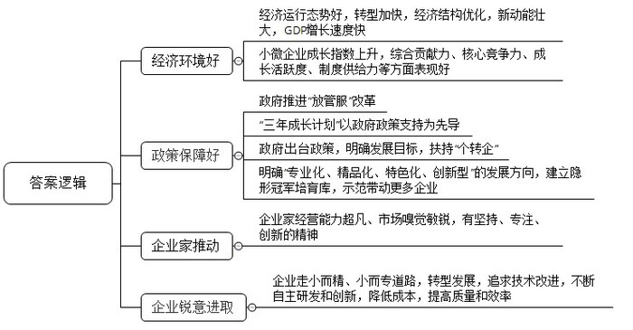
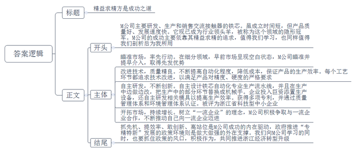
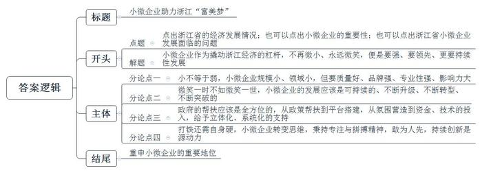

# 2018年浙江省公考《申论》题（B卷）

> 候选采集稿。参考答案及解析来自粉笔页面，不代表官方答案或真实高分答卷；来源使用许可与原卷对应关系仍需人工核实。

## 给定材料

### 材料 1

2017年以来，浙江坚持稳中求进工作总基调，贯彻落实新发展理念，前三季度经济运行延续上半年稳走向好态势，主要经济指标走势好于全国，转型升级步伐加快，经济结构调整优化，新动能不断发展壮大。前三季度，全省生产总值36958亿元，按可比价格计算，同比增长8.1%，增速比上半年快0.1个百分点，比去年同期快0.6个百分点，高于全国（6.9%）1.2个百分点。

全省深入推进“放管服”改革，2017年前三季度，新设企业28.4万家，同比增长25.4%；新设个体工商户55.7万家，同比增长15.2%。平均每天新设企业1040家、个体工商户2040家。至9月底，浙江省有各类市场主体575.3万户，同比增长12.5%，其中，企业188.8万家，同比增长16.7%，这些企业绝大多数是中小微企业。

2016年全省规模以上工业小微企业实现增加值5802.6亿元，同比增长6.0%；规模以下工业小微企业实现增加值4263.45亿元，同比增长6.2%；小微外贸企业出口总额累计2354.9亿元，同比增长19.43%。多年来，以中小微企业为主体的民营经济是浙江经济稳定增长的重要拉动力，它们贡献了浙江60%的税收、70%的经济总量、80%的外贸出口、90%的社会就业，为约占全国人口4%的浙江人，在全国1%的土地上，创造全国7%的经济总量作出了巨大贡献。

### 材料 2

1969年，25岁的鲁冠球凭着东拼西凑的4000元钱，带领6名农民白手起家，在萧山创办了“宁围公社农机厂”。为求生存，他千方百计为周边公社的农具提供各种配套，“人家要什么就做什么”。凭着鲁冠球超凡的经营能力和敏锐的市场嗅觉，企业越做越大，到1978年，全厂已有400多人，年产值300余万元，厂门口也先后挂上了“宁围农机厂”“宁围轴承厂”“宁围链条厂”“宁围失蜡铸钢厂”和“宁围万向节厂”等七八块牌子。就在一切看上去都顺风顺水的时候，鲁冠球却作出了一个惊人的决定，他把挂在厂门口的几块厂牌一一拆了，只留下一块“萧山万向节厂”——他决心今后只把精力投放到一个产品中，那就是汽车的易耗配件“万向节”上。鲁冠球后来说，他从1978年开始考虑一些问题，“做工厂不能有什么就做什么，到了一定的时候就要小而专、小而精”。自此，这家“身份低微”的企业从当时的“冷门”行业一跃发展成为今天营收超千亿、利润过百亿的现代化跨国企业集团，被誉为“中国企业常青树”。

浙江义乌S日用品有限公司创始人楼某14岁时就随父走街串巷，鸡毛换糖，收过农药瓶、摆过地摊、搞过养殖……15年间干过20多个行当，但积蓄寥寥。1993年底，已是而立之年的楼某慢慢意识到，什么都尝试便什么也做不好，他决定抓住手中的吸管生产设备，一门心思做吸管，从此不再换主业。“吸管这东西，一次性、几厘钱、低门槛、低技术、低利润，在餐桌上都是白送，还没人关注，只能挣一点辛苦钱。”楼某说，“家庭抱怨、员工怀疑，但我仍然坚持原定的路径，未来五十年只做一根吸管。”20多年来，S公司坚持专业化发展道路，坚守实业，不多元，不浮躁，不急功近利，将一根吸管做精、做强、做到极致。目前，S公司拥有各类塑料吸管生产流水线200多条，企业员工600余人，年生产各类塑料吸管近万吨（200多亿支），已成为全球质量最好、品种最全、创新最多、市场覆盖面最广的塑料吸管生产企业，是当之无愧的“行业领导者”。

### 材料 3

浙江经济是“千家万户”的草根经济。改革开放初期，个体工商户以其准入简便、成本低廉、经营灵活的特点，实现了浙江人创业做老板、发家致富的最初梦想，带动了浙江以制造业为主的传统产业发展，造就了民营经济大省和强省的地位。但随着市场经济的发展，个体工商户自身的发展空间在逐步萎缩，尤其是2008年以来，浙江经济进入工业化发达阶段，发展面临的困难剧增，大量个体工商户等市场主体难以适应经济发展的新要求。为此，浙江省陆续出台《浙江省个体工商户转企业及小微企业规范升级工作意见》《浙江省人民政府办公厅关于支持个体工商户转型升级为企业的意见》《关于制定“个转企”行业标准的指导意见》等一系列“个转企”扶持政策文件，以政府有形之手推动市场主体自觉提升。自2013年以来，全省累计完成“个转企”20.2万家，市场主体中个体工商户比重由2012年底的71.7%下降到2016年的66.7%，减少了5个百分点。创业者越过个体户模式，“一步到位”直接设立企业渐成潮流，以杭州为例，2016年新设市场主体中个体工商户比例仅占50.9%。

“说起个体户，对方就会觉得你信誉度不高，很多要求有一定资质的招投标活动参加不了，还无法出具增值税发票，损失了不少订单。”在温州瓯海郭溪街道从事五金加工的杨某告诉记者，前年的“个转企”，使他完成了从个体户“小老板”向公司“企业主”的华丽转身，突破了以往的发展瓶颈。在他看来，“个转企”更像是一道平衡大账与小账的“考题”。转企前，杨某也有顾虑：原来赚的钱，只要放进自己的口袋就行，而转企后，所有的成本开支，都要纳入公司规范的财务体系中。除此之外，经营成本的增加才是对他最大的考验：转企前，他每月只需要缴纳1500多元的定额税，转企后，按照目前的产量，他每月所缴的税费至少要5000元，再请一个兼职的会计，每年至少还要增加2万元的额外开支。即使原材料采购、电费等发票可以进行部分成本抵扣，加上政府还有部分财政返还奖励，每年的实际经营成本也要增加5万元左右。但杨某更愿意把“个转企”视为一种倒逼机制。“个转企”后，他拿到50万元的贷款，陆续添置两台先进机器，聘用三名设计师，专门从事新产品开发。尽管经营成本增加不少，但杨某更看重的是转型后企业发展空间和口碑的提升。他认为，“个转企”后如果不自我加压，不做好企业发展规划，再沿袭以前的“小富即安”或“小打小闹”的思维，很难说企业会走多远。

### 材料 4

在浙江嘉兴众多小微企业中，不乏成功转型升级的样本。海归创二代徐某通过不断创新，将一个传统的图文打印部变成了融信息化与数字化于一体的档案管理有限公司。徐某的父亲在上世纪九十年代承包了一家村办企业，1995年开办了D文体用品店；到2002年，在全市已拥有4家大型文体办公用品店，并在市、县大型商场设立了多家专柜；2006年，又增加图文经营项目，并在2009年将图文业务独立开设成为一家企业，可以说这是一个有着“转型基因”的企业。2010年，从新加坡留学回国后，徐某从图文业务开始做起，迈上了商海之路。经过一年多的历练，徐某发现，公司要发展，必须有先进的技术引领行业。为此，他引进日本先进机器，将传统打印业务转向了数字化印刷。2012年，经过结构调整和技术提升的D文体商行已经在行业内崭露头角，并在2013年获得浙江省数字印刷经营许可证，成为嘉兴市惟一拥有此经营权的企业。同时，D数字印刷有限公司也成为嘉兴市政府定点印刷单位。这一次成功转型后，有着国际视野的徐某发现，越来越多的客户不仅对印刷业务要求越来越高，而且很多人对原始文件的数字化加工要求越来越迫切。“一些人的档案都是纸质的，没法满足现代社会电子化的需求。”徐某从客户需求中看到了商机。2013年，徐某再次引进先进技术，在数字化印刷的基础上，增加了数字化加工。此后，徐某又走遍广东、北京、上海等地，经过认真考察后，他建起了嘉兴第一座民营档案馆——浙江W档案管理技术服务有限公司。数字化档案馆的建设突破了传统的、封闭的档案管理模式，实现了档案工作以手工管理为主向以计算机管理为主、以管理档案实体为主向以管理档案信息为主、以档案存储保管为主向利用服务为主的转变。

### 材料 5

2016年浙江省小微企业成长指数上升趋势明显，综合贡献力、核心竞争力、成长活跃度、制度供给力指数等方面均有不俗表现。蓬勃向上是浙江省小微企业成长的主旋律，但是也有一些值得关注的问题：近年来受内需不足、外围经济增长乏力，原材料、劳动力、物流、资金使用等成本逐年攀升及企业产品价格难以上涨的影响，小微企业面临的生产经营风险有所增加；“成本高、税费高、融资难、招工难”等问题没有完全解决，许多企业依然面临较大的生存压力；以传统制造业为主业的小微企业在产品经营定位上大多采取低成本、低价格、低回报的策略，自主创新能力不足，技术力量薄弱，产品低端化、同质化现象严重，常以低廉价格为市场竞争主要手段；政府资金扶持力度、企业融资便捷程度、税收减免和用房用地优惠政策、政府机构办事效率等制度供给仍需加力，企业政策获得感需要进一步增强。

### 材料 6

浙江产大民企，也产“小巨人”，从打火机大王、吸管大王，到袜子大王……这些“小巨人”在浙江经济转型升级中扮演着非常重要的角色。湖州M电气科技有限公司就是这样一家企业。“我们主要研发、生产和销售交流接触器的铁芯。”企业负责人沈某介绍，在空调、高铁、发电设备上，都会用到交流接触器，铁芯就是其中非常重要的一个部件。虽然成立时间只有7年，作为行业领头羊，M公司已成为这个领域的隐形冠军，其合作伙伴中，更不乏ABB、西门子、HCC、格力、正泰、德力西这样的知名企业。“这是一个细分领域，早前市场呈现空白状态，我们瞄准并提早介入，就有了先发优势。”沈某表示，“小小一块铁芯，从外观上看没有什么特别，可其实对精度、硬度等要求都很严格。”产品生产工艺流程图显示，一个小小的铁芯生产，要经过冲压、插铆钉、铆压、放置短路环、压紧短路环、磨削等十多个环节。不过由于生产自动化程度的提高，目前产品的生产效率非常高。沈某说：“以前的冲床需要手工送原材料、脚踩冲压，卡尺量厚度，现在都一体成型了，快捷而省力；以前的磨床都是人工手动操作，一个人管一台，现在电脑控制，一个人可以管两台，精密而省力；以前的成品包装环节需要人工刷油防锈，现在采用机器自动雾化喷油，均匀而省力……”在这些生产环节的前世今生介绍中，沈某的语气里难掩骄傲：“每个工艺环节我们都在不断追求技术改进，除了降低成本，更重要的是提升了产品质量。”据介绍，早前M公司就自主设计了铁芯自动化专业生产流水线，并且一直在生产中边做边改，最近一次是把生产中的部分环节替换成机械手，所需人工由原先的三人减少到一人，效能也大为提高。另外，由于产品精度高，生产所需的模具也需要相当高的精度，为此企业除了投入巨资添置生产设备，还自主研发相关模具以提高生产效率。如M公司自主研发的一款铁芯冲压模，使得出品率从“一出二”提升到“一出四”，节省原料效果显著。由于创新不断，M公司不仅取得了2项发明专利、4项实用新型专利，也是整个吴兴区科创园内最早通过IS09001质量管理体系认证、IS014001环境管理体系认证的企业。2014年，M公司还被评为浙江省科技型中小企业。技术上的创新，使得产品的品质更加稳定，由此也赢得了诸多知名品牌的信任。不久前，在ABB的网上全球招标工程中，企业在SIZE8号铁芯产品上的得分一直名列前茅。这款产品主要用在核潜艇的交流接触器上，一旦中标，对M公司发展的影响不言而喻。“和一流的企业合作，也推动我们要做一流的企业。”沈某坦言。在这种“做一流企业”的理念推动下，近几年，面对经济不甚景气的大环境，M公司每年销售额都有20%到30%的增长，客户群也相当稳定。

浙江是全国率先提出打造“隐形冠军”企业的省份。2016年8月，浙江省经信委发布《关于培育隐形冠军，促进中小企业“专精特新”发展的通知》，2017年3月，浙江省政府出台《关于推进中小微企业“专精特新”发展的实施意见》，明确将“专业化、精品化、特色化、创新型”作为引导我省中小微企业的发展方向。“十三五”期间，浙江计划在全省范围筛选1000家左右走“专精特新”发展道路的中小企业建立隐形冠军培育库，确认100家左右隐形冠军企业，示范带动更多的中小企业走“专精特新”发展道路。对于隐形冠军的认定和培育对象，浙江省重点关注纺织、服装、皮革、化工、化纤、造纸、橡胶塑料制品、非金属制品、有色金属加工、农副产品加工等10个制造行业。

### 材料 7

著名管理学家赫尔曼·西蒙在分析德国经济时发现，名不见经传、却在某一个窄小的行业里做到顶峰的1000多家中小企业，才是德国经济的真正引擎。它们有不可动摇的行业地位，有稳定的员工队伍和高度的创新精神，还有丰厚的利润回报，西蒙将其称为“隐形冠军”。随着研究的深入，西蒙考察了全球五大洲14个国家的大量优秀中小企业之后，从中抽取了457家企业进行定性研究，并写出了《隐形冠军：谁是全球最优秀的公司》一书。

西蒙认为合格的“隐形冠军”必须有以下三个标准：一是其产品的国际市场份额是第一或第二位；二是它必须是中小公司；三是它的社会知名度低。“隐形冠军”的特征则包括：（1）成长得更慢；（2）在更加稳定的市场里竞争，受时尚潮流或者经济繁荣周期的影响较小；（3）必须从一开始就发展国际业务，因为他们的产品或服务在任何单个国家的市场都不大；（4）也许寿命更长；（5）家族企业或者封闭持股企业更多；（6）保持中小规模。

西蒙还进一步分析说，“隐形冠军”企业成功的道理，就像爱因斯坦所说的公式A+B+C=成功：A意味着勤奋，B意味着智慧，C意味着闭上嘴、不要谈论你自己的成功。其实这个大道理不仅作为“科学大师”的爱因斯坦知道，几十年前西方另一位“管理大师”德鲁克也告诫过企业家，在创新时要切记三个“禁忌”：“不要太聪明”“不要过多花样，不要分心，不要一次做过多事情”“不要为未来而创新”。

### 材料 8

德国作为一个老牌工业制造国，在世界经济中所拥有的重要地位离不开本国中小企业的贡献，中小企业占德国企业总数的99.7%，公司净产值占全国的一半，中小企业承担了德国就业人数的70%，富有活力的中小企业成为德国经济的重要支柱。德国中小企业之所以能够取得如此成就，得益于政府的帮助和扶持。

1988年，德国成立了“联邦高科技和创业园区协会”，专门负责园区建设工作，为中小企业提供服务。该机构的一个突出特点就是独立于政府之外，主要职责有：以孵化高科技中小企业为核心，促进成果转化；加强与产业部门协调，为其创造良好的外部环境；通过质量检测体系跟踪和检测各个高科技园区的效率等。德国科技园区和创业中心的管理机构均为企业化运营的管理公司，为进入园区的中小企业提供技术、管理等咨询，提供企业技术和管理人员的培训等等。“联邦高科技和创业园区协会”对德国中小企业创新发挥了领导和服务功能。与此同时，德国还实施了反官僚主义法，以法律形式规范政府经济管理行为，简化经济活动中过分繁杂的管理办法和规定，消除对中小企业的束缚。

2006年，德国联邦政府制定了《国家高技术发展战略》，体现了德国科技立国的意志，目标是确保德国科研水平和经济竞争力在世界的领先地位，实现生物、能源、医药等领域科技成果的快速转化。与此同时，德国政府还为中小企业创新制定专项资金扶持计划。这些计划的主要目的在于增强中小企业科研创新的融资能力，促进企业与院校之间的创新合作。2007年，由德国联邦教研部负责的中小企业创新项目计划正式实施，到2010年底资助的经费达到3亿欧元。该项目不仅在生物、医药等领域资助中小企业，还推动中小企业积极参与新型公共安全服务、技术等方面的研发活动。2008年7月，德国公布了中小企业创新核心计划，支持中小企业与科研机构的合作，平均每年资助6000个项目，总预算额达到了4.79亿欧元，后来又增加了9亿欧元，该计划使很多中小企业受益。

### 材料 9

近年来，浙江省委、省政府高度重视我省经济的可持续发展，把推动产业结构调整、市场主体升级、区域经济提升，作为经济转型升级的重要举措，充分发挥政府与市场两方面作用，大胆创新、主动作为，创造性地提出了“个转企、小升规、规改股、股上市”的市场主体升级工程。在全国经济下行压力较大的背景下，浙江市场主体升级工作焕发全新活力，为浙江经济率先发力、逆势上行夯实了基础，赢得了先机，积蓄了能量，取得了显著成效。

“让小微不再微小，让小微永远微笑。”2015年6月1日，浙江省出台《浙江省“小微企业三年成长计划”（2015-2017年）》，“三年成长计划”着力破解小微企业发展的结构性、素质性、体制性矛盾，着力打造育小、扶小、活小、强小的制度环境，着力形成大众创业、万众创新的良好格局，推进广大小微企业走质量强企、品牌强企和绿色发展之路。“三年成长计划”实施以来，以政府政策支持为先导的扶持措施，在众多小微企业的发展过程中发挥着日益重要的作用，助推小微企业呈现出强劲的发展态势：民间创投持续活跃，新设小微企业大幅增长；转企升规上市给力，主体结构持续优化；生产经营状态平稳，经济效益连续回升；科技投入强度加大，新产品产值占比提高；新兴产业方兴未艾，行业布局趋于合理。

2017年1月发布的《浙江省小微企业发展“十三五”规划》则明确提出了小微企业的发展目标：至2020年，全省小微企业发展体制机制和创业创新环境显著优化，平台建设加快推进，科技创新活力与核心竞争力持续增强，产业结构不断优化升级，发展质量效益全面提升，经济社会贡献不断加大，为打造浙江经济“升级版”、加快建设“两富”“两美”浙江作出新贡献。

## 题目

### 第 1 题

**资料**9**中介绍了浙江省“小微企业三年成长计划”，结合给定资料分析浙江顺利实施“小微企业三年成长计划”的条件。（20分）**

关联材料：材料 1、材料 2、材料 3、材料 4、材料 5、材料 6、材料 7、材料 8、材料 9

作答要求：

要求：

（1）全面、准确，逻辑清晰；

（2）字数不超过300字。

### 第 2 题

**资料**6**中介绍了M公司的发展案例。假如你是某经济日报的记者，请就M公司的“成功之道”写一篇短评。（30分）**

关联材料：材料 1、材料 2、材料 3、材料 4、材料 5、材料 6、材料 7、材料 8、材料 9

作答要求：

要求：

（1）紧扣资料，评论有深度；

（2）字数不超过600字。

### 第 3 题

**给定资料**9**中划线句子写道：“让小微不再微小，让小微永远微笑。”请你结合对这句话的理解，联系实际，自选角度，自拟题目，写一篇议论文。（50分）**

关联材料：材料 1、材料 2、材料 3、材料 4、材料 5、材料 6、材料 7、材料 8、材料 9

作答要求：

要求：

（1）主旨明确，内容充实，结构完整，论述深刻；

（2）参考“给定资料”，但不拘泥于“给定资料”；

（3）思路清晰，语言流畅；

（4）字数1000-1200字。

## 答案与解析

第 1 题

**参考答案（粉笔题库参考内容）**

1.经济环境好。经济运行态势好，转型加快，经济结构优化，新动能壮大，GDP增长速度快；小微企业成长指数上升，综合贡献力、核心竞争力、成长活跃度、制度供给力等方面表现好。

2.政策保障好。政府推进“放管服”改革；“三年成长计划”以政府政策支持为先导；政府出台政策，明确发展目标，扶持“个转企”；明确“专业化、精品化、特色化、创新型”的发展方向，建立隐形冠军培育库，示范带动更多企业。

3.企业家推动。企业家经营能力超凡、市场嗅觉敏锐，有坚持、专注、创新的精神。

4.企业锐意进取。企业走小而精、小而专道路，转型发展，追求技术改进，不断自主研发和创新，降低成本，提高质量和效率。

**参考答案说明：**答案根据“经济环境好”“政策保障好”“企业家推动”“企业锐意进取”等不同的话题进行了分条撰写。且每条要点之间内容上没有交叉。

**解析状态：unknown（来源未提供）**

第 2 题

**参考答案（粉笔题库参考内容）**

精益求精方是成功之道

M公司主要研发、生产和销售交流接触器的铁芯。虽成立时间短，但产品质量好、发展速度快。它现已成为行业领头羊，被称为这个领域的隐形冠军。M公司的成功主要依靠其精益求精的追求，值得我们学习，也同样值得我们剖析后为我所用。

瞄准市场，率先行动。在细分领域，早前市场呈现空白状态，M公司瞄准并提早介入，取得先发优势。

改进技术，质量精良。不断提高自动化程度，降低成本，保证产品的生产效率。每个工艺环节都追求技术改进，以满足产品对精度、硬度的严格要求。

自主研发，不断创新。自主设计铁芯自动化专业生产流水线，并且在生产中边做边改，把生产中的部分环节替换成机械手。企业投入巨资添置生产设备，还自主研发相关模具以提高生产效率。获得多项专利，并通过质量管理体系和环境管理体系认证。被评为浙江省科技型中小企业。

开拓市场，持续增长。树立“一流企业”的理念，M公司积极争取与一流企业合作，不断推动自己向一流企业迈进。

抓先机、提效率、敢创新、高站位是M公司成功的内在驱动，政府推进“专精特新”发展的政策环境则是做大做强的外在支撑。我们向M公司学习的同时，也要抓住政策的风口，积极作为，共同推进浙江经济转型升级！

**参考答案说明：**（1）格式方面，本参考答案写到了“标题”。（2）正文部分，一方面从内容来看，围绕着“M公司的‘成功之道’”这一主题，本参考答案的开头写到了M公司的基本情况；主体部分从“瞄准市场，率先行动”“改进技术，质量精良”“自主研发，不断创新”“开拓市场，持续增长”分析了M公司的经营做法和相关成果；最后结尾部分对M公司取得成功的原因进行了总结，并指出了如何向其学习。另一方面，形式上，本参考答案做到了分段分条撰写，整体上条理较为清晰。

**解析状态：unknown（来源未提供）**

第 3 题

**参考答案（粉笔题库参考内容）**

**小微企业助力浙江“富美梦”**

过去，浙江初创市场经济大潮时，便凭借“走过千山万水，说遍千言万语，想尽千方百计，历经千辛万苦”的中小企业迅速领先，变“资源小省”为“市场大省”；如今，经济步入新常态，甚至出现下行趋势，小微企业依然冲在前列、屹立不倒，为浙江经济发展增添活力，助力“两富”、“两美”、“升级版”的浙江强省梦。**小微企业作为撬动浙江经济的杠杆，不再微小、永远微笑，便是要强、要领先、更要持续性发展。**

**小不等于弱，小微企业规模小、领域小，但要质量好、品牌强、专业性强、影响力大**。浙江过去的个体户不等于小微企业，只是小打小闹的作坊经营，自身要求低、产品不过关，通常得不到外界信任；还有很多企业什么都做、什么都生产，不够专注，没有扎根在一个领域好好做产品，也称不上小微企业。小微企业不再微小，并不是要去扩大规模、增加人手，而是要强大，提高专业性和影响力。

**微笑一时不如微笑一世，小微企业的发展应该是可持续的、不断升级、不断转型、不断突破的。**时代不是一成不变，小微企业同样不能止步不前。如今，技术的更新换代、日新月异让社会实现数据化、信息化、智能化；互联网+、产业融合、跨界合作，让产业模式不断更迭；不仅如此，人们的需求在变、消费习惯在变、服务方式在变……小微企业只有顺应变化、顺势而为才能真正拥有持久的竞争力，浙江经济的持续发展才有保障。

“让小微不再微小，让小微永远微笑”不能是一句空话，**扶小、助小、强小需要政府和市场的合力，**需要勇气、智慧和行动。

**政府的帮扶应该是全方位的，从政策帮扶到平台搭建，从氛围营造到资金、技术的投入，给予立体化、系统化的支持。**小微企业之所以微小，缺什么？无非是资金、技术，无非是得到的重视不够，政府的帮扶恰恰应该对症下药。**从战略上来说**，浙江省已经颁布了一系列小微企业的扶持政策，足以看到魄力和诚意。**从行动上而言**，政府不仅要积极引入民间资本，拓宽小微企业的资金渠道，同时还应成立专门的科技机构，注重与高校的合作，增加科技投入，加强技术培训，加快科技成果的转化，借此营造创新、创业的氛围。

**打铁还需自身硬，小微企业转变思维，秉持专注与拼搏精神，敢为人先，持续创新是源动力。**小微企业在转型过程中通常困难重重，比如成本增加、人才流失、收入减少等，遇到瓶颈通常容易退缩。然而，越是碰到挫折越是应该拿出浙江人大胆实践、坚忍不拔、埋头苦干的精神。当然，光有蛮劲还不够，“君子善假于物也”，小微企业还要借助新观念、新思维、新技术、新产品，才能突破重围，持续不断的发展强大，才能走得远、走得长。

“星星之火，可以燎原”，如果把小微企业比喻成星星之火，那么它应该成为时代的强光，拿出燎原之志，燎原之势，点燃整个浙江，点燃整个中国，助力浙江富美梦和中国富强梦！

**文章分析**

**小微企业助力浙江“富美梦”**  

【**标题的优点：**首先，范文的标题“小微企业助力浙江‘富美梦’”突出了“小微企业”这一主题。其次，形式上采用了比喻（富美梦）修辞手法，使得标题更加形象生动，有吸引力。】

过去，（1）浙江初创市场经济大潮时，便凭借“走过千山万水，说遍千言万语，想尽千方百计，历经千辛万苦”的中小企业迅速领先，变“资源小省”为“市场大省”；如今，经济步入新常态，甚至出现下行趋势，小微企业依然冲在前列、屹立不倒，为浙江经济发展增添活力，助力“两富”、“两美”、“升级版”的浙江强省梦。（2）**小微企业作为撬动浙江经济的杠杆****，****不再微小****、****永远微笑****，****便是要强****、****要领先****、****更要持续性发展****。**

【**开头的优点：★内容方面。**范文的开头是紧扣题目给定的“让小微不再微小，让小微永远微笑”这句话展开的。首先，开头在段首处点出主题，做到了主题明确。其次，对“小微企业”这一主题进行了分析阐述，指出了（1）小微企业的重要性**；**（2）“让小微不再微小，让小微永远微笑”的含义**。****★文字表达方面：**使用了“杠杆”“大潮”等形象生动的修辞方法，让语言生动、有感染力。】

**小不等于弱，小微企业规模小、领域小，但要质量好、品牌强、专业性强、影响力大**。（1）浙江过去的个体户不等于小微企业，只是小打小闹的作坊经营，自身要求低、产品不过关，通常得不到外界信任；还有很多企业什么都做、什么都生产，不够专注，没有扎根在一个领域好好做产品，也称不上小微企业。（2）小微企业不再微小，并不是要去扩大规模、增加人手，而是要强大，提高专业性和影响力。

【**论述段****1****的优点：★观点句：**范文的观点句是紧扣“小微企业”这一文章主题提出的。形式上，它在段首处直接写出，位置突出，容易发现。内容上，关键词突出，内容要点明确，可以明显看出它是从“质量、品牌、专业性、影响力”等角度入手，指出了“小微企业如何不再微小”。**★论述内容：**（1）介绍了“过去浙江个体户”存在的问题；（2）介绍了“小微企业不再微小”的对策。以上两个方面的内容都是紧扣“小不等于弱，小微企业规模小、领域小，但要质量好、品牌强、专业性强、影响力大”这个观点句进行分析论述的，论述的针对性强，内容层次丰富。最后，在论述方法上采取了讲道理的方式进行展开，做到了论述有力。】

**微笑一时不如微笑一世，小微企业的发展应该是可持续的、不断升级、不断转型、不断突破的。**（1）时代不是一成不变，小微企业同样不能止步不前。如今，技术的更新换代、日新月异让社会实现数据化、信息化、智能化；互联网+、产业融合、跨界合作，让产业模式不断更迭；不仅如此，人们的需求在变、消费习惯在变、服务方式在变……（2）小微企业只有顺应变化、顺势而为才能真正拥有持久的竞争力，浙江经济的持续发展才有保障。

【**论述段****2****的优点：★观点句：**范文的观点句是紧扣“小微企业”这一文章主题提出的。形式上，它在段首处直接写出，位置突出，容易发现。内容上，关键词突出，内容要点明确，可以明显看出它是从“可持续、不断升级、不断转型、不断突破”等角度入手，指出了“小微企业应如何发展”。**★论述内容：**（1）介绍了“当今时代发展”的特点；（2）介绍了“小微企业如何才能‘永远微笑’”。以上两个方面的内容都是紧扣“微笑一时不如微笑一世，小微企业的发展应该是可持续的、不断升级、不断转型、不断突破的”这个观点句进行分析论述的，论述的针对性强，内容层次丰富。最后，在论述方法上主要采取了讲道理和举例子相结合，做到了丰富多样。】

“让小微不再微小，让小微永远微笑”不能是一句空话，**扶小、助小、强小需要政府和市场的合力，**需要勇气、智慧和行动。

【**过渡段的优点：**范文过渡段分析了“让小微不再微小，让小微永远微笑”的对策方面的内容，此外，还要注意过渡段末尾的“扶小、助小、强小需要政府和市场的合力，需要勇气、智慧和行动”是用来引起下文的过渡句，起到了承上启下的作用。】

**政府的帮扶应该是全方位的，从政策帮扶到平台搭建，从氛围营造到资金、技术的投入，给予立体化、系统化的支持。**小微企业之所以微小，缺什么？（1）无非是资金、技术，无非是得到的重视不够，政府的帮扶恰恰应该对症下药。（2）**从战略上来说**，浙江省已经颁布了一系列小微企业的扶持政策，足以看到魄力和诚意。（3）**从行动上而言**，政府不仅要积极引入民间资本，拓宽小微企业的资金渠道，同时还应成立专门的科技机构，注重与高校的合作，增加科技投入，加强技术培训，加快科技成果的转化，借此营造创新、创业的氛围。

【**论述段****3****的优点：★观点句：**范文的观点句是紧扣“小微企业”这一文章主题提出的。形式上，它在段首处直接写出，位置突出，容易发现。内容上，关键词突出，内容要点明确，可以明显看出它是从“政府”这一角度入手，指出了“政府如何支持小微企业发展”。**★论述内容：**（1）介绍了“小微企业发展中遭遇的困境”；（2）介绍了“政府从制度层面给予小微企业的支持”；（3）介绍了“政府从行动层面给予小微企业的支持”。以上三个方面的内容都是紧扣“政府的帮扶应该是全方位的，从政策帮扶到平台搭建，从氛围营造到资金、技术的投入，给予立体化、系统化的支持”这个观点句进行分析论述的，论述的针对性强，内容层次丰富。最后，在论述方法上采用了道理论证，做到了论述有力。】

**打铁还需自身硬，小微企业转变思维，秉持专注与拼搏精神，敢为人先，持续创新是源动力。**（1）小微企业在转型过程中通常困难重重，比如成本增加、人才流失、收入减少等，遇到瓶颈通常容易退缩。然而，（2）越是碰到挫折越是应该拿出浙江人大胆实践、坚忍不拔、埋头苦干的精神。当然，光有蛮劲还不够，“君子善假于物也”，小微企业还要借助新观念、新思维、新技术、新产品，才能突破重围，持续不断的发展强大，才能走得远、走得长。

【**论述段****4****的优点：★观点句：**范文的观点句是紧扣“小微企业”这一文章主题提出的。形式上，它在段首处直接写出，位置突出，容易发现。内容上，关键词突出，内容要点明确，可以明显看出它是从“企业自身”这一角度入手，指出了“小微企业应如何依靠自己的努力不断发展”。**★论述内容：**（1）介绍了“小微企业转型中遭遇的困境”；（2）介绍了“小微企业自身应该如何发力”。以上两个方面的内容都是紧扣“打铁还需自身硬，小微企业转变思维，秉持专注与拼搏精神，敢为人先，持续创新是源动力”这个观点句进行分析论述的，论述的针对性强，内容层次丰富。最后，在论述方法上主要采取了讲道理和举例子相结合，做到了丰富多样。】

【**论述段之间的关系：★内容的内在逻辑：**范文的论述段之间是依照“先说让小微不再微小，再说让小微永远微笑，最后分别从政府和企业两个层面指出如何让小微企业发展”的逻辑展开的。论述段1与论述段2围绕题目指定理解的划线句子展开，论述段3与论述段4围绕“政府”“企业”两个主体提出对策。**★段与段的外在衔接：**论述段2的段首处讲到“让小微企业永远微笑”，承接论述段1中的“让小微企业不再微小”，起到了分开阐述题目给定的“让小微不再微小，让小微永远微笑”这句话的作用。论述段2之后的过渡段“‘让小微不再微小，让小微永远微笑’不能是一句空话，扶小、助小、强小需要政府和市场的合力，需要勇气、智慧和行动”，起到了引出论述段3和论述段4的作用。】

“星星之火，可以燎原”，（1）如果把小微企业比喻成星星之火，那么它应该成为时代的强光，拿出燎原之志，燎原之势，点燃整个浙江，点燃整个中国，（2）助力浙江富美梦和中国富强梦！

【**结尾的优点：**范文的结尾回扣了“小微企业”这一主题。（1）再次提到了“小微企业的重要性”；（2）阐述了“小微企业”对助力浙江发展的深远意义。】

**解析状态：unknown（来源未提供）**

