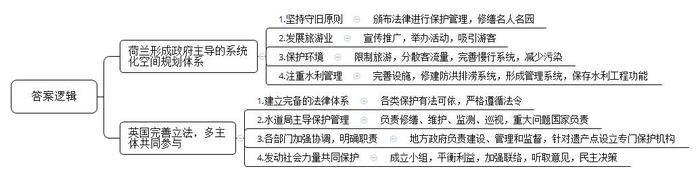
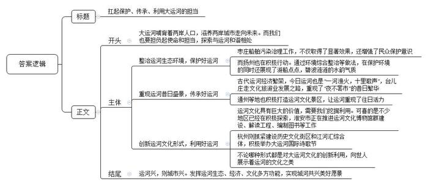
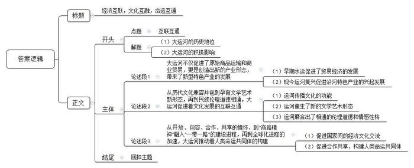

# 2019年浙江省公考《申论》题（B卷）

<!-- gwy:overview:start -->
> **浙江 · 2019 · 申论 · B类** ｜ 3 题 · 图片 3 处 · 答案随题折叠

导航：[题目](#题目) · [材料 1](#材料-1)
<!-- gwy:overview:end -->

> 候选采集稿。参考答案及解析来自粉笔页面，不代表官方答案或真实高分答卷；来源使用许可与原卷对应关系仍需人工核实。

## 给定材料

### 材料 1

荷兰的阿姆斯特丹运河带被列为世界遗产，联合国教科文组织给出这样的评价：“阿姆斯特丹运河带是16世纪末到17世纪初规划一座新‘港口城市’的产物，体现了历史与城市的完美结合。”

早在16、17世纪，荷兰就形成了以政府主导的系统化空间规划体系——各级市政当局都要对所辖区域进行空间规划，规划一般由相应层级的政府部门制定，交付议会审议通过，具有法律效力。阿姆斯特丹运河的建造和管理，也得益于该市政府的统筹规划，体现了当局在城市建设与发展方面的智慧。

如今，阿姆斯特丹政府在遗产保护方面始终坚持守旧原则，努力将运河遗产完整地保留下来，也不轻易对城市布局进行调整。政府一方面颁布相关法令对运河遗产进行保护、加强管理，另一方面对运河沿岸的名人名园进行修缮以吸引游客，比如修复了运河上的古老木屋、安妮之家等。为了宣传推广运河带，政府创办了许多大型活动来吸引国内外游客，比如每年8月举行的王子运河水上音乐会是荷兰最大的音乐节，而阿姆斯特丹水上灯光节则是著名的欧洲五大灯光节之一。

面对过度旅游问题，阿姆斯特丹政府也采取了一系列措施，如限制新酒店的建造，将邮轮停泊港口移出城市中心，大力推广阿姆斯特丹东片及周边城市的旅游路线以分散客流量，等等。为减少环境污染，政府还加宽了人行道路，划定了新的自行车专用道，不断完善城市慢行系统。

荷兰不但强调修建围堤、海堤、水坝等防洪排涝系统，而且十分注重水利管理，在全国建立了水量调度和水情预报中心，形成覆盖全国、相当完善的水利工程管理系统，以最大程度地保存和实现阿姆斯特丹运河的水利工程功能。

庞蒂斯沃特水道桥及运河于2009年被列入世界遗产名录，是英国境内唯一跨越威尔士和英格兰的遗产。随着英国工业化的完成，庞蒂斯沃特水道桥及运河作为货运通道的历史使命渐已结束，如今，这一遗产已成为英国境内重要的水上旅游通道，并在运河沿岸居民的日常生活中扮演重要角色。

庞蒂斯沃特水道桥及运河保护涉及的法律法规相当完善，从一座桥到一片绿地，从一条小道到一片生态聚集区，各类保护都有法可依。如果涉及到各类遗产，则必须遵循相应的遗产管理法令。作为庞蒂斯沃特水道桥及运河的河道本体与桥梁（部分路桥除外）的所有者，英国水道局起保护管理的主导作用，它负责运河的修缮、桥及闸的维护、水质的监测，与公共、私人以及志愿者组织共同工作，以可持续发展的方式为民众谋福利。英国水道局每年从复活节到10月份都会在庞蒂斯沃特水道桥及兰格伦停泊处巡视，而对一些关键工程则每天巡视。一般情况下，日常的维护由地方工作人员负责实施，但当水工设施出现重大问题时，则需要国家层面的维修计划和投入。

运河沿线地方政府拥有运河上的一些历史桥梁以及遗产边界内的部分基础设施和缓冲区内的部分土地，负责建设和管理世界遗产点及缓冲区内的公共停车场和公厕等基础设施，管理登录建筑和保护范围内的土地利用规划，同时有权对英国水道局以及其他土地所有者影响遗产安全的行为进行监管。相关保护机构则负责遗产区域内各类遗产点相应的保护管理工作，例如威尔士历史古迹委员会负责缓冲区内两个国家级遗产点的管理，负责维护恰克铁路高架桥等。

由各利益相关者组成的指导小组作为运河遗产协作管理的主体，定期开会来协同完成管理规划的实施。他们坚持以可持续发展的方式管理遗产点及缓冲区，平衡遗产的保护、经济的发展以及地方政府和社区的利益需求。此外，指导小组通过非政府组织“庞蒂斯沃特之友”来加强与运河沿线各地社区的联络，保护范围及缓冲区内涉及的5000多个家庭经常会收到咨询邮件，并通过有效的意见反馈途径及程序切实参与到运河遗产相关事务的决策及管理中来。譬如在庞蒂斯沃特水道桥及运河申遗过程中，申遗文本以及管理规划进行了长达12周的公示，以征求当地居民、企业、组织、游客等对这一遗产保护和管理的意见。

### 材料 2

运河兴，则城市兴。大运河流域居住着中国近八分之一的人口，大运河一直在滋养着两岸城市走向未来，而两岸的城市也在不断思考和探索着如何与身边的大运河和谐相处。

近年来，扬州对大运河环境的综合整治陆续展开，搬迁棚户、疏浚河道、整修堤岸，大运河逐渐重现当年的清水碧波。由于运输功能转到了城外的新河道，大运河上已无当年舟楫纵横的繁忙景象，但游船点点，碧波涟涟，“运河之城”的水韵气质依然令人流连。扬州市还启动了以运河保护为重点的“江淮生态大走廊”建设，在沿河的邵伯湖等湖泊实施退渔还湖、退养还湖工程，总计还湖面积达到15万亩。

在山东枣庄，大运河船舶污染治理正在大力推进，船舶按照要求加装污油、污水收集设备，运河沿线码头配套建设污油、污水回收处理装置，海事部门加大对来往船只的监督检查，船民的环保意识也不断增强。对此，船户小苑说：“我们这两套收集设备的改造，得到了1万多元政府补贴。政府这么大力度抓环保，再向大运河里乱排乱倒可真是太不像话了。”

地处鲁南的台儿庄古城，利用保存完好的古河道、古码头等水工遗存以及水街水巷历史肌理，重建北方水城，走文化旅游业发展之路。如今，“一河渔火，十里歌声，夜不罢市”的昔日繁华已在这座曾经的大运河水旱大码头上重现端倪。古城周围民宿已发展到1.5万个床位，2018年迎来游客600万人次。

“无恙蒲帆新雨后，一枝塔影认通州。”高高矗立的燃灯佛舍利塔，曾见证北京通州当年舟楫往来的繁盛景象，如今与毗邻的3座庙宇一起正被打造为运河文化景区；同时，京杭大运河通州至天津段也将很快再次通航，北运河水上观光旅游有望成为一道崭新的风景。

自古就有“居天下之中，扼漕运之冲”美誉的江苏省淮安市，近年来大力推进中国漕运博物馆、清江浦记忆馆、皇家敕建名人馆等运河文化博物馆群建设。通过制作清口水利枢纽、洪泽湖大堤3D动漫，实施惠济祠沙盘复原等系列解读工程，为广大市民和中外游客了解运河历史、感受运河文化搭建平台。此外，该市还积极挖掘整理大运河史料，组织编写了《里运河名胜》《淮安运河故事》《运河文化研究论文集》等系列丛书。

在浙江杭州，大运河拱宸桥畔的桥西历史文化街区已成为中外游客的必游之地，产城融合的沿大运河景观带年接待规模达1200万人次，大运河已成为继西湖、西溪之后杭州又一张闪亮的旅游金名片。城南的大运河与钱塘江交汇处，江河汇流区应运而生，一座近百万平方米的江河汇综合体正在崛起，大运河和钱塘江正“手挽手”助力杭州“拥江发展”。

出于对大运河文化的热爱，杭州诗人小舒于2012年9月发起了首届大运河国际诗歌节，倡导通过诗歌去保护、宣传和传承大运河文化。诗歌节至今已连续举办了6届，吸引了30多个国家和地区的200多位诗人以不同的形式参与其中，汇成了一股保护传承大运河文化基因的民间力量。小舒说：“大运河一定是一条审美的河，举办诗歌节，就是希望为她提供更多的文化符号，让她真正成为诗的河流。”

### 材料 3

2014年6月22日，在卡塔尔多哈举行的第38届世界遗产大会宣布，中国大运河入选世界文化遗产名录，成为我国第46个世界遗产项目。作为一个大跨度整体联线型文化遗产项目，中国大运河是指我国自春秋时期开凿邗沟以来，先后在隋唐宋时期以洛阳为中心的南北大运河、元明清时期以北京为中心的京杭大运河及其延伸段浙东运河的总称，是世界上开凿时间最早、规模最大、线路最长、延续时间最久的人工运河。

中国大运河北至北京、南抵杭州、东达宁波、西到洛阳，流经6个省、2个直辖市共35座城市，主线总长3200千米，流经市域面积31万多平方千米。大运河与海河、黄河、淮河、长江、钱塘江等五大水系相交汇，串联起中国历史上的七大古都，连接了陆上与海上的丝绸之路。《中国大运河申遗文本》这样评价大运河的价值：“它实现了在广大国土范围内南北资源和物产的大跨度调配，沟通了国家的政治中心与经济中心，促进了不同地域间的经济、文化交流，在国家统一、政权稳定、经济繁荣、文化交流和科技发展等方面发挥了不可替代的作用。”

大运河改变了中国的地理环境，形成了一个南北东西全方位的大水网。大运河的原始功能是运输，而货的运输与人的流动，直接带动了运河沿岸经济的发展、文化的繁荣和城市的崛起。如唐代繁华的都城长安，是运河西部的终极，南北均归于此；运河重镇济宁，是全国南北物资交流的集散地；江北扬州，城池之大、货物之多、生活之繁华、交通之发达，当时堪称天下第一；名城苏州，处于江南运河的中心位置，航运繁忙；大运河的起运点杭州，是当时全国最富庶的郡县之一。

### 材料 4

随着申遗的成功，中国大运河迎来了新的发展契机。2017年2月，习近平总书记在北京通州视察时强调，要深入挖掘以大运河为核心的历史文化资源，保护大运河是沿线所有地区的共同责任；同年5月，习近平总书记又进一步作出了“大运河是祖先留给我们的宝贵遗产，是流动的文化，要统筹保护好、传承好、利用好”的重要指示。

2019年4月，浙江省委书记车俊在调研我省大运河文化保护传承利用工作时强调，要认真贯彻落实习近平总书记重要指示精神，坚决扛起浙江担当，精心保护大运河遗产，有效传承大运河文化，合理利用大运河资源，把大运河浙江段建设成千年古韵、江南丝路、通江达海、运济天下的水乡文化精典呈现区、运河文化精品展示带和水生态文化精彩示范段，努力在全国大运河文化带建设中走在前列。

### 材料 5

在历史脉络中，“运河”名称的由来与变化，是不同历史节点所勾连的历史进程的反映。从典籍记载来看，早期运河多称沟或渠，如邗沟、灵渠等，天然河道则称水，如黄河就被称为“河水”。尽管运河历史悠久，滥觞于灵渠、邗沟，甚或更早，但运河名称的产生以及“专称”的确定却是中古以后的事情。汉代“漕渠”名称出现，特指汉武帝时在关中开凿的西起长安、东通黄河的水利工程。《说文》曰：“漕，水转谷也。”即通过水路转运粮食。至隋唐时期，具有漕运功能的人工河多被称为漕渠，又因该时期“河”字已不再是黄河的专称，所以“漕河”一词也出现了，用来指称漕运河流。如唐杜佑《通典》记：“天宝二年，左常侍兼陕州刺史韦坚开漕河，自苑西引渭水，因古渠至华阴入渭，引永丰仓及三门仓米以给京师，名曰‘广运潭’。”宋代“漕河”名称广泛使用，但同时“运河”一词开始出现，《四库全书》所列宋代文献中有94种使用了“运河”的名称。“大运河”的概念也首次在南宋江南运河段出现，据南宋《淳祐临安志》载：“下塘河，南自天宗水门接盐桥运河，余杭水门，二水合于北郭税务司前，……一由东北上塘过东仓新桥入大运河，至长安闸入秀州，曰运河”。这里所说的大运河指的是江南运河。可见，这一时期，运河已然成为一个特有名词，指称某段人工河，但前须加地名指代。值得注意的是，从文献所记录的名称分布来看，“运河”一词多出现在江淮和江南区域，包括龟山运河、扬楚运河、浙西运河等商业运输、贸易繁荣的河段。

元明清时期“运河”开始指称南北贯通的京杭大运河。元代已有“运河二千余里，漕公私物货，为利甚大”的说法，但使用并不广泛，相反“运粮河”一词在北方区域多用来指称漕运河流。明代正史文献虽亦称运河，但一些专书、地方志仍多用漕河之名。《明史•河渠志》《清史稿•河渠志》中，都列“运河”专篇，指北至北京、南至杭州的运河，但两者又有不同。前者列运河篇，但称“漕河”，且将运河每一段河道都加上漕字，使之有“白漕、卫漕、闸漕、河漕、湖漕、江漕、浙漕之别”；后者则直接称运河：“运河自京师历直沽、山东，下达扬子江口，南北二千余里，又自京口抵杭州，首尾八百余里，通谓之运河。”雍正四年官方正式设置北运河的管理机构后，多使用通惠河、北运河、南运河和江南运河等说法。近世以来，民间则往往将其称为“京杭运河”或“大运河”。2014年运河申遗过程中，又将隋唐、浙东两段运河与京杭运河合称为“中国大运河”。

### 材料 6

《中国运河文化史》一书中写道：“中华民族的文化是多元一体的文化，随着运河的南北大贯通和迅速开发，运河区域的社会经济达到了前所未有的兴盛与繁荣，这不仅为运河区域文化的发展提供了雄厚的物质基础，而且也促进了南北文化、东西文化的交流和中外文化的大交流，使各种地域文化和外来文化相互接触、融会、整合，形成独具特色的运河文化。”从这个意义上说，大运河最本质的功能是沟通，大运河文化最根本的特征是交流，是在沟通和交流中形成的包容开放的精神底蕴。

对中国来说，大运河是活态的文化遗产，它不仅是一条人工开凿的运河，更是文化线路和中国民族大融合的见证。从隋唐到元明清到近现代，“大一统”一直是中国政治经济格局的主流，这多少有赖于大运河的文化融合作用。大运河在实现物资交换和人员交流的同时，大大削去了地域文化的不平衡，弱化了大疆域、多民族的文化冲突。以大运河为轴，就南北向而言，燕赵文化、齐鲁文化、吴楚文化、越文化得以兼容并包；就东西向而言，巴蜀文化、湖湘文化、中原文化、三秦文化及三晋文化等得以互相融合。

大运河很大程度上消弭了区域地理环境和经济发展水平等的不同造成的文化差异，通过文学艺术的传播增进了交流。典型的例子就是“国粹”京剧的形成。乾隆年间，四大徽班进京，嘉庆、道光年间又同来自湖北的汉调艺人合作，逐渐接受昆曲、秦腔的部分剧目、曲调和表演方法，并吸收了一些民间曲调、北京土语，逐渐发展形成这一独特剧种。后来京剧的传播又远远超出了北京一城一地，在大运河沿线都有着广泛而深入的影响。

大运河两岸人们的生活习俗、行为规范、思维方式、价值观念也在交流和碰撞中相互影响，潜移默化地相互改变。康熙时期组织编纂《全唐诗》，沿运河两岸搜集资料，编好后走运河到杭州印刷，印好后再运回北京；沧州人纪晓岚前往福建汀州任主考官，他就把河北的风土人情、奇闻异事讲给闽人听。正是在这样的南北融合、东西交汇的过程中，大运河沿线乃至更广大范围内的全体中国人磨合出了相通的伦理道德和情感性格等。

### 材料 7

浙江是大运河世界文化遗产的重点区域。大运河浙江段的河道长度、遗产点段数量、遗产区面积等都在“中国大运河”世界文化遗产中占有较大的比重，共有11个河段280多千米河道，13处遗产点和18个遗产要素列入世界遗产名录。同时，大运河沿线的杭州运河元宵灯会、宁波妈祖信仰、湖州含山轧蚕花、嘉兴三塔踏白船、绍兴背纤号子，以及湖笔制作、黄酒酿造等传统技艺也得到了持续性传承，非物质文化遗产源远流长。

大运河浙江段流经杭州、嘉兴、湖州、绍兴、宁波5市的20多个区县，沿线与运河的建设、交通、商业、生产活动密切相关且历史风貌和传统格局保存完好的运河城镇有22个，运河村落有3处。这些城镇、村落不仅保存了与运河密切相关的城乡历史文化聚落，如城墙、城门、历史街区、建筑群落等，而且保护传承了珍贵的运河文化，其中多个已纳入历史文化名城名镇名村保护范围，以保证其真实性、完整性的延续。

浙江省早在2008年就启动了大运河浙江段的遗产资源调查和保护规划编制工作，为运河文化带建设打下了基础。为了加强大运河世界文化遗产保护，出台了全国首部运河保护条例《杭州市大运河世界文化遗产保护条例》，为运河文化带建设提供制度保障。成立中国大运河文化带建设浙江城市协作体，探索建立沿线城市共建共享大运河文化的体制机制。自2016年起，每年在杭州举办中国大运河国际论坛，推动中国大运河文化遗产可持续发展。

在运河环境风貌的保护和整治方面，浙江严格管控大运河沿线各市、县的城镇建设项目，积极开展运河沿线城镇、乡村航道两侧的环境综合整治工作，努力展现运河两岸原有的历史环境风貌。结合“五水共治”工程的推进，运河沿线地方政府认真落实保护管理责任，采取了截污纳管、工业污染整治、农村农业污染防治、河道综合整治等措施，运河水质全面改善，生态建设成效显著。

2017年，杭州市第十二次党代会提出，要打响东方文化特色品牌，坚持保护第一、应保尽保，实施城市记忆工程，同时要发挥运河、西湖“双世遗”综合带动效应，沿河沿湖高端商务带要以金融服务、高端商务、商贸旅游、文化创意、现代物流等产业为特色，建成高端服务业集聚发展带。

### 材料 8

大运河不仅是中国的，也是世界的。古往今来，运河始终承载着互联互通、拉近时空、共享资源的美好期待，人员、商品、文化、信息的流动拆除了地域的藩篱，拉近了人心的距离，为不同文化、不同语言的平等交流与合作奠定了基础。时至今日，尽管运河的经济功能不如往日突出，但是大运河长期积累的文化价值仍然具有丰富的现代意义，大运河文化中蕴含的包容情怀和互联互通精神仍然是国际社会共同的追求。

2017年12月，以“中国大运河文化带构建”为主题的第二届中国大运河国际论坛在浙江杭州举行。与会专家表示，古代陆上丝绸之路是一条连接欧亚大陆的商贸通道，海上丝绸之路是中国与东非、欧洲等地交流往来的海上大通道，而中国大运河则是将这两条通道连接在一起的黄金水道。大运河与两条丝绸之路最为重要的联结，不仅在于地理意义上的南北通达，更在于二者皆具备的，以互联互通、合作共享为内核的“商路精神”。正是这种“商路精神”，增进了各国各民族在经济、政治、文化、情感上的交流，推动了区域协作共享、国际合作共赢和文化多元包容、文明共同发展。

“从世界贸易共同体到人类命运共同体，其实这里面都是相通的。世界贸易共同体首先是商贸的交流，而商贸的交流必然引发人员的交往，人员的交往则带动文化的交汇，文化的交汇进一步促进感情的交流，感情的交流达成了命运的交融，最终形成了人类命运共同体。”专家进一步解释道，“浙江的宁波、舟山都是非常重要的海上丝绸之路起始点，通过京杭大运河、浙东运河的联结，把整个丝绸之路经济带与大运河文化带串联起来，从而为‘一带一路’倡议提供更为深厚的经济与人文基础。”

## 题目

### 第 1 题

**根据资料**7**，梳理归纳国外运河遗产保护利用的主要经验。（****20分）**

关联材料：材料 1

作答要求：

要求：

（1）全面、准确，有条理；

（2）字数不超过300字。

第 1 题 · 答案与解析

**参考答案（粉笔题库参考内容）**

一、荷兰形成政府主导的系统化空间规划体系。1.坚持守旧原则。颁布法律进行保护管理，修缮名人名园。2.发展旅游业。宣传推广，举办活动，吸引游客。3.保护环境。限制旅游，分散客流量，完善慢行系统，减少污染。4.注重水利管理。完善设施，修建防洪排涝系统，形成管理系统，保存水利工程功能。

二、英国完善立法，多主体共同参与。1.建立完备的法律体系，各类保护有法可依，严格遵循法令。2.水道局主导保护管理。负责修缮、维护、监测、巡视，重大问题国家负责。3.各部门加强协调，明确职责。地方政府负责建设、管理和监督，针对遗产点设立专门保护机构。4.发动社会力量共同保护。成立小组，平衡利益，加强联络，听取意见，民主决策。

**参考答案说明：**（1）本参考答案写到了荷兰和英国两个国家的经验。（2）荷兰主要从“坚持守旧原则”“发展旅游业”“保护环境”“注重水利管理”这四个方面进行了分条撰写；英国主要从“建立完备的法律体系”“水道局主导保护管理”“各部门加强协调”“发动社会力量共同保护”这四个方面进行了分条撰写。各条答案要点之间在内容上相互并列，没有交叉。

**解析状态：unknown（来源未提供）**

### 第 2 题

**资料**6**是某晚报拟刊登的一篇新闻报道。围绕这篇报道，以****“城市与运河和谐相处”为主题写一则短评，与该报道一同在晚报刊发。（30分）**

关联材料：材料 2

作答要求：

要求：

（1）题目自拟，观点鲜明；

（2）论述深刻，结构完整；

（3）字数不超过500字。

第 2 题 · 答案与解析

**参考答案（粉笔题库参考内容）**

扛起保护、传承、利用大运河的担当

大运河哺育着两岸人口，滋养两岸城市走向未来。而我们也要担负起使命和担当，探索与运河和谐相处。

整治运河生态环境，保护好运河。枣庄船舶污染治理工作，不仅取得了显著效果，还增强了民众保护意识。而扬州也在积极行动。通过环境综合整治等做法，在保护环境的同时还展现了游船点点，碧波涟涟的水韵气质。

重现运河昔日盛景，传承好运河。古代运河经济繁荣，今日运河也是“一河渔火，十里歌声”，台儿庄走文化旅游业发展之路，重现了“夜不罢市”的昔日繁华。通州等地也积极打造运河文化景区，让运河重现了往日活力。

创新运河文化形式，利用好运河。运河文化具有巨大的价值，需要我们挖掘利用。可喜的是不少地区已经在积极探索，淮安市正在推进运河文化博物馆群建设、解读工程、编制图书等工作；杭州则抓紧建设历史文化街区和江河汇综合体，积极举办大运河国际诗歌节。不论哪种形式都是对大运河文化的创新利用，向世人展示着运河的文化之美。

运河兴，则城市兴。发挥运河生态、经济、文化多方功能，实现城河共兴美好愿景。

**参考答案说明**：（1）格式方面，本参考答案写到了“标题”“正文”两个部分。（2）正文部分，一方面从内容来看，围绕着“城市与运河和谐相处”这一主题，本参考答案的开头先针对“城市与运河和谐相处”阐明了观点；接着主体部分从“整治运河生态环境，保护好运河”“重现运河昔日盛景，传承好运河”“创新运河文化形式，利用好运河”三个方面介绍了各个地区积极探索城市与运河和谐相处的做法和效果；最后结尾部分进行了总结。另一方面，形式上，本参考答案做到了分段撰写，整体上条理较为清晰。

**解析状态：unknown（来源未提供）**

### 第 3 题

**习近平总书记指出，自古以来，互联互通就是人类社会的追求。结合给定资料，以****“互联互通”为话题，联系实际，自选角度，自拟题目，写一篇议论性文章。（50分）**

关联材料：材料 3、材料 4、材料 5、材料 6、材料 7、材料 2、材料 1、材料 8

作答要求：

要求：

（1）主旨明确，结构完整，思路清晰；

（2）内容充实，论述深刻，语言流畅；

（3）不拘泥于给定资料；

（4）字数1000～1200字。

第 3 题 · 答案与解析

**参考答案（粉笔题库参考内容）**

**经济互联，文化互融，命运互通**

习总书记说过：“自古以来，互联互通就是人类社会的追求。”翻看大运河发展的历史篇章，它始终承载着互联互通，拉近时空，共享资源的美好期待。**大运河带动了运河沿岸贸易往来的互通，促进经济繁荣发展，也在其功能的发展变化中，拉近了人心的距离，为不同文化，不同语言的平等交流奠定了基础，促进了文化的互融。**

**大运河不仅促进了原始商品运输和商业贸易，更是创造出新的产业形态，带来了新型特色产业的发展。**在早期，水运相对于其他运输方式而言，有着低成本、大批量、远距离的优点，因此，在商品货物和人员流通中有着明显的优势，大批物资经运河流向各地，促进运河两岸商业贸易的推进，刺激了沿岸的经济发展。现如今，水运复兴，依托运河两岸多元化的自然风光和人文风貌，运河水上观光旅游已然成为一道崭新的风景。打造出了一批文化休闲体验旅游产业，伴随而来的是沿河特色产业的兴起发展，高端服务业聚集发展带不断延伸，运河区域的经济达到前所未有的兴盛与繁荣。

运河带来经济发展的同时，也为区域文化的发展提供了雄厚的物质基础，更是进一步促进了各种地域文化的相融，形成了独特的运河文化。

**从历代文化兼容并包到孕育文学艺术新形态，再到民族伦理道德相通，大运河促进着文化发展的互联互通。**齐鲁文化、燕赵文化、中原文化……东西南北的文化，在大运河的流波中削去了地域文化的不平衡，弱化了疆域，为中国“大一统”的政治经济格局奠定了文化基础。与此同时，大运河通过文学艺术的传播，增进不同差异文化的交流沟通，促进了新的文学艺术形态的诞生。运河文化带南北方戏曲代表——京剧、越剧，都正是吸纳了不同地域特色的剧种元素而缔造的“混血”产物。甚至在文化融合的过程中，人们的生活习俗、价值观念等也在交流和碰撞中相互影响、相互改变，使得中国人磨合出了相通的伦理道德和情感性格。

**从开放、包容、合作、共享的情怀，到“商路精神”融入“一带一路”的建设进程，再到全球化进程的加速，大运河推动着人类命运共同体的构建。**大运河不仅是中国的，也是世界的，其长期积累的文化价值具有丰富的现代意义。依托“一带一路”、长江经济带等国家发展战略，大运河这条古代“高铁”让文化经济交流愈发广泛、频繁。以“商路精神”为根基，我们认识到，文化没有优劣之分，只有地域之别，能让文化超越冲突。正如当前引发人们关注的“贸易战”，便是违背发展潮流的愚昧行为。唯有秉持合作、共享的精神，在交流互鉴、取长补短中找到契合点，共享红利，才能真正形成人类命运共同体。

大运河既记录着前人冲破地域阻碍、携手共进的史诗，又承载着今人同心协力、共同发展的愿景。我们要依托运河，发扬运河精神，在互联互通中谋求发展，真正实现经济互联，文化互融，命运互通！

**文章分析**

**经济互联，文化互融，命运互通**

【**标题的优点：**首先，范文的标题“经济互联，文化互融，命运互通”突出了“互联互通”这一主题。其次，形式上，文字简洁明快。】

习总书记说过：“自古以来，互联互通就是人类社会的追求。”（1）翻看大运河发展的历史篇章，它始终承载着互联互通，拉近时空，共享资源的美好期待。（2）**大运河带动了运河沿岸贸易往来的互通，促进经济繁荣发展****，也****在其功能的发展变化中****，****拉近了人心的距离****，****为不同文化****，不****同语言的平等交流奠定了基础****，****促进了文化的互融****。**

【**开头的优点：**★内容方面：范文的开头是紧扣题目给定的“互联互通”这一主题展开的。首先，开头第一句话点出主题，做到了主题明确。其次，对“互联互通”这一主题进行了分析阐述：（1）先指出了“大运河的历史地位”；（2）接着指出了“大运河的积极影响”。★文字表达方面：长短句配合使用，使语言表达有节奏感。】

**大运河不仅促进了原始商品运输和商业贸易，更是创造出新的产业形态，带来了新型特色产业的发展。**（1）在早期，水运相对于其他运输方式而言，有着低成本、大批量、远距离的优点，因此，在商品货物和人员流通中有着明显的优势，大批物资经运河流向各地，促进运河两岸商业贸易的推进，刺激了沿岸的经济发展。（2）现如今，水运复兴，依托运河两岸多元化的自然风光和人文风貌，运河水上观光旅游已然成为一道崭新的风景。打造出了一批文化休闲体验旅游产业，伴随而来的是沿河特色产业的兴起发展，高端服务业聚集发展带不断延申，运河区域的经济达到前所未有的兴盛与繁荣。

【**论述段****1的优点：**★观点句：范文的观点句是紧扣“互联互通”这一文章主题提出的。形式上，它在段首处直接写出，位置突出，容易发现。内容上，要点明确，可以明显看出它是从“促进经贸发展”入手，指出了“大运河的积极影响”。★论述内容：（1）介绍了“早期水运促进了贸易经济的发展”；（2）介绍了“现今运河复兴促进沿河特色产业的兴起发展”。注意：以上两个方面的内容都是紧扣“大运河不仅促进了原始商品运输和商业贸易，更是创造出新的产业形态，带来了新型特色产业的发展”这个观点句进行分析论述的，论述的针对性强，内容层次丰富。最后，在论述方法主要采取了讲道理的方式，做到了论述深刻。】

运河带来经济发展的同时，也为区域文化的发展提供了雄厚的物质基础，更是进一步促进了各种地域文化的相融，形成了独特的运河文化。

【**过****渡****段的优点：**范文过渡段分析了“运河”的积极影响，注意过渡段末尾的“更是进一步促进了各种地域文化的相融，形成了独特的运河文化”是用来引起下文的过渡句。】

**从历代文化兼容并包到孕育文学艺术新形态，再到民族伦理道德相通，大运河促进着文化发展的互联互通。**（1）齐鲁文化、燕赵文化、中原文化……东西南北的文化，在大运河的流波中削去了地域文化的不平衡，弱化了疆域，为中国“大一统”的政治经济格局奠定了文化基础。与此同时，（2）大运河通过文学艺术的传播，增进不同差异文化的交流沟通，促进了新的文学艺术形态的诞生。运河文化带南北方戏曲代表——京剧、越剧，都正是吸纳了不同地域特色的剧种元素而缔造的“混血”产物。（3）甚至在文化融合的过程中，人们的生活习俗、价值观念等也在交流和碰撞中相互影响、相互改变，使得中国人磨合出了相通的伦理道德和情感性格。

【**论述段****2的优点：**★观点句：范文的观点句是紧扣“互联互通”这一文章主题提出的。形式上，它在段首处直接写出，位置突出，容易发现。内容上，要点明确，可以明显看出它是从“促进文化发展”入手，指出了“大运河的积极影响”。★论述内容：（1）介绍了“运河传播文化的功能”；（2）介绍了“运河催生了新的文学艺术形态”；（3）介绍了“运河磨合出了相通的伦理道德和情感性格”。注意：以上三个方面的内容都是紧扣“从历代文化兼容并包到孕育文学艺术新形态，再到民族伦理道德相通，大运河促进着文化发展的互联互通”这个观点句进行分析论述的，论述的针对性强，内容层次丰富。最后，在论述方法和论据的选取上做到了讲道理、举例子相结合，论述充实。】

**从开放、包容、合作、共享的情怀，到****“商路精神”融入“一带一路”的建设进程，再到全球化进程的加速，大运河推动着人类命运共同体的构建。**（1）大运河不仅是中国的，也是世界的，其长期积累的文化价值具有丰富的现代意义。依托“一带一路”、长江经济带等国家发展战略，大运河这条古代“高铁”让文化经济交流愈发广泛、频繁。（2）以“商路精神”为根基，我们认识到，文化没有优劣之分，只有地域之别，能让文化超越冲突。正如当前引发人们关注的“贸易战”，便是违背发展潮流的愚昧行为。唯有秉持合作、共享的精神，在交流互鉴、取长补短中找到契合点，共享红利，才能真正形成人类命运共同体。

【**论述段****3的优点：**★观点句：范文的观点句是紧扣“互联互通”这一文章主题提出的。形式上，它在段首处直接写出，位置突出，容易发现。内容上，要点明确，可以明显看出它是从“形成人类命运共同体”入手，指出了“大运河的积极影响”。★论述内容：（1）介绍了“促进国家间的经济文化交流”；（2）介绍了“促进合作共享，构建人类命运共同体”。注意：以上两个方面的内容都是紧扣“从开放、包容、合作、共享的情怀，到‘商路精神’融入‘一带一路’的建设进程，再到全球化进程的加速，大运河推动着人类命运共同体的构建”这个观点句进行分析论述的，论述的针对性强，内容层次丰富。最后，在论述方法和论据的选取上做到了讲道理、举例子相结合，论述充实。】

【**论述段之间的关系**：★内容的内在逻辑：范文的论述段之间是依照“递进”的逻辑展开的。论述段1先写了“大运河对经贸发展的影响”，论述段2再写了“大运河对文化发展的影响”，论述段3接着写了“大运河对人类命运共同体的影响”，论述逐步深入。★段与段的外在衔接：论述段1之后的过渡段“运河带来经济发展的同时，也为区域文化的发展提供了雄厚的物质基础，更是进一步促进了各种地域文化的相融，形成了独特的运河文化”起到了承接论述段1、引出论述段2的作用。】

大运河既记录着前人冲破地域阻碍、携手共进的史诗，又承载着今人同心协力、共同发展的愿景。我们要依托运河，发扬运河精神，在互联互通中谋求发展，真正实现经济互联，文化互融，命运互通！

【**结尾的优点：**范文的结尾回扣了“互联互通”这一主题，并发出了号召希望。】

**解析状态：unknown（来源未提供）**

