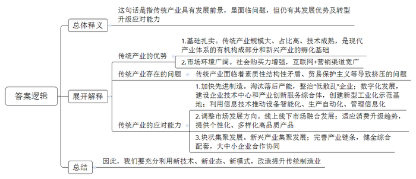
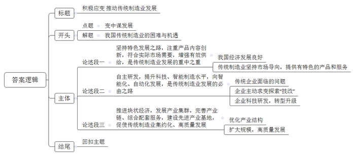

# 2020年浙江省公考《申论》题（A卷）

> 候选采集稿。参考答案及解析来自粉笔页面，不代表官方答案或真实高分答卷；来源使用许可与原卷对应关系仍需人工核实。

## 给定材料

### 材料 1

传统制造业是浙江实体经济的主体，是经济发展之基、富民之源，深刻地影响着浙江“两个高水平”建设。无论是改革开放初期的工业化发展阶段、本世纪初加入世贸组织后的出口高增长阶段，还是国际金融危机以来浙江率先进入经济发展新常态的转型升级阶段，传统制造业都扮演了重要角色。规模大、占比高、技术成熟的传统制造业不仅是现代产业体系的有机构成部分，还是新兴产业的孵化基础。

当前，浙江传统制造业正处于转型升级关键期和阵痛期，面临着一些亟需解决的困难和问题，素质性、结构性矛盾十分突出。根据2016年度统计数据测算，全省10个重点传统制造业用47%的工业用地、73%的能耗、85%的排放、43%的用工，贡献了43%的工业增加值和40%的税收，投入产出效益总体偏低，在亩均税收、亩均增加值、研发经费支出与主营业务收入之比等关键指标上，总体低于全省制造业平均水平。以纺织行业为例，浙江纺织行业规模上企业数量庞大，但国家级企业技术中心仅有3家，主营业务收入利润率低于全省平均水平1.14个百分点。

### 材料 2

纵观世界近现代史，制造业的持续发展和转型升级，是主要发达国家现代化的共同经验。18世纪中后期，第一次工业革命开启于英国，以大规模工厂化生产取代个体工场手工生产为标志的现代制造业快速崛起，推动英国率先完成工业化。19世纪末，德国、美国抓住第二次工业革命的历史机遇，在电力、机械等领域形成领先优势，实现了现代化。第二次世界大战后，日本在钢铁、电子、汽车等产业快速发展的支撑下，跻身发达国家行列。在这些国家的现代化进程中，不断完善升级的制造业体系发挥了至关重要的作用。反观一些曾经也在工业化上取得不俗成绩的发展中国家，由于放松对制造业发展的坚持，特别是忽视推动制造业转型升级，陷入了经济增长缓慢、收入提升停滞的“中等收入陷阱”。

当前，全球经济在开放与保护的较量中艰难前行，贸易保护主义为世界经济蒙上阴云，以世贸组织为核心的多边贸易体制面临前所未有的挑战，传统制造业承受着更大的挤压风险。2017年，浙江在全国率先启动传统制造业改造提升工作，并将其列入“富民强省十大行动计划”，聚焦聚力高质量、竞争力、现代化，充分利用新技术、新业态、新模式，改造提升传统制造业，不断提高传统制造业高新化、智能化、绿色化水平。2018年，《浙江省加快传统制造业改造提升行动计划（2018-2022年）》出台，该计划围绕消费品、原材料、机械装备及零部件制造三大领域，在2017年确定的纺织、服装、皮革、化工、化纤、造纸、橡胶塑料、非金属制品、有色金属加工、农副食品加工等第一批10个重点行业基础上，增加汽车零部件、低压电气、金属制品、泵阀轴承、家具及竹木制品、家用电器、文体用品等第二批7个重点行业，基本实现主要传统制造业门类“全覆盖”。

经过2017年至2019年两年多的努力，浙江传统制造业改造提升取得了显著成效。全省累计淘汰落后产能企业5760家，整治提升“低散乱”企业10.1万家；累计盘活存量建设用地44.32万亩，腾出用能空间506万吨标煤。有效利用盘活空间，加快先进制造和新兴产业集聚发展，建成小微企业园726个，入驻小微企业3.73万家。截至2019年，全省上云企业达到32.5万家；建设121个“无人车间”“无人工厂”，130个骨干数字企业，127个数字化重大项目，100个数字化园区。传统制造业领域建成省级以上企业技术中心809家，建成产业创新服务综合体51个。全省拥有年产值超千亿元集群12个，超百亿元集群80多个，累计创建国家新型工业化产业示范基地21家，居全国前列。

两年多励精图治，浙江传统制造业增加值增速从不到5％回升到6％左右，增加值率从18.2％提高到20.8％，劳动生产率年均提高8.1％，亩均增加值从80多万元提高到近100万元，传统制造业中高新技术产业增加值占比提高到50％以上，有力支撑了工业经济在高基数上的高质量发展。传统制造业改造提升的浙江实践表明，传统产业并不是落后产业，也不是夕阳产业，只有落后的产品，没有落后的产业。

### 材料 3

改革开放以来，浙江各地从培养“一村一品、一地一业”起步，再到推进块状集聚、特色发展，传统制造业经历了较长时期的大发展大繁荣，影响力竞争力不断提升。浙江块状经济发达，全省年销售收入20亿元以上的产业集群有130多个，为全省工业贡献了50%的产值、利润和就业。许多产业的产业链条基本完整，综合配套相对健全，大中小企业合作协同，形成了良好的产业发展生态。同时，浙江拥有大量的专业市场，义乌市场、柯桥轻纺市场、海宁皮革市场闻名遐迩，还拥有全球最大的网上市场，实体市场与网络市场共同发展，线上线下市场相互促进。

新一轮科技革命和产业变革正在孕育兴起，特别是移动互联网、智能终端、大数据等新一代信息技术，在推动传统制造业设备智能化、生产自动化、管理信息化等方面，已经彰显出巨大的影响力，为打破传统路径依赖、破解瓶颈制约指明了方向。正如美国管理学家迈克尔·波特说的，任何传统产业只要加上知识和技术，都可以成为一个具有国际竞争力的技术密集型产业。传统制造业只要主动去拥抱科技革命，把科技革命的新鲜血液源源不断地输入体内，就能持续保持强健体魄，从而变粗放型增长为集约型增长，变传统企业为高新技术企业。

很多传统制造业都是为人类衣食住行提供产品的。随着居民收入持续增加、新型城镇化加快推进，社会购买力越来越强，传统制造业的市场不仅没有缩小，反而在不断增长，市场空间依然十分广阔。从消费渠道看，“互联网+电商”快速发展，网上零售额占消费品零售总额比重大幅提高，浙江拥有阿里巴巴等电商平台企业和信息经济优势，浙货“出海”“上网”营销渠道更加宽广。但也要清醒认识到，现在的市场需求，已不是过去对模仿型、排浪式低端产品的需求，而是对个性化、多样化高品质产品的需求。我国居民的消费结构正由生存型消费向发展型消费升级，由物质型消费向服务型消费升级，由传统消费向新型消费升级。市场永远都在，关键是要适应消费升级新趋势，增强供给有效性。

浙商是浙江最珍贵的金字招牌，也是浙江发展最倚重的力量。这些年，面对传统产业发展过程中的各种困难和挑战，广大浙商不畏惧、不退缩，迎难而上、乘风破浪，向创新要动力、向转型要出路、向品质要效益，走出了一条条卓有成效的转型升级之路。

近年来，浙江坚持以“最多跑一次”改革为牵引，撬动方方面面领域的改革，不断激发产业发展的内在活力。深入实施“一窗受理、集成服务”的改革，统筹推进事项梳理归集、数据共享、标准化建设、事中事后监管等工作，减少审批事项、优化审批流程、提升办事效率，努力变“企业跑”为“数据跑”“政府跑”。同时，不折不扣落实中央减税降费政策，深化企业减负担、降成本改革，2019年共为企业减负2280亿元，5年累计超过6000亿元。

### 材料 4

在宁波，除了临港工业，还有慈溪家电、余姚塑料、宁海模具、象山针织、奉化气动元件、海曙纺织服装等门类齐全、层次多样且高度密集、区域特色鲜明的传统制造业集群，在模具、轴承、液气密、紧固件等细分领域形成比较优势。

服饰纺织业巨头S公司的染色车间遍布先进机器，鲜见操作工人，更看不到各色染料，一改过去人们对传统纺织印染企业“大染缸”的印象。S公司目前市值超过千亿元，凭借雄厚实力，完全可以在高回报的资本市场呼风唤雨，为什么坚决不做？S公司董事长对此轻描淡写：做好一件事，就很不错了。正是得益于这种“专注”，S公司在风浪中搏击壮大，成为全球最大的纵向一体化服装制造商，连续数年名列中国针织服装出口企业出口规模第一位。

“穷则变，变则通，通则久。"宁波制造业，当初多是由一些有胆有识的农民“洗脚上田”办起来的。办企业，改变了很多人的命运，时势变迁也让许多企业家认识到，坚韧不拔不是一成不变，创新才是制造业的灵魂所在。

一根纱线进去，45分钟后，一件成衣就做好了。拿在手上细看，这件成衣没有一处接缝，真正的一体成型，把纱线变为成衣的“魔术师”就是宁波C公司。从最初的手摇横机到最新的一体成型电脑横机，C公司始终深耕针织装备的研制。伴随着一轮轮产品迭代，C公司也实现了自身研发与制造水平的不断提升。“以前针织装备德国第一、日本第二，我们跟在后面跑。从跟跑到领跑，现在我们做到了行业第一。后面追兵紧追不舍，我们更要加快跑。”C公司董事长说。

### 材料 5

客观实际不是一成不变的，而是不断发展变化的。“变化者，乃天地之自然。”坚持一切从实际出发，既要看到社会主义初级阶段基本国情没有变，也要看到我国经济社会发展每个阶段呈现出来的新特点。我国社会生产力、综合国力、人民生活水平实现了历史性跨越，我国基本国情的内涵不断发生变化，我们面临的国际国内风险、面临的难题也发生了重要变化。过去长期困扰我们的一些矛盾不存在了，但新的矛盾不断产生，其中很多是我们没有遇到、没有处理过的。如果守着我们对过去中国实际的认识不动，守株待兔，刻舟求剑，我们就难以前进。我们要准确把握国际国内环境变化，辩证分析我国经济发展阶段性特征，准确把握我国不同发展阶段的新变化、新特点，使主观世界更好符合客观实际，按照实际决定工作方针，这是我们必须牢牢记住的工作方法。

——习近平总书记在十八届中央政治局第二十次集体学习时的讲话

### 材料 6

新冠肺炎疫情可以说是对浙江制造业的一场突击考试。疫情给浙江制造业带来较大不利影响的同时，也倒逼制造业企业危中寻机，主动加大技改力度，提升智能化水平。

抗疫之初，正值春节，浙江医用外科口罩、医用防护服产量基本为零。但仅用1个多月时间，浙江就扭转了医疗防护物资供应难的局面。这背后，一批冲在一线的浙江智能制造企业表现可圈可点。在金华，H机器人科技公司技术团队仅用15天时间，就帮助市内5家口罩企业将产能提升20倍，从日产3万只到60万只。2月份，浙江重点口罩机生产企业产能和产量分别是26台和6台，而到3月份这两个数据分别达到400台和350台。“扭转困局的背后，浙江智能制造功劳不小。而它们之所以能迅速‘转身’，不是凑巧，实则为浙江制造之变。”省经信厅相关处室负责人介绍。

疫情来袭，用工需求量大的温州工业企业率先意识到，以往劳动密集型为主的生产方式，很难经得起这类重大突发公共卫生事件的冲击。虽说条条大路通罗马，中小企业各有各的发展路径，然而疫情倒逼，让不少制造企业不约而同走上了“技改”这条路。程某是一家摩托车配件生产企业的负责人，他更早嗅到了“复工危机”——满满的订单和一时无法返岗的员工，这意味着想快速复工必须另寻良方。于是，他紧急联系了温州市智能制造研究院工程师凌某，启动了企业技改项目。这样的故事还在不断上演。自研究院复工以来，不断有企业主动找上门要求“体检”，“忙得忘了吃饭”已成为凌某的工作常态；而在去年这段时间，他才收到零星几家制造企业的技改评估预约。

### 材料 7

2020年3月，全省制造业高质量发展大会在杭州召开。会议强调，要坚持新发展理念引领，锚定目标、突出关键，开辟建设全球先进制造业基地的新路径，力争今年推动制造业高质量发展成为高水平全面建成小康社会的显著特征，到2025年建成国内领先、有国际影响力的制造强省，到2035年基本建成全球先进制造业基地。

6月，浙江省委十四届七次全会通过《中共浙江省委关于深入学习贯彻习近平总书记考察浙江重要讲话精神 努力建设新时代全面展示中国特色社会主义制度优越性重要窗口的决议》，提出要从10个方面努力建设好“重要窗口”。“改造提升传统产业，加快建设全球先进制造业基地”顺势成为10个方面“重要窗口”之一的“努力建设展示坚持和完善社会主义市场经济体制、不断推动高质量发展的重要窗口”的重要内容。

之前的2003年，也是浙江制造业发展进程中的一个关键节点。当年6月，随着“非典”疫情防控与复工复产进入新阶段，浙江召开了改革开放以来的首次全省工业大会，明确提出“建设先进制造业基地”目标。7月，浙江省委十一届四次全会举行，首次全面系统概括浙江发展的八个优势，提出指向未来的八项举措，即“八八战略”。其中一项正是“进一步发挥浙江的块状特色产业优势，加快先进制造业基地建设，走新型工业化道路”。

当今世界正处于百年未有之大变局，制造业已经成为新一轮国际竞争和大国博弈的“竞技场”。全球新一轮科技革命和产业变革向纵深发展，内外市场开放发展、产业链联动发展、产业融合发展态势越来越明显，制造内容、制造形态、制造方式面临深刻变革。新冠肺炎疫情防控取得了阶段性重要成果，但疫情防控任务依然艰巨繁重，特别是全球疫情仍在蔓延之中。大变局、大变革、大事件都摆在那里，躲是躲不过去的，关键是怎么去看？怎么去应对？怎么去抢抓机遇、化危为机？发展从来都不是一帆风顺、一路坦途的。大变局、大变革、大事件中困难与机遇同在、挑战与希望并存，战胜挑战就是新机遇，克服困难就能再上新台阶，这就是辩证法。

## 题目

### 第 1 题

**资料**2**中有下划线句子：传统产业并不是落后产业，也不是夕阳产业，只有落后的产品，没有落后的产业。结合资料**1**、**2**、**3**，谈谈你对这句话的理解。（40分）**

关联材料：material-1、material-2、material-3

作答要求：

要求：理解全面、深刻，逻辑清晰，字数不超过400字。

### 第 2 题

**根据你对资料**5**习近平总书记重要讲话精神的理解，以“大变局、大变革、大事件中困难与机遇同在、挑战与希望并存”为话题，自选角度，自拟题目，写一篇议论性文章。（60分）**

关联材料：material-1、material-2、material-3、material-4、material-5、material-6、material-7

作答要求：

要求：

（1）紧密结合给定资料；

（2）主旨明确，结构完整，思路清晰；

（3）内容充实，论述深刻，语言流畅；

（4）字数1000-1200字。

## 答案与解析

第 1 题

**参考答案（粉笔题库参考内容）**

这句话是指传统产业具有发展前景，虽面临问题，但仍有其发展优势及转型升级应对能力。

其优势体现在：1.基础扎实。传统产业规模大、占比高、技术成熟，是现代产业体系的有机构成部分和新兴产业的孵化基础。2.市场环境广阔。社会购买力增强，互联网+营销渠道宽广。当前，传统产业面临着素质性结构性矛盾、贸易保护主义等导致挤压的问题，但仍有如下应对能力：1.加快先进制造。淘汰落后产能，整治“低散乱”企业；数字化发展，建设企业技术中心和产业创新服务综合体，创建新型工业化示范基地；利用信息技术推动设备智能化、生产自动化、管理信息化。2.调整市场发展方向。线上线下市场融合发展；适应消费升级趋势，提供个性化、多样化高品质产品。3.块状集聚发展。新兴产业集聚发展；完善产业链条，健全综合配套，大中小企业合作协同。

因此，我们要充分利用新技术、新业态、新模式，改造提升传统制造业。

**参考答案说明：**思路方面，本参考答案按照词句解释题“总体释义+展开解释+总结”的一般答题思路展开。内容方面，本参考答案先对“传统产业并不是落后产业，也不是夕阳产业，只有落后的产品，没有落后的产业”这句话的含义进行了解释；接着“展开解释”部分从“传统产业的优势表现”“传统产业存在的问题”“传统产业的应对能力”等方面进行了阐释；最后进行了总结。词句表达方面，本参考答案加上了“表现在”“因此”等连接词来承接上下文。

**解析状态：unknown（来源未提供）**

第 2 题

**参考答案（粉笔题库参考内容）**

**积极应变 推动传统制造业发展**

谋大事必先观大势，开新局必先知变局。从国内看，传统制造业素质性、结构性矛盾仍旧突出，关键指标低于平均水平，处于转型升级阵痛期；从外部看，国际秩序不稳，大国竞争博弈加剧，经济全球化遭遇逆流；从全局看，全球疫情仍在蔓延，疫情防控任重道远……身处百年未有之大变局中，我国传统制造业更应意识到困难与机遇同在、挑战与希望并存。因此，我们要顺应时代、勇于改变，走特色化、智能化、集约化高质量发展之路，逆势而上，化危为机。

**坚持特色发展之路，注重产品内容创新，符合实际市场需要，增强有效供给****，****是传统制造业发展的重中之重。**目前我国经济长期向好，物质基础雄厚，国民收入持续增长，社会购买力增强，同时电商、直播等新消费业态的兴起使得销售渠道更加宽广。这也使得传统制造企业应当对当前消费者的需求有着清晰的认知，即不再是过去模仿型、排浪式的低端产品，而是更加追求个性化、多样化、品质化的产品。市场永远都在，且前景广阔，关键是针对消费升级带来的需求结构变化，提供具有创新性、差异化、优质化的产品和服务，提升对市场需求的适配性，增强供给。

**自主研发，提升科技、智能制造水平，向智能化、自动化发展，是传统制造业发展的必由之路。**过去，我们凭借人口红利、资源聚集，实现了从无到有的原始积累，但当简单重复的生产到达制造效率的“天花板”时，盈利和规模都难以更上一层楼。如何突破传统模式束缚，实现弯道超车？宁波的纺织龙头企业通过智能针织设备将一根纱线一体成衣；温州摩托车配件厂面对复工危机，主动求变大胆探索“技改”，帮助企业在疫情间寻得出路。在新一轮科技革命和产业革命中，智能终端、大数据等新技术彰显出了巨大影响力。传统企业的科技研发，帮助提升智能含量，让传统制造业扭转困局，迅速“转身”。

**推进块状经济，发展产业集群，完善产业链、综合配套服务，建设先进产业基地，促使传统制造业集约化、高质量发展。**浙江拥有慈溪家电、余姚塑料、奉化气动元件等层次多样且区域特色鲜明的传统制造业产业集群，一方面优化了产业结构，发挥模范带头作用，让相关产业在同一地区规模化发展，另一方面企业、产业既在规模上横向发展，大小企业相互依托，相互扶持，又在配套上纵深发展，完善相关产业链及综合配套服务，在各个细分领域形成比较优势，推动传统制造业高水平高质量发展。

“危和机总是同生并存的，克服了危即是机。”唯有追求特色化、智能化、集约化高质量发展，传统制造业才能在变中保持高速发展的不变本质，实现老树逢春，涅槃重生。

**文章分析**

**积极应变 推动传统制造业发展**

【**标题的优点**：首先，范文的标题“积极应变 推动传统制造业发展”突出了“变中谋发展”这一主题。其次，前半句点出对策，后半句点出了目的，使标题更加完整、饱满。】

谋大事必先观大势，开新局必先知变局。（1）从国内看，传统制造业素质性、结构性矛盾仍旧突出，关键指标低于平均水平，处于转型升级阵痛期；（2）从外部看，国际秩序不稳，大国竞争博弈加剧，经济全球化遭遇逆流；从全局看，全球疫情仍在蔓延，疫情防控任重道远……身处百年未有之大变局中，我国传统制造业更应意识到困难与机遇同在、挑战与希望并存。（3）因此，我们要顺应时代、勇于改变，走特色化、智能化、集约化高质量发展之路，逆势而上，化危为机。

【**开头的优点：**★内容方面：范文的开头是紧扣“变中谋发展”这一主题展开的。首先，点出主题，做到了主题明确。其次，对“变中谋发展”这一主题进行了分析阐述：（1）先介绍了国内传统制造业面临的问题；（2）再介绍了外部环境；（3）指出我国传统制造业的发展之路。★文字表达方面：使用了“因此”，使语言表达有逻辑性。】

**坚持特色发展之路，注重产品内容创新，符合实际市场需要，增强有效供给****，****是传统制造业发展的重中之重。**（1）目前我国经济长期向好，物质基础雄厚，国民收入持续增长，社会购买力增强，同时电商、直播等新消费业态的兴起使得销售渠道更加宽广。（2）这也使得传统制造企业应当对当前消费者的需求有着清晰的认知，即不再是过去模仿型、排浪式的低端产品，而是更加追求个性化、多样化、品质化的产品。市场永远都在，且前景广阔，关键是针对消费升级带来的需求结构变化，提供具有创新性、差异化、优质化的产品和服务，提升对市场需求的适配性，增强供给。

【**论述段****1****的优点**：★观点句：范文的观点句是紧扣“变中谋发展”这一文章主题提出的。形式上，它在段首处直接写出，位置突出，容易被发现；内容上，关键词突出，内容要点明确，可以明显看出它是从“产品和服务”这一角度入手。★论述内容：（1）我国经济为传统制造业提供良好的发展环境；（2）传统制造业坚持市场导向，提供有特色的产品和服务。注意：以上两个方面的内容都是紧扣观点句“坚持特色发展之路，注重产品内容创新，符合实际市场需要，增强有效供给，是传统制造业发展的重中之重”进行分析论述的，针对性强、内容层次丰富。】

**自主研发，提升科技、智能制造水平，向智能化、自动化发展，是传统制造业发展的必由之路。**（1）过去，我们凭借人口红利、资源聚集，实现了从无到有的原始积累，但当简单重复的生产到达制造效率的“天花板”时，盈利和规模都难以更上一层楼。（2）如何突破传统模式束缚，实现弯道超车？宁波的纺织龙头企业通过智能针织设备将一根纱线一体成衣；温州摩托车配件厂面对复工危机，主动求变大胆探索“技改”，帮助企业在疫情间寻得出路。（3）在新一轮科技革命和产业革命中，智能终端、大数据等新技术彰显出了巨大影响力。传统企业的科技研发，帮助提升智能含量，让传统制造业扭转困局，迅速“转身”。

【**论述段****2的优点**：★观点句：范文的观点句是紧扣“变中谋发展”这一文章主题提出的。形式上，它在段首处直接写出，位置突出，容易被发现；内容上，关键词突出，内容要点明确，可以明显看出它是从“科技创新”这一角度入手。★论述内容：（1）传统企业面临的问题；（2）企业主动求变探索“技改”；（3）企业科技研发，转型升级。注意：以上三个方面的内容都是紧扣观点句“自主研发，提升科技、智能制造水平，向智能化、自动化发展，是传统制造业发展的必由之路”进行分析论述的，在论述方法和论据的选取上做到了讲道理、举例子相结合，做到了丰富多样。】

**推进块状经济，发展产业集群，完善产业链、综合配套服务，建设先进产业基地，促使传统制造业集约化、高质量发展。**（1）浙江拥有慈溪家电、余姚塑料、奉化气动元件等层次多样且区域特色鲜明的传统制造业产业集群，一方面优化了产业结构，发挥模范带头作用，让相关产业在同一地区规模化发展，（2）另一方面企业、产业既在规模上横向发展，大小企业相互依托，相互扶持，又在配套上纵深发展，完善相关产业链及综合配套服务，在各个细分领域形成比较优势，推动传统制造业高水平高质量发展。

【**论述段****3的优点**：★观点句：范文的观点句是紧扣“变中谋发展”这一文章主题提出的。形式上，它在段首处直接写出，位置突出，容易被发现；内容上，内容要点明确，可以明显看出它是从“集约高质量”这一角度入手。★论述内容：（1）优化产业结构；（2）扩大企业、产业规模，高质量发展。注意：以上两个方面的内容都是紧扣观点句“推进块状经济，发展产业集群，完善产业链、综合配套服务，建设先进产业基地，促使传统制造业集约化、高质量发展”进行分析论述的，针对性强、内容层次丰富。】

【**论述段之间的关系：**★内容的内在逻辑：范文的论述段之间是依照“并列”的逻辑展开的。论述段1先写了“产品和服务”，论述段2再写了“科技创新”，论述段3接着写了“集约高质量”。★段与段的外在衔接：论述段1由“是传统制造业发展的重中之重”这一句式引导论述，论述段2由“是传统制造业发展的必由之路”引导论述，从形式上看起来工整对仗。】

“危和机总是同生并存的，克服了危即是机。”唯有追求特色化、智能化、集约化高质量发展，传统制造业才能在变中保持高速发展的不变本质，实现老树逢春，涅槃重生。

【**结尾的优点**：范文的结尾回扣了“变中谋发展”这一主题，再次强调了“变中谋发展”的重要性，并展望了未来。】

**解析状态：unknown（来源未提供）**

