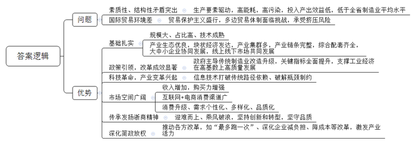
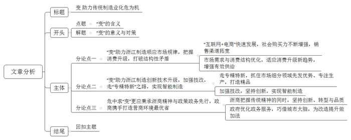

# 2020年浙江省公考《申论》题（B卷）

<!-- gwy:overview:start -->
> **浙江 · 2020 · 申论 · B类** ｜ 2 题 · 图片 2 处 · 答案随题折叠

导航：[题目](#题目) · [材料 1](#材料-1)
<!-- gwy:overview:end -->

> 候选采集稿。参考答案及解析来自粉笔页面，不代表官方答案或真实高分答卷；来源使用许可与原卷对应关系仍需人工核实。

## 给定材料

### 材料 1

传统制造业是浙江实体经济的主体，是经济发展之基、富民之源，深刻地影响着浙江“两个高水平”建设。无论是改革开放初期的工业化发展阶段、本世纪初加入世贸组织后的出口高增长阶段，还是国际金融危机以来浙江率先进入经济发展新常态的转型升级阶段，传统制造业都扮演了重要角色。规模大、占比高、技术成熟的传统制造业不仅是现代产业体系的有机构成部分，还是新兴产业的孵化基础。

当前，浙江传统制造业正处于转型升级关键期和阵痛期，面临着一些亟需解决的困难和问题，素质性、结构性矛盾十分突出。根据2016年度统计数据测算，全省10个重点传统制造业用47%的工业用地、73%的能耗、85%的排放、43%的用工，贡献了43%的工业增加值和40%的税收，投入产出效益总体偏低。在亩均税收、亩均增加值、研发经费支出与主营业务收入之比等关键指标上，总体低于全省制造业平均水平。以纺织行业为例，浙江纺织行业规模上企业数量庞大，但国家级企业技术中心仅有3家，主营业务收入利润率低于全省平均水平1.14个百分点。

### 材料 2

纵观世界近现代史，制造业的持续发展和转型升级，是主要发达国家现代化的共同经验。18世纪中后期，第一次工业革命开启于英国，以大规模工厂化生产取代个体工场手工生产为标志的现代制造业快速崛起，推动英国率先完成工业化。19世纪末，德国、美国抓住第二次工业革命的历史机遇，在电力、机械等领域形成领先优势，实现了现代化。第二次世界大战后，日本在钢铁、电子、汽车等产业快速发展的支撑下，跻身发达国家行列。在这些国家的现代化进程中，不断完善升级的制造业体系发挥了至关重要的作用。反观一些曾经也在工业化上取得不俗成绩的发展中国家，由于放松对制造业发展的坚持，特别是忽视推动制造业转型升级，陷入了经济增长缓慢、收入提升停滞的“中等收入陷阱”。

当前，全球经济在开放与保护的较量中艰难前行，贸易保护主义为世界经济蒙上阴云，以世贸组织为核心的多边贸易体制面临前所未有的挑战，传统制造业承受着更大的挤压风险。2017年，浙江在全国率先启动传统制造业改造提升工作，并将其列入“富民强省十大行动计划”，聚焦聚力高质量、竞争力、现代化，充分利用新技术、新业态、新模式，改造提升传统制造业，不断提高传统制造业高新化、智能化、绿色化水平。2018年，《浙江省加快传统制造业改造提升行动计划（2018-2022年）》出台，该计划围绕消费品、原材料、机械装备及零部件制造三大领域，在2017年确定的纺织、服装、皮革、化工、化纤、造纸、橡胶塑料、非金属制品、有色金属加工、农副食品加工等第一批10个重点行业基础上，增加汽车零部件、低压电气、金属制品、泵阀轴承、家具及竹木制品、家用电器、文体用品等第二批7个重点行业，基本实现主要传统制造业门类“全覆盖”。

经过2017年至2019年两年多的努力，浙江传统制造业改造提升取得了显著成效。全省累计淘汰落后产能企业5760家，整治提升“低散乱”企业（作坊）10.1万家；累计盘活存量建设用地44.32万亩，腾出用能空间506万吨标煤。有效利用盘活空间，加快先进制造和新兴产业集聚发展，建成小微企业园726个，入驻小微企业3.73万家。截至2019年，全省上云企业达到32.5万家；建设121个“无人车间”、“无人工厂”，130个骨干数字企业，127个数字化重大项目，100个数字化园区。传统制造业领域建成省级以上企业技术中心809家，建成产业创新服务综合体51个。全省拥有年产值超千亿元集群12个，超百亿元集群80多个，累计创建国家新型工业化产业示范基地21家，居全国前列。

两年多励精图治，浙江传统制造业增加值增速从不到5％回升到6％左右，增加值率从18.2％提高到20.8％，劳动生产率年均提高8.1％，亩均增加值从80多万元提高到近100万元，传统制造业中高新技术产业增加值占比提高到50％以上，有力支撑了工业经济在高基数上的高质量发展。传统制造业改造提升的浙江实践表明，传统产业并不是落后产业，也不是夕阳产业，只有落后的产品，没有落后的产业。

### 材料 3

改革开放以来，浙江各地从培养“一村一品、一地一业”起步，再到推进块状集聚、特色发展，传统制造业经历了较长时期的大发展大繁荣，影响力、竞争力不断提升。浙江块状经济发达，全省年销售收入20亿元以上的产业集群有130多个，为全省工业贡献了50%的产值、利润和就业。许多产业的产业链条基本完整，综合配套相对健全，大中小企业合作协同，形成了良好的产业发展生态。同时，浙江拥有大量的专业市场，义乌市场、柯桥轻纺市场、海宁皮革市场闻名遐迩，还拥有全球最大的网上市场，实体市场与网络市场共同发展，线上线下市场相互促进。

新一轮科技革命和产业变革正在孕育兴起，特别是移动互联网、智能终端、大数据等新一代信息技术，在推动传统制造业设备智能化、生产自动化、管理信息化等方面，已经彰显出巨大的影响力，为打破传统路径依赖、破解瓶颈制约指明了方向。正如美国管理学家迈克尔·波特说的，任何传统产业只要加上知识和技术，都可以成为一个具有国际竞争力的技术密集型产业。传统制造业只要主动去拥抱科技革命，把科技革命的新鲜血液源源不断地输入体内，就能持续保持强健体魄，从而变粗放型增长为集约型增长，变传统企业为高新技术企业。

很多传统制造业都是为人类衣食住行提供产品的。随着居民收入持续增加、新型城镇化加快推进，社会购买力越来越强，传统制造业的市场不仅没有缩小，反而在不断增长，市场空间依然十分广阔。从消费渠道看，“互联网+电商”快速发展，网上零售额占消费品零售总额比重大幅提高，浙江拥有阿里巴巴等电商平台企业和信息经济优势，浙货“出海”、“上网”营销渠道更加宽广。但也要清醒认识到，现在的市场需求，已不是过去对模仿型、排浪式低端产品的需求，而是对个性化、多样化高品质产品的需求。我国居民的消费结构正由生存型消费向发展型消费升级，由物质型消费向服务型消费升级，由传统消费向新型消费升级。市场永远都在，关键是要适应消费升级新趋势，增强供给有效性。

浙商是浙江最珍贵的金字招牌，也是浙江发展最倚重的力量。这些年，面对传统产业发展过程中的各种困难和挑战，广大浙商不畏惧、不退缩，迎难而上、乘风破浪，向创新要动力、向转型要出路、向品质要效益，走出了一条条卓有成效的转型升级之路。

近年来，浙江坚持以“最多跑一次”改革为牵引，撬动方方面面领域的改革，不断激发产业发展的内在活力。深入实施“一窗受理、集成服务”的改革，统筹推进事项梳理归集、数据共享、标准化建设、事中事后监管等工作，减少审批事项、优化审批流程、提升办事效率，努力变“企业跑”为“数据跑”、“政府跑”。同时，不折不扣落实中央减税降费政策，深化企业减负担、降成本改革，2019年共为企业减负2280亿元，5年累计超过6000亿元。

### 材料 4

在宁波，除了临港工业，还有慈溪家电、余姚塑料、宁海模具、象山针织、奉化气动元件、海曙纺织服装等门类齐全、层次多样且高度密集、区域特色鲜明的传统制造业集群，在模具、轴承、液气密、紧固件等细分领域形成比较优势。

服饰纺织业巨头S公司的染色车间遍布先进机器，鲜见操作工人，更看不到各色染料，一改过去人们对传统纺织印染企业“大染缸”的印象。S公司目前市值超过千亿元，凭借雄厚实力，完全可以在高回报的资本市场呼风唤雨，为什么坚决不做？S公司董事长对此轻描淡写：做好一件事，就很不错了。正是得益于这种“专注”，S公司在风浪中搏击壮大，成为全球最大的纵向一体化服装制造商，连续数年名列中国针织服装出口企业出口规模第一位。

“穷则变，变则通，通则久。”宁波制造业，当初多是由一些有胆有识的农民“洗脚上田”办起来的。办企业，改变了很多人的命运，时势变迁也让许多企业家认识到，坚韧不拔不是一成不变，创新才是制造业的灵魂所在。

一根纱线进去，45分钟后，一件成衣就做好了。拿在手上细看，这件成衣没有一处接缝，真正的一体成型，把纱线变为成衣的“魔术师”就是宁波C公司。从最初的手摇横机到最新的一体成型电脑横机，C公司始终深耕针织装备的研制。伴随着一轮轮产品迭代，C公司也实现了自身研发与制造水平的不断提升。“以前针织装备德国第一、日本第二，我们跟在后面跑。从跟跑到领跑，现在我们做到了行业第一。后面追兵紧追不舍，我们更要加快跑。”C公司董事长说。

### 材料 5

客观实际不是一成不变的，而是不断发展变化的。“变化者，乃天地之自然。”坚持一切从实际出发，既要看到社会主义初级阶段基本国情没有变，也要看到我国经济社会发展每个阶段呈现出来的新特点。我国社会生产力、综合国力、人民生活水平实现了历史性跨越，我国基本国情的内涵不断发生变化，我们面临的国际国内风险、面临的难题也发生了重要变化。过去长期困扰我们的一些矛盾不存在了，但新的矛盾不断产生，其中很多是我们没有遇到、没有处理过的。如果守着我们对过去中国实际的认识不动，守株待兔，刻舟求剑，我们就难以前进。我们要准确把握国际国内环境变化，辩证分析我国经济发展阶段性特征，准确把握我国不同发展阶段的新变化、新特点，使主观世界更好符合客观实际，按照实际决定工作方针，这是我们必须牢牢记住的工作方法。

——习近平总书记在十八届中央政治局第二十次集体学习时的讲话

### 材料 6

新冠肺炎疫情可以说是对浙江制造业的一场突击考试。疫情给浙江制造业带来较大不利影响的同时，也倒逼制造业企业危中寻机，主动加大技改力度，提升智能化水平。

抗疫之初，正值春节，浙江医用外科口罩、医用防护服产量基本为零。但仅用1个多月时间，浙江就扭转了医疗防护物资供应难的局面。这背后，一批冲在一线的浙江智能制造企业表现可圈可点。在金华，H机器人科技公司技术团队仅用15天时间，就帮助市内5家口罩企业将产能提升20倍，从日产3万只到60万只。2月份，浙江重点口罩机生产企业产能和产量分别是26台和6台，而到3月份这两个数据分别达到400台和350台。“扭转困局的背后，浙江智能制造功劳不小。而它们之所以能迅速‘转身’，不是凑巧，实则为浙江制造之变。”省经信厅相关处室负责人介绍。

疫情来袭，用工需求量大的温州工业企业率先意识到，以往劳动密集型为主的生产方式，很难经得起这类重大突发公共卫生事件的冲击。虽说条条大路通罗马，中小企业各有各的发展路径，然而疫情倒逼，让不少制造企业不约而同走上了“技改”这条路。程某是一家摩托车配件生产企业的负责人，他更早嗅到了“复工危机”——满满的订单和一时无法返岗的员工，这意味着想快速复工必须另寻良方。于是，他紧急联系了温州市智能制造研究院工程师凌某，启动了企业技改项目。这样的故事还在不断上演。自研究院复工以来，不断有企业主动找上门要求“体检”，“忙得忘了吃饭”已成为凌某的工作常态；而在去年这段时间，他才收到零星几家制造企业的技改评估预约。

### 材料 7

2020年3月，全省制造业高质量发展大会在杭州召开。会议强调，要坚持新发展理念引领，锚定目标、突出关键，开辟建设全球先进制造业基地的新路径，力争今年推动制造业高质量发展成为高水平全面建成小康社会的显著特征，到2025年建成国内领先、有国际影响力的制造强省，到2035年基本建成全球先进制造业基地。

6月，浙江省委十四届七次全会通过《中共浙江省委关于深入学习贯彻习近平总书记考察浙江重要讲话精神 努力建设新时代全面展示中国特色社会主义制度优越性重要窗口的决议》，提出要从10个方面努力建设好“重要窗口”。“改造提升传统产业，加快建设全球先进制造业基地”顺势成为10个方面“重要窗口”之一的“努力建设展示坚持和完善社会主义市场经济体制、不断推动高质量发展的重要窗口”的重要内容。

之前的2003年，也是浙江制造业发展进程中的一个关键节点。当年6月，随着“非典”疫情防控与复工复产进入新阶段，浙江召开了改革开放以来的首次全省工业大会，明确提出“建设先进制造业基地”目标。7月，浙江省委十一届四次全会举行，首次全面系统概括浙江发展的八个优势，提出指向未来的八项举措，即“八八战略”。其中一项正是“进一步发挥浙江的块状特色产业优势，加快先进制造业基地建设，走新型工业化道路”。

当今世界正处于百年未有之大变局，制造业已经成为新一轮国际竞争和大国博弈的“竞技场”。全球新一轮科技革命和产业变革向纵深发展，内外市场开放发展、产业链联动发展、产业融合发展态势越来越明显，制造内容、制造形态、制造方式面临深刻变革。新冠肺炎疫情防控取得了阶段性重要成果，但疫情防控任务依然艰巨繁重，特别是全球疫情仍在蔓延之中。大变局、大变革、大事件都摆在那里，躲是躲不过去的，关键是怎么去看？怎么去应对？怎么去抢抓机遇、化危为机？发展从来都不是一帆风顺、一路坦途的。大变局、大变革、大事件中困难与机遇同在、挑战与希望并存，战胜挑战就是新机遇，克服困难就能再上新台阶，这就是辩证法。

## 题目

### 第 1 题

**结合资料1、2、3，谈谈浙江传统制造业存在的问题并分析浙江传统制造业改造提升的优势。（40分）**

关联材料：材料 1、材料 2、材料 3

作答要求：

要求：全面、准确，有条理，字数不超过400字。

第 1 题 · 答案与解析

**参考答案（粉笔题库参考内容）**

一、问题：1.素质性、结构性矛盾突出。生产要素驱动，高能耗，高污染，投入产出效益低，低于全省制造业平均水平。2.国际贸易环境差。贸易保护主义盛行，多边贸易体制面临挑战，承受挤压风险。

二、优势：1.基础扎实。规模大、占比高、技术成熟；产业生态优良，块状经济发达，产业集群多，产业链条完整，综合配套齐全，大中小企业协同发展，线上线下市场共同发展。2.政策引领，改革成效显著。政府主导传统制造业改造升级，关键指标全面提升，支撑工业经济在高基数上高质量发展。3.科技革命，产业变革兴起。信息技术打破传统路径依赖、破解瓶颈制约。4.市场空间广阔。收入增加，购买力增强，互联网+电商消费渠道广，消费升级、需求个性化、多样化、品质化。5.传承发扬浙商精神。迎难而上、乘风破浪，坚持创新和转型，坚守品质。6.深化简政放权。推动各方改革，如“最多跑一次”、深化企业减负担、降成本等改革，激发产业活力。

**解析**

**参考答案说明：**本参考答案宏观上分成了“问题”和“优势”两个要素。（1）在“问题”内部，从“素质性、结构性矛盾突出”“国际贸易环境差”等不同的角度进行了分条撰写。（2）在“优势”内部，从“基础扎实”“政策引领，改革成效显著”“科技革命，产业变革兴起”“市场空间广阔”“传承发扬浙商精神”“深化简政放权”等不同的方面进行了分条撰写。各条要点之间在内容上相互并列，没有交叉。

**考点**：多要素组合类

**来源**：2020年浙江省公考《申论》题（B卷）

### 第 2 题

**根据你对资料5习近平总书记重要讲话精神的理解，以“变”为话题，自选角度，自拟题目，写一篇议论性文章。（60分）**

关联材料：材料 1、材料 2、材料 3、材料 4、材料 5、材料 6、材料 7

作答要求：

要求：

（1）紧密结合给定资料；

（2）主旨明确，结构完整，思路清晰；

（3）内容充实，论述深刻，语言流畅；

（4）字数1000-1200字。

第 2 题 · 答案与解析

**参考答案（粉笔题库参考内容）**

**变 助力传统制造业化危为机**

“变化者，乃天地之自然”。**习总书记指出：如果守着我们对过去中国实际的认识不动，守株待兔，刻舟求剑，我们就难以前进。**而当下，无论是科技的更迭、电子商务的兴起到人们的消费升级，抑或我国国情、国际格局的革新再到新冠肆虐的新局面，都对传统制造业带来了深刻影响。事到万难须放胆，**面对这一百年未有之大变局，唯有巧借“变”的力量，按照实际发展，让传统制造业同样顺势而为、顺势而变，方能在变局中开新局，于危机中育新机**。

**“变”助力浙江制造顺应市场规律，把握消费升级，打破结构性矛盾。**随着大数据时代的来临，“互联网+电商”快速发展，社会购买力不断增强。我们所熟知的海康威视、方太等诸多知名实体品牌也纷纷通过“触电”“上网”“出海”拓宽销售渠道，打通线上与线下销售壁垒，抢抓时代网络变局机遇。但在传统线下品牌借助电商平台企业和信息经济优势获得经济红利的同时，市场需求与消费结构也随之不断优化，消费者对产品的需求日益升级。唯于此，我们更要借此机遇倒逼制造业顺应市场，从提供产品到提供服务，适应消费升级新趋势，增强有效供给。

**“变”助力浙江制造创新技术升级，加强技改，走“专精特新”之路，实现智能制造。**翻开浙商发展史，之江大地既产大民企，也产小巨人。在传统制造业扎堆高利润产品时，鲁冠球抓住市场细分领域的先发优势，通过不断的技术改革专注于“万向节”生产，使得昔日名不见经传的萧山万向节厂变为行业隐形冠军；疫情期间，宁波均胜电子等众多企业将自身制造能力和软件智能研发优势结合，顺势而为，从最初仅满足自身防疫需要，到供给社会紧缺防疫物资，展现了疫情下的浙江制造“众生相”。坚韧不拔不是一成不变，创新才是制造业的灵魂所在，在变局中主动寻求技术“体检”，保持浙江民营、实体经济稳固发展。

**危中求“变”更应秉承浙商精神与政策政务先行，政商携手打造营商环境最优省。**源于崇文重教文化地缘优势，从“鸡毛换糖”到袜子大王、打火机大王的涌现，皆为世界展示了浙商迎难而上、乘风破浪的风采。时下正值市场变革之际，浙商在把握传统精神的同时，也要认清传统制造业的新变化、新特点，向创新要动力、向转型要出路、向品质要效益。在互联网变革的当下，传统制造业发展除企业献力外，亦需优化政务服务，巧借城市大脑，让政务先行为其改造提升做加法。“浙里办APP”的流行让浙江政务从“最多跑一次”朝“一次都不跑”迈进；“四张清单一张网”更是为亲清政商关系打下扎实基础。面对社会转型期，政商携手必将传递浙江制造业“干在实处、走在前列、勇立潮头”的创新创业活力。

越不可越之峰则登其巅，渡不可渡之河则达彼岸。我们深知传统制造业并非夕阳产业，身处时代大变局往往困难与机遇同在、挑战与希望并存。只要顺应时代之“变”，巧借“变”的力量为制造业创造良好发展生态，在变局中思考、在变局中前行，方能战胜挑战获得新机遇，克服困难再上新台阶，使得春风又绿江南岸。

**文章分析**

**变** **助力传统制造业化危为机**

【**标题的优点：**标题中含有“变”这一主题词，使文章主题更突出、清晰。】

“变化者，乃天地之自然”。**习总书记指出：如果守着我们对过去中国实际的认识不动，守株待兔，刻舟求剑，我们就难以前进。**而当下，无论是科技的更迭、电子商务的兴起到人们的消费升级，抑或我国国情、国际格局的革新再到新冠肆虐的新局面，都对传统制造业带来了深刻影响。事到万难须放胆，面对这一百年未有之大变局**，唯有巧借“变”的力量，按照实际发展，让传统制造业同样顺势而为、顺势而变，方能在变局中开新局，于危机中育新机。**

【**开头的优点：**★内容方面。范文的开头是紧扣题目给定的“变助力传统制造业化危为机”这一主题展开的，而且能够紧密结合资料中习近平总书记的讲话展开。首先，结合习总书记的话指出变的含义及不变的危害；其次，分析当前变的大背景。最后，引出文章的总观点：唯有巧借“变”的力量，让传统制造业同样顺势而为，才能在危机中育新机。★文字表达方面。使用了“而”“方能”等连接词，使语言表达有逻辑性。】

**“变”助力浙江制造顺应市场规律，把握消费升级，打破结构性矛盾。**（1）随着大数据时代的来临，“互联网+电商”快速发展，社会购买力不断增强。我们所熟知的海康威视、方太等诸多知名实体品牌也纷纷通过“触电”“上网”“出海”拓宽销售渠道，打通线上与线下销售壁垒，抢抓时代网络变局机遇。但在传统线下品牌借助电商平台企业和信息经济优势获得经济红利的同时，市场需求与消费结构也随之不断优化，消费者对产品的需求日益升级。唯于此，（2）我们更要借此机遇倒逼制造业顺应市场，从提供产品到提供服务，适应消费升级新趋势，增强有效供给。

【**论述段1的优点：**★观点句：范文的观点句是紧扣“变助力传统制造业化危为机”这一文章主题提出的。形式上，它在段首处直接写出，位置突出，容易发现。内容上，关键词突出，内容要点明确，可以明显看出它侧重于分析变对助力浙江制造业顺应市场规律，把握消费升级，打破结构性矛盾的意义。★论述内容：（1）介绍社会购买力提升的大背景；（2）指出我们应该拓宽销售渠道同时适应消费升级满足消费者需求。注意：以上两个方面的内容都是紧扣观点句“‘变’助力浙江制造顺应市场规律，把握消费升级，打破结构性矛盾”进行分析论述的，针对性强、内容层次丰富。并且，这两个方面的论述有内在逻辑顺序：先写“背景”，再写“对策”。最后，在论证方法和论据选取方面，讲道理和举例子相结合，做到了丰富多样。】

**“变”助力浙江制造创新技术升级，加强技改，走“专精特新”之路，实现智能制造。**翻开浙商发展史，之江大地既产大民企，也产小巨人。在传统制造业扎堆高利润产品时，（1）鲁冠球抓住市场细分领域的先发优势，通过不断的技术改革专注于“万向节”生产，使得昔日名不见经传的萧山万向节厂变为行业隐形冠军；（2）疫情期间，宁波均胜电子等众多企业将自身制造能力和软件智能研发优势结合，顺势而为，从最初仅满足自身防疫需要，到供给社会紧缺防疫物资，展现了疫情下的浙江制造“众生相”。坚韧不拔不是一成不变，创新才是制造业的灵魂所在，在变局中主动寻求技术“体检”，保持浙江民营、实体经济稳固发展。

【**论述段2的优点：**★观点句：范文的观点句是紧扣“变助力传统制造业化危为机”这一文章主题提出的。形式上，它在段首处直接写出，位置突出，容易发现。内容上，关键词突出，内容要点明确，可以明显看出它侧重于分析变对助力浙江制造创新技术升级，加强技改，走“专精特新”之路，实现智能制造的意义。★论述内容：（1）介绍鲁冠球成为隐形冠军的事例；（2）介绍宁波均胜电子等众多企业实现智能制造的事例。通过两个案例的方式进行论证观点，说服力更强。注意：以上两个方面层次清晰，论述的针对性强。在论述方法上主要采用了讲道理、举例子相结合的方式。】

**危中求“变”更应秉承浙商精神与政策政务先行，政商携手打造营商环境最优省。**（1）源于崇文重教文化地缘优势，从“鸡毛换糖”到袜子大王、打火机大王的涌现，皆为世界展示了浙商迎难而上、乘风破浪的风采。时下正值市场变革之际，浙商在把握传统精神的同时，也要认清传统制造业的新变化、新特点，向创新要动力、向转型要出路、向品质要效益。（2）在互联网变革的当下，传统制造业发展除企业献力外，亦需优化政务服务，巧借城市大脑，让政务先行为其改造提升做加法。“浙里办APP”的流行让浙江政务从“最多跑一次”朝“一次都不跑”迈进；“四张清单一张网”更是为亲清政商关系打下扎实基础。面对社会转型期，政商携手必将传递浙江制造业“干在实处、走在前列、勇立潮头”的创新创业活力。

【**论证段3的优点：**★观点句：范文的观点句是紧扣“变助力传统制造业化危为机”这一文章主题提出的。形式上，它在段首处直接写出，位置突出，容易发现。内容上，关键词突出，内容要点明确，可以明显看出它是从“浙商和政策”两方面入手。★论述内容：（1）强调传承浙商精神，也要认清新变化等。（2）介绍政务先行，并列举浙里办，最多跑一次等例子进行论证。注意：以上两个方面层次清晰，论述的针对性强。在论述方法上主要采用了讲道理、举例子相结合的方式。】

【**论述段之间的关系：**★内容的内在逻辑：论述段1、2从分析意义的角度谈“变助力传统制造业化危为机”，论证段3从提出对策的角度出发加以论证。三个论述段是按照分析问题-解决问题的逻辑书写的，逻辑清晰。】

越不可越之峰则登其巅，渡不可渡之河则达彼岸。我们深知传统制造业并非夕阳产业，身处时代大变局往往困难与机遇同在、挑战与希望并存。只要顺应时代之“变”，巧借“变”的力量为制造业创造良好发展生态，在变局中思考、在变局中前行，方能战胜挑战获得新机遇，克服困难再上新台阶，使得春风又绿江南岸。

【**结尾的优点**：范文的结尾回扣了“变助力传统制造业化危为机”这个主题，语言表达规范，有号召力。】

**解析状态：unknown（来源未提供）**

**考点**：文章写作题

**来源**：2020年浙江省公考《申论》题（B卷）

