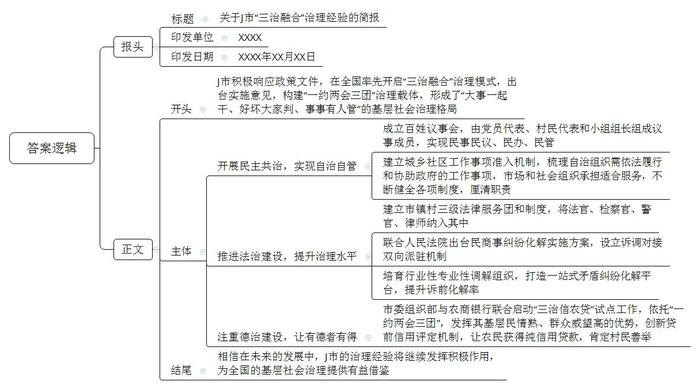
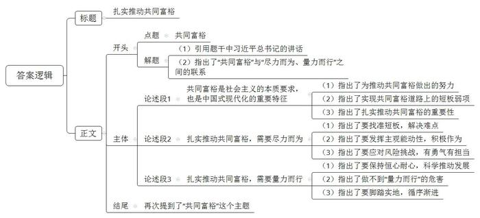

# 2022年浙江省常规、定向紧缺选调生考试《申论》题

<!-- gwy:overview:start -->
> **浙江 · 2022 · 申论 · 选调生** ｜ 2 题 · 图片 2 处 · 答案随题折叠

导航：[题目](#题目) · [材料 1](#材料-1)
<!-- gwy:overview:end -->

> 候选采集稿。参考答案及解析来自粉笔页面，不代表官方答案或真实高分答卷；来源使用许可与原卷对应关系仍需人工核实。

## 给定材料

### 材料 1

每周五，浙江省J市人民法院法官唐磊都会到崇福镇送法下乡。

一张桌子、几条板凳，纠纷双方落座，唐磊便“开庭”问案。这个“庭”因时因事而异，有时在农家小院，有时在田间地头，有时在镇司法所的法官工作室……这就是桐乡群众耳熟能详的“板凳法庭”。

如今在J市，基层公共法律服务体系正在不断完善，由法院、检察院、公安局、司法局相关人员和律师组成的法律服务团实现城乡全覆盖。

法治下沉止纷争，是J市探索建立健全党组织领导的自治、法治、德治相结合的城乡基层治理体系的缩影。

地处杭嘉湖平原腹地的J市，有户籍人口69.9万、新居民57.1万。8年多前，当地经济社会快速发展，一些新的社会问题也随之而来，J市面临“成长的烦恼”。2013年9月，J市出台《关于推进社会管理“德治、法治、自治”建设的实施意见》，全市211个村（社区）逐步构建“一约两会三团”治理载体——村规民约，百姓议事会、乡贤参事会，百事服务团、法律服务团、道德评判团等，着力形成“大事一起干、好坏大家判、事事有人管”的基层社会治理格局。

2015年7月，浙江省创新基层社会治理提升社会风险防控能力现场推进会在J市举行，全面推广J市“三治融合”基层社会治理经验。2019年，中央农办、农业农村部发布首批全国乡村治理典型案例，J市“自治法治德治融合”名列其中。

党的十九大报告指出：“加强农村基层基础工作，健全自治、法治、德治相结合的乡村治理体系。”“十四五”规划纲要提出：“健全党组织领导的自治、法治、德治相结合的城乡基层社会治理体系。”今年4月，《中共中央国务院关于加强基层治理体系和治理能力现代化建设的意见》印发，其中要求“力争用5年左右时间，建立起党组织统一领导、政府依法履责、各类组织积极协同、群众广泛参与，自治、法治、德治相结合的基层治理体系”。

近日，记者走进J市，探寻在全国率先开启“三治融合”的J市实践。

村党总支书记、村委会主任张国伟

波光潋滟的京杭大运河穿村而过，褐砖红瓦的三层联排新居枕山襟水。步入J市崇福镇南阳村南苑阳光城小区，茵茵草地错落有致地点缀其间，五颜六色的鲜花竞相绽放。

“小区能建成这样，村民自治的作用功不可没。”村党总支书记、村委会主任张国伟感慨道。

2013年，南阳村在推行“三治融合”时成立百姓议事会，以实现民事民议、民事民办、民事民管。11名议事会成员由党员代表、村民代表、村民小组组长等组成。“遇到涉及村民利益的事，百姓议事会总要先过一遍。”张国伟说。

2014年，J市在崇福镇规划建设现代物流园区，计划对南阳村的15个村民小组、434户村民实施搬迁。放到以前，村民分到新宅基地后，就各自建房。这一回，参加议事会的村民却有了新想法：能否像城里小区那样统一规划，大家一起建房？

百姓议事会把村民的意见报到镇里，镇政府请专业律师评估后给出答复：除建筑高度等法律法规规章和国家政策已有规定事项外，在不违背公序良俗的前提下，其他方面由村民自主决定。

很快，南阳村在百姓议事会的基础上，成立了由村干部、老党员、村民代表等组成的业主委员会，定下建房各项细节。

“南苑阳光城的规划设计、施工建设、物业管理，均由村民自主协商议定。”张国伟打开档案柜，取出一沓厚厚的设计图纸递给记者。随手翻阅，几乎每张图上都有或大或小的改动，“设计图纸经常改了又划、划了又改。”张国伟说，虽然方案数易其稿，工程进展却十分迅速：2015年6月启动建设，2016年12月竣工分房。

乔迁之初，曾有村民在绿化带里拔草种菜。如何兼顾小区管理要求和村民生活习惯？经百姓议事会讨论形成共识，村里决定将小区不远处的一块荒地辟为农耕园，村民只要承诺不在小区内种菜，每户即可免费获得20平方米菜地。

随村民范有仙步入农耕园，青菜、莴笋、香芹等满目翠绿。“种菜有了去处，还不影响小区绿化。”范有仙一脸高兴。

“推进民事民议、民办、民管，村里矛盾少了，活力多了。”张国伟说，“村里事、商量办”已成习惯。

如今，百姓议事会等治理载体已成为全市211个村（社区）的标配，一些村镇还打造出“民生议事厅”“木兰议事会”“五泾驿站”等品牌。

更让张国伟感到高兴的，是各项基层群众自治制度的不断健全。

J市近年来着力厘清自治组织职责，按照“费随事转、权随责走”的原则，建立城乡社区工作事项准入机制，梳理出基层群众自治组织“需依法履行的36项事项”和“需协助政府工作的40项事项”两份清单。同时，将适合市场及社会组织承担的服务交由市场和社会组织承担。目前，J市注册登记的社会组织558家、备案的2846家，持证社工达2125人，并培育出“J市管家”“J市义工”等社工队伍品牌。

中午时分，记者来到南阳村居家养老中心，社工田亚英正准备为村里老人送餐。“村里现在每年支付8万元，养老的事我们帮着干，村里省了事，村民还享受到了专业服务。”田亚英说。

“一系列务实举措加强组织保障，村民自治更从容了。”张国伟表示。

驻村律师卜炳忠

在高桥街道越丰村的调解室，记者见到了律师卜炳忠。每月15日是他驻村服务的日子。

调解室的门总是开着。偶有办事村民路过，都会和卜炳忠打招呼。驻村11年，卜炳忠早已和村民们相熟。“大家认识我，是从一张反对票开始的。”卜炳忠笑道。

2015年初夏，村里整治违章工棚，一位老太太愣是不同意拆除。整改时限将至，村里想要强拆。卜炳忠提醒道：“从法律上来说，村委会不具备实施强拆的主体资格。”后来村里另寻其他办法解决了问题。

近年来，越丰村发展迅速，村里土地纠纷、旅游纠纷、劳动争议增多。与之对应的，是村里深入推行“三治融合”，依法治理水平不断提升。“具体体现到我这儿，就是我的帮手变多了。”卜炳忠说，“我前边有调解员，后边有法官、检察官、警官，大家一起拉了三张化解矛盾的网。”

2014年3月，J市印发全面建立三级法律服务团制度的实施意见，全市建立市、镇、村三级法律服务团100个，一批法官、检察官、警官、律师纳入其中。2019年4月，J市司法局与桐乡市人民法院联合出台《加强诉调对接 助推民商事纠纷有效化解实施方案》，创新设立诉调对接“双向派驻”机制，在乡镇司法所建立法官工作室，在法庭建立驻庭人民调解工作室。

三张网效果如何？卜炳忠介绍了他之前介入调解的一桩纠纷。

“补偿款80多万元。”得知自家店铺要拆迁，村民沈林刚翻箱倒柜半天，却没找到店铺产权证。正疑惑间，村民陆阿芬拿着店铺产权证找上门来。翻开一看，沈林刚愣住了——证上写的是陆阿芬父亲的名字。

原来，早在10多年前，陆阿芬的父亲便将这间店铺卖给了沈林刚。因两人是好友，交易时并未办理过户手续。现在为拆迁补偿款，两家人产生了纠纷。

这矛盾咋化解？村干部照例先请来村里的调解员，无奈此案涉及金额较大，连续调解几次都未成功。于是，卜炳忠出马。他从法律角度给双方细剖了利害关系，但双方还是不服气，直言要“打官司”。几天后，卜炳忠陪同驻镇联村的法官李永华来到村调解室，再次介入调解。李永华结合办案实际特别是类似案件，从法律规定到执行风险，给纠纷双方作了分析。

调解室里，村道德评判团成员徐元明也发了话：“你们两家从上一辈关系就很好，现在非要搞得法庭上见吗？”法治与德治的组合拳，终于让双方同意各退一步，拆迁补偿款按约定比例分配。

目前，J市不仅市、镇、村三级法律服务团齐备，还培育了48个行业性专业性调解组织，打造一站式矛盾纠纷化解平台。2020年，J市诉前化解率达80.68%，名列浙江省前茅。

银行部门经理沈建平

无抵押，无担保，凭人品口碑，崇福镇民利村村民薛纪荣拿到了5万元“三治信农贷”贷款。

54岁的薛纪荣原本家庭幸福美满，一场突如其来的车祸令儿子瘫痪在床，并陷入深度昏迷，被诊断为植物人。薛纪荣不离不弃，日复一日地为儿子翻身、按摩、喂食。经过5年多悉心照料，儿子终于苏醒，还能开口说话了。2019年初，见儿子日渐康复，薛纪荣打算开办一家纺织作坊，资金问题却让她一筹莫展。

“薛大姐待人有情有义，对儿子不离不弃，得到社会广泛认同，被评为桐乡市道德模范。”民利村道德评判团成员沈晓渭得知薛纪荣的难处后，随即与J市农商银行取得联系，希望通过“三治信农贷”为她纾难解困。

“这是J市在‘三治融合’基层社会治理基础上推出的一款普惠型金融产品。”J市农商银行普惠金融部经理沈建平介绍，2018年，J市委组织部与J市农商银行联合启动“三治信农贷”试点工作，依托村级党组织领导的“一约两会三团”，发挥其基层民情熟、群众威望高的优势，创新贷前信用评定机制，让有创业创新意愿的农村群众凭借好口碑、好家风等就能获得纯信用贷款。

“贷款手续不少，我能应付得了吗？没有资产抵押，贷款能批下来吗？”薛纪荣不免担心。沈晓渭宽慰她：“在家等消息就行。”很快，民利村百事服务团成员来到薛纪荣家现场走访，结合村道德评判团对其遵守村规民约等情况的评议结果提出建议授信额度，报送百姓议事会公议确定与村党组织核定。贷款申请材料递交至J市农商银行普惠金融部后，沈建平为薛纪荣开辟了贷款审批绿色通道，5万元贷款第一时间到账，还享受利率优惠政策。

“‘三治信农贷’给予的不仅是资金支持，更是对村民做好人、行善举的肯定和鼓励，让有德者有得。”沈建平说。截至今年6月末，J市“三治信农贷”已完成授信11.9万户，累计向2.49万户发放贷款66.53亿元。

### 材料 2

“尽力而为、量力而行”，是习近平同志对实际工作的一贯要求。在《之江新语》中，习近平同志就多次强调“尽力而为、量力而行”，不“开空头支票、盲目吊高胃口”。在《求是》杂志最近刊发的重要文章《扎实推动共同富裕》中，习近平总书记再次强调了这个工作原则。浙江要牢牢记住总书记的谆谆教诲，制定政策和推进实施都要遵循科学规律。

浙江在探索解决发展不平衡不充分问题方面成绩显著，但短板弱项仍然明显。比如，我们的许多人均指标只是略高于全球的平均水平，离发达国家仍有不小的差距。再比如，对照现代化先行的要求，山区26县是我省推进共同富裕的薄弱环节，科技创新也是我们要花大力气补上的一课。我们必须找准制约实现共同富裕的突出短板和弱项，有针对性地实施一批有力政策举措，切实解决共同富裕的重点难点堵点问题。

浙江省委是用3个五年实施方案压茬推进共同富裕的，可见难度之大、挑战之多。我们必须保持恒心耐心，实打实地一件事一件事办好。惟有树立“循序渐进、由低到高、由局部到整体”的原则，两条腿走路、系统化推进、螺旋式上升，才能逐步从低层次共同富裕迈向高层次共同富裕。

盲目提高标准，不仅会增加共同富裕的难度，加重财政负担，对广大群众来说也可能是福利陷阱；过高的标准难以兑现，即使一时兑现了，也不可持续。在制定实施各项政策举措时，我们一定要把握好“时度效”原则。特别是要把保障和改善民生建立在经济发展和财力可持续的基础之上，重点加强基础性、普惠性、兜底性民生保障建设，不作兑现不了的承诺，坚决防止落入“福利主义”陷阱。

## 题目

### 第 1 题

**根据给定资料**1**，请就J市“三治融合****”****治理经验，写一份简报。****（****30分****）**

关联材料：材料 1

作答要求：

要求：准确、全面、有条理，500字左右。

第 1 题 · 答案与解析

**参考答案（粉笔题库参考内容）**

关于J市“三治融合”治理经验的简报

XXXX XXXX年XX月XX日

J市积极响应政策文件，在全国率先开启“三治融合”治理模式，出台实施意见，构建“一约两会三团”治理载体，形成了“大事一起干、好坏大家判、事事有人管”的基层社会治理格局。具体实践如下：

开展民主共治，实现自治自管。成立百姓议事会，由党员代表、村民代表和小组组长组成议事成员，实现民事民议、民办、民管；建立城乡社区工作事项准入机制，梳理自治组织需依法履行和协助政府的工作事项，市场和社会组织承担适合服务，不断健全各项制度，厘清职责。

推进法治建设，提升治理水平。建立市镇村三级法律服务团和制度，将法官、检察官、警官、律师纳入其中；联合人民法院出台民商事纠纷化解实施方案，设立诉调对接双向派驻机制；培育行业性专业性调解组织，打造一站式矛盾纠纷化解平台，提升诉前化解率。

注重德治建设，让有德者有得。市委组织部与农商银行联合启动“三治信农贷”试点工作，依托“一约两会三团”，发挥其基层民情熟、群众威望高的优势，创新贷前信用评定机制，让农民获得纯信用贷款，肯定村民善举。

相信在未来的发展中，J市的治理经验将继续发挥积极作用，为全国的基层社会治理提供有益借鉴。

**解析**

**参考答案说明：**（1）格式方面，本参考答案写到了“报头”“正文”两个部分。（2）正文部分，一方面从内容上来看，围绕“三治融合”这一主题，本参考答案的开头先写到了J市“三治融合”的背景及宏观做法、成绩；主体部分从“自治”“法治”“德治”这三个方面进行展开；结尾部分结合未来的发展进行展望总结。另一方面，形式上，本参考答案做到了分段、分条撰写，整体上条理较为清晰。

### 第 2 题

**给定资料**2**中，****“****习近平同志就多次强调****‘****尽力而为、量力而行****’****，不****‘****开空头支票、盲目吊高胃口****’”****。请结合这句话的思考，联系实际，自拟题目，写一篇议论文。****（****60分****）**

关联材料：材料 1、材料 2

作答要求：

要求：观点正确，参考给定资料，但不拘于给定资料，语言通顺，结构完整，字数1000字左右。

第 2 题 · 答案与解析

**参考答案（粉笔题库参考内容）**

**扎实推动共同富裕**

不论是《之江新语》，还是《求是》杂志，都曾谈到习近平总书记对于实际工作开展的要求：尽力而为、量力而行。扎实推动共同富裕，也需要平衡好两者的辩证关系，既要坚定为民初心，全力以赴，也要合理确定工作目标，实事求是。

**共同富裕是社会主义的本质要求，也是中国式现代化的重要特征。**2021年，浙江接过为全国推动共同富裕提供省域范例的重任，破难点、切痛点、疏堵点，为中国式现代化先行探路。虽然成绩显著，但不可否认的是，目前短板弱项仍然明显。比如，与发达国家的发展水平相比，许多人均指标依然存在较大差距；与乡村振兴的目标相比，偏远山区依旧是发展中的薄弱环节；与现代化先行的要求相比，科技创新仍然是需要补上的关键一课。因此，必须继续扎实推动共同富裕，努力交出可借鉴可推广可复制的“高分答卷”。

**扎实推动共同富裕，需要尽力而为。**找准短板、弱项，激发发展动力，切实解决重点难点堵点问题，才能实现跨越发展，助力民生改善。民生无小事，枝叶总关情。推动共同富裕建设“等不得”。一方面，要充分发挥主观能动性，积极作为。面对发展机遇，不能“坐着要”或是“站着等”，而是要“踮脚够”，尝试“跳起来摘桃子”，全力以赴开展工作。另一方面，要敢于应对困难挑战，承担风险。改革处处有难题，发展处处有挑战，既要有“越是艰险越向前”的勇气，也要有“千磨万击还坚劲”的毅力，更要有“岂因祸福避趋之”的担当。探索实现共同富裕，做好发展“先行者”，浙江必须全力以赴，继续冲锋。

**扎实推动共同富裕，需要量力而行。**保持恒心耐心，科学推动发展，避免好高骛远、形式主义，才能实现持续性、稳定性发展。浙江省委制定3个五年实施方案推进共同富裕，可见难度之大，挑战之多。若是忽视发展规律及自身实际，盲目提高标准，只会增加共同富裕的难度，加重财政负担，影响发展信心及群众信任。因此，推动实现共同富裕必须脚踏实地，循序渐进。要牢牢遵循总书记教诲，一件事情接着一件事情办，一年接着一年干，切忌贪大求快，乱许“空头支票”吊高群众胃口，定能向着共同富裕的目标扎实迈进。

船到中流正奋楫。激发斗志、昂扬精神，求真务实、久久为功，浙江定能在迈向共同富裕的新征程中，策马扬鞭，行稳致远！

**文章分析**

扎实推动共同富裕

【**标题的优点：**标题中含有主题词“共同富裕”，使文章主题更突出、清晰。】

不论是《之江新语》，还是《求是》杂志，都曾谈到习近平总书记对于实际工作开展的要求：（1）<u>尽力而为</u>、<u>量力而行</u>。（2）<u>扎实推动共同富裕</u>，也需要<u>平衡好两者的辩证关系</u>，既要<u>坚定为民初心</u>，<u>全力以赴</u>，也要<u>合理确定工作目标</u>，<u>实事求是</u>。

【**开头的优点：**★内容方面。范文的开头是紧扣题目给定的“共同富裕”这一主题展开的。首先，引用题干中习近平总书记的讲话；而后，指出了“共同富裕”与“尽力而为、量力而行”之间的联系。★文字表达方面。使用了“既要”“也要”等连接词，使语言表达有逻辑性。】

**共同富裕是社会主义的本质要求，也是中国式现代化的重要特征。**2021年，浙江接过为全国推动共同富裕提供省域范例的重任，（1）<u>破难点</u>、<u>切痛点</u>、<u>疏堵点</u>，<u>为</u><u>中国式现代化先行探路</u>。虽然成绩显著，但不可否认的是，（2）目前<u>短板弱项</u>仍然明显。比如，与发达国家的发展水平相比，许多<u>人均指标</u>依然<u>存在较大差距</u>；与乡村振兴的目标相比，<u>偏远山区</u>依旧是发展中的<u>薄弱环节</u>；与现代化先行的要求相比，<u>科技创新</u>仍然是<u>需要补上</u>的关键一课。（3）因此，必须<u>继续扎实推动共同富裕</u>，努力交出<u>可借鉴可推广可复制</u>的“高分答卷”。

【**论述段****1的优点：**★观点句：范文的观点句是紧扣“共同富裕”这一文章主题提出的。形式上，它在段首处直接写出，位置突出，容易发现。内容上，关键词突出，内容要点明确，可以明显看出主要论述“共同富裕”的重要性及存在的短板弱项。★论述内容：（1）指出了为推动共同富裕做出的努力；（2）指出了实现共同富裕道路上的短板弱项；（3）指出了扎实推动共同富裕的重要性。注意：以上几个方面的内容都是紧扣“共同富裕是社会主义的本质要求，也是中国式现代化的重要特征”这个观点句进行分析论述的，论述的针对性强，内容层次丰富。在论述方法上主要采用了讲道理的方式，论述清晰透彻。】

**扎实推动共同富裕，需要尽力而为。**（1）<u>找准短板</u>、<u>弱项</u>，<u>激发发展动力</u>，切实解决重点难点堵点问题，才能实现跨越发展，<u>助力民生改善</u>。民生无小事，枝叶总关情。推动共同富裕建设“等不得”。（2）一方面，要充分<u>发挥主观能动性</u>，<u>积极作为</u>。<u>面对发展机遇</u>，不能“坐着要”或是“站着等”，而是要“踮脚够”，尝试“跳起来摘桃子”，<u>全力以赴开展工作</u>。（3）另一方面，要敢于<u>应对困难挑战</u>，<u>承担风险</u>。改革处处有难题，发展处处有挑战，既<u>要有</u>“越是艰险越向前”的<u>勇气</u>，也要有“千磨万击还坚劲”的<u>毅力</u>，更<u>要有</u>“岂因祸福避趋之”的<u>担当</u>。探索实现共同富裕，做好发展“先行者”，浙江必须全力以赴，继续冲锋。

【**论述段****2的优点：**★观点句：范文的观点句是紧扣“共同富裕”这一文章主题提出的。形式上，它在段首处直接写出，位置突出，容易发现。内容上，关键词突出，内容要点明确，可以明显看出主要论述“共同富裕需要尽力而为”。★论述内容：（1）指出了要找准短板，解决难点；（2）指出了要发挥主观能动性，积极作为；（3）指出了要应对风险挑战，有勇气有担当。注意：以上几个方面的内容都是紧扣“扎实推动共同富裕，需要尽力而为”这个观点句进行分析论述的，论述的针对性强，内容层次丰富。在论述方法上主要采用了讲道理的方式，论述清晰透彻。】

**扎实推动共同富裕，需要量力而行。**（1）<u>保持恒心耐心</u>，<u>科学推动发展</u>，<u>避免好高骛远</u>、<u>形式主义</u>，才能实现持续性、稳定性发展。浙江省委制定3个五年实施方案推进共同富裕，可见难度之大，挑战之多。（2）<u>若是忽视发展规律及自身实际</u>，<u>盲目提高标准</u>，只会<u>增加</u>共同富裕的<u>难度</u>，<u>加重财政负担</u>，<u>影响发展信心及群众信任</u>。（3）因此，推动实现共同富裕必须<u>脚踏实地</u>，<u>循序渐进</u>。要牢牢遵循总书记教诲，<u>一件事情接着一件事情办</u>，一年接着一年干，<u>切忌贪大求快</u>，乱许“空头支票”吊高群众胃口，定能向着共同富裕的目标<u>扎实迈进</u>。

【**论述段****3的优点：**★观点句：范文的观点句是紧扣“共同富裕”这一文章主题提出的。形式上，它在段首处直接写出，位置突出，容易发现。内容上，关键词突出，内容要点明确，可以明显看出主要论述“共同富裕需要量力而行”。★论述内容：（1）指出了要保持恒心耐心，科学推动发展；（2）指出了做不到“量力而行”的危害；（3）指出了要脚踏实地，循序渐进。注意：以上几个方面的内容都是紧扣“扎实推动共同富裕，需要量力而行”这个观点句进行分析论述的，论述的针对性强，内容层次丰富。在论述方法上主要采用了讲道理的方式，论述清晰透彻。】

【**论述段之间的关系：**★内容的内在逻辑：范文的论述段之间是依照“共同富裕”“尽力而为”“量力而行”的逻辑展开的。论述段1先写了“共同富裕是社会主义的本质要求，也是中国式现代化的重要特征”，论述段2再写了“扎实推动共同富裕，需要尽力而为”，论述段3接着写了“扎实推动共同富裕，需要量力而行”。★段与段的外在衔接：文章开头指出“扎实推动共同富裕，也需要平衡好两者的辩证关系”，起到了连接论述段1、2、3的作用。】

船到中流正奋楫。激发斗志、昂扬精神，求真务实、久久为功，浙江定能在迈向<u>共同富裕</u>的新征程中，策马扬鞭，行稳致远！

【**结尾的优点：**范文的结尾回扣了“共同富裕”这个主题，并对全文进行了总结展望。】

**解析状态：unknown（来源未提供）**

