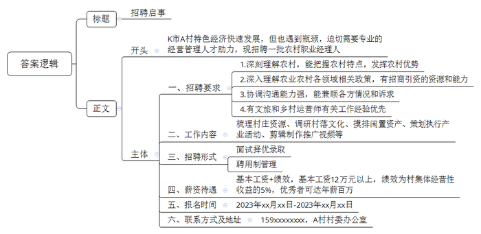
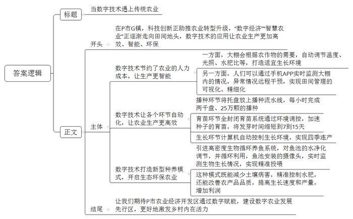
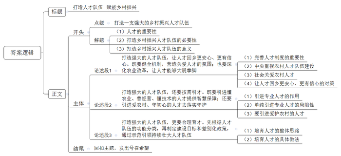

# 2023年浙江省公考《申论》题（B卷）

<!-- gwy:overview:start -->
> **浙江 · 2023 · 申论 · B类** ｜ 3 题 · 图片 3 处 · 答案随题折叠

导航：[题目](#题目) · [材料 1](#材料-1)
<!-- gwy:overview:end -->

> 候选采集稿。参考答案及解析来自粉笔页面，不代表官方答案或真实高分答卷；来源使用许可与原卷对应关系仍需人工核实。

## 给定材料

### 材料 1

党的十八大以来，以习近平同志为核心的党中央把解决好三农问题作为全党工作的重中之重，出台一系列重大方针政策，推动一系列重大改革举措，指引我国新时代三农发展取得历史性成就、发生历史性变革。粮食和重要农产品供给稳定，粮食产量连续7年稳定在1.3万亿斤以上，10年再上一个千亿斤新台阶，做到了谷物基本自给、口粮绝对安全。脱贫攻坚战取得全面胜利，现行标准下9899万农村贫困人口全部脱贫，走出了一条中国特色减贫道路。物质技术装备条件明显改善，累计建成9亿亩高标准农田，配套建设了一批现代化灌区，农业科技进步贡献率达到61%，农作物种源自给率超过95%，农作物耕种收综合机械化率超过72%。乡村振兴开局良好，乡村产业蓬勃发展，人居环境明显改善，公共设施提档升级，农村供水供电、交通道路、宽带网络和学校医院等设施加快建设，农村民生事业不断取得新进展。农村改革全面深化，基本形成乡村振兴的制度框架和政策体系，农村承包地“三权分置”、集体产权制度、宅基地制度等重大改革稳步推进，探索形成了一批成熟定型、管根本利长远的制度成果。

未来一段时期，是我国加快农业农村现代化的重要战略机遇期，必须加强前瞻性思考、全局性谋划、战略性布局、整体性推进，以更高的站位、更大的力度、更实的举措，书写好中华民族伟大复兴的“三农”新篇章。

### 材料 2

一个村庄也要有自己的“CEO”了？他们的工作是什么？前不久，浙江省H市L区开出20万年薪的优厚待遇，招聘农村职业经理人。这一新兴职业引起了公众的关注。

D村是L区此次招聘农村职业经理人的村之一。D村村委会工作人员说，从报名情况看，农村职业经理人岗位很有吸引力，报名人数众多，而且应聘者都很优秀。“职业经理人不仅要对农村有深刻的理解，能够把握和发挥好农村的特点和优势，还要对各级政府在农业农村领域的相关政策有深入了解，具备招商引资的资源和能力等。”该工作人员介绍，“以前仅靠村委会的人员，在经营方面力量有所不足，所以需要专业人士来做专业的事情。”

这并不是H市第一次招聘农村职业经理人。H市Y区早在2019年就集中招聘了8名经营管理人才担任农村职业经理人，招聘形式与此次L区类似。当时共有412人报考，报名与录取比例超过50比1；其中T村的经理人岗位，比例更高达114比1。报名者都具有本科及以上学历，其中硕士75人、博士1人，有供职于地产行业的“金领”，有来自京沪金融投资圈的MBA，还有常年深耕美丽乡村旅游发展的执业规划设计师等。

“85后”小唐就在那次招聘中成功胜出，成为Y区F村的职业经理人。小唐自从大学毕业后，就一直从事文旅方面工作，也做过一段时间乡村运营师，工作内容与“乡村CEO”类似。对农村的深厚感情，也让小唐更进一步选择成为一名农村职业经理人，加上她是本地人，可以更好理解当地文化以及沟通。在招聘面试时，小唐凭借一个此前策划的成功案例吸引了评委：她当时工作的村里有一家馒头铺，原本只是单纯的早点摊，在与老板沟通后，小唐组织专门团队对馒头铺进行了改造升级，馒头铺的经营形式不断丰富，可以让客人体验做馒头，也可以成为中小学生劳动教育研学场所，而专门设计的口味和精美的包装，还吸引很多游客将馒头作为乡村旅游的伴手礼。

在入职F村时，新组建的经营管理公司只有小唐一个人，她既是CEO，也是员工。“村庄资源的梳理、村落文化的调研、闲置资产的摸排、产业活动的策划执行、推广视频的剪辑制作等，全都是我一个人在做。”小唐介绍，F村一半的土地都是茶园，茶叶是该村最主要的产业，以往村民主要是售卖新鲜茶叶或是各自加工。如今进行规划后，从源头开始统一茶叶的品质，在原来废弃厂房处新建了茶产业设施用房，同时还在积极吸引游客前来体验。

“F村距离H市主城区较近，我们的主题就是以茶为基础，带动第二、第三产业发展。”小唐介绍。她正在计划打造“茶家乐”，让村民将闲置的资源利用起来。

“做一名农村职业经理人，要平衡考虑好各方面的情况，兼顾各方诉求，需要协调和沟通各方，才能更好地开展工作。”小唐说。经过一年多的工作，她赢得了村里村外各方的认可和支持，公司团队也扩展到了3人，新加入的2名员工都是有活力的年轻人，其中一人还是硕士研究生。

“心急吃不了热豆腐，做乡村工作最重要的就是不能急、要考虑长期的效益。”小唐说，各村的情况有所不同，具体的发展措施也不一样。

### 材料 3

近年来，K市A村通过完善基础设施，加大产业扶持，推动农村特色经济不断发展壮大。村里聚焦打造稻香水韵农家、健康慢生活主题村落，开展了稻田娱乐、消夏避暑、特色民宿、农家体验等乡村旅游项目，吸引了越来越多的游客。今年“十一”期间，A村结合村庄资源，开展水上休闲旅游项目，接待游客3500余人，收入60余万元，带动村内就业人数150余人。这些成绩和效益的取得，让A村人有了把特色经济继续做大做好做精的迫切愿望，但也感觉遇到了瓶颈，迫切需要专业的助力。

“这几年村里经过治理，环境和条件有了翻天覆地的变化。‘绿水青山’有了，怎么更好更快地变成‘金山银山’呢？”A村党支部书记老张直言，这几年村“两委”一直在努力为经营好村里项目、提高村民的收入动脑筋做工作，虽有一些成效，但总觉得有些力不能及。“比如，为了能吸引游客，我们计划根据时令举办一些活动。想法是有，可怎么对接资源、策划内容、做好宣传，我们都不擅长，感觉错过了一个又一个的机会。”

“让专业的人干专业的事”，A村打算选聘职业经理人。经过一番咨询和走访，老张对选聘有了一些打算：A村职业经理人实行聘用制管理，首次聘用期初步考虑为1年，做得好的续聘2年；薪酬分基本工资和绩效工资两部分，基本工资不少于12万元，绩效工资为村集体经营性收益的5%，做得好的可能达百万。“所谓的百万薪酬，其实是一种绩效奖励，这需要应聘人员的个人能力非常高，完成推进乡村项目招商落地运营、盘活乡村集体资产，通过一系列目标考核，才能实现百万年薪。”老张说。

根据工作实际需求，村里打算放宽对应聘者的学历要求，更注重个人能力和实际经验，以面试形式代替笔试进行选聘。老张表示，选聘农村职业经理人，不是选能帮助村集体种田养鱼的技术能手，而是选能带动乡村发展，让乡村特色产业更上一层楼的“经营能手”。同时，这也是一个“双向奔赴”的过程，村里打算以最优厚的条件吸引人才，也希望人才能够以自身真正优势来获得村里的青睐。

### 材料 4

田埂间，一个个机器人运输着刚采摘下的农产品；设施大棚内，一个个高清摄像头来回巡视，实时监测着农作物状态，并对病害植物进行拍照识别及远程诊断；温室里，遮阳设施智能调控着光照和温度，施肥机自动调节着农作物的水肥比，农作物的生长周期得以可视化监控与数据化管理……

作为浙江省首个农业经济开发区——P市G镇，一个依托于物联网的数字农业样板间已然成形。过去三年间，20个数字农业和产乡融合型项目集聚于此，科技创新正助推农业转型升级，让“数字经济”“智慧农业”逐渐走向田间地头。

L农业科技有限公司余总介绍说，占地120亩的园区内，只有一位管理员，因为农业的数字化大大节约了人力成本。在这里，余总对园区的管控大多时候只需要依靠手机。打开手机上的App，他随时可以查看到12个大棚内的实时监测画面，大棚内实时智能调节的温度、光照情况，以及施肥机自动为每种农作物调配的水量、农药、氮、磷、钾等含量……

如果出现异常情况，他还可以通过手机实现远程人为干预，设定相关数值，从而调控大棚内的环境及施肥机的输出情况。但更多时候，“数字农业”早已替他完成了这一切——大棚会根据农作物的需要，主动打开或关闭遮阳棚，调节温度，让农作物处于最适宜的生长环境；施肥机也会智能调节水肥比，形成农作物需要的完美配方。

像L公司这样，动动手指就能完成“农忙”，在P市G镇已不是稀罕事。

在C高科技农业示范园内，蔬菜工厂里的各类瓜果蔬菜生机勃勃。“它们从播种到育苗再到生长，靠的全是数字化自动控制。”技术主管小姚介绍，以前都是人工播种，但现在只要将托盘放上播种流水线，一小时就可以完成两千盘、多达25万颗的播种。播种后，全封闭育苗系统则会通过环境调控，加速种子的育苗，“它可以将生菜苗的发芽时间缩短到7到15天，育苗效率提高6到8倍。”小姚说，工厂通过计算机对植物生长的温度、光照、二氧化碳浓度等进行自动控制，实现了一年四季连续生产，“满负荷运行可年产蔬菜10万斤。”

走进Y农业示范园的玻璃温室大棚，六个30立方米大的罐体里，数万条鲈鱼争先恐后地游来游去；鱼池旁，一株株翠绿的蔬菜长势喜人。

“这是从以色列引进的高密度生物循环养鱼系统。”浙江Y农业科技有限公司杨总介绍说，鱼池中的水，经过净化调节可以循环利用，每天排出5%-10%的水通过管道提供给隔壁的蔬菜作为生长的“营养液”，被蔬菜吸收“脱肥”后的“营养液”又流回鱼池供鱼生长，从而形成鱼菜共生的氮磷养分循环。

“与传统种养模式相比，这种新模式更生态环保，既脱离了土壤病害，又有精准的水肥控制。”杨总说，在这种新型养殖模式下，利用传感器，水产养殖的溶解氧、pH值、氨氮、亚硝酸盐等相关数据得到实时监测及自动调控，“让鱼和蔬菜长期处于适宜的生长环境下，不仅品质更好，生长速度更快，产量也更高。”

目前，鱼池中还安装水下摄像头，今后，鲈鱼的生长情况也将得到实时监测。“在每个鱼池投放4000多条鱼苗，依靠数字调控、精准投喂，半年内，鱼苗就可以从1克生长到1斤。”杨总预估年产量可达15吨，“如果在传统鱼塘里，养殖这些鱼至少需要20倍规模大的空间。”这意味着，一个类似的温室每年可产生约40万元的纯利润。

“我们期望P市农业经济开发区通过数字赋能，率先打造数字农业发展先行区。”P市农业农村局唐副局长说。

### 材料 5

新的时代，新的技术，传统农业迎来新的发展机遇，一批现代农业技术新匠人应运而生。他们秉承农人匠心，述说着新农人的追梦之旅，也为乡村振兴提供了智慧保障。

陈师傅，1968年生人，专长果蔬新型栽培技术和管理，2020年6月获评S市现代农业技术新匠人。陈师傅是一名在田间奋斗了几十年的“老农民”，“以前从事的是传统农业，后来发现新型农业产量高，人员用量少，对比传统农业有着巨大优势。”新型农业发展的大潮“挠”得陈师傅“心痒痒”，年近半百的他开始埋头苦学新型农业技术。2019年5月，S市J数字农业产业园招聘一名总负责人，学有所成的陈师傅便毛遂自荐来到这里。

而J数字农业产业园的李总，则是一名80后青农人，他在经营自己的农业产业园之余，还利用自主知识产权的沙培技术，以及根据当地情况改造的浅液膜水培、气雾培技术，向周边农场、大户、承包户进行技术输出，提供全托式一站实地培训。这种新模式吸引了一批农创青年入驻，深入学习高科技种植技术，实现了一批青年农创客的孵化与培养。

懂农业，方能知轻重；爱农村，方能守初心。农业农村现代化，需要一批真正懂农业、爱农村的人去落实、去守护。农业农村现代化的实质是人的全面发展，让广大农民充分融入现代化进程，最终实现现代化，是全面建设社会主义现代化国家的根本要求。只有充分调动农民的积极性、主动性和创造性，让农民切身参与到农业农村现代化中来，才能不断壮大乡村振兴人才队伍，有效推进乡村的可持续性发展。

### 材料 6

习近平总书记在党的二十大报告中指出：“加快建设农业强国，扎实推动乡村产业、人才、文化、生态、组织振兴。”这是我们党第一次郑重提出建设农业强国，必将对全党深刻认识新时代农业发展定位、完善农业政策体系、推动农业现代化建设产生重大影响。

中央高度重视农业农村人才队伍建设，《中华人民共和国乡村振兴促进法》对强化乡村振兴的人才支撑作出明确规定，《中国共产党农村基层组织工作条例》为加强农业农村人才队伍建设提供了制度和组织保障，中共中央办公厅、国务院办公厅专门印发《关于加快推进乡村人才振兴的意见》，农业农村人才支持政策不断健全完善，全社会关注关心关爱农业农村人才的氛围日益浓厚，农业农村人才发展迎来了前所未有的良好环境。

2021年12月，农业农村部编制了《“十四五”农业农村人才队伍建设发展规划》，根据不同人才队伍的功能定位，把农业农村人才划分为主体人才、支撑人才和管理服务人才，共3类10支人才队伍。针对不同人才队伍特点和作用，分别制定建设目标和差别化政策，做到突出重点，实现以点带面，强化示范引领。《规划》提出，到2025年，培育家庭农场主、农民合作社理事长等乡村产业振兴带头人10万人，辐射带动500万新型生产经营主体负责人发展壮大；农业科研人才量质双升，“神农英才”等领军人才有效增加；农业产业化国家重点龙头企业家超过2000人；返乡入乡创业人员超过1500万人，其中农村创业带头人100万人。

## 题目

### 第 1 题

**根据“资料2”“资料3”，为A村拟写一份农村职业经理人招聘启事。（20分）**

关联材料：材料 2、材料 3

作答要求：

（1）紧扣资料，内容明确；

（2）条理清晰，表述简洁；

（3）不超过350字。

第 1 题 · 答案与解析

**参考答案（粉笔题库参考内容）**

招聘启事

K市A村特色经济快速发展，但也遇到瓶颈，迫切需要专业的经营管理人才助力，现招聘一批农村职业经理人。

一、招聘要求：1.深刻理解农村，能把握农村特点，发挥农村优势。2.深入理解农业农村各领域相关政策，有招商引资的资源和能力。3.协调沟通能力强，能兼顾各方情况和诉求。4.有文旅和乡村运营师有关工作经验优先。

二、工作内容：梳理村庄资源、调研村落文化、摸排闲置资产、策划执行产业活动、剪辑制作推广视频等。

三、招聘形式：面试择优录取；聘用制管理。

四、薪资待遇：基本工资+绩效，基本工资12万元以上，绩效为村集体经营性收益的5%，优秀者可达年薪百万。

五、报名时间：2023年xx月xx日-2023年xx月xx日

六、联系方式及地址：159xxxxxxxx，A村村委办公室

**解析**

**参考答案说明**：（1）格式方面，本参考答案写到了“标题”“正文”两个部分。（2）正文部分，一方面从内容上来看，围绕“A村招聘农村职业经理人”这一主题，本参考答案的开头先写到了“A村的发展情况，指出了招聘农村职业经理人的背景”；主体部分写到了“招聘要求”“工作内容”“招聘形式”“薪资待遇”“报名时间”“联系方式及地址”六个方面的内容。另一方面，形式上，本参考答案做到了分段、分条撰写，整体上条理较为清晰。

### 第 2 题

**“资料4”是《P市日报》拟刊发的一篇新闻报道，请你围绕这则报道，以“当数字技术遇上传统农业”为题，写一则短评，与该报道一同刊发。（30分）**

关联材料：材料 4

作答要求：

（1）观点鲜明，论述深刻；

（2）结构完整，条理清晰；

（3）不超过600字。

第 2 题 · 答案与解析

**参考答案（粉笔题库参考内容）**

当数字技术遇上传统农业

在P市G镇，科技创新正助推农业转型升级，“数字经济”“智慧农业”正逐渐走向田间地头，数字技术的应用让农业生产更加高效、智能、环保。

数字技术节约了农业的人力成本，让生产更智能。一方面，大棚会根据农作物的需要，自动调节温度、光照、水肥比等，打造适宜生长环境；另一方面，人们可以通过手机APP实时监测大棚内的情况，异常情况远程干预，实现田间管理的可视化、精细化。

数字技术让各个环节自动化，让农业生产更高效。播种环节将托盘放上播种流水线，每小时完成两千盘、25万颗的播种；育苗环节全封闭育苗系统通过环境调控，加速种子的育苗，将发芽时间缩短到7到15天；生长环节计算机自动控制生长环境，实现四季连产。

数字技术打造新型种养模式，开启生态环保农业。引进高密度生物循环养鱼系统，对鱼池的水净化调节，并循环利用，鱼池安装的摄像头，实时监测生物生长情况，实现精准投喂。这种模式既能减少土壤病害，精准控制水肥，还能改善农产品品质，提高生长速度和产量，增加利润。

让我们期待P市农业经济开发区通过数字赋能，建设数字农业发展先行区，更好地激发乡村内在活力。

**解析**

**参考答案说明**：（1）格式方面，本参考答案写到了“标题”“正文”两个部分。（2）正文部分，一方面从内容上来看，围绕着“当数字技术遇上传统农业”这一主题，本参考答案的开头先写到了P市G镇发展数字农业的现状；接着主体部分从“数字技术节约了农业的人力成本，让生产更智能”“数字技术让各个环节自动化，让农业生产更高效”“数字技术打造新型种养模式，开启生态环保农业”这三个方面展开。另一方面，形式上，本参考答案做到了分段、分条撰写，整体上条理较为清晰。

### 第 3 题

**习近平总书记强调，要让愿意留在乡村、建设家乡的人留得安心，让愿意上山下乡、回报乡村的人更有信心，激励各类人才在农村广阔天地大施所能、大展才华、大显身手。结合给定资料，联系农业农村现代化实际，围绕“打造一支强大的乡村振兴人才队伍”主题，自选角度，自拟题目，写一篇议论性文章。（50分）**

关联材料：材料 1、材料 2、材料 3、材料 4、材料 5、材料 6

作答要求：

（1）主旨明确，结构完整，思路清晰；

（2）内容充实，论述深刻，语言流畅；

（3）不拘泥于给定资料；

（4）字数1000-1200字。

第 3 题 · 答案与解析

**参考答案（粉笔题库参考内容）**

**打造人才队伍 赋能乡村振兴**

千秋基业，人才为先。身处乡村振兴的时代浪潮中，打造一支强大的乡村振兴人才队伍，既是推进乡村可持续发展的必然要求，也是全面建设农村农业现代化的必然要求。只有在乡村发展中，重视人才队伍建设，才能绘就全面推进乡村振兴、加快农业农村现代化新蓝图。

**打造强大的人才队伍，让人才回乡更安心、更有信心。既要健全机制，营造关爱人才的氛围；也要深化农业改革，让人才能够大展拳脚。**“事在人为，业由人兴。”完善人才制度和组织机制，释放人才政策红利，是兴业干事之根本。回望过去，中央高度重视农村人才队伍建设，关于强化乡村支撑作出了许多明文规定；环顾当下，全社会关心关爱农业农村人才的氛围日益浓厚，人才发展迎来了前所未有的良好环境；展望未来，我们还需要全面深化农业改革，发展现代化农业，形成一批成熟定型、管根本利长远的制度成果，让愿意留在乡村、建设家乡的人留得安心，让回报乡村的人更有信心。

**打造强大的人才队伍，还要按需引才。既要引进懂农业、善经营、懂技术的人才提供智慧保障；还要引进爱农村、守初心的人才去落实守护。**具备专业技能和管理知识的人才可以提升农业生产效率、优化经营管理、推广先进生产技术，进而推动农业现代化发展。同时，他们还能够提供更好的农业营销策略和商业模式，为农业生产和农民增收提供有力支撑。但是，单纯地引进专业人才并不能满足农业现代化所需要的全部人才需求。在“三农”问题处理和农村振兴进程中，同样需要引进爱农村、守初心的人才来落实守护，他们贴近农民，深入了解和解决农民的生活和生产问题，是农村社会治理和人才队伍建设不可或缺的一部分。

**打造强大的人才队伍，更要合理育才。先根据人才队伍的功能分类，再制定建设目标和差别化政策，通过示范引领持续壮大人才队伍。**从发展实际的角度看，不同人才有自身的成长规律，不能“大水灌溉式”培育人才。先要根据不同人才队伍的功能定位，把农业农村人才划分为主体人才、支撑人才和管理服务人才等，再分别制定建设目标和差别化政策，提高乡村人才振兴工作的针对性和实效性，推动乡村人才发展精益求精，最终再产生辐射效应，从而让更多的人更有意愿在农村大施所能、大展才华、大显身手。

“道阻且长，行则将至。”乡村振兴不能一蹴而就，打造一支强大的乡村振兴人才队伍也不能一举成功，但广大农村大有可为，我们要搭台铺路，招龙引凤，科学管理，为乡村发展汇聚天下英才，让乡村人才在希望的田野上踔厉奋发、阔步向前，让乡村振兴的号角响彻在田间地头。

**解析**

**文章分析**

**打造人才队伍 赋能乡村振兴**

【**标题的优点：**首先，范文的标题突出了“打造一支强大的乡村振兴人才队伍”这一主题；其次，形式上采用对称式结构，使标题更加美观、饱满。】

（1）千秋基业，<u>人才为先</u>。（2）身处乡村振兴的时代浪潮中，打造一支强大的<u>乡村振兴人才队伍</u>，既是<u>推进乡村可持续发展的必然要求</u>，也是<u>全面建设农村农业现代化的必然要求</u>。（3）只有在乡村发展中，重视人才队伍建设，才能绘就<u>全面推进乡村振兴</u>、<u>加快农业农村现代化</u>新蓝图。

【**开头的优点：**★内容方面：范文的开头是紧扣题目给定的“打造一支强大的乡村振兴人才队伍”这一主题展开的。首先，开头点出主题，做到了主题明确。其次，对“打造一支强大的乡村振兴人才队伍”这一主题进行了分析阐述，指出了（1）人才的重要性；（2）打造乡村振兴人才队伍的必要性；（3）打造乡村振兴人才队伍的意义。★文字表达方面：使用了“既是……也是”“只有……才能”等关联词，使语言表达有逻辑性。】

**打造强大的人才队伍，让人才回乡更安心、更有信心。既要健全机制，营造关爱人才的氛围；也要深化农业改革，让人才能够大展拳脚。**（1）“事在人为，业由人兴。”<u>完善人才制度</u>和<u>组织机制</u>，<u>释放人才政策红利</u>，是兴业干事之根本。（2）回望过去，<u>中央高度重视农村人才队伍建设</u>，关于强化乡村支撑作出了许多<u>明文规定</u>；（3）环顾当下，<u>全社会关心关爱农业农村人才的氛围</u>日益浓厚，人才发展迎来了前所未有的<u>良好环境</u>；（4）展望未来，我们还需要<u>全面深化农业改革</u>，<u>发展现代化农业</u>，形成一批成熟定型、管根本利长远的<u>制度成果</u>，让愿意留在乡村、建设家乡的人留得安心，让回报乡村的人更有信心。

【**论述段1的优点：**★观点句：范文的观点句是紧扣“打造一支强大的乡村振兴人才队伍”这一文章主题提出的。形式上，它在段首处直接写出，位置突出，容易发现。内容上，关键词突出，内容要点明确，可以明显看出主要论述“让人才回乡更安心、更有信心”方面的内容。★论述内容：（1）先介绍了完善人才制度的重要性；（2）接着介绍了中央重视农村人才队伍建设；（3）再介绍了社会关爱农村人才；（4）最后介绍了让人才回乡更安心、更有信心的对策。注意：以上四个方面的内容都是紧扣“打造强大的人才队伍，让人才回乡更安心、更有信心。既要健全机制，营造关爱人才的氛围；也要深化农业改革，让人才能够大展拳脚”这个观点句进行分析论述的，论述的针对性强，内容层次丰富。在论述方法上主要采用了讲道理的方式，论述清晰透彻。】

**打造强大的人才队伍，还要按需引才。既要引进懂农业、善经营、懂技术的人才提供智慧保障；还要引进爱农村、守初心的人才去落实守护。**（1）具备专业技能和管理知识的人才可以<u>提升农业生产效率</u>、<u>优化经营管理</u>、<u>推广先进生产技术</u>，进而<u>推动农业现代化发展</u>。同时，他们还能够提供更好的<u>农业营销策略和商业模式</u>，<u>为农业生产和农民增收提供有力支撑</u>。（2）但是，单纯地引进专业人才并<u>不能满足农业现代化所需要的全部人才需求</u>。（3）在“三农”问题处理和农村振兴进程中，同样需要引进爱农村、守初心的人才来落实守护，他们<u>贴近农民</u>，<u>深入了解和解决农民的生活和生产问题</u>，是<u>农村社会治理和人才队伍建设</u>不可或缺的一部分。

【**论述段2的优点：**★观点句：范文的观点句是紧扣“打造一支强大的乡村振兴人才队伍”这一文章主题提出的。形式上，它在段首处直接写出，位置突出，容易发现。内容上，关键词突出，内容要点明确，可以明显看出主要论述“按需引才”方面的内容。★论述内容：（1）先介绍了引进专业人才的作用；（2）接着介绍了单纯引进专业人才的局限性；（3）最后介绍了要引进爱护农村的人才。注意：以上三个方面的内容都是紧扣“打造强大的人才队伍，还要按需引才。既要引进懂农业、善经营、懂技术的人才提供智慧保障；还要引进爱农村、守初心的人才去落实守护”这个观点句进行分析论述的，论述的针对性强，内容层次丰富。在论述方法上主要采用了讲道理的方式，论述清晰透彻。】

**打造强大的人才队伍，更要合理育才。先根据人才队伍的功能分类，再制定建设目标和差别化政策，通过示范引领持续壮大人才队伍。**（1）从发展实际的角度看，<u>不同人才有自身的成长规律</u>，<u>不能“大水灌溉式”培育人才</u>。（2）先要<u>根据不同人才队伍的功能定位</u>，把农业农村人才划分为<u>主体人才</u>、<u>支撑人才</u>和<u>管理服务人才</u>等，再<u>分别制定建设目标和差别化政策</u>，<u>提高乡村人才振兴工作的针对性和实效性</u>，推动乡村人才发展精益求精，最终再<u>产生辐射效应</u>，从而让更多的人更有意愿在农村大施所能、大展才华、大显身手。

【**论述段3的优点：**★观点句：范文的观点句是紧扣“打造一支强大的乡村振兴人才队伍”这一文章主题提出的。形式上，它在段首处直接写出，位置突出，容易发现。内容上，关键词突出，内容要点明确，可以明显看出主要论述“合理育才”方面的内容。★论述内容：（1）先介绍了培育人才的整体思路；（2）接着介绍了培育人才的具体做法。注意：以上两个方面的内容都是紧扣“打造强大的人才队伍，更要合理育才。先根据人才队伍的功能分类，再制定建设目标和差别化政策，通过示范引领持续壮大人才队伍”这个观点句进行分析论述的，论述的针对性强，内容层次丰富。在论述方法上主要采用了讲道理的方式，论述清晰透彻。】

【**论述段之间的关系**：★内容的内在逻辑：范文的论述段之间是依照并列的逻辑展开的。论述段1先写了“让人才回乡更安心、更有信心”，论述段2再写了“按需引才”，论述段3最后写了“合理育才”，论述逻辑清晰。】

“道阻且长，行则将至。”乡村振兴不能一蹴而就，打造一支强大的乡村振兴人才队伍也不能一举成功，但广大农村大有可为，我们要搭台铺路，招龙引凤，科学管理，为乡村发展汇聚天下英才，让乡村人才在希望的田野上踔厉奋发、阔步向前，让乡村振兴的号角响彻在田间地头。

【**结尾的优点：**范文的结尾回扣了“打造一支强大的乡村振兴人才队伍”这个主题，发出了号召希望。】

