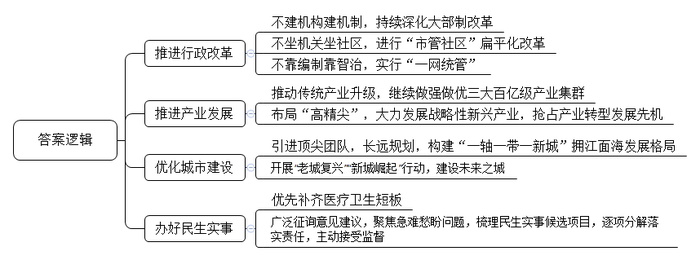
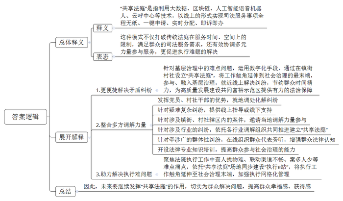
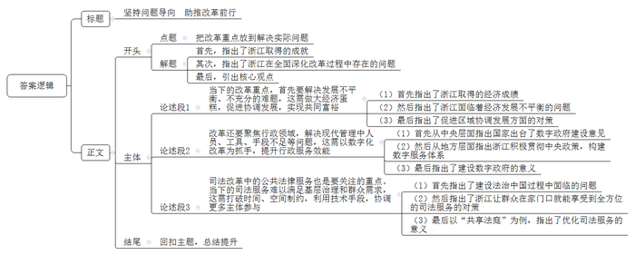

# 2023年浙江省公考《申论》题（C卷）

<!-- gwy:overview:start -->
> **浙江 · 2023 · 申论 · C类** ｜ 3 题 · 图片 3 处 · 答案随题折叠

导航：[题目](#题目) · [材料 1](#材料-1)
<!-- gwy:overview:end -->

> 候选采集稿。参考答案及解析来自粉笔页面，不代表官方答案或真实高分答卷；来源使用许可与原卷对应关系仍需人工核实。

## 给定材料

### 材料 1

2019年，浙江龙港撤镇设市，实现从“中国第一座农民城”到“全国首个镇改市”的历史性跨越。龙港改革的难点，是要以40%的行政资源，承接100%的行政管理职能，服务好48.5万常住人口。对此，龙港的解法是：“不建机构建机制、不坐机关坐社区、不靠编制靠智治。”怎么建机制？龙港持续深化大部制改革。对体制机制、组织架构进行系统性深层次重塑，构建一类事项原则上由一个部门统筹、一件事情原则上由一个部门负责的县域行政运行体系。比如“一枚印章管审批”改革，就把涉及7个部门的1146项行政审批事项，统一划转至龙港市行政审批局，推出“一窗通办”新模式，让老百姓“只进一扇门、只盖一枚章”。怎么坐社区？那就是“市管社区”扁平化改革。社区书记直接向市委书记汇报工作，社工“零距离”对接市局。2022年以来，龙港通过社区联合党委“党建统领”，市领导和部门捆绑社区“组团服务”，社会组织、企业、乡贤、志愿者等社会力量“多元共治”，实现了80%以上的基层问题和群众需要的服务在社区得到解决。怎么靠智治？龙港把数字化作为破解“人少事多”“乡镇缺层”等难题的“船”和“桥”。实行“一网统管”，广泛拓展信息来源，打通各类监督议政平台，率先实行110与12345话务并轨，确保市级指令直达社区、贯通网格，形成闭环联动处置机制。

火热夏日，龙港JT有限公司的生产车间一派热火朝天的景象，一款名为BOPE的同质可回收材料正在数字化生产线上有节奏地流动着。“该产品原材料由我们研究院首席科学家杨院士团队牵头，与中石化北化院联合开发。”龙港高分子产业研究院徐副院长介绍，该材料已经在生产线上规模化生产，不仅实现原材料替代，为下游减少加工工序，进而为生产链上的企业降低生产成本，而且转型升级成功原生产线，突破原先生产范围。撤镇设市后，龙港一手抓传统产业升级，继续做强做优印刷包装、新型材料、绿色纺织等三大百亿级产业集群；一手积极布局“高精尖”，大力发展数字经济、智能装备、生命健康、新能源、新材料等战略性新兴产业，力求“换道冲刺”抢滩占先。全市规上企业数量翻了一番；工业技改投资增长54.5%；企业研发机构、高新技术企业、省科技型企业数量实现倍增；国家级专精特新“小巨人”企业实现零的突破。

龙港从渔村发展而来，城市建设起步晚，基础设施历史欠账较多。有网友曾嘲讽道：“农民城特色，粗放发展，没有品质。”撤镇设市以来龙港引进顶尖团队以百年大计理念抓规划建设，着力构建世纪大道景观轴、滨海都市风情带和龙港新城的“一轴一带一新城”拥江面海发展格局。眼下，龙港紧锣密鼓地开展“老城复兴”“新城崛起”行动，一座崭新的“未来之城”轮廓显现。9月1日，承载龙港推动老城复兴、提升城市品位的滨江核心区综合开发项目举行开工仪式。当天共有高端商业、高端住宅、休闲公园、市政道路等15个子项目同步启动建设，整个区域面积达67公顷，项目总投资56亿元。该区块建成后，将成为地标性的生态居住综合社区。

在家门口享受优质医疗服务，是龙港设市后呼声最高的民生需求之一，龙港市委市政府坚持以人民为中心，把加快补齐龙港医疗卫生短板作为优先事项全力推进，2020年与温医大附一院达成智联合作。根据协议，温医大附一院对龙港市人民医院全面运营管理。依托“全托管”这一强大技术后盾，患急性心肌梗死的砖瓦社区居民老王在龙港市人民医院介入中心获得了有效救治。为让更多市民切身感受到生活在这座城市的幸福感，龙港在广泛征询意见建议的基础上，聚焦群众急难愁盼问题，梳理形成10件民生实事候选项目，逐项分解落实责任，主动接受各界监督，确保高质量办好民生实事。

### 材料 2

“本来海岛之间要倒两班船，来回路上就要花费大半天时间，好在有了‘共享法庭’让我们在家门口就能解决纠纷。”2021年11月30日，家住浙江省岱山县衢山岛的被告毛某与舟山市普陀区的原告贝阿婆，通过就近的“共享法庭”视频连线，顺利达成调解协议。

“一条热线管诉求，一键调解化纠纷。”2021年10月12日，诸暨市人民法院“共享法庭治理端”在东盛社区“共享法庭”投入使用，充分利用大数据、区块链、人工智能语音机器人、云呼中心等技术，实现服务事项全程无纸、一键申请、实时分配、即诉即办。

人民群众对司法服务有现实需求，但基层网格人员力量不足，不少群众不会用、不愿用网络进行纠纷调解。针对近年来基层治理中的难点问题，杭州丽水等地法院积极探索运用数字化手段，通过在镇街村社设立“共享法庭”，将工作触角延伸到社会治理的最末端，参与和融入基层治理。2021年以来，浙江法院以“共享法庭”建设为抓手，为高质量发展建设共同富裕示范区提供了有力的法治保障。

“‘共享法庭’打破传统人民法庭服务乡村振兴在时间和空间上的制约，是架构在数字空间、虚拟在群众身边的人民法庭。”浙江省高级人民法院主要负责人表示。

杭州市临安区人民法院“共享法庭”驻矛调中心工作室联合板桥镇上田“共享法庭”，通过“法官讲法理+村干部讲情理”，合力促成一起侵权责任纠纷当事人达成调解协议，并在线进行了司法确认。浙江高级人民法院相关负责人介绍，浙江法院坚持“一般纠纷就地调”，发挥党员、村社干部熟悉社情民意、群众工作能力强的优势，就地调处化解纠纷；落实“复杂纠纷指导调”，对于村社内的疑难复杂纠纷，积极通过“共享法庭”提供线上指导或线下支持；强化“涉诉纠纷邀请调”，对于涉及镇街、村社辖区内的案件，视情邀请当地调解力量参与调解，做到“纠纷哪里来，调解哪里去”。针对纠纷行业特征明显、类型化纠纷多的特点，浙江法院依托婚姻家庭、金融保险、物业、房产、消费等行业调解组织，整合各方调解力量共同推进建立特设“共享法庭”，实现“行业纠纷行业解”。

“通过今天的旁听、让我们对这起纠纷有了更清晰的法律认知。”2021年12月13日,在衢州市柯城区人民法院设在新新街道金桂社区的“共享法庭”，10余名业主代表在线旁听了柯城区法院花园人民法庭的一起物业纠纷庭审。因疫情影响，庭审旁听等司法活动受到限制，但这类群体性纠纷牵涉广，组织群众旁听有其必要性，而“共享法庭”就很好地解决了这个后顾之忧。

在舟山，“东海渔嫂”是基层社会治理一道“温柔而有力量”的防线。调解“家长里短”光靠“苦口婆心”远远不够，渔嫂们通过定期参加各区县法院依托“共享法庭”开设的法律专业知识培训，提高了参与社会治理的战斗力。

温州市鹿城区人民法院则聚焦执行工作中查人找物难、联动渠道不畅、案多人少等难点痛点，依托“共享法庭”场地同步建设“执行e站”，将执行工作触角延伸至街镇、村社等社会治理末端，为加强执行网格化管理、从源头“切实解决执行难”问题作出了有益探索。

### 材料 3

党的二十大报告强调，“扎实推进共同富裕”。报告中的“扎实”两字，透露出实现共同富裕是一个长期的历史过程，而且是个难度系数很高的过程。通过高质量发展做大蛋糕，是实现共同富裕的基础。当下，中国经济面临需求收缩、供给冲击、预期转弱“三重压力”，叠加百年变局和世纪疫情“两大变量”，做大蛋糕面临前所未有的难度。即便是经济社会发展走在全国前列的浙江，也感受到与预期目标的差距。面对挑战，浙江作出积极回应。以经济发展为例，过去一年，浙江的创新体系和产业培育体系进一步明确，目标是培育4个万亿级世界级先进产业群，若干高成长性百亿级“新星”产业群，这些都是浙江立足共同富裕的长期性，眼光放远，面向未来，对经济发展作出的部署。

党的二十大报告提到，“促进区域协调发展。深入实施区域协调发展战略、区域重大战略、主体功能区战略、新型城镇化战略，优化重大生产力布局，构建优势互补、高质量发展的区域经济布局和国土空间体系”。过去一年，浙江“山区26县”大多经济指标增幅超过全省平均，有个问题却很难忽视：山区县发展确实更快了，但实际上由于基数差异较大，区域间的绝对差距仍在拉大。这个问题怎么解决？浙江省经信厅课题组曾对山区工业摸过一次“家底”，通过梳理每个县的基础和特色，引导各地壮大主导产业、培育新兴产业。特色、高新、低碳，成为山区26县产业发展的关键词。遂昌金属制品、天台汽车零部件、青田不锈钢、龙游特种纸、永嘉泵阀、淳安水饮料、缙云机械装备等7个超百亿产业已经出现，另外还有3个超70亿产业，山区26县的生态工业正在“使劲”。

浙江城乡协调水平在全国首屈一指，2021年，浙江城乡居民收入比已经降低到1.94，全国的数据是2.50。有不少专家认为，从居民收入、公共服务、基础设施建设等方面看，浙江进入了城乡协调的瓶颈期。也因此，浙江在缩小城乡差距方面，想了不少新办法。“千村示范、万村整治”工程始于2003年，获得过联合国最高环保荣誉“地球卫士奖”。2021年，“千村示范、万村整治”工程迎来又一轮迭代，开始转向全城创建新时代美丽乡村。这次提升，将乡村数字化改革、未来乡村试点、新时代乡村集成改革、推进乡村治理体系和治理能力现代化等内容纳入“千村示范、万村整治”工程。同时，浙江迈入农村改革的深水区，逐渐从富农增收、村容村貌整治转向体制机制创新。比如，作为国家城乡融合发展11个试验区之一，浙江嘉湖片区实施方案正式获批，在建立进城落户农民依法自愿有偿转让退出农村权益制度、建立农村集体经营性建设用地入市制度、建立生态产品价值实现机制等方面进行率先探索。

党的二十大报告提出，增进民生福祉，提高人民生活品质，重要路径是“增加低收入者收入，扩大中等收入群体”。高质量发展建设共同富裕示范区，浙江有个重大使命——率先基本形成以中等收入群体为主体的橄榄型社会结构。2022年上半年出台的浙江“扩中”“提低”行动方案，明确了“扩中”“提低”基本原则、主要目标、实施路径等，有不少创新点。比如在全国率先划定中等收入群体的“底线”——家庭年可支配收入10万元；画出“橄榄型社会”的基本轮廓——到2025年，家庭年可支配收入10万元至50万元群体比例达80%，20万元至60万元群体比例达45%。

### 材料 4

作为浙江全面深化改革的总抓手，数字化改革依托先发优势，向深度和广度进军，推进中国式现代化在浙江生动实践。2022年，浙江确定了94项重大改革、143个重大应用建设、21项牵一发动全身重大改革。这些重大改革和重大应用，重点围绕浙江经济社会发展中面临的一些重大机制障碍和瓶颈制约。抓好这些关键改革，来引领撬动各方面各领域改革，是浙江全面深化改革的推进路径，也是数字化改革能持续取得实效的关键所在。比如，建立健全公权力大数据监督机制，是浙江在省域层面坚持和完善党和国家监督体系的有益实践。通过数字化改革，公权力监督从过去的靠“人力”，正逐步转变为依托大数据监督。基于海量数据，高级算法，“公权力大数据监督”应用对“算力”进行深度挖掘运用，以数字化进一步推动正风肃纪反腐，提升监督效能。截至8月，“公权力大数据监督”应用已归集行权数据9600万条，产生红色预警3.7万条，挽回直接损失9500万元。

迈向现代化不能凭赤手空拳，需要有更宽广的视野，来找到与之相适应的工具手段方法。10月18日18时许，温州市瓯海区大综合一体化执法监管数智应用平台发出AI预警，系统识别到潘桥街道上汇路大象城映象厂场附近有流动摊贩聚集。群众通过“浙里办App”上的“温州智慧城管”应用反映的线索也被调出。值班人员锁定问题后迅速远程打开事发地的智能设备启动“空中喊话”进行劝导，并通过指挥平台向潘桥街道综合行政执法队发出指令。15分钟后，执法人员到达现场开始集中整治劝导流动摊贩规范经营并通过执法记录仪将执法现场实时传回指挥大厅，执法情况实现全过程监督……半小时不到，上汇路恢复畅通。

数字化改革行稳致远，必须进一步建立健全有效推进机制。目前，从各地各部门看，都形成了“一把手”亲自抓改革的机制；从大系统看，浙江数字化改革有了一体化智能化公共数据平台，党建统领整体智治、数字政府、数字经济、数字社会、数字文化、数字法治、基层治理等“6+1”系统以及理论体系和制度体系构成的数字化改革话语体系。以浙江省市场监管局为例，至今年上半年已上线14个重大应用，实现核心业务数字化全覆盖，不仅在全省数字化改革中领跑，更重要的是破解了在平台经济规范运行、外卖行业管理、冷链管理等160多个行业中的痛点难点问题。避免碎片化和低水平重复建设，是确保改革不走偏的关键，这也是浙江此前在改革中一直强调的。一方面，各地各部门要抓住国家所需、群众所盼、未来所向，突出问题导向，不断谋划推进重大改革；另一方面，“一地创新、全省共享”机制要迭代完善，推动各地部门的应用，使之能在更大范围内复制推广，调动起社会各界和基层参与改革的积极性、主动性和创造性。值得一提的是，10月29日公布的2022年数字化改革“最系列”成果中，15项最佳规则和15项最响话语，已将前期数字化改革的经验进行了固化，形成了长效机制。比如《浙江省公共数据条例》，对公共数据的管理和应用创新、保障数字化改革、推进深化数字浙江建设等在法律层面进行了明确。

## 题目

### 第 1 题

**“资料**1**”介绍了龙港撤镇设市三年来的改革创新实践，请你概括其主要做法。（20分）**

关联材料：材料 1

作答要求：

要求：

（1）全面、准确、有条理；

（2）不超过350字。

第 1 题 · 答案与解析

**参考答案（粉笔题库参考内容）**

1.推进行政改革。不建机构建机制，持续深化大部制改革；不坐机关坐社区，进行“市管社区”扁平化改革；不靠编制靠智治，实行“一网统管”。

2.推进产业发展。推动传统产业升级，继续做强做优三大百亿级产业集群；布局“高精尖”，大力发展战略性新兴产业，抢占产业转型发展先机。

3.优化城市建设。引进顶尖团队，长远规划，构建“一轴一带一新城”拥江面海发展格局；开展“老城复兴”“新城崛起”行动，建设未来之城。

4.办好民生实事。优先补齐医疗卫生短板；广泛征询意见建议，聚焦急难愁盼问题，梳理民生实事候选项目，逐项分解落实责任，主动接受监督。

**参考答案说明**：本参考答案围绕“推进行政改革”“推进产业发展”“优化城市建设”“办好民生实事”这四个方面的做法分条撰写，各条具体要点之间在内容上相互并列，没有交叉。

**解析状态：unknown（来源未提供）**

### 第 2 题

**根据****“资料**4**”，谈谈你对“共享法庭”建设的理解。（30分）**

关联材料：材料 2

作答要求：

要求：

（1）理解准确，观点鲜明；

（2）论述深刻，内容全面；

（3）不超过600字。

第 2 题 · 答案与解析

**参考答案（粉笔题库参考内容）**

“共享法庭”是指利用大数据、区块链、人工智能语音机器人、云呼中心等技术，以线上的形式实现司法服务事项全程无纸、一键申请、实时分配、即诉即办。这种模式不仅打破传统法庭在服务时间、空间上的限制，满足群众的司法服务需求，还有效协调多元力量参与服务，更促进执行难题的解决。

具体来说：

1.更便捷解决矛盾纠纷。针对基层治理中的难点问题，运用数字化手段，通过在镇街村社设立“共享法庭”，将工作触角延伸到社会治理的最末端，参与、融入基层治理，就近线上解决纠纷，节约群众时间精力，为高质量发展建设共同富裕示范区提供有力的法治保障。

2.整合多方调解力量。发挥党员、村社干部的优势，就地调处化解纠纷；针对疑难复杂纠纷，提供线上指导或线下支持；针对涉及镇街、村社辖区内的案件，邀请当地调解力量参与；针对涉及行业的纠纷，依托各行业调解组织共同推进建立“共享法庭”；针对牵涉广的群体性纠纷，在线组织群众代表旁听，增强群众法律认知；开设法律专业知识培训，提高群众参与社会治理的能力。

3.助力解决执行难问题。聚焦法院执行工作中查人找物难、联动渠道不畅、案多人少等难点痛点，依托“共享法庭”场地同步建设“执行e站”，将执行工作触角延伸至社会治理末端，加强执行网格化管理。

因此，未来要继续发挥“共享法庭”的作用，切实为群众解决问题，提高群众幸福感、获得感。

**参考答案说明**：（1）从内容上来看，围绕“‘共享法庭’建设”这一主题，先对“共享法庭”进行解释说明，接着表达了肯定的态度。展开解释部分从“更便捷解决矛盾纠纷”“整合多方调解力量”“助力解决执行难问题”这三个方面进行了解释；结尾部分添加了结束语，表达了对“共享法庭”的期待和展望。（2）形式上，本参考答案做到了分段、分条撰写，整体上条理较为清晰。

**解析状态：unknown（来源未提供）**

### 第 3 题

**习近平书记指出：****“每个时代总有属于它自己的问题，只要科学地认识，准确地把握，正确地解决这些问题，就能够把我们的社会不断推向前进”。结合给定资料，以“把改革重点放到解决实际问题”为主题，自选角度，自拟题目，写一篇议论性文章。（50分）**

关联材料：材料 1、材料 3、材料 4、材料 2

作答要求：

要求：

（1）主旨明确，结构完整，思路清晰；

（2）内容充实，论述深刻，语言流畅；

（3）不拘泥于给定资料；

（4）字数1000-1200字。

第 3 题 · 答案与解析

**参考答案（粉笔题库参考内容）**

**坚持问题导向** **助推改革前行**

在实干争先、与时俱进的精神引领下，浙江在经济社会发展方面走在了全国前列。但在全面深化改革的过程中，浙江依然面临着区域发展不平衡、不充分、行政服务效能有待提升、司法服务无法满足群众诉求等改革难题。因此，必须要坚持问题导向，敢啃“硬骨头”，才能助推浙江发展迈上新台阶！

**当下的改革重点，首先要解决发展不平衡、不充分的难题，这需做大经济蛋糕，促进协调发展，实现共同富裕。**浙江用约占全国4%的人口总量，在全国1%的土地上，创造了全国7%的经济总量。然而，在“共同富裕”的长期目标下，浙江虽然整体经济蓬勃发展，却也面临着区域、城乡间发展基数差异较大、绝对差距仍在扩大的瓶颈。因此，在协调区域发展中，需要调研梳理地方基础、特色，构建优势互补、高质量发展的区域经济布局，引导各地壮大主导产业、培育新兴产业，将农村改革转向体制机制创新，进而优化收入结构，实现“扩中”“提低”目标，提高人民生活品质。

**改革还要聚焦行政领域，解决现代管理中人员、工具、手段不足等问题，这需以数字化改革为抓手，提升行政服务效能。**针对跨部门、跨层级、跨区域事项多、环节繁、多次跑、效率低等堵点难点问题，国务院特印发《关于加强数字政府建设的指导意见》，就主动顺应数字化转型趋势，充分释放数字化发展红利，全面开创数字政府建设新局面作出部署。浙江省为贯彻《意见》精神，依托互联网信息技术，构建了全方位、多层次、立体化的数字服务体系，如推出“浙里办”APP，推进“网上办”“掌上办”；通过“互联网+监管”平台建设，形成横向到边、纵向到底的执法监管格局；积极巩固和拓展“最多跑一次”改革成果，实现“一网通办”……这些数字化探索，不仅破解了人少事多、效率低下等困境，也全面提高了政务服务智慧化水平。

**司法改革中的公共法律服务也是要关注的重点。当下的司法服务难以满足基层治理和群众需求，这需打破时间、空间制约，利用技术手段，协调更多主体参与。**长期以来基层网格人员力量不足，群众法制观念薄弱，司法服务不充分，成为建设法治中国的制约瓶颈。为了让群众在家门口就能享受到全方位的司法服务，浙江各地法庭充分利用在线服务平台，加载移动微法院、庭审直播等信息化应用程序，同时协调基层党员干部、热心群众、法律志愿者、行业调解组织等力量充分参与，将司法服务送达老百姓“家门口”“指尖上”。尤其是“共享法庭”的设立，主动延伸司法触角，有效解决了各地之间因山高水远、交通不便带来的时空限制，打通基层司法服务的“最后一公里”，让司法为民成色更足、底色更亮。

问题是时代的声音，新时代新征程，改革所面临问题的复杂程度、解决问题的艰巨程度明显加大，只有聆听时代声音，聚焦改革中的问题，才能真正推动改革稳步向前！

**文章分析**

**坚持问题导向 助推改革前行**

【**标题的优点：**首先，范文的标题突出了“把改革重点放到解决实际问题”这一主题。其次，它在形式上采用对称式结构，使标题更加完整、饱满。】

（1）在实干争先、与时俱进的精神引领下，浙江在经济社会发展方面走在了全国前列。（2）但在全面深化改革的过程中，浙江依然面临着区域发展不平衡、不充分、行政服务效能有待提升、司法服务无法满足群众诉求等改革难题。（3）因此，必须要坚持问题导向，敢啃“硬骨头”，才能助推浙江发展迈上新台阶！

【**开头的优点：**★内容方面。范文的开头是紧扣“把改革重点放到解决实际问题”这一主题展开的。首先，指出了浙江取得的成就；其次，指出了浙江在全面深化改革过程中存在的问题；最后，引出核心观点，指出必须要坚持问题导向。★文字表达方面。使用了“但”“因此”等连接词，使语言表达有逻辑性。】

**当下的改革重点，首先要解决发展不平衡、不充分的难题，这需做大经济蛋糕，促进协调发展，实现共同富裕。**（1）浙江用约占全国4%的人口总量，在全国1%的土地上，创造了全国7%的经济总量。（2）然而，在“共同富裕”的长期目标下，浙江虽然整体经济蓬勃发展，却也面临着区域、城乡间发展基数差异较大、绝对差距仍在扩大的瓶颈。（3）因此，在协调区域发展中，需要调研梳理地方基础、特色，构建优势互补、高质量发展的区域经济布局，引导各地壮大主导产业、培育新兴产业，将农村改革转向体制机制创新，进而优化收入结构，实现“扩中”“提低”目标，提高人民生活品质。

【**论述段****1的优点：**★观点句：范文的观点句是紧扣“把改革重点放到解决实际问题”这一文章主题提出的。形式上，它在段首处直接写出，位置突出，容易发现。内容上，关键词突出，内容要点明确，可以明显看出他是从“经济领域”入手，指出了当下改革的重点是解决区域间经济发展不均衡的问题。★论述内容：（1）首先指出了浙江取得的经济成绩；（2）然后指出了浙江面临着经济发展不平衡的问题；（3）最后指出了促进区域协调发展方面的对策。注意：以上三个方面的内容都是紧扣“当下的改革重点，首先要解决发展不平衡、不充分的难题，这需做大经济蛋糕，促进协调发展，实现共同富裕”这个观点句论述的，论述的针对性强，内容层次丰富。在论述方法上主要采用了讲道理的方式，论述清晰透彻。】

**改革还要聚焦行政领域，解决现代管理中人员、工具、手段不足等问题，这需以数字化改革为抓手，提升行政服务效能。**（1）针对跨部门、跨层级、跨区域事项多、环节繁、多次跑、效率低等堵点难点问题，国务院特印发《关于加强数字政府建设的指导意见》，就主动顺应数字化转型趋势，充分释放数字化发展红利，全面开创数字政府建设新局面作出部署。（2）浙江省为贯彻《意见》精神，依托互联网信息技术，构建了全方位、多层次、立体化的数字服务体系，如推出“浙里办”APP，推进“网上办”“掌上办”；通过“互联网+监管”平台建设，形成横向到边、纵向到底的执法监管格局；积极巩固和拓展“最多跑一次”改革成果，实现“一网通办”……（3）这些数字化探索，不仅破解了人少事多、效率低下等困境，也全面提高了政务服务智慧化水平。

【**论述段****2****的优点：**★观点句：范文的观点句是紧扣“把改革重点放到解决实际问题”这一文章主题提出的。形式上，它在段首处直接写出，位置突出，容易发现。内容上，关键词突出，内容要点明确，可以明显看出他是从“行政领域”入手，指出了当下改革的重点是解决行政管理服务的问题。★论述内容：（1）首先从中央层面指出国家出台了数字政府建设意见；（2）然后从地方层面指出浙江积极贯彻中央政策，构建数字服务体系；（3）最后指出了建设数字政府的意义。注意：以上三个方面的内容都是紧扣“改革还要聚焦行政领域，解决现代管理中人员、工具、手段不足等问题，这需以数字化改革为抓手，提升行政服务效能”这个观点句论述的，论述的针对性强，内容层次丰富。在论述方法上采用了讲道理、举例子相结合，做到了丰富多样。】

**司法改革中的公共法律服务也是要关注的重点。当下的司法服务难以满足基层治理和群众需求，这****需****打破时间、空间制约，利用技术手段，协调更多主体参与。**（1）长期以来基层网格人员力量不足，群众法制观念薄弱，司法服务不充分，成为建设法治中国的制约瓶颈。（2）为了让群众在家门口就能享受到全方位的司法服务，浙江各地法庭充分利用在线服务平台，加载移动微法院、庭审直播等信息化应用程序，同时协调基层党员干部、热心群众、法律志愿者、行业调解组织等力量充分参与，将司法服务送达老百姓“家门口”“指尖上”。（3）尤其是“共享法庭”的设立，主动延伸司法触角，有效解决了各地之间因山高水远、交通不便带来的时空限制，打通基层司法服务的“最后一公里”，让司法为民成色更足、底色更亮。

【**论述段****3****的优点：**★观点句：范文的观点句是紧扣“把改革重点放到解决实际问题”这一文章主题提出的。形式上，它在段首处直接写出，位置突出，容易发现。内容上，关键词突出，内容要点明确，可以明显看出他是从“司法领域”入手，指出了当下改革的重点是解决公共法律服务问题。★论述内容：（1）首先指出了建设法治中国过程中面临的问题；（2）然后指出了浙江让群众在家门口就能享受到全方位的司法服务的对策；（3）最后以“共享法庭”为例，指出了优化司法服务的意义。注意：以上三个方面的内容都是紧扣“司法改革中的公共法律服务也是要关注的重点。当下的司法服务难以满足基层治理和群众需求，这需打破时间、空间制约，利用技术手段，协调更多主体参与”这个观点句论述的，论述的针对性强，内容层次丰富。在论述方法上采用了讲道理、举例子相结合，做到了丰富多样。】

【**论述段之间的关系：**★内容的内在逻辑：论述段1-3分别从“经济”“行政”“司法”的角度展开，论述了当下改革重点要解决的实际问题以及相应的对策。★段与段的外在衔接：在语言表达方面运用“首先”“还要”“也是”进行了衔接，使得论述段之间相互并列，逻辑清晰。】

问题是时代的声音，新时代新征程，改革所面临问题的复杂程度、解决问题的艰巨程度明显加大，只有聆听时代声音，聚焦改革中的问题，才能真正推动改革稳步向前！

【**结尾的优点：**范文的结尾回扣了“把改革重点放到解决实际问题”这个主题，并且进行了总结提升。】

**解析状态：unknown（来源未提供）**

