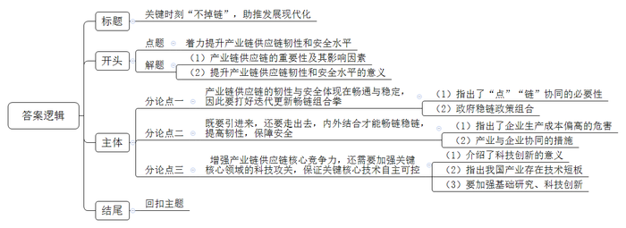

# 2023年浙江省常规、定向紧缺选调生考试《申论》题（网友回忆版）

<!-- gwy:overview:start -->
> **浙江 · 2023 · 申论 · 选调生** ｜ 2 题 · 图片 1 处 · 答案随题折叠

导航：[题目](#题目) · [材料 1](#材料-1)
<!-- gwy:overview:end -->

> 候选采集稿。参考答案及解析来自粉笔页面，不代表官方答案或真实高分答卷；来源使用许可与原卷对应关系仍需人工核实。

## 给定材料

### 材料 1

我叫李凡，正如我的名字一样，是千千万万基层党务工作者中平凡的一员。每每说起服务于民，谈到提升基层社会治理能力，我就会想起金元社区“蝶变记”……

2018年刚任职时，社区工作说起来就让人发愁。社区班子老龄化，组织观念弱；社区有3525户10969人，人员结构较为复杂；邻里不熟，配套匮乏，居民对社区情况更是不关心、不在乎……众人拾柴火焰高，我深知只有调动起社区“亲人”的力量，小社区才能迸发出大能量。

每天一上班我就去找居民“唠家常”，听真话、收意见、提想法，定期召集工作人员对问题需求进行分类。经过全面收集和系统研究，我牵头制定了社区居民所想所盼的“三项清单”。同时，明确目标责任，把辖区内各家单位动员起来，启动“红色领航”工程，选派党建指导员定期参与基层工作，并发动辖区单位成立贵阳市首家“共治委员会”，社区治理迎来新篇章。

社区搞健康培训，辖区卫健单位主动请缨接受任务；辖区有条道路破损了，建筑企业立即开动机器，连夜修补……“共治委员会”逐渐成为群策群力的平台，更是重要纽带，将成员单位凝聚一起，形成政治理论“共学”、党组织“共建”、社会事务“共治”、文化教育“共享”、扶贫解困“共帮”的良好氛围。

打造上下贯通的服务体系，让这个社区“活”起来，才能让邻里间“亲”起来。于是，我带领社区从强化基层党组织领导作用入手，全力打造“金元社区党群服务站”，搭建党建网、民生网、平安网，形成“三网融合”的基层社区治理体系。一位老大爷感动地说：“有了服务站，大家有歇脚的地方了，有倾诉的地方了，心就走到一起了。”就这一句发自肺腑、平凡而真挚的话语，使我瞬间顿悟，社区工作如此平凡，但在群众心里却是如此重要。有时候碰到难心事烦心事，难免憋屈，但回想起老大爷的那一番话，一股强有力的暖流就会注入心中，整个人立马满血复活、干劲十足。

2021年2月4日这天，我们也迎来了最值得纪念的日子，习近平总书记来到金元社区视察。总书记在法治广场上殷殷嘱托：“基层强则国家强，基层安则天下安。”这句话就是我们工作的灯塔和指引，牢牢刻进了我们每个人的心中。“让社区成为居民最放心、最安心的港湾。”这是我们基层党务工作者需要为之努力的目标。担任街道党工委副书记3年多来，“心怀群众，全心全意为群众服务”是我始终坚守的初心和使命，无论前方是荆棘密布还是千难万险，我都将铭记初心使命，并以之作为不断前行的强大动力，一步一个脚印服务好我们的每一位“亲人”！

### 材料 2

我叫李若曼，在失业和工伤保险经办窗口默默奉献了21年。我时刻把参保企业、职工和群众的冷暖挂在心间，认真负责、严谨细致、任劳任怨，积极帮助群众解决急难愁盼问题。

“业务能力过硬，任劳任怨”“上班来得早，下班走得晚”……这是领导和同事眼中的我。这些年来，我牢牢抓住每一次学习的机会，主动学习做笔记、结合窗口做实事，桌上的政策书籍已经翻得不成样，笔记心得已然成为工作宝典。从新兵到熟手，从外行到专家，我凭借扎实的理论功底和优良的工作作风，出色完成了每一项工作，实现了一次又一次的蜕变。

2020年初，面对突如其来的新冠肺炎疫情，我放弃节假日，坚守岗位，冲锋在前，及时配合处领导开发稳岗返还网上经办系统，开通工伤保险待遇绿色通道，以“不见面”经办方式，确保社保服务“不打烊”。那段时间，稳岗返还审核工作量大，我跟同事咬牙坚持，仅用3天时间完成了全省5600余户企业的信息核查比对工作，为全省各级经办机构及时发放稳岗返还资金奠定了坚实基础。

“耐心、细致”“政策讲得透彻”……这是群众眼中的我。我总是站在办事群众的角度思考问题，以“一张笑脸、一声问候、一把椅子、一杯热茶”对待群众，切实解决办事群众的实际困难。有一次，西部矿业集团社保经办人员到窗口办理业务时已临近下班，且所带资料不齐全。得知情况后，我主动加班，帮助收集资料，完成信息录入。还有一次，青海省核工业地质局一名职工在野外工作途中发生事故，被鉴定为二级伤残，符合享受工伤保险配置辅助器具待遇条件。得知他本人腰部以下瘫痪行动不便后，我立即向局领导汇报情况，对接协调定点机构为其量身定做轮椅及相关辅助器具，与安装人员一同前往职工家中进行安装、配置。

21年来，我深深热爱着我的工作。局领导曾询问：“你是局里的老同志，在窗口时间长、压力大，要不要调岗？”虽然心中有一丝波澜，但我还是婉言拒绝了。虽然窗口经办工作比较辛苦，有时还要受一些委屈，但每每看到群众满意的笑脸，我总感到无比踏实和自豪。平时，总会有一些我接待过的群众来看我，有时还会带一些小礼物，我也总是婉言谢绝：“解决大家工伤和失业保险上的困难，是每一位社保经办人员应该做的，你们的满意就是给我最好的礼物！”这些事情同样感动和激励着我身边的工作人员，渐渐汇聚起一股“为人民服务，让人民满意”的强大精神力量。

### 材料 3

我叫刘晓妮，生长于皖北一个偏僻的小村庄，2011年大学毕业后被聘为安徽省第四批大学生村官。聘用期满，我放弃已考取的银行工作，通过省考成为一名普通的乡镇公务员，在蒙洼蓄洪区最下游的郜台乡坚守了近七年，用自己的辛勤和汗水在深度贫困地区谱写了新时代的青春之歌。

虽然从小在农村长大，但第一次走进庄台时，我还是被眼前的场景震撼了。昏暗拥挤的房屋，污水横流的地面，“一线天”的通道，四处堆放的垃圾、柴草垛，我的心一下凉了半截。但想起工作的初心，要凭借自己的努力改善家乡人民的生活面貌。“下村带着我啊”是我跟每个站所都打过的招呼。我总是主动要求到村里去，很快每个庄台的路都摸得清清楚楚，全乡各个村的工作也越来越熟悉。2016年3月，我被推选为乡党委委员。在进班子的第二天就主动申请包保全乡唯一一个深度贫困村宁台村。起初，村里的干部群众对我不信任，以为这个瘦弱的“小丫头”就是来装装样子，我决定用实际行动来改变大家的看法。

两年来，我用耐心把村里的“难缠户”变成了调解员，以身作则调动干部工作积极性；把柳编产业引到村里的车间，让群众在家门口就能打工挣钱；鼓励因残致贫的潘光俊发展蛋鸡养殖产业，帮助他顺利渡过2020年的疫情、汛情……宁台村也从落后村变成了乡里的工作先进村，村里人对我的称呼也变成了“妹子”“侄女”“孙女”。

在我和同事的共同努力下，郜台乡高标准完成年度脱贫目标任务，顺利实现了四个贫困村出列，一个挂牌督战村摘牌，2554户7454人脱贫。我也荣获阜阳市脱贫攻坚“最美帮扶人”称号，作为典型代表在全市表彰大会上交流发言。

2020年7月，汛期进入关键阶段，淮河上游雨大水急，水位节节攀升。7月19日晚上8点接到上级命令，要求7个小时内把蓄洪区内所有群众转移到安全地带。我负责的曹台村仅3处单堤段就长达2公里，需要转移安置的农户有26户60人，时间紧任务重。我拎着喇叭反复排查、宣传、督促，穿着胶鞋在坝底来回穿梭。经过紧张的7个小时，完成自己责任段工作的同时，还协助其他同事把全乡289户807人全部按时转移到安全庄台。

脚下有多少泥土，心中就沉淀多少真情。在郜台乡工作期间，作为班子里最年轻的同志，每当有重大挑战时我都主动靠前担当。身边的同事都说，我这充满能量的干劲儿深深感染了他们，他们也越干越有劲。

很多群众喜欢喊我“小妮儿”。在我们这里，“小妮儿”是对女孩的昵称，这个亲昵的称呼代表着群众对我的疼爱和认可。站在群众的立场说群众的话，说话不说空话，说的话从来不落空，这是赢得群众信任的最大法宝。

2021年5月，因工作需要，我转任阜南县龙王乡党委副书记、乡长。新的环境，新的岗位，新的角色，工作变得更加繁忙，然而永远不变的是那颗做老百姓的“贴心小妮儿”的赤诚之心。

### 材料 4

2022年9月19日，国家主席习近平向产业链供应链韧性与稳定国际论坛致贺信指出，维护全球产业链供应链韧性和稳定是推动世界经济发展的重要保障，符合世界各国人民共同利益。习近平强调，中国愿同各国一道，把握新一轮科技革命和产业变革新机遇，共同构筑安全稳定、畅通高效、开放包容、互利共赢的全球产业链供应链体系，为促进全球经济循环、助力世界经济增长、增进各国人民福祉作出贡献。

### 材料 5

“通则不痛，痛则不通”，这句中医术语，也适合用来形容当下的产业链供应链。当前，世纪疫情叠加贸易摩擦、地区冲突，全球产业链供应链遭受严重冲击。早已深深植入全球产业链分工体系中的浙江，痛感明显。为了畅通、稳定产业链供应链，浙江迅速迭代更新畅链组合拳。

针对人流不畅问题尤其是出国洽谈受阻，浙江在全国首批组织了商务包机和定期航班，支持浙江企业飞出去、见客户、谈合作、签订单。浙江已先后开通商务定期航线3条41个班次，组织商务包机13个班次，累计服务1100多人，签订订单超过10亿美元。

针对产业链供应链上的卡点，浙江积极组织“十链百场万企”对接活动。今年7月以来，全省累计举办对接活动136场，参加企业超过1.7万家，对接订单862亿元，融资2137亿元。

针对全球供应链运输不畅、海外运输时间较长的问题，浙江大力推动企业建设海外仓，打造布局全球、内外联动的外贸跨境服务体系。截至目前，浙江已在全球160个城市建设海外仓791个，为海外供应链的顺畅提供了有效保障。

### 材料 6

从2022年5月起，温州围绕传统支柱产业和新兴主导产业等两大万亿产业集群，共任命20名市领导担任链长、副链长，加上县级特色产业链，全市共74条产业链均设链长，有针对性地协调指导本产业链重大发展问题，帮助产业链补链、延链、固链、强链，推动传统行业的产业链现代化转型。截至11月底，温州在常规展会之外，链长带队新增开展对接活动77场次，对接订单近393亿元，对接项目221个，先后服务企业8357家，其中中小企业占比超过9成。

市汽车零部件产业链链长、市人大常委会相关负责人牵头，一面主动引荐多家整车制造企业资源来温，一面根据此前排摸的链上重点企业名录，邀请相匹配的企业参与整零配套对接。今年7月，桐乡市的H新能源汽车公司受邀走进温州，开展汽车零部件产业链整零配套对接专场活动。“一次对接，预计能为我们带来每年近1亿元的新增产值，这让我们信心大增。”某科技股份有限公司销售经理戴某说。经过几个月的协调，温州现已有8家企业成为H公司的供货商并拿下新订单，20余家温企与其达成合作意向。

前不久，泵阀产业链链办与市贸促会组织一批温州泵阀企业赴北京推介。在随后举行的首届中国（温州）国际泵阀展上，十余个国家的20多位驻华使节参与展会，进企考察，并带动约200名国际买家现场采购，3天内达成意向订单6亿元。此外，包括汽车零部件、电气、生命健康等产业链的链长牵头先后组织5批企业外出对接，达成合作意向9.5亿元。

### 材料 7

党的二十大报告指出，我们要坚持以推动高质量发展为主题，把实施扩大内需战略同深化供给侧结构性改革有机结合起来，增强国内大循环内生动力和可靠性，提升国际循环质量和水平，加快建设现代化经济体系，着力提高全要素生产率，着力提升产业链供应链韧性和安全水平，着力推进城乡融合和区域协调发展，推动经济实现质的有效提升和量的合理增长。

## 题目

### 第 1 题

**材料1\-3是三位“最美公务员”先进事迹资料。所在的单位想将其汇编刊印，供本系统党员干部学习。请你根据材料1\-3撰写一则编者按。（30分）**

关联材料：材料 1、材料 2、材料 3

作答要求：

要求：紧扣资料，导向正确，内容具体，条理性强，不超过350字。

第 1 题 · 答案与解析

**参考答案（粉笔题库参考内容）**

编者按：为提高本系统党员干部为民服务的能力，本期汇编刊印了三位“最美公务员”的先进事迹：社区工作者李凡提升社区治理能力。他听取整理群众问题需求，制定“三项清单”；明确目标责任，动员辖区单位，启动“红色领航”工程，成立共治委员会、社区党群服务站，形成“三网融合”基层治理体系。社保经办人员李若曼优化窗口服务。21年来，她认真负责、任劳任怨，工作作风优良、业务能力过硬；疫情期间放弃休假坚守岗位，确保社保服务不打烊；她耐心细致，热爱工作，积极帮助群众解决急难愁盼问题。大学生村官刘晓妮助力脱贫攻坚。她坚守初心，扎根深度贫困区7年，用耐心和实际行动，转变村民态度，引导产业发展，帮贫扶弱，帮助村民脱贫致富；面对重大挑战主动担当，以身作则调动干部工作积极性。希望大家向他们学习，始终与人民站在一起。

**解析状态：unknown（来源未提供）**

### 第 2 题

**结合给定资料4\-7，联系实际，围绕“着力提升产业链供应链韧性和安全水平”主题，自选角度，自拟题目，写一篇议论性文章。（60分）**

关联材料：材料 1、材料 2、材料 3、材料 4、材料 5、材料 6、材料 7

作答要求：

要求：

（1）主旨明确，结构完整，思路清晰；

（2）内容充实，论述深刻，语言流畅；

（3）不拘泥于给定资料；

（4）字数1000-1200字。

第 2 题 · 答案与解析

**参考答案（粉笔题库参考内容）**

**关键时刻“不掉链”，助推发展现代化**

产业链供应链是现代经济的重要形态，对现代经济体系运行产生着重要影响，但全球产业布局的演变、产业结构的变化、国内外突发因素等都会影响产业链供应链的稳定。因此，党的二十大报告强调“着力提升产业链供应链韧性和安全水平”，这是推动经济高质量发展、加快建设现代化经济体系的重要保障。

产业链供应链在关键时刻不能掉链子，这是大国经济必须具备的重要特征。如何提升产业链供应链韧性和安全水平，促进中国式现代化行稳致远？

**产业链供应链的韧性与安全体现在畅通与稳定，因此要打好迭代更新畅链组合拳。**产业链供应链的发展重在“点”“链”协同，提升其韧性和安全水平，需要每个“卡点”之间无缝衔接，各要素之间互通有无。但因世纪疫情的影响，加之国内外环境的动荡，使得人流、物流等活动不畅，“断链”风险加剧。因此，要打出组合拳，出台稳链办法。一方面成立产业链供应链应急保障专班，做好重点企业的服务和保障工作；另一方面制订重点工业企业闭环生产方案，确保生产不停、链条不断、产能不减、秩序不乱；还要积极组织企业对接活动，促进各生产要素的流动。如此，才能稳住产业链供应链，进而稳住经济大盘。

**既要引进来，还要走出去，内外结合才能畅链稳链，提高韧性，保障安全。**要素市场化水平在一定程度上决定了企业生产成本，企业生产成本偏高，可能引发产业链供应链上的企业外迁，从而削弱产业链供应链韧性。因此，要优化产业企业发展环境，实施重点产业链供应链上产业与企业的协同合作。首先，要依托本地的优质资源，开展企业专场对接活动，吸引企业入驻，从而进行延链、补链，打通上下游企业之间的壁垒；其次，推介龙头企业、领军企业及冠军企业走出去，不仅走出本地，还要走出国门，深化开放合作，支持外资研发中心创新发展，打造互利互惠、共生共赢的产业链供应链国际合作体系。

**增强产业链供应链核心竞争力，还需要加强关键核心领域的科技攻关，保证关键核心技术自主可控。**中国式现代化关键在科技现代化。科技创新尤其是原始创新有利于在关键领域形成重大突破性带动作用。当前我国传统产业改造升级速度较慢，关键技术的“高精尖”领域研发储备还不够，导致产业的技术短板制约产业链供应链升级换代。所以要继续加强基础研究，着力攻克“卡脖子”技术和“掉链子”环节，激励自主创新，强化企业科技创新主体地位，以创新链推动产业链资金链人才链的深度融合，从而确保国民经济循环畅通。

新征程上，我们要顺应产业发展大势，把增强产业链供应链韧性和安全水平放在更加重要的位置，构筑安全稳定、畅通高效的产业链供应链体系，为现代化、高质量发展奠定坚实基础。

**文章分析**

**关键时刻“不掉链”，助推发展现代化**

【**标题的优点：**标题中含有主题词，使文章主题更突出、清晰。其次，形式上采用了比喻的修辞手法，使得标题更加形象生动，有吸引力。】

（1）<u>产业链供应链是现代经济的重要形态</u>，<u>对现代经济体系运行产生着重要影响</u>，但全球产业布局的演变、产业结构的变化、国内外突发因素等都会影响产业链供应链的稳定。（2）因此，党的二十大报告强调“着力提升产业链供应链韧性和安全水平”，<u>这是推动经济高质量发展、加快建设现代化经济体系的重要保障</u>。

【**开头的优点：**★内容方面。范文的开头是紧扣题目给定的“着力提升产业链供应链韧性和安全水平”这一主题展开的。首先，介绍产业链供应链的重要性及其影响因素；其次，指出了提升产业链供应链韧性和安全水平的意义。★文字表达方面。运用了排比等修辞手法，使语言表达有逻辑性、并增强文章气势。】

产业链供应链在关键时刻不能掉链子，这是大国经济必须具备的重要特征。如何提升产业链供应链韧性和安全水平，促进中国式现代化行稳致远？

【**过渡段的优点：**范文过渡段分析了产业链供应链的重要性，注意过渡段末尾的“如何提升产业链供应链韧性和安全水平，促进中国式现代化行稳致远”是用来引起下文的过渡句。】

**产业链供应链的韧性与安全体现在畅通与稳定，因此要打好迭代更新畅链组合拳。**（1）<u>产业链供应链的发展重在“点”“链”协同</u>，<u>提升其韧性和安全水平</u>，<u>需要每个“卡点”之间无缝衔接</u>，<u>各要素之间互通有无</u>。但因世纪疫情的影响，加之国内外环境的动荡，使得人流、物流等活动不畅，“断链”风险加剧。（2）因此，<u>要打出组合拳</u>，<u>出台稳链办法</u>。一方面<u>成立产业链供应链应急保障专班</u>，<u>做好重点企业的服务和保障工作</u>；另一方面<u>制订重点工业企业闭环生产方案</u>，<u>确保生产不停、链条不断、产能不减、秩序不乱</u>；还要<u>积极组织企业对接活动</u>，<u>促进各生产要素的流动</u>。如此，才能稳住产业链供应链，进而稳住经济大盘。

【**论述段1的优点：**★观点句：范文的观点句是紧扣“着力提升产业链供应链韧性和安全水平”这一文章主题提出的。形式上，它在段首处直接写出，位置突出，容易发现。内容上，关键词突出，内容要点明确，可以明显看出主要论述从“产业链供应链的韧性与安全的体现”方面入手。★论述内容：（1）先指出了“点”“链”协同的必要性；（2）再从专班服务、生产方案、公司对接等角度给出了稳链政策组合。注意：以上几个方面的内容都是紧扣“推产业链供应链的韧性与安全体现在畅通与稳定，因此要打好迭代更新畅链组合拳”这个观点句进行分析论述的，论述的针对性强，内容层次丰富。在论述方法上主要采用了讲道理与举例子结合，论述清晰透彻。】

**既要引进来，还要走出去，内外结合才能畅链稳链，提高韧性，保障安全。**（1）<u>要素市场化水平在一定程度上决定了企业生产成本</u>，<u>企业生产成本偏高</u>，<u>可能引发产业链供应链上的企业外迁</u>，<u>从而削弱产业链供应链韧性</u>。（2）因此，<u>要优化产业企业发展环境</u>，<u>实施重点产业链供应链上产业与企业的协同合作</u>。首先，<u>要依托本地的优质资源</u>，<u>开展企业专场对接活动</u>，<u>吸引企业入驻</u>，<u>从而进行延链、补链，打通上下游企业之间的壁垒</u>；其次，<u>推介龙头企业</u>、<u>领军企业及冠军企业走出去</u>，<u>不仅走出本地</u>，<u>还要走出国门</u>，<u>深化开放合作</u>，<u>支持外资研发中心创新发展</u>，<u>打造互利互惠、共生共赢的产业链供应链国际合作体系</u>。

【**论述段2的优点：**★观点句：范文的观点句是紧扣“着力提升产业链供应链韧性和安全水平”这一文章主题提出的。形式上，它在段首处直接写出，位置突出，容易发现。内容上，关键词突出，内容要点明确，可以明显看出主要论述从“企业既要引进来，还要走出去”方面入手。★论述内容：（1）指出了企业生产成本偏高的危害；（2）从吸引企业入驻、推介企业走出去等角度阐释了产业与企业协同的措施。注意：以上几个方面的内容都是紧扣“既要引进来，还要走出去，内外结合才能畅链稳链，提高韧性，保障安全”这个观点句进行分析论述的，论述的针对性强，内容层次丰富。在论述方法上主要采用了讲道理的方式，论述内容贴切合理。】

**增强产业链供应链核心竞争力，还需要加强关键核心领域的科技攻关，保证关键核心技术自主可控。**（1）<u>中国式现代化关键在科技现代化</u>。<u>科技创新尤其是原始创新有利于在关键领域形成重大突破性带动作用</u>。（2）<u>当前我国传统产业改造升级速度较慢</u>，<u>关键技术的“高精尖”领域研发储备还不够</u>，<u>导致产业的技术短板制约产业链供应链升级换代</u>。（3）<u>所以要继续加强基础研究</u>，<u>着力攻克“卡脖子”技术和“掉链子”环节</u>，<u>激励自主创新</u>，<u>强化企业科技创新主体地位</u>，<u>以创新链推动产业链资金链人才链的深度融合</u>，<u>从而确保国民经济循环畅通</u>。

【**论述段3的优点：**★观点句：范文的观点句是紧扣“着力提升产业链供应链韧性和安全水平”这一文章主题提出的。形式上，它在段首处直接写出，位置突出，容易发现。内容上，关键词突出，内容要点明确，可以明显看出主要论述从“加强关键核心领域的科技攻关”方面入手。★论述内容：（1）先介绍了科技创新的意义；（2）再指出我国产业存在技术短板；（3）强调要加强基础研究、科技创新。注意：以上几个方面的内容都是紧扣“增强产业链供应链核心竞争力，还需要加强关键核心领域的科技攻关，保证关键核心技术自主可控”这个观点句进行分析论述的，论述的针对性强，内容层次丰富。在论述方法上主要采用了讲道理与举例子结合，论述清晰透彻。】

新征程上，我们要顺应产业发展大势，把增强产业链供应链韧性和安全水平放在更加重要的位置，构筑安全稳定、畅通高效的产业链供应链体系，为现代化、高质量发展奠定坚实基础。

【**结尾的优点：**范文的结尾回扣了“着力提升产业链供应链韧性和安全水平”这个主题，并且进行了总结提升。】

**解析状态：unknown（来源未提供）**

