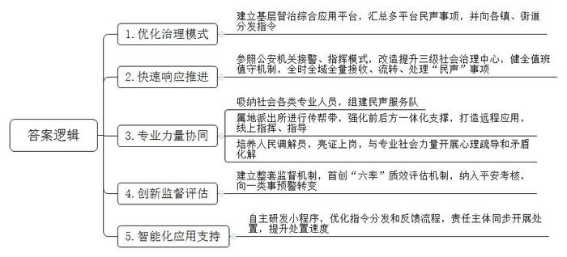
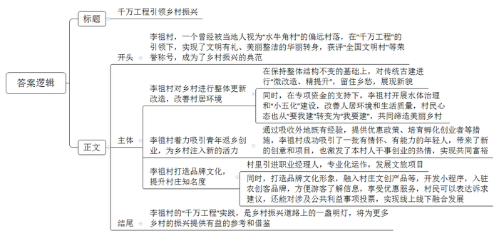
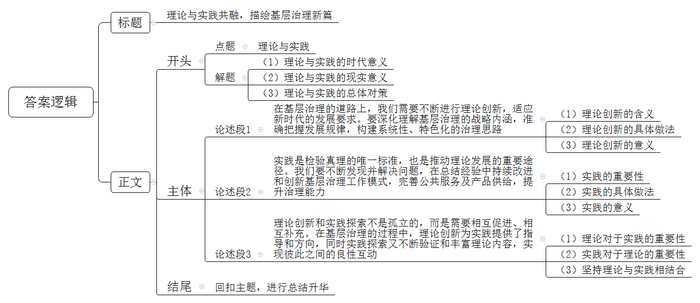

# 2024年浙江省公考《申论》题（C卷）

<!-- gwy:overview:start -->
> **浙江 · 2024 · 申论 · C类** ｜ 3 题 · 图片 3 处 · 答案随题折叠

导航：[题目](#题目) · [材料 1](#材料-1)
<!-- gwy:overview:end -->

> 候选采集稿。参考答案及解析来自粉笔页面，不代表官方答案或真实高分答卷；来源使用许可与原卷对应关系仍需人工核实。

## 给定材料

### 材料 1

四方天井，琴韵书声。在李祖村一座有着近百年历史的四合院内，孩子们正在乡恋学堂主理人小梦的带领下，读线装书，体验活字印刷和古法造纸技艺。2018年，来到李祖村的小梦被村里的田园风光和淳朴乡风所吸引。“看到村民们的恬静生活，我很受触动，当时便萌生了在村里办阅读空间的想法。”小梦说。有了想法，还要解决场地问题。在村干部帮助下，小梦联系到了这座百年四合院。然而，“这里长期作为堆放物品的仓库，外立面斑驳，墙体也发生了倾斜。”小梦回忆。发愁之时，后宅街道及时伸出援手。“当时，街道组织对墙体进行修缮，帮了我们大忙。”小梦说。不同于一些村子的大拆大建，李祖村对传统古建进行“微改造、精提升”，在保持整体结构不变的基础上，让村子“不变味、展新韵”。

阅读空间的建设是李祖村在“千万工程”推动下实现整体更新改造的典型案例。谁能想到，如今在大家眼中文明有礼、美丽整洁的李祖村，曾经被当地人称为位置偏远、缺乏活力的“水牛角村”（意为看不到发展希望的穷村庄）。

“20年前，出门走的是烂泥路，房前屋后杂草丛生，喝水得从井里打，池塘又黑又臭。”村民老杨回忆，“村里人出门都不好意思说自己是李祖村人。”2004年，在“千万工程”政策的带动下，李祖村以整治村口“臭水塘”为突破口开展水体治理，改善农村人居环境，提高村民生活质量。在专项资金支持下，村里一边逐个清理池塘底部的污泥，让池水恢复清澈；一边铺设供水管线，让村民家里能用上干净安全的自来水。经过一年多整治，村民们惊喜地发现池塘里的水变干净了。“住在池塘边成了一种享受。”池塘附近的居民说。

水质变好只是第一步。2005年，李祖村启动包括道路硬化、路灯亮化、卫生洁化、家庭美化、环境优化等在内的“小五化”建设，为连通城区的道路铺上水泥，开展管线综合治理，增容布点近10台变压器。沿着村路安上的路灯，不仅让村庄亮了起来，也让村民的心里更加敞亮。

随着“乡村变美了、生活变好了”成为村民们的共同感受，大家的心态也从“要我建设美丽乡村”向“我要建设美丽乡村”转变。在村民的共同努力下，令人头疼的垃圾分类，通过村规民约的制定与执行，有了显著改善；住房困难户、危旧房拆迁户们搬进了舒适的小高层，他们曾居住的危旧房地基上，造起了全村共享的公共空间；历史悠久的老宅旧屋，则由村里精心修缮和改造，打造成年轻创客的创业空间。现如今，走进李祖村，家家户户房前屋后繁花似锦、绿植遍地，让人心旷神怡。在“千万工程”的引领下，李祖村获评“全国文明村”“浙江省第二批未来乡村”等荣誉称号。

### 材料 2

穿过共富广场，走上一段石阶，生机盎然的栀子树下，藏着一家人气颇高的糖水铺。“咱们家的糖水都是现煮现熬，这是我们店里的招牌——南瓜挞。”店主小红正向到店的客人热情介绍。

去广东佛山打过工，也在义乌市区开过店，谈到为什么最后选择李祖村？出生在湖南的小红回答得干脆：“第一次来李祖村，我就被山坡上金灿灿的油菜花吸引。”吸引她的不只是山间的美景，更有村里无处不在的温情。与李祖村初识之后，小红的身影便常常出现在村里，挑选衣物、学习扎染、感受活字印刷……“慢慢地，我和村里的创业者们成了好朋友。”小红说，“他们对于乡村的情怀感染了我。”2021年3月，小红又一次来到了李祖村，不过这次她并不是以游客身份出现，而是要为新店选址。“村里的生活，温暖而有趣。成为‘新村民’后，大家都会主动为村里想点子、出主意。”小红说。

为了让年轻人愿意来、留得住，李祖村没少下气力。外出调研，吸收外地的既有经验；寻找团队，持续培育孵化乡村创业者；制定政策，出台免房屋租金、给予项目启动资金等优惠条件……“村子要想有活力，就需要一群对农村有情怀的年轻人。”李祖村党支部书记说。

日益浓厚的创业氛围，也激发了本村人干事创业的热情，小锋便是其中之一。2023年2月，在电商领域打拼多年的小锋回到李祖村，路过村口的生机花园农场时，里面的果蔬、鲜花和观景树让他无法挪开脚步……“没想到村里有了染坊、咖啡馆，还有这么多年轻人。”小锋感慨。于是他有了回乡创业的念头：在村子里开办一家生态农场。联系沟通、选择地点、签订协议……从创意到生意，他只用了4个多月。2023年7月，在村里流转的75亩坡地上，小锋开始了新农人生活。每天凌晨5点起床，一直得干到晚上8点才回家休息，他的皮肤被晒得黝黑。收获时，他还联系村民帮忙采收，并支付报酬。“希望通过我的努力带动乡亲们一同致富。”小锋说。

目前，李祖村已经有200余名青年在此创新创业。

### 材料 3

策划演唱会、举办共富“村晚”、组织共富市集……一段时间以来，李祖村内各类精彩活动轮番上演，赢得了人气、获得了好评，而这些活动的成功举办，离不开职业经理人小谢的出谋划策。

小谢与李祖村的牵手，源自一场双向奔赴。2020年，Z省深化“千万工程”建设新时代美丽乡村现场会召开前夕，李祖村原村主任主动找到小谢，邀请她来李祖村当乡村运营职业经理人，而当时已经策划了“大陈小集”等文创区域品牌的小谢，也希望能够为李祖村的发展贡献力量。

2020年7月，小谢以职业经理人的身份来到李祖村。团队沉下心来，从招商、创业者管理、宣传推广、活动运营等环节入手，深度挖掘乡村潜力，带动发展了“十亩时光露营基地”“妈妈的味道美食街”等一批文旅项目。

在进村的路上，有一个卡通人物形象引人注目。它以梨为形，笑脸盈盈，仿佛在跟每位进村的人展现着李祖村的热情与活力。作为李祖村的品牌文化形象，它有个特别的名字——“有礼的祖儿”。谈起这一品牌文化形象的诞生，李祖村的乡村策划师小李直言“不易”。“最初，村民并不理解为什么要打造品牌文化形象。”小李介绍。2021年，“有礼的祖儿”在文博会上精彩亮相，提升了村子的知名度，这一做法才慢慢被村民接受。

在“有礼的祖儿”小程序里，村里56家农创客品牌正在陆续入驻，点开“创客之家”，各家店铺的详细介绍、联系方式一目了然。注册登录的游客，都可获得李祖村“云村民”的专属身份，和原乡人、归乡人同享积分兑换商品折扣的优惠服务。“后续，我们还会为各个品牌制作二维码标牌，张贴在实体商铺门前，将游客导流到线上，吸引更多‘云村民’共同参与李祖村的乡村建设。”小谢说。

如今，线下，“有礼的祖儿”融入村子的文创周边产品、指示标识等，使村庄更年轻；线上，“有礼的祖儿”不仅为创客、访客服务，还推动着乡村治理的进程。打开小程序“有礼的祖儿”，村民不仅可以表达诉求、提供建议，解决邻里纠纷、事故灾害、公共卫生等问题，还能够对涉及公共利益的事项进行投票等。

### 材料 4

Z省有700多条风景线，2000多个特色精品村，走在其中，“一户一处景，一村一幅画，一线一风光”。农村“30分钟公共服务圈”“20分钟医疗卫生服务圈”，等级公路比例100%……Z省乡村的今日之景，与2003年习近平同志在Z省工作时亲自谋划、亲自部署、亲自推动的“千村示范、万村整治”工程密不可分。

20年间，“千万工程”持续深化，Z省历届省委、省政府久久为功。2003-2010年，“千村示范、万村整治”示范引领，主要以村庄环境综合整治为重点，推动广大乡村更加整洁有序；2011-2020年，“千村精品、万村美丽”深化提升，主要以美丽乡村建设为重点，推动广大乡村更加美丽宜居；2021年起，“千万工程”步入“千村未来、万村共富”迭代升级新阶段，重点是提升乡村产业匹配度、基础设施完备度、公共服务便利度、城乡发展融合度；2023年，Z省提出新型城镇化和乡村振兴“双轮驱动”，把提高县城承载能力与深化“千万工程”结合起来。

在不同的阶段，“千万工程”的恒久使命就是“破题”，为乡村发展寻找最适合的答案。而越来越多的乡村，也正在重新定义乡村的价值。松阳，长三角区域传统村落最集中的地区之一，他们不急着把农村变得像城市，而是实施传统村落保护项目与“拯救老屋”行动，大批老屋被修复改造成精品民宿、艺术家工作室、乡村博物馆。义乌，当地人有着活络的经商头脑，农创客、乡村职业经理人出现在乡村，他们在村里的老旧厂房和闲置农房里创业，村民因此有了房租新分红、就业新机会……

在第17届中国—东盟社会发展与减贫论坛上，缙云县壶镇镇联丰村党总支书记概括了“千万工程”给村里带来的三重变化：“第一步变干净，第二步变漂亮，第三步有特色。”特色由何而来？村口的烂泥塘变成了荷花塘、沿线开发卡丁车项目，带动村集体经济由负转正，连年分红；村里每季度评选美丽家庭，村民们踊跃参与、暗自较劲的过程，也是共建共享家园的过程。

### 材料 5

键盘敲击声此起彼伏，一条条指令从指尖发出……走进J市南湖区社会治理综合指挥服务中心，宽敞明亮的大厅内，“民声一键办”专席上的工作人员正在井然有序地“派单”。

“我们将110报警平台接到的非警务类事项，12345政务服务便民热线接到的投诉类、求助类电话，基层网格员、社区干部等上报的疑难矛盾纠纷线索等都汇总在基层智治综合应用平台，并通过该平台向各镇、街道分发指令。”南湖区社会治理综合指挥服务中心工作人员介绍。

6月7日凌晨2时许，有群众称经开区塘汇街道鸣阳路茶香坊某烧烤店声音太吵，影响参加高考的学生休息，接报后塘汇街道民声服务队赶到现场劝说，并跟老板沟通高考期间提醒食客尽量降低声音。上午，队员结合夏季治安打击整治行动，对附近深夜营业的夜宵场所逐一开展走访宣传，提醒经营者和食客在此特殊时间段积极配合。J市公安局情报指挥中心有关负责人介绍，以前碰到这类事件，群众不知道找谁能尽快解决问题，“民声一键办”改革以来，以公安110接处警体系为样本，参照公安机关110指挥中心、派出所综合指挥室模式，对“市、县、镇（街道）”三级社会治理中心进行改造提升，健全7×24小时值班值守机制，全时全域全量接收、流转“民声”事项。

没有打错的热线，只有顺畅的对接。群众无论打哪个电话，内部都能无障碍流转，诉求一一得到解决。7月6日晚，J市独山港镇民声服务队接到一条指令：独山港镇三兴大酒店路口有很多人摆摊，影响群众出行。民声服务队队员小陈前往处理，他来自J市综合执法局独山港中队，熟悉该类占道经营的情况及处理流程，抵达现场后，即刻处理完该事项，现场秩序得以恢复。

“专业力量的合成，可以让处置更快，效率更高，做到有的放矢。”J市独山港派出所所长说。J市全市已建立72支即时响应、协同处置的民声服务队伍，拥有各类人员1341人。针对专职队伍组建之初现场应变能力不足、处置流程不熟等问题，由属地派出所通过“双处警”“跟班作业”等形式进行传帮带。建立前后方一体化支撑机制，打造“警云达”远程应用，当民声服务队遇到“疑难杂症”，民警可全程线上指挥，远程指导服务队开展各项工作。在此基础上，吸收“红船义警”“蓝天救援队”“老娘舅”“民声大姐”等具有专业技能的社会力量，协同开展群众受困施救矛盾纠纷化解、心理健康疏导。针对流转事项中86.33%是矛盾纠纷的特点，J市将有较强专业能力和调解能力、较高群众认可度的民声服务队队员培养成人民调解员，亮证上岗，可以出具有法律效力的《人民调解书》，提高了调解的权威性和效率，也调动了队员的积极性。

流转只是起点，解决才是终点。J市建立受理流转、提级盯办等一整套监督机制，并在全省首创签收率、分流率、反馈率、办结率、回流率、投诉率等“六率”质效评估机制，纳入平安考核。同时，“民声一键办”机制使职能部门与群众的关系更加紧密，为群众办事解难更有针对性，增强了社情民意感知能力，使“一件事处置”向“一类事预警”转变。

嘉善县万洋工业园，入驻企业110家，常态用工8000余人。为快速处置园区内涉企纠纷，嘉善县自主研发“E企快”小程序，指令职能部门和园区物业企业负责人同步开展处置。工作人员通过小程序接受指令，在小程序内一键确认“签收”，到达现场后确认“到达”，处置完毕时反馈处置信息，系统也会一直跟进，直到彻底化解。

自“民声一键办”改革以来，J市全市12345、110与基层智治综合应用平台流转事项7.82万件，12345受理诉求类事项同比下降21.3%，各类“民声”事项办结率达98.1%，其中营商环境事项一次性化解率达99.08%，占比较高的劳资类、消费类纠纷事项办理时限分别从10个、7个工作日都缩短为24小时，“民声”诉求得到了更快、更好、更精准的回应。据第三方机构测评，群众满意度达99.1%。

“‘民声一键办’的深入推进，有效将各类‘民声’事项解决在基层、处置在源头，走出了警源治理的J市路径。”J市公安局相关负责人说。

### 材料 6

党的二十大报告指出，在社会基层坚持和发展新时代“枫桥经验”，及时把矛盾纠纷化解在基层、化解在萌芽状态。“枫桥经验”从涓涓枫溪流淌至全国各地，走过半个多世纪而历久弥新，久经检验依然生机勃勃，它不因循守旧、故步自封，而是在实践中不断守正创新、与时俱进。

走进Z省诸暨市枫桥镇枫源村，村委会办公室“三上三下，民主公开”的标语格外醒目。“一上一下”为收集议题，村两委会从群众中收集议题，通过上门下访征求意见；“二上二下”为酝酿方案，通过召开民主恳谈会，对方案进行深入讨论完善；“三上三下”为审议决策，经村民代表会议表决通过后组织实施。通过“三上三下”的环节，村民的意见得以充分表达并最终体现在决策中，不仅有效提升了决策的科学性，还从源头化解了矛盾。共同参与、群策群力，新时代“枫桥经验”调动人民群众自主自治的积极性，打造人人有责、人人尽责的社会治理共同体。

14.6万常住流动人口、7000多家企业、规上工业产值超千亿元……S市高新区枫桥街道，迅速发展的经济体量和人口规模，与基层治理能力、公共服务体系之间的矛盾十分突出。2021年，S市高新区首个新市民公安志愿者队伍——“新枫景”志愿服务联盟通过民政部门备案，成为合法社会组织法人，活跃在护校安园、邻里守望、矛盾化解等社区工作一线，累计服务时长超过22万小时。“党组织把握大方向的同时，给他们留出足够的发展空间。”S市公安局高新区分局有关负责人说，“通过培育多元主体来完善公共服务和公共产品供给，增强社会组织活力和成长性，使之成为基层治理的有益补充和生力军。”从社会治安领域拓展至各类安全风险预警、防控机制和能力建设；从传统行业拓展至寄递物流、平台经济等新业态；从立足国内拓展至服务对外开放，创新开展涉外纠纷人民调解……

2021年7月8日，Z省解纷码正式上线。因为不同意楼上邻居加装电梯，杭州居民高阿姨扫了扫二维码，上传了她的“烦心事”。接下来，她的难题移交给了平台和杭州市上城区矛调中心，直至她和邻居握手言和。

高阿姨的便利，是Z省打破信息孤岛，推动跨部门、跨领域、跨层级的数据、资源流通，推动矛盾纠纷排查调处化解全链条推进、全系统治理的一个缩影。立足基层治理，更多数字化探索迸发活力——政法一体化、数智枫桥省平台、“大综合一体化”、全域数字法院、检察数据大监督等一批重大应用出台，解决了不少过去想解决却一直无法解决的难题，从源头捕捉风险、发布预警，真正实现“防未然，治未病”有了更坚固的保障。

## 题目

### 第 1 题

**根据资料5，概括“民声一键办”工作的亮点。（20分）**

关联材料：材料 5

作答要求：

要求：全面、准确，有条理，字数不超过300字。

第 1 题 · 答案与解析

**参考答案（粉笔题库参考内容）**

1.优化治理模式。建立基层智治综合应用平台，汇总多平台民声事项，并向各镇、街道分发指令。

2.快速响应推进。参照公安机关接警、指挥模式，改造提升三级社会治理中心，健全值班值守机制，全时全域全量接收、流转、处理“民声”事项。

3.专业力量协同。吸纳社会各类专业人员，组建民声服务队；属地派出所进行传帮带，强化前后方一体化支撑，打造远程应用，线上指挥、指导；培养人民调解员，亮证上岗，与专业社会力量开展心理疏导和矛盾化解。

4.创新监督评估。建立整套监督机制，首创“六率”质效评估机制，纳入平安考核，向一类事预警转变。

5.智能化应用支持。自主研发小程序，优化指令分发和反馈流程，责任主体同步开展处置，提升处置速度。

**解析**

**参考答案说明：**本参考答案从“优化治理模式”“快速响应推进”“专业力量协同”“创新监督评估”“智能化应用支持”五个方面展开，各条答案要点之间在内容上相互并列，没有交叉。

**考点**：特点类

**来源**：2024年浙江省公考《申论》题（C卷）

### 第 2 题

**资料1、2、3是李祖村实施“千万工程”的相关报道，请你根据这三则材料，自拟标题，写一篇短评。（30分）**

关联材料：材料 1、材料 2、材料 3

作答要求：

要求：观点鲜明，论述深刻，结构完整。字数不超过600字。

第 2 题 · 答案与解析

**参考答案（粉笔题库参考内容）**

千万工程引领乡村振兴

李祖村，一个曾经被当地人视为“水牛角村”的偏远村落，在“千万工程”的引领下，实现了文明有礼、美丽整洁的华丽转身，获评“全国文明村”等荣誉称号，成为了乡村振兴的典范。

李祖村对乡村进行整体更新改造，改善村居环境。在保持整体结构不变的基础上，对传统古建进行“微改造、精提升”，留住乡愁，展现新貌。同时，在专项资金的支持下，李祖村开展水体治理和“小五化”建设，改善人居环境和生活质量，村民心态也从“要我建”转变为“我要建”，共同缔造美丽乡村。

李祖村着力吸引青年返乡创业，为乡村注入新的活力。通过吸收外地既有经验，提供优惠政策、培育孵化创业者等措施，李祖村成功吸引了一批有情怀、有能力的年轻人，带来了新的创意和项目，也激发了本村人干事创业的热情，实现共同富裕。

李祖村打造品牌文化，提升村庄知名度。村里引进职业经理人，专业化运作，发展文旅项目；同时，打造品牌文化形象，融入村庄文创产品等，开发小程序，入驻农创客品牌，方便游客了解信息，享受优惠服务，村民可以表达诉求建议，还能对涉及公共利益事项投票，实现线上线下融合发展。

李祖村的“千万工程”实践，是乡村振兴道路上的一盏明灯，将为更多乡村的振兴提供有益的参考和借鉴。

**解析**

**参考答案说明**：（1）格式方面，本参考答案写到了“标题”“正文”两个部分。（2）正文部分，一方面从内容上来看，围绕着“李祖村实施‘千万工程’”这一主题，本参考答案的开头先写到了李祖村的基本情况和对实施“千万工程”的评价；接着主体部分从“对乡村进行整体更新改造，改善村居环境”“吸引青年返乡创业，为乡村注入新的活力”“打造品牌文化，提升村庄知名度”这三个方面展开，最后，结尾部分进行了总结。另一方面，形式上，本参考答案做到了分段、分条撰写，整体上条理较为清晰。

**考点**：评论类

**来源**：2024年浙江省公考《申论》题（C卷）

### 第 3 题

**习近平总书记指出，“我们要根据时代变化和实践发展，不断深化认识，不断总结经验，不断进行理论创新，坚持理论指导和实践探索辩证统一，实现理论创新和实践创新良性互动。”根据你对这句话的理解，结合给定资料，自选角度，自拟题目，写一篇议论性文章。（50分）**

关联材料：材料 2、材料 3、材料 4、材料 5、材料 1、材料 6

作答要求：

要求：

（1）主旨明确，结构完整，思路清晰；

（2）内容充实，论述深刻，语言流畅；

（3）不拘泥于给定资料；

（4）字数1000-1200字。

第 3 题 · 答案与解析

**参考答案（粉笔题库参考内容）**

**理论与实践共融，描绘基层治理新篇**

在波澜壮阔的时代洪流中，理论与实践始终是推动社会前进的双桨。习近平总书记深刻指出：“我们要根据时代变化和实践发展，不断深化认识，不断总结经验，不断进行理论创新，坚持理论指导和实践探索辩证统一，实现理论创新和实践创新良性互动。”这一思想在基层治理的伟大实践中得到了生动的体现。我们要不断进行理论创新，并在实践中检验和发展这些理论，实现理论创新与实践探索的良性互动，才能够在新的历史起点上，以更加坚定的步伐推进全面振兴。

**在基层治理的道路上，我们需要不断进行理论创新，适应新时代的发展要求。要深化理解基层治理的战略内涵，准确把握发展规律，构建系统性、特色化的治理思路。**理论创新不仅仅是对传统治理理念的简单修正，更是一场深刻的变革，我们要站在历史与现实的交汇点上，审视基层社会的多元需求和复杂变化，从而提炼出符合时代特征的新理念、新观点。这意味着，我们不能盲目照搬其他地区的经验，而是要结合本地的实际情况，打造独具特色的治理模式。例如，在农村地区，可以探索“乡村振兴”与基层治理相结合的新模式；在城市社区，可以研究如何通过智能化、信息化手段提升治理效率。唯有如此，才能更好地回应人民群众的新期待。

**实践是检验真理的唯一标准，也是推动理论发展的重要途径。我们要不断发现并解决问题，在总结经验中持续改进和创新基层治理工作模式，完善公共服务及产品供给，提升治理能力。**古人云：“读万卷书，行万里路”。在基层治理的广阔天地里，唯有脚踏实地的操作，才能真切地验证治理理论的真实效用与适用性。每一次的尝试与实践，都是我们与问题的正面交锋，都是我们为提升治理能力而付出的努力。通过实践中的反馈，我们可以更好地了解居民的需求和意见，从而不断完善和优化公共服务及产品的供给。只有这样，我们的治理模式才能不断适应社会的变化，更好地服务于人民群众，实现社会的和谐稳定。

**理论创新和实践探索不是孤立的，而是需要相互促进、相互补充。在基层治理的过程中，理论创新为实践提供了指导和方向，同时实践探索又不断验证和丰富理论内容，实现彼此之间的良性互动。**没有理论的指导，实践可能会迷失方向。通过深入研究社会治理的规律，我们可以形成更加科学、合理的治理方案，从而在实践中减少盲目性，提高治理效率。同时，没有实践探索的验证，理论也只能是空中楼阁。在实践中遇到的问题和挑战，往往能够为我们提供宝贵的经验，反哺理论的发展，使其更加贴近实际，更具可操作性。在基层治理的道路上，我们要坚持理论与实践相结合的原则，不断创新和完善治理模式和手段，推动社会的和谐稳定与发展繁荣。

在新的历史征程上，让我们继续深化理论创新，勇于实践探索，以更加昂扬的姿态、更加坚定的步伐，推进基层治理能力现代化，共同绘制出全面振兴的壮丽画卷。

**解析**

**文章分析**

**理论与实践共融，描绘基层治理新篇**

【**标题的优点：**首先，范文的标题突出了“理论与实践”这一主题；其次，形式上采用对称式结构，使标题更加美观、饱满。】

（1）在波澜壮阔的时代洪流中，理论与实践始终是推动社会前进的双桨。（2）习近平总书记深刻指出：“我们要根据时代变化和实践发展，不断深化认识，不断总结经验，不断进行理论创新，坚持理论指导和实践探索辩证统一，实现理论创新和实践创新良性互动。”这一思想在基层治理的伟大实践中得到了生动的体现。（3）我们要不断进行理论创新，并在实践中检验和发展这些理论，实现理论创新与实践探索的良性互动，才能够在新的历史起点上，以更加坚定的步伐推进全面振兴。

【**开头的优点：**★内容方面：范文的开头是紧扣题目给定的“理论与实践”这一主题展开的。首先，开头点出主题，做到了主题明确。其次，对“理论与实践”这一主题进行了分析阐述，指出了（1）理论与实践的时代意义；（2）理论与实践的现实意义；（3）理论与实践的总体对策。★文字表达方面：引用了领导人讲话，增强了论述内容的权威性；使用了“要……才能”等关联词，使语言表达有逻辑性。】

**在基层治理的道路上，我们需要不断进行理论创新，适应新时代的发展要求。要深化理解基层治理的战略内涵，准确把握发展规律，构建系统性、特色化的治理思路。**（1）理论创新不仅仅是对传统治理理念的简单修正，更是一场深刻的变革，我们要站在历史与现实的交汇点上，审视基层社会的多元需求和复杂变化，从而提炼出符合时代特征的新理念、新观点。（2）这意味着，我们不能盲目照搬其他地区的经验，而是要结合本地的实际情况，打造独具特色的治理模式。例如，在农村地区，可以探索“乡村振兴”与基层治理相结合的新模式；在城市社区，可以研究如何通过智能化、信息化手段提升治理效率。（3）唯有如此，才能更好地回应人民群众的新期待。

【**论述段1的优点：**★观点句：范文的观点句是紧扣“理论与实践”这一文章主题提出的。形式上，它在段首处直接写出，位置突出，容易发现。内容上，关键词突出，内容要点明确，可以明显看出主要论述“不断进行理论创新，适应新时代的发展要求”方面的内容。★论述内容：（1）理论创新的含义；（2）理论创新的具体做法；（3）理论创新的意义。注意：以上三个方面的内容都是紧扣“在基层治理的道路上，我们需要不断进行理论创新，适应新时代的发展要求。要深化理解基层治理的战略内涵，准确把握发展规律，构建系统性、特色化的治理思路”这个观点句进行分析论述的，论述的针对性强，内容层次丰富。在论述方法上主要采用了讲道理和举例子的方式，论述充实透彻、清晰有力。】

**实践是检验真理的唯一标准，也是推动理论发展的重要途径。我们要不断发现并解决问题，在总结经验中持续改进和创新基层治理工作模式，完善公共服务及产品供给，提升治理能力。**（1）古人云：“读万卷书，行万里路”。在基层治理的广阔天地里，唯有脚踏实地的操作，才能真切地验证治理理论的真实效用与适用性。（2）每一次的尝试与实践，都是我们与问题的正面交锋，都是我们为提升治理能力而付出的努力。（3）通过实践中的反馈，我们可以更好地了解居民的需求和意见，从而不断完善和优化公共服务及产品的供给。只有这样，我们的治理模式才能不断适应社会的变化，更好地服务于人民群众，实现社会的和谐稳定。

【**论述段2的优点：**★观点句：范文的观点句是紧扣“理论与实践”这一文章主题提出的。形式上，它在段首处直接写出，位置突出，容易发现。内容上，关键词突出，内容要点明确，可以明显看出主要论述“实践是检验真理的唯一标准，也是推动理论发展的重要途径”方面的内容。★论述内容：（1）实践的重要性；（2）实践的具体做法；（3）实践的意义。注意：以上三个方面的内容都是紧扣“实践是检验真理的唯一标准，也是推动理论发展的重要途径。我们要不断发现并解决问题，在总结经验中持续改进和创新基层治理工作模式，完善公共服务及产品供给，提升治理能力”这个观点句进行分析论述的，论述的针对性强，内容层次丰富。在论述方法上主要采用了讲道理的方式，论述清晰透彻。】

**理论创新和实践探索不是孤立的，而是需要相互促进、相互补充。在基层治理的过程中，理论创新为实践提供了指导和方向，同时实践探索又不断验证和丰富理论内容，实现彼此之间的良性互动。**（1）没有理论的指导，实践可能会迷失方向。通过深入研究社会治理的规律，我们可以形成更加科学、合理的治理方案，从而在实践中减少盲目性，提高治理效率。（2）同时，没有实践探索的验证，理论也只能是空中楼阁。在实践中遇到的问题和挑战，往往能够为我们提供宝贵的经验，反哺理论的发展，使其更加贴近实际，更具可操作性。（3）在基层治理的道路上，我们要坚持理论与实践相结合的原则，不断创新和完善治理模式和手段，推动社会的和谐稳定与发展繁荣。

【**论述段3的优点：**★观点句：范文的观点句是紧扣“理论与实践”这一文章主题提出的。形式上，它在段首处直接写出，位置突出，容易发现。内容上，关键词突出，内容要点明确，可以明显看出主要论述“理论创新和实践探索不是孤立的，而是需要相互促进、相互补充”方面的内容。★论述内容：（1）理论对于实践的重要性；（2）实践对于理论的重要性；（3）坚持理论与实践相结合。注意：以上三个方面的内容都是紧扣“理论创新和实践探索不是孤立的，而是需要相互促进、相互补充。在基层治理的过程中，理论创新为实践提供了指导和方向，同时实践探索又不断验证和丰富理论内容，实现彼此之间的良性互动”这个观点句进行分析论述的，论述的针对性强，内容层次丰富。在论述方法上主要采用了讲道理的方式，论述清晰透彻。】

【**论述段之间的关系**：★内容的内在逻辑：范文的论述段之间是依照并列的逻辑展开的。论述段1先写了“不断进行理论创新，适应新时代的发展要求”，强调“理论创新”；论述段2再写了“实践是检验真理的唯一标准，也是推动理论发展的重要途径”，强调“实践探索”；论述段3最后写了“理论创新和实践探索不是孤立的，而是需要相互促进、相互补充”，强调“理论与实践的关系”。论述层层递进，逻辑清晰。】

在新的历史征程上，让我们继续深化理论创新，勇于实践探索，以更加昂扬的姿态、更加坚定的步伐，推进基层治理能力现代化，共同绘制出全面振兴的壮丽画卷。

【**结尾的优点：**范文的结尾回扣了“理论与实践”这个主题，并且进行了总结升华。】

**考点**：文章写作题

**来源**：2024年浙江省公考《申论》题（C卷）

