# 2024年度浙江省党政机关选调应届优秀大学毕业生《行测》题（网友回忆版）

> 候选采集稿。参考答案及解析来自粉笔页面，不代表官方答案或真实高分答卷；来源使用许可与原卷对应关系仍需人工核实。

## 题型与作答说明

数学运算

（15题）

每道试题呈现一段表述数学关系的文字，要求你迅速、准确地计算出答案。

类比推理

（5题）

根据题目要求，选出一个最恰当的答案。

图形推理

（5题）

请按每道题的答题要求作答。

逻辑判断

（5题）

每道题给出一段陈述，这段陈述被假设是正确的，不容置疑的。要求你根据这段陈述，选择一个答案。注意：正确的答案应与所给的陈述相符合，不需要任何附加说明即可以从陈述中直接推出。

常识判断

（10题）

根据题目要求，在四个选项中选出一个最恰当的答案。

资料分析

（10题）

所给出的图、表、文字或综合性资料均有若干个问题要你回答。你应根据资料提供的信息进行分析、比较、计算和判断处理。

## 题目

### 第 1 题

某单位组织100多名员工在周一、周三、周五晚上参加夜跑。每人至少参加1次，跑1次的人数是跑2次及以上的2.5倍，跑2次的人数是跑3次的10倍。那么该单位仅参加1次夜跑的有多少人？

A. 80

B. 105

C. 110

D. 154

### 第 2 题

甲地在乙地正南15千米处，在丙地正东10千米处。小张和小王分别从乙、丙两地同时出发，分别向正西和正南方向匀速行进。已知小张的速度为5千米/小时且30分钟后两人的直线距离为19.5千米。那么小张到达小王的正北方时，两人的直线距离为多少千米？

A. 21

B. 22

C. 25

D. 27

### 第 3 题

有600克盐、1架天平、1个60克和1个10克的砝码，最少用天平称多少次可以将这些盐平均分为3份？

A. 2

B. 3

C. 4

D. 5

### 第 4 题

某工厂有2个车间，A车间有2名师傅7名学徒，学徒的生产效率是师傅的60%；B车间有3名师傅9名学徒，学徒的生产效率是师傅的70%。两个车间每天各能完成372件产品。某天工厂组织所有师傅集中培训半天，那么这天两个车间的总产量比平时下降的比例在以下哪个区间？

A. 不到20%

B. 20%~25%

C. 25%~30%

D. 超过30%

### 第 5 题

下图中共有25个方格，把3粒相同的棋子放在方格里，要求每行每列最多出现1粒棋子，共有多少种不同的放法?

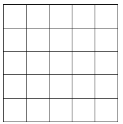

A. 100

B. 300

C. 600

D. 36

### 第 6 题

某党史知识竞赛预赛有10题，甲能答对其中8题，乙能答对其中6题。预赛从10道题中任意抽3题，答对2题或以上可进入下一轮，那么甲、乙都晋级的概率是：

A. 

B. 

C. 

D. 

### 第 7 题

观察下面数列的规律，8/88是这列数中的第几个？

1/1；2/1，1/2；3/1，2/2，1/3；4/1，3/2，2/3，1/4；···

A. 3909

B. 4553

C. 4568

D. 4659

### 第 8 题

幼儿园给小朋友送贴纸，包括动物类贴纸3种、卡通人物类贴纸4种、水果类贴纸4种，每种贴纸各不相同。已知每位小朋友每类贴纸各选择2种，那么这个幼儿园至少有多少个小朋友，才能保证有3个小朋友的贴纸完全相同？

A. 109

B. 110

C. 216

D. 217

### 第 9 题

甲、乙两人完成同一项实验，甲需要11-14小时（实验完成时间为均匀分布，下同），乙需要13-15小时。那么乙比甲更快完成实验的概率是多少？

A. 

B. 

C. 

D. 

### 第 10 题

一项考试每人需参加8次测验，最终成绩为去掉最高分与最低分后剩余成绩的平均值。小张参加这项考试，每次测验分数各不相同且均为大于70、小于90的整数。已知前3次的平均分比前5次的高2分，后3次的平均分比后5次的低2分，第4次和第5次平均分为80分，第2次和第7次成绩被去掉。那么第2次和第7次的成绩最少差多少分？

A. 10

B. 11

C. 12

D. 18

### 第 11 题

某公司在甲、乙、丙3个仓库间调运大米。如果将甲仓库的大米运至乙仓库，则乙仓库的大米变为丙仓库的1.5倍；如果将乙仓库的大米运至丙仓库，则丙仓库的大米比甲仓库的多70吨；如果将丙仓库的大米运至甲仓库，则甲仓库的大米比乙仓库的少20吨。那么调运前，大米最多的仓库比最少的仓库多多少吨?

A. 60

B. 80

C. 100

D. 120

### 第 12 题

纸牌游戏斗地主有3个人参加，包括1个地主和2个农民，结果只有地主获胜或农民获胜。某游戏平台十万场比赛数据显示，所有玩家平均胜率为47%，那么这十万场比赛的玩家“抢”到地主时的胜率在以下哪个区间？

A. 35%~45%

B. 45%~55%

C. 55%~65%

D. 65%~75%

### 第 13 题

有11张椅子摆放成一个圆形，逆时针依次编号为1-11。刚开始，某同学坐在1号椅子上，每过1分钟，他需要从顺时针移动1个位子、逆时针移动1个位子、原地不动中选择一项，且不能在一张椅子上连续坐超过2分钟。那么8分钟后，有多少种情况能使他坐在6号椅子上？

A. 89

B. 105

C. 112

D. 148

### 第 14 题

公园里有一座灯塔，底部为边长12米的正六边形，甲乙分别从对角处沿六边形的边按顺时针方向同时出发（如下图所示）。甲每秒钟走3米，乙每秒钟走2米，经过每个顶点时，两人都要停下站立1秒。那么甲出发后经过多少秒才能看到乙？（甲、乙不在同一边上不能看见）

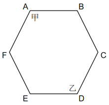

A. 29

B. 34

C. 35

D. 39

### 第 15 题

如下图所示，在5×3的长方形中，每个小正方形面积为1，以交点为三角形的顶点可画出面积是4的三角形的数量在以下哪个范围？

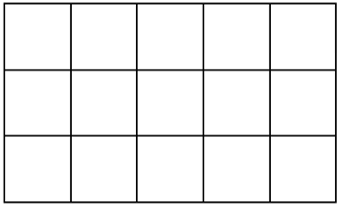

A. 不到60

B. 60~80

C. 81~100

D. 超过100

### 第 16 题

林业：第二产业：金融业

A. 小号：铜管乐器：小提琴

B. 登山鞋：运动鞋：休闲鞋

C. 越南：南美洲：尼日利亚

D. 物理：高等数学：化学

### 第 17 题

智取：生辰纲

A. 拳打：镇关西

B. 倒拔：垂杨柳

C. 大破：连环马

D. 雪夜：上梁山

### 第 18 题

火箭军 对于 （ ） 相当于 （ ） 对于 氨气

A. 第二炮兵 惰性气体

B. 东风快递 稀有气体

C. 解放军 导热性

D. 陆军 氙气

### 第 19 题

（ ） 对于 钱塘江 相当于 芯片 对于 （ ）

A. 潮涌 卡脖子

B. 杭州 硅

C. 水 智能手机

D. 松花江 集成电路

### 第 20 题

（ ） 对于 连锁店 相当于 山珍 对于 （ ）

A. 总店 野山参

B. 便利店 蘑菇

C. 零售店 海味

D. 店员 药材

### 第 21 题

从所给的四个选项中，选择最合适的一个填入问号处，使之呈现一定的规律性：

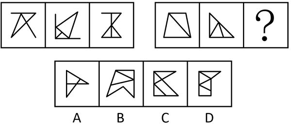

A. A

B. B

C. C

D. D

### 第 22 题

从所给的四个选项中，选择最合适的一个填入问号处，使之呈现一定的规律性：

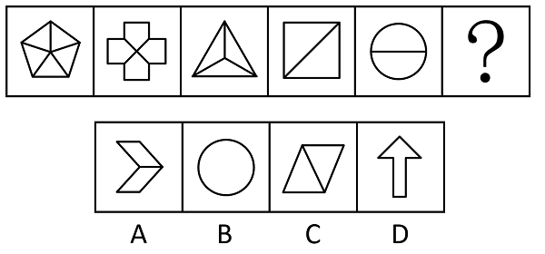

A. A

B. B

C. C

D. D

### 第 23 题

把下面的六个图形分为两类，使每一类图形都有各自的共同特征或规律，分类正确的一项是：

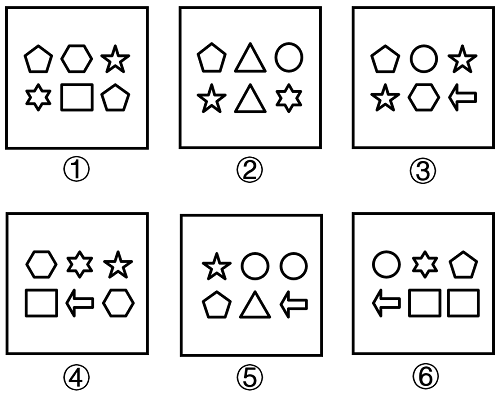

A. ①②③，④⑤⑥

B. ①③⑤，②④⑥

C. ①③④，②⑤⑥

D. ①②⑤，③④⑥

### 第 24 题

把下面的六个图形分为两类，使每一类图形都有各自的共同特征或规律，分类正确的一项是：

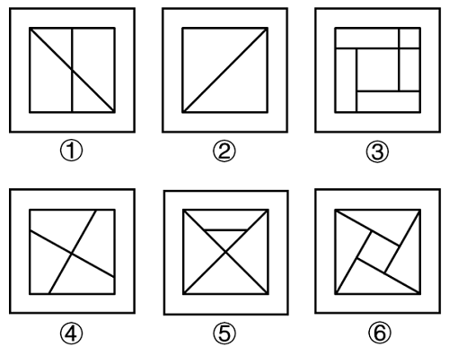

A. ①②③，④⑤⑥

B. ①②④，③⑤⑥

C. ①③⑤，②④⑥

D. ①④⑥，②③⑤

### 第 25 题

左边给定的是纸盒的外表面，右边哪项能够由它折叠而成?

A. A

B. B

C. C

D. D

### 第 26 题

纪检监察干部犹如“医者”，在日常工作中，应当严格遵循“惩前毖后、治病救人”的工作原则。对监督检查中发现的违纪违规行为，唯有坚持有“研”在先、精准施“治”，方能最终达到教育人、挽救人、感化人的预期目标。若不能提前入手、吃透政策，必将陷入“胡子眉毛一把抓”的被动境地，不仅不能达到监督效果，也会对被监督者的日常工作造成一定影响。

如果以上判断正确，则必定成立的是：

A. 如果监督效果达到了，说明监察干部提前入手并吃透了政策

B. 如果没有达到预期目标，说明没有坚持有“研”在先、精准施“治”

C. 如果陷入“胡子眉毛一把抓”的被动境地，说明监察干部没有吃透政策

D. 只要严格遵守“惩前毖后、治病救人”的工作原则，就能做好监督工作

### 第 27 题

某公司组织参观活动，甲、乙、丙、丁四人在一起谈论此事。

甲说：只有丁去，我才去；

乙说：我和丙都不去；

丙说：除非甲去，否则乙不去；

丁说：甲和丙两个人至少有一个人去。

实际出发后，发现只有一个人说法是真的，根据以上信息可以得出去参观的人是：

A. 甲

B. 乙

C. 丙

D. 丁

### 第 28 题

美妆品牌营销借助新媒体已是大势所趋，除社交平台外，许多美妆品牌入驻短视频平台，在短视频平台投入的营销费用越来越高。与此同时，这些品牌的营销额也有明显增长。有人认为，美妆品牌销售额的增长得益于短视频平台的推广作用。

以下哪项如果为真，最能削弱上述结论？

A. 社交平台的用户数量多于短视频平台的用户数量

B. 在美妆品牌的消费者中，关注这些品牌短视频的比例很低

C. 有人在短视频平台看到美妆品牌的广告后，就会购买相应的产品

D. 这些品牌在短视频平台的营销费用并没有比在其他平台的营销费用多

### 第 29 题

一项统计显示，孕妇做B超检查孕囊会产生长、宽、厚三个数据。当这三个数据呈现一定比例时，即可确定胎儿的性别准确率达到70%。有专家据此认为，孕囊的长、宽、厚三个数据与胎儿的性别紧密联系。

以下哪项如果为真，最不能削弱专家的观点？

A. 孕囊的长宽厚的比例会随胎儿月龄的增长而不断变化

B. 该统计的样本来自某县级医院，该医院成立不到两年

C. 同月龄不同性别的胎儿，孕囊的形状和大小差异较为明显

D. 孕囊内主要是羊水易受压变形，影响其尺寸因素众多

### 第 30 题

臆想症是指对自身感觉或征象作出不切实际的病态解释，致使整个心身被由此产生的疑惑、烦恼和恐惧所占据的一种精神疾病，有研究发现，臆想症患者的性格往往敏感多疑、主观、固执、孤僻，以自我为中心。研究者认为，性格有可能是导致臆想症的原因。

以下哪项如果为真，最能支持研究者的观点？

A. 某统计数据显示女性臆想症患者比例高于男性

B. 某地区民众不重视心理健康，得臆想症的较多

C. 快节奏的生活导致城市白领成为臆想症的高发人群

D. 性格孤僻的人变得愿意和他人交流后，臆想症有所缓解

### 第 31 题

中国共产党十九届六中全会总结了党的百年奋斗重大成就和历史经验，将百年历史分为四个时期。下列关于四个历史时期党面临的重要任务表述，正确的有几项？

①新民主主义革命时期，党面临的主要任务是反对帝国主义、封建主义、官僚资本主义，争取民族独立、人民解放，为实现中华民族伟大复兴创造根本社会条件

②社会主义革命和建设时期，党面临的主要任务是实现从新民主主义到社会主义的转变，进行社会主义革命，推进社会主义建设，为实现中华民族伟大复兴奠定根本政治前提和制度基础

③改革开放和社会主义现代化建设新时期，党面临的主要任务是继续探索中国建设社会主义的正确道路，解放和发展社会生产力，使人民摆脱贫困、尽快富裕起来，为实现中华民族伟大复兴提供充满新的活力的体制保证和快速发展的物质条件

④党的十八大以来，中国特色社会主义进入新时代。党面临的主要任务是实现第一个百年奋斗目标，开启实现第二个百年奋斗目标新征程，朝着实现中华民族伟大复兴的宏伟目标继续前进

A. 1

B. 2

C. 3

D. 4

### 第 32 题

党的二十大报告提出，中国式现代化是中国共产党领导的社会主义现代化。下列对中国式现代化的理解不准确的是：

A. 物质富足、精神富有是社会主义现代化的根本要求

B. 既有各国现代化的共同特征，更有基于自己国情的中国特色

C. 实现高质量发展，实现“双碳”目标是中国式现代化的本质要求之一

D. 是人与自然和谐共生的现代化，要坚持可持续发展，坚持节约优先、保护优先、自然恢复为主的方针

### 第 33 题

2023年3月19日，中共中央办公厅印发《关于在全党大兴调查研究的工作方案》，提出12个方面的调研内容。下列属于这12个方面调研内容的有几项？

①推进共同富裕、增进民生福祉中的重大问题

②全面依法治国中的重大问题

③本地区本部门本单位长期未解决的老大难问题

④推进民族团结进步事业的重大问题

⑤维护社会稳定中的重大问题

A. 2

B. 3

C. 4

D. 5

### 第 34 题

关于失踪人，下列情况符合法律规定的是：

A. 甲被宣告为失踪人后，其财产由配偶代管

B. 失踪人乙重新出现，关于乙的失踪宣告自动撤销

C. 丙失踪一年后，其父亲向公安机关申请宣告丙为失踪人

D. 失踪人丁无法律规定的财产代管人，其财产由人民法院代管

### 第 35 题

关于海南自由贸易港，下列说法不正确的是：

A. 海南自由贸易港的实施范围是海南岛全岛

B. 零关税、低税率、简税制是海南自由贸易港税收制度的主要特征

C. 货物由海南自由贸易港贸易进入内地，原则上按进口规定办理相关手续

D. 海南自由贸易港贸易、投资及相关管理活动法规应当由全国人民代表大会常务委员会制定

### 第 36 题

2023年4月26日至28日，第十三届中国卫星导航年会在北京召开，会议发布《北斗卫星导航系统建设与发展》报告。关于北斗卫星导航系统，下列说法不正确的是：

A. 北斗卫星导航系统由空间段、地面段和用户段三部分组成

B. 北斗卫星导航系统提供多个频点的导航信号，能够通过多频信号组合使用等方式提高服务精度

C. 北斗卫星导航系统是中国自行研制的全球卫星导航系统，与美国GPS、俄罗斯格洛纳斯共同被联合国认定为全球三大导航系统

D. 北斗卫星导航系统创新融合了导航与通信能力，具备定位导航授时、星基增强、地基增强、精密单点定位、短报文通信和国际搜救等多种服务能力

### 第 37 题

巴勒斯坦问题始终是中东问题的核心，是当今世界不断被撕开的伤口。下列关于巴勒斯坦地区和中东历史的说法不正确的是：

A. 耶路撒冷是犹太教、基督教和伊斯兰教共同的圣城

B. 以色列在1967年第三次中东战争期间占领戈兰高地，并非法占领至今

C. 犹太人普遍信奉犹太教，犹太教的教义认为犹太人和阿拉伯人来自同一祖先

D. 阿拉伯人属闪米特人的一支，是指西亚和北非讲阿拉伯语的居民，以阿拉伯人为主体民族的国家包括沙特阿拉伯、埃及、约旦、伊朗等

### 第 38 题

雪是我国古代诗人常爱吟诵的对象，但有的咏雪诗却不带“雪”字。下列诗句并未描写雪景的是：

A. 空里流霜不觉飞，汀上白沙看不见

B. 未许牛羊伤至洁，且看鸦鹊弄新晴

C. 旋扑珠帘过粉墙，轻于柳絮重于霜

D. 忽如一夜春风来，千树万树梨花开

### 第 39 题

关于我国各地的地理情况，下列排序正确的是：

A. 陆地面积由大至小：甘肃广东海南浙江

B. 平均海拔高度由高至低：贵阳重庆哈尔滨合肥

C. 常住人口数量（2022年）由多至少：江苏贵州宁夏广西

D. 邻省（自治区、直辖市）数量由多至少：安徽四川新疆云南

### 第 40 题

“天公恶作剧，翻手变炎凉。海运三山动，江高数尺缰。”当这首诗中描写的现象出现时，下列做法不正确的是：

A. 关闭煤气，切断电源

B. 住在高层建筑的人到阳台躲避

C. 撤离时用枕头等软物将头部护住

D. 来不及转移时，迅速躲到较坚实的家具下面

## 材料 1

2022年，全年国有建设用地供应76.6万公顷，同比增长10.9%。其中，工矿仓储用地、商服用地、住宅用地、基础设施及其他用地供应面积分别为19.8万公顷、3.1万公顷、7.9万公顷和45.8万公顷，占土地供应总量的比重分别为25.9%、4.0%、10.3%、59.8%。全年出让国有建设用地30.7万公顷，与去年基本持平；出让成交价款约为6.0万亿元，同比下降21.9%。

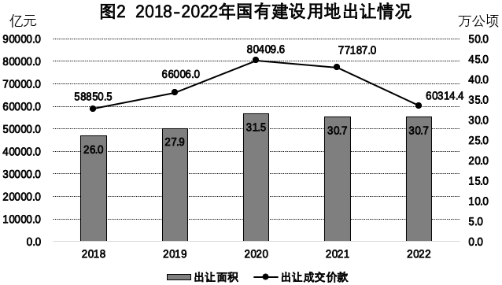

### 第 41 题

2022年，国有建设用地供应中，供应面积同比增长最快的是：

A. 基础设施及其他用地

B. 住宅用地

C. 商服用地

D. 工矿仓储用地

### 第 42 题

2019-2022年，国有建设用地出让均价最高的是哪一年？

A. 2019

B. 2020

C. 2021

D. 2022

### 第 43 题

2018-2022年，国有建设用地出让面积占国有建设用地供应面积的比重最高的年份其占比在以下哪个区间？

A. 40%以下

B. 40%-45%

C. 45%-50%

D. 50%以上

### 第 44 题

下列折线图中，能准确反映2019-2022年住宅用地供应面积增速的是：

A. 

B. 

C. 

D. 

### 第 45 题

能够从上述资料中推出的是：

A. 2018-2022年，国有建设用地供应量逐年上升

B. 2018-2022年，住宅用地出让面积占供应面积的比重高于其他类别

C. 2019-2022年，国有建设用地供应中，各类用地供应面积均有升有降

D. 2018-2022年，国有建设用地供应中，商服用地供应总面积超过17.5万公顷

## 材料 2

截止2022年底，Z省人均城乡低保标准全部达到12996元/年，各个地市低保年标准全部达到12420元以上，并实现市城同标，全省特困供养标准第一年实现城乡统筹，人均年标准达到21072元。全年开展临时救助9.06万人次。全省累计发放最低生活保障资金61.48亿元，特困资金8.09亿元，临时救助资金2.56亿元。

### 第 46 题

2013~2022年，Z省城市低保标准每月增幅超过50元的年份有几个？

A. 3

B. 4

C. 5

D. 6

### 第 47 题

2022年Z省特困资金发放额比2015年增长了约（ ）。

A. 233%

B. 175%

C. 157%

D. 82%

### 第 48 题

下列折线图中，能准确反映Z省2015-2018年特困资金发放金额变化的是（ ）。

A. 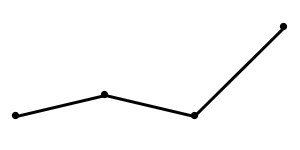

B. 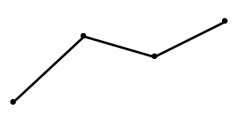

C. 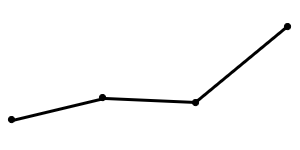

D. 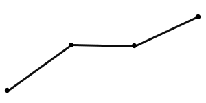

### 第 49 题

2022年，Z省特困对象与低保对象人数之比约为（ ）。

A. 1：6

B. 1：8

C. 1：10

D. 1：12

### 第 50 题

不能从上述资料中推出的是（ ）。

A. 2016年，Z省低保资金发放金额同比涨幅大于特困资金

B. 2013-2017年，Z省农村低保标准同比增幅均大于城市

C. 2022年，Z省临时救助资金发放金额每人次约为2800元

D. 2013-2022年，Z省农村低保标准同比增长最快的是2017年

## 答案与解析

第 1 题

**参考答案（粉笔题库参考内容）**

C

**解析**

设跑3次的有x人，则跑2次的有10x人，跑1次的有(10x+x)×2.5=27.5x人。

方法一：根据题意，该单位参加夜跑的人数=跑1次的人数+跑2次的人数+跑3次的人数，则共有27.5x+10x+x=38.5x人，结合题干条件该单位有100多名员工参加夜跑，即100<38.5x<200，且38.5x为整数，则x=4，故该单位仅参加1次夜跑的有27.5×4=110人。

方法二：该单位仅参加1次夜跑的有27.5x人，即人，那么所求人数一定为55的整数倍，观察选项，只有C项符合。

故正确答案为C。

第 2 题

**参考答案（粉笔题库参考内容）**

D

**解析**

如图所示，A、B、C三点分别表示甲地、乙地、丙地，根据题意可知，AB=15千米，AC=10千米。小张和小王分别从B点、C点同时出发，30分钟后分别到达D点、E点，两人的直线距离即DE=19.5千米，则BD千米。在直角三角形DEF中，EF=AC-BD=10-2.5=7.5千米，DF=AB+CE=（15+CE）千米，根据勾股定理可得：，则CE=3千米，即小王30分钟行进3千米，那么速度为千米/小时。小张从出发直至到达小王的正北方，即图中G点，共用时小时，此时小王到达图中H点，行进距离为CH=2×6=12千米，故两人的直线距离为GH=AB+CH=15+12=27千米。

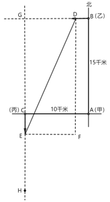

故正确答案为D。

第 3 题

**参考答案（粉笔题库参考内容）**

B

**解析**

第1次称重，在天平一侧放60克砝码，然后将600克盐分成2份放入天平两侧并使天平平衡，此时2份盐分别为270克和330克。第2次称重，天平一侧放60克和10克砝码，称出270克盐中的70克，此时270克盐还剩200克。第3次称重，将200克盐放在天平一侧，称出330克盐中的200克，将剩余的130克盐与第2次称出的70克盐组成200克，则最少用天平称3次可以将这些盐平均分为3份。

故正确答案为B。

第 4 题

**参考答案（粉笔题库参考内容）**

A

**解析**

设A车间师傅每天的生产效率为10x件，则学徒每天的生产效率为10x×60%=6x件；B车间师傅每天的生产效率为10y件，则学徒每天的生产效率为10y×70%=7y件。

方法一：根据题意可列等式：2×10x+7×6x=372，解得x=6；3×10y+9×7y=372，解得y=4。工厂组织所有师傅集中培训半天，则这天两个车间的总产量下降了件，比平时下降的比例为，在A项区间内。

方法二：工厂组织所有师傅集中培训半天，A车间的产量下降了件，比平时下降的比例为；B车间的产量下降了件，比平时下降的比例为。两车间产量下降的比例相同，则培训这天两个车间的总产量比平时下降的比例也为，在A项区间内。

故正确答案为A。

第 5 题

**参考答案（粉笔题库参考内容）**

C

**解析**

根据题意先放第一粒棋子，25个方格可随意放置，有种放法；放置第二粒棋子时，排除第一粒棋子所在的一行一列共9个位置，则剩余25-9=16个位置可随意放置，有种放法；同理，放置第三粒棋子时，排除前两粒棋子所在的两行两列共16个位置，则剩余25-16=9个位置可随意放置，有种放法。因为3粒棋子相同，故不考虑放入的先后顺序，总共有种不同的放法。

故正确答案为C。

第 6 题

**参考答案（粉笔题库参考内容）**

A

**解析**

根据公式：概率。从10道题中任意抽3题，总的情况数有种。要求答对2题或以上可进入下一轮，则答对2题和答对3题均可进入下一轮。甲答对2题的情况数有种，答对3题的情况数有种，则甲晋级的概率为；乙答对2题的情况数有种，答对3题的情况数有种，则乙晋级的概率为。分步用乘法，甲、乙都晋级的概率为。

故正确答案为A。

第 7 题

**参考答案（粉笔题库参考内容）**

B

**解析**

根据题意可知，第1组有1个数，内部加和为2；第2组有2个数，每个数内部加和均为3；第3组有3个数，每个数内部加和均为4；第4组有4个数，每个数内部加和均为5······即规律为第n组有n个数，每个数内部加和为n+1。8/88加和为8+88=96，属于第96-1=95组，该组有95个数。每组中数的个数构成公差为1的等差数列。

方法一：根据等差数列求和公式：，则前94组共有个数。每组数中，第m个数的右半部分为m，则8/88是所在组中第88个数，则8/88是这列数中第4465+88=4553个数。

方法二：前94组共有4465个数，前95组共有4465+95=4560个数，8/88在第95组数中，则8/88一定在第4466~4560个数之间，结合选项，只有B项满足。

故正确答案为B。

第 8 题

**参考答案（粉笔题库参考内容）**

D

**解析**

根据题意可知，每个小朋友选择动物类贴纸的情况数有种，选择卡通人物类贴纸的情况数有种，选择水果类贴纸的情况数有种。分步用乘法，每个小朋友选择贴纸的情况数共有3×6×6=108种。

要想保证有3个小朋友的贴纸完全相同，且人数尽量少，最不利情况为上述计算的每种情况均有2个小朋友选择，在此基础上再加1个小朋友，即可保证至少有3个小朋友的贴纸完全相同。故该幼儿园至少有108×2+1=217个小朋友。

故正确答案为D。

第 9 题

**参考答案（粉笔题库参考内容）**

D

**解析**

设甲完成实验需要的时间为x，乙完成实验需要的时间为y，则只有当x＞y时，乙比甲更快完成实验。即x＞y、、重叠的区域（如下图所示），只有在阴影部分区域乙才能比甲更快完成实验，本题所求概率即为阴影部分面积占整个长方形ABCD面积的比例。假设每小时对应的长度为1，则长方形ABCD的面积为3×2=6，阴影部分为一个等腰直角三角形，面积为，阴影部分面积占总面积的，即乙比甲更快完成实验的概率是。

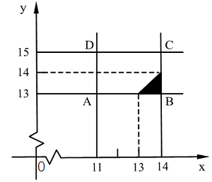

故正确答案为D。

第 10 题

**参考答案（粉笔题库参考内容）**

C

**解析**

设小张前3次测验的平均分为x分，根据“前3次的平均分比前5次的高2分”，可列方程：，解得x=85。设小张后3次测验的平均分为y分，根据“后3次的平均分比后5次的低2分”，可列方程：，解得y=75。因前3次平均分>第4、5次平均分>后3次平均分，且“第2次和第7次成绩被去掉”，可推测第2次成绩最高、第7次成绩最低。要想第2次和第7次成绩相差最少，则第2次成绩应尽可能低、第7次成绩尽可能高。前3次平均分为85，则第2次成绩最低为86，其余为85、84；后3次平均分为75，则第7次成绩最高为74，其余为75、76。第2次和第7次的成绩差=86-74=12。

备注：此时，第4、5次成绩可为81、79；82、78；83、77，均满足题干要求。

故正确答案为C。

第 11 题

**参考答案（粉笔题库参考内容）**

B

**解析**

根据题意可列方程组：，联立解得：甲=300，乙=360，丙=280。故调运前，大米最多的仓库（乙）比最少的仓库（丙）多360-280=80吨。

故正确答案为B。

第 12 题

**参考答案（粉笔题库参考内容）**

C

**解析**

根据题意可知，玩家“抢”到地主的概率为、农民的概率为。设这十万场比赛的玩家“抢”到地主时的胜率为x，则农民的胜率为1-x，所有玩家平均胜率为，解得x=59%，在C项范围内。

故正确答案为C。

第 13 题

**参考答案（粉笔题库参考内容）**

B

**解析**

根据题意，该同学不能在一张椅子上连续坐超过2分钟，则不能连续选择原地不动。如图所示，该同学从1号椅子移动到6号椅子，需要逆时针移动5个位置或顺时针移动6个位置，8分钟需要做出8次选择，分情况讨论：

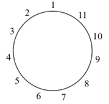

（1）逆时针移动5次，原地不动3次：由于不能连续选择原地不动，则在逆时针移动5次形成的6个空位中，选择3个空位插入原地不动，有种情况；

（2）逆时针移动6次，顺时针移动1次，原地不动1次：在8次中选择1次顺时针移动、1次原地不动，有种情况；

（3）顺时针移动6次，原地不动2次：由于不能连续选择原地不动，则在顺时针移动6次形成的7个空位中，选择2个空位插入原地不动，有种情况；

（4）顺时针移动7次，逆时针移动1次：在8次中选择1次逆时针移动，有种情况。

综上所述，8分钟后共有20+56+21+8=105种情况能使他坐在6号椅子上。

故正确答案为B。

第 14 题

**参考答案（粉笔题库参考内容）**

B

**解析**

根据题意，甲每秒钟走3米，秒走1条边，加上在顶点站立1秒，共需4+1=5秒走完1条边；乙每秒钟走2米，秒走1条边，加上在顶点站立1秒，共需6+1=7秒走完1条边。问“甲出发后经过多少秒才能看到乙”，即甲能看到乙的最短时间，从小到大代入选项：

代入A项：甲：，4秒刚好又走了1条边，共走了6条边，站在A点；乙：，共走完4条边，最后1秒走在BC边上。则甲不能看到乙。

代入B项：甲：，4秒刚好又走了1条边，共走了7条边，站在B点；乙：，6秒刚好又走了1条边，站在C点。则甲乙在同一条边BC上，甲能看到乙。

C、D两项均大于B项，无需代入，即甲出发后经过34秒才能看到乙。

故正确答案为B。

第 15 题

**参考答案（粉笔题库参考内容）**

C

**解析**

根据三角形面积公式：，要画出面积是4的三角形，则三角形的底×高=8。，分情况讨论：

（1）当底为4，高为2时，从横向4条线段中任选1条，每条可选出2段长度为4的线段作为底边，每个底边满足条件的高有6个，则共有个；

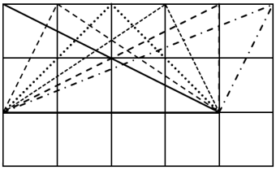

（2）当底为2，高为4时，从纵向线段中选择，为满足高为4，只能选左侧2条和右侧2条竖线段，每条可选出2段长度为2的线段作为底边，去掉与情况（1）重复的直角三角形，每个底边满足条件的高有2个，则共有个；

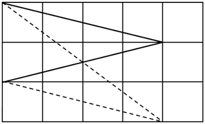

（3）当底为，高为时，按锐角三角形、直角三角形、钝角三角形分类讨论。

①锐角三角形：AB⊥CD，且，则，满足题意，向右平移，此方向共有3个三角形符合题意。在这3个三角形的基础上分别进行水平翻转、垂直翻转、水平翻转后再垂直翻转，则共有3×4=12个。

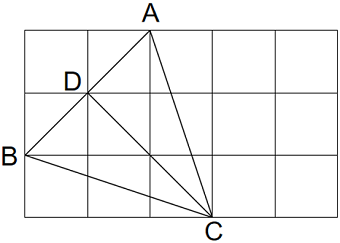

②直角三角形：AB⊥AC，此情况已包含在底为4，高为2的情况中，不再重复计算。

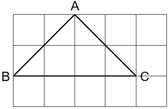

③钝角三角形：BD⊥CD，且，则，满足题意，向下平移此方向共有2个三角形符合题意。在这2个三角形的基础上分别进行水平翻转、垂直翻转、水平翻转后再垂直翻转，则共有2×4=8个。

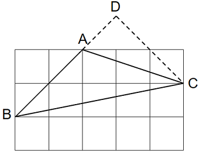

故面积是4的三角形共有48+16+12+8=84个。

故正确答案为C。

第 16 题

**参考答案（粉笔题库参考内容）**

C

**解析**

第一步：判断题干词语间逻辑关系。

“林业”是第一产业，“金融业”是第三产业，二者都不是“第二产业”，第一个词和第三个词分别与第二个词为反向种属关系。

第二步：判断选项词语间逻辑关系。

A项：“小号”是“铜管乐器”的一种，前两个词为种属关系；“小提琴”是弦乐器的一种，不是“铜管乐器”，后两个词为反向种属关系，与题干逻辑关系不一致，排除；

B项：“登山鞋”是户外“运动鞋”的一种，前两个词为种属关系；“运动鞋”与“休闲鞋”是两种不同的鞋，后两个词为并列关系，与题干逻辑关系不一致，排除；

C项：“越南”是亚洲的组成部分，“尼日利亚”是非洲的组成部分，二者都不是“南美洲”的组成部分，第一个词和第三个词分别与第二个词为反向组成关系，在此需要注意，在没有更好答案的情况下，反向种属关系和反向组成关系都属于反向包容关系，与题干逻辑关系一致，当选；

D项：“高等数学”不是“物理”，二者为反向种属关系，但词语顺序与题干相反，与题干逻辑关系不一致，排除。

故正确答案为C。

注：本题的考法在历年极个别真题中也曾考查过，重点学习思维即可，即如果题干是反向种属关系，选项没有反向种属关系，可以择优选择反向组成关系。

第 17 题

**参考答案（粉笔题库参考内容）**

A

**解析**

第一步：判断题干词语间逻辑关系。

“智取生辰纲”是长篇小说《水浒传》中的经典情节。写的是北宋宣和年间，大名府留守梁中书为了给岳父蔡京庆生，筹备价值十万贯的金银珠宝作为生辰纲，委托杨志押送至东京，在途中（黄泥冈）被晁盖、吴用等人用计夺取的故事情节。“智取”与“生辰纲”构成动宾关系，且“智取”是用“智”去“取”，拆分后是方式和目的的对应关系。

第二步：判断选项词语间逻辑关系。

A项：“拳打镇关西” 是长篇小说《水浒传》中的经典情节。写的是鲁达得知金翠莲被郑屠（绰号“镇关西”）强骗后十分愤怒，以切肉末为由挑衅镇关西，待镇关西被激怒后三拳打死镇关西的故事情节。“拳打”与“镇关西”构成动宾关系，且“拳打”是用“拳”去“打”，拆分后是方式和目的的对应关系，且与题干逻辑关系一致，当选；

B项：“倒拔垂杨柳”是长篇小说《水浒传》中的经典情节。写的是鲁智深为了收服一众泼皮，竟将杨柳树连根拔起的故事情节。“倒拔”与“垂杨柳”构成动宾关系，但“倒拔”拆分后为“倒”和“拔”，不是用“倒”去“拔”，不是方式与目的的对应关系，与题干逻辑关系不一致，排除；

C项：“大破连环马”是长篇小说《水浒传》中的经典情节，写的是梁山好汉最终大破连环马阵法（战马用铁环相连，冲击力极强），杀得呼延灼全军覆没，落荒而逃的故事情节。“大破”与“连环马”构成动宾关系，但“大破”拆分后不是用“大”去“破”，不是方式与目的的对应关系，与题干逻辑关系不一致，排除；

D项：“雪夜上梁山”是长篇小说《水浒传》中的经典情节。写的是林冲遭高俅父子多次陷害，被刺配沧州后，仍遭追杀。林冲侥幸逃脱，在风雪之夜走投无路，经柴进推荐，最终下定决心前往梁山。他冒雪赶路，毅然上了梁山，开启了落草为寇的生涯。“雪夜”与“上梁山”不构成动宾关系，与题干逻辑关系不一致，排除。

故正确答案为A。

注：本题有争议，有同学选择C项，理由是“智取生辰纲”是晁盖、吴用等人使用计谋夺取梁中书送给蔡京的生日礼物的事件，强调智慧策略。同样，“大破连环马”是宋江、吴用等人使用钩镰枪计谋破解呼延灼的连环马阵法，也强调智谋和团队合作，认为C项跟题干更为一致，这个想法也有道理。

C项跟题干“内容”上更相似，而A项跟题干“结构”上更相似，从历年考点和本题出题特征来看，出题人把“智取”和“生辰纲”做了拆分，考查“结构”的可能性更大，故小粉笔更倾向答案为A项，争议题不纠结，重点学习这种特征的题可以从“结构”和“内容”两个角度去思考即可，考场上有哪个选哪个。

第 18 题

**参考答案（粉笔题库参考内容）**

D

**解析**

逐一代入选项。

A项：“火箭军”是由“第二炮兵”更名而来，二者是全同关系；“氨气”不是“惰性气体”，二者是反向种属关系，前后逻辑关系不一致，排除；

B项：“东风快递”是中国人民解放军“火箭军”在新浪微博平台上开通的实名认证官方微博账号，二者是对应关系；“氨气”不是“稀有气体”，二者是反向种属关系，前后逻辑关系不一致，排除；

C项：“火箭军”是中国人民“解放军”的军种，二者是种属关系；“氨气”具有“导热性”，二者是属性对应关系，前后逻辑关系不一致，排除；

D项：“火箭军”和“陆军”是两种不同的中国人民解放军军种，二者是并列关系中的反对关系；“氨气”和“氙气”是两种不同的气体，二者是并列关系中的反对关系，前后逻辑关系一致，当选。

故正确答案为D。

第 19 题

**参考答案（粉笔题库参考内容）**

C

**解析**

逐一代入选项。

A项：“潮涌”有两种理解方式：①杭州第19届亚运会会徽名为“潮涌”，会徽主体图形由扇面、钱塘江、钱江潮头、赛道、互联网符号及象征亚洲奥林匹克理事会的太阳图形六个元素组成，“钱塘江”图形元素是会徽“潮涌”的一个组成部分，二者为组成关系；②“潮涌”也可以理解为一种自然现象，“钱塘江”会出现“潮涌”现象，二者为地点与自然现象的对应关系；我国“芯片”行业面临“卡脖子”的难题，二者为对应关系，“潮涌”不管是哪种理解方式，前后逻辑关系都不一致，排除；

B项：“钱塘江”位于“杭州”，二者为地点对应关系；“硅”是制造“芯片”的重要原材料，二者为原材料对应关系，前后逻辑关系不一致，排除；

C项：“水”是“钱塘江”的组成部分，二者为组成关系；“芯片”是“智能手机”的组成部分，二者为组成关系，前后逻辑关系一致，当选；

D项：“松花江”和“钱塘江”是两条不同的河流，二者为并列关系；“芯片”又称“集成电路”，是指内含集成电路的硅片，二者为全同关系，前后逻辑关系不一致，排除。

故正确答案为C。

第 20 题

**参考答案（粉笔题库参考内容）**

B

**解析**

逐一代入选项。

A项：“连锁店”指一个公司或集团开设的经营业务相关、方式相同的若干个商店，“总店”指商店的总部，现在世界上的连锁店大多是“前总店，后分店”模式，一般总店创建时间较早，分店分布在各个地方。“总店”是“连锁店”的组成部分，二者为组成关系；“野山参”是“山珍”的一种，二者为种属关系，前后逻辑关系不一致，排除；

B项：有的“便利店”是“连锁店”，有的“便利店”不是“连锁店”，有的“连锁店”是“便利店”，有的“连锁店”不是“便利店”，二者为交叉关系；有的“山珍”是“蘑菇”，有的“山珍”不是“蘑菇”，有的“蘑菇”是“山珍”，有的“蘑菇”不是“山珍”，二者为交叉关系，前后逻辑关系一致，当选；

C项：有的“零售店”是“连锁店”，有的“零售店”不是“连锁店”，有的“连锁店”是“零售店”，有的“连锁店”不是“零售店”，二者为交叉关系；“山珍”和“海味”为并列关系，前后逻辑关系不一致，排除；

D项：“店员”在“连锁店”工作，二者为对应关系；有的“山珍”是“药材”，有的“山珍”不是“药材”，有的“药材”是“山珍”，有的“药材”不是“山珍”，二者为交叉关系，前后逻辑关系不一致，排除。

故正确答案为B。

第 21 题

**参考答案（粉笔题库参考内容）**

A

**解析**

元素组成不同，且无明显属性规律，考虑数量规律。观察发现，图形线条交叉明显，考虑数交点数。第一组图中，题干图形交点数依次为4、5、6；第二组图中，前两幅图的交点数依次为4、5，故？处应该选择一个交点数为6的图形，只有A项符合。

故正确答案为A。

第 22 题

**参考答案（粉笔题库参考内容）**

D

**解析**

元素组成不同，优先考虑属性规律。观察发现，题干图形均为轴对称图形，对称轴的数量依次为5、4、3、2、2、？，无规律；进一步观察发现，题干图形封闭区域明显，考虑数面，面数量依次为5、4、3、2、2、？，即每幅图形面数量与对称轴数量相等，只有D项符合。

故正确答案为D。

第 23 题

**参考答案（粉笔题库参考内容）**

C

**解析**

本题为分组分类题目。元素组成不同，且无明显属性规律，考虑数量规律。观察发现，每幅图均有6个元素，且均存在两个相同元素，图①③④中，两个相同元素位置相对，图②⑤⑥中，两个相同元素位置相邻，即图①③④为一组，图②⑤⑥为一组。

故正确答案为C。

第 24 题

**参考答案（粉笔题库参考内容）**

B

**解析**

本题为分组分类题目。元素组成不同，且无明显属性规律，考虑数量规律。观察发现，题干图形均存在多个面，图①②④中，所有面都与外框有公共边，图③⑤⑥中，中间的1个面与外框不相连，其余面都与外框有公共边，即图①②④为一组，图③⑤⑥为一组。

故正确答案为B。

第 25 题

**参考答案（粉笔题库参考内容）**

B

**解析**

对题干展开图进行编号，如下图所示，逐一分析选项。

A项：选项右侧面为面e，面e和面i是相对面，不能同时出现，故选项由面f、面g和面e构成。题干展开图中，这三个面的公共点挨着面f中的黑色锐角，而选项中，这三个面的公共点挨着面f中的黑色直角，选项与题干展开图不一致，排除；

B项：选项由面f、面k和面e构成，选项与题干展开图一致，当选；

C项：选项由面h、面g和面e构成，题干展开图中，这三个面的公共点没有挨着面e中的黑色三角形，而选项中，这三个面的公共点挨着面e中的黑色三角形，选项与题干展开图不一致，排除；

D项：选项中出现了两个有黑色矩形的面，而题干展开图中只有一个有黑色矩形的面（面k），选项与题干展开图不一致，排除。

故正确答案为B。

第 26 题

**参考答案（粉笔题库参考内容）**

A

**解析**

第一步：翻译题干。

①达到教育人、挽救人、感化人的预期目标坚持有“研”在先 且 精准施“治”；

②-（提前入手 且 吃透政策）陷入“胡子眉毛一把抓”的被动境地；

③-（提前入手 且 吃透政策）达到监督效果；

④-（提前入手 且 吃透政策）对被监督者的日常工作造成一定影响。

第二步：逐一分析选项。

A项：翻译为：达到监督效果提前入手 且 吃透政策，是对条件③的否后，根据“否后必否前”，可以推出“提前入手 且 吃透政策”，可以推出，当选；

B项：翻译为：-达到预期目标（坚持有“研”在先 且 精准施“治”），是对条件①的否前，否前无必然结论，无法推出，排除；

C项：翻译为：陷入“胡子眉毛一把抓”的被动境地吃透政策，是对条件②的肯后，肯后无必然结论，无法推出，排除；

D项：翻译为：严格遵守“惩前毖后、治病救人”的工作原则做好监督工作，题干中“严格遵循‘惩前毖后、治病救人’的工作原则”和“做好监督工作”之间不存在推出关系，无法推出，排除。

故正确答案为A。

第 27 题

**参考答案（粉笔题库参考内容）**

B

**解析**

第一步：分析题干条件。

（1）甲：甲丁；

（2）乙：-乙 且 -丙；

（3）丙：乙甲；

（4）丁：甲 或 丙。

第二步：根据题干条件进行推理。

题干条件中没有明显的矛盾关系，可考虑假设法。

由于“甲”出现的次数最多，可优先考虑假设“甲”的情况。

假设甲去参观活动：

对于条件（1），“甲丁”等价于“-甲 或 丁”，因不确定丁的情况，则该条件无法确定真假；对于条件（3），“乙甲”等价于“-乙 或 甲”，“甲去”是对或关系其中一项的肯定，则该条件必然为真；对于条件（4），“甲 或 丙”，“甲去”是对或关系其中一项的肯定，则该条件必然为真，此时条件（3）和条件（4）均为真，与“只有一个人说法是真的”矛盾，因此可以得出，甲不去参观活动。

再根据条件（1），“甲丁”等价于“-甲 或 丁”可知，“甲不去”是对或关系其中一项的肯定，则该条件必然为真，此时条件（2）（3）（4）应均为假，即条件（2）（3）（4）的矛盾命题均为真，即“乙 或 丙”、“乙 且 -甲”、“-甲 且 -丙”均为真，继续推理可知，乙去参观活动，丙不去参观活动，丁的情况不确定，对应B项。

故正确答案为B。

第 28 题

**参考答案（粉笔题库参考内容）**

B

**解析**

第一步：找出论点和论据。

论点：美妆品牌销售额的增长得益于短视频平台的推广作用。

论据：许多美妆品牌入驻短视频平台，在短视频平台投入的营销费用越来越高。与此同时，这些品牌的营销额也有明显增长。

本题论点和论据都在讨论短视频平台推广对美妆品牌销售额的影响，论点和论据话题一致，削弱优先考虑削弱论点。

第二步：逐一分析选项。

A项：该项说的是社交平台的用户数量多于短视频平台的用户数量，而平台用户数量多不等于销售额高，与论点讨论的短视频平台推广是否能提高美妆品牌销售额无关，无法削弱，排除；

B项：该项说的是美妆品牌的消费者关注这些品牌短视频的比例很低，说明购买美妆品牌的人大多不看这些品牌的短视频，即美妆品牌销售额的增长与短视频平台推广的关系不大，削弱论点，可以削弱，当选；

C项：该项说的是有人在短视频平台看到美妆品牌的广告后会购买相应的产品，说明短视频平台的推广能提高美妆品牌的销售额，为加强项，无法削弱，排除；

D项：该项说的是这些品牌在短视频平台的营销费用不比其他平台多，与论点讨论的短视频平台推广是否能提高美妆品牌销售额无关，无法削弱，排除。

故正确答案为B。

第 29 题

**参考答案（粉笔题库参考内容）**

C

**解析**

第一步：找出论点和论据。

论点：孕囊的长、宽、厚三个数据与胎儿的性别紧密联系。

论据：一项统计显示，孕妇做B超检查孕囊会产生长、宽、厚三个数据。当这三个数据呈现一定比例时，即可确定胎儿的性别准确率达到70%。

本题论点讨论的是孕囊的长、宽、厚三个数据与胎儿的性别紧密联系，论据讨论的是孕囊的长、宽、厚三个数据呈现一定比例时确定胎儿性别的准确率达到70%，论点和论据话题一致，削弱可以考虑削弱论点或削弱论据，且本题为选非题，排除能削弱的选项即可。

第二步：逐一分析选项。

A项：该项指出孕囊的长宽厚比例会不断变化，说明孕囊的长宽厚比例会受其他因素影响，与性别并非紧密联系，削弱论点，可以削弱，排除；

B项：该项指出统计的样本来自某个成立不到两年的县级医院，说明统计样本数量有限且范围较小，这意味样本数量不足且不具代表性，削弱了统计结果的可靠性，削弱论据，可以削弱，排除；

C项：该项指出同月龄不同性别的胎儿，孕囊的形状和大小有差异，证明孕囊的形状和大小确实与胎儿的性别紧密联系，可以加强，无法削弱，当选；

D项：该项指出影响孕囊尺寸的因素众多，影响因素越多，通过孕囊尺寸判断胎儿性别的可能性越小，孕囊尺寸与胎儿性别的联系越不紧密，削弱论点，可以削弱，排除。

本题为选非题，故正确答案为C。

第 30 题

**参考答案（粉笔题库参考内容）**

D

**解析**

第一步：找出论点和论据。

论点：性格有可能是导致臆想症的原因。

论据：有研究发现，臆想症患者的性格往往敏感多疑、主观、固执、孤僻，以自我为中心。

本题论点讨论的是性格有可能是导致臆想症的原因，论据讨论的是臆想症患者的性格往往敏感多疑、主观、固执、孤僻，以自我为中心，二者都在讨论臆想症与性格的关系，话题一致，加强优先考虑补充论据。

第二步：逐一分析选项。

A项：该项指出女性臆想症患者比例高于男性，讨论的是臆想症患者的性别差异，而论点讨论的是导致臆想症的原因，话题不一致，无法加强，排除；

B项：该项指出某地区民众不重视心理健康，得臆想症的较多，说明不重视心理健康与臆想症可能存在联系，而论点讨论的是性格与臆想症的联系，话题不一致，无法加强，排除；

C项：该项指出快节奏的生活导致城市白领成为臆想症的高发人群，说明生活节奏与臆想症可能存在联系，而论点讨论的是性格与臆想症的联系，话题不一致，无法加强，排除；

D项：该项指出性格孤僻的人变得愿意和他人交流后，臆想症有所缓解，说明改变孤僻的性格能缓解臆想症，补充论据，可以加强，当选。

故正确答案为D。

第 31 题

**参考答案（粉笔题库参考内容）**

D

**解析**

本题考查政治常识。

①正确，《中共中央关于党的百年奋斗重大成就和历史经验的决议》中“一、夺取新民主主义革命伟大胜利”部分指出：“新民主主义革命时期，党面临的主要任务是，反对帝国主义、封建主义、官僚资本主义，争取民族独立、人民解放，为实现中华民族伟大复兴创造根本社会条件。”

②正确，《中共中央关于党的百年奋斗重大成就和历史经验的决议》中“二、完成社会主义革命和推进社会主义建设”部分指出：“社会主义革命和建设时期，党面临的主要任务是，实现从新民主主义到社会主义的转变，进行社会主义革命，推进社会主义建设，为实现中华民族伟大复兴奠定根本政治前提和制度基础。”

③正确，《中共中央关于党的百年奋斗重大成就和历史经验的决议》中“三、进行改革开放和社会主义现代化建设”部分指出：“改革开放和社会主义现代化建设新时期，党面临的主要任务是，继续探索中国建设社会主义的正确道路，解放和发展社会生产力，使人民摆脱贫困、尽快富裕起来，为实现中华民族伟大复兴提供充满新的活力的体制保证和快速发展的物质条件。”

④正确，《中共中央关于党的百年奋斗重大成就和历史经验的决议》中“四、开创中国特色社会主义新时代”部分指出：“党的十八大以来，中国特色社会主义进入新时代。党面临的主要任务是，实现第一个百年奋斗目标，开启实现第二个百年奋斗目标新征程，朝着实现中华民族伟大复兴的宏伟目标继续前进。”

故①②③④表述正确，共4项。

故正确答案为D。

第 32 题

**参考答案（粉笔题库参考内容）**

C

**解析**

本题考查政治常识。

A项正确，党的二十大报告在“三、新时代新征程中国共产党的使命任务”部分指出：“中国式现代化是物质文明和精神文明相协调的现代化。物质富足、精神富有是社会主义现代化的根本要求······”

B项正确，党的二十大报告在“三、新时代新征程中国共产党的使命任务”部分指出：“中国式现代化，是中国共产党领导的社会主义现代化，既有各国现代化的共同特征，更有基于自己国情的中国特色。”

C项错误，党的二十大报告在“三、新时代新征程中国共产党的使命任务”部分指出：“中国式现代化的本质要求是：坚持中国共产党领导，坚持中国特色社会主义，实现高质量发展，发展全过程人民民主，丰富人民精神世界，实现全体人民共同富裕，促进人与自然和谐共生，推动构建人类命运共同体，创造人类文明新形态。”

D项正确，党的二十大报告在“三、新时代新征程中国共产党的使命任务”部分指出：“中国式现代化是人与自然和谐共生的现代化······我们坚持可持续发展，坚持节约优先、保护优先、自然恢复为主的方针，像保护眼睛一样保护自然和生态环境，坚定不移走生产发展、生活富裕、生态良好的文明发展道路，实现中华民族永续发展。”

本题为选非题，故正确答案为C。

第 33 题

**参考答案（粉笔题库参考内容）**

C

**解析**

本题考查政治常识。

①②③⑤正确，④错误，《关于在全党大兴调查研究的工作方案》在“三、调研内容”部分指出：“1.贯彻落实党中央决策部署和习近平总书记对本地区本部门本领域工作重要指示批示精神的主要情况和重点问题。2.贯彻新发展理念、构建新发展格局、推动高质量发展中的重大问题······3.统筹发展和安全，确保粮食、能源、产业链供应链、生产、食品药品、公共卫生等安全，防范化解重大经济金融风险中的主要情况和重点问题。4.全面深化改革开放中的重大问题······5.全面依法治国中的重大问题······6.意识形态领域面临的挑战，推进文化自信自强、建设社会主义文化强国和新闻舆论引导、网络综合治理中的主要情况和重点问题。7.推进共同富裕、增进民生福祉中的重大问题······8.人民最关心最直接最现实的利益问题······9.牢固树立和践行绿水青山就是金山银山理念方面的差距和不足，推进美丽中国建设、保护生态环境和维护生态安全中的主要情况和重点问题。10.维护社会稳定中的重大问题······11.全面从严治党中的重大问题······12.本地区本部门本单位长期未解决的老大难问题。”

故①②③⑤表述正确，共4项。

故正确答案为C。

第 34 题

**参考答案（粉笔题库参考内容）**

A

**解析**

本题考查法律常识。

A项正确，根据《中华人民共和国民法典》第四十二条第一款规定：“失踪人的财产由其配偶、成年子女、父母或者其他愿意担任财产代管人的人代管。”

B项错误，根据《中华人民共和国民法典》第四十五条第一款规定：“失踪人重新出现，经本人或者利害关系人申请，人民法院应当撤销失踪宣告。”

C项错误，根据《中华人民共和国民法典》第四十条规定：“自然人下落不明满二年的，利害关系人可以向人民法院申请宣告该自然人为失踪人。”

D项错误，根据《中华人民共和国民法典》第四十二条规定：“失踪人的财产由其配偶、成年子女、父母或者其他愿意担任财产代管人的人代管。代管有争议，没有前款规定的人，或者前款规定的人无代管能力的，由人民法院指定的人代管。”

故正确答案为A。

第 35 题

**参考答案（粉笔题库参考内容）**

D

**解析**

本题考查政治常识。

A项正确，2020年6月，中共中央、国务院印发了《海南自由贸易港建设总体方案》。《海南自由贸易港建设总体方案》在“一、总体要求”部分“（四）实施范围”中指出：“海南自由贸易港的实施范围为海南岛全岛。”

B项正确，2021年6月，第十三届全国人民代表大会常务委员会第二十九次会议通过了《中华人民共和国海南自由贸易港法》。该法专门用一章谈海南财税制度，构建一套有别于内地的特殊税收制度，而“零关税、低税率、简税制”是主要特征。

C项正确，2020年6月，中共中央、国务院印发了《海南自由贸易港建设总体方案》。《海南自由贸易港建设总体方案》在“二、制度设计”部分“（一）贸易自由便利”中指出：“2.‘二线’管住。在海南自由贸易港与中华人民共和国关境内的其他地区（以下简称内地）之间设立‘二线’。货物从海南自由贸易港进入内地，原则上按进口规定办理相关手续，照章征收关税和进口环节税······”

D项错误，2021年6月，第十三届全国人民代表大会常务委员会第二十九次会议通过了《中华人民共和国海南自由贸易港法》。《中华人民共和国海南自由贸易港法》第十条第一款规定：“海南省人民代表大会及其常务委员会可以根据本法，结合海南自由贸易港建设的具体情况和实际需要，遵循宪法规定和法律、行政法规的基本原则，就贸易、投资及相关管理活动制定法规，在海南自由贸易港范围内实施。”

本题为选非题，故正确答案为D。

第 36 题

**参考答案（粉笔题库参考内容）**

C

**解析**

本题考查科技常识。

A项正确，北斗卫星导航系统，简称：BDS，由空间段、地面段和用户段三部分组成。空间段由若干地球静止轨道卫星、倾斜地球同步轨道卫星和中圆地球轨道卫星组成。地面段包括主控站、时间同步/注入站和监测站等若干地面站，以及星间链路运行管理设施。用户段包括北斗及兼容其他卫星导航系统的芯片、模块、天线等基础产品，以及终端设备、应用系统与应用服务等。

B、D两项正确，北斗系统具有以下特点：一是北斗系统空间段采用三种轨道卫星组成的混合星座，与其他卫星导航系统相比高轨卫星更多，抗遮挡能力强，尤其低纬度地区性能优势更为明显。二是北斗系统提供多个频点的导航信号，能够通过多频信号组合使用等方式提高服务精度。三是北斗系统创新融合了导航与通信能力，具备定位导航授时、星基增强、地基增强、精密单点定位、短报文通信和国际搜救等多种服务能力。

C项错误，北斗卫星导航系统是中国自行研制的全球卫星导航系统，也是继美国GPS、俄罗斯GLONASS之后的第三个成熟的卫星导航系统。北斗卫星导航系统（BDS）和美国GPS、俄罗斯GLONASS、欧盟GALILEO，是联合国卫星导航委员会已认定的供应商。因此，联合国认定了全球四大导航系统。

本题为选非题，故正确答案为C。

第 37 题

**参考答案（粉笔题库参考内容）**

D

**解析**

本题考查人文常识。

A项正确，耶路撒冷老城已有超过3000年历史，是世界上最古老的城市之一。耶路撒冷是犹太教、基督教（包括天主教、新教、东正教）、伊斯兰教（包括逊尼派、什叶派）的圣地。

B项正确，戈兰高地位于叙利亚西南部，约旦河谷地东侧，1967年第三次中东战争期间被以色列占领，并非法占领至今，联合国在边界设置缓冲区。

C项正确，犹太教为犹太人信仰的一神论民族宗教。犹太教的《旧约圣经》和伊斯兰教的《古兰经》均记载着犹太人和阿拉伯人拥有共同的祖先，就是亚伯拉罕。

D项错误，阿拉伯人，属闪米特人的一支，是指西亚和北非讲阿拉伯语的居民，以阿拉伯人为主体民族的国家包括沙特阿拉伯、阿拉伯联合酋长国、卡塔尔、伊拉克、叙利亚、约旦、黎巴嫩、巴勒斯坦、埃及等。而伊朗的主体民族是波斯人。

本题为选非题，故正确答案为D。

第 38 题

**参考答案（粉笔题库参考内容）**

A

**解析**

本题考查人文常识。

A项错误，“空里流霜不觉飞，汀上白沙看不见”出自唐代张若虚的《春江花月夜》，意思是月色如霜，所以霜飞无从觉察，洲上的白沙和月色融合在一起，看不分明。并未描写雪景。

B项正确，“未许牛羊伤至洁，且看鸦鹊弄新晴”出自宋代苏轼的《雪后到乾明寺遂宿》，意思是不能容许牛羊来践踏至洁的白雪，静静观看那喳喳欢鸣弄晴的鸦雀。描写的是雪景。

C项正确，“旋扑珠帘过粉墙，轻于柳絮重于霜”出自唐代李商隐的《对雪二首》，意思是雪花一会儿扑向珠帘，一会儿飞过粉墙；它比柳絮轻盈，却比寒霜沉重。描写的是雪景。

D项正确，“忽如一夜春风来，千树万树梨花开”出自唐代岑参的《白雪歌送武判官归京》，意思是忽然间宛如一夜春风吹来，好像是千树万树梨花盛开。描写的是胡地天气八月纷扬落雪的景象。

本题为选非题，故正确答案为A。

第 39 题

**参考答案（粉笔题库参考内容）**

B

**解析**

本题考查地理国情。

A项错误，甘肃陆地总面积42.58万平方公里，海南陆地总面积3.54万平方公里，浙江陆地总面积10.55万平方公里，广东陆地总面积约17.98万平方公里。陆地面积由大至小应为：甘肃广东浙江海南。

B项正确，贵阳的平均海拔高度为1100米，重庆的平均海拔高度为400米，哈尔滨的平均海拔高度为151米，合肥的平均海拔高度为20-40米。平均海拔高度由高至低：贵阳重庆哈尔滨合肥。

C项错误，2022年江苏、贵州、宁夏、广西的常住人口数量分别为：江苏8515万人，贵州3856万人，宁夏728万人，广西5046.9万人。常住人口数量（2022年）由多至少应为：江苏广西贵州宁夏。

D项错误，安徽与江苏、浙江、湖北、河南、江西、山东六个省接壤，四川与云南、贵州、重庆、陕西、甘肃、青海和西藏七个省（市、自治区）接壤，新疆与甘肃、青海、西藏三个省（市、自治区）接壤，云南与四川、贵州、广西、西藏四个省（市、自治区）接壤。邻省（自治区、直辖市）数量由多至少应为：四川安徽云南新疆。

故正确答案为B。

第 40 题

**参考答案（粉笔题库参考内容）**

B

**解析**

本题考查科技常识。

“天公恶作剧，翻手变炎凉。海运三山动，江高数尺缰。”出自宋代陆文圭的《和心渊雷雨地震诗》，意思是上天像是在恶作剧，翻手之间就能让气候从炎热变为凄凉。海上的风浪使得三座山都能摇动，江水也因此高涨数尺。描绘了地震和雷雨来临时的场景。

A、C、D三项正确，如果地震发生时人在室内，优先选择躲避在卫生间、储藏室等空间小、有承重墙或支撑物的地方。用枕头、棉被、书包等顶在头上保护头部。为防止次生灾害，尽可能关闭煤气，切断电源。

B项错误，阳台是楼房建筑中拉力最弱的部位，非常容易受到破坏。此外，阳台通常没有坚固的支撑结构，容易受到飞溅的碎片和坠落物体的伤害。因此，地震发生时，躲到阳台并不是一个安全的选择。

本题为选非题，故正确答案为B。

第 41 题

**参考答案（粉笔题库参考内容）**

A

**解析**

根据题干“2022年······同比增长最快的是”，可判定本题为一般增长率问题。定位图1可得：2021年基础设施及其他用地、住宅用地、商服用地和工矿仓储用地供应面积分别为37.9万公顷、10.1万公顷、3.6万公顷、17.5万公顷，2022年分别为45.8万公顷、7.9万公顷、3.1万公顷、19.8万公顷。其中2022年住宅用地和商服用地供应面积均较2021年减少，同比增长率为负数，排除B、C两项。根据公式：增长率，则基础设施及其他用地同比增长率；工矿仓储用地同比增长率，故2022年国有建设用地供应中，供应面积同比增长最快的是基础设施及其他用地。

故正确答案为A。

第 42 题

**参考答案（粉笔题库参考内容）**

B

**解析**

根据题干“2019-2022年······均价最高的是哪一年”，结合材料时间为2018-2022年，可判定本题为现期平均数问题。定位图2可得：2019-2022年，国有建设用地出让成交价款分别为66006.0亿元、80409.6亿元、77187.0亿元、60314.4亿元；出让面积分别为27.9万公顷、31.5万公顷、30.7万公顷、30.7万公顷。其中2022年与2021年相比，出让面积相同，但出让成交价款小于2021年，故出让均价小于2021年，排除D项。根据公式：现期平均数，可得：2019年出让均价亿元/万公顷、2020年出让均价亿元/万公顷、2021年出让均价亿元/万公顷，故2020年的出让均价最高。

故正确答案为B。

第 43 题

**参考答案（粉笔题库参考内容）**

C

**解析**

根据题干“2018-2022年······占比在以下哪个区间”，结合材料时间为2018-2022年，可判定本题为现期比重问题。定位图1可得2018-2022年国有建设用地供应面积；定位图2可得：2018-2022年国有建设用地出让面积分别为26.0万公顷、27.9万公顷、31.5万公顷、30.7万公顷、30.7万公顷。根据公式：比重，且结合柱状图可知，2018年与2019年相比，国有建设用地供应面积较大，国有建设用地出让面积较小，故2018年所占比重小于2019年，排除2018年；同理可排除2021年与2022年，故只需比较2019年与2020年即可。2019年所占比重；2020年所占比重，可知2020年所占比重较高，在C项范围内。

故正确答案为C。

第 44 题

**参考答案（粉笔题库参考内容）**

D

**解析**

根据题干“······2019-2022年······增速的是”，可判定本题为一般增长率问题。定位图1可得：2018-2022年住宅用地供应面积分别为10.9万公顷、10.5万公顷、11.5万公顷、10.1万公顷、7.9万公顷。根据公式：增长率，可得2019-2022年住宅用地供应面积增速分别为：

2019年，；

2020年，；

2021年，；

2022年，。

综上可知，2019-2022年住宅用地供应面积增速中，只有2020年增速为正，即在折线图中2020年所对应的点最高，排除A、C两项；且2021年与2020年增速相差|−12%−10%|=22个百分点，2022年与2021年增速相差|−22%−(-12%)|=10个百分点，2020年与2021年高度差约为2021与2022年高度差的2倍，只有D项满足。

故正确答案为D。

第 45 题

**参考答案（粉笔题库参考内容）**

D

**解析**

A项：定位图1可得，2019年国有建设用地供应量少于2018年，并非逐年上升，错误；

B项：材料中并未给出住宅用地出让面积的相关数据，故无法得出2018-2022年住宅用地出让面积占供应面积的比重，错误；

C项：定位图1可得，2018-2022年，工矿仓储用地供应面积分别为13.3万公顷、14.7万公顷、16.7万公顷、17.5万公顷、19.8万公顷，即2019-2022年工矿仓储用地供应面积逐年增加，并非有升有降，错误；

D项：定位图1可得，2018-2022年，商服用地供应面积分别为3.5万公顷、3.7万公顷、4.1万公顷、3.6万公顷、3.1万公顷，则2018-2022年商服用地供应总面积为3.5+3.7+4.1+3.6+3.1=18万公顷>17.5万公顷，正确。

故正确答案为D。

第 46 题

**参考答案（粉笔题库参考内容）**

C

**解析**

根据题干“2013~2022年······增幅超过50元的年份有几个”，可判定本题为增长量计算问题。定位表1可知2012~2022年Z省城市低保标准（按月）数据，根据公式：增长量=现期量-基期量，则2013~2022年Z省城市低保标准每月增长量分别为：

2013年，526-477=49元<50元；

2014年，587-526=61元>50元；

2015年，653-587=66元>50元；

2016年，678-653=25元<50元；

2017年，739-678=61元>50元；

2018年，771-739=32元<50元；

2019年，814-771=43元<50元；

2020年，886-814=72元>50元；

2021年，935-886=49元<50元；

2022年，1083-935=148元>50元。

综上，Z省城市低保标准每月增幅超过50元的年份有2014、2015、2017、2020、2022年，共计5个。

故正确答案为C。

注：本题题干不够严谨，增幅指增长率，但本题要求增幅超过50元，故只能按增长量计算。

第 47 题

**参考答案（粉笔题库参考内容）**

B

**解析**

根据题干“2022年······增长了约”，结合选项为百分数，可判定本题为一般增长率问题。定位表2可得：2015年和2022年Z省特困资金发放额分别为2.94亿元和8.09亿元。根据公式：增长率，则2022年Z省特困资金发放额比2015年增长了，与B项最接近。

故正确答案为B。

第 48 题

**参考答案（粉笔题库参考内容）**

C

**解析**

定位表2可得：Z省2015-2018年特困资金发放金额分别为2.94亿元、3.04亿元、3.02亿元、3.37亿元。观察发现，从2015年（2.94亿元）到2016年（3.04亿元）缓慢上升，从2016年（3.04亿元）到2017年（3.02亿元）略微下降、基本持平，从2017年（3.02亿元）到2018年（3.37亿元）迅速上升，则能准确反映此变化趋势的为C项。

故正确答案为C。

第 49 题

**参考答案（粉笔题库参考内容）**

D

**解析**

根据题干“2022年······与······之比约为”，可判定本题为比值计算问题。定位文字材料可得：截止2022年底，Z省人均城乡低保标准全部达到12996元/年，全省特困供养人均年标准达到21072元。全省累计发放最低生活保障资金61.48亿元，特困资金8.09亿元。根据公式：人数，则2022年Z省低保对象人数：特困对象人数，即特困对象人数：低保对象人数。

故正确答案为D。

第 50 题

**参考答案（粉笔题库参考内容）**

D

**解析**

A项：定位表2可得，2015年、2016年Z省低保资金发放金额分别为26.44亿元、35.1亿元，特困资金发放金额分别为2.94亿元、3.04亿元。根据公式：，则2016年Z省低保资金发放金额同比增长率，特困资金发放金额同比增长率，前者大于后者，正确；

B项：定位表1可得2012-2017年Z省城市和农村低保标准。根据公式：，则2013-2017年，Z省农村低保标准同比增长率、城市低保标准同比增长率分别为：

2013年，农村低保标准同比增长率，城市低保标准同比增长率，前者分子大分母小，则农村>城市，满足；

2014年，农村低保标准同比增长率，城市低保标准同比增长率，前者分子大分母小，则农村>城市，满足；

2015年，农村低保标准同比增长率，城市低保标准同比增长率，前者分子大分母小，则农村>城市，满足；

2016年，农村低保标准同比增长率，城市低保标准同比增长率，前者分子大分母小，则农村>城市，满足；

2017年，农村低保标准同比增长率，城市低保标准同比增长率，前者分子大分母小，则农村>城市，满足。综上，2013-2017年，Z省农村低保标准同比增幅均大于城市，正确；

C项：定位文字材料可得，2022年Z省开展临时救助9.06万人次，累计发放临时救助资金2.56亿元。则2022年Z省临时救助资金每人次发放金额元，正确；

D项：定位表1可得2012-2022年Z省农村低保标准。根据公式：，可得2017年农村低保标准同比增长率，2013年农村低保标准同比增长率，即2017年同比增长率<2013年同比增长率，则2013-2022年，Z省农村低保标准同比增长最快的不是2017年，错误。

本题为选非题，故正确答案为D。

