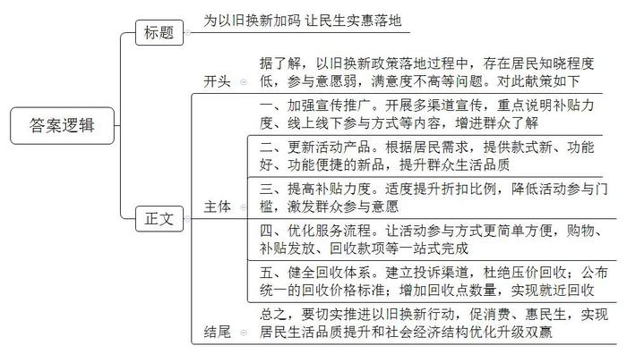
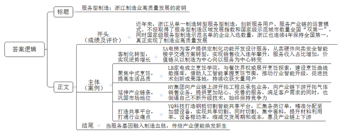
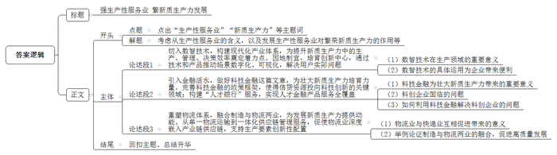

# 2025年浙江省公考《申论》题（A卷）

<!-- gwy:overview:start -->
> **浙江 · 2025 · 申论 · A类** ｜ 3 题 · 图片 3 处 · 答案随题折叠

导航：[题目](#题目) · [材料 1](#材料-1)
<!-- gwy:overview:end -->

> 候选采集稿。参考答案及解析来自粉笔页面，不代表官方答案或真实高分答卷；来源使用许可与原卷对应关系仍需人工核实。

## 给定材料

### 材料 1

28.4%、45.0%、60.2%，分别是1978年、2012年、2023年服务业对当年GDP的贡献率。节节攀升的数字，彰显服务业作为推动经济增长的主动力日益增强。

随着工业化和城镇化加速推进，居民收入稳步提高，从量与质两个方面对服务业提出了更高的要求，新兴服务业迎来黄金发展期。人们逐步从买商品向买体验、物质需求向精神追求转变，带动旅游、文化、体育、健康、养老、教育等生活性服务业加速发展。电商平台、数字金融让消费者足不出户“买全球”，共享单车、共享汽车等共享交通模式让出行便捷又绿色……电子商务、金融科技、共享经济等现代服务业蓬勃发展，深刻改变人们的生产生活方式，也折射出服务业结构优化升级、质量持续提升之变。

近年来，我国大力发展生产性服务业。2019年至2023年，规模以上高技术服务业、科技服务业、服务业战略性新兴产业企业营业收入年均分别增长12.9%、12.3%和12.0%。服务业对制造业转型升级的支撑作用不断增强，现代服务业和先进制造业融合发展初显成效。2023年，我国规模以上生产性服务业企业实现营业收入119万亿元，2020年至2023年年均增长12.1%。与此同时，我国实施“互联网+”行动，推动互联网与制造业深度融合，加快新旧发展动能和生产体系转换。2023年末，我国具备一定影响力的工业互联网平台数量超过340个，覆盖了全部工业大类，工业互联网核心产业规模达1.35万亿元。2023年，数字经济核心产业的发明专利授权量达到40.6万件，占同期全社会发明专利授权总量的四成半，近五年年均增速达到21.0%。数字经济核心产业快速发展，为发展新质生产力注入强劲动力。

2023年，浙江服务业增加值达46268亿元，服务业对GDP增长的贡献率达63.2%，成为推动浙江经济发展的主动力产业。2024年5月，浙江发布《推动浙江服务业高质量发展三十条措施》，提出将打造六大高地——全球新兴产业科创高地、全球现代物流发展高地、全球数字贸易高地、全国现代金融服务高地、全国高端商务服务高地、全国品质生活高地。到2027年，将基本建成浙江特色现代服务业体系，奋力打造现代服务业强省。

### 材料 2

生活性服务业是促消费、惠民生的重要领域。良好的服务可以刺激更多的消费行为。而消费提质，可以实现居民生活品质提升和社会经济结构优化升级双赢。

2024年8月22日，浙江省人民政府办公厅印发《浙江省进一步推动消费品以旧换新行动方案》。国庆假期，宁波的褚女士终于换掉了婆婆家的旧冰箱。“这台冰箱有20多年了。”褚女士说，“老冰箱的毛病不少，冷冻层隔段时间就结起厚厚的霜，鼓风机也坏了，一启动就嘎嘎作响。”褚女士几次想给他们换新冰箱，无奈老人不舍得花钱，一直将就着用。“正好这次以旧换新能享受补贴，终于把他们说动了。”褚女士在某购物平台的“宁波以旧换新”页面选购了一台500L容量的冰箱，原价4799元，实付3300元。当天就有配送员上门换了新冰箱，婆婆也很满意：“新冰箱价格实惠，质量也好，晚上睡觉时再也听不到噪声了。”过了几天，婆婆又跟儿媳妇说要换一个智能手机，原来这款新冰箱是智能家电，婆婆想试试用手机调节冰箱内不同区域的温度。褚女士又通过以旧换新的方式帮婆婆买了新手机。

以旧换新，固然是以“真金白银”的补贴和折扣为主要卖点，但消费者也希望通过换新，换来更新颖、便捷的体验和更高的生活品质。

### 材料 3

为了解以旧换新过程中存在的问题和公众的诉求期盼，为相关政策制定提供参考，10月，L市J县开展了“居民家庭耐用品以旧换新专题调研”。本次调研，收回有效调研问卷1058份。

调研显示，对今年消费品以旧换新活动的了解程度，非常了解、比较了解、基本了解的分别占20.5%、12.5%和18.8%，听说过但不怎么了解的占30.1%，没听说过、不了解的占18.1%。

关于参加以旧换新活动意愿度的问题，选择会参加的居民占33.8%，不一定、看新产品吸引力的占37.2%，不一定、看活动力度决定的占29.0%。调研显示，尚未参加家庭耐用品以旧换新活动的居民占59.5%，只参加过线下活动的占22.9%，只参加过线上活动的占13.4%，线上线下都参加过的占4.2%。而在以旧换新活动中公众比较看重的功能和服务的调研（多选题）中发现，居首位的是回收价格合理（812人选择），其次是服务流程简单方便（660人选择），第三是新品比旧品功能提升明显（554人选择）。

在参加过以旧换新活动的428名居民中，不满意选项（多选题）选择最多的是补贴力度小且使用门槛高（284人选择），其次是活动产品很多是老款、无法买到心仪的新款（175人选择），第三是回收价格不合理（102人选择）。调研居民对目前废旧耐用品回收体系存在问题（多选题）的看法，58.8%反映压价回收，44.3%反映回收价格不透明，25.2%反映回收点距离远而上门回收不合算。

### 材料 4

服务型制造是制造业与服务业融合发展的新模式、新业态，是制造业提质增效与转型升级的重要方向。通俗地理解，服务型制造中，为消费者服务的可归类为生活性服务业，为生产企业服务的可归类为生产性服务业。

近年来，浙江深入实施《关于深入推进服务型制造促进制造业高质量发展的实施意见》，取得了服务型制造区域发展指数和国家级服务型制造示范城市数量全国“双第一”，为全球先进制造业基地建设提供了有力支撑。2023年底，工信部公布第五批国家级服务型制造示范名单，浙江18家单位入选，连续4年保持入选数量全国第一。从“硬汉式”单一制造，转型为“刚柔相济”的服务型制造，服务用户、服务产业链的运营模式，已成为浙江制造业高质量发展的重要路径。

在位于杭州临平的XA电梯制造厂里，不少人正在体验电梯轿厢。负责人介绍，这些都是加装电梯的小区居民，实地体验后，企业要给他们提供定制化功能开发设计服务。“行业有句俗语叫做‘三分看制造，七分看保养’。”XA电梯陆副总裁说，“如今企业要生存下去，必须向服务行业转型。”在这家企业，新员工入职后的第一个岗位不是去“流水线”，而是学习不同场景下的电梯客制化解决方案。过去三年，全国电梯制造行业销售收入持续负增长，但XA电梯因为完成了从卖电梯硬件向卖安全智能楼宇交通方案的企业转型，销售收入连年攀升，服务收入占比更是超过40%。“价值链正从以制造为中心向以服务为中心转变。”有专家这样解读。

双菇蒸鸡腿、醪糟猪蹄、麻油沙姜鸡、香橙蒸蛋……每天，有越来越多“吃货”加入杭州LB家电公司的粉丝战队，跟着大厨在家做出美味的中式菜肴。成立行业唯一的中式烹饪学院，与知名餐厅主厨、美食达人等餐饮界权威人士共同展开中式烹饪探索，成为LB公司转型的新尝试。公司开始建设中式烹饪曲线数据库，通过人工智能精准追踪时间和温度两大核心指标，掌控每道菜式的烹饪节奏，进一步推动厨电的智能升级。如今，基于中式烹饪曲线数据库的技术创新成果已经开始落地，如“一秒控烟技术”、蒸烤炸一体机的专业曲线辅助、洗碗机根据烹饪后餐具浊度情况的自动清洗曲线等新技术均来源于此。

### 材料 5

新上钢铁项目少了，制氧设备的需求自然就减少了，怎么办？国内制氧行业龙头、老牌制造企业HY集团的对策是“牵着奶牛卖牛奶”。

“随着关键技术突破，设备走向精密化、体系化，必须要卖服务，不仅是技术支持的服务，而且是用户甚至整个工程需要的建设和管理服务。”HY集团负责人说。HY集团的转型路径，是向产业链上游开拓工程总承包业务，向产业链下游开拓气体销售业务。HY集团不光要提供品质精良的设备，还要融资几千万元甚至上亿元建造气体工厂，自己安装、维护和管理，客户只需等设备投产，掏钱买气体。“这就是‘牵着奶牛卖牛奶’。通过为用户提供更加贴心、完善的服务，进一步巩固了公司在国内外市场的地位。”HY集团负责人说，“上门去服务会不断碰到新场景新问题，于是技术就会不断更新升级，企业就会始终保持竞争力。”

“把动力厂交给HY之后，感觉睡觉都能睡踏实了。”山西一家钢铁企业总经理对HY的气体服务赞不绝口，“从民营钢企的角度看，更希望专业的公司来运营、管理动力厂，专业的人干专业的事情，高效高质低成本。”该企业曾经每天担忧的检修、安全、运行，甚至人才流失等问题，通过一纸协议，通通转给了HY集团。

走进嘉兴YQ在线科技有限公司，4台高高悬挂的液晶显示器格外显眼，订单数据、客户情况等大数据实时更新，各地制造加盟商的钢板切割设备运行情况实时显示。50人左右的团队，百来台电脑，既没有产业工人，也没有切割机，却服务着全国上千钢板切割企业，年销售破亿元。

钢板切割是所有机械行业都会涉及到的一块内容，但在大多数情况下，国内机械行业需要自己购买材料、切割设备、设计图纸，且因为周期性和季节性波动，往往会造成材料利用率低、设备稼动率不高。YQ打造钢板切割智能共享平台，就是为了打通这一行业“痛点”。

“我们在加盟商的切割设备上安装了‘YQ壹卡’，实时采集设备状态，并通过5G网络，将数据实时传输至平台。”YQ负责人说，“通过YQ的智能共享平台，把多品种、小批量、个性化定制的订单汇集在一起，利用人工智能分单技术，精准地分配到加盟商的切割设备上，实现共享切割、同时切割。”在利用大数据、自动套料模块进行钢板集中套料后，钢板的利用率比行业平均水平提高了12%，设备稼动率可提升30%，产品交货周期比传统行业缩短了一半，终端用户的切割成本节省30%，惠及产业链上下游。

### 材料 6

习近平总书记指出，“发展新质生产力是推动高质量发展的内在要求和重要着力点”。党的二十届三中全会明确“健全因地制宜发展新质生产力体制机制”，同时要求“聚焦重点环节分领域推进生产性服务业高质量发展”。

生产性服务业，顾名思义就是为各类市场主体的生产活动提供服务的行业，主要包括研发设计与其他技术服务，货物运输、仓储和邮政快递服务，信息服务，金融服务，节能与环保服务，租赁与商务服务，人力资源管理与培训服务，批发经纪代理服务，生产性支持服务等服务行业。它与制造业直接相关，是制造业的配套产业，是链接先进制造与现代服务的关键环节。

新质生产力通过“技术革命性突破、生产要素创新性配置、产业深度转型升级”促成“劳动者、劳动资料、劳动对象优化组合和更新跃升”，进而实现全要素生产率提升。在人工智能、大数据迅猛发展的新经济时代，数智技术成为新质生产力的最重要生产工具之一。而生产性服务的主要手段正是数智技术，即充分利用数据、技术要素及其相应的云计算、物联网、区块链等成果，在资本、管理等要素加持下，实现更高水平的要素配置，逐步推进拥有更高综合素质的新时代劳动者、数智化的劳动资料、以数据信息为主的新型劳动对象实现高水平交互融合，从而实现更高科技含量和综合水平的服务提升，助力各大产业高质量发展并向新质生产力转化。

在11月14日省委理论学习中心组举行的专题学习研讨会上，省委书记、省长王浩强调，加快建设创新浙江、因地制宜发展新质生产力，要找准工作的着力点和发力点。要统筹推进传统产业转型升级、新兴产业培育壮大、未来产业前瞻布局，加快构建浙江特色现代化产业体系，推动高质量发展。而生产性服务业作为现代服务业中的新兴产业，是现代化产业体系的重要一环，它与一、二次产业创新性深度融合，正是“加快建设创新浙江、因地制宜发展新质生产力”工作的着力点和发力点之一。

### 材料 7

制造业高质量发展的步伐越快，对能提供增值赋能的生产性服务业的需求就越大。11月初，浙江省经信厅、财政厅联合发文，就做好2024年度浙江省制造业创新中心培育创建工作作出具体部署，将聚焦国家制造业创新中心重点领域、我省“415X”先进制造业集群、新兴产业、未来产业等领域，新培育布局一批省级制造业创新中心。目前浙江已经培育省级创新中心21家、国家石墨烯创新中心1家，主要集中在新材料、高端装备、数字经济、生物医药等重点领域。

创新中心正在服务高端制造业中发挥巨大作用。比如，石墨烯导热膜在热导率方面是铜的近3倍，可有效解决芯片发展过程中导热性能遇到的瓶颈问题。今年4月，国家石墨烯创新中心研发的石墨烯导热膜产品一上市，就迅速发往全国膜切厂，进入产业链下游企业，匹配手机、平板、路由器等产品生产需求，实现了石墨烯导热膜的应用落地。再如，当前备受关注的自动驾驶，方向虽明，但是行业面临数据获取和处理能力、系统稳定性等技术瓶颈，单靠某一家企业，很难完成技术突破。智能网联汽车创新中心先后承担省级研发项目5个，研发了智能线控底盘、底盘域控等关键技术，并深度参与杭州智能网联汽车“车路云一体化”应用试点城市建设，为自动驾驶和智慧出行奠定了科技基础。

### 材料 8

11月22日，在加快建设创新浙江因地制宜发展新质生产力动员部署会暨全省科学技术奖励大会上，海康威视的陈宗年智能物联创新团队被授予2023年度浙江科技大奖。“我们公司生来要走技术创新的路。”中电海康集团党委书记、董事长陈宗年说。如今海康不仅是我国智能物联领域的代表性科技企业，也是以物联感知、AI、大数据等核心技术服务千行百业的生产性服务业龙头企业。

应用在皮带检测领域的光纤就是典型案例之一。在矿产开采、建材水泥、钢铁冶金、电力、港口等行业，皮带用于运输原材料，一旦皮带托辊出现异常，就会造成皮带磨损、跑偏、发热，甚至起火等严重事故，导致产线停工等问题。中国约有几十万根皮带，皮带廊道往往长达几十公里，人工巡检艰苦且危险，过去依托的可见光、热成像等设备和解决方案，也都难以适应复杂的应用环境。海康威视创新性地采用智能光纤来检测皮带的实时运行情况。“光纤是无源的，环境适应能力很强，在皮带钢架上铺设后，能够把接收到的信号还原成音频进行智能分析，根据分析的数据来判断皮带在运行过程中是不是出现了异常，这是一个重要的应用突破。”海康威视徐副总裁说，“我自己爬过皮带的管廊，体验过环境的复杂。我们研发的振动光纤，已经迭代了4代产品，现在产品已经能够很好地解决皮带运维场景的核心需求。”

DZ有限公司位于杭州市钱塘区的工厂，每年可生产2000万台小型车载电机和雨刮系统，服务于全球各大汽车厂商。海康威视协助工厂部署了AR相机及系统平台，打通了生产、质检、物流、设备保全、能源等业务系统和关键模块，实现了对生产现场的可视化全景掌握，进一步提升了管理和决策效率。“通过这次合作，工厂不仅提高了生产效率和产品质量，还降低了成本，增强了竞争力。”DZ有限公司负责人表示，“智能工厂的建设是一个不断演进的过程，在未来的几年里，我们希望和海康威视深入合作持之以恒。”“在助力千行百业数字化转型的过程中，海康威视在其中扮演的角色，是通过技术和产品推动一个个场景的数字化，为用户解决实际问题。”徐副总裁说。

### 材料 9

去年10月，中央金融工作会议把“科技金融”放在“五篇大文章”首位，为引导更多金融资源投向科技领域指明了方向。中央有号召，浙江见行动。今年以来，浙江先后发布《加大力度支持科技型企业融资实施细则》《金融机构服务科技型企业效果评估办法》等，科技金融的政策框架进一步完善。各家金融机构正强化金融服务科技创新，推动信贷资源投向科技创新关键领域，助力新质生产力培育发展。

“目前公司拥有2项计算机软件著作权，我们对自己的成功非常有信心，但是技术专利属于‘无形资产’，变现难度极大。”温州某文化传媒有限公司负责人颇为感慨。温州银行高新支行了解到情况后及时联系了企业负责人，以其科创指数评分为主要授信评价，帮助企业申请“科创指数贷”，解决企业无抵押、融资难的问题。

科创企业往往面临技术风险，不确定性因素较多。杭州市滨江区创新评估机制，启动“企业创新积分”制度，通过数据驱动和定量评价的方式，对企业的创新能力进行量化评估。截至8月末，183家企业获得创新积分贷超6.8亿元。余姚农村商业银行则联合当地科技局和融资担保公司推出“姚创贷”产品，通过按比例分担风险，解决金融机构“不敢贷”之忧。

针对科技型企业中“人”这个关键因素，浙江正推广轻资产、重智力的“人才银行”服务模式，截至9月末，全省11个设区市已实现人才金融产品服务全覆盖；财通证券在协助企业推荐挂牌、股权激励、保荐上市的同时，为股东提供资产托管、理财咨询等伴随式服务。

回看前三季度浙江金融数据，科技金融领域的增速十分亮眼——全省科技服务业贷款余额同比增长19.2%，高于各项贷款增速9.3个百分点。融资更便捷、成本更低廉、服务更精准……科创企业的获得感，不仅体现出一个地区金融产业的发达程度，更是观察该地区发展潜力的风向标。截至9月末，全省科技服务业贷款余额达27690.68亿元，位居全国前列，越来越多的金融活水正引向科创企业，成为培育壮大新质生产力的关键力量。

### 材料 10

126辆自动引导车、14台提升机高速运转，一件件包裹随着皮带机流转、分拣、落格，直接在仓库集散，全过程无缝衔接……这是宁波市海曙区某快递公司为企业量身定制的智能云仓的工作场景。智能化设备和系统是这里的绝对主角，一件快件从下单到装车只需20分钟，快件处理能力对比传统人工提升30%以上，差错率几乎为零。快递业从末端“搬运工”走进前台生产线，从单一的物流运输到一体化供应链管理服务，实现快递业与制造业的深度融合。据测算，“快递进厂”平均为企业降低物流成本近两成。

“快递进厂”正在将服务延伸至生产环节。宁波顺丰丰泰产业园位于宁波枢纽核心片区，新能源汽车电池制造企业YS有限公司落户其中。制造企业与快递企业同在一个园区，根据产品特点，顺丰公司为YS定制物流方案。“企业的产品直接从厂房送到园区，在这里实现一站式仓储配送。”园区负责人说。目前，顺丰丰泰产业园为13家制造企业提供定制化供应链解决方案，日均快递发货量超过2万件。

去年，海曙区实施快递业与制造业融合发展合作项目达49个，快递业务年收入约4516万元，支撑制造业产值总额40.9亿元，并入选国家邮政局首批“快递业与制造业融合发展试点先行区”名单。此外，海曙区专门出台《推进“快递业与制造业融合发展试点先行区”建设实施方案》，吸引了邮政、顺丰、菜鸟、DHL等寄递企业区域总部落户。

如今，浙江各地的物流业正深度嵌入产业链供应链，加快重塑物流体系，深化制造与物流两业融合生态建设，更好支持生产要素创新性配置，为培育发展新质生产力提供强大动能。

## 题目

### 第 1 题

**《J县晚报》拟编辑一期《以旧换新，我来献策》专版，社区干部小赵参与了“居民家庭耐用品以旧换新专题调研”工作，被约稿。假如你是小赵，根据资料2、3，完成这篇约稿。（20分）**

关联材料：材料 2、材料 3

作答要求：

（1）对策全面，针对性强；

（2）结构完整，条理清晰，语言流畅；

（3）字数不超过350字。

第 1 题 · 答案与解析

**参考答案（粉笔题库参考内容）**

为以旧换新加码 让民生实惠落地

据了解，以旧换新政策落地过程中，存在居民知晓程度低，参与意愿弱，满意度不高等问题。对此献策如下：

一、加强宣传推广。开展多渠道宣传，重点说明补贴力度、线上线下参与方式等内容，增进群众了解。二、更新活动产品。根据居民需求，提供款式新、功能好、功能便捷的新品，提升群众生活品质。三、提高补贴力度。适度提升折扣比例，降低活动参与门槛，激发群众参与意愿。四、优化服务流程。让活动参与方式更简单方便，购物、补贴发放、回收款项等一站式完成。五、健全回收体系。建立投诉渠道，杜绝压价回收；公布统一的回收价格标准；增加回收点数量，实现就近回收。

总之，要切实推进以旧换新行动，促消费、惠民生，实现居民生活品质提升和社会经济结构优化升级双赢。

**解析**

**参考答案说明：**（1）格式方面，本参考答案写到了“标题”“正文”两个部分。（2）正文部分，一方面从内容上来看，围绕“以旧换新”这一主题，本参考答案先在开头简单介绍了当前以旧换新活动存在的总体问题，接着主体部分从“加强宣传推广”“更新活动产品”“提高补贴力度”“优化服务流程”“健全回收体系”五个方面提出了对策，最后结尾对主题进行了升华。另一方面，形式上，本参考答案做到了分段、分条撰写，整体上条理较为清晰。

### 第 2 题

**根据资料4、5，聚焦“服务型制造的浙江实践”话题，写一则短评。（30分）**

关联材料：材料 4、材料 5

作答要求：

（1）题目自拟，观点鲜明，论述深刻；

（2）结构完整，条理清晰，语言流畅；

（3）字数不超过600字。

第 2 题 · 答案与解析

**参考答案（粉笔题库参考内容）**

服务型制造：浙江制造业高质量发展的密钥

近年来，浙江从单一制造转型服务型制造，创新服务用户、服务产业链的运营模式。不但取得了服务型制造区域发展指数和国家级示范城市数量全国“双第一”，同时国家级服务型制造示范名单的企业入选数量，浙江也连续4年保持全国第一，真正实现了制造业高质量发展。

客制化转型，实现逆势增长。XA电梯为客户提供定制化功能开发设计服务，从卖硬件向卖安全智能楼宇交通方案转型，实现销售收入连年攀升，服务收入占比增加，价值链从以制造为中心向以服务为中心转变。

聚焦中式烹饪，提高生活品质。LB家电成立烹饪学院，与餐饮界权威展开烹饪探索，建设烹饪曲线数据库，借助人工智能掌握烹饪节奏，推动行业智能升级，促进技术创新成果落地，持续收获大量用户。

延伸产业链条，巩固市场地位。HY集团向产业链上游开拓工程总承包业务，向产业链下游开拓气体销售业务，提供更加贴心、完善的服务，满足客户需求的同时，也倒逼自己不断升级技术，始终保持竞争力。

打造共享平台，打通行业痛点。YQ科技打造钢板切割智能共享平台，汇集各类订单，精准分配至加盟设备，实现共享切割、同时切割、集中套料，提升材料利用率、设备稼动率，缩减交货周期和成本，惠及产业链上下游。

当服务基因融入制造血脉，传统产业便能焕发新生。

**解析**

**参考答案说明：**（1）格式方面，本参考答案写到了“标题”“正文”两个部分。（2）正文部分，一方面从内容上来看，围绕着“服务型制造的浙江实践”这一主题，本参考答案的开头先介绍了浙江实践服务型制造所取得的成绩，并给出评价；主体部分从“客制化转型，实现逆势增长”“聚焦中式烹饪，提高生活品质”“延伸产业链条，巩固市场地位”“打造共享平台，打通行业痛点”这四个方面介绍了浙江实践服务型制造的具体案例；结尾部分进行了总结。另一方面，形式上，本参考答案做到了分段、分条撰写，整体上条理较为清晰。

### 第 3 题

**结合给定资料，围绕“做强生产性服务业，赋能新质生产力发展”话题，自选角度，自拟题目，写一篇议论性文章。（50分）**

关联材料：材料 1、材料 2、材料 3、材料 4、材料 5、材料 6、材料 7、材料 8、材料 9、材料 10

作答要求：

（1）主旨明确，结构完整，思路清晰；

（2）内容充实，论述深刻，语言流畅；

（3）不拘泥于给定资料；

（4）字数1000-1200字。

第 3 题 · 答案与解析

**参考答案（粉笔题库参考内容）**

**强生产性服务业** **繁新质生产力发展**

在全球化与信息化交织的今天，经济发展已经迈入了一个全新的阶段，其中生产性服务业的崛起尤为引人注目。作为制造业的配套产业，作为链接制造业与现代服务业的关键环节，生产性服务业不仅为传统产业升级提供了强大的智力支持，更为新兴生产力的蓬勃发展注入了不竭动力。同时，生产性服务业的核心在于通过高效、专业的服务，提升其他行业的生产效率和创新能力。

不管是数智技术的介入，还是科技金融的参与，亦或是物流体系的完善，都是生产性服务业激发市场活力，优化资源配置，形成更多经济增长点，进一步推动经济结构调整，实现生产力高质量发展的有力支撑。

**切入数智技术，构建现代化产业体系，为提升新质生产力中的生产、管理、决策效率奠定着力点。因地制宜，培育创新中心，通过技术和产品推动场景数字化、可视化，解决用户实际问题**。数智技术在生产领域的应用，实现了生产过程的自动化、智能化和精益化，机器人、自动化设备等智能装备，可以替代传统的人工操作，提高生产效率和产品质量。例如，专家级的项目管理AI系统可以基于大数据和算法，自主规划任务流程、识别风险点，为决策提供建议，从而提高企业的管理水平和运营效率。

**引入金融活水，做好科技金融这篇文章，为壮大新质生产力培育力量。完善科技金融的政策框架，使得信贷资源投向科技创新的关键领域；构建“人才银行”服务，实现人才金融产品服务全覆盖**。科技金融是建设科技强国的重要保障，能够促进科技、产业与金融的良性循环，能够加快技术研发与成果转化，赋能实体经济，为新质生产力的形成和发展注入动力。但是，科创企业往往面临较多不确定因素，“科创指数贷”“姚创贷”等解决了企业无抵押、融资难的问题，提升科技服务业贷款，把越来越多的金融活水引向科创企业，提升科创企业获得感，让融资更便捷、成本更低廉、服务更精准。

**重塑物流体系，融合制造与物流两业，为发展新质生产力提供动能。从单一物流运输到一体化供应链管理服务，促使物流业深度嵌入产业链供应链，支持生产要素创新性配置**。高效、快捷的物流服务能够有效保障制造业发展，通过深度融合，快递业助力制造业优化供应链管理，提高生产效率，降低物流成本；同时能够提升快递企业的市场竞争力。就如“快递进厂”，快递业从末端“搬运工”走进前台生产线，不仅提升快件处理能力，降低差错率，更是将服务延伸至生产环节，快递公司为企业定制供应链解决方案，提升快递发货量及发货速度。

回望过去，生产性服务业的快速发展，有力地促进了我国的经济转型和产业升级，是推动新质生产力发展的重要途径和必然选择。让我们携手共进，以更加开放的姿态、更加务实的行动，共同开创生产性服务业美好的未来，为构建新发展格局、推动高质量发展作出更大贡献！

**解析**

**文章分析**

**强生产性服务业** **繁新质生产力发展**

【**标题的优点：**首先，范文的标题突出了“生产性服务业”“新质生产力”等主题词。其次，形式上，文字简洁明快。】

（1）在<u>全球化与信息化交织</u>的今天，<u>经济发展已经迈入了一个全新的阶段</u>，其中生产性服务业的崛起尤为引人注目。（2）作为<u>制造业的配套产业</u>，作为<u>链接制造业与现代服务业的关键环节</u>，生产性服务业不仅为<u>传统产业升级提供了强大的智力支持</u>，更为<u>新兴生产力的蓬勃发展注入了不竭动力</u>。（3）同时，生产性服务业的核心在于通过<u>高效、专业的服务</u>，提升<u>其他行业的生产效率和创新能力</u>。

【**开头的优点：**★内容方面：范文的开头是紧扣“生产性服务业”“新质生产力”等主题词展开的。首先指出了生产性服务业发展的背景；然后指出了生产性服务业的重要性；最后指出发展生产性服务业的核心，即对策。★文字表达方面：长短句配合使用，使语言表达有节奏感。】

不管是数智技术的介入，还是科技金融的参与，亦或是物流体系的完善，都是生产性服务业激发市场活力，优化资源配置，形成更多经济增长点，进一步推动经济结构调整，实现生产力高质量发展的有力支撑。

【**过渡段的优点**：范文过渡段分析了“发展生产性服务业，繁荣新质生产力”的对策、意义等方面的内容，此外，还要注意过渡段是为了引起下文的过渡性内容。】

**切入数智技术，构建现代化产业体系，为提升新质生产力中的生产、管理、决策效率奠定着力点。因地制宜，培育创新中心，通过技术和产品推动场景数字化、可视化，解决用户实际问题**。（1）<u>数智技术在生产领域</u>的应用，实现了<u>生产过程的自动化、智能化和精益化</u>，机器人、自动化设备等智能装备，<u>可以替代传统的人工操作</u>，<u>提高生产效率和产品质量</u>。（2）例如，专家级的项目管理<u>AI系统</u>可以基于大数据和算法，<u>自主规划任务流程</u>、<u>识别风险点</u>，为决策提供建议，从而<u>提高企业的管理水平和运营效率</u>。

【**论述段1的优点：**★观点句：范文的观点句是紧扣“生产性服务业”“新质生产力”等主题词提出的。形式上，它在段首处直接写出，位置突出，容易发现。内容上，关键词突出，内容要点明确，可以明显看出它是围绕“利用数智技术，构建现代化产业体系”展开。★论述内容：（1）数智技术在生产领域的重要意义；（2）数智技术的具体运用为企业带来便利。注意：以上几个方面的内容都是紧扣“切入数智技术，构建现代化产业体系，为提升新质生产力中的生产、管理、决策效率奠定着力点。因地制宜，培育创新中心，通过技术和产品推动场景数字化、可视化，解决用户实际问题”这个观点句论述的，论述的针对性强，内容层次丰富。在论述方法上采用了讲道理、举例子相结合，做到了丰富多样。】

**引入金融活水，做好科技金融这篇文章，为壮大新质生产力培育力量。完善科技金融的政策框架，使得信贷资源投向科技创新的关键领域；构建“人才银行”服务，实现人才金融产品服务全覆盖**。（1）<u>科技金融是建设科技强国的重要保障</u>，能够<u>促进科技、产业与金融的良性循环</u>，能够<u>加快技术研发与成果转化</u>，<u>赋能实体经济</u>，为新质生产力的形成和发展注入动力。（2）但是，<u>科创企业往往面临较多不确定因素</u>，（3）“科创指数贷”“姚创贷”等解决了企业无抵押、融资难的问题，<u>提升科技服务业贷款</u>，把越来越多的<u>金融活水引向科创企业</u>，<u>提升科创企业获得感</u>，让<u>融资更便捷、成本更低廉、服务更精准</u>。

【**论述段2的优点：**★观点句：范文的观点句是紧扣“生产性服务业”“新质生产力”等主题词提出的。形式上，它在段首处直接写出，位置突出，容易发现。内容上，关键词突出，内容要点明确，可以明显看出它是围绕“科技金融”展开。★论述内容：（1）科技金融为壮大新质生产力带来的重要意义；（2）科创企业面临的问题；（3）如何利用科技金融解决科创企业的问题。注意：以上几个方面的内容都是紧扣“引入金融活水，做好科技金融这篇文章，为壮大新质生产力培育力量。完善科技金融的政策框架，使得信贷资源投向科技创新的关键领域；构建‘人才银行’服务，实现人才金融产品服务全覆盖”这个观点句论述的，论述的针对性强，内容层次丰富。在论述方法上采用了讲道理、举例子相结合，做到了丰富多样。】

**重塑物流体系，融合制造与物流两业，为发展新质生产力提供动能。从单一物流运输到一体化供应链管理服务，促使物流业深度嵌入产业链供应链，支持生产要素创新性配置**。（1）高效、快捷的<u>物流服务</u>能够有效保障制造业发展，通过深度融合，快递业<u>助力制造业优化供应链管理</u>，<u>提高生产效率</u>，<u>降低物流成本</u>；同时能够<u>提升快递企业的市场竞争力</u>。（2）就如“快递进厂”，快递业从末端“搬运工”走进前台生产线，不仅<u>提升快件处理能力</u>，降低差错率，更是将<u>服务延伸至生产环节</u>，快递公司为企业定制供应链解决方案，提升快递发货量及发货速度。

【**论述段3的优点：**★观点句：范文的观点句是紧扣“生产性服务业”“新质生产力”等主题词提出的。形式上，它在段首处直接写出，位置突出，容易发现。内容上，关键词突出，内容要点明确，可以明显看出它是围绕“重塑物流体系”展开。★论述内容：（1）物流业与快递业互相促进带来的意义；（2）举例论证制造与物流两业的融合，促进高质量发展。注意：以上几个方面的内容都是紧扣“重塑物流体系，融合制造与物流两业，为发展新质生产力提供动能。从单一物流运输到一体化供应链管理服务，促使物流业深度嵌入产业链供应链，支持生产要素创新性配置”这个观点句论述的，论述的针对性强，内容层次丰富。在论述方法上采用了讲道理、举例子相结合，做到了丰富多样。】

回望过去，<u>生产性服务业</u>的快速发展，有力地促进了我国的经济转型和产业升级，是推动<u>新质生产力发展</u>的重要途径和必然选择。让我们携手共进，以更加开放的姿态、更加务实的行动，共同开创生产性服务业美好的未来，为构建新发展格局、推动高质量发展作出更大贡献！

【**结尾的优点：**范文的结尾回扣了“生产性服务业”“新质生产力”等主题词，并且进行了总结提升。】

