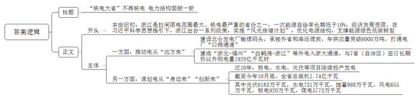
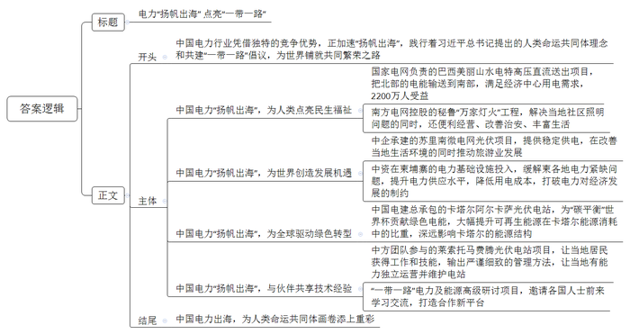
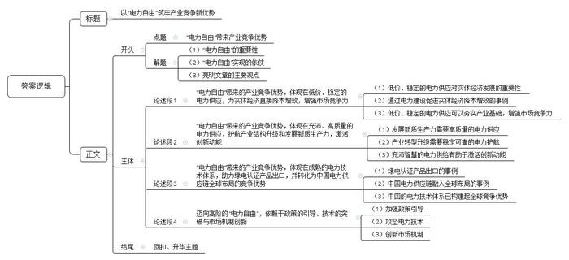

# 2026年浙江省公考《申论》题（A卷）

<!-- gwy:overview:start -->
> **浙江 · 2026 · 申论 · A类** ｜ 3 题 · 图片 3 处 · 答案随题折叠

导航：[题目](#题目) · [材料 1](#材料-1)
<!-- gwy:overview:end -->

> 候选采集稿。参考答案及解析来自粉笔页面，不代表官方答案或真实高分答卷；来源使用许可与原卷对应关系仍需人工核实。

## 给定材料

### 材料 1

全社会用电量被喻为经济“晴雨表”，为观察中国经济提供了独特视角。不久前，国家能源局公布的最新数据显示：今年前三季度，我国全社会用电量达7.77万亿千瓦时，创下历史新高。其中，7月、8月连续两月“超万亿”——相当于东盟国家全年的用电量，也是全球首次出现一个国家的月度用电量“超万亿”。

作为现代工业社会的基石，电力的战略重要性不可低估。从原材料的冶炼、加工，到生产线的运转、自动化设备的驱动，再到服务器、云计算等，无一不依赖于电力的持续输入。近年来，一些发达工业国因能源政策失误或外部供应中断而陷入“能源危机”，一些新兴经济体因电力基础设施薄弱而影响其工业化进程。在这样的背景下，企业和民众可以以稳定、可预期的成本，获得充足、可靠的电力供应，这种“电力自由”的价值——一种深层次的竞争优势便尤为凸显。

今年2月，在杭州萧山区的ZG公司精密制造车间里，一列列橙色的机器手上下翻飞，将一台台服务器主板安装到位，送往下一组装环节。“早上8点就开工赶订单了。多亏供电公司抢抓春节停工窗口期，帮助我们及时增容，新的生产线才能通电。”ZG公司潘经理说。

位于杭州余杭区的中国（杭州）人工智能小镇，集聚了359家高新技术企业、79家省级专精特新中小企业和24家独角兽企业。2月4日复工以来，园区用电负荷迅速增长，国网杭州余杭区供电公司员工第一时间来到园区，开展用电设备专项巡检、健康水平监测分析，保障设备在复工后快速适应负荷变化。“当我们有需要的时候，供电公司员工会第一时间出现。用电有保障，我们就能全身心地搞科研、搞产品。”浙江QN科技公司韩总说。

### 材料 2

半导体制造、生物医药、新能源汽车等战略性新兴产业，其生产过程不仅耗电量大，而且对电能质量的要求也极为苛刻。充沛而稳定的电力，正在成为护航产业结构升级和发展新质生产力的重要保障。

在杭州钱塘区的BD公司芯片生产车间内，精密设备高速运转，将晶圆加工成高性能集成电路。公司设备部王经理介绍：“芯片生产从蚀刻、沉积到封装测试，每个环节对电能质量都有严苛要求，瞬时电压波动不能超过±5%，波动时长不能超过100毫秒。一旦超限，生产线设备需要停产调试，损失巨大。”针对这类对电能质量有极高要求的企业，国网杭州供电公司逐一提交加装电压监测设备建议书，该建议方案可为企业提供24小时动态监测服务。同时，供电公司还摸排1700余个园区情况，“一企一策”制订电能质量提升方案，满足企业高精度用电需求。

“AI的尽头是算力，算力的尽头是电力”。大模型的训练和推理需要消耗惊人的算力，而算力的背后是巨大的电力消耗。一个超大型智算中心的年用电量，相当于一个中等城市。没有充沛、经济的电力，“算力优势”便无从谈起。据国网浙江电力营销数据统计，浙江2024年算力产业总耗电量大约是48亿千瓦时。今年以来，浙江算力产业带来的用电增长已超过20%。

“乌镇之光”超算中心，作为长三角算力网络核心节点，峰值算力达每秒181.9千万亿次，这对供电质量与可靠性要求极高。面对其高负荷、零闪动的用电需求，国网嘉兴供电公司通过用能分析与节能建议，量身定制高可靠接入方案，在超算中心入驻后不久就完成40700千伏安容量建设。在稳定的电力护航下，超算中心的强大算力如同一条数字江河，滋养着乌镇的整片数智生态，吸引智能驾驶、具身智能、生命健康等众多前沿领域的项目与企业集聚。

### 材料 3

时光回溯到本世纪初，彼时全国性缺电严重制约经济社会发展，浙江省尤为严重，每到夏季，工厂“停三开四”成为常态。尤其是2003年，浙江成为全国拉闸限电范围最大、缺电最严重的省份之一，经济发展不得不放缓脚步。浙江是经济用能大省，也是能源资源小省，一次能源自给率长期低于10%，煤炭、石油、天然气等能源资源供应严重依赖外部调入，能源储备和社会经济发展极不匹配。时任浙江省委书记习近平高瞻远瞩地指出，“宁肯电等发展，不要发展等电”“从长远看，我们还要考虑电力结构的调整，要大力发展清洁能源”。

在习近平总书记前瞻思考、全局谋划、整体推进的科学思想指引下，浙江出台《浙江省可再生能源开发利用促进条例》《浙江省绿色低碳转型促进条例》等一系列政策，实施“风光倍增计划”，优化电源结构，支撑能源绿色低碳转型，一方面推动电力从“远方来”，一方面谋划电从“身边来”“创新来”。

北仑发电厂输煤码头，一派繁忙的景象，两艘庞大的运煤船靠泊港口，高空中抓斗卸船机“翩翩起舞”。在浙东海岸线上，特大型煤电机组鳞次栉比，拥有自备输煤码头的电厂有10余家。外省和海外运来的煤炭，在码头自动配煤系统下完成混配，再通过铁路和公路运往各大电厂。没有煤的浙江，就这样凭空造出了一座“海上煤田”，年供应量突破6000万吨，彻底打通了电厂的“口粮通道”。

浙北—福州1000千伏特高压交流输变电工程、白鹤滩—浙江±800千伏特高压直流输电工程等外电入浙大通道相继建成投运。2023年，浙江省与宁、新、川、晋、闽、青、甘7省（自治区）签订长期协议外购电量1920亿千瓦时。

近10年来，浙能六横电厂一期、中核三门核电一期等机组相继投产发电；中核集团金七门核电一期、中广核三澳核电一期等核电项目陆续开工；宁海抽水蓄能、磐安抽水蓄能等电站陆续开工；象山长大涂光伏电站、华电玉环1号海上风电等新能源项目陆续投产发电……截至今年10月底，浙江省内电源总装机达1.74亿千瓦，年内新增电源装机2183万千瓦，创下历史新高。全省光伏装机达6183万千瓦，年内增长1456万千瓦。其中，安装在住宅、厂房等屋顶的分布式光伏装机达5143万千瓦，其采用的“自发自用、余电上网”模式，让更多人用上绿色电力。此外，水电和抽蓄总装机分别达731万千瓦、988万千瓦，风电总装机达655万千瓦，核电总装机达920万千瓦。

今年，浙江新增清洁煤电500万千瓦，国能北仑电厂、浙能嘉兴电厂和华润苍南电厂等均有机组“上新”。这些煤电项目创新建设高效率、大容量机组，降低度电煤耗，并配套除尘、脱硫等超低排放环保设备，不断提升清洁生产水平。截至10月底，全省煤电总装机达5773万千瓦。

### 材料 4

AI技术贯穿于发电、输电、配电和用电等各个环节。“在发电侧，AI可以优化发电机组的运行参数，提高发电效率；在电网侧，可以优化电力调度，减少线路损耗；在用户侧，则可以通过智能控制实现节能降耗。”一位业内人士介绍说。近年来，风、光等新能源在能源结构中的占比日益增加。如何驯服不稳定的新能源，保障间歇性、波动性电源的稳定接入和消纳，是电网实现从传统单一功能型电网向智能化、绿色化的现代电网蜕变的关键。

“AI正与电力系统深度融合。”SLD电气电网行业高级架构师王工说，“当前电力系统的数据量、更新速率和关系复杂性正呈爆炸式增长，而AI恰恰能够凭借实时的决策精准识别资源浪费，并以智能化的方式优化资源管理策略，提升电力系统的柔性。例如，在源网互动方面，由AI赋能的预测性调度可以减少弃风弃光，有力提升风、光、储能等分布式能源与大电网的协同性。”

国网杭州供电公司创新研发的“杭电光擎”系统，可以秒级解析1800余个母线节点、1400余条高压线路的复杂拓扑关系。“过去制定负荷转供方案需15分钟，现在AI只需2分钟。”该公司调度员说。

更多的电力行业人工智能创新应用正在杭州加快落地。“源网荷储”智慧保供平台集成百亿级电网数据，通过知识图谱和推理引擎，在迎峰度夏期间联动“虚拟电厂”形成190万千瓦可调能力，相当于新建一座中型火电厂；“电力+气象”分钟级联动机制，使新能源超短期预测准确率达98.92%；10万座配电站房如今有了数字孪生管家“米特”，它能根据天气、设备状态自主编排巡视计划，5分钟内完成异常研判，相当于给每个设备配了“专属医生”……

在宁波前湾新区数字经济产业园，分布式光伏、储能和空调等资源，被统一接入“智慧能源大脑”能量管理平台。平台可实时监测清洁能源发电、储存与消纳全过程，精准评估光伏出力与储能充放的经济效益，并基于多源数据融合分析，增强“源网荷储”多维互动能力，最终实现高效、经济、绿色的用能管理。“平台试点应用一年多来，园区内的光伏消纳率明显提高，平均每度电的成本降低5.5%。”园区运营负责人张经理说。如今，这样的“智慧大脑”已在宁波各产业园区普遍应用。

### 材料 5

电力不仅关乎生产的连续性，更直接影响着经济的成本。从西部的风光大基地，到沿海的核电集群，再到深入全国的特高压输电网络，一个庞大、高效、多元的能源体系，维持着电价的稳定。一个稳定且相对低廉的电价体系，能够有效降低实体经济，特别是制造业的运行成本。

在今年1月23日的“8+4”经济政策体系发布会上，浙江省发改委相关负责人表示，去年浙江企业电价降了1分钱，减少企业用电成本45亿元以上。今年，浙江通过完善现货市场机制，在供需相对宽松的情况下，继续有效引导价格稳中有降。

“关键是让‘发电—售电—用电’的链条更通畅，让上游价格变化有效传导到终端。”浙江电力交易中心市场部庄主任说。在发电环节，煤电价格对浙江上网电价的影响占70%，是影响企业电价的关键。浙江引导电价跟着煤价走，煤电价格大幅度下降。在售电环节，通过设计封顶机制以增加用电企业的选择权，也就是企业勾选封顶条款后，在签约价格和全省均价之间，可以按照较低价结算。

在畅通传导链条之余，电力市场本身就是稳价降价的“无形之手”。今年，浙江正式进入双边现货市场时代，发电企业和用电企业都可以参与交易，每半小时形成一个电价。进入现货市场的风电、光伏发电、水电和核电，发电成本较低，通过市场竞争机制，降低现货市场电价。

“原本企业担心入市后电价不稳定，今年吃了颗‘定心丸’。”衢州市发改委相关负责人表示。随着入市主体和交易模式的多样化，活跃的电力市场通过价格信号指挥发电和用电两端，用更经济高效的方式配置好电力资源。风光电站、储能电站、“虚拟电厂”等新型主体还可以科学组合发用电资源，参与削峰填谷等电网调节工作，以此获得市场收益。

### 材料 6

“电力自由”并不意味着企业可以无节制地用电。实际上，为了降低用电成本，各地电力部门正与企业协同，以数智化为依托重塑综合能源服务业态，推动企业节能降本。

走进FR公司的生产车间，传统制造的高耗能场景已被绿色智慧场景替代。这家专注智能驾驶系统的企业，正以“光伏+储能”模式，成为嘉兴桐乡制造业绿色转型的鲜活样本。厂房屋顶，深蓝色的光伏板构成“追光矩阵”，将太阳能转化为绿色电能。“2022年，我们协助FR公司完成装机容量844千瓦的屋顶光伏建设并成功并网发电。”国网乌镇供电所小陈介绍，“截至目前，该光伏系统累计发电量已达168.15万千瓦时，为企业节约电费支出超过118万元。”

清晨，阳光刚爬上嘉兴ZD产业园的厂房屋顶，AWD公司的朱总习惯性地看了一眼实时电表。自从工厂屋顶披上光伏“蓝甲”，电费账单明显“瘦了身”。“电价便宜了两成，光上半年电费就省了近12万元。”朱总算起账来笑容满面，“这钱正好可以添置新设备。”产业园内已经有8家企业的光伏板并网发电，享受“屋顶银行”带来的红利。这片占地千亩的产业园里，80%的屋顶已被光伏板覆盖，年发电量高达633万千瓦时，绿电就地消纳比例稳定在50%。

### 材料 7

“欧盟碳关税政策刚出来时，按照传统方式生产，光碳税就能‘吃掉’两成利润。”宁波SL公司外贸负责人汪经理坦言，“多亏了供电公司，从绿电交易到绿证购买，帮我们把碳排放算得清清楚楚。”如今，公司的竹制产品凭借绿电生产优势，不仅没有了高额碳税，在展会上也备受国外客商青睐。

在SL公司生产车间，全自动生产线把竹子变成精美的餐具，驱动机器的是来自浙北山区的风电和光电。满载SL公司产品的电动集装箱卡车，驶入宁波舟山港梅山港区，卡车停稳后，港口机械臂精准钩住集装箱，龙门吊在绿电驱动下完成吊装。很快，这批货物将搭载货轮发往欧洲。“公司产品生产和运输用的都是绿电，形成了环保闭环。”汪经理说。截至目前，宁波已有超2000家外贸企业通过采购绿证等方式提升市场竞争力。今年前4个月，全市绿电交易规模同比增长87%。

在金华BC公司的电能表智能生产车间，32台安装了新型电碳管理终端的设备如同“碳显微镜”，实时跳动显示着关键数据：当前市电电碳因子、厂区屋顶光伏发电量及对应碳排放量、各产线乃至单台设备的实时能耗与碳排放。国网金华供电公司自主研发的分时分区电碳因子核算服务平台，就像给电网做“碳CT扫描”一样，利用广义节点法，融合区块链理念，根据碳源机组和电网拓扑大数据，精准计算小时级电碳因子，并推送给用户。

“看这里。”BC公司单总经理指向一块屏幕说，“4月15日中午12点，阳光充足，我们优先用自建光伏供电，生产一只智能电表的碳排放比完全使用网电时降低近30%。5月份引入绿电交易后，表现最优的一天，我们每用一度电仅产生0.028公斤二氧化碳，几乎可以忽略不计。”平台提供的精细化数据，让企业的降碳决策有了科学依据。目前，这套系统已生成可扫码查询的“分时碳标签”。欧美客户看到标签后，对“浙江制造”的低碳实力更加认可。

### 材料 8

2013年3月，习近平总书记提出构建人类命运共同体理念，随后又提出共建“一带一路”倡议，为世界各国铺就共同发展繁荣之路。

中国电力行业在技术创新、产业链、供应链体系等方面形成了独特的竞争优势。在各国加快能源转型的背景下，中国电力“扬帆出海”，为全球贡献了中国智慧和中国方案。2024年，中国主要电力企业新签境外工程承包项目涉及46个国家和地区；中国风力发电机组出口增长71.9%；光伏产品连续4年出口额超过2000亿元。

在幅员辽阔的巴西，南部的里约州和圣保罗州面临电力负荷快速增加的压力，而发电中心则位于北部亚马孙河流域，南北跨度超过2000公里。中国国家电网公司独立投资、建设、运营的美丽山水电特高压直流送出二期工程项目，输电线路达2550公里，跨越巴西5个州、81座城市，把北部的电能源源不断输送到南部，满足了巴西最重要的经济中心的用电需求，受益人口达2200万人。

在距离中秘共建“一带一路”标志性项目钱凯港约半小时车程的阿斯普罗丹社区，中国南方电网控股的秘鲁BL公司的“万家灯火”工程已初见成果。“今年年初，我在家门口装上电灯、架起锅灶，开始卖炒饭、汉堡之类的食品，生意格外红火。”阿斯普罗丹社区居民肯诺说，通电之前，由于照明不佳，社区治安堪忧，肯诺晚上只能紧闭房门，以防偷盗、抢劫等事件。如今，生意顺遂的肯诺先后在家中添置了洗衣机、电视、冰箱等电器，还“破天荒”购买了手机，接通了网络。“我现在天天看新闻和球赛，生活也有了色彩。”肯诺高兴地说，下一步，他计划把房子的二楼改建为餐馆，摆上桌椅，提供堂食服务，招呼街坊邻居到店里拉家常、喝啤酒、看比赛。

在距离苏里南首都帕拉马里博200多公里的波埃凯蒂村，村民们围坐在村头广场的路灯下，聊着由中企承建的微电网光伏项目，孩子们则在家里明亮的灯光下做着功课。以前，这个位置偏远、交通闭塞的热带雨林村落，用电只能靠几台柴油发电机。微电网光伏项目的投入使用，不仅改善了当地生活环境，也给波埃凯蒂村的旅游业带来了发展机遇。“我们这里自然环境优美，就是因为经常没电，让想来这里旅游的人望而却步。”当地一家旅馆负责人贝卡兴奋地说，“自从有了稳定供电，来的游客越来越多，旅馆的生意也日益红火起来。”

在柬埔寨，中国华电投资建设的额勒赛下游水电站已连续安全生产10余年，年均发电量约10亿千瓦时，为柬埔寨贡献了年均10%以上安全稳定可靠的电能。作为“一带一路”建设的参与者，柬埔寨经济快速发展，电力需求猛增，中资在柬电力基础设施的投入，大大缓解了柬各地电力紧缺问题。世界银行报告显示，近年来柬埔寨电力供应水平得到巨大提升，停电次数和时长明显减少和缩短，企业对成本高昂的柴油发电依赖度大幅降低，电力已不再是制约柬埔寨经济发展的因素。

在2022年世界杯举办地卡塔尔，灼热的阳光被转化成绿色电能输送到球场，照亮绿茵场的每一缕灯光都散发着“中国元素”。由中国电建总承包的卡塔尔首座非化石燃料发电站——阿尔卡萨光伏电站，为卡塔尔“碳平衡”世界杯贡献源源不断的绿色电能。该项目可以满足其全国峰值电力需求的10%，大幅提升可再生能源在卡塔尔能源消耗中的比重，减少碳排放，有力支撑了卡塔尔举办“碳平衡”世界杯的承诺，对卡塔尔的能源结构调整产生了深远的影响。

### 材料 9

非洲南部的莱索托素有“高山王国”之称，太阳能、水力和风能资源丰富，但该国工业基础较为薄弱，约40%的电力供应依赖进口。莱索托政府将发展新能源产业作为实现能源自给的重要方向。马费腾光伏电站项目是莱索托第一个大型光伏电站项目，截至2025年2月底，项目已累计发电超1亿千瓦时。

“我参与了办公区房屋修建、电力设备安装等工作。”曾经参与光伏电站建设的村民玛丽表示，这份工作让她获得了收入，改善了家里的经济状况，“我学会了砌墙手艺，还能进行简单的电工维修。我可以凭借这些技术继续找工作，为两个孩子支付学费。”

“这是我参与的第一个大型新能源项目，这份工作让我深感自豪。光伏电站投运以来，满足了全国约16.6%的电力需求，让我们的生活有了更多光亮。”运维工程师莫哈利说，“在施工建设阶段，中方工程师教会了我如何安装光伏面板、调试电力设备等；进入运营维护阶段后，中方团队严谨细致的管理方法更让我受益匪浅。”光伏发电技术在莱索托是新鲜事物，“学习光伏电站的运营维护技能，让我有了一技之长”。

2023年4月并网发电后，马费腾光伏电站进入为期3年的运营维护服务期。中方团队正与莱索托发电公司合作，培训本土光伏工程师，帮助他们未来可以独立运营并维护光伏电站。目前莱方团队已经有10名本土光伏工程师，还有两名处于见习阶段。莱索托发电公司公共关系负责人玛梅洛说：“中方团队在光伏电站维护方面有着丰富的经验，愿意耐心、细致地帮助我们成长。”

“中国的特高压技术与装备让人印象深刻，这是一次让人难忘的学习旅程。”谈起在中国的12天“低碳之旅”，来自俄罗斯某电力系统运营商的伊万连声赞叹。这次“低碳之旅”，是由国网技术学院与西安交通大学、香港理工大学和香港电灯有限公司联合发起的2024“一带一路”电力及能源高级研讨项目。来自俄罗斯、智利、葡萄牙、菲律宾、津巴布韦等国家和地区的26名电力能源专业人士，先后在济南、西安、香港开展学习交流。国网技术学院依托专业实训场所，邀请相关专业骨干培训师共开展讲座5次，内容涵盖新型电力系统、大规模清洁能源并网、特高压带电作业、配网运检以及高级智能量测等；安排学员前往山东电工电气特高压装备基地、国网智能科技生产基地等进行实地参观。

2018年以来，“一带一路”电力及能源高级研讨项目已连续举办7年，共有来自44个国家和地区的830名政府官员、企业高管、专家学者和技术骨干参与，打造了国际能源电力合作新平台。

## 题目

### 第 1 题

**根据资料3，以“‘缺电大省’不再缺电** **电力结构面貌一新”为题，写一份简报，梳理浙江电力蝶变轨迹，介绍现今浙江电力结构概况。（20分）**

关联材料：材料 3

作答要求：

要求：内容全面、准确；结构合理，条理清晰，语言流畅；字数不超过350字。

第 1 题 · 答案与解析

**参考答案（粉笔题库参考内容）**

“缺电大省”不再缺电 电力结构面貌一新

本世纪初，浙江是拉闸限电范围最大、缺电最严重的省份之一，一次能源自给率长期低于10%，经济发展受限。在习近平科学思想指引下，浙江出台一系列政策，实施“风光倍增计划”，优化电源结构，支撑能源绿色低碳转型。

一方面，推动电从“远方来”。建设北仑发电厂输煤码头，承接外省和海运煤炭，年供应量突破6000万吨，打通电厂“口粮通道”；建成“浙北-福州”“白鹤滩-浙江”等外电入浙大通道，与7省（自治区）签订长期协议外购电量1920亿千瓦时。另一方面，谋划电从“身边来”“创新来”。近10年，核电、水电、光伏等项目陆续投产发电。截至今年10月底，全省总装机1.74亿千瓦。其中光伏6183万千瓦，水电731万千瓦，抽蓄988万千瓦，风电655万千瓦，核电920万千瓦，煤电5773万千瓦。

**解析**

**参考答案说明：**（1）格式方面，本参考答案写到了“标题”“正文”两部分。（2）内容方面，围绕着“电力结构”这一主题，本参考答案开头部分介绍了浙江电力蝶变轨迹；接着主体部分从“推动电从‘远方来’”和“谋划电从‘身边来’‘创新来’”两个方面介绍了浙江电力结构概况。形式方面，本参考答案做到了分段、分条撰写，整体上条理较为清晰。

### 第 2 题

**根据资料8、9，围绕“中国电力‘扬帆出海’”话题，写一则短评。（30分）**

关联材料：材料 8、材料 9

作答要求：

要求：

（1）题目自拟，观点鲜明，论述深刻；

（2）结构完整，条理清晰，语言流畅；

（3）字数不超过600字。

第 2 题 · 答案与解析

**参考答案（粉笔题库参考内容）**

电力“扬帆出海” 点亮“一带一路”

中国电力行业凭借独特的竞争优势，正加速“扬帆出海”，践行着习近平总书记提出的人类命运共同体理念和共建“一带一路”倡议，为世界铺就共同繁荣之路。

中国电力“扬帆出海”，为人类点亮民生福祉。国家电网负责的巴西美丽山水电特高压直流送出项目，把北部的电能输送到南部，满足经济中心用电需求，2200万人受益；南方电网控股的秘鲁“万家灯火”工程，解决当地社区照明问题的同时，还便利经营、改善治安、丰富生活。

中国电力“扬帆出海”，为世界创造发展机遇。中企承建的苏里南微电网光伏项目，提供稳定供电，在改善当地生活环境的同时推动旅游业发展；中资在柬埔寨的电力基础设施投入，缓解柬各地电力紧缺问题，提升电力供应水平，降低用电成本，打破电力对经济发展的制约。

中国电力“扬帆出海”，为全球驱动绿色转型。中国电建总承包的卡塔尔阿尔卡萨光伏电站，为“碳平衡”世界杯贡献绿色电能，大幅提升可再生能源在卡塔尔能源消耗中的比重，深远影响卡塔尔的能源结构。

中国电力“扬帆出海”，与伙伴共享技术经验。中方团队参与的莱索托马费腾光伏电站项目，让当地居民获得工作和技能，输出严谨细致的管理方法，让当地有能力独立运营并维护电站；“一带一路”电力及能源高级研讨项目，邀请各国人士前来学习交流，打造合作新平台。

中国电力出海，为人类命运共同体画卷添上重彩！

**解析**

**参考答案说明：**（1）格式方面，本参考答案写到了“标题”“正文”两个部分。（2）正文部分：一方面从内容来看，围绕“中国电力‘扬帆出海’”这一主题，本参考答案的开头部分先介绍了中国电力出海的概况及总体评价；接着，主体部分从“为人类点亮民生福祉”“为世界创造发展机遇”“为全球驱动绿色转型”“与伙伴共享技术经验”这四个方面介绍了中国电力出海的典型案例及成效；最后，结尾部分进行了简单总结。另一方面从形式来看，本参考答案做到了分段、分层撰写，整体上条理较为清晰。

### 第 3 题

**结合给定资料，围绕“‘电力自由’带来产业竞争优势”话题，联系实际，自选角度，自拟题目，写一篇议论性文章。（50分）**

关联材料：材料 1、材料 2、材料 3、材料 4、材料 5、材料 6、材料 7、材料 8、材料 9

作答要求：

要求：

（1）主旨明确，结构完整，思路清晰；

（2）论述深刻，内容充实，语言流畅；

（3）不拘泥于给定资料；

（4）字数1000-1200字。

第 3 题 · 答案与解析

**参考答案（粉笔题库参考内容）**

**以“电力自由”筑牢产业竞争新优势**

在高质量发展成为时代主题的当下，“电力自由”已成为塑造区域乃至国家产业核心竞争力的关键所在。它的实现，有赖于背后丰沛、稳定、经济、绿色、智能的电力体系。“电力自由”不仅为实体经济降本增效筑牢根基，为新质生产力的萌发与壮大提供沃土，更通过技术与模式的成熟输出，为国家参与全球产业竞合开拓崭新赛道。

**“电力自由”带来的产业竞争优势，体现在低价、稳定的电力供应，为实体经济直接降本增效，增强市场竞争力。**低价电力如“及时雨”，直接灌溉利润土壤；稳定供电则如航船的“深水港”，确保精密制造的安全靠泊，两者结合，塑造一片吸引企业扎根、成长的安全沃土。河南省平顶山市通过建设增量配电网、绿色微电网，使园区工业电价低于国网，吸引大量企业入驻，形成千亿级尼龙新材料产业集群，国际市场占有率高达37%。“低价”释放的成本红利与“稳定”提供的运行保障，共同夯实了产业发展的要素基础，进而转化为全球市场份额与竞争话语权。

**“电力自由”带来的产业竞争优势，体现在充沛、高质量的电力供应，护航产业结构升级和发展新质生产力，激活创新动能。**新质生产力所依托的人工智能、高端制造等前沿产业，对电压有着苛刻的要求，一次毫秒级的电压波动可能导致生产失败。稳定可靠的电力护航现有产业向技术密集型升级，使得制造环节能够追求极致的精度与效率。同时充沛且智慧的电力供给成为激活创新的催化剂，通过“算电协同”“源网荷储”等新型模式，主动优化资源配置，为数字基础设施提供经济、绿色的能源，降低数字创新的成本与碳足迹。

**“电力自由”带来的产业竞争优势，体现在成熟的电力技术体系，助力绿电认证产品出口，并转化为中国电力供应链全球布局的竞争优势。**远景能源在内蒙古利用风光电制取的“绿氨”，凭借符合国际标准的碳足迹认证，成功出口至韩国，将西部绿色电力转化为高附加值零碳商品。中国电建、国家电网等企业，承建的卡洛特水电站、阿尔舒巴赫光伏电站等项目不仅输出了中国的技术、装备和建设标准，更在所在地形成了从设计、建设到运营维护的长期服务链条，融入了全球能源基础设施网络。从赋予单一商品绿色通行证，到在海外落地完整的能源解决方案，中国成熟的电力技术体系已构建起系统化的全球竞争优势。

**迈向高阶的“电力自由”，依赖于政策的引导、技术的突破与市场机制创新。**这不仅要加强顶层设计，明确新型电力系统建设路径，通过多种手段激励绿电开发与消费；还要攻坚储能、柔性输电等技术，提升系统灵活性与智能化水平；更要持续完善绿电交易机制，让价格信号反映电力的商品与环境价值，激励多元主体参与。三者互为依托，方能构建起安全、经济、绿色、高效的现代能源体系。

持续巩固和深化涵盖稳、优、绿、智的“电力自由”，是赋能新质生产力、塑造发展新动能的关键所在。唯有如此，方能在全球产业竞争中夯实根基、赢得主动。

**文章分析**

**以“电力自由”筑牢产业竞争新优势**

【**标题的优点：**标题中含有主题词，使文章主题更突出、清晰。】

（1）在<u>高质量发展成为时代主题</u>的当下，“电力自由”已成为<u>塑造区域乃至国家产业核心竞争力</u>的关键所在。（2）它的实现，有赖于背后<u>丰沛、稳定、经济、绿色、智能的电力体系</u>。（3）“电力自由”不仅<u>为实体经济降本增效筑牢根基</u>，<u>为新质生产力的萌发与壮大提供沃土</u>，更通过技术与模式的成熟输出，<u>为国家参与全球产业竞合开拓崭新赛道</u>。

【**开头的优点：**★内容方面。范文的开头是紧扣“‘电力自由’带来产业竞争优势”这一主题展开的。首先，开头点出主题，做到了主题明确。其次，对“‘电力自由’带来产业竞争优势”这一主题进行了分析阐述：（1）指出了“电力自由”的重要性；（2）指出了“电力自由”实现的依仗；（3）亮明文章的主要观点，指出“电力自由”为产业竞争带来哪些优势。★文字表达方面。使用了“不仅……，更……”等关联词，使语言表达有逻辑性。】

**“电力自由”带来的产业竞争优势，体现在低价、稳定的电力供应，为实体经济直接降本增效，增强市场竞争力。**（1）<u>低价电力</u>如“及时雨”，直接<u>灌溉利润土壤</u>；<u>稳定供电</u>则如航船的“深水港”，<u>确保精密制造的安全靠泊</u>，两者结合，塑造一片<u>吸引企业扎根</u>、<u>成长</u>的安全沃土。（2）<u>河南省平顶山市</u>通过建设增量配电网、绿色微电网，使园区工业电价低于国网，吸引大量企业入驻，形成千亿级尼龙新材料产业集群，国际市场占有率高达37%。（3）“低价”释放的<u>成本红利</u>与“稳定”提供的<u>运行保障</u>，共同<u>夯实了产业发展的要素基础</u>，进而转化为<u>全球市场份额与竞争话语权</u>。

【**论述段1的优点：**★观点句：范文的观点句是紧扣“‘电力自由’带来产业竞争优势”这一文章主题提出的。形式上，它在段首处直接写出，位置突出，容易发现。内容上，关键词突出，内容要点明确，可以明显看出主要从“实体经济降本增效”这个角度展开论述。★论述内容：（1）指出了低价、稳定的电力供应对实体经济发展的重要性；（2）介绍了通过电力建设促进实体经济降本增效的事例；（3）再次强调低价、稳定的电力供应可以夯实产业基础，增强市场竞争力。注意：以上三个方面的内容都是紧扣“‘电力自由’带来的产业竞争优势，体现在低价、稳定的电力供应，为实体经济直接降本增效，增强市场竞争力”这个观点句进行分析论述的，论述的针对性强，内容层次丰富。在论述方法上采用了讲道理与举例子相结合的方式，论述充实透彻。】

**“电力自由”带来的产业竞争优势，体现在充沛、高质量的电力供应，护航产业结构升级和发展新质生产力，激活创新动能。**（1）<u>新质生产力</u>所依托的人工智能、高端制造等<u>前沿产业</u>，<u>对电压有着苛刻的要求</u>，一次毫秒级的电压波动可能导致生产失败。（2）<u>稳定可靠的电力</u>护航现有<u>产业向技术密集型升级</u>，使得制造环节能够<u>追求极致的精度与效率</u>。（3）同时<u>充沛且智慧的电力供给</u>成为<u>激活创新</u>的催化剂，通过“算电协同”“源网荷储”等<u>新型模式</u>，主动<u>优化资源配置</u>，为数字基础设施提供经济、绿色的能源，降低<u>数字创新</u>的成本与碳足迹。

【**论述段2的优点：**★观点句：范文的观点句是紧扣“‘电力自由’带来产业竞争优势”这一文章主题提出的。形式上，它在段首处直接写出，位置突出，容易发现。内容上，关键词突出，内容要点明确，可以明显看出主要从“产业结构转型升级”这个角度展开论述。★论述内容：（1）指出了发展新质生产力需要高质量的电力供应；（2）介绍了产业转型升级需要稳定可靠的电力护航；（3）论述了充沛智慧的电力供给有助于激活创新动能。注意：以上三个方面的内容都是紧扣“‘电力自由’带来的产业竞争优势，体现在充沛、高质量的电力供应，护航产业结构升级和发展新质生产力，激活创新动能”这个观点句进行分析论述的，论述的针对性强，内容层次丰富。在论述方法上采用了讲道理与举例子相结合的方式，论述充实深刻。】

**“电力自由”带来的产业竞争优势，体现在成熟的电力技术体系，助力绿电认证产品出口，并转化为中国电力供应链全球布局的竞争优势。**（1）<u>远景能源</u>在内蒙古利用风光电制取的“绿氨”，凭借<u>符合国际标准</u>的碳足迹认证，成功出口至韩国，将西部<u>绿色电力转化为高附加值零碳商品</u>。（2）中国电建、国家电网等企业，承建的卡洛特水电站、阿尔舒巴赫光伏电站等项目不仅<u>输出了中国的技术、装备和建设标准</u>，更在所在地<u>形成了从设计</u>、<u>建设到运营维护的长期服务链条</u>，融入了<u>全球能源基础设施网络</u>。（3）从赋予单一<u>商品绿色通行</u>证，到在<u>海外落地</u>完整的<u>能源解决方案</u>，中国成熟的电力技术体系已构建起<u>系统化的全球竞争优势</u>。

【**论述段3的优点：**★观点句：范文的观点句是紧扣“‘电力自由’带来产业竞争优势”这一文章主题提出的。形式上，它在段首处直接写出，位置突出，容易发现。内容上，关键词突出，内容要点明确，可以明显看出主要从“参与全球产业竞合”这个角度展开论述。★论述内容：（1）介绍了绿电认证产品出口的事例；（2）介绍了中国电力供应链融入全球布局的事例；（3）再次强调中国的电力技术体系已构建起全球竞争优势。注意：以上三个方面的内容都是紧扣“‘电力自由’带来的产业竞争优势，体现在成熟的电力技术体系，助力绿电认证产品出口，并转化为中国电力供应链全球布局的竞争优势”这个观点句进行分析论述的，论述的针对性强，内容层次丰富。在论述方法上采用了讲道理与举例子相结合的方式，论述充实到位。】

**迈向高阶的“电力自由”，依赖于政策的引导、技术的突破与市场机制创新。**（1）这不仅要<u>加强顶层设计</u>，明确新型电力系统<u>建设路径</u>，通过多种手段<u>激励绿电开发与消费</u>；（2）还要<u>攻坚储能</u>、<u>柔性输电</u>等技术，提升<u>系统灵活性与智能化水平</u>；（3）更要持续<u>完善绿电交易机制</u>，让<u>价格</u>信号<u>反映电力的商品与环境价值</u>，<u>激励多元主体参与</u>。三者互为依托，方能<u>构建起安全、经济、绿色、高效的现代能源体系</u>。

【**论述段4的优点：**★观点句：范文的观点句是紧扣“‘电力自由’带来产业竞争优势”这一文章主题提出的。形式上，它在段首处直接写出，位置突出，容易发现。内容上，关键词突出，内容要点明确，可以明显看出主要从“迈向高阶的‘电力自由’的对策”这个角度展开论述。★论述内容：（1）加强政策引导；（2）攻坚电力技术；（3）创新市场机制。注意：以上三个方面的内容都是紧扣“迈向高阶的‘电力自由’，依赖于政策的引导、技术的突破与市场机制创新”这个观点句进行分析论述的，论述的针对性强，内容层次丰富。在论述方法上主要采用了讲道理的方式，论述清晰到位。】

【**论述段之间的关系：**★内容的内在逻辑：范文的论述段之间是依照“并列”的逻辑展开的。论述段1先写了“低价、稳定的电力供应，为实体经济直接降本增效，增强市场竞争力”，论述段2再写了“充沛、高质量的电力供应，护航产业结构升级和发展新质生产力，激活创新动能”，论述段3接着写了“成熟的电力技术体系，助力绿电认证产品出口，并转化为中国电力供应链全球布局的竞争优势”，论述段4最后写了“迈向高阶的‘电力自由’，依赖于政策的引导、技术的突破与市场机制创新”。文章整体论述思路清晰。】

持续巩固和深化涵盖稳、优、绿、智的“电力自由”，是赋能新质生产力、塑造发展新动能的关键所在。唯有如此，方能在全球产业竞争中夯实根基、赢得主动。

【**结尾的优点：**范文的结尾回扣了“‘电力自由’带来产业竞争优势”这个主题，并且进行了总结提升。】

**解析状态：unknown（来源未提供）**

