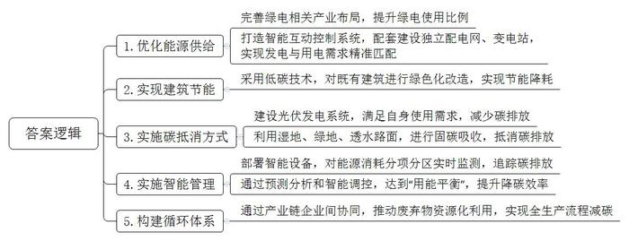
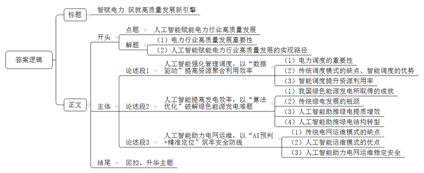

# 2026年浙江省公考《申论》题（C卷）

> 候选采集稿。参考答案及解析来自粉笔页面，不代表官方答案或真实高分答卷；来源使用许可与原卷对应关系仍需人工核实。

## 给定材料

### 材料 1

2025年7月，国家发展改革委等部委联合印发《关于开展零碳园区建设的通知》，提出“支持有条件的地区率先建成一批零碳园区”。

什么是零碳园区？国家发展改革委相关负责人解释，零碳园区是指通过规划、设计、技术应用、管理优化等方式，使园区内生产、生活活动产生的二氧化碳排放降至“近零”水平，并具备进一步达到“净零”条件的园区。

在位于内蒙古鄂尔多斯市的“风光氢储能”零碳产业园里，一排排光伏板鳞次栉比，远处的大型风力发电机随风转动，光伏、光热、氢能、储能等领域企业，正源源不断地生产绿电，输送到各家企业。园区企业绿电使用比例接近70%。

园区内新建了一个独立于原有电网的配电网和变电站，还有一张看不见的“微电网”——智能互动控制系统。“这个系统一头连着上游发电设备，可毫秒级精准预测发电量；一头连着企业，可实时掌握工厂用电需求。波动的发电侧，就可以更好匹配随机的需求侧。”鄂尔多斯YJ能源公司王经理介绍。

走进贵州首个零碳园区，空气中混合着草木清香，远处传来阵阵鸟鸣，让人觉得这里更像一座山体公园。在这座充满科技感的“零碳建筑”内部，工程师们运用60项低碳技术，让老建筑穿上“保温衣”，给实验室换上“智慧窗”，改造后的它不仅简约而时尚，年碳排放量较改造前下降12.5%，连原本渗水的管道都改成了雨水收集系统的“毛细血管”，实现了建筑节能降耗目标。

贵州建科院采用“光伏发电减排、生态固碳吸收”措施，通过“碳抵消”方式实现零碳排放。园区内3528平方米的光伏矩阵让屋顶变身发电站，连露天休闲长椅都藏着光伏玻璃。这套总投资400万的光伏系统，完全能够满足园区自身使用需求。1600平方米湿地公园成为生态净化器，6059.17平方米透水路面、1657.97平方米绿地化作天然碳捕手。最终，年碳减排和年碳吸收两者抵消了园区250.08吨的年碳排放量，还形成负52.9吨的碳抵消盈余，实现零碳排放。

“追踪碳排放，我们有个聪明助手，能算精账、巧管理。”建科院研发中心李主任说，通过智能表计和光伏系统，对园区水、电等能源分项分区监测，并通过预测分析和智能调控，达到“用能平衡”。60块智能表计如同园区“碳神经”，实时监测着每度电的绿色基因。这个会算账的“碳账本”，不仅让园区实现100%能源自给，更把降碳效率提升30%。“哪怕是用一度电、一滴水，我们都可以实时监管。”李主任解释。

在江苏兴化的零碳园区内，KF公司建设了4000多平方米的新厂房，工厂屋顶铺设光伏板，为工厂生产供能。邻近的豆制品企业KY公司，把生产过程中产生的废弃物豆渣提供给KF公司，后者通过生物发酵技术生产有机肥料，发酵产生的二氧化碳用气囊储存后提供给工厂旁的温室，用作供给植物生长的气肥，帮助整个生产流程减碳。“一方面，将工厂按照零碳标准建设，符合公司主要客户对供应链降碳的要求；另一方面，碳足迹更少的有机肥料在出口销售时更有竞争优势，可获得产品溢价。”KF公司负责人表示。

### 材料 2

2013年3月，习近平总书记提出构建人类命运共同体理念，随后又提出共建“一带一路”倡议，为世界各国铺就共同发展繁荣之路。

中国电力行业在技术创新、产业链、供应链体系等方面形成了独特的竞争优势。在各国加快能源转型的背景下，中国电力“扬帆出海”，为全球贡献了中国智慧和中国方案。2024年，中国主要电力企业新签境外工程承包项目涉及46个国家和地区；中国风力发电机组出口增长71.9%；光伏产品连续4年出口额超过2000亿元。

在幅员辽阔的巴西，南部的里约州和圣保罗州面临电力负荷快速增加的压力，而发电中心则位于北部亚马孙河流域，南北跨度超过2000公里。中国国家电网公司独立投资、建设、运营的美丽山水电特高压直流送出二期工程项目，输电线路达2550公里，跨越巴西5个州、81座城市，把北部的电能源源不断输送到南部，满足了巴西最重要的经济中心的用电需求，受益人口达2200万人。

在距离中秘共建“一带一路”标志性项目钱凯港约半小时车程的阿斯普罗丹社区，中国南方电网控股的秘鲁BL公司的“万家灯火”工程已初见成果。“今年年初，我在家门口装上电灯、架起锅灶，开始卖炒饭、汉堡之类的食品，生意格外红火。”阿斯普罗丹社区居民肯诺说，通电之前，由于照明不佳，社区治安堪忧，肯诺晚上只能紧闭房门，以防偷盗、抢劫等事件。如今，生意顺遂的肯诺先后在家中添置了洗衣机、电视、冰箱等电器，还“破天荒”购买了手机，接通了网络。“我现在天天看新闻和球赛，生活也有了色彩。”肯诺高兴地说，下一步，他计划把房子的二楼改建为餐馆，摆上桌椅，提供堂食服务，招呼街坊邻居到店里拉家常、喝啤酒、看比赛。

在距离苏里南首都帕拉马里博200多公里的波埃凯蒂村，村民们围坐在村头广场的路灯下，聊着由中企承建的微电网光伏项目，孩子们则在家里明亮的灯光下做着功课。以前，这个位置偏远、交通闭塞的热带雨林村落，用电只能靠几台柴油发电机。微电网光伏项目的投入使用，不仅改善了当地生活环境，也给波埃凯蒂村的旅游业带来了发展机遇。“我们这里自然环境优美，就是因为经常没电，让想来这里旅游的人望而却步。”当地一家旅馆负责人贝卡兴奋地说，“自从有了稳定供电，来的游客越来越多，旅馆的生意也日益红火起来。”

在柬埔寨，中国华电投资建设的额勒赛下游水电站已连续安全生产10余年，年均发电量约10亿千瓦时，为柬埔寨贡献了年均10%以上安全稳定可靠的电能。作为“一带一路”建设的参与者，柬埔寨经济快速发展，电力需求猛增，中资在柬电力基础设施的投入，大大缓解了柬各地电力紧缺问题。世界银行报告显示，近年来柬埔寨电力供应水平得到巨大提升，停电次数和时长明显减少和缩短，企业对成本高昂的柴油发电依赖度大幅降低，电力已不再是制约柬埔寨经济发展的因素。

在2022年世界杯举办地卡塔尔，灼热的阳光被转化成绿色电能输送到球场，照亮绿茵场的每一缕灯光都散发着“中国元素”。由中国电建总承包的卡塔尔首座非化石燃料发电站——阿尔卡萨光伏电站，为卡塔尔“碳平衡”世界杯贡献源源不断的绿色电能。该项目可以满足其全国峰值电力需求的10%，大幅提升可再生能源在卡塔尔能源消耗中的比重，减少碳排放，有力支撑了卡塔尔举办“碳平衡”世界杯的承诺，对卡塔尔的能源结构调整产生了深远的影响。

### 材料 3

非洲南部的莱索托素有“高山王国”之称，太阳能、水力和风能资源丰富，但该国工业基础较为薄弱，约40%的电力供应依赖进口。莱索托政府将发展新能源产业作为实现能源自给的重要方向。马费腾光伏电站项目是莱索托第一个大型光伏电站项目，截至2025年2月底，项目已累计发电超1亿千瓦时。

“我参与了办公区房屋修建、电力设备安装等工作。”曾经参与光伏电站建设的村民玛丽表示，这份工作让她获得了收入，改善了家里的经济状况，“我学会了砌墙手艺，还能进行简单的电工维修。我可以凭借这些技术继续找工作，为两个孩子支付学费。”

“这是我参与的第一个大型新能源项目，这份工作让我深感自豪。光伏电站投运以来，满足了全国约16.6%的电力需求，让我们的生活有了更多光亮。”运维工程师莫哈利说，“在施工建设阶段，中方工程师教会了我如何安装光伏面板、调试电力设备等；进入运营维护阶段后，中方团队严谨细致的管理方法更让我受益匪浅。”光伏发电技术在莱索托是新鲜事物，“学习光伏电站的运营维护技能，让我有了一技之长”。

2023年4月并网发电后，马费腾光伏电站进入为期3年的运营维护服务期。中方团队正与莱索托发电公司合作，培训本土光伏工程师，帮助他们未来可以独立运营并维护光伏电站。目前莱方团队已经有10名本土光伏工程师，还有两名处于见习阶段。莱索托发电公司公共关系负责人玛梅洛说：“中方团队在光伏电站维护方面有着丰富的经验，愿意耐心、细致地帮助我们成长。”

“中国的特高压技术与装备让人印象深刻，这是一次让人难忘的学习旅程。”谈起在中国的12天“低碳之旅”，来自俄罗斯某电力系统运营商的伊万连声赞叹。这次“低碳之旅”，是由国网技术学院与西安交通大学、香港理工大学和香港电灯有限公司联合发起的2024“一带一路”电力及能源高级研讨项目。来自俄罗斯、智利、葡萄牙、菲律宾、津巴布韦等国家和地区的26名电力能源专业人士，先后在济南、西安、香港开展学习交流。国网技术学院依托专业实训场所，邀请相关专业骨干培训师共开展讲座5次，内容涵盖新型电力系统、大规模清洁能源并网、特高压带电作业、配网运检以及高级智能量测等；安排学员前往山东电工电气特高压装备基地、国网智能科技生产基地等进行实地参观。

2018年以来，“一带一路”电力及能源高级研讨项目已连续举办7年，共有来自44个国家和地区的830名政府官员、企业高管、专家学者和技术骨干参与，打造了国际能源电力合作新平台。

### 材料 4

2025年7月，在高温和经济发展等多重因素推动下，我国单月用电量首次突破1万亿千瓦时，这在全球也属首次。“1万亿千瓦时”，相当于东盟国家全年的用电量总和。面对屡创新高、体量巨大的负荷考验，今夏为何不必担心缺电？

浙江宁波北仑区，我国最大火电厂新机组投产，单台年发电量60亿千瓦时；青藏高原，我国高海拔地区单机容量最大风电项目并网，年上网电量预计接近14亿千瓦时；金沙江上游，华电金上巴塘水电站全容量投产发电，年平均发电量可供175万个家庭使用一年……截至7月底，全国累计发电装机容量36.7亿千瓦，相当于160多个三峡电站的装机容量。电力供应“含绿量”也在不断提升，全社会用电量中“每3度电就有1度绿电”。我国构建起了全球最大、发展最快的可再生能源体系，2024年风电、光伏新增装机占到全球的六成以上。

用电感受的变化，离不开一条跨越山河的“能源动脉”。我国主导制定了世界上超过八成的特高压技术规范，建成了世界上规模最大、最复杂的输变电工程，创造了电压等级最高、输送容量最大、输电距离最远等多个“世界之最”。通过特高压输电工程，只需约0.01秒，就能将西部的水电、风电、光电等清洁能源，瞬间送到2000多公里外的东部沿海省份。截至目前，我国已建成44条特高压输电线路，西电东送年送电量9200亿千瓦时，能够满足全国超过一半的家庭用电需求。

“迎峰度夏期间，新型储能充分发挥‘超级充电宝’功效，为顶峰时段电力保供贡献了关键力量。”国家能源局相关负责人说。电力供需不平衡是常态，储能设备在用电低谷时存电、高峰时放电，保障电网安全稳定运行。在江苏，93座新型储能电站在晚间用电高峰集中向电网放电，实际最大调用规模相当于超过7000万盏100瓦的灯泡同时点亮。截至9月底，我国新型储能装机规模超过1亿千瓦，与“十三五”末相比增长超30倍。

### 材料 5

在央视《对话》节目中，有专家指出：“AI的尽头是能源，能源的尽头就是AI”“电力加算力等于未来的生产力”。某资深技术专家表示，“比特”管理“瓦特”的时代已经来临。

7月的一天，午后两点，最热的时候，用电负荷即将迎来峰值考验。浙能集团“虚拟电厂”调度中心内，工程师轻点鼠标发出协同指令。几秒钟，YL科创中心办公大楼中央空调温度升高1℃，HF公司储能电站开启放电模式，萧山城厢智能充电站降低输出功率……数百个分散能源瞬间凝成一股合力，将峰值负荷拉回“安全区”。当天浙能“虚拟电厂”共聚合了26家企业客户的可调节能源，在用电高峰时段增加供应3.3万千瓦时电量，成为区域电力系统稳定运行的重要支撑。

8月初，高温不退，宁波用电负荷持续攀升，个别时段出现用电高峰。宁波“虚拟电厂”随即向WH公司等多家签约企业发出调节负荷的邀约。收到邀约后，短短1小时内，WH公司等企业便通过降低生产负荷、调节储能设备放电等方式，共削峰11.84万千瓦时电量。

“虚拟电厂”本身不发电，只是电力的“搬运工”——用大数据技术聚合、调度零散的光伏、充电桩、储能等资源，在用电高峰时段少用电、多放电，实现“削峰填谷”。企业参与“削峰填谷”可通过调节用电负荷获得相应的补贴收益。

“随着光电、风电等绿色能源的普及，‘虚拟电厂’作为能源稳定器的作用进一步凸显。”XN能源公司钱总说，“更重要的是，我们建设了能源大模型，基于时序模型，结合历史曲线、天气等因素不断优化能源曲线，结合电力市场供需关系，不断参与电力市场现货交易、需求响应、电力辅助服务。大模型每天处理的数据量相当于10万页A4纸，每一次调度决策都是万亿级参数计算的结果。”目前，XN公司的“虚拟电厂”全国可调容量已近100万千瓦。

### 材料 6

7月正值汛期，大渡河流域刚经历了一场强降雨，流域水电站的水库调度面临预测难题。水电站不仅要发电，还要调峰蓄洪。大渡河流域水电开发公司的杨工程师和同事们经常要做一道极端复杂的“数学题”——“怎样在降雨到来之前，对流域上的各座电站实现精准调度，使其既能保障防汛安全，又能发出尽可能多的电？”AI大模型7天前就预测到了暴雨洪水过程。“它根据实时水位、未来来水情况自动预测判别下游群众面临的防洪风险，调度水库降水位运行，腾出库容，准备迎接洪水。最后，迅速决策出每座水库什么时候拦蓄洪水、什么时候开闸泄洪、每个闸门泄洪量是多少。”杨工解释说，“大模型能推演未来15分钟水电坝上水位、出库流量，从而建议相关发电机组调整参数。”

在内蒙古库布齐沙漠腹地，近19.6万块光伏板与金黄的沙海、低矮的绿色植被，勾勒出一匹奔腾的骏马图案，这是全球最大光伏板图形电站——“骏马电站”。走进“骏马电站”集控中心，巨型屏幕上跳动着智能光伏管理系统上传的实时数据，类似“CT扫描”一样，电站所有健康问题都能在运维中心的大屏幕上“一键可视”，精准定位组串故障并自动输出诊断报告、及时提供发电量损失评估及修复建议，助力提升运维效率和发电量。光伏板像“向日葵”般精准地“追光”，在同等条件下捕捉更多太阳能。“光照追踪支架能根据太阳角度自动调整朝向，精准优化组件倾角，日均发电量比固定支架提高15%。”专家介绍说。

在新疆某风力发电场，过去经常能看到这样的场景：明明风刮得很大，可风力发电机的叶片却转得慢悠悠；有时候风向突然变了，叶片半天没调整过来，白白浪费了风能；甚至遇到大风天气，叶片因为没及时调整角度，还会被吹得晃动，影响安全——“风能抓不住”“发电不稳定”，这些一直是风力发电的难题。

如今，发电厂给风力发电机装上“AI大脑”，通过风力发电机上的“传感器”，24小时监测周围的风向、风速。AI借助这些数据进行分析，判断出“最佳风向”，让叶片始终对准“最佳风向”，把风能利用得更充分。

实际应用数据显示，装上“AI大脑”后，气象预测精度提升至百米级，准确率提升15%，风电功率预测准确率提升10%，大大提高发电效率和电网的稳定性。以前，一台风力发电机可能只能利用50%的风能，现在能利用到70%以上。

随着大量波动性的新能源并网，新型储能、虚拟电厂等接入电力系统，电力系统变得越来越复杂。2024年12月19日，国家电网发布千亿级多模态行业大模型——光明电力大模型，融合了气象、电网等多领域全量数据。今年初，长沙的雨雪冰冻天气导致电网负荷陡升，长沙供电公司运用大模型进行调度运算：一方面根据气象预测数据估算全省风力、光伏的发电总量；一方面根据历史数据，对雨雪天气带来的负荷波动提前预测。10分钟后，一个大型保供方案就编制完成了。“以前负荷转供策略制定繁琐且耗时，极度依赖调度人员个人能力和经验，有了‘光明’后，即使在特殊复杂条件下，也能切实保障电网安全稳定运行。”

### 材料 7

国家电网光明电力大模型让安全运维从“事后抢险”迈入“事前预测”时代。在电网运维中，核心的换流变压器的零部件有1000多个，要快速准确研判缺陷类型并精准定位难度极大，而大模型可以解析人类感官无法捕捉的次声波频段信号和0.1℃级别的温度梯度变化。“以前我们组织设备研发、试验测试和运维检修联合专家团队到现场评估，至少耗时一周，现在只要点下鼠标就能得到诊断结论。”国网山东电力运维人员小孙介绍。

面对台风预警，大模型的风险推演系统可在5分钟内模拟出不同风速下电厂设备的应力分布，并给出诸如“提前降低3号机组负荷15%”的具体建议。这种风险推演和动态预判能力，使某沿海电厂在去年台风期间避免了价值千万的设备损伤。

如今，在电力系统中，AI算法可提前预测线路故障，大幅缩短停电时间；核电站中，AI设备诊断系统可实时精准识别水温、温度、电流等细微异常，为核安全加上关键“保险”……正如光明电力大模型研发人员所说：“AI预警和我们人工决策结合起来，或许正是工业安全的最优解，既保留人对复杂系统的掌控力，又赋予机器超越感官的洞察力。”

1万伏的高压配网线路上，一台亮黄色的具身智能机器人正在替人类干活。它是国内首批真正走入实际高危作业场景的具身智能机器人之一，它不怕触电、不惧高空、不畏严寒酷暑，可以在不断电的前提下独立完成架空线路运维检修作业中的搭线、断线、附件安装、设备加装等复杂精细操作。过去，完成一次作业需要四个技术工人配合，耗费数小时。如今，只需两位工作人员在地面操控配合具身智能机器人，就能完成同等甚至更高质量的工作。带电作业效率、稳定性、安全性都在以肉眼可见的方式被改写。

## 题目

### 第 1 题

**根据资料**5**，概括零碳园区实现“零碳”的路径。（20分）**

关联材料：material-1

作答要求：

要求：全面、准确、有条理，字数不超过300字。

### 第 2 题

**根据资料**6**、**7**，围绕****“中国电力‘扬帆出海’”****话题，写一则短评。（****30分）**

关联材料：material-2、material-3

作答要求：

要求：

（1）题目自拟，观点鲜明，论述深刻；

（2）结构完整，条理清晰，语言流畅；

（3）字数不超过600字。

### 第 3 题

**2025年9月，国家发展改革委、国家能源局印发《关于推进“人工智能+”能源高质量发展的实施意见》，提出到2030年，能源领域人工智能专用技术与应用总体达到世界领先水平。结合给定资料，围绕“人工智能赋能电力行业高质量发展”话题，联系实际，自选角度，自拟题目，写一篇议论性文章。（50分）**

关联材料：material-4、material-5、material-6、material-7、material-1、material-2、material-3

作答要求：

要求：

（1）主旨明确，结构完整，思路清晰；

（2）论述深刻，内容充实，语言流畅；

（3）不拘泥于给定资料；

（4）字数1000-1200字。

## 答案与解析

第 1 题

**参考答案（粉笔题库参考内容）**

1.优化能源供给。完善绿电相关产业布局，提升绿电使用比例；打造智能互动控制系统，配套建设独立配电网、变电站，实现发电与用电需求精准匹配。

2.实现建筑节能。采用低碳技术，对既有建筑进行绿色化改造，实现节能降耗。

3.实施碳抵消方式。建设光伏发电系统，满足自身使用需求，减少碳排放；利用湿地、绿地、透水路面，进行固碳吸收，抵消碳排放。

4.实施智能管理。部署智能设备，对能源消耗分项分区实时监测，追踪碳排放；通过预测分析和智能调控，达到“用能平衡”，提升降碳效率。

5.构建循环体系。通过产业链企业间协同，推动废弃物资源化利用，实现全生产流程减碳。

**参考答案说明：**本参考答案从“优化能源供给”“实现建筑节能”“实施碳抵消方式”“实施智能管理”“构建循环体系”五个方面展开，各条答案要点之间在内容上相互并列，没有交叉。

**解析状态：unknown（来源未提供）**

第 2 题

**参考答案（粉笔题库参考内容）**

电力“扬帆出海” 点亮“一带一路”

中国电力行业凭借独特的竞争优势，正加速“扬帆出海”，践行着习近平总书记提出的人类命运共同体理念和共建“一带一路”倡议，为世界铺就共同繁荣之路。

中国电力“扬帆出海”，为人类点亮民生福祉。国家电网负责的巴西美丽山水电特高压直流送出项目，把北部的电能输送到南部，满足经济中心用电需求，2200万人受益；南方电网控股的秘鲁“万家灯火”工程，解决当地社区照明问题的同时，还便利经营、改善治安、丰富生活。

中国电力“扬帆出海”，为世界创造发展机遇。中企承建的苏里南微电网光伏项目，提供稳定供电，在改善当地生活环境的同时推动旅游业发展；中资在柬埔寨的电力基础设施投入，缓解柬各地电力紧缺问题，提升电力供应水平，降低用电成本，打破电力对经济发展的制约。

中国电力“扬帆出海”，为全球驱动绿色转型。中国电建总承包的卡塔尔阿尔卡萨光伏电站，为“碳平衡”世界杯贡献绿色电能，大幅提升可再生能源在卡塔尔能源消耗中的比重，深远影响卡塔尔的能源结构。

中国电力“扬帆出海”，与伙伴共享技术经验。中方团队参与的莱索托马费腾光伏电站项目，让当地居民获得工作和技能，输出严谨细致的管理方法，让当地有能力独立运营并维护电站；“一带一路”电力及能源高级研讨项目，邀请各国人士前来学习交流，打造合作新平台。

中国电力出海，为人类命运共同体画卷添上重彩！

**参考答案说明：**（1）格式方面，本参考答案写到了“标题”“正文”两个部分。（2）正文部分：一方面从内容来看，围绕“中国电力‘扬帆出海’”这一主题，本参考答案的开头部分先介绍了中国电力出海的概况及总体评价；接着，主体部分从“为人类点亮民生福祉”“为世界创造发展机遇”“为全球驱动绿色转型”“与伙伴共享技术经验”这四个方面介绍了中国电力出海的典型案例及成效；最后，结尾部分进行了简单总结。另一方面从形式来看，本参考答案做到了分段、分层撰写，整体上条理较为清晰。

**解析状态：unknown（来源未提供）**

第 3 题

**参考答案（粉笔题库参考内容）**

**智赋电力** **筑就高质量发展新引擎**

电力行业作为能源体系的核心支柱，其高质量发展直接关系到能源安全、绿色转型与经济社会进步。当人工智能与电力行业深度融合，“比特”管理“瓦特”的时代已然来临。人工智能以数据驱动优化调度、以算法创新破解发电难题、以智能预判筑牢运维防线，为电力行业高质量发展注入了强劲动能。

**人工智能强化管理调度，以****“数据驱动”提高资源聚合利用效率。**电力系统的高效运行，离不开对海量分散资源的精准整合与科学调度。传统调度模式依赖人工经验，难以应对复杂多变的供需形势，而人工智能的介入，让资源聚合利用实现从“被动响应”到“主动调控”的跨越。上海虚拟电厂平台聚合楼宇空调、储能等资源，实现高峰时段50秒内降低负荷约300千瓦；国家电网浙江电力调度AI系统整合电源数据、优化调度，提升资源利用率。人工智能的应用，使分散的电力资源形成合力，最大化提升资源利用效率，让每一度电都发挥最大价值。

**人工智能提高发电效率，以****“算法优化”破解绿色能源发电难题。**当前，我国已构建起全球最大、发展最快的可再生能源体系，绿电生产已取得显著成就。然而，风电、光伏等能源的波动性、不稳定性成为制约其发展的关键瓶颈。人工智能通过算法优化，实现精准识别并自动调整，让发电效率实现质的提升。无论是光伏发电站通过智能管理系统优化支架角度，实现精准“追光”，还是风力发电场借助“AI大脑”实时监测气象变化、调整风机运行状态，破解“风能抓不住”的难题，都体现了大模型的重要价值。人工智能让绿色能源从“靠天吃饭”变为“精准可控”，为能源结构转型提供了有力支撑。

**人工智能助力电网运维，以****“AI预判+精准定位”筑牢安全防线。**传统运维模式多为“事后抢险”，不仅效率低下，还可能造成重大损失。人工智能则通过准确研判与精准定位，推动运维模式向“事前预测”转变。同时，带电作业的效率、稳定性、安全性等也得到显著提升。江苏常州供电公司的配电变压器重过载AI预警系统，可预判设备负载趋势，提前规避设备故障风险；青海西宁供电公司的电缆隧道智能巡检机器人，可替代人工完成巡检任务，精准监测设备状态并自动生成报告……人工智能正在以肉眼可见的速度改写着电网运维的传统格局，为电力系统安全稳定运行筑牢坚实屏障。

科技兴则能源兴，创新强则能源强。人工智能赋能电力行业，不仅破解了调度、发电、运维中的诸多难题，更契合了能源高质量发展的时代要求。未来，需持续深化人工智能与电力行业的融合，推动算力与电力形成相互支撑、协同发展的态势，进一步吹响能源强国的号角。

**文章分析**

**智赋电力** **筑就高质量发展新引擎**

【**标题的优点：**首先，范文的标题突出了“人工智能赋能电力行业高质量发展”这一主题，做到了文章主题突出、清晰；其次，标题采用比喻的修辞手法，使表达更加形象生动，有吸引力。】

（1）电力行业作为能源体系的核心支柱，其高质量发展直接关系到能源安全、绿色转型与经济社会进步。当人工智能与电力行业深度融合，“比特”管理“瓦特”的时代已然来临。（2）人工智能以数据驱动优化调度、以算法创新破解发电难题、以智能预判筑牢运维防线，为电力行业高质量发展注入了强劲动能。

【**开头的优点：**★内容方面。范文的开头是紧扣“人工智能赋能电力行业高质量发展”这个主题展开的。首先，开头点出主题，做到了主题明确。其次，对“人工智能赋能电力行业高质量发展”这一主题进行了分析阐述，（1）电力行业高质量发展重要性；（2）人工智能赋能电力行业高质量发展的实现路径。★文字表达方面。长短句配合使用，使语言表达有节奏感，同时，使用了排比等修辞手法，使文字表达更加形象、有力。】

**人工智能强化管理调度，以****“数据驱动”提高资源聚合利用效率。**（1）电力系统的高效运行，离不开对海量分散资源的精准整合与科学调度。（2）传统调度模式依赖人工经验，难以应对复杂多变的供需形势，而人工智能的介入，让资源聚合利用实现从“被动响应”到“主动调控”的跨越。上海虚拟电厂平台聚合楼宇空调、储能等资源，实现高峰时段50秒内降低负荷约300千瓦；国家电网浙江电力调度AI系统整合电源数据、优化调度，提升资源利用率。（3）人工智能的应用，使分散的电力资源形成合力，最大化提升资源利用效率，让每一度电都发挥最大价值。

【**论述段****1的优点：**★观点句：范文的观点句是紧扣“人工智能赋能电力行业高质量发展”这一文章主题提出的。形式上，它在段首处直接写出，位置突出，容易发现。内容上，关键词突出，内容要点明确，可以明显看出主要论述“资源调度”。★论述内容：（1）电力调度的重要性；（2）传统调度模式的缺点、智能调度的优势；（3）智能调度提升资源利用率。注意：以上三个方面的内容都是紧扣“人工智能强化管理调度，以‘数据驱动’提高资源聚合利用效率”这个观点句进行分析论述的，论述的针对性强，内容层次丰富。在论述方法上主要采用了讲道理、举例子相结合的方式，论证内容充实、合理。】

**人工智能提高发电效率，以****“算法优化”破解绿色能源发电难题。**（1）当前，我国已构建起全球最大、发展最快的可再生能源体系，绿电生产已取得显著成就。（2）然而，风电、光伏等能源的波动性、不稳定性成为制约其发展的关键瓶颈。（3）人工智能通过算法优化，实现精准识别并自动调整，让发电效率实现质的提升。无论是光伏发电站通过智能管理系统优化支架角度，实现精准“追光”，还是风力发电场借助“AI大脑”实时监测气象变化、调整风机运行状态，破解“风能抓不住”的难题，都体现了大模型的重要价值。（4）人工智能让绿色能源从“靠天吃饭”变为“精准可控”，为能源结构转型提供了有力支撑。

【**论述段****2的优点：**★观点句：范文的观点句是紧扣“人工智能赋能电力行业高质量发展”这一文章主题提出的。形式上，它在段首处直接写出，位置突出，容易发现。内容上，关键词突出，内容要点明确，可以明显看出主要论述“高效绿电”。★论述内容：（1）我国绿色能源发电所取得的成就；（2）传统绿电发展的瓶颈；（3）人工智能助推绿电提质增效；（4）人工智能助推绿电结构转型。注意：以上四个方面的内容都是紧扣“人工智能提高发电效率，以‘算法优化’破解绿色能源发电难题”这个观点句进行分析论述的，论述的针对性强，内容层次丰富。在论述方法上主要采用了讲道理、举例子相结合的方式，论证内容充实、合理。】

**人工智能助力电网运维，以****“AI预判+精准定位”筑牢安全防线。**（1）传统运维模式多为“事后抢险”，不仅效率低下，还可能造成重大损失。（2）人工智能则通过准确研判与精准定位，推动运维模式向“事前预测”转变。同时，带电作业的效率、稳定性、安全性等也得到显著提升。江苏常州供电公司的配电变压器重过载AI预警系统，可预判设备负载趋势，提前规避设备故障风险；青海西宁供电公司的电缆隧道智能巡检机器人，可替代人工完成巡检任务，精准监测设备状态并自动生成报告……（3）人工智能正在以肉眼可见的速度改写着电网运维的传统格局，为电力系统安全稳定运行筑牢坚实屏障。

【**论述段****3的优点：**★观点句：范文的观点句是紧扣“人工智能赋能电力行业高质量发展”这一文章主题提出的。形式上，它在段首处直接写出，位置突出，容易发现。内容上，关键词突出，内容要点明确，可以明显看出主要论述“安全运维”。★论述内容：（1）传统电网运维模式的缺点；（2）人工智能运维模式的优点；（3）人工智能助力电网运维稳定安全。注意：以上三个方面的内容都是紧扣“人工智能助力电网运维，以‘AI预判+精准定位’筑牢安全防线”这个观点句进行分析论述的，论述的针对性强，内容层次丰富。在论述方法上主要采用了讲道理、举例子相结合的方式，论证内容充实、合理。】

【**论述段之间的关系**：★内容的内在逻辑：范文的论述段之间是依照并列的逻辑展开的。论述段1-3分别从“资源调度”“高效绿电”“安全运维”这三个层面论述了人工智能赋能电力行业高质量发展的路径，三个论述段层次分明、逻辑严密、论据充实。】

科技兴则能源兴，创新强则能源强。人工智能赋能电力行业，不仅破解了调度、发电、运维中的诸多难题，更契合了能源高质量发展的时代要求。未来，需持续深化人工智能与电力行业的融合，推动算力与电力形成相互支撑、协同发展的态势，进一步吹响能源强国的号角。

【**结尾的优点：**范文的结尾回扣了“人工智能赋能电力行业高质量发展”这个主题，并对未来人工智能与电力行业的融合发展进行了展望。】

**解析状态：unknown（来源未提供）**

