# 2026 浙江省公务员录用考试 行测（A类）

> 行测 · 120 题 · 浙江 2026

> **当前实有 120 / 参考题本 120 题**。本次对应题目ID无缺号。
> 顺序依据为同题题库的固定回忆版本，不等于官方印刷原卷逐字认证；既有题干、选项、材料和解析不作静默改写。新增校算答案与来源答案分别标明。

## 第 1 题　qid 12019789 · 新思想

习近平总书记指出，人与自然是生命共同体，人类必须尊重自然、顺应自然、保护自然。这一论断是基于马克思主义人与自然关系思想的重大理论创新成果。下列说法与其相一致的有几项?
①保护自然就是保护人类自己，善待自然就是善待人类自己
②如果人靠科学和创造性天才征服了自然力，那么自然力将完全为人服务
③人类通过实践活动改造自然，使自然成为人类本质力量对象化的产物
④大自然是人类赖以生存发展的基本条件，给人类直接提供了生活资料和生产资料
⑤人本身是自然界的产物，是在自己所处的环境中并且和这个环境一起发展起来的

- **A**. 2
- **B**. 3
- **C**. 4
- **D**. 5

## 第 2 题　qid 12019788 · 时事政治

2025年10月20日至23日，中国共产党第二十届中央委员会第四次全体会议在北京举行。全会审议通过了《中共中央关于制定国民经济和社会发展第十五个五年规划的建议》。下列有关表述，正确的有几项？
①“十四五”时期是基本实现社会主义现代化夯实基础、全面发力的关键时期，在基本实现社会主义现代化进程中具有承前启后的重要地位
②坚持把发展经济的着力点放在实体经济上，坚持智能化、绿色化、融合化方向
③要加快高水平科技自立自强，引领发展新质生产力，加强原始创新和关键核心技术攻关，推动科技创新和产业创新深度融合，一体推进教育科技人才发展，深入推进数字中国建设
④坚持把解决好“三农”问题作为全党工作重中之重，促进城乡融合发展，持续巩固拓展脱贫攻坚成果，推动农村基本具备现代生活条件，加快建设农业强国
⑤坚持正确用人导向，坚持把政治标准放在首位，树立和践行正确政绩观，完善干部考核评价机制，调整不胜任现职干部，推进领导干部能上能下常态化

- **A**. 2
- **B**. 3
- **C**. 4
- **D**. 5

## 第 3 题　qid 12019790 · 新思想

习近平新时代中国特色社会主义思想内容丰富、博大精深，提出了一系列原创性的治国理政新理念新思想新战略。这一伟大思想，不仅属于中国，也属于世界。下列不属于习近平新时代中国特色社会主义思想的世界意义的是：

- **A**. 破解反贫困难题，创造减贫治理的中国样本，为全球减贫事业作出重大贡献
- **B**. 在新时代引领党和国家事业取得了重大成就，续写了经济快速发展和社会长期稳定两大奇迹
- **C**. 破解自我监督难题，找到长期执政条件下跳出历史周期率的第二个答案，为世界政党建设提供借鉴
- **D**. 打破“现代化=西方化”的迷思，拓展发展中国家走向现代化的路径选择，为人类对更好社会制度的探索提供中国方案

## 第 4 题　qid 12019736 · 马克思主义

习近平总书记在2025年新年贺词中指出：“我们乘着改革开放的时代大潮阔步前行，中国式现代化必将在改革开放中开辟更加广阔的前景。”下列与改革开放有关的论述，按提出时间先后顺序排列，正确的是：
①中国开放的大门不会关闭，只会越开越大
②改革开放是决定当代中国命运的关键一招
③发展新质生产力，必须进一步全面深化改革，形成与之相适应的新型生产关系

- **A**. ②①③
- **B**. ②③①
- **C**. ①②③
- **D**. ①③②

## 第 5 题　qid 12019746 · 新思想

习近平法治思想是把马克思主义法治理论同中国法治建设具体实际相结合、同中华优秀传统法律文化相结合的重大理论创新成果，是原创性的当代中国马克思主义法治理论、21世纪马克思主义法治理论。下列有关表述，不正确的是：

- **A**. 法治是人权最有效的保障，推进全面依法治国，根本目的是依法保障人民权益
- **B**. 党的领导和社会主义法治是一致的，社会主义法治必须坚持党的领导，党的领导必须依靠社会主义法治
- **C**. 中华法系源远流长，中华优秀传统法律文化蕴含丰富法治思想和深邃政治智慧，要积极推动中华优秀传统法律文化创造性转化、创新性发展
- **D**. 新时代我们党在方向道路问题上吸收了西方“宪政”“三权分立”“司法独立”等思想，明确将坚持依宪治国、依宪执政作为全面依法治国的首要任务

## 第 6 题　qid 12019795 · 新思想

农业强国是社会主义现代化强国的根基。下列有关表述，正确的有（    ）。
①保障粮食和重要农产品稳定安全供给始终是建设农业强国的头等大事
②深化农村土地制度改革，允许农村土地所有权出租、入股、买卖
③完善城乡融合发展体制机制和政策体系，促进发展要素向农村倾斜，推动城乡公共资源均等化配置
④坚持确保谷物基本自给、口粮绝对安全的粮食安全观，落实藏粮于地、藏粮于技战略
⑤建好建强农村基层党组织，健全以集体经济收入为主的稳定的村级组织运转经费保障制度

- **A**. 2项
- **B**. 3项
- **C**. 4项
- **D**. 5项

## 第 7 题　qid 12019734 · 新思想

人口发展是关系中华民族伟大复兴的大事。下列有关表述，不正确的是：

- **A**. 我国总体上已由人口增量发展转向减量发展阶段，人口发展呈现少子化、老龄化、区域人口增减分化等明显的趋势性特征
- **B**. 我国现有人口和劳动力规模足够庞大，目前人口减少的体量有限，全民受教育水平持续提高，人口综合红利仍然具有明显优势
- **C**. 人口安全是人口高质量发展的底线要求，大国兴衰往往受到人口状况的深刻影响，要将人口安全纳入总体国家安全范畴加以谋划
- **D**. 党的二十大提出，优化人口发展战略，建立生育支持政策体系，降低生育、养育、教育成本，并决定实施三孩生育政策以及育儿补贴制度等配套支持措施

## 第 8 题　qid 12019793 · 新思想

2025年是军队建设“十四五”规划收官之年。下列有关表述，不正确的是：

- **A**. 3月7日，中共中央总书记、国家主席、中央军委主席习近平出席十四届全国人大三次会议解放军和武警部队代表团全体会议时指出，要强化军地合力，用好地方优势力量和资源，提高我军建设质量和效益
- **B**. 八一建军节前夕，中央军委主席习近平签署命令，发布军事航天部队、网络空间部队、信息支援部队、联勤保障部队军旗旗面式样，于2025年8月1日启用
- **C**. 巩固国防和强大军队是中国式现代化的战略支撑，要加快先进战斗力建设，推进军事治理现代化，巩固提高一体化国家战略体系和能力
- **D**. 11月5日，我国第一艘电磁弹射型航空母舰福建舰正式入列东海舰队，入列授旗仪式在海南三亚某军港举行，这标志着中国海军正式进入“三航母时代”

## 第 9 题　qid 12019754 · 新思想

2025年9月1日，习近平总书记在“上海合作组织+”会议上郑重提出全球治理倡议。近年来，习近平总书记提出了一系列全球倡议，从不同角度为动荡不安的世界注入稳定性和确定性，为应对世界变局、破解人类难题提供了中国智慧和中国方案。下列倡议与其主要内容对应正确的是：

- **A**. 全球文明倡议——奉行主权平等，遵守国际法治，践行多边主义，倡导以人为本，注重行动导向
- **B**. 全球治理倡议——坚持发展优先、以人民为中心、普惠包容、创新驱动、人与自然和谐共生、行动导向
- **C**. 全球发展倡议——尊重世界文明多样性，弘扬全人类共同价值，重视文明传承和创新，加强国际人文交流合作
- **D**. 全球安全倡议——坚持共同、综合、合作、可持续的安全观，尊重各国主权、领土完整，遵守联合国宪章宗旨和原则，重视各国合理安全关切，通过对话协商以和平方式解决国家间的分歧和争端，统筹维护传统领域和非传统领域安全

## 第 10 题　qid 12019800 · 新思想

习近平总书记指出，人工智能作为引领新一轮科技革命和产业变革的战略性技术，深刻改变人类生产生活方式。下列有关表述，正确的是：

- **A**. 当前全球人工智能科技创新和产业创新深度融合，每年为全球经济贡献超百万亿元，已成为最重要的增长点之一
- **B**. 要加快实施“人工智能+”产业发展行动，构建政府主导、国企运营、民企参与的产学研用协同创新体系，助力传统产业改造升级
- **C**. 人工智能可以是造福人类的国际公共产品，要广泛开展人工智能国际合作，帮助全球南方国家加强技术能力建设，为弥合全球智能鸿沟作出中国贡献
- **D**. 要持续加强基础研究，集中力量攻克关键核心技术，强化算力、算法、数据等高效供给，加快构建独立于西方技术体系的人工智能产业链生态链，确保产业安全和国家安全

## 第 11 题　qid 18643856 · 新思想

今年以来，在以习近平同志为核心的党中央坚强领导下，各地区各部门积极作为、攻坚克难，加紧实施更加积极有为的宏观政策，我国经济运行稳中有进，高质量发展取得新成效。下列有关表述，不正确的是：

- **A**. 社会消费品零售总额同比保持增长，体育娱乐用品、金银珠宝等部分升级类消费增速加快
- **B**. 我国与非美市场的贸易额和去年基本持平，特别是与欧盟地区的贸易，有效稳定了我国外贸的基本盘
- **C**. 上半年，内需对国内生产总值增长的贡献率达68.8%，显示出国内大循环的主体地位稳固、内生动力日益增强
- **D**. 世界银行6月发布的《全球经济展望》将2025年全球经济增速预期下调为2.3%，而上半年我国经济增长5.3%，展现出强大活力和韧性

## 第 12 题　qid 18643859 · 地理国情

2025年是中国人民抗日战争暨世界反法西斯战争胜利80周年。下列有关表述，正确的有几项？
①抗日战争是中国近代以来抗击外敌入侵第一次取得完全胜利的民族解放战争，为拯救人类文明、保卫世界和平作出了重大贡献
②中华民族是不畏强暴、自立自强的伟大民族，中国人民解放军始终是党和人民完全可以信赖的英雄部队
③抗日战争时期，我国涌现出大量优秀文艺作品，其中包括田汉作词、聂耳作曲的《黄河大合唱》
④1945年9月2日，日本签署投降书，宣告日本无条件投降，并切实履行《波茨坦公告》，无条件将日本侵占的中国领土，包括台湾、澎湖列岛等归还中国

- **A**. 1
- **B**. 2
- **C**. 3
- **D**. 4

## 第 13 题　qid 18643869 · 法律常识

2025年6月27日，《反不正当竞争法》由第十四届全国人民代表大会常务委员会第十六次会议修订通过，自2025年10月15日起施行。下列未涉嫌不正当竞争行为的是：

- **A**. 某工厂为吸引采购商购买其产品，向采购商负责人支付佣金
- **B**. 某购物平台为吸引人气，强制要求入驻商家以低于成本的价格销售商品
- **C**. 某网店擅自将其他公司未注册的驰名商标设置为自家商品的搜索关键词
- **D**. 某公司经理王某冒充保洁进入竞争对手公司纵火，使其遭受巨额财产损失

## 第 14 题　qid 12019796 · 人文常识

中国历史上不同时期，衣着服饰各具特色。下列服饰与其相对应时期正确的是（    ）。

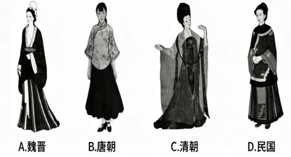

- **A**. 魏晋
- **B**. 唐朝
- **C**. 清朝
- **D**. 民国

## 第 15 题　qid 18643858 · 人文常识

高校毕业生毕业时要进行档案转递，下列档案转递方式不当的是：

- **A**. 小赵到某国有企业工作，档案由学校转递到其就业单位
- **B**. 小钱离校暂未就业，根据本人意愿，档案由原学校代为保管
- **C**. 小孙自主创业，档案转递到其创业地公共就业人才服务机构
- **D**. 小李到某民营企业就业，档案由其本人转递到就业地公共就业人才服务机构

## 第 16 题　qid 18643865 · 人文常识

2025年9月23日，我国迎来第八个中国农民丰收节。某电视台播出了《这边“丰”景正好——各地中国农民丰收节活动现场见闻》。下列情景不可能出现的是：

- **A**. 在安徽宁国，农民用无人机运送山核桃；在河北迁西，农民用无人机运输板栗
- **B**. 在辽宁营口，渔民转动船只，带动水体旋转，把深水处的海蜇旋到浅水处，便于捕捞
- **C**. 在黑龙江抚远，农民将蔓越莓田注满水，然后用打果机使果实脱落浮在水面上，再进行采收，以提高采收率
- **D**. 在浙江嘉兴，农民采用毯秧机械化插秧技术进行插秧，通过插秧机将培育好的带土毯状秧苗切块，完成分秧与插秧

## 第 17 题　qid 18643866 · 人文常识

下列诗句提及的著名关隘，不在长城上的是：

- **A**. 居庸关上子规啼，饮马流泉落日低
- **B**. 羌笛何须怨杨柳，春风不度玉门关
- **C**. 峰峦如聚，波涛如怒，山河表里潼关路
- **D**. 山一程，水一程，身向榆关那畔行，夜深千帐灯

## 第 18 题　qid 18643868 · 人文常识

2025年9月7日午夜至8日凌晨，我国迎来了全国可见的月全食天象，形成了暗红色的“血月”。下列关于“血月”成因解释最准确的是：

- **A**. 太阳光穿过地球大气时，红光折射率大，可以折射到月球上
- **B**. 月亮本身就会发出暗红色的淡光，平时被更强烈的太阳光照射才呈现白色
- **C**. 太阳光穿过地球大气时，长波长的红光折射到月球上，短波长的光被散射了
- **D**. 太阳光穿过地球大气时，红光折射到月球上，其余颜色的光在出地球大气时发生了全反射

## 第 19 题　qid 18643867 · 科技常识

配料：小麦粉、生活饮用水、植物油、食用盐、白砂糖、香辛料、谷氨酸钠、单硬脂酸甘油酯、5&#39;-呈味核苷酸二钠、阿斯巴甜、三氯蔗糖、特丁基对苯二酚、纽甜、红曲红、山梨酸钾、食用香精。
以上是某食品的配料表，下列有关表述，正确的是：

- **A**. 三氯蔗糖不属于糖类，糖尿病人可适量摄入
- **B**. 红曲红是一种人工合成色素，具有良好的着色性
- **C**. 山梨酸钾与福尔马林的防腐机理相同，可替换使用
- **D**. 谷氨酸钠俗名味精，是常见的增味剂，不属于食品添加剂

## 第 20 题　qid 18643876 · 地理国情

下图是浙江省地图。下列标号的地市与相关表述，对应不正确的是（    ）。

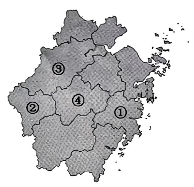

- **A**. ①特产丰富，著名的有仙居杨梅、黄岩蜜桔、三门青蟹等
- **B**. ②毗邻皖、赣、闽三省，是孔子晚年的居住地和第二故乡，有“南孔圣地”的美誉
- **C**. “2025中国民营企业500强”榜单中，③有38家企业上榜，连续23年位居全国城市第一
- **D**. “世界超市”义乌位于④，在一次次改革中创造了“莫名其妙”“无中生有”“点石成金”等发展经验

## 第 21 题　qid 12019741 · 逻辑填空

氦            ，在地球上，它的主要存在形式是单独离散的氦原子，即氦气，几乎不与任何元素发生化学反应。氦气轻盈飘逸，它的密度很小，是除了氢气以外密度最小的物质。
填入画横线部分最恰当的一项是：

- **A**. 独善其身
- **B**. 独树一帜
- **C**. 独来独往
- **D**. 独一无二

## 第 22 题　qid 12019792 · 逻辑填空

“办不成事”窗口冷清，是政务服务效能日益提升的        ，反映出制度越来越完善，流程越来越规范、服务越来越优质、群众办事越来越方便。这扇窗口是一面镜子，时刻提醒着党员干部要持续关注群众需求，不断提升履职能力；它依然是一种保障，能够在群众遇到困难时提供        的帮助。
依次填入画横线部分最恰当的一项是：

- **A**. 写照 托底
- **B**. 成效 精准
- **C**. 证明 应有
- **D**. 缩影 必要

## 第 23 题　qid 12019787 · 逻辑填空

建设科学城有利于探索新时期教育、科技、人才融合发展的新模式，        科学、技术、产业一体化发展的系统性突破，形成系统效应和乘数效应，让科学城成为塑造科技与产业发展的新动能和新优势的“          ”。
依次填入画横线部分最恰当的一项是：

- **A**. 建构 催化剂
- **B**. 催生 试验田
- **C**. 激活 火车头
- **D**. 推动 攻坚战

## 第 24 题　qid 12019791 · 逻辑填空

今天，很多昆曲工作者在探索昆曲的发展之路，有结合流行元素的，有挖掘新题材的，有        现代科技的。而我们则着力推动昆曲文化的复原和传承，力求让观众获得            的昆曲观剧体验。
依次填入画横线部分最恰当的一项是：

- **A**. 展现 无与伦比
- **B**. 融入 原汁原味
- **C**. 混合 妙趣横生
- **D**. 运用 身临其境

## 第 25 题　qid 12019757 · 逻辑填空

蹭知名企业，注册相似的名称博人气、抓流量，达到            的效果······在商业竞争日益激烈的今天，一些不良商家走上“歪门邪道”，通过商业碰瓷来谋取不正当利益。这种“搭便车”的歪风邪气如任其长期存在，将衍化成为严重破坏市场生态的毒瘤，不仅让消费者真假难辨，而且        企业的创新动力和消费者的信任基础。
依次填入画横线部分最恰当的一项是：

- **A**. 鱼龙混杂 蚕食
- **B**. 滥竽充数 危害
- **C**. 鱼目混珠 侵蚀
- **D**. 掩人耳目 削弱

## 第 26 题　qid 12019745 · 逻辑填空

优秀的文旅纪录片，往往以更具真实性的镜头语言、平实的叙事手法来浓缩一个地方的“精华”，将当地的人文特色、历史底蕴、风味生活            ，从而展现小情趣、小美好。当游客循着文旅纪录片中的线索            时，会惊喜地发现“买家秀”与“卖家秀”相差无几，这份期待便稳稳当当地落了地。
依次填入画横线部分最恰当的一项是：

- **A**. 和盘托出   循迹溯源
- **B**. 娓娓道来   按图索骥
- **C**. 平铺直叙   顺藤摸瓜
- **D**. 条分缕析   独辟蹊径

## 第 27 题　qid 12019755 · 逻辑填空

城市更新，一头连着民生福祉，一头连着城市发展。城市管理者要以绣花功夫        城市肌理，深切        人民群众的真实诉求，把握城市更新与保护的关系，补齐城市短板，提升城市界面“颜值”，不断满足人民美好生活的需要，让民生幸福            。
依次填入画横线部分最恰当的一项是：

- **A**. 打磨 洞悉 绵延不断
- **B**. 修饰 倾听 花开遍地
- **C**. 刻画 回应 落地生根
- **D**. 雕琢 体察 触手可及

## 第 28 题　qid 12019756 · 逻辑填空

发挥主动性去探究问题，综合运用已有知识去探索解决问题的方法，是研学的主要目的。强化探究性不仅要根据        的研究主题进行，而且要针对在旅行中孩子们提出的        问题持续推进，这样才能让孩子们深入探究。研学的组织者要善于        孩子们感兴趣的研究主题，鼓励孩子去探索，避免只学不研，或者研究流于形式。
依次填入画横线部分最恰当的一项是：

- **A**. 预设 鲜活 捕捉
- **B**. 现有 真实 延伸
- **C**. 设计 新奇 激发
- **D**. 既定 实际 引导

## 第 29 题　qid 12019813 · 语句表达

①北京地区也有，称作“燕京八景”，也称“燕山八景”“北京八景”“燕台八景”
②祖国河山大好，各地皆有名胜，常常概之以“八景”“十景”之名
③这个说法历史悠久，距今已有800多年，影响也很深远，即使是放在全国范围内来看，也是很有名的
④历朝历代的文人对八景吟咏不绝，八景为文人创作提供了灵感和素材，文人的诗篇又丰富了八景的文化内涵，甚至影响着八景景观的重建与再塑
⑤“燕京八景”也因此而成为北京景观与文化史中饶有趣味的话题
⑥“燕京八景”自然是对北京地区名胜的总结，但其意义又不止于此
将以上6个句子重新排列，语序正确的一项是：

- **A**. ②①③⑥④⑤
- **B**. ②④①⑤③⑥
- **C**. ⑥④③②①⑤
- **D**. ②①③⑤⑥④

## 第 30 题　qid 12019815 · 逻辑填空

智能防撞系统可开启碰撞警示，必要时还将自动刹车；借助AR，智能头盔抬头显示技术把导航等信息“虚拟成像”，骑乘者可提前看到导航路线指引；自平衡技术与辅助驾驶技术，可帮助降低摩托车操控难度；智能骑行服、手套，可集成一些控制按钮或传感器，达成智能化人车交互；手机投屏、赛道模式、弹射起步功能······随着新一代信息技术深入应用，摩托骑行变得更加                    。
填入画横线部分最恰当的一项是：

- **A**. 智能、自如、自由
- **B**. 安全、便捷、炫酷
- **C**. 简单、洒脱、风驰电掣
- **D**. 方便、轻松、随心所欲

## 第 31 题　qid 12019794 · 语句表达

我们生活的这个世界，碰撞声总是充斥耳边。俗话说“            ”，可俗话又说“天意难违”；俗话说“                    ”，可俗话又说“留得青山在，不怕没柴烧”。很多话看似自相矛盾，但在各自语境里又恰如其分。
依次填入画横线部分最恰当的一项是：

- **A**. 人定胜天 宁为玉碎，不为瓦全
- **B**. 事在人为  捡了芝麻，丢了西瓜
- **C**. 谋事在人 青山不常在，绿水难长流
- **D**. 成事在天 忍一时风平浪静，退一步海阔天空

## 第 32 题　qid 12019783 · 语句表达

《吴越春秋》记载的《弹歌》用八个字勾勒出先民制弓、狩猎的场景；陈子昂《登幽州台歌》，无一字奇险，却冠绝千古。                    。古希腊《荷马史诗》洋洋洒洒48卷，再现特洛伊战争的壮阔与英雄返乡的艰辛；白居易《长恨歌》840字七言诗行，将帝王爱情与王朝兴衰织成一曲悲歌。
填入画横线部分最恰当的一项是：

- **A**. 诗是抒情的，直接诉诸情感，又是最经济的，语短而意长
- **B**. 读诗，不是读者的单向“解码”，而是与作者的“同频共振”
- **C**. 无论古今中外、短章史诗，诗歌始终在做一件事：用语言超越语言
- **D**. 如果说短诗以“留白”激发无尽想象，那么长诗则以“铺陈”描摹无尽世界

## 第 33 题　qid 12019728 · 片段阅读

粗菜细做是潮菜传承中不变的技巧。比如潮州名菜护国菜，选取番薯叶鲜嫩的部位，与高汤炖煮，色泽碧绿、香醇软滑；摆盘讲究，呈现泾渭分明的太极图案。相传南宋少帝赵员逃至潮州，饥渴交加时，寺庙僧人以野菜煮成汤肴献上，赵员吃后觉得美味无比，赐名“护国菜”。
这段文字没有提及护国菜的：

- **A**. 烹饪方式
- **B**. 传承途径
- **C**. 视觉美感
- **D**. 名字由来

## 第 34 题　qid 12019735 · 片段阅读

码洋是一本图书定价和销售册数的乘积。据统计，2024年我国图书零售市场码洋规模达1129亿元，总体规模保持稳定。从不同渠道码洋结构比例看，平台电商码洋比重为40.9%、内容电商码洋比重为30.4%、垂直及其他电商和实体店占比分别为14.7%和14.0%。从各类图书的码洋构成来看，少儿类是码洋比重最大的类别，为28.16%，其次是教辅类，码洋比重为25.33%，文学和学术文化类码洋比重在7%至9%。
根据这段文字，可以得出：

- **A**. 我国图书零售市场线上码洋规模逐年提升
- **B**. 2024年少儿类和教辅类图书码洋涨幅最高
- **C**. 图书零售业已构建起线上线下融合发展体系
- **D**. 码洋规模主要受销售册数影响，与图书定价关系不大

## 第 35 题　qid 12019781 · 片段阅读

生活在网络环境中，没有所谓的“空闲时间”，通勤时刷短视频、吃饭时看直播，甚至洗澡时也要戴着耳机听播客。人们即使在休憩或旅行中，也难以找到独处的状态：度假时，朋友圈定位与九宫格照片发布的优先级高于欣赏日出日落；户外运动时，隔十分钟就想看看手机，生怕错过“重要”信息。安静让他们变得烦躁不安，仿佛独处意味着被世界抛弃，必须用持续的信息输入填满每分钟。这种对“空闲”的恐惧，本质上是对自我的陌生——当剥离了网络标签和社交互动，我们是否还能认识那个独处的自己？
文中“对‘空闲’的恐惧”指的是：

- **A**. 担心错过网络世界的重要信息
- **B**. 害怕在独处中暴露真实自我
- **C**. 无法适应没有即时反馈的生活
- **D**. 因网络社交中断而迷失自我

## 第 36 题　qid 12019824 · 片段阅读

十多年前，一项针对2000名英国成年人的调查首次提出可能有爱好基因的存在。只要看看他们的家谱和他们祖先的喜好，就会发现他们强烈倾向于某些类型的活动。科学家甚至发现了一种特殊的基因变体，这种变体决定了填字游戏是否会吸引你。当然，这与你是否擅长无关。不少科技企业花费了大量时间寻找所谓的人才基因，即可能赋予一个人天生独特能力的基因变体，使一个人能够被引导到他最能发挥价值的领域。但到目前为止，似乎对于所有的天赋，无论是数字运算、音乐能力还是运动能力，基因只会产生很小的影响。
下列说法与这段文字意思相符的是：

- **A**. 基因在潜意识中支配着我们的行为
- **B**. 我们的行为很大程度上源于自身意志
- **C**. 未来也许能找到赋予某种天赋的人才基因
- **D**. 基因可能影响着我们进行某些活动的自然倾向

## 第 37 题　qid 12019784 · 语句表达

西夏文字参照汉字形体创制，特点主要有：根据汉字部首偏旁创制，借鉴汉字的横、竖、撇、捺、钩、折笔画，唯独放弃单个“挑”画不用，常把挑和点连写，类似汉字“两点水”的行书写法；一字一音，字形方正，与契丹、女真字相仿，类似“八分字”，共有6000多字；文字笔画重复、雷同的较多，笔画多在8至20画之间；西夏文字斜画较多，撇、捺等斜画比汉字丰富，有较多的会意字、音义合成字。总体而言，西夏文字的笔画非常均匀规范，严谨而美观。
关于西夏文字，文中没有提及：

- **A**. 创制时间
- **B**. 字形特点
- **C**. 文字数量
- **D**. 造字依据

## 第 38 题　qid 12019782 · 片段阅读

传统“正史”中，《史记》和《汉书》双峰并峙，影响深远，而两者间的异同高下之比较，也成了中国史学史上最有兴味的话题之一。有的时代人们喜欢《史记》，有时则更喜欢《汉书》，概略地说，大约中唐之前，人们甲班乙马，宋以后，人们劣固优迁。汉唐间，《汉书》对《史记》占有压倒性优势，因为《史记》被当作诽谤愤怨之书。中唐之后，文风递变，《史记》开始受到青睐，宋人如郑樵和刘辰翁都贬低《汉书》。到明代，文学领域的拟古派、唐宋派都对《史记》推崇备至。清代随着考据学兴起，《汉书》地位相对升高而《史记》稍诎，但也算不上扳回一局。
这段文字没有提到下列哪一现象的原因？

- **A**. 中唐之前甲班乙马
- **B**. 宋代之后劣固优迁
- **C**. 《汉书》在清代地位有所提升
- **D**. 《史记》被认为带有“诽谤”之意

## 第 39 题　qid 12019785 · 片段阅读

“西方中心主义”的科学史长期宣扬科学、科学精神、科学思维、科学成就是西方特有的先进事物，中国历史上没有或乏善可陈。如一些观点认为，“在中国，系统化的、自然主义的思维得不到发展”“中国的科学是微不足道的······”这些观点接受“西方中心主义”知识灌输，把中国历史上各种科学技术成就包括一些科学原理的发现和研究，如勾股定理、星体运行规律、医学原理等都贬低成“实用技术”。这种将“科学原理”与“实用技术”割裂的逻辑，本质上是用西方近代科学标准剪裁中国古代科技史，忽视了不同文明对“科学”的多元定义。
这段文字意在指出“西方中心主义”科学史观的哪一错误？

- **A**. 将科学精神与技术应用割裂看待
- **B**. 忽视中国古代科技成就的实用性价值
- **C**. 混淆“科学原理”与“实用技术”的概念边界
- **D**. 以西方近代科学标准否定中国古代科学技术成就

## 第 40 题　qid 12019823 · 语句表达

点茶法出现于晚唐五代，流行于宋元时期。其主要步骤有： 1.碎茶，以纸裹茶饼，锤碎； 2.碾茶，用碾或磨将茶加工成末； 3.罗茶，用罗筛茶，获得细腻茶末，放置于茶末盒中；4.熁（xié）盏，预热茶盏，相当于现在的“温杯”；5.点茶，投茶末入盏，用执壶向茶盏浇注沸水，用茶筅（xiǎn）击拂，使其融合。
根据上述描述，下列图与步骤对应正确的是（    ）。

- **A**. 
罗茶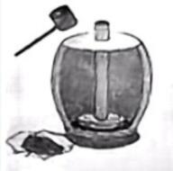

- **B**. 
熁盏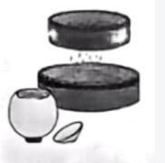

- **C**. 
点茶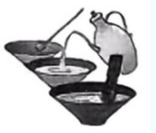

- **D**. 
碎茶

## 第 41 题　qid 12019744 · 片段阅读

中国传统的造纸方法是先用水疏散植物纤维，同时施胶（主要用杨桃藤等植物胶）以改善纸抗水性，然后抄纸再加压，榨出纸膜中的水分，最后烘（晾、晒）干形成纸张。而传统古籍修复也是用浆水（小麦粉制成）使纸纤维疏松膨胀，将古籍原纸和修复纸两纸纤维黏合，最后晾干水分，恢复纸张平整。因此用传统方法修复对古籍的损害最小。
文中将造纸与修复技术对比，主要目的是：

- **A**. 说明古籍修复技术的历史渊源
- **B**. 揭示古代造纸与修复技术的传承关系
- **C**. 论证传统修复方法对古籍损害小的原因
- **D**. 比较植物纤维在不同工艺中的应用差异

## 第 42 题　qid 12019822 · 片段阅读

自2017年微软小冰发表诗集以来，人工智能在写作领域掀起变革。其核心优势源于算法支持，既体现在日常文案的即时性输出——如文心一言10秒生成格式规范的新闻稿，又延伸至感性创作的高效性——小冰以平均4秒/首的速度创作“雨”主题诗歌，且能连续产出不重复内容。这种优势突破了写作受限于灵感枯竭、时间耗费的困境，正如人们所说“AI创造力不会枯竭”，而人类创作则受内外因素制约，难以持续稳定输出。
这段文字的论证结构是（    ）。

- **A**. 
提出现象分析成因对比论证揭示影响

- **B**. 
引入话题列举优势比较差异得出结论

- **C**. 
点明变革例证支撑引用观点指出局限

- **D**. 
引出主题数据论证理论分析预测趋势

## 第 43 题　qid 12019786 · 片段阅读

量子信息分三大块：量子计算机、量子通信、量子精密测量。其共同特点是利用量子态进行信息处理、测量或者传输，但操控量子态需要非常高精尖的严苛环境，目前主要应用于专业领域，并没有任何在医疗健康领域的应用，更不可能用一个手环去操控量子态。所谓的“用量子能量、标量波引起DNA、线粒体共振，给身体带来能量”，仅仅是把公众接触较少的词汇堆砌在一起，是彻底的伪科学骗局。而一些人之所以会觉得它们有效，主要是因为心理暗示。
这段文字意在：

- **A**. 驳斥量子手环具有治病、提供能量的功能
- **B**. 强调量子信息在特定领域的应用是伪科学
- **C**. 证明量子手环在治疗中起到了安慰剂作用
- **D**. 介绍量子信息在医疗健康方面的相关应用

## 材料 1（第44—45题共用）

        每到假期，在良渚古城遗址公园的公众考古区，招募成团的公众考古志愿者总会如约而至，来自浙江省文物考古研究所良渚工作站的专家会耐心地给志愿者讲解良渚文化和考古知识。

        “________” 杭州市民小杨听得津津有味。第一次体验考古的他兴奋地挥着手铲，走向发掘体验区内画好的方格网，跃跃欲试。

        良渚古城遗址公园的社教专员先教大家学习如何使用考古手铲、刷子等工具，然后指导大家开始铲边、刮面、捡拾等程序。一把手铲，开启一段探知悠久文明的惊喜之旅。半小时后，小杨捧着刚刚挖出来的文物，向大家展示。专家初步断定，这是一块商周时期的陶片，距今有两三千年的历史。收获惊喜，更要做好保护。志愿者给挖到的 “宝贝” 挨个儿登记、贴标签，并装袋封存，完成考古日志。

        “参加公众考古活动让我对考古工作有了更直观、更深入的认识，也能更深刻地感受良渚文明的魅力。” 小杨说。

### 第 44 题　qid 12019798 · 语句表达

填入画横线部分最恰当的一项是：

- **A**. 我今天一定能挖出点东西！
- **B**. 我从小就喜欢考古，今天是来圆梦的！
- **C**. 没想到考古里藏着这么多有趣的知识！
- **D**. 啊！赶紧开始挖吧！我已经迫不及待了！

### 第 45 题　qid 18983269 · 片段阅读

这段新闻报道，有两处直接引用当事人的话，作者最主要的意图是（    ）。

- **A**. 提升新闻报道的可读性
- **B**. 凸显新闻采访的重要性
- **C**. 增强报道的现场感和可信度
- **D**. 借当事人之口，说出作者想说的话

## 第 46 题　qid 18643922 · 数学运算

甲、乙两个蓄水池，水深分别为8米、5米。8：30开始，甲蓄水池中的水匀速注入到乙蓄水池。甲蓄水池水深每小时减少0.2米，乙蓄水池水深每小时增加0.3米。问什么时刻两个蓄水池中水深相同？

- **A**. 14：30
- **B**. 15：00
- **C**. 15：30
- **D**. 16：00

## 第 47 题　qid 18643921 · 数学运算

现有200克浓度未知的硝酸铵溶液，加入100克浓度为30%的硝酸铵溶液，再蒸发150克水后，溶液浓度恰好为40%。问原溶液的浓度是多少？

- **A**. 15%
- **B**. 20%
- **C**. 25%
- **D**. 30%

## 第 48 题　qid 18643924 · 数学运算

甲、乙两人在同一户外徒步路线上开展训练，他们早上8点同时出发，匀速前进。甲每小时比乙多走1千米，11点甲开始休息1小时，乙继续前进，并在12点赶上甲。问此时乙走了多少千米？

- **A**. 9
- **B**. 12
- **C**. 15
- **D**. 18

## 第 49 题　qid 18643926 · 数学运算

某部门规定，员工每工作4天休息1天。已知员工甲、乙、丙、丁分别在9月1日、2日、3日、4日休息，那么9月份4人同时在岗工作多少天？

- **A**. 3
- **B**. 4
- **C**. 5
- **D**. 6

## 第 50 题　qid 18643925 · 数学运算

乒乓球馆有14张球桌正在进行趣味比赛，其中双打总人数是单打的1.5倍。已知参与单打的男生人数13人，参与双打的男生人数15人，那么参与单打的女生人数比参与双打的女生人数：

- **A**. 少4人
- **B**. 多4人
- **C**. 少6人
- **D**. 多6人

## 第 51 题　qid 18643928 · 数学运算

6名运动员站成2行3列的方队，要求小张和小王前后相邻，小李和小吴左右相邻。问有多少种不同的站法？

- **A**. 16
- **B**. 32
- **C**. 48
- **D**. 96

## 第 52 题　qid 18643929 · 数学运算

小李10天共做了41道数学题，任意两天做的题数相差不超过2道。问他最多有几天做了5道题？

- **A**. 3
- **B**. 4
- **C**. 5
- **D**. 6

## 第 53 题　qid 18643933 · 数学运算

某企业在甲、乙两个项目上共投资160万元，最终共收回资金200万元，已知甲项目和乙项目的收益率分别为40%和16%，那么该企业在甲项目上投资了多少万元？

- **A**. 60
- **B**. 70
- **C**. 80
- **D**. 90

## 第 54 题　qid 18643932 · 数学运算

小王开网店销售花篮，网店开业前已经做下51个花篮。网店开业后，小王边做边卖，每2天做1个，每天卖出2个。问第几天网店中花篮第一次售空？

- **A**. 32
- **B**. 33
- **C**. 34
- **D**. 35

## 第 55 题　qid 18643934 · 数学运算

小张从营地出发，骑车向东偏南方向行进60千米后，左转继续行进45千米到达营地正东方向的位置。问他保持当前方向再行进35千米，与营地之间的直线距离为多少千米？

- **A**. 80
- **B**. 90
- **C**. 100
- **D**. 120

## 第 56 题　qid 18643930 · 数学运算

甲、乙、丙三个车间同时分别加工120个零件。2小时后，甲车间还剩48个未加工，乙车间还剩12个未加工，丙车间已加工完20分钟。现有270个零件的新任务需要分配给三个车间，要求加工同时开始同时结束，那么丙车间比甲车间多分配多少个零件？

- **A**. 30
- **B**. 60
- **C**. 90
- **D**. 120

## 第 57 题　qid 18643938 · 数学运算

甲、乙两船在静水中的速度相同，现甲从上游A点、乙从下游B点同时出发匀速相向而行，且同时在A、B之间的C点放下一个竹排顺水流漂行。一段时间后甲、乙与竹排的距离分别为2千米和8千米，且均未与竹排相遇。已知AC距离x千米，BC距离y千米，那么x和y的数量关系为：

- **A**. x-y=3
- **B**. x-y=6
- **C**. y-x=3
- **D**. y-x=6

## 第 58 题　qid 18643935 · 数学运算

某快餐店1份盒饭售价40元，1杯奶茶售价10元。如果2份盒饭和1杯奶茶配套出售，打九折，可获利20元；如果4份盒饭和3杯奶茶配套出售，打八折，可获利24元。那么按原价出售，1份盒饭比1杯奶茶多获利多少元？

- **A**. 7
- **B**. 7.5
- **C**. 8
- **D**. 8.5

## 第 59 题　qid 18643940 · 数学运算

如下图所示，某操场形状由两个半圆形和一个矩形组成。已知两个半圆形的面积之和是矩形面积的倍，矩形的周长为500米，那么操场外轮廓的长度为多少米？

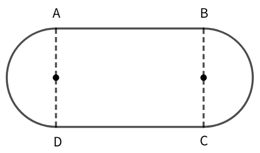

- **A**. 

- **B**. 

- **C**. 

- **D**. 

## 第 60 题　qid 18643936 · 数学运算

某旅行团有10位游客，平均年龄为35岁，且年龄各不相同。已知他们当中最大者比最小者大25岁，那么年龄最小的3人年龄之和最大可能为多少岁？

- **A**. 87
- **B**. 88
- **C**. 89
- **D**. 90

## 第 61 题　qid 18643943 · 数学运算

某公司从3个部门共选派8人参加会议。已知甲部门人数是乙、丙部门人数之和的一半，乙部门人数占甲、乙、丙部门总人数的20%，丙部门比甲部门多2人。如果每个部门至少选派2人，至多选派3人，那么选派出的8人有多少种不同组合？

- **A**. 560
- **B**. 780
- **C**. 920
- **D**. 1610

## 第 62 题　qid 18643937 · 数学运算

小张计划在假期剩余的13天完成A、B、C三本书的阅读。已知阅读A书需要连续2天，阅读B书需要连续3天，阅读C书需要连续4天。问在所有可能的阅读方案中随机选择一种，没有阅读的4天都不相连的概率是多少？

- **A**. 

- **B**. 

- **C**. 

- **D**. 

## 第 63 题　qid 18643939 · 数学运算

从1，2，3，4，5，6，7，8，9，10十个数中随机选择两个数，它们的最大公约数为1的概率是多少？

- **A**. 

- **B**. 

- **C**. 

- **D**. 

## 第 64 题　qid 18643942 · 数学运算

小赵制作一件手工作品，需要将一个长方体纸盒的每条棱和每个面的对角线用细木条加以固定。制作完成后，他发现仅用了3种不同长度的细木条，且最短的细木条长度为1分米。问该纸盒的体积为多少立方分米？

- **A**. 

- **B**. 
2

- **C**. 

- **D**. 

## 第 65 题　qid 18643941 · 数学运算

根据节假日放假规定，当且仅当元旦在周三时，不会形成小长假。问在连续的10年中，这种情况最少会出现多少次？

- **A**. 0
- **B**. 1
- **C**. 2
- **D**. 3

## 第 66 题　qid 12019729 · 图形推理

从所给的四个选项中，选择最合适的一个填入问号处，使之呈现一定的规律：

- **A**. A
- **B**. B
- **C**. C
- **D**. D

## 第 67 题　qid 12019740 · 图形推理

从所给的四个选项中，选择最合适的一个填入问号处，使之呈现一定的规律性：

- **A**. A
- **B**. B
- **C**. C
- **D**. D

## 第 68 题　qid 12019751 · 图形推理

从所给的四个选项中，选择最合适的一个填入问号处，使之呈现一定的规律性：

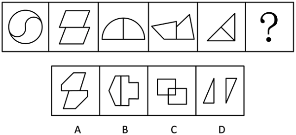

- **A**. A
- **B**. B
- **C**. C
- **D**. D

## 第 69 题　qid 12019730 · 图形推理

从所给的四个选项中，选择最合适的一项填入问号处，使之呈现一定的规律性：

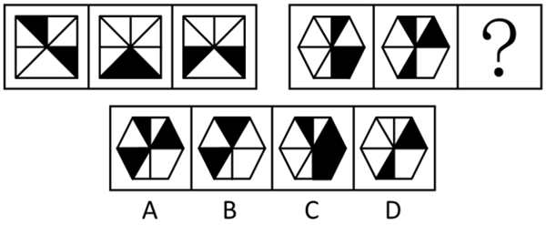

- **A**. A
- **B**. B
- **C**. C
- **D**. D

## 第 70 题　qid 12019768 · 图形推理

从所给的四个选项中，选择最合适的一个填入问号处，使之呈现一定的规律性：

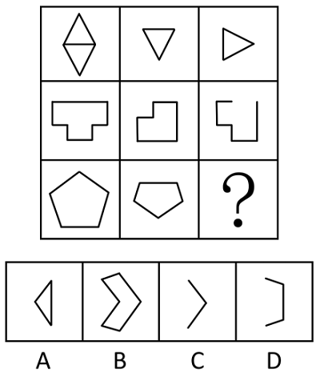

- **A**. A
- **B**. B
- **C**. C
- **D**. D

## 第 71 题　qid 12019732 · 图形推理

把下面的六个图形分为两类，使每一类图形都有各自的共同特征或规律，分类正确的一项是：

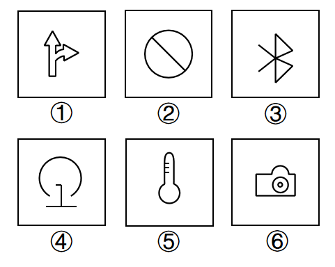

- **A**. ①②③，④⑤⑥
- **B**. ①②⑤，③④⑥
- **C**. ①③⑥，②④⑤
- **D**. ①④⑤，②③⑥

## 第 72 题　qid 12019817 · 图形推理

从所给的四个选项中，选择最合适的一个填入问号处，使之呈现一定的规律性：

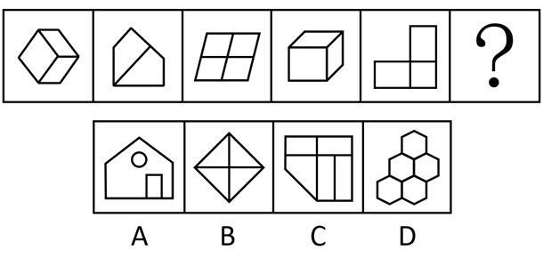

- **A**. A
- **B**. B
- **C**. C
- **D**. D

## 第 73 题　qid 12019737 · 图形推理

把下面的六个图形分为两类，使每一类图形都有各自的共同特征或规律，分类正确的一项是：

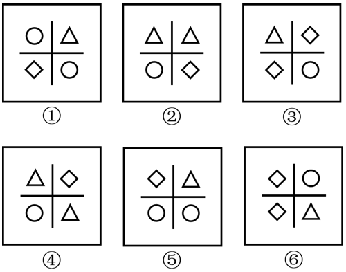

- **A**. ①②④，③⑤⑥
- **B**. ①③④，②⑤⑥
- **C**. ①③⑤，②④⑥
- **D**. ①④⑥，②③⑤

## 第 74 题　qid 12019748 · 图形推理

左边给定的是纸盒外表面的展开图，右边哪一项能由它折叠而成？

- **A**. A
- **B**. B
- **C**. C
- **D**. D

## 第 75 题　qid 12019797 · 图形推理

下面是某立体图形的正面和后面，它由三个完全相同的小立体图形组成，该小立体图形是：

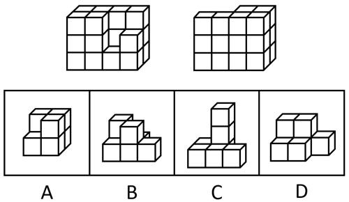

- **A**. A
- **B**. B
- **C**. C
- **D**. D

## 第 76 题　qid 12019733 · 类比推理

板鞋：鞋

- **A**. 青海：海
- **B**. 土匪：匪
- **C**. 河马：马
- **D**. 水银：银

## 第 77 题　qid 12019749 · 类比推理

抗日战争时期：解放战争时期

- **A**. 日新：月异
- **B**. 秋收冬藏：春生夏长
- **C**. 弱冠之年：而立之年
- **D**. 朝饮木兰之坠露：夕餐秋菊之落英

## 第 78 题　qid 12019731 · 类比推理

鸭绒被：卤鸭头

- **A**. 棉花：棉被
- **B**. 铅笔芯：钻石
- **C**. 人参：西洋参
- **D**. 牛排：牛角梳

## 第 79 题　qid 12019773 · 类比推理

天下大事：必作于细

- **A**. 积善之家：必有余庆
- **B**. 工欲善其事：必先利其器
- **C**. 治国有常：利民为本
- **D**. 有朋自远方来：不亦乐乎

## 第 80 题　qid 12019738 · 类比推理

举手：示意：点头

- **A**. 握手：礼仪：敬礼
- **B**. 义务：纳税：选举
- **C**. 罢工：游行：抗议
- **D**. 界限：界碑：界河

## 第 81 题　qid 12019774 · 类比推理

实现：现实

- **A**. 适合：合适
- **B**. 代替：替代
- **C**. 离别：别离
- **D**. 积累：累积

## 第 82 题　qid 12019739 · 类比推理

消防栓：按摩椅

- **A**. 火山口：三江源
- **B**. 金钟罩：铁布衫
- **C**. 传染病：急救车
- **D**. 助听器：防晒霜

## 第 83 题　qid 12019771 · 类比推理

结婚登记：身份证：户口本

- **A**. 睡觉：床：枕头
- **B**. 成功：运气：努力
- **C**. 登山：鞋子：登山杖
- **D**. 考试：准考证：签字笔

## 第 84 题　qid 12019742 · 类比推理

物理学家：化学家：居里夫人

- **A**. 整数：正数：质数
- **B**. 硫酸：铜：硫酸铜
- **C**. 办公室：卧室：电脑
- **D**. 公司职员：自媒体博主：文艺青年

## 第 85 题　qid 12019743 · 类比推理

（    ） 对于 木雕 相当于 花雕酒 对于 （    ）

- **A**. 黄杨木 糯米
- **B**. 装饰 陪嫁
- **C**. 石雕 莲子酒
- **D**. 雕塑艺术 发酵

## 第 86 题　qid 12019752 · 定义判断

表层扮演是情绪劳动的一种策略，指个体隐藏真实情绪，按照工作要求伪装出特定外在情绪表现的行为模式；深层扮演指个体通过调整内在真实情感以符合工作要求的情绪表达方式，它强调内在情绪体验与外在表现的一致性。
根据上述定义，下列体现深层扮演的是：

- **A**. 服务员面对顾客投诉强忍怒火保持职业微笑
- **B**. 护士换位思考理解患者焦虑后主动安抚情绪
- **C**. 客服人员机械背诵标准化礼貌用语应对咨询
- **D**. 销售员因业绩压力自发对产品产生强烈信心

## 第 87 题　qid 12019750 · 定义判断

无边界组织指打破传统组织内部的横向（部门间）、纵向（层级间）、外部（与客户/供应商间）的预设边界，以灵活授权团队取代固定部门，加强信息自由流通与资源动态配置的组织设计模式。
根据上述定义，下列属于无边界组织的是：

- **A**. 连锁餐饮企业通过标准化流程管理各分店运营
- **B**. 政府机构采用垂直管理体系确保政策统一执行
- **C**. 公司根据项目需要进行跨职能部门团队动态组合
- **D**. 企业通过部门分工和逐级审批制度保障运营效率

## 第 88 题　qid 12019747 · 定义判断

情境变量是实验或自然环境中可影响个体行为或心理过程的外部因素，如物理距离、社会文化背景等。
根据上述定义，下列属于情境变量的是：

- **A**. 实验中恒定的光照强度
- **B**. 被试完成问卷时的情绪状态
- **C**. 企业员工绩效考核的量化指标
- **D**. 跨文化研究中不同国家的礼仪规范差异

## 第 89 题　qid 12019762 · 定义判断

光杆动词式把字句，是指“把+名词+光杆动词”，即动词后无任何附加成分的句子；动趋式把字句，是指“把+名词+动趋式动补短语”的句子，其中动趋式动补短语表达了行为发生的趋势。
根据上述定义，下列属于动趋式把字句的是：

- **A**. 你别把家门上锁
- **B**. 母亲把剩菜带回来
- **C**. 你别把小问题复杂化
- **D**. 我建议大会把这个提案取消

## 第 90 题　qid 12019758 · 定义判断

转口贸易是指商品生产国与消费国通过第三国（或地区）转手进行的贸易活动，生产国和消费国不直接进行买卖，货物在第三国不经过加工或仅进行简单分类、包装等非本质改变。
根据上述定义，下列属于转口贸易的是：

- **A**. 迪拜将伊朗原油提炼成成品油后销往欧洲
- **B**. 新加坡从中国进口手机零部件，组装后出口至印度
- **C**. 智利铜矿经秘鲁港口卸货后，直接原箱装船运往日本
- **D**. 中国纺织品出口至荷兰，荷兰贸易商更换原产地证明文件后转卖至英国

## 第 91 题　qid 12019753 · 定义判断

剪切增稠是指剪切速率或者剪切应力增加到某一个数值时，液体中形成了新的结构，引起了阻力的增加，导致液体的表观黏度增大，同时伴随着体积胀大的现象。
根据上述定义，下列现象属于剪切增稠的是：

- **A**. 块状的老酸奶经搅拌后变成较稀的液体
- **B**. 陷入沼泽时，快速挣扎会让沼泽变稀，下陷速度加快
- **C**. 液体防弹衣中的液体被高速的子弹击中时会迅速膨胀变硬
- **D**. 敲击瓶底或大力甩瓶身可以让粘在瓶底的剩余番茄酱流出

## 第 92 题　qid 12019759 · 定义判断

随机变量X1和X2独立，是指X1的取值不影响X2的取值，X2的取值也不影响X1的取值；随机变量X1和X2服从同一分布，是指X1和X2在取值范围内的概率分布一致。如果一些随机变量服从同一分布，并且互相独立，那么这些随机变量是独立同分布。
根据上述定义，下列随机变量是独立同分布的是：

- **A**. 甲、乙两人先后抽奖，甲、乙抽中奖的情况
- **B**. 甲、乙两人先后掷骰子，甲、乙掷出点数的情况
- **C**. 实力差距悬殊的甲、乙两棋手进行比赛，甲、乙的胜负情况
- **D**. 在街上随机选择一名男性甲和一名女性乙，甲、乙的身高情况

## 第 93 题　qid 12019764 · 定义判断

求同求异并用法是探求现象间因果联系的一种方法，是指在被研究现象出现的若干正面场合中，都有一个相同的先行情况出现，而在被研究现象不出现的若干反面场合中，该先行情况都不出现，则该先行情况就是被研究现象的原因。
根据上述定义，下列体现求同求异并用法的是：

- **A**. 世界杯期间，小明第一晚边看边喝浓茶，失眠了；第二晚边看边喝咖啡，失眠了；第三晚边看边吸烟，失眠了。可见吸烟、喝咖啡和喝浓茶是失眠的原因
- **B**. 体质相同的双胞胎兄弟在饭店用餐，一个吃了冰激凌后出现腹痛；另一个没吃冰激凌未出现腹痛，两人吃的其他食物完全相同。可见吃冰激凌是腹痛的原因
- **C**. 电脑维修店接待了几位因电脑中毒前来维修的顾客，他们的电脑品牌、型号各有不同，但他们的电脑在中毒前都运行了同一个软件。可见该软件可能存在木马程序
- **D**. 失足青年的家庭一般都不稳定，有的父母离异，有的父母对孩子关心帮助不够；而没有失足的青年家庭较为稳定，父母经常关心和帮助他们。可见家庭不稳定是青年失足的重要原因

## 第 94 题　qid 12019760 · 定义判断

具身智能是指智能体（如机器人、无人机、智能汽车等）通过物理实体与环境实时交互，不断修正自身模型和策略，在不断变化的环境中做出实时反应，实现感知、认知、决策和行动一体化。
根据上述定义，下列场景中没有体现具身智能的是：

- **A**. 无人机按计划路线对稻田进行农药喷洒，实现“科技助农”
- **B**. 作战机器人实时分析环境数据，在复杂地形中自主行走和避障
- **C**. 自动驾驶汽车在绿灯变红前3秒钟，做出“加速驶过路口”的决策
- **D**. 人形机器人“消防员”正在灭火，突然看到被困群众，立马上前安抚他们

## 第 95 题　qid 12019763 · 定义判断

片面谬误是指用特例为自己的错误开脱。人们都不喜欢被证明自己的言行是错误的，所以当他们被证明是错误的时候，总会想办法给自己找理由。
根据上述定义，下列属于片面谬误的是：

- **A**. 领导指出小王工作出了差错，小王说那天自己身体刚好不舒服
- **B**. 小赵年终考核垫底，他自我安慰道，不管怎么考核，总有人是最差的
- **C**. 老师批评小孙考试经常出现计算错误，小孙妈妈说孩子一着急就这样
- **D**. 小李超常发挥获得比赛二等奖，他心里想，再多答对一题就能得一等奖了

## 第 96 题　qid 12019761 · 逻辑判断

某单位拟对辖区内酒店进行升级提星，要求酒店必须基本设施完备，并且要通过卫生部门的严格考核。
以下哪项为真，说明升级提星这项工作没有遵守要求？
（1）酒店成功升级提星，但没有通过卫生部门的严格考核
（2）酒店成功升级提星，但酒店内没有空调、吹风机等基本设施
（3）酒店基本设施完备，且通过了卫生部门的严格考核，但是没有升级提星

- **A**. （1）（2）
- **B**. （2）（3）
- **C**. （3）
- **D**. （1）（2）（3）

## 第 97 题　qid 12019765 · 逻辑判断

某商店现有歌手甲的专辑A、B各一张，歌手乙的专辑C、D各一张，歌手丙的专辑E、F各一张，共6张专辑，需将它们放在横向排列的1~6号货架，每个货架摆放一张。已知：（1）A和C不相邻；（2）F和C不相邻；（3）有且仅有一张甲的专辑在最边上的货架。
如果C在2号货架，E在4号货架，那么以下哪项可能为真？

- **A**. B在1号货架
- **B**. B在5号货架
- **C**. D在5号货架
- **D**. D在6号货架

## 第 98 题　qid 12019766 · 逻辑判断

某校举办演讲比赛，琪琪、依依、冰冰、鑫鑫、磊磊、静静6人均获了奖，其中一等奖1人，二等奖2人，三等奖3人。已知：
(1)除非琪琪获得二等奖，否则冰冰获得一等奖；
(2)只有鑫鑫获得三等奖且静静获得二等奖，琪琪和依依才能至少有一人获得二等奖；
(3)如果鑫鑫获得三等奖，那么冰冰获得二等奖，且依依不是三等奖。
根据上述信息，以下哪项一定为真？

- **A**. 冰冰未获得一等奖
- **B**. 琪琪获得二等奖
- **C**. 鑫鑫未获得一等奖
- **D**. 磊磊获得三等奖

## 第 99 题　qid 12019770 · 类比推理

下列诗句中描述的两者逻辑关系，与“但使龙城飞将在，不教胡马度阴山”中“龙城飞将在”与“胡马度阴山”关系一致的是：

- **A**. “黄沙百战穿金甲，不破楼兰终不还”中“破楼兰”与“还”
- **B**. “问渠那得清如许？为有源头活水来”中“清如许”与“源头活水来”
- **C**. “不畏浮云遮望眼，自缘身在最高层”中“浮云遮望眼”与“身在最高层”
- **D**. “若非群玉山头见，会向瑶台月下逢”中“群玉山头见”与“瑶台月下逢”

## 第 100 题　qid 12019767 · 逻辑判断

穗行数指玉米果穗上籽粒的行数。近日，有自媒体称，可以通过观察穗行数来判断玉米是否为转基因产品：从玉米底部看穗行数，正好12行的是非转基因玉米，多于12行的就是转基因玉米。
以下哪项如果为真，不能反驳该自媒体的观点？

- **A**. 调控玉米产量性状的过程非常复杂，当前技术难以通过转基因改变玉米穗行数
- **B**. 转基因玉米转入的基因一般为抗虫、抗倒、抗旱、耐涝相关基因，不会影响玉米外观
- **C**. 穗行数性状受到遗传和环境等多重因素影响，同一品种在不同单株之间也存在穗行数波动
- **D**. 玉米穗行数由其遗传基因决定，玉米穗轴上的小花是成对排列的，因此玉米穗行数始终为双数

## 第 101 题　qid 12019776 · 逻辑判断

动物毛发的自我更新和生长依赖于毛囊干细胞的周期性增殖和分化，年龄增长会使毛囊干细胞变僵硬，妨碍毛发再生。近日有研究发现，当毛囊干细胞中由肌动球蛋白组成的细胞骨架软化时，细胞会膨大并发生一系列反应，成功促使老龄小鼠毛发再生。因此，增强毛囊干细胞中微核糖核酸分子miR-205的表达可使细胞软化并促进毛发生长。
上述结论的成立需要补充以下哪项作为前提?

- **A**. miR-205影响着毛发的软硬程度
- **B**. 可以通过基因手段增强miR-205表达
- **C**. miR-205能抑制毛囊干细胞增殖和分化
- **D**. miR-205对软化细胞骨架起着重要作用

## 第 102 题　qid 12019769 · 逻辑判断

1970年联合国教科文组织规定，自1970年以后，凡是通过非法渠道从一些国家走私文物的，一经查明，就要无条件退还。我国文物主要是在清末和民国时期流失，不符合“1970年以后”的条件；且时过境迁，文物几经转手，哪个环节属于合法收购，哪些属于战争掠夺，异国博物馆收购时是否合法等，早已没有清晰的证据链；再加上部分国家的博物馆傲慢无礼，极大地增加了追索难度。因此，跨境文物追索几乎是不可能完成的任务。
以下哪项如果为真，最能质疑上述观点?

- **A**. 除了按照国际公约，还可通过条约、协议等其他方法来追索流失文物
- **B**. 历史上，文物的大规模流失源自于数百年来不公正的国际政治经济秩序
- **C**. 按国际公约精神和伦理道德原则解决文物归属争议纠纷有很大局限性
- **D**. 从全球范围来看，文物走私是仅次于毒品走私和武器走私的第三大非法贸易

## 第 103 题　qid 12019778 · 逻辑判断

人类的大脑在进化的过程中，发展出了一套完全不以逻辑推理、仅仅耗费少量心理资源就能迅速作出决策的决策系统。该系统有助于人类祖先在纷繁复杂的外部环境中迅速作出对自身和种群生存有利的决策，人类的情绪在这个过程中扮演了重要角色。与依靠逻辑规则的理性分析相比，我们对刺激所产生的情绪反应更加迅速，这种即时的情绪反应有助于我们更加快速地规避风险。因此，任何情绪反应对人来说都是有意义的。
以下哪项如果为真，不能支持上述结论？

- **A**. 情绪反应的是内心的需求，每一种情绪都有其价值
- **B**. 许多疾病都与情绪相关，坏情绪直接损害人的健康
- **C**. 大脑在决策时进行理性分析，会耗费大量的能量和时间
- **D**. 不被我们喜欢的负面情绪是在提示风险，有利于人的生存

## 第 104 题　qid 12019772 · 逻辑判断

当人体摄入过多的蛋白质时，肾脏必须更加努力工作以清除额外产生的含氮废物。长此以往可能会导致肾小球滤过率升高，从而增加肾脏的工作负担，加速肾脏损伤。因此有人认为，健身人群长期喝蛋白粉会伤肾。
以下哪项如果为真，最能反驳上述观点？

- **A**. 熬夜、劳累、高油高盐饮食等是导致肾病的主要原因
- **B**. 运动会使肌肉纤维发生损伤，需要更多蛋白质来修复
- **C**. 比起欧美国家，我国人均每日蛋白质摄入量要低不少
- **D**. 研究表明，喝蛋白粉与其他摄入蛋白质方式无明显区别

## 第 105 题　qid 12019775 · 类比推理

王妈妈：“我家孩子今天没写作业又被老师批评了。”
夏妈妈：“他今天不写作业，明天就不想上学，后天就会辍学走向犯罪，要好好教训一下了。”
下列对话中所犯的逻辑错误与题干最相似的是：

- **A**. 
小刘：“这款无糖奶茶，甜吗？”

店员：“无糖就是没放糖，你怕太甜就选这个。”

- **B**. 
小张：“应该适当减少塑料的使用，保护环境。”

小陈：“取消塑料使用会导致工厂停产，带来更大的危害。”

- **C**. 
小李：“我不太喜欢爬山，怕膝盖受力太大。”

小赵：“你不喜欢爬山，就是不爱大自然，就会错过生活中的美好。”

- **D**. 
小周：“我觉得神不存在，没有证据能证明神存在。”

小林：“钟表有构造有规律，是人造出来的；世界也有构造有规律，就一定是神造出来的。”

## 材料 2（第106—110题共用）

        2024年，中国化工新材料产业规模达到1655.6亿美元，居全球第一位。其次是美国，化工新材料产业规模为1455.0亿美元。

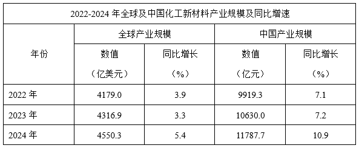

### 第 106 题　qid 18643945 · 比重

2024年，中美两国化工新材料产业规模之和占全球比重约为：

- **A**. 52%
- **B**. 57%
- **C**. 63%
- **D**. 68%

### 第 107 题　qid 18643946 · 增长

2022年，中国化工新材料产业规模同比增加值在以下哪个范围内？

- **A**. 不到600亿元
- **B**. 600~700亿元
- **C**. 700~800亿元
- **D**. 800亿元以上

### 第 108 题　qid 18643947 · 比重

假如汇率没有变动，2022~2024年中国化工新材料产业规模占全球比重的变化趋势为：

- **A**. 先增后降
- **B**. 先降后增
- **C**. 逐年增加
- **D**. 逐年下降

### 第 109 题　qid 18643948 · 比重

根据资料推算汇率换算，化工新材料产业结构中，2024年中国产业规模占全球比重超过70%的有几类？

- **A**. 1
- **B**. 2
- **C**. 3
- **D**. 4

### 第 110 题　qid 18643949 · 综合

化工新材料产业结构中，2024年全球产业规模最高的三类的产业规模之和约是最低的三类的产业规模之和的多少倍？（不包括“其他材料”）

- **A**. 3.2
- **B**. 4.7
- **C**. 5.3
- **D**. 6.1

## 材料 3（第111—115题共用）

        2025年8月，全国电梯采购规模25.11亿元，环比增长7.77%，同比增长43%。

        全国电梯采购规模突破千万元的有河北省、湖北省等22个省份，其中，河北省、湖北省和北京市位居全国电梯采购规模前三，采购规模依次为67006.13万元、33061.49万元和23594.98万元。

        8月，全国电梯更新改造采购规模56108.32万元，环比增长51.92%，同比增长347.55%。

        8月，全国电梯维保采购规模9650.81万元，环比下降40.06%，同比下降14.11%，主要分布于政府机关、医疗系统、教育系统、轨道交通等，其中，政府机关电梯维保占全国电梯维保采购市场40.85%。河北省、江苏省和浙江省电梯维保采购规模排名位列前三，分别为2227.91万元、1662.78万元和1376.29万元。

        8月，全国加装电梯采购规模9538.15万元，环比增长30.72%，同比下降18.63%，主要分布于政府机关、医疗系统、教育系统等，其中，政府机关加装电梯占全国加装电梯采购市场61.17%。四川省、北京市和广东省加装电梯采购规模排名前三，依次2484.57万元、2459.31万元和939.68万元。

### 第 111 题　qid 18643961 · 综合

2024年8月，全国电梯采购规模约为多少亿元？

- **A**. 17.6
- **B**. 18.9
- **C**. 20.1
- **D**. 23.3

### 第 112 题　qid 18643962 · 综合

2025年8月，全国电梯更新改造采购规模环比增量约是全国加装电梯采购规模环比增量的多少倍？

- **A**. 4.4
- **B**. 5.9
- **C**. 7.3
- **D**. 8.6

### 第 113 题　qid 18643963 · 综合

2025年7月，全国电梯维保采购规模约占全国电梯采购规模的：

- **A**. 4%
- **B**. 7%
- **C**. 11%
- **D**. 22%

### 第 114 题　qid 18643964 · 综合

2025年8月，我国政府机关加装电梯采购规模比其电梯维保采购规模多约多少万元？

- **A**. 1700
- **B**. 1900
- **C**. 2000
- **D**. 1800

### 第 115 题　qid 18643965 · 综合

能够从上述资料中推出的是：

- **A**. 2024年8月，全国加装电梯采购规模不到1亿元
- **B**. 2025年8月，浙江省电梯维保采购规模日均超过40万元
- **C**. 2025年8月，广东省加装电梯采购规模超过其电梯维保采购规模
- **D**. 2025年8月，河北省、湖北省和北京市电梯采购规模总和占全国的50%以上

## 材料 4（第116—120题共用）

        2025年初，某杂志社联合民生智库开展城乡居民消费调查，全面了解城乡居民收支与消费信心状况，深入分析居民消费意愿、能力、行为与场景。

        调查显示，城乡居民在2024年有48.07%的家庭收入持平，22.01%的家庭收入增加，其中6.09%的家庭收入明显增加；近三成被访者表示收入减少，其中11.23%的家庭明显减少。对于2025年的家庭收入，46.10%的居民预计将基本持平，19.04%的居民预期收入将增加，23.28%的居民对未来收入变化不确定，11.58%的居民预期收入将明显减少。

        调查发现，47.01%的城乡居民日常购物以线上渠道为主，37.52%的城乡居民线上、线下并重，只有15.48%的城乡居民明确表示以线下为主。

        不同群体的购物选择存在较大差异：一是代际断层，年轻群体成为线上消费主力，其中00后群体线上购物占比69.8%，比70后群体高了53.79个百分点；二是城乡分化，城镇居民的线上购物占比50.18%，高于农村居民11.66个百分点，务农群体选择线上购物的占比比农村居民还要低19.74个百分点；三是学历分化，高学历群体选择线上购物比例更高，硕士以上学历群体线上购物占比62.81%，远高于初中及以下学历群体的22.63%。

### 第 116 题　qid 18643956 · 综合

2025年初，选择“冲动购物，随机消费”的人数约是选择“关注时尚品牌，跟随潮流”的多少倍？

- **A**. 2
- **B**. 6
- **C**. 8
- **D**. 10

### 第 117 题　qid 18643957 · 比重

已知2023年初我国人口为14.12亿，2025年初我国人口为14.08亿。根据调查分析的比例推测，2025年初我国更倾向于“只买必需品，多存点钱”的人数比2023年初：

- **A**. 少不到0.1亿
- **B**. 少0.1亿以上
- **C**. 多不到0.1亿
- **D**. 多0.1亿以上

### 第 118 题　qid 18643958 · 比重

将70后群体、务农群体、初中及以下学历群体线上购物占比从低到高顺序排列，正确的是：

- **A**. 初中及以下学历群体、务农群体、70后群体
- **B**. 初中及以下学历群体、70后群体、务农群体
- **C**. 务农群体、70后群体、初中及以下学历群体
- **D**. 70后群体、务农群体、初中及以下学历群体

### 第 119 题　qid 18643959 · 综合

在参与调查的居民中，2024年家庭收入未减少且2025年预期收入将基本持平的家庭数量：

- **A**. 至少占16.18%
- **B**. 至少占46.10%
- **C**. 至多占16.18%
- **D**. 至多占70.08%

### 第 120 题　qid 18643960 · 综合

根据上述资料，下列说法不正确的是：

- **A**. 多数居民对2025年收入稳定有信心
- **B**. 目前，线上购物占主导地位，但线下购物仍不可替代
- **C**. 2024年，收入明显增加的家庭在收入增加的家庭中占比不足三成
- **D**. 比起2023年，2025年被访者的消费观念更趋理性，更注重品质和性价比

## 答案与解析

第 1 题

**答案**：C

**来源参考解析（非官方标准答案）**

本题考查马克思主义。
①正确，人因自然而生，人与自然是一种共生关系，对自然的伤害最终会伤及人类自身。保护自然就是保护人类自己，善待自然就是善待人类自己。习近平总书记强调：“人类只有遵循自然规律才能有效防止在开发利用自然上走弯路，人类对大自然的伤害最终会伤及人类自身，这是无法抗拒的规律。”
②错误，马克思主义自然观认为，人应该在尊重客观规律的前提下发挥主观能动性。该项“征服自然力”和“自然力完全为人服务”的观点，违背了自然规律的客观性。历史和实践也证明，人类过度干预自然，只会遭到自然的报复，并不能让自然力完全为人服务。
③正确，“人的本质力量的对象化”是马克思在《1844年经济学-哲学手稿》中提出的深刻命题。他指出，与动物的盲目、无意识的生命活动不同，人类通过创造性的实践活动，在明确目的的指引下，充分发挥自身的本质力量来改造对象。“自然成为人类本质力量对象化的产物”指人类通过劳动实践将内在的认知能力、创造力和构建社会关系的能力外化到自然界，使自然被打上人类活动的印记。这一过程既改变了自然面貌，也发展了人类自身，体现了主客体的辩证统一。
④正确，人与自然生命共同体理念明确人类依存于自然而生存发展。根据马克思主义唯物史观的原理，大自然提供的生活资料和生产资料是人类生存发展的物质基础，这正是二者紧密相连的重要体现。
⑤正确，恩格斯在《反杜林论》中指出：“人本身是自然界的产物，是在自己所处的环境中并且和这个环境一起发展起来的。”从马克思主义的唯物史观来看，人类的历史，首先在于满足自身吃穿住行的物质需要，这些需要的满足，只有向自然界索取。当人类秉持合理性、友好性、保护性地开发和利用自然资源时，自然也同样以友好性慷慨地回报人类；当人类以毁坏性、盲目性、掠夺性的方式向自然索取时，自然的惩罚和报复也往往是无情的。
故①③④⑤正确，共4项。
故正确答案为C。

---

第 2 题

**答案**：C

**来源参考解析（非官方标准答案）**

本题考查理论与政策。
2025年10月23日，中国共产党第二十届中央委员会第四次全体会议通过《中共中央关于制定国民经济和社会发展第十五个五年规划的建议》（以下简称《建议》）。
①错误，《建议》在“一、‘十五五’时期是基本实现社会主义现代化的关键时期”部分指出：“（2）‘十五五’时期在基本实现社会主义现代化进程中具有承前启后的重要地位······‘十五五’时期是基本实现社会主义现代化夯实基础、全面发力的关键时期，要巩固拓展优势、破除瓶颈制约、补强短板弱项，在激烈国际竞争中赢得战略主动，推动事关中国式现代化全局的战略任务取得重大突破，为基本实现社会主义现代化奠定更加坚实的基础。”故“‘十四五’时期”表述错误，应为“‘十五五’时期”。
②正确，《建议》在“三、建设现代化产业体系，巩固壮大实体经济根基”部分指出：“现代化产业体系是中国式现代化的物质技术基础。坚持把发展经济的着力点放在实体经济上，坚持智能化、绿色化、融合化方向，加快建设制造强国、质量强国、航天强国、交通强国、网络强国，保持制造业合理比重，构建以先进制造业为骨干的现代化产业体系。”
③正确，《建议》在“四、加快高水平科技自立自强，引领发展新质生产力”部分指出：“（11）加强原始创新和关键核心技术攻关······（12）推动科技创新和产业创新深度融合······（13）一体推进教育科技人才发展······（14）深入推进数字中国建设······”
④正确，《建议》在“八、加快农业农村现代化，扎实推进乡村全面振兴”部分指出：“农业农村现代化关系中国式现代化全局和成色。坚持把解决好‘三农’问题作为全党工作重中之重，促进城乡融合发展，持续巩固拓展脱贫攻坚成果，推动农村基本具备现代生活条件，加快建设农业强国。”
⑤正确，《建议》在“十五、全党全国各族人民团结起来为实现‘十五五’规划而奋斗”部分指出：“（56）坚持和加强党中央集中统一领导······发展党内民主，健全和落实民主集中制，坚持科学决策、民主决策、依法决策。坚持正确用人导向，坚持把政治标准放在首位，树立和践行正确政绩观，完善干部考核评价机制，调整不胜任现职干部，推进领导干部能上能下常态化。”
故②③④⑤表述正确，共4项。
故正确答案为C。

---

第 3 题

**答案**：B

**来源参考解析（非官方标准答案）**

本题考查理论与政策。
2025年11月12日，《中国社会科学报》发表社评文章《习近平新时代中国特色社会主义思想的世界意义》（以下简称《文章》）。
A、C、D三项正确，《文章》指出：“习近平新时代中国特色社会主义思想，是当代中国马克思主义、二十一世纪马克思主义，是中华文化和中国精神的时代精华，是实现中华民族伟大复兴的行动指南，是马克思主义中国化时代化新的飞跃······破解反贫困难题，创造减贫治理的中国样本，为全球减贫事业作出重大贡献······打破‘现代化=西方化’的迷思，拓展发展中国家走向现代化的路径选择，为人类对更好社会制度的探索提供中国方案······破解自我监督难题，找到长期执政条件下跳出历史周期率的第二个答案，为世界政党建设提供借鉴······回答世界之问，为推动构建人类命运共同体提供中国方案······指导新时代中国特色社会主义取得重大成就，充分彰显科学社会主义在21世纪的强大生机活力······”
B项错误，续写经济快速发展和社会长期稳定两大奇迹，围绕中国自身发展成效展开，描述的是习近平新时代中国特色社会主义思想对中国国内经济建设和社会治理的引领作用，属于该思想的国内意义范畴，而非世界意义。
本题为选非题，故正确答案为B。

---

第 4 题

**答案**：A

**来源参考解析（非官方标准答案）**

本题考查理论与政策。
①2017年10月，党的十九大报告在“五、贯彻新发展理念，建设现代化经济体系”部分指出：“（六）推动形成全面开放新格局。开放带来进步，封闭必然落后。中国开放的大门不会关闭，只会越开越大。”
②2012年12月，习近平总书记在深圳前海作出重要论断：“改革开放是决定当代中国命运的关键一招，也是决定实现‘两个一百年’奋斗目标、实现中华民族伟大复兴的关键一招。”
③2024年1月，习近平总书记在主持中共中央政治局第十一次集体学习时强调：“生产关系必须与生产力发展要求相适应。发展新质生产力，必须进一步全面深化改革，形成与之相适应的新型生产关系。”
故按提出时间先后顺序排列正确的是②①③。
故正确答案为A。

---

第 5 题

**答案**：D

**来源参考解析（非官方标准答案）**

本题考查理论与政策。
A项正确，2022年6月15日，《求是》杂志发表的习近平总书记的重要文章《坚定不移走中国人权发展道路，更好推动我国人权事业发展》中指出：“五是坚持依法保障人权。法治是人权最有效的保障。”2020年11月16日至17日，中央全面依法治国工作会议在北京召开，习近平总书记出席会议并发表重要讲话指出：“推进全面依法治国，根本目的是依法保障人民权益。”
B项正确，2014年10月23日，中国共产党第十八届中央委员会第四次全体会议通过的《中共中央关于全面推进依法治国若干重大问题的决定》中“一、坚持走中国特色社会主义法治道路，建设中国特色社会主义法治体系”部分指出：“党的领导和社会主义法治是一致的，社会主义法治必须坚持党的领导，党的领导必须依靠社会主义法治。”
C项正确，2023年11月27日，中共中央政治局就加强涉外法制建设进行第十次集体学习，习近平总书记在主持学习时强调：“中华法系源远流长，中华优秀传统法律文化蕴含丰富法治思想和深邃政治智慧，是中华文化的瑰宝。要积极推动中华优秀传统法律文化创造性转化、创新性发展，赋予中华法治文明新的时代内涵，激发起蓬勃生机。”
D项错误，2021年2月28日，《求是》杂志发表的习近平总书记的重要文章《坚定不移走中国特色社会主义法治道路 为全面建设社会主义现代化国家提供有力法治保障》中指出：“有一点要明确，我们推进全面依法治国，决不照搬别国模式和做法，决不走西方所谓‘宪政’、‘三权鼎立’、‘司法独立’的路子。”2025年12月4日，法治日报发表的《学习宣传贯彻习近平法治思想 推动宪法深入人心》中指出：“坚持依宪治国、依宪执政，是习近平法治思想的重要内容，也是全面依法治国的首要任务。”故“新时代我们党在方向道路问题上吸收了西方‘宪政’‘三权分立’‘司法独立’等思想”表述错误，应为“决不走西方所谓‘宪政’、‘三权鼎立’、‘司法独立’的路子”。
本题为选非题，故正确答案为D。

---

第 6 题

**答案**：A

**来源参考解析（非官方标准答案）**

本题考查理论与政策。
①正确，2023年3月15日，第6期《求是》杂志发表的习近平总书记题为《加快建设农业强国 推进农业农村现代化》的文章中指出：“二、保障粮食和重要农产品稳定安全供给始终是建设农业强国的头等大事。无农不稳，无粮则乱······”
②错误，根据《中华人民共和国宪法》第十条第二款规定：“农村和城市郊区的土地，除由法律规定属于国家所有的以外，属于集体所有；宅基地和自留地、自留山，也属于集体所有。”第十条第四款规定：“任何组织或者个人不得侵占、买卖或者以其他形式非法转让土地······”根据《农村土地经营权流转管理办法》第二条规定：“土地经营权流转应当坚持农村土地农民集体所有、农户家庭承包经营的基本制度，保持农村土地承包关系稳定并长久不变，遵循依法、自愿、有偿原则，任何组织和个人不得强迫或者阻碍承包方流转土地经营权。”故“允许农村土地所有权出租、入股、买卖”表述有误，农村土地所有权严禁流转，允许流转的是土地经营权。
③错误，2025年4月印发的《加快建设农业强国规划（2024—2035年）》在“八、促进城乡融合发展，缩小城乡差别”部分指出：“（二十四）推进城乡融合发展。统筹新型工业化、新型城镇化和乡村全面振兴，全面提高城乡规划、建设、治理融合水平。完善城乡融合发展体制机制和政策体系，促进城乡要素平等交换、双向流动，推动公共资源均衡配置……”故“促进发展要素向农村倾斜”和“城乡公共资源均等化配置”表述有误，应为“促进城乡要素平等交换、双向流动”和“公共资源均衡配置”。
④正确，根据《中华人民共和国粮食安全保障法》第二条第一款规定：“国家粮食安全工作坚持中国共产党的领导，贯彻总体国家安全观，统筹发展和安全，实施以我为主、立足国内、确保产能、适度进口、科技支撑的国家粮食安全战略，坚持藏粮于地、藏粮于技，提高粮食生产、储备、流通、加工能力，确保谷物基本自给、口粮绝对安全。”
⑤错误，2025年4月，中共中央、国务院印发的《加快建设农业强国规划（2024－2035年）》在“七、高质量推进宜居宜业和美乡村建设，提升农村现代生活水平”部分指出：“（二十一）整体提升乡村治理效能。坚持和发展新时代‘枫桥经验’，健全党组织领导的自治、法治、德治相结合的乡村治理体系。深入推进抓党建促乡村全面振兴，建好建强农村基层党组织，健全以财政投入为主的稳定的村级组织运转经费保障制度。”故“以集体经济收入为主”表述有误，应为“以财政投入为主”。
故①④表述正确，共2项。
故正确答案为A。

---

第 7 题

**答案**：D

**来源参考解析（非官方标准答案）**

本题考查理论与政策。
2024年11月15日，《求是》杂志发表了习近平总书记的重要文章《以人口高质量发展支撑中国式现代化》（以下简称文章）。
A项正确，文章在“（一）我国现代化建设面临新的人口形势”部分指出：“我国长期是世界人口最多的国家，人口发展是关系中华民族伟大复兴的大事······我国总体上已由人口增量发展转向减量发展阶段，人口发展呈现少子化、老龄化、区域人口增减分化等明显的趋势性特征。推进中国式现代化面临新的人口环境和条件。”
B项正确，文章在“（一）我国现代化建设面临新的人口形势”部分指出：“再次，要正确认识人口红利问题······我国现有人口和劳动力规模足够庞大，目前人口减少的体量有限，全民受教育水平持续提高，人口综合红利仍然具有明显优势。同时要看到，我国人口少子化、老龄化发生在现代化完成之前，这会带来一些新的困难和挑战，要积极加以应对。”
C项正确，文章在“（二）做好新时代人口工作的基本思路和重大原则”部分指出：“二是坚持以系统观念统筹谋划人口问题······人口安全是人口高质量发展的底线要求，大国兴衰往往受到人口状况的深刻影响，要将人口安全纳入总体国家安全范畴加以谋划。”
D项错误，党的二十大报告在“九、增进民生福祉，提高人民生活品质”部分指出：“（四）推进健康中国建设······优化人口发展战略，建立生育支持政策体系，降低生育、养育、教育成本······”2021年5月31日，中共中央政治局会议审议通过《关于优化生育政策促进人口长期均衡发展的决定》。会议指出，进一步优化生育政策，实施一对夫妻可以生育三个子女政策及配套支持措施，有利于改善我国人口结构、落实积极应对人口老龄化国家战略、保持我国人力资源禀赋优势。2025年7月，中共中央办公厅、国务院办公厅印发《育儿补贴制度实施方案》，明确从2025年1月1日起，对符合法律法规规定生育的3周岁以下婴幼儿发放补贴，至其年满3周岁。育儿补贴按年发放，现阶段国家基础标准为每孩每年3600元。其中，对2025年1月1日之前出生、不满3周岁的婴幼儿，按应补贴月数折算计发补贴。由此可知，三孩生育政策以及育儿补贴制度等配套支持措施并非党的二十大提出的，三孩政策是2021年5月31日，中共中央政治局会议通过的，育儿补贴制度等配套支持措施是2025年7月，中共中央办公厅、国务院办公厅印发的《育儿补贴制度实施方案》规定的。
本题为选非题，故正确答案为D。

---

第 8 题

**答案**：D

**来源参考解析（非官方标准答案）**

本题考查理论与政策。
A项正确，2025年3月7日下午，中共中央总书记、国家主席、中央军委主席习近平出席十四届全国人大三次会议解放军和武警部队代表团全体会议并发表重要讲话。习近平总书记在讲话中指出，完成我军建设“十四五”规划目标任务，离不开国家经济社会发展大体系支撑。要强化军地合力，用好地方优势力量和资源，提高我军建设质量和效益。要抓住我国新质生产力蓬勃发展机遇，创新战斗力建设和运用模式，健全先进技术敏捷响应和快速转化机制，加快发展新质战斗力。
B项正确，2025年7月，中央军委主席习近平签署命令，发布军事航天部队、网络空间部队、信息支援部队、联勤保障部队军旗旗面式样，标志我军构建起八一军旗和陆军、海军、空军、火箭军军旗，军事航天部队、网络空间部队、信息支援部队、联勤保障部队军旗组成的新时代人民军队军旗体系。兵种军旗，自2025年8月1日启用。
C项正确，《中共中央关于制定国民经济和社会发展第十五个五年规划的建议》在“十四、如期实现建军一百年奋斗目标，高质量推进国防和军队现代化”部分：“巩固国防和强大军队是中国式现代化的战略支撑······（53）加快先进战斗力建设······（54）推进军事治理现代化······（55）巩固提高一体化国家战略体系和能力。”
D项错误，2012年9月25日，辽宁舰入列；2019年12月17日，山东舰入列；2025年11月5日，福建舰入列，意味着人民海军的航母实现了“从0到3”的跨越，实现了从改造升级到自主建造，从滑跃起飞到电磁弹射的跨越，开启了中国海军的“电磁弹射”时代和“三航母”时代。福建舰是海军现役吨位最大的舰艇，常驻地为三亚军港，所在的海域是南海，因此“福建舰入列东海舰队”表述有误。
本题为选非题，故正确答案为D。

---

第 9 题

**答案**：D

**来源参考解析（非官方标准答案）**

本题考查理论与政策。
2025年10月15日，《求是》杂志发表习近平总书记的重要文章《推动落实全球发展倡议、全球安全倡议、全球文明倡议、全球治理倡议》，以下简称文章。
A项错误，文章中指出：“为此，我愿提出全球治理倡议，同各国一道，推动构建更加公正合理的全球治理体系，携手迈向人类命运共同体。第一，奉行主权平等。第二，遵守国际法治。第三，践行多边主义。第四，倡导以人为本。第五，注重行动导向。”故“全球文明倡议”说法错误，应为“全球治理倡议”。
B项错误，文章中指出：“在此，我愿提出全球发展倡议：坚持发展优先。坚持以人民为中心。坚持普惠包容。坚持创新驱动。坚持人与自然和谐共生。坚持行动导向。”故“全球治理倡议”说法错误，应为“全球发展倡议”。
C项错误，文章中指出：“在此，我愿提出全球文明倡议。我们要共同倡导尊重世界文明多样性······我们要共同倡导弘扬全人类共同价值······我们要共同倡导重视文明传承和创新······我们要共同倡导加强国际人文交流合作······”故“全球发展倡议”说法错误，应为“全球文明倡议”。
D项正确，文章中指出：“为了促进世界安危与共，中方愿在此提出全球安全倡议：我们要坚持共同、综合、合作、可持续的安全观，共同维护世界和平和安全；坚持尊重各国主权、领土完整，不干涉别国内政，尊重各国人民自主选择的发展道路和社会制度；坚持遵守联合国宪章宗旨和原则，摒弃冷战思维，反对单边主义，不搞集团政治和阵营对抗；坚持重视各国合理安全关切，秉持安全不可分割原则，构建均衡、有效、可持续的安全架构，反对把本国安全建立在他国不安全的基础之上；坚持通过对话协商以和平方式解决国家间的分歧和争端，支持一切有利于和平解决危机的努力，不能搞双重标准，反对滥用单边制裁和‘长臂管辖’；坚持统筹维护传统领域和非传统领域安全，共同应对地区争端和恐怖主义、气候变化、网络安全、生物安全等全球性问题。”
故正确答案为D。

---

第 10 题

**答案**：C

**来源参考解析（非官方标准答案）**

本题考查理论与政策。
2025年4月25日，中共中央政治局就加强人工智能发展和监管进行第二十次集体学习（以下简称“集体学习”）。
A项错误，习近平总书记在主持集体学习时强调：“要推动人工智能科技创新与产业创新深度融合······”2025年8月26日，国家发展改革委创新驱动发展中心主任说：“根据多项研究结果，到2030年，人工智能将为全球经济贡献超百万亿元，有望成为最重要的增长点之一。人工智能等手段的深度应用，也有助于在科研、城市治理等方面带来质的提升。”故“每年为全球经济贡献超百万亿元，已成为最重要的增长点之一”说法错误，应为“到2030年，人工智能将为全球经济贡献超百万亿元，有望成为最重要的增长点之一”。
B项错误，习近平总书记在主持集体学习时强调：“要推动人工智能科技创新与产业创新深度融合，构建企业主导的产学研用协同创新体系，助力传统产业改造升级，开辟战略性新兴产业和未来产业发展新赛道。”故“构建政府主导、国企运营、民企参与的产学研用协同创新体系”说法错误，应为“构建企业主导的产学研用协同创新体系”。
C项正确，习近平总书记在主持集体学习时强调：“人工智能可以是造福人类的国际公共产品。要广泛开展人工智能国际合作，帮助全球南方国家加强技术能力建设，为弥合全球智能鸿沟作出中国贡献。”
D项错误，习近平总书记在主持集体学习时强调：“要持续加强基础研究，集中力量攻克高端芯片、基础软件等核心技术，构建自主可控、协同运行的人工智能基础软硬件系统。以人工智能引领科研范式变革，加速各领域科技创新突破。”故“加快构建独立于西方技术体系的人工智能产业链生态链”说法错误，应为“构建自主可控、协同运行的人工智能基础软硬件系统”。
故正确答案为C。

---

第 11 题

**答案**：B

**来源参考解析（非官方标准答案）**

本题考查经济常识。
A项正确，根据国家统计局数据显示，2025年1—10月份，社会消费品零售总额412169亿元，增长4.3%，增速比去年同期高0.8个百分点。其中体育娱乐、金银珠宝类零售额分别增长18.4%、14%，由此可知，体育娱乐用品、金银珠宝等部分升级类消费增速显著加快。
B项错误，非美市场包含东盟、欧盟、非洲等多个重要贸易伙伴。根据中国海关总署数据显示，2025年我国与非美市场贸易额并非和去年基本持平，而是呈现明显增长态势。2025年前10个月，东盟为我国第一大贸易伙伴，我国与东盟贸易总值为6.18万亿元，增长9.1%；欧盟为我国第二大贸易伙伴，我国与欧盟贸易总值为4.88万亿元，增长4.9%。同期，我国对共建“一带一路”国家合计进出口19.28万亿元，增长5.9%。这些非美市场的贸易增长有效对冲了对美贸易下降的影响，稳定了外贸基本盘。
C项正确，根据国家统计局数据显示，2025年上半年内需对GDP增长的贡献率为68.8%，其中最终消费支出贡献率为52%，是增长的主动力。这充分体现出国内大循环主体地位稳固、内生动力不断增强。
D项正确，2025年6月，世界银行发布的《全球经济展望》将当年全球经济增速预期从2.7%下调至2.3%。而我国统计局数据显示，同期上半年国内生产总值同比增长5.3%，在全球经济增长乏力的背景下，我国经济增速亮眼，凸显出强大的活力和韧性。
本题为选非题，故正确答案为B。

---

第 12 题

**答案**：C

**来源参考解析（非官方标准答案）**

本题考查毛中特。
①正确，2020年9月3日，习近平总书记在纪念中国人民抗日战争暨世界反法西斯战争胜利75周年座谈会上讲话指出：“这（中国人民抗日战争）是近代以来中国人民反抗外敌入侵持续时间最长、规模最大、牺牲最多的民族解放斗争，也是第一次取得完全胜利的民族解放斗争。”2025年9月3日，习近平总书记在纪念中国人民抗日战争暨世界反法西斯战争胜利80周年大会上的讲话中指出：“中国人民抗日战争是世界反法西斯战争的重要组成部分，中国人民以巨大的民族牺牲，为拯救人类文明、保卫世界和平作出了重大贡献。”
②正确，2025年9月3日，习近平总书记在纪念中国人民抗日战争暨世界反法西斯战争胜利80周年大会上的讲话中指出：“中华民族是不畏强暴、自立自强的伟大民族。当年，面对正义与邪恶、光明与黑暗、进步与反动的生死较量，中国人民同仇敌忾、奋起反抗，为国家生存而战，为民族复兴而战，为人类正义而战······中国人民解放军始终是党和人民完全可以信赖的英雄部队。全军将士要忠实履行神圣职责，加快建设世界一流军队，坚决维护国家主权、统一、领土完整，为实现中华民族伟大复兴提供战略支撑，为世界和平与发展作出更大贡献！”
③错误，《黄河大合唱》由诗人光未然（张光年）和作曲家冼星海于1939年在延安创作，以黄河为背景，展现了中华民族抗日救亡的壮丽画卷。由田汉作词，聂耳作曲的是《义勇军进行曲》，诞生于1935年。
④正确，1945年9月2日，日本签署《日本投降书》，投降书全文共八条，宣告日本无条件投降，并切实履行《波茨坦公告》之条款，无条件将日本侵占的中国领土，包括台湾、澎湖列岛等归还中国。
综上，①②④表述正确，共3项。
故正确答案为C。

---

第 13 题

**答案**：D

**来源参考解析（非官方标准答案）**

本题考查法律常识。
A项错误，根据《中华人民共和国反不正当竞争法》第八条第三款规定：“经营者在交易活动中，可以以明示方式向交易相对方支付折扣，或者向中间人支付佣金。经营者向交易相对方支付折扣、向中间人支付佣金的，应当如实入账。接受折扣、佣金的经营者也应当如实入账。”因此，某工厂为吸引采购商购买其产品，向采购商负责人支付佣金，涉嫌不正当竞争行为。
B项错误，根据《中华人民共和国反不正当竞争法》第十四条规定：“平台经营者不得强制或者变相强制平台内经营者按照其定价规则，以低于成本的价格销售商品，扰乱市场竞争秩序。”因此，某购物平台为吸引人气，强制要求入驻商家以低于成本的价格销售商品，涉嫌不正当竞争行为。
C项错误，根据《中华人民共和国反不正当竞争法》第七条第二款规定：“擅自将他人注册商标、未注册的驰名商标作为企业名称中的字号使用，或者将他人商品名称、企业名称（包括简称、字号等）、注册商标、未注册的驰名商标等设置为搜索关键词，引人误认为是他人商品或者与他人存在特定联系的，属于前款规定的混淆行为。”因此，某网店擅自将其他公司未注册的驰名商标设置为自家商品的搜索关键词，涉嫌不正当竞争行为。
D项正确，根据《中华人民共和国反不正当竞争法》第二条第一、二款规定：“经营者在生产经营活动中，应当遵循自愿、平等、公平、诚信的原则，遵守法律和商业道德，公平参与市场竞争。本法所称的不正当竞争行为，是指经营者在生产经营活动中，违反本法规定，扰乱市场竞争秩序，损害其他经营者或者消费者的合法权益的行为。”不正当竞争行为是经营者在生产经营中违反公平、诚信原则和商业道德，以虚假宣传、商业贿赂等手段扰乱市场竞争秩序的行为，而王某纵火是故意损害他人财物的行为，不属于法律规定的不正当竞争行为。
故正确答案为D。
备注：本题A项，某工厂为吸引采购商购买其产品，向采购商负责人支付佣金，是否构成不正当竞争行为，还需要考虑支付佣金时是否将该佣金如实入账。若佣金如实入账，则不构成不正当竞争行为；如佣金未如实入账，则构成不正当竞争行为。由于A项并未表明是否如实入账这一情节，所以A项存在瑕疵。同时本题D项不存在争议，为正确项。因此，本题择优只能选D项。

---

第 14 题

**答案**：A

**来源参考解析（非官方标准答案）**

本题考查人文常识。
A项正确，图中女子服装上衣衣身宽松、袖子宽大，下装长裙曳地，符合魏晋时期“宽衣博带、褒衣大袖”的服饰特征。魏晋时期社会动荡、玄学盛行，士族阶层追求“越名教而任自然”的精神，反映在服饰上就是摒弃繁琐束缚，转向宽舒、飘逸的风格。
B项错误，图中女子修身短袄搭配黑色百褶裙，脚穿低跟皮鞋，是民国时期典型的女性学生装，又称 “文明新装”，是民国初年新文化运动影响下形成的代表性服饰。故唐朝对应错误，应为民国。
C项错误，图中女子着装是典型的唐朝襦裙装。上衣领口开敞，体现唐代服饰的开放风气；下装为高腰（或齐胸）长裙，裙摆宽大，面料带有精致纹样，符合唐代服饰“崇尚华丽”的审美。故清朝对应错误，应为唐朝。
D项错误，图中女子着装是清朝汉族女性的典型服饰袄裙装。上衣采用高立领、右衽的设计，领口、衣襟、袖口处有多层精致的镶边（“滚边”）装饰；下装搭配马面裙，裙面带有刺绣纹样，既显华丽又符合清代服饰 “崇尚繁复装饰” 的审美；整体风格端庄规整。故民国对应错误，应为清朝。
故正确答案为A。

---

第 15 题

**答案**：D

**来源参考解析（非官方标准答案）**

本题考查法律常识。
A项正确，《关于做好取消普通高等学校毕业生就业报到证有关衔接工作的通知》在“四、做好档案转递衔接”部分指出：“······高校要及时将高校毕业生登记表、成绩单等重要材料归入学生档案，按规定有序转递，个人不能自带和保管。到机关、国有企事业单位就业或定向招生就业的，转递至就业单位或定向单位······”因此，小赵到国有企业工作，其档案应由学校转递至就业单位。
B项正确，《关于做好取消普通高等学校毕业生就业报到证有关衔接工作的通知》在“四、做好档案转递衔接”部分指出：“······暂未就业的，可根据本人意愿转递至户籍地公共就业人才服务机构，或按规定在高校保留两年······”因此，小钱离校暂未就业，可根据本人意愿，档案由原学校代为保管。
C项正确，《关于做好取消普通高等学校毕业生就业报到证有关衔接工作的通知》在“四、做好档案转递衔接”部分指出：“······到非公单位就业、灵活就业及自主创业的，转递至就业创业地或户籍地公共就业人才服务机构，其中转递至就业创业地的，应提供相关就业创业信息······”因此，小孙自主创业，档案应转递到其就业创业地或户籍地公共就业人才服务机构。
D项错误，《关于做好取消普通高等学校毕业生就业报到证有关衔接工作的通知》在“四、做好档案转递衔接”部分指出：“······高校要及时将高校毕业生登记表、成绩单等重要材料归入学生档案，按规定有序转递，个人不能自带和保管······”因此，小李到某民营企业就业，档案不能由其本人自带保管转递。
本题为选非题，故正确答案为D。

---

第 16 题

**答案**：D

**来源参考解析（非官方标准答案）**

本题考查地理国情。
A项正确，宁国山核桃是安徽省宁国市特产，国家地理标志产品，每年白露时节‌开始统一采摘。迁西板栗先后被评为中国驰名商标、首批河北省十佳区域公用品牌、河北省地理标志产品，采摘时间主要集中在‌每年9月初至10月中下旬。故中国农民丰收节时，该项情景可能出现。
B项正确，辽宁营口市是我国海蜇的主产区，素有海蜇之乡的美誉，每年的7月到10月是当地海蜇的收获季。故中国农民丰收节时，该项情景可能出现。
C项正确，黑龙江省佳木斯市抚远市有亚洲最大的蔓越莓规模化种植基地——红海蔓越莓基地。蔓越莓的采收时间是9月-11月，此时，田间注满水，打果机机械臂高速运转，将枝蔓上的蔓越莓打落。由于蔓越莓果实内部空心的独特结构，脱落的果实瞬间浮上水面，再进行采收。故中国农民丰收节时，该项情景可能出现。
D项错误，在浙江嘉兴，水稻插秧的时间主要集中在‌每年的6月份。嘉兴地区广泛推广机械插秧作业，机械插秧是以双膜育秧或软盘育秧技术培育带土毯状秧苗，通过插秧机对秧苗切块完成分秧与插秧的水稻种植技术。故中国农民丰收节时，该项情景不可能出现。
本题选非题，故正确答案为D。

---

第 17 题

**答案**：C

**来源参考解析（非官方标准答案）**

本题考查人文常识。
A项正确，“居庸关上子规啼，饮马流泉落日低”出自清代朱彝尊的《出居庸关》。居庸关是北京长城沿线上的著名古关城，“天下九塞”之一。关城所在的峡谷，属太行余脉军都山地，西山夹峙，下有巨涧，悬崖峭壁，地形极为险要。
B项正确，“羌笛何须怨杨柳，春风不度玉门关”出自唐代王之涣的《凉州词》。玉门关位于敦煌，汉时修筑酒泉至玉门间的长城，玉门关随之设立。玉门关为汉代重要的屯兵之地，是重要的军事关隘和丝路交通要道。
C项错误，“峰峦如聚，波涛如怒，山河表里潼关路”出自元代张养浩的《山坡羊·潼关怀古》。潼关位于陕西省渭南市潼关县北，北临黄河，南踞山腰，为关中东大门，是连接西北、华北、中原的咽喉要道，其地理位置具有战略意义。但潼关不属于长城防御体系。
D项正确，“山一程，水一程，身向榆关那畔行，夜深千帐灯”出自清代纳兰性德的《长相思》。山海关古称榆关，也作渝关，位于河北省东北部，是明长城的重要关口。山海关位于连接东北与华北的咽喉要道，素有“两京锁钥无双地，万里长城第一关”之称。
本题为选非题，故正确答案为C。

---

第 18 题

**答案**：C

**来源参考解析（非官方标准答案）**

本题考查科技常识。
A项错误，红光能抵达月球，根本原因在于其波长较长，不易被大气分子散射（瑞利散射效应弱），因而能穿透大气，而非因其“折射率大”。在可见光范围内，紫光的折射率最大，而红光的折射率最小。
B项错误，月球自身并不发光，其所有可见光亮均来自对太阳光的反射。所谓“血月”的红光，源自被地球大气筛选并折射后的太阳光。
C项正确，月全食发生时，月球进入地球的本影区，太阳光无法直接照射到月球表面。射向月球的阳光需穿过地球边缘大气层。在此过程中，短波长的光（如蓝、紫光）被大气强烈散射而分散；长波长的红光则因散射弱而得以穿透大气，并发生折射，最终照射到月球表面，使其呈现暗红色。
D项错误，其余颜色的光未能抵达月球，主要原因是大气散射，而非“全反射”。全反射需满足光从光密介质进入光疏介质且入射角大于临界角，阳光进出地球大气的路径不符合该条件。
故正确答案为C。

---

第 19 题

**答案**：A

**来源参考解析（非官方标准答案）**

本题考查科技常识。
A项正确，三氯蔗糖又称为三氯半乳蔗糖、蔗糖素，是以天然蔗糖为原料，经科学方法研制而成的一种蔗糖衍生物，是人工合成的非糖类甜味剂，甜度高且不参与血糖代谢，糖尿病人可适量摄入。
B项错误，红曲红是由红曲霉菌发酵产生的天然色素，并非人工合成，它安全性较高，且具有良好的着色性，常被用于肉制品、豆制品等食品的调色。
C项错误，山梨酸钾是食品级防腐剂，通过抑制微生物的酶活性和代谢过程发挥防腐作用，安全性高；福尔马林是35%-40%的甲醛水溶液，具有强毒性和致癌性，严禁用于食品防腐，二者防腐机理和安全性完全不同，绝对不可替换使用。
D项错误，谷氨酸钠俗名味精，是典型的增味剂，而增味剂属于食品添加剂的类别之一，用于提升食品的鲜味。因此谷氨酸钠属于食品添加剂。
故正确答案为A。

---

第 20 题

**答案**：B

**来源参考解析（非官方标准答案）**

本题考查地理国情。
根据浙江省地理位置可知：①为台州市、②为衢州市、③为杭州市、④为金华市。
A项正确，“仙居杨梅、黄岩蜜桔、三门青蟹”三种均为台州市特产。其中仙居杨梅是台州市仙居县特产，是全国农产品地理标志，仙居县有“中国杨梅第一县”“中国杨梅之乡”等美誉，产业规模和品质均居全国前列；黄岩蜜桔是台州市黄岩区特产，为著名柑橘品种，以皮薄肉嫩、甜酸适口的特质闻名；三门青蟹是台州市三门县特产，因三门湾独特的咸淡水交汇环境，肉质饱满、膏肥黄满。
B项错误，衢州市位于浙江省西部，毗邻安徽省、江西省、福建省，是浙闽赣皖四省边际交通枢纽。衢州市有万年文化史和四千多年的建城史，素有“东南阙里、南孔圣地”的美誉，是孔子后裔的世居地和第二故乡，孔氏南宗家庙是全国仅有的两座孔氏家庙之一。故“孔子晚年居住地”是山东曲阜，衢州是孔氏后裔的世居地与第二故乡。
C项正确，2025年8月28日，全国工商联发布了2025中国民营企业500强榜单，浙江以107家上榜企业数量位居全国首位。其中，杭州上榜企业38家，连续23年位列全国城市第一。
D项正确，义乌市是金华市代管的县级市，是金华-义乌都市区的核心城市之一，有“世界超市”的全球知名美誉。其发展模式被官方和学界广泛总结为：“莫名其妙”“无中生有”“点石成金”。其中“无中生有”指义乌原本无传统工业基础，却从小生意起步，培育出全球最大的小商品批发市场；“莫名其妙”指义乌发展速度之快、模式之独特超出传统发展逻辑的预期；“点石成金”指将普通小商品通过规模化、品牌化运作，做成百亿级产业，实现价值倍增。
本题为选非题，故正确答案为B。

---

第 21 题

**答案**：C

**来源参考解析（非官方标准答案）**

根据“它的主要存在形式是单独离散的氦原子”以及“几乎不与任何元素发生化学反应”可知，氦具有单独存在，不与其他元素发生反应的特性。C项“独来独往”指独身来往，不与其他人为伍，符合文意，当选。A项“独善其身”指怕招惹是非，只顾自己好，不关心身外之事，文段未提及只顾自己，不管别人之意，排除；B项“独树一帜”指独自打起一面旗号，比喻与众不同，自成一格，文段并未对比氦与其他元素的不同，排除；D项“独一无二”形容唯一的，难得的，没有相同或可以相比的，文段未提及氦的唯一性，排除。
故正确答案为C。
【文段出处】知乎《元素的故事：嗨，氦！》

---

第 22 题

**答案**：A

**来源参考解析（非官方标准答案）**

本题可从第二空入手，根据“它依然是一种保障”可知，横线处应体现出“‘办不成事’窗口”在政务服务工作中起到的保障作用，即群众办事的核心诉求是办成事，当常规流程无法解决问题时，最终会诉诸“‘办不成事’窗口”去解决问题，这个窗口往往是群众办事时的最后一个环节。A项“托底”指作为最后保障，确保事物不出现最坏结果，符合文意，保留。B项“精准”指非常准确，精确，C项“应有”指应当具有，D项“必要”指不可缺少的，均没有突出“办不成事”窗口所具有的最后一环的特征，排除。
第一空，代入验证，搭配“窗口冷清”，且根据“反映出制度······”可知，横线处所填词语应表示“窗口冷清”这一现象可体现出“政务服务效能日益提升”的状态。A项“写照”指对事物真实状态的刻画、反映，符合文意，当选。
故正确答案为A。
【文段出处】新华日报《“办不成事”窗口遇冷折射了什么》

---

第 23 题

**答案**：B

**来源参考解析（非官方标准答案）**

第一空，搭配“系统性突破”，B项“催生”指催促使产生，D项“推动”指推动使事物前进或发展，均可搭配“系统性突破”，保留。A项“建构”指建立构成，常搭配“体系”“理论”等，C项“激活”泛指刺激某事物，使其活跃起来，常与“产业”“项目”等搭配，均与“系统性突破”搭配不当，排除。
第二空，根据前文“建设科学城有利于探索新时期教育······的新模式”可知，横线处应体现科学城对科技与产业的新动能具有探索、引领作用。B项“试验田”指进行试点、探索新方法新路径的地方，符合文意，当选。D项“攻坚战”指攻克敌设有坚固防御的要地，与“探索引领”语意不符，排除。
故正确答案为B。
【文段出处】光明网《统筹推进我国科学城体系化建设》

---

第 24 题

**答案**：B

**来源参考解析（非官方标准答案）**

本题可从第二空入手，根据“着力推动昆曲文化的复原和传承”可知，横线处表示“复原和传承”带来的观剧体验，B项“原汁原味”比喻事物本身，没有受到外来影响的风格，与“复原和传承”的语境高度契合，保留。A项“无与伦比”指事物非常完美，没有能跟它相比的，用在此处程度过重，且与“复原和传承”无关，排除；C项“妙趣横生”形容语言或作品洋溢着趣味性，强调“有趣”，D项“身临其境”指亲自到达某种境地获得切身感受，强调“亲身体验”，均与“复原和传承”无法构成语义对应，排除。
第一空，代入验证，根据前文“探索昆曲的发展之路”及“有······有······有······”的并列句式可知，横线处表示昆曲结合现代科技之意，B项“融入”指融合、混入，置于此处表示将现代科技与昆曲融合，符合语境，当选。
故正确答案为B。
【文段出处】人民日报《推动昆曲艺术薪火相传（中国道路中国梦）》

---

第 25 题

**答案**：C

**来源参考解析（非官方标准答案）**

第一空，根据“蹭知名企业，注册相似的名称博人气、抓流量”“通过商业碰瓷来谋取不正当利益”可知，一些不良商家故意注册相似名称误导人，让消费者分不清真假，从而谋取不当利益。故横线处所填成语应表达以假乱真、冒充之意。B项“滥竽充数”比喻没有真才实学的人混在行家队伍中充数，也比喻以假的冒充真的，以次的冒充好的，C项“鱼目混珠”意思是用鱼眼假冒珍珠，比喻以假乱真，以次充好，均符合文意，保留。A项“鱼龙混杂”比喻好的坏的混在一起，通常主语是好坏均有的大集合，与文意不符，排除；D项“掩人耳目”指以假象蒙蔽、欺骗别人，而文段侧重“冒充”，与文意不符，排除。
第二空，搭配“企业的创新动力和消费者的信任基础”，且根据前文“如任其长期存在，将衍化成为严重破坏市场生态的毒瘤”可知，横线处所填词语要体现逐渐破坏、损害之意。C项“侵蚀”指逐渐侵害使变坏，与“创新动力和信任基础”搭配得当，且符合文意，当选。B项“危害”指使受破坏、损害，与“动力和基础”搭配不当，且不如“侵蚀”更符合逐渐破坏的过程，排除。
故正确答案为C。
【文段出处】半月谈网《向商业碰瓷毒瘤亮剑》

---

第 26 题

**答案**：B

**来源参考解析（非官方标准答案）**

第一空，根据“优秀的文旅纪录片”可知，横线处应体现优秀纪录片的特点，感情色彩偏积极，且根据“浓缩一个地方的‘精华’”及“从而展现小情趣、小美好”可知，优秀的文旅纪录片是有选择性的输出有价值的内容，B项“娓娓道来”形容谈论不倦或说话动听，符合文意，保留。A项“和盘托出”原指端东西时连盘子一起托出，引申为毫无保留地陈述事实或表达观点，而文段并非强调全面性，不符合文意，排除；C项“平铺直叙”指说话或写文章不加修饰，没有起伏，重点不突出，也用以形容文章容易理解，无法体现“小情趣、小美好”之意，排除；D项“条分缕析”形容分析得细密清楚而有条理，不符合纪录片“讲述”的特点，排除。
第二空，代入验证，根据上下文“当游客循着文旅纪录片中的线索”及“会惊喜地发现‘买家秀’与‘卖家秀’相差无几”可知，横线处应体现游客按照文旅纪录片中的线索去寻找真实地点，B项“按图索骥”泛指依据一定的线索去寻找事物，符合文意，当选。
故正确答案为B。
【文段出处】浙江宣传《光影里的诗与远方》

---

第 27 题

**答案**：D

**来源参考解析（非官方标准答案）**

第一空，根据“城市管理者要以绣花功夫······城市肌理”可知，横线处应体现精细之意。A项“打磨”指在器物的表面摩擦，使光滑精致，D项“雕琢”本义指雕刻加工玉石、木材等器物，引申为对文字或语言的刻意修饰，均能体现精细之意，符合文意，保留。B项“修饰”指修改装饰使整齐美观，侧重装饰外表，文段并非强调装饰外表，与文意不符，排除；C项“刻画”指用文字描写或用其他艺术手段表现，并非强调精细，与文意不符，排除。
第二空，搭配“诉求”，根据“深切······人民群众的真实诉求”可知，横线处应体现深入了解民众需求之意，A项“洞悉”指很清楚地知道，侧重深刻洞察，D项“体察”指体会和观察，均与“诉求”搭配恰当，且符合文意，保留。
第三空，搭配“民生幸福”，根据“不断满足人民美好生活的需要”可知，横线处应体现让民生幸福能够被民众真切感受到。D项“触手可及”指伸手便可接触到，形容距离很近，符合文意，且与“民生幸福”搭配恰当，当选。A项“绵延不断”形容一个接一个不间断地出现，多用于时间或空间上的延续，与“民生幸福”搭配不当，排除。
故正确答案为D。
【文段出处】澎湃新闻《城市更新，始终以人为核心》

---

第 28 题

**答案**：A

**来源参考解析（非官方标准答案）**

本题可从第三空入手，搭配“研究主题”，且根据后文“鼓励孩子去探索”可知，横线处所填词语应表达组织者应敏锐识别孩子兴趣点之意，A项“捕捉”指获取捉住，符合文意，且与“研究主题”搭配恰当，保留。B项“延伸”指延长扩大，文段强调组织者要发现孩子们感兴趣的研究主题，而非扩展延伸，与文意不符，排除；C项“激发”指激动奋发，D项“引导”指带领、启发，均与“研究主题”搭配不当，排除。
第一空，代入验证，A项“预设”指事先设定或计划的事情，置于此处可体现出强化研究性要根据研学前已经设定好的主题，符合文意，保留。
第二空，代入验证，A项“鲜活”指鲜明生动，置于此处可契合文段旅行中孩子们临时或随时提出问题的动态场景，当选。
故正确答案为A。
【文段出处】光明日报《研学不是“说走就走的旅行”》

---

第 29 题

**答案**：A

**来源参考解析（非官方标准答案）**

观察选项，对比首句。②句指出祖国各地的名胜常有“八景”“十景”之名，⑥句对北京地区的“燕京八景”进行分析，按照行文逻辑，应该先介绍祖国各地的名胜常有“八景”“十景”之名，再具体介绍“燕京八景”，故②句在⑥句之前，排除C项。
继续观察选项，对比尾句。④句指出“八景”与文人之间的关系，⑤句通过“因此”对“燕京八景”进行总结，说明“燕京八景”具备景观与文化的双重属性，⑥句指出“燕京八景”是对北京景观的总结，又引出意义不止于此，按照行文逻辑，应该先介绍“燕京八景”与景观相关，再进一步分析其文化方面的意义，最后对景观与文化进行分析总结，故三句顺序应为⑥④⑤，A项当选。
故正确答案为A。

---

第 30 题

**答案**：B

**来源参考解析（非官方标准答案）**

横线位于文段结尾，需结合前文内容分析。文段开篇指出智能防撞系统可通过碰撞警示、自动刹车保障骑乘安全，接着介绍借助AR，智能头盔抬头显示技术可显示导航、自平衡技术与辅助驾驶技术能降低摩托车操控难度、智能骑行服与手套的集成控制功能，可实现人机交互，都使得骑行更加便捷；最后列举了手机投屏、赛道模式、弹射起步等特色功能，凸显骑乘的科技感与体验感。尾句对前文内容进行总结，重点强调新一代信息技术的深入应用，让摩托骑行在安全、便捷及体验感上实现升级，对应B项。
A项，“自由”文段未提及骑乘“不受限制”的相关表述，无中生有，排除；
C项，“洒脱”侧重骑乘者的气质，文段未对骑乘者姿态进行描述，无中生有，且“风驰电掣”只能对应“弹射起步功能”，表述片面，排除；
D项，“随心所欲”强调“不受约束”，与智能防撞系统的“安全约束”逻辑冲突，同时未提及“安全”“炫酷”的特点，排除。
故正确答案为B。
【文段出处】半月谈《科技催生“成年人的智能玩具”》

---

第 31 题

**答案**：A

**来源参考解析（非官方标准答案）**

第一空，根据“可”表转折关系可知，横线处应该与“天意难违”意思相反，“天意难违”指上天的意志难以违背，故横线处应该体现人的厉害之处，A项“人定胜天”指人类可以通过自身的努力克服自然的障碍，B项“事在人为”指事情要靠人去做的，C项“谋事在人”指谋划办事在于人的主观努力，均符合文意，保留。D项“成事在天”指事情究竟能否成功在于天意，与“天意难违”意思一致，构不成转折关系，排除。
第二空，根据“可”表转折关系可知，横线处应该与“留得青山在，不怕没柴烧”意思相反，“留得青山在，不怕没柴烧”指只要保存根本或生命，将来就有希望，故横线处应该体现没有保留任何余地，全力以赴之意，A项“宁为玉碎，不为瓦全”原义指宁愿做高贵的玉器而破碎，也不愿做低贱的瓦器得以保全，比喻宁为正义事业而牺牲，也不苟且偷生，符合文意，当选。B项“捡了芝麻，丢了西瓜”指做事因小失大，得不偿失，C项“青山不常在，绿水难长流”指变化无常，均无法构成转折关系，排除。
故正确答案为A。
【文段出处】南京江北新区公众号《“开车人”与“骑车人”，争的是什么》

---

第 32 题

**答案**：D

**来源参考解析（非官方标准答案）**

横线位于文段中间，需联系上下文进行分析。横线前以《弹歌》《登幽州台歌》为例，体现了短诗篇幅简短却意蕴深厚的特点；横线后以《荷马史诗》《长恨歌》为例，展现了长诗篇幅宏阔、铺陈详尽的表达特质。横线处需要起到承上启下的作用，衔接短诗与长诗的不同表达特质。D项前半句总结短诗“留白激发想象”的特点，后半句引出长诗“铺陈描摹世界”的特质，精准衔接了前后文的对比关系，当选。
A项，“语短而意长”对应横线前的“短诗”的特质，但无法对应后文“长诗”的特质，与后文衔接不当，排除；
B项，侧重强调“读者与作者的‘同频共振’”，文段并未提及读者和作者的关系，无中生有，排除；
C项，“无论古今中外、短章史诗”对文段中提到的所有诗歌进行总结，无法体现前文短诗、后文长诗的对比逻辑，起不到承上启下的作用，排除。
故正确答案为D。
【文段出处】浙江宣传《诗歌是特别的》

---

第 33 题

**答案**：B

**来源参考解析（非官方标准答案）**

A项，根据“选取番薯叶鲜嫩的部位，与高汤炖煮”可知，护国菜的烹饪方式文段已提及，表述正确，排除；
B项，“传承途径”文段并未提及，无中生有，当选；
C项，根据“色泽碧绿”“摆盘讲究，呈现泾渭分明的太极图案”可知，护国菜的视觉美感文段已提及，表述正确，排除；
D项，根据“南宋少帝赵员逃至潮州，饥渴交加时，寺庙僧人以野菜煮成汤肴献上，赵员吃后觉得美味无比，赐名‘护国菜’”可知，护国菜的名字由来文段已提及，表述正确，排除。
本题为选非题，故正确答案为B。
【文段出处】半月谈《人间真味潮州菜》

---

第 34 题

**答案**：C

**来源参考解析（非官方标准答案）**

A项，根据“2024年······平台电商码洋比重为40.9%、内容电商码洋比重为30.4%、垂直及其他电商和实体店占比分别为14.7%和14.0%”可知，文段仅提及了2024年码洋相关数据，“逐年提升”文段并未提及，无中生有，排除；
B项，根据“少儿类是码洋比重最大的类别，为28.16%，其次是教辅类，码洋比重为25.33%”可知，文段指出少儿类和教辅类图书码洋占比最高，“涨幅最高”偷换概念，排除；
C项，根据“从不同渠道码洋结构比例看，平台电商码洋比重为40.9%、内容电商码洋比重为30.4%、垂直及其他电商和实体店占比分别为14.7%和14.0%”可知，图书零售业既有电商这一线上销售渠道，同时也有实体店这一线下渠道，表述正确，当选；
D项，根据“码洋是一本图书定价和销售册数的乘积”可知，“与图书定价关系不大”表述与文意相悖，排除。
故正确答案为C。
【文段出处】新华网《报告显示2024年我国图书零售市场总体规模保持稳定》

---

第 35 题

**答案**：D

**来源参考解析（非官方标准答案）**

定位原文，“对‘空闲’的恐惧”出现在文段末尾，后文通过“本质上是”进行解释说明，说明了恐惧来源于对自我的陌生，人们可能不认识剥离了网络标签和社交互动后的自己。故文段“对‘空闲’的恐惧”是指人们对脱离网络后的自己感到陌生，对应D项。
A项，“担心错过网络世界的重要信息”是人们为自己没有空闲时间找的借口，并非“对‘空闲’的恐惧”的本质含义，排除；
B项，“暴露真实自我”无中生有，且文段强调恐惧与网络有关，未提及网络，排除；
C项，文段强调恐惧来源于“不认识脱离网络后的自我”，未提及网络与自我，排除。
故正确答案为D。

---

第 36 题

**答案**：D

**来源参考解析（非官方标准答案）**

A项，根据“······可能有爱好基因的存在”以及“但到目前为止，似乎对于所有的天赋，无论是数字运算、音乐能力还是运动能力，基因只会产生很小的影响”可知，“支配”一词表述过于绝对，排除；
B项，文段仅介绍基因对于人们活动会产生影响，并未涉及“自身意志”对人们行为的影响，无中生有，排除；
C项，文段并未提到未来能否找到赋予某种天赋的人才基因，无中生有，排除；
D项，根据“只要看看他们的家谱和他们祖先的喜好，就会发现他们强烈倾向于某些类型的活动”以及“似乎对于所有的天赋，无论是数字运算、音乐能力还是运动能力，基因只会产生很小的影响”可知，基因确实有可能影响我们的某些活动，符合文意，当选。
故正确答案为D。
【文段出处】科普中国《基因决定你的人生选择？》

---

第 37 题

**答案**：A

**来源参考解析（非官方标准答案）**

A项，文段并未提及西夏文字的“创制时间”，无中生有，当选；
B项，根据“一字一音，字形方正，与契丹、女真字相仿，类似‘八分字’”可知，西夏文字的“字形特点”文段有所提及，排除；
C项，根据“共有6000多字”可知，西夏文字的“文字数量”文段有所提及，排除；
D项，根据“西夏文字参照汉字形体创制”及“根据汉字部首偏旁创制，借鉴汉字的横······”可知，西夏文字的“造字依据”文段有所提及，排除。
本题为选非题，故正确答案为A。
【文段出处】《论西夏文及其书法艺术》

---

第 38 题

**答案**：D

**来源参考解析（非官方标准答案）**

A项，“甲班乙马”是中国古代史学批评中的一个术语，意为扬班固及其《汉书》而抑司马迁及其《史记》。根据“汉唐间，《汉书》对《史记》占有压倒性优势，因为《史记》被当作诽谤愤怨之书。”可知，“中唐之前甲班乙马”的原因文段有提及，排除；
B项，“劣固优迁”意为贬低班固及其《汉书》而推崇司马迁及其《史记》。根据“中唐之后，文风递变，《史记》开始受到青睐，宋人如郑樵和刘辰翁都贬低《汉书》”可知，“宋代之后劣固优迁”的原因文段有提及，排除；
C项，根据“清代随着考据学兴起，《汉书》地位相对升高”可知，“《汉书》在清代地位有所提升”的原因文段有提及，排除；
D项，文段仅提到“《史记》被当作诽谤愤怨之书”，但未解释其原因，当选。
本题为选非题，故正确答案为D。
【文段出处】光明日报《“史升汉降”与史学史之延长》

---

第 39 题

**答案**：D

**来源参考解析（非官方标准答案）**

文段开篇提出“西方中心主义”科学史观对中国古代科学的片面论断，接着举例说明其将中国古代的勾股定理、星体运行规律等科学原理发现贬低为“实用技术”。最后通过“这种”指代上文做总结，强调“西方中心主义”科学史存在割裂“科学原理”与“实用技术”的逻辑，并点明这一逻辑的本质，即用西方近代科学标准剪裁中国古代科技史，忽视中国对“科学”的定义。故“西方中心主义”科学史观的表层现象是割裂“科学原理”与“实用技术”，本质错误则是用西方标准来否定中国古代科技成就，对应D项。
A项，“将科学精神与技术应用割裂看待”只是题干提到的表层现象，并非其本质错误，排除；
B项，根据“把中国历史上各种科学技术成就······贬低成‘实用技术’”可知，“西方中心主义”承认中国科技的实用性价值，故“忽视实用性价值”与文意相悖，排除；
C项，“混淆概念边界”与文意不符，文段说的是“割裂”二者，而非“混淆”，且只对应题干提到的表层现象，排除。
故正确答案为D。
【文段出处】《科学史上西方中心的思维定式与历史虚无主义》

---

第 40 题

**答案**：C

**来源参考解析（非官方标准答案）**

A项，根据“碎茶，以纸裹茶饼，锤碎”可知，图片内容为碎茶，而非罗茶，图片内容与文字步骤不对应，排除；
B项，根据“罗茶，用罗筛茶，获得细腻茶末，放置于茶末盒中”可知，图片内容为罗茶，而非熁盏，图片内容与文字步骤不对应，排除；
C项，根据“点茶，投茶末入盏，用执壶向茶盏浇注沸水，用茶筅（xiǎn）击拂，使其融合”可知，图片内容与文字步骤对应，当选；
D项，根据“熁（xié）盏，预热茶盏，相当于现在的‘温杯’”可知，图片内容为熁盏，而非碎茶，图片内容与文字步骤不对应，排除。
故正确答案为C。

---

第 41 题

**答案**：C

**来源参考解析（非官方标准答案）**

文段首先介绍中国传统的造纸方法，接着介绍了传统古籍修复技术，尾句通过“因此”得出结论，即用传统的古籍修复方法对古籍的损害较小。故文段将造纸与修复技术对比是为了论证传统修复方法修复对古籍损害最小的原因，对应C项。
A项“历史渊源”、B项“传承关系”，文段均未提及，无中生有，排除；
D项，对应文段“因此”之前的内容，并非将造纸与修复技术对比的主要目的，排除。
故正确答案为C。
【文段出处】书籍《古籍修复技术》

---

第 42 题

**答案**：B

**来源参考解析（非官方标准答案）**

文段开头“自2017年微软小冰发表诗集以来，人工智能在写作领域掀起变革”引出AI写作的话题，接着指出AI的核心优势是算法支持，并以“文心一言10秒生成新闻稿”“小冰4秒/首创作诗歌”为例列举其即时性、高效性的优势，随后将AI创作（不会枯竭、持续稳定）和人类创作（受制约、难以持续）做差异比较，并由此得出结论强调AI突破人类写作困境，故这段文字的论证结构是引入话题列举优势比较差异得出结论，对应B项。

A项“分析成因”，D项“理论分析”“预测趋势”在文段中均未提及，无中生有，排除；

C项，文段中并未对“人工智能在写作领域掀起变革”作例证支撑，故“点明变革例证支撑”表述错误。

故正确答案为B。

---

第 43 题

**答案**：A

**来源参考解析（非官方标准答案）**

文段开篇引出“量子信息”话题，并介绍其涵盖的三大方向所具备的共同特点，即都需要利用量子态，随后通过“但”进行转折，指出操控量子态需要非常高精尖的严苛环境，因此量子信息目前主要应用于专业领域，没有任何在医疗健康领域的应用，进而得出结论，即量子手环是彻底的伪科学骗局，尾句进行补充论证，故整个文段重点强调量子手环是伪科学骗局，对应A项。
B项，缺少文段核心话题“量子手环”，排除；
C项，对应尾句非重点部分，排除；
D项，缺少文段核心话题“量子手环”，且文段重点强调量子信息没有在医疗健康领域的应用，所谓的量子手环是伪科学骗局，排除。
故正确答案为A。
【文段出处】北京青年报《量子能量手环有助健康？想多了！》

---

第 44 题

**答案**：C

**来源参考解析（非官方标准答案）**

横线位于第二段开头，需结合上下文分析。文章第一段首先介绍公众考古志愿者来到良渚古城遗址公园，并且考古专家会给志愿者讲解良渚文化和考古知识。横线后介绍杭州市民小杨听得津津有味，第一次体验考古的他非常“兴奋”“跃跃欲试”。结合第一段可知，横线后“听得津津有味”是在听专家介绍良渚文化和考古知识，故横线处应表达出小杨在听专家讲解“良渚文化和考古知识”时的感受，C项符合文意，当选。
A项，“我今天一定能挖出点东西！”体现出小杨十分重视能不能挖出东西这一结果，与前文“听专家讲解知识”以及后文“听得津津有味”衔接不当，排除；
B项，没有表达出小杨在听讲解后的感触，无法对应横线后“听得津津有味”，排除；
D项，“赶紧开始挖吧！”表达出了急于“挖宝”的迫切心情，与后文“听得津津有味”衔接不当，排除。
故正确答案为C。
【文段出处】人民日报《跟着课本游古迹悄然兴起 曾经跃然纸上 此刻映入眼帘（文化中国行·感知文化里的中国）》

---

第 45 题

**答案**：C

**来源参考解析（非官方标准答案）**

这段新闻报道中，两处直接引用当事人的话均出自志愿者小杨，根据“参加公众考古活动让我对考古工作有了更直观、更深入的认识，也能更深刻地感受良渚文明的魅力”可知，通过小杨的话可以直观感受到志愿者参与活动的亲身体验，可以增强新闻报道的现场感和可信度，对应C项。
A项，“新闻报道的可读性”指使人爱读、爱看的特性，文中当事人的话仅表达个体的直观感受，与吸引人的特性无关，排除；
B项，“新闻采访的重要性”侧重“采访”本身的重要性，文段只是引用了采访到的具体话语，而非强调“采访”这一行为的重要性，偏离重点，排除；
D项，文中小杨的话属于自己在活动中的感受，仅代表参与者的个人感受，并非作者强加，排除。
故正确答案为C。
【文段出处】人民日报《跟着课本游古迹悄然兴起 曾经跃然纸上 此刻映入眼帘（文化中国行·感知文化里的中国）》

---

第 46 题

**答案**：A

**来源参考解析（非官方标准答案）**

设t小时后两个蓄水池中水深相同，根据题意可列式：8-0.2t=5+0.3t，解得t=6，8：30过6小时为14：30。
故正确答案为A。

---

第 47 题

**答案**：A

**来源参考解析（非官方标准答案）**

设原溶液的浓度为x，根据题意可列式：浓度，解得x=15%。

故正确答案为A。

---

第 48 题

**答案**：B

**来源参考解析（非官方标准答案）**

设乙每小时的速度为x千米，则甲每小时的速度为（x+1）千米。12点时，甲走了11-8=3个小时，乙走了12-8=4个小时，甲、乙两人所走路程相同，可列方程，解得x=3，则此时乙走了4×3=12千米。

故正确答案为B。

---

第 49 题

**答案**：D

**来源参考解析（非官方标准答案）**

员工每工作4天休息1天，可知员工每个工作周期（工作+休息）为5天，即每5天中休息1天。

方法一：根据“甲、乙、丙、丁分别在9月1日、2日、3日、4日休息”，可知甲的休息日期除以5余1，乙的休息日期除以5余2，丙的休息日期除以5余3，丁的休息日期除以5余4。综合可知4人同时在岗工作的日期除以5的余数不能是1、2、3、4，日期必须为5的倍数，在9月（共30天）中，满足的日期有5日、10日、15日、20日、25日、30日，共6天。

方法二：如下表所示（在岗以“√”表示，休息以“×”表示）：

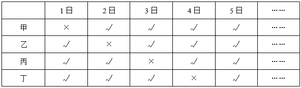

由上表可知，9月1-5日刚好为一个周期，一个周期内4人同时在岗日期为1天，9月共30天，即共有个周期，则9月份4人同时在岗工作6×1=6天。

故正确答案为D。

---

第 50 题

**答案**：C

**来源参考解析（非官方标准答案）**

方法一：设参与单打的女生有x人，参与双打的女生有y人。根据常识：双打和单打每桌分别有4人和2人参与，结合题意可列式：······①，······②，联立①②两式，解得：x=3，y=9，即参与单打的女生有3人，参与双打的女生有9人，则题目所求=3-9=-6人，即少6人。

方法二：根据“双打总人数是单打的1.5倍”，则。根据常识：双打和单打每桌分别有4人和2人参与，则。设双打球桌数量为3x，单打球桌数量为4x，则3x+4x=14，解得x=2，即双打球桌数量=6，单打球桌数量=8。可列表如下：

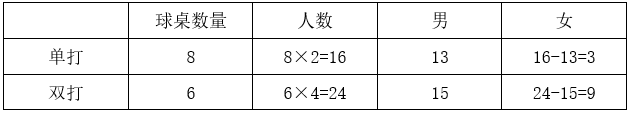

则题目所求=3-9=-6人，即少6人。

故正确答案为C。

---

第 51 题

**答案**：B

**来源参考解析（非官方标准答案）**

根据题意，2行3列的方队如下图所示：

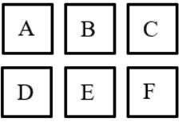

先将小李和小吴内部排序，情况数为种；再将二人安排在（AB、BC、DE、EF）四组中的一组位置，使其左右相邻，情况数为种；然后将小张和小王内部排序后安排到小李、小吴选择后剩下的一整列，使二人前后相邻，情况数为种；最后将剩余的二人安排到剩下的两个位置，情况数为种。分步用乘法，共有2×4×2×2=32种不同的站法。

故正确答案为B。

---

第 52 题

**答案**：C

**来源参考解析（非官方标准答案）**

根据题意，要使做5道题的天数最多，则其他天数中每天的做题量要尽可能少，又根据任意两天做的题数相差不超过2道，则其他天数中每天的做题量可以为3道、4道。设有x天做了5道题，有y天做了4道题，则有（10-x-y）天做了3道题，根据题意可列方程：5x+4y+3（10-x-y）=41，整理可得：2x=11-y，2x为偶数，11为奇数，则y为奇数，当y=1时，可使x最大，x=5，即他最多有5天做了5道题。
故正确答案为C。

---

第 53 题

**答案**：A

**来源参考解析（非官方标准答案）**

方法一：设该企业在甲项目上投资了x万元，在乙项目上投资了（160-x）万元。根据题意，可列式：，解得x=60。即该企业在甲项目上投资了60万元。

方法二：根据题意可得甲、乙两个项目总的收益率为。设该企业在甲项目上投资了x万元，在乙项目上投资了（160-x）万元。根据线段法：距离与量成反比，可列式：，解得x=60。即该企业在甲项目上投资了60万元。

故正确答案为A。

---

第 54 题

**答案**：C

**来源参考解析（非官方标准答案）**

本题考虑代入排除，问第一次售空，从最小的选项开始代入。

代入A项，第32天时，网店一共做出花篮个，一共卖出2×32=64个，67&gt;64，没有售空，排除；

代入B项，第33天时，网店一共做出花篮个，一共卖出2×33=66个，67&gt;66，没有售空，排除；

代入C项，第34天时，网店一共做出花篮个，一共卖出2×34=68个，68=68，花篮第一次售空，当选。

故正确答案为C。

---

第 55 题

**答案**：C

**来源参考解析（非官方标准答案）**

如图所示，小张从营地O点出发，骑车向东偏南方向行进至A点后，左转继续行进至B点，并保持当前方向再行进35千米到C点。可得，OA=60，AB=45，BC=35，则AC=AB+BC=45+35=80。为直角三角形，则小张到达C点后，他与营地之间的直线距离OC。

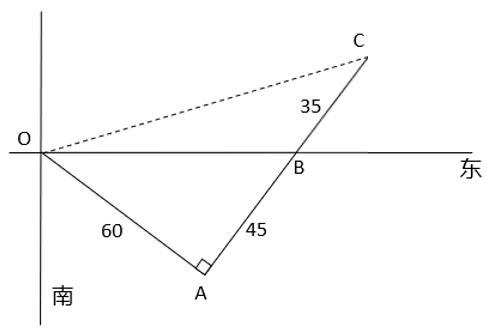

故正确答案为C。

---

第 56 题

**答案**：B

**来源参考解析（非官方标准答案）**

根据题意，甲车间每小时加工的零件数量为个，乙车间每小时加工的零件数量为个，丙车间加工完120个零件需要小时，则丙车间每小时加工的零件数量为个。

方法1：三个车间共加工270个零件且同时开始同时结束，需用时小时，则丙车间比甲车间多分配个零件。

方法2：甲、乙、丙车间每小时加工零件数量之比为36：54：72=2：3：4，由于三个车间共加工270个零件且同时开始同时结束，即工作时间相同，可得三个车间各自加工零件总数之比=每小时加工零件数量之比=2：3：4，故丙车间比甲车间多分配个零件。

故正确答案为B。

---

第 57 题

**答案**：D

**来源参考解析（非官方标准答案）**

如图所示，设甲、乙两船的静水速度为，竹排顺水漂行的速度为，甲、乙、竹排行进时间为t，则甲船的顺流速度为（），乙船的逆流速度为（）。根据甲和竹排行进过程，可得，整理可得······①；根据公式：，乙与竹排的行进过程，可得，整理可得······②。联立①②两式，可得x-2=y-8，即y-x=6。

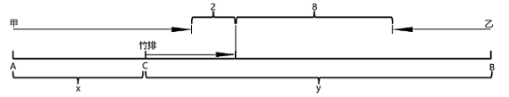

故正确答案为D。

---

第 58 题

**答案**：D

**来源参考解析（非官方标准答案）**

设1份盒饭成本为x元，1份奶茶成本为y元。根据题意，可列式：（2×40+10）×0.9-（2x+y）=20，整理可得：2x+y=61······①；（4×40+3×10）×0.8-（4x+3y）=24，整理可得：4x+3y=128······②，联立①②，解得x=27.5，y=6。则按原价出售，1份盒饭比1杯奶茶多获利40-27.5-（10-6）=8.5元。
故正确答案为D。

---

第 59 题

**答案**：B

**来源参考解析（非官方标准答案）**

设两个半圆形的半径均为r米，则两个半圆形的面积之和为一个圆形的面积，即为平方米。AD=2r米，则米。根据题意，可列式：，解得r=50米，故两个半圆形的半径均为50米，AB=250-2r=150米，即操场外轮廓的长度为2个半圆对应的弧长之和+AB+DC=1个圆的周长+2AB米。

故正确答案为B。

---

第 60 题

**答案**：C

**来源参考解析（非官方标准答案）**

将年龄从大到小排名第八的人设为x岁，要想年龄最小的3人年龄之和最大，则第九名、第十名尽量大，第二名至第七名尽量小，且年龄各不相同，根据题意，可构造数列如下：

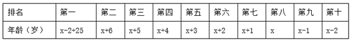

则x-2+25+x+6+x+5+x+4+x+3+x+2+x+1+x+x-1+x-2=10×35，整理可得，10x+41=350，解得：x=30.9，将x向下取整为30，并代入原数列可得：

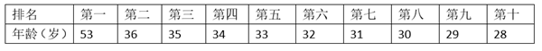

此时10人年龄之和为10x+41=10×30+41=341岁，距离10人总年龄350岁还差9岁。若将第十名增加1岁，则第一名需增加1岁，第九至第二名每人至少需增加1岁，此时至少要比341岁多10岁，年龄之和超过350岁，不符合要求。若第九名增加1岁，则第八至第三名可均增加1岁，第二名增加2岁，此时刚好增加9岁，十人年龄之和为341+9=350岁，符合要求。构造的数列如下：

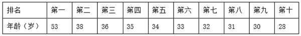

则年龄最小的3人年龄之和最大可能为31+30+28=89岁。

故正确答案为C。

---

第 61 题

**答案**：D

**来源参考解析（非官方标准答案）**

根据题意，设甲部门有x人，乙部门有y人，则丙部门有（x+2）人。可列式：，化简为：x-y=2······①；y=20%（x+y+x+2），化简为：2y-x=1······②，联立①②解得：x=5，y=3。即甲部门有5人，乙部门有3人，丙部门有5+2=7人。

若满足“每个部门至少选派2人，至多选派3人”，选派8人分情况讨论如下：

（1）甲部门选派2人，乙、丙部门各选派3人：有种情况；

（2）乙部门选派2人，甲、丙部门各选派3人：有种情况；

（3）丙部门选派2人，甲、乙部门各选派3人：有种情况。分类用加法，则共有350+1050+210=1610种情况。

故正确答案为D。

---

第 62 题

**答案**：D

**来源参考解析（非官方标准答案）**

根据题意，每本书的阅读时间需要连续，可将一本书看作一个整体，且不同书籍存在阅读顺序，则阅读三本书的情况数为种。此时将三本书看作3个主体，加上没有阅读的4天，即为7个主体中任选4天不阅读，情况数为种，故所有可能的阅读方案有6×35种。

没有阅读的4天都不相连，采用插空法。3本书4个空，刚好安排4天，只有1种情况，且三本书的阅读情况不变，则满足条件的情况数为6×1种。

根据公式：概率，则题干所求为。

故正确答案为D。

---

第 63 题

**答案**：B

**来源参考解析（非官方标准答案）**

根据题意，总情况为从十个数中随机选择两个数，共有种情况。满足条件的情况为两个数的最大公约数为1，即两个数互质，正面考虑情况数较多，故从反面思考。反面情况为两个数存在大于1的公约数，分情况讨论如下：

（1）2个数均为2的倍数，即从2、4、6、8、10中任选2个数，有种情况；

（2）2个数均为3的倍数，即从3、6、9中任选2个数，有种情况；

（3）2个数均为5的倍数，即从5、10中任选2个数，有1种情况。

分类用加法，反面情况共有10+3+1=14种情况。故题干所求概率=1-反面情况概率。

故正确答案为B。

---

第 64 题

**答案**：A

**来源参考解析（非官方标准答案）**

设长方形纸盒的长、宽、高的长度分别为a分米、b分米、c分米，则每个面对角线的长度为分米、分米、分米，共6种长度。由于小赵制作过程中仅用了3种不同长度，则长、宽、高中需有两边长度相同。根据“最短的细木条长度为1分米”，假设b=c=1分米，此时所需的长度分别为a分米、1分米、分米、分米，共4种长度。令a边长度=短边对角线长度，可满足仅有3种不同的长度，此时长、宽、高长度分别为、1、1，长方形的体积立方分米。

故正确答案为A。

---

第 65 题

**答案**：A

**来源参考解析（非官方标准答案）**

若当年为平年，则下一年元旦在当年元旦星期数基础上加1，若当年为闰年，则下一年元旦在当年元旦星期数基础上加2。若让元旦为周三出现次数最少，可利用闰年星期数加2，跳过周三，前、后相邻两年元旦星期数分别为周二和周四作为起始，推出前、后年份星期数，如下表：

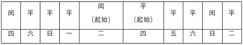

可知连续的10年中元旦在周三的次数最少为0次。

故正确答案为A。

---

第 66 题

**答案**：A

**来源参考解析（非官方标准答案）**

元素组成不同，优先考虑属性规律。黑白色区域分布相对比较规整，优先考虑对称性。图1黑色区域为轴对称图形，图2白色区域为轴对称图形，图3黑色区域为轴对称图形，图4白色区域为轴对称图形，图5黑色区域为轴对称图形，因此“？”处应该是白色区域为轴对称图形，只有A项符合。
故正确答案为A。

---

第 67 题

**答案**：D

**来源参考解析（非官方标准答案）**

元素组成不同，且无明显属性规律，考虑数量规律。观察发现，题干图形均由直线和曲线构成，且直线和曲线出现明显相交，考虑曲直交点数。题干图形的曲直交点数均为3，故“？”处应选择有3个曲直交点的图形，只有D项符合。
故正确答案为D。

---

第 68 题

**答案**：A

**来源参考解析（非官方标准答案）**

元素组成不同，且每幅图均由两个图形拼接而成，考虑图形间关系。观察发现，题干两个面均是以边相连，排除C、D两项；继续观察发现，每幅图均为形状、大小相同的两个图形，排除B项。
故正确答案为A。

---

第 69 题

**答案**：B

**来源参考解析（非官方标准答案）**

元素组成不同，且无明显属性规律，观察发现，题干图形均由黑块和白块组成，且色块分布均匀，优先考虑黑白块面积。第一组图形中，黑块面积均为整个图形面积的，第二组图形中，前两幅图形的黑块面积均为整个图形面积的，故？处图形的黑块面积应为整个图形面积的，只有B项符合。

故正确答案为B。

---

第 70 题

**答案**：C

**来源参考解析（非官方标准答案）**

元素组成相似，优先考虑样式规律，且相同线条重复出现，故考虑样式规律中的加减同异。九宫格优先看横行，第一行中，图1顺时针旋转，图2逆时针旋转，旋转后的图1和图2求同得到图3；经验证，第二行也满足此规律；第三行应用此规律，将图1顺时针旋转，图2逆时针旋转，然后图1和图2求同，得到的图应为C项。

故正确答案为C。

---

第 71 题

**答案**：A

**来源参考解析（非官方标准答案）**

本题为分组分类题目。元素组成不同，且无明显属性规律，考虑数量规律。观察发现，题干多幅图形出现“日”字变形图、明显出头端点，考虑笔画数。图①②③均为一笔画图形，图④⑤⑥均为三笔画图形，即图①②③为一组，图④⑤⑥为一组。
故正确答案为A。

---

第 72 题

**答案**：C

**来源参考解析（非官方标准答案）**

元素组成不同，且无明显属性规律，考虑数量规律。观察发现，题干图形封闭区域明显，考虑面数量，但总体数面无明显规律。继续观察发现，题干所有面的形状均为四边形，故？处图形中所有面的形状也应均为四边形，只有C项符合。
故正确答案为C。

---

第 73 题

**答案**：B

**来源参考解析（非官方标准答案）**

本题为分组分类题目。元素组成不同，且无明显属性规律，考虑数量规律。观察发现，每幅图均有4个元素，且均存在2个相同元素，图①③④中相同元素位置相对，图②⑤⑥中相同元素位置相邻。即图①③④为一组，图②⑤⑥为一组。
故正确答案为B。

---

第 74 题

**答案**：D

**来源参考解析（非官方标准答案）**

本题为空间重构类题目，将题干展开图标上序号，如下图所示，逐一进行分析。

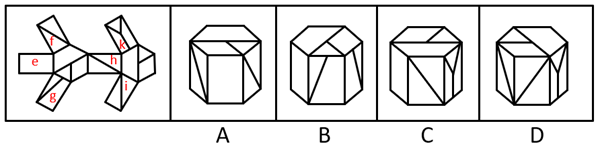

A项：选项正面为面e，题干展开图中面e的两侧分别与面f和面g相邻，而选项中面e的两侧相邻面中没有面g，选项与题干展开图不一致，排除；

B项：选项正面为面g，右侧面与面g形状相同，但题干展开图中面g形状的面只有1个，故选项右侧面为无中生有的面，选项与题干展开图不一致，排除；

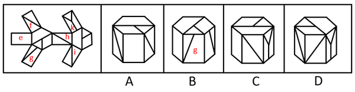

C项：选项右侧面为面k，题干展开图中面k与其左侧相邻面上方的公共点引出两条面上的线，而选项中面k与其左侧相邻面上方的公共点只引出一条面上的线，选项与题干展开图不一致，排除；

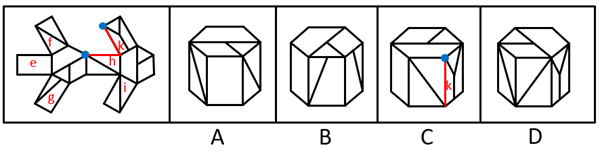

D项：选项与题干展开图一致，当选。

故正确答案为D。

---

第 75 题

**答案**：D

**来源参考解析（非官方标准答案）**

本题考查立体拼合，题干立体图形可由3个完全相同的D项图形拼合而成，具体拼合方式如下图所示。

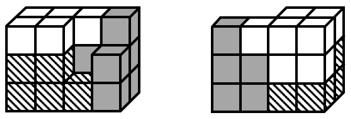

故正确答案为D。

---

第 76 题

**答案**：B

**来源参考解析（非官方标准答案）**

第一步：判断题干词语间逻辑关系。
“板鞋”是“鞋”的一种，二者为种属关系。
第二步：判断选项词语间逻辑关系。
A项：“青海”一般指“青海省”，是中国西部的省级行政区，不是“海”的一种，二者不是种属关系，与题干逻辑关系不一致，排除；
B项：“土匪”是指在地方上抢劫财物、为非作歹、严重扰乱社会治安的武装匪徒，“匪”是指强盗，抢劫财务的坏人，“土匪”是“匪”的一种，二者为种属关系，与题干逻辑关系一致，当选；
C项：“河马”与“马”是两种不同的哺乳动物，二者为并列关系，与题干逻辑关系不一致，排除；
D项：“水银”和“银”是两种不同的金属，二者为并列关系，与题干逻辑关系不一致，排除。
故正确答案为B。

---

第 77 题

**答案**：C

**来源参考解析（非官方标准答案）**

第一步：判断题干词语间逻辑关系。
抗日战争发生在1931年至1945年之间，而解放战争则发生在1946年至1950年之间，二者是中国历史上两个重要的时间阶段，构成并列关系，且二者存在时间上的延续。
第二步：判断选项词语间逻辑关系。
A项：日新月异即每日每月都出现新的情况，呈现新的面貌，日新和月异不是两个并列的时间阶段，与题干逻辑关系不一致，排除；
B项：秋收冬藏指秋天收获，冬天储藏；春生夏长指春天萌生，夏天滋长，前后共描述了四个时间阶段及对应的行为，并非单纯的时间阶段的并列，与题干逻辑关系不一致，排除；
C项：弱冠之年指代男子年满二十岁行加冠礼后进入成年的人生阶段；而立之年指代三十岁时心智成熟、具备独立判断能力的人生阶段，二者均是人生两个重要的时间阶段，构成并列关系，且二者存在时间上的延续，与题干逻辑关系一致，当选；
D项：朝饮木兰之坠露，即早晨我饮木兰上的露滴；夕餐秋菊之落英，即晚上我用菊花残瓣充饥，二者体现了两个时间阶段及对应的行为，并非单纯的时间阶段的并列，与题干逻辑关系不一致，排除。
故正确答案为C。

---

第 78 题

**答案**：D

**来源参考解析（非官方标准答案）**

第一步：判断题干词语间逻辑关系。
鸭绒被和卤鸭头的原材料都来自鸭子，二者原材料一致。
第二步：判断选项词语间逻辑关系。
A项：棉花可以用来做棉被，二者为原材料与成品的对应关系，与题干逻辑关系不一致，排除；
B项：铅笔芯的原材料是石墨，钻石的原材料是金刚石，二者原材料不一致，与题干逻辑关系不一致，排除；
C项：人参和西洋参是两种不同的药材，二者为并列关系，与题干逻辑关系不一致，排除；
D项：牛排和牛角梳的原材料都来自牛，二者原材料一致，与题干逻辑关系一致，当选。
故正确答案为D。

---

第 79 题

**答案**：B

**来源参考解析（非官方标准答案）**

第一步：判断题干词语间逻辑关系。
天下大事，必作于细指天下的大事都是从细小的地方一步步形成的，必作于细是达成天下大事的必要条件，同时也是必要对策。
第二步：判断选项词语间逻辑关系。
A项：积善之家，必有余庆指修善积德的个人和家庭，必然有更多的吉庆，二者是条件关系，但必有余庆不是达成积善之家的必要对策，与题干逻辑关系不一致，排除；
B项：工欲善其事，必先利其器指工匠要想做好活儿，一定先要把工具整治得锐利精良，必先利其器是工欲善其事的必要条件，同时也是必要对策，与题干逻辑关系一致，当选；
C项：治国有常，利民为本指治理国家的根本途径是利民，二者是条件关系，但利民是一种途径，不是具体对策，与题干逻辑关系不一致，排除；
D项：有朋自远方来，不亦乐乎指有志同道合的人从远方来，不是很令人高兴的吗，二者并非条件关系，与题干逻辑关系不一致，排除。
故正确答案为B。

---

第 80 题

**答案**：A

**来源参考解析（非官方标准答案）**

第一步：判断题干词语间逻辑关系。
举手和点头都是一种示意方式，第一个词和第三个词是并列关系，且均与第二个词构成种属关系。
第二步：判断选项词语间逻辑关系。
A项：握手和敬礼都是一种礼仪行为，第一个词和第三个词是并列关系，且均与第二个词构成种属关系，与题干逻辑关系一致，当选；
B项：纳税是一种义务，选举是公民权利，而不是义务，与题干逻辑关系不一致，排除；
C项：罢工和游行都是一种抗议方式，第一个词和第二个词是并列关系，且均与第三个词构成种属关系，与题干逻辑关系不一致，排除；
D项：界碑和界河都代表“界限”，第二个词和第三个词是并列关系，与题干逻辑关系不一致，排除。
故正确答案为A。

---

第 81 题

**答案**：A

**来源参考解析（非官方标准答案）**

第一步：判断题干词语间逻辑关系。
题干两词没有必然语义关系，看相同单字也选不出唯一答案，因此考虑词性，实现是动词，现实是形容词。
第二步：判断选项词语间逻辑关系。
A项：适合是动词，合适是形容词，与题干词性一致，当选；
B项：代替和替代都是动词，与题干词性不一致，排除；
C项：离别和别离都是动词，与题干词性不一致，排除；
D项：积累和累积都是动词，与题干词性不一致，排除。
故正确答案为A。

---

第 82 题

**答案**：D

**来源参考解析（非官方标准答案）**

第一步：判断题干词语间逻辑关系。
从微观的角度来讲，“消防栓”与“按摩椅”一个是消防设施一个是保健设备，关联不大。但二者都是物品，可以考虑命名方式，消防栓是因其具有消防的功能而命名，按摩椅是因其具有按摩的功能而命名。
第二步：判断选项词语间逻辑关系。
A项：火山口是火山喷发时岩浆及其他碎屑物喷出的裂口，三江源因其是长江、黄河和澜沧江的发源地而得名，二者均不是因其具有的功能而命名，与题干逻辑关系不一致，排除；
B项：金钟罩和铁布衫是中国传统武术项目，命名源于其独特的练成效果和形象比喻，二者均不是因其具有的功能而命名，与题干逻辑关系不一致，排除；
C项：传染病是因其具有传染的属性而命名，不是因其具有的功能而命名，与题干逻辑关系不一致，排除；
D项：助听器是因其具有助听的功能而命名，防晒霜是因其具有防晒的功能而命名，与题干逻辑关系一致，当选。
故正确答案为D。

---

第 83 题

**答案**：D

**来源参考解析（非官方标准答案）**

第一步：判断题干词语间逻辑关系。
结婚登记时身份证是证明身份的必要凭证，但不一定需要户口本，前两词为必要条件对应关系，第一词和第三词为非必要条件对应关系。
第二步：判断选项词语间逻辑关系。
A项：睡觉不一定需要床，前两词并非必要条件对应关系，与题干逻辑关系不一致，排除；
B项：成功不一定需要运气，前两词并非必要条件对应关系，与题干逻辑关系不一致，排除；
C项：登山不一定需要鞋子，前两词并非必要条件对应关系，与题干逻辑关系不一致，排除；
D项：考试时准考证是证明身份的必要凭证，但不一定需要签字笔，前两词为必要条件对应关系，第一词和第三词为非必要条件对应关系，与题干逻辑关系一致，当选。
故正确答案为D。

---

第 84 题

**答案**：A

**来源参考解析（非官方标准答案）**

第一步：判断题干词语间逻辑关系。
有的物理学家是化学家，有的物理学家不是化学家，有的化学家是物理学家，有的化学家不是物理学家，二者为交叉关系；居里夫人是物理学家，也是化学家，第三个词与前两个词均构成种属关系。
第二步：判断选项词语间逻辑关系。
A项：有的整数是正数，有的整数不是正数，有的正数是整数，有的正数不是整数，二者为交叉关系；质数是整数，也是正数，第三个词与前两个词均构成种属关系，与题干逻辑关系一致，当选；
B项：硫酸和铜在一定条件下发生化学反应生成硫酸铜，三者是化学产物的对应关系，与题干逻辑关系不一致，排除；
C项：电脑可以在办公室，也可以在卧室，第三个词与前两个词均构成地点的对应关系，与题干逻辑关系不一致，排除；
D项：公司职员、自媒体博主、文艺青年是人的三种不同身份，且用“四个有的”造句造得通，三者两两之间互为交叉关系，与题干逻辑关系不一致，排除。
故正确答案为A。

---

第 85 题

**答案**：C

**来源参考解析（非官方标准答案）**

逐一代入选项。
A项：黄杨木是制作木雕的原材料，二者为原材料对应，糯米是制作花雕酒的原材料，二者为原材料对应，但词语前后顺序相反，前后逻辑关系不一致，排除；
B项：木雕是一种建筑装饰，二者为种属关系，花雕酒经常作为女儿陪嫁中的特定物品，二者为对应关系，前后逻辑关系不一致，排除；
C项：石雕和木雕都是建筑装饰，二者为并列关系，花雕酒是使用糯米为主要原料发酵而得的酒，花雕酒和莲子酒是两种不同的酒，二者为并列关系，前后逻辑关系一致，当选；
D项：木雕是一种雕塑艺术，二者为种属关系，糯米经过发酵制作成花雕酒，发酵与花雕酒为工艺对应，前后逻辑关系不一致，排除。
故正确答案为C。

---

第 86 题

**答案**：B

**来源参考解析（非官方标准答案）**

第一步：找出定义关键词。
表层扮演：“个体隐藏真实情绪”、“按照工作要求伪装出特定外在情绪表现”；
深层扮演：“个体通过调整内在真实情感以符合工作要求的情绪表达方式”、“强调内在情绪体验与外在表现的一致性”。
第二步：逐一分析选项。
A项：服务员面对顾客投诉强忍怒火保持职业微笑，符合“个体隐藏真实情绪”、“按照工作要求伪装出特定外在情绪表现”，符合“表层扮演”定义，不符合“深层扮演”定义，排除；
B项：护士换位思考理解患者焦虑后主动安抚情绪，护士能够换位思考并主动安抚，说明其从内心理解了患者的情绪并且体现在了外在表现上，符合“个体通过调整内在真实情感以符合工作要求的情绪表达方式”、“强调内在情绪体验与外在表现的一致性”，符合“深层扮演”定义，当选；
C项：客服人员机械背诵标准化礼貌用语应对咨询，未体现其内在情绪，不符合“个体通过调整内在真实情感以符合工作要求的情绪表达方式”、“强调内在情绪体验与外在表现的一致性”，不符合“深层扮演”定义，排除；
D项：销售员因业绩压力自发对产品产生强烈信心，未体现其情绪的外在表现，不符合“个体通过调整内在真实情感以符合工作要求的情绪表达方式”、“强调内在情绪体验与外在表现的一致性”，不符合“深层扮演”定义，排除。
故正确答案为B。

---

第 87 题

**答案**：C

**来源参考解析（非官方标准答案）**

第一步：找出定义关键词。
“打破传统组织内部的横向（部门间）、纵向（层级间）、外部（与客户/供应商间）的预设边界”、“以灵活授权团队取代固定部门”。
第二步：逐一分析选项。
A项：通过标准化流程管理各分店运营，强调的是标准化和统一控制，未体现边界打破或团队灵活授权，不符合“打破传统组织内部的横向（部门间）、纵向（层级间）、外部（与客户/供应商间）的预设边界”、“以灵活授权团队取代固定部门”，不符合定义，排除；
B项：政府机构采用垂直管理体系确保政策统一执行，不符合“打破传统组织内部的横向（部门间）、纵向（层级间）、外部（与客户/供应商间）的预设边界”、“以灵活授权团队取代固定部门”，不符合定义，排除；
C项：公司根据项目需要进行跨职能部门团队动态组合，符合“打破传统组织内部的横向（部门间）、纵向（层级间）、外部（与客户/供应商间）的预设边界”、“以灵活授权团队取代固定部门”，符合定义，当选；
D项：企业通过部门分工和逐级审批制度保障运营效率，强化了部门分工和层级审批，不符合“打破传统组织内部的横向（部门间）、纵向（层级间）、外部（与客户/供应商间）的预设边界”、“以灵活授权团队取代固定部门”，不符合定义，排除。
故正确答案为C。

---

第 88 题

**答案**：D

**来源参考解析（非官方标准答案）**

第一步：找出定义关键词。
“影响个体行为或心理过程的外部因素”、“物理距离、社会文化背景”。
第二步：逐一分析选项。
A项：恒定的光照强度，光照强度是外部因素，符合“影响个体行为或心理过程的外部因素”，符合定义，保留；
B项：被试完成问卷时的情绪状态，情绪状态是自身的心理状态，不符合“影响个体行为或心理过程的外部因素”，不符合定义，排除；
C项：企业员工绩效考核的量化指标，量化指标是客观评价标准，可以是外部因素，符合“影响个体行为或心理过程的外部因素”，符合定义，保留；
D项：跨文化研究中不同国家的礼仪规范差异，礼仪规范是外部因素，符合“影响个体行为或心理过程的外部因素”、“物理距离、社会文化背景”，符合定义，保留。
对比A、C、D三项，A项的光照强度是“恒定”的，不符合“变量”的特质，C项的量化指标不是“物理距离、社会文化背景”，故D项更符合题干定义。
故正确答案为D。

---

第 89 题

**答案**：B

**来源参考解析（非官方标准答案）**

第一步：找出定义关键词。
光杆动词式把字句：“把+名词+光杆动词”、“动词后无任何附加成分”；
动趋式把字句：“把+名词+动趋式动补短语（表达了行为发生的趋势）”。
第二步：逐一分析选项。
A项：“你别把家门上锁”的结构是“把+家门+上锁”，“上锁”并非行为趋势，不符合“把+名词+动趋式动补短语（表达了行为发生的趋势）”，不符合“动趋式把字句”定义，排除；
B项：“母亲把剩菜带回来”的结构是“把+剩菜+带回来”，“带回来”表达了行为发生的趋势，符合“把+名词+动趋式动补短语（表达了行为发生的趋势）”，符合“动趋式把字句”定义，当选；
C项：“你别把小问题复杂化”的结构是“把+小问题+复杂化”，“复杂化”并非行为趋势，不符合“把+名词+动趋式动补短语（表达了行为发生的趋势）”，不符合“动趋式把字句”定义，排除；
D项：“我建议大会把这个提案取消”的结构是“把+提案+取消”，“取消”为动词，其后无附加成分，符合“把+名词+光杆动词”、“动词后无任何附加成分”，符合“光杆动词式把字句”定义，不符合“动趋式把字句”定义，排除。
故正确答案为B。

---

第 90 题

**答案**：D

**来源参考解析（非官方标准答案）**

第一步：找出定义关键词。
“商品生产国与消费国”、“通过第三国（或地区）转手进行的贸易”、“在第三国不经过加工或仅进行简单分类、包装等非本质改变”。
第二步：逐一分析选项。
A项：该项中的伊朗为“生产国”，欧洲为“消费国”，迪拜为“第三国（或地区）”，但是迪拜将伊朗原油提炼成成品油，说明第三国（或地区）对商品进行了加工，不符合“在第三国不经过加工或仅进行简单分类、包装等非本质改变”，不符合定义，排除；
B项：该项中的中国为“生产国”，印度为“消费国”，新加坡为“第三国（或地区）”，但新加坡将手机零部件组装后进行出口，说明第三国对商品进行了加工，不符合“在第三国不经过加工或进行简单分类、包装等非本质改变”，不符合定义，排除；
C项：该项中的智利为“生产国”，日本为“消费国”，秘鲁为“第三国（或地区）”，智利铜矿经过秘鲁港口卸货后，直接原箱装船运往日本，即只是在秘鲁进行停靠转运，未体现在此进行贸易，不符合“通过第三国（或地区）转手进行的贸易”，不符合定义，排除；
D项：该项中的中国为“生产国”，英国为“消费国”，荷兰为“第三国（或地区）”，荷兰贸易商“更换”原产地证明文件后“转卖”至英国，符合“通过第三国”（或地区）转手进行的贸易”、“在第三国不经过加工或仅进行简单分类、包装等非本质改变”，符合定义，当选。
故正确答案为D。

---

第 91 题

**答案**：C

**来源参考解析（非官方标准答案）**

第一步：找出定义关键词。
“液体形成新的结构”、“液体表观黏度增大，体积胀大”。
第二步：逐一分析选项。
A项：老酸奶搅拌后变稀，不符合“液体表观黏度增大，体积胀大”，不符合定义，排除；
B项：快速挣扎让沼泽变稀，不符合“液体表观黏度增大，体积胀大”，不符合定义，排除；
C项：液体防弹衣中的液体被子弹击中时会迅速膨胀变硬，符合“液体形成新的结构”、“液体表观黏度增大，体积胀大”，符合定义，当选；
D项：敲击瓶底或大力甩瓶身让粘在瓶底的番茄酱流出，不符合“液体形成新的结构”、“液体表观黏度增大，体积胀大”，不符合定义，排除。
故正确答案为C。

---

第 92 题

**答案**：B

**来源参考解析（非官方标准答案）**

第一步：找出定义关键词。

独立：“X1的取值不影响X2的取值，X2的取值也不影响X1的取值”；

同一分布：“X1和X2在取值范围内的概率分布一致”；

独立同分布：“服从同一分布”且“互相独立”。

第二步：逐一分析选项。

A项：甲、乙两人“先后”抽奖，因此甲抽中的结果会影响乙抽中的概率，不符合“X1和X2在取值范围内的概率分布一致”，不符合“服从同一分布”，不符合“独立同分布”定义，排除；

B项：甲、乙两人先后掷骰子，骰子的点数取值范围均为1-6，且每个点数出现的概率均为，符合“X1和X2在取值范围内的概率分布一致”，同时甲掷出的点数不会对乙掷出的点数产生任何影响，符合“互相独立”，符合“独立同分布”定义，当选；

C项：甲、乙两棋手实力差距悬殊，甲获胜的概率远高于乙，二者的胜负概率分布不一致，不符合“X1和X2在取值范围内的概率分布一致”，不符合“服从同一分布”，不符合“独立同分布”定义，排除；

D项：随机选择的男性甲和女性乙，二者的身高概率分布存在明显差异，不符合“X1和X2在取值范围内的概率分布一致”，不符合“服从同一分布”，不符合“独立同分布”定义，排除。

故正确答案为B。

---

第 93 题

**答案**：D

**来源参考解析（非官方标准答案）**

第一步：找出定义关键词。
“在被研究现象出现的若干正面场合中，都有一个相同的先行情况出现”、“在被研究现象不出现的若干反面场合中，该先行情况都不出现”、“该先行情况就是被研究现象的原因”。
第二步：逐一分析选项。
A项：小明第一晚边看边喝浓茶，第二晚边看边喝咖啡，第三晚边看边吸烟，三晚做的事不相同，不是同一个先行情况，不符合“在被研究现象出现的若干正面场合中，都有一个相同的先行情况出现”，不符合定义，排除；
B项：双胞胎兄弟在饭店用餐，一个吃了冰激凌，另一个没吃冰激凌，只有兄弟两个人，不符合“在被研究现象出现的若干正面场合中，都有一个相同的先行情况出现”、“在被研究现象不出现的若干反面场合中，该先行情况都不出现”，不符合定义，排除；
C项：几位顾客电脑在中毒前都运行了同一个软件，未提及“在被研究现象不出现的若干反面场合中，该先行情况都不出现”，不符合定义，排除；
D项：失足青年的家庭一般都不稳定，符合“在被研究现象出现的若干正面场合中，都有一个相同的先行情况出现”，没有失足的青年家庭较为稳定，符合“在被研究现象不出现的若干反面场合中，该先行情况都不出现”，可见家庭不稳定是青年失足的重要原因，符合“该先行情况就是被研究现象的原因”，符合定义，当选。
故正确答案为D。

---

第 94 题

**答案**：A

**来源参考解析（非官方标准答案）**

第一步：找出定义关键词。
“智能体”、“物理实体与环境实时交互，不断修正自身模型和策略”、“在不断变化的环境中做出实时反应”、“实现感知、认知、决策和行动一体化”。
第二步：逐一分析选项。
A项：无人机符合“智能体”，按计划路线对稻田进行农药喷洒，不符合“在不断变化的环境中做出实时反应”，不符合定义，当选；
B项：作战机器人符合“智能体”，实时分析环境数据，符合“物理实体与环境实时交互”，在复杂地形中自主行走和避障，符合“在不断变化的环境中做出实时反应”，符合定义，排除；
C项：自动驾驶汽车符合“智能体”，在绿灯变红前3秒钟，做出“加速驶过路口”的决策，符合“在不断变化的环境中做出实时反应”，符合定义，排除；
D项：人形机器人符合“智能体”，突然看到被困群众，立马上前安抚他们，符合“在不断变化的环境中做出实时反应”，符合定义，排除。
本题为选非题，故正确答案为A。

---

第 95 题

**答案**：A

**来源参考解析（非官方标准答案）**

第一步：找出定义关键词。
“用特例”、“为自己的错误开脱”。
第二步：逐一分析选项。
A项：小王以那天自己身体不舒服为借口，为工作出差错开脱，符合“用特例”、“为自己的错误开脱”，符合定义，当选；
B项：小赵用总有人是最差的来安慰年终考核垫底的自己，不是特例，不符合“用特例”，不符合定义，排除；
C项：小孙妈妈用孩子着急来解释小孙考试经常出现计算错误，不符合“为自己的错误开脱”，不符合定义，排除；
D项：小李比赛获得二等奖，心里想再多答对一题就能获得一等奖，不符合“用特例”、“为自己的错误开脱”，不符合定义，排除。
故正确答案为A。

---

第 96 题

**答案**：A

**来源参考解析（非官方标准答案）**

第一步：翻译题干。

升级提星基本设施完备 且 通过卫生部门的严格考核。

第二步：逐一分析。

（1）翻译为：升级提星 且 通过卫生部门的严格考核，“升级提星”是对题干条件的肯前，肯前必肯后，可以推出“通过卫生部门的严格考核”，说明（1）没有遵守要求；

（2）翻译为：升级提星 且 基本设施完备（没有空调、吹风机等基本设施），“升级提星”是对题干条件的肯前，肯前必肯后，可以推出“基本设施完备”，说明（2）没有遵守要求；

（3）翻译为：基本设施完备 且 通过卫生部门的严格考核 且 升级提星，“基本设施完备 且 通过卫生部门的严格考核”是对题干条件的肯后，“升级提星”是对题干条件的否前，否前肯后无必然结论，无法明确（3）是否遵守要求。

综上，可以说明升级提星这项工作没有遵守要求的是（1）（2）。

故正确答案为A。

---

第 97 题

**答案**：A

**来源参考解析（非官方标准答案）**

第一步：分析题干条件。

（1）A和C不相邻；

（2）F和C不相邻；

（3）有且仅有一张甲的专辑在最边上的货架；

（4）C在2号货架；

（5）E在4号货架；

（6）歌手甲为专辑A和B、歌手乙为专辑C和D、歌手丙为专辑E和F，共6张专辑，需将它们放在横向排列的1~6号货架。

第二步：根据题干条件进行推理。

根据条件（4）、（5）可知C在2号货架，E在4号货架，又根据条件（1）、（2）、（6）可知专辑A和专辑F均不能放在1号、3号货架，因此专辑A和专辑F只能放在5号或6号货架，此时分两种情况假设：

（1）假设A在5号货架，F在6号货架，根据条件（3）、（6）可知，B只能在1号货架，那么D只能在3号货架，如下表第一行所示；

（2）假设A在6号货架，F在5号货架，根据条件（3）、（6）可知，B只能在3号货架，那么D只能在1号货架，如下表第二行所示。

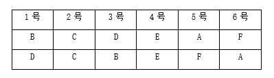

故正确答案为A。

---

第 98 题

**答案**：C

**来源参考解析（非官方标准答案）**

第一步：分析题干条件。

①冰冰获得一等奖琪琪获得二等奖；

②琪琪获得二等奖 或 依依获得二等奖鑫鑫获得三等奖 且 静静获得二等奖；

③鑫鑫获得三等奖冰冰获得二等奖 且 依依获得三等奖；

④6人均获奖，其中一等奖1人，二等奖2人，三等奖3人。

第二步：根据题干条件进行推理。

①②③可以递推出⑤：冰冰获得一等奖琪琪获得二等奖鑫鑫获得三等奖 且 静静获得二等奖冰冰获得二等奖 且 依依获得三等奖。

此时，假设“冰冰获得一等奖”成立，则可得出“琪琪获得二等奖 且 静静获得二等奖 且 冰冰获得二等奖”，和条件④“二等奖2人”自相矛盾，所以假设的“冰冰获得一等奖”不成立，即冰冰获得一等奖。

结合条件④“一等奖1人，二等奖2人，三等奖3人”，其中冰冰获得一等奖，所以其他人都未获得一等奖，C项一定为真。

故正确答案为C。

---

第 99 题

**答案**：D

**来源参考解析（非官方标准答案）**

第一步：分析题干推理形式。

题干诗句可翻译为：龙城飞将在（A）不教胡马度阴山（B），所以“龙城飞将在”与“胡马度阴山”的推理形式为：有A没B，包含二者不共存的情况。

第二步：逐一分析选项。

A项：诗句可翻译为：不破楼兰（A）不还（B），所以“破楼兰”与“还”的推理形式为：没A没B，与题干推理形式不同，排除；

B项：诗句可翻译为：清如许（A）是因为源头活水来（B），所以“清如许”与“源头活水来”的推理形式为：A是因为B，与题干推理形式不同，排除；

C项：诗句可翻译为：不畏浮云遮望眼（A）是因为身在最高层（B），所以“浮云遮望眼”与“身在最高层”的推理形式为：A是因为B，与题干推理形式不同，排除；

D项：诗句可翻译为：非群玉山头见（A）瑶台月下逢（B），所以“群玉山头见”与“瑶台月下逢”的推理形式为：没A有B，包含二者不共存的情况，与题干推理形式相同，当选。

故正确答案为D。

---

第 100 题

**答案**：D

**来源参考解析（非官方标准答案）**

第一步：找出论点和论据。
论点：从玉米底部看穗行数，正好12行的是非转基因玉米，多于12行的就是转基因玉米。
论据：无。
本题论点讨论的是通过观察玉米穗行数是否超过12行来判断是否为转基因玉米，只有论点没有论据，本题为选非题，排除能削弱的选项即可。
第二步：逐一分析选项。
A项：该项指出当前技术难以通过转基因改变玉米穗行数，说明转基因不会影响玉米穗行数，即不能通过观察玉米穗行数来判断是否为转基因玉米，可以削弱，排除；
B项：该项指出转基因玉米转入的基因不影响玉米外观，说明转基因不会改变玉米穗行数，即不能通过观察玉米穗行数来判断是否为转基因玉米，可以削弱，排除；
C项：该项指出穗行数受多重因素影响，即使同一品种在不同单株之间也存在穗行数波动，说明穗行数不能作为判断依据，即不能通过观察玉米穗行数来判断是否为转基因玉米，可以削弱，排除；
D项：该项指出玉米穗行数由遗传基因决定且始终为双数，但并没有说明转基因是否会影响玉米穗行数，与论点讨论的通过观察玉米穗行数是否超过12行来判断是否为转基因玉米无关，为无关项，无法削弱，当选。
本题为选非题，故正确答案为D。

---

第 101 题

**答案**：D

**来源参考解析（非官方标准答案）**

第一步：找出论点和论据。
论点：增强毛囊干细胞中微核糖核酸分子miR-205的表达可使细胞软化并促进毛发生长。
论据：当毛囊干细胞中由肌动球蛋白组成的细胞骨架软化时，细胞会膨大并发生一系列反应，成功促使老龄小鼠毛发再生。
本题论点讨论的是“miR-205”和“细胞软化促进毛发生长”之间的关系，论据讨论的是“细胞骨架软化”和“毛发再生”之间的关系，二者话题不一致，加强优先考虑搭桥，即在“miR-205”与“细胞骨架软化”之间建立联系。
第二步：逐一分析选项。
A项：该项指出miR-205影响着毛发的软硬程度，但是不明确毛发的软硬程度和毛发生长之间的关系，属于不明确选项，无法加强，排除；
B项：该项强调可以通过基因手段增强miR-205表达，但是不明确增强miR-205表达后能否让细胞骨架软化并促进毛发生长，属于不明确选项，无法加强，排除；
C项：该项指出miR-205能抑制毛囊干细胞增殖和分化，毛囊干细胞增殖和分化的功能被抑制，有可能不利于细胞骨架软化和毛发生长，有削弱力度，无法加强，排除；
D项：该项指出miR-205对软化细胞骨架起着重要作用，即在“miR-205”与“细胞骨架软化”之间建立了联系，属于搭桥项，可以加强，当选。
故正确答案为D。

---

第 102 题

**答案**：A

**来源参考解析（非官方标准答案）**

第一步：找出论点和论据。
论点：跨境文物追索几乎是不可能完成的任务。
论据：1970年联合国教科文组织规定，自1970年以后，凡是通过非法渠道从一些国家走私文物的，一经查明，就要无条件退还。我国文物主要是在清末和民国时期流失，不符合“1970年以后”的条件；且时过境迁，文物几经转手，哪个环节属于合法收购，哪些属于战争掠夺，异国博物馆收购时是否合法等，早已没有清晰的证据链；再加上部分国家的博物馆傲慢无理，极大地增加了追索难度。
本题论据讨论的是跨境文物追索的难点，论点是基于这些难点得出“跨境文物追索几乎是不可能完成的任务”的结论，通过论据可以合理得到论点，因此二者话题一致，削弱优先考虑削弱论点。
第二步：逐一分析选项。
A项：该项指出除了按照国际公约，还可通过条约、协议等其他方法来追索流失文物，说明还有其他方法可以跨境追索文物，削弱论点，可以削弱，当选；
B项：该项指出历史上文物大规模流失的原因，与论点讨论的跨境文物追索是否有可能完成无关，无关项，无法削弱，排除；
C项：该项指出按国际公约精神和伦理道德原则解决文物归属争议纠纷有很大局限性，但并没有说明是否还有其他方法可以解决文物归属争议纠纷，不明确选项，无法削弱，排除；
D项：该项指出文物走私是仅次于毒品走私和武器走私的第三大非法贸易，与论点讨论的跨境文物追索是否有可能完成无关，无关项，无法削弱，排除。
故正确答案为A。

---

第 103 题

**答案**：B

**来源参考解析（非官方标准答案）**

第一步：找出论点和论据。
论点：任何情绪反应对人来说都是有意义的。
论据：与依靠逻辑规则的理性分析相比，我们对刺激所产生的情绪反应更加迅速，这种即时的情绪反应有助于我们更加快速地规避风险。
本题论点和论据都在讨论情绪反应是有意义的，话题一致，加强优先考虑补充论据。本题为选非题，排除三个能够加强的选项即可。
第二步：逐一分析选项。
A项指出每一种情绪都有其价值，直接补充论据，可以加强，排除；
B项指出疾病与情绪的关系，而论点和论据讨论的是情绪反应有助于更快地规避风险以及情绪反应有意义，话题不一致，无法加强，当选；
C项指出理性分析会耗费大量能量和时间，说明情绪反应耗时更短更快速，补充论据，可以加强，排除；
D项指出即使是负面情绪也是有意义的，补充论据，可以加强，排除。
本题为选非题，故正确答案为B。

---

第 104 题

**答案**：B

**来源参考解析（非官方标准答案）**

第一步：找出论点和论据。
论点：健身人群长期喝蛋白粉会伤肾。
论据：当人体摄入过多的蛋白质时，肾脏必须更加努力工作以清除额外产生的含氮废物。长此以往可能会导致肾小球滤过率升高，从而增加肾脏的工作负担，加速肾脏损伤。
本题论点和论据都在讨论喝蛋白粉会伤肾，二者话题一致，削弱优先考虑削弱论点。
第二步：逐一分析选项。
A项：指出熬夜、劳累、高油高盐饮食等是导致肾病的主要原因，没有提及喝蛋白粉和肾病的关系，与论点讨论的健身人群长期喝蛋白粉会伤肾的话题不一致，无关选项，无法削弱，排除；
B项：指出运动会使肌肉纤维发生损伤，需要更多蛋白质来修复，说明健身人群本身就需要摄入更多的蛋白质，喝蛋白粉不会给肾脏增加工作负担，也就不会伤肾，削弱论点，可以削弱，当选；
C项：指出我国比欧美国家人均每日蛋白质摄入量要低，与论点讨论的健身人群长期喝蛋白粉会伤肾的话题不一致，无关选项，无法削弱，排除；
D项：指出喝蛋白粉与其他摄入蛋白质方式无明显区别，只是在对比蛋白质摄入方式，没有提及和肾病的关系，与论点讨论的健身人群长期喝蛋白粉会伤肾的话题不一致，无关选项，无法削弱，排除。
故正确答案为B。

---

第 105 题

**答案**：C

**来源参考解析（非官方标准答案）**

第一步：分析题干中的逻辑错误。
夏妈妈从“今天不写作业”推出“明天不想上学”，再推出“后天辍学走向犯罪”，这是一种夸大的连锁因果推论，缺乏合理依据，属于滑坡谬误。
第二步：逐一分析选项。
A项：小刘问“无糖奶茶甜吗”，关心的是口味，而店员回答“无糖就是没放糖”，没有直接回答是否甜，解释的是无糖奶茶的概念，但无糖奶茶可能含有除糖之外的其它甜味剂，属于概念混淆，与题干所犯逻辑错误不一致，排除；
B项：小张说“适当减少塑料的使用”，而小陈说“取消塑料使用会导致工厂停产”，小陈将小张说的“适当减少”夸大为“取消塑料使用”，即歪曲对方论点，然后攻击这个被歪曲的论点，属于稻草人谬误，与题干所犯逻辑错误不一致，排除；
C项：小赵从“不喜欢爬山”推出“不爱大自然”，再推出“错过美好”，这是一种夸大的连锁因果推论，缺乏合理依据，属于滑坡谬误，与题干所犯逻辑错误一致，当选；
D项：小周说“神不存在因为没有证据证明存在”，小林用钟表类比世界，认为世界有规律所以是神造的，属于类比不当，与题干所犯逻辑错误不一致，排除。
故正确答案为C。

---

第 106 题

**答案**：D

**来源参考解析（非官方标准答案）**

根据题干“2024年······占······比重约为”，结合材料时间为2024年，可判定本题为现期比重问题。定位文字材料和统计表1可得：2024年，中国化工新材料产业规模达到1655.6亿美元，居全球第一位。其次是美国，化工新材料产业规模为1455.0亿美元；2024年全球化工新材料产业规模为4550.3亿美元。根据公式：比重，故所求为，与D项最接近。

故正确答案为D。

---

第 107 题

**答案**：B

**来源参考解析（非官方标准答案）**

根据题干“2022年······同比增加值······”，可判定本题为增长量计算问题。定位表1可得：2022年中国化工新材料产业规模为9919.3亿元，同比增长7.1%。根据公式：增长量，可得所求为亿元，在B项范围内。

故正确答案为B。

---

第 108 题

**答案**：C

**来源参考解析（非官方标准答案）**

根据题干“······2022~2024年中国化工新材料产业规模占全球比重的变化趋势为”，可判定本题为两期比重问题。定位表1可得，2023年、2024年中国化工新材料产业规模同比增速分别为7.2%（）、10.9%（），2023年、2024年全球产业规模同比增速分别为3.3%（）、5.4%（）。根据两期比重比较结论：若部分增长率（a）&gt;整体增长率（b），则比重上升。2023年，7.2%（）&gt;3.3%（），比重增加；2024年，10.9%（）&gt;5.4%（），比重增加。则2022~2024年中国化工新材料产业规模占全球的比重逐年增加。

故正确答案为C。

---

第 109 题

**答案**：A

**来源参考解析（非官方标准答案）**

根据题干“······2024年······比重超过70%的有几类”，结合材料时间为2024年，可判定本题为现期比重问题。定位文字材料可得：2024年，中国化工新材料产业规模达到1655.6亿美元；定位统计表1可得：2024年，中国化工新材料产业规模为11787.7亿元；定位统计表2可得2024年全球及中国化工新材料各产业类别产业规模。换算汇率，1美元元。根据公式：比重，可得2024年化工新材料各产业类别中，中国产业规模占全球比重分别为：

工程塑料和特种工程塑料，；

高端聚烯烃，；

聚氨酯材料，；

高性能橡胶，；

功能性膜材料，；

新能源材料，；

氟硅材料，；

电子化学品，；

高性能纤维，；

其他材料，。

比较可知，比重超过70%的只有新能源材料，共1类。

故正确答案为A。 

---

第 110 题

**答案**：A

**来源参考解析（非官方标准答案）**

根据题干“2024年······是······的多少倍”，结合材料时间为2024年，可判定本题为现期倍数问题。定位统计图2可得，2024年全球产业规模最高的三类产业分别为工程塑料和特种工程塑料869.6亿美元、高端聚烯烃765.7亿美元、聚氨酯材料595.1亿美元，全球产业规模最低的三类产业分别为高性能纤维160.2亿美元、电子化学品210.3亿美元、氟硅材料333.4亿美元，故所求倍。

故正确答案为A。

---

第 111 题

**答案**：A

**来源参考解析（非官方标准答案）**

根据题干“2024年8月······约为多少亿元”，结合材料时间为2025年8月，可判定本题为基期计算问题。定位文字材料第一段可得：2025年8月，全国电梯采购规模25.11亿元，同比增长43%。根据公式：基期量，则2024年8月，全国电梯采购规模为亿元。

故正确答案为A。

---

第 112 题

**答案**：D

**来源参考解析（非官方标准答案）**

根据题干“2025年8月······约是······的多少倍”，结合材料时间为2025年8月，可判定本题为现期倍数问题。定位材料第三段和第五段可得：2025年8月，全国电梯更新改造采购规模56108.32万元，环比增长51.92%。2025年8月，全国加装电梯采购规模9538.15万元，环比增长30.72%。根据公式：增长量，则2025年8月全国电梯更新改造采购规模环比增量为万元；全国加装电梯采购规模环比增量为万元，故所求倍数为倍，与D项最接近。 

故正确答案为D。

---

第 113 题

**答案**：B

**来源参考解析（非官方标准答案）**

根据题干“2025年7月······占······”，结合材料时间为2025年8月，可判定本题为基期比重问题。定位文字材料第一段和第四段可得：2025年8月，全国电梯采购规模25.11亿元（B），环比增长7.77%（b）。2025年8月，全国电梯维保采购规模9650.81万元（A），环比下降40.06%（a）。根据公式：基期比重，则所求为。 

故正确答案为B。

---

第 114 题

**答案**：B

**来源参考解析（非官方标准答案）**

根据题干“2025年8月，我国政府机关加装电梯采购规模比其电梯维保采购规模多约多少万元”，结合材料给出2025年8月全国电梯维保和加装电梯采购规模，及其中政府机关电梯维保和加装电梯采购规模占比，可判定本题为现期比重问题。定位文字材料第四段可得：2025年8月全国电梯维保采购规模9650.81万元，其中，政府机关电梯维保占全国电梯维保采购市场40.85%；定位文字材料第五段可得：2025年8月全国加装电梯采购规模9538.15万元，其中，政府机关加装电梯占全国加装电梯采购市场61.17%。根据公式：部分=整体×比重，则所求万元，与B项最接近。

故正确答案为B。

---

第 115 题

**答案**：B

**来源参考解析（非官方标准答案）**

A项：定位文字材料第五段可得，2025年8月，全国加装电梯采购规模9538.15万元，同比下降18.63%。根据公式：基期量，则所求亿元，即超过1亿元，错误；

B项：定位文字材料第四段可得，2025年8月，浙江省电梯维保采购规模为1376.29万元。则所求万元，即超过40万元，正确；

C项：材料中未给出2025年8月广东省电梯维保采购规模的相关数据，无法判断，错误；

D项：定位文字材料第一、二段可得，2025年8月，全国电梯采购规模25.11亿元；其中，河北省、湖北省和北京市电梯采购规模依次为67006.13万元、33061.49万元和23594.98万元。根据公式：比重，则所求，即占比不到50%，错误。

故正确答案为B。

---

第 116 题

**答案**：C

**来源参考解析（非官方标准答案）**

根据题干“2025年······是······的多少倍”，结合材料时间为2025年，可判定本题为现期倍数问题。定位统计图可得：2025年，选择“冲动购物，随机消费”的人数占比为10.08%，选择“关注时尚品牌，跟随潮流”的人数占比为1.24%。根据公式：部分=整体×比重，则所求倍数倍。

故正确答案为C。

---

第 117 题

**答案**：B

**来源参考解析（非官方标准答案）**

根据题干“······2025年初······人数比2023年初”，结合题干给出2023年初与2025年初我国人口，统计图给出2023年与2025年各消费观念人数占比，可判定本题为现期比重问题。根据题干可得：2023年初我国人口为14.12亿，2025年初我国人口为14.08亿，定位统计图可得：2023年初我国更倾向于“只买必需品，多存点钱”的人数占比为64.01%，2025年占比为63.29%。根据公式：部分=整体×比重，则所求亿，即少0.1亿以上。

故正确答案为B。

---

第 118 题

**答案**：D

**来源参考解析（非官方标准答案）**

定位文字材料第四段可得：00后群体线上购物占比69.8%，比70后群体高了53.79个百分点······城镇居民的线上购物占比50.18%，高于农村居民11.66个百分点，务农群体选择线上购物的占比比农村居民还要低19.74个百分点······远高于初中及以下学历群体的22.63%。则70后群体线上购物占比为69.8%-53.79%=16.01%；务农群体线上购物占比为50.18%-11.66%-19.74%=18.78%。比较可知，占比从低到高顺序排列为：70后群体（16.01%）、务农群体（18.78%）、初中及以下学历群体（22.63%）。
故正确答案为D。

---

第 119 题

**答案**：A

**来源参考解析（非官方标准答案）**

根据题干“在参与调查的居民中，2024年家庭收入······且2025年预期收入······&quot;，结合选项为“占+百分数”，并且材料给出2024年家庭收入、2025年预期收入相关的占比数据，可判定本题为现期比重问题。定位文字材料第二段可得：城乡居民在2024年有48.07%的家庭收入持平，22.01%的家庭收入增加；2025年的家庭收入，46.10%的居民预计将基本持平。则2024年家庭收入未减少的居民占比为48.07%+22.01%=70.08%。根据两集合容斥原理公式：，则。若要使占比尽量少，则都不满足为0，，即2024年家庭收入未减少且2025年预期收入将基本持平的家庭数量至少占16.18%；若要使占比尽量多，则2025年预期收入将基本持平的居民应均属于2024年收入未减少的居民，则至多占46.10%。结合选项，只有A项满足。

故正确答案为A。

---

第 120 题

**答案**：D

**来源参考解析（非官方标准答案）**

A项：定位文字材料第二段可得，对于2025年的家庭收入，46.10%的居民预计将基本持平，19.04%的居民预期收入将增加。则2025年收入稳定及增加的居民占比为46.10%+19.04%&gt;50%，说明多数居民对2025年收入稳定有信心，正确；

B项：定位文字材料第三段可得，47.01%的城乡居民日常购物以线上渠道为主，37.52%的城乡居民线上、线下并重，只有15.48%的城乡居民明确表示以线下为主。则线上购物的居民占比为47.01%+37.52%&gt;50%，说明线上购物占主导地位。但也有15.48%的居民以线下为主，说明线下购物仍不可替代，正确；

C项：定位文字第二段可得，城乡居民在2024年有22.01%的家庭收入增加，其中6.09%的家庭收入明显增加。根据公式：比重，则所求，即不到三成，正确；

D项：定位统计图可得，2023年和2025年被访者消费观念中关注品质，少买点，买好的人数占比分别为56.09%、48.28%；精挑细选，找性价比最高的人数占比分别为57.43%、47.64%。比较可知，2023年被访者注重品质和性价比的人数占比均高于2025年，说明2023年被访者更注重品质和性价比，错误。

本题为选非题，故正确答案为D。

---

