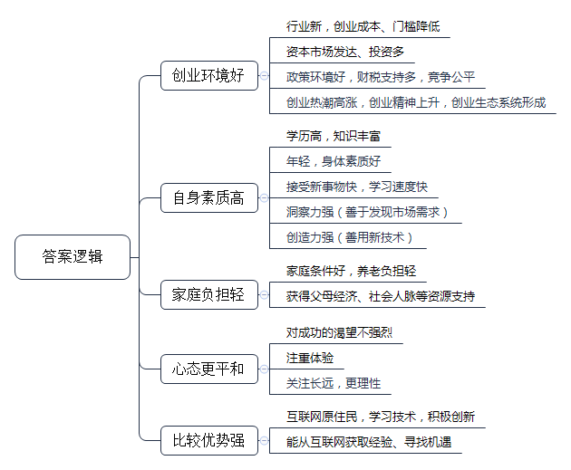
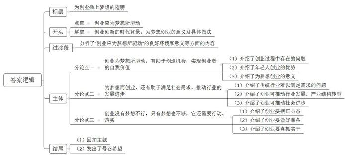

# 2016年公务员多省联考《申论》题（海南卷）

<!-- gwy:overview:start -->
> **海南 · 2016 · 申论 · 统考** ｜ 3 题 · 图片 3 处 · 答案随题折叠

导航：[题目](#题目)
<!-- gwy:overview:end -->

> 候选采集稿。参考答案及解析来自粉笔页面，不代表官方答案或真实高分答卷；来源使用许可与原卷对应关系仍需人工核实。

## 给定材料

### 材料 material-34ccee8caebb74ca

在北京西北部一栋办公楼冷飕飕的地下室里，一群想要成为企业家的人正聚集在计算机屏幕前，注视着他们最新的项目雏形。而在几公里之外，在一个暖意融融、装修更为豪华的地下演讲厅里，30多名经理和创业者也在讨论有关新产品和新公司的创意。这两群人都验证着中国社会对创业热潮日益增长的兴趣。英语在线教学服务“英语流利说”创始人王某表示：“初创是令人迷恋的新事物。”“中国的创业精神呈现一种上升趋势。顶级风投公司正在寻找年轻的创业者——整套生态系统逐步形成。”

据不完全统计，从2013年5月至今中央层面已经出台至少22份相关文件促进创业创新，各地方政府也纷纷出台政策，简政放权，从财税、金融、保障服务、政策激励等方面支持创新型企业特别是创新型小微企业发展，使各种创新资源向企业集聚，让更多金融产品和服务对接创新需求，用创新的翅膀使中国企业飞向新高度。2015年10月19日，在全国大众创业万众创新活动周启动仪式上，李克强总理被现场热烈气氛所感染而登台发表即席演讲，称“要为创新创业者站台”。李克强总理指出，大企业员工和草根创业者通过创新创业都可以成为更多财富的创造者和拥有者。这既是收入分配结构调整的重要内容，也促进了社会公平正义。双创为所有人提供了公平竞争的机会，让有能力的人通过自身奋斗获得上升通道。

### 材料 material-8157651f4919cf7e

深圳的创业者乔峤想要做一款智能耳机，他发现，60%的人都会在跑步过程中听歌，并用手机APP记录运动数据。如果有产品能同时解决跑步人群运动数据记录和听歌的需求，又能通过音乐来实现运动激励，会有很好的市场前景。乔峤对记者说，他想针对每个人的身体特征，设计和提供有效的音乐服务产品，做到每一个硬件设备都是针对个人定制的。

可是，光有好点子还不行，初始创业的乔峤，面临既缺资金、又缺人才的尴尬，他尝试着用股权众筹的方式来实现自己的创业梦想。在众筹网上，他发布了自己的股权众筹商业计划书，以出让公司10%股份的方式，融资187万元，最低投资额1万元。最终，吸引了16名投资者参与。乔峤告诉记者，这些投资者为他引入了互联网、音乐、体育领域的强大资源，其中，几个最志同道合的投资人干脆直接加入了创业团队。

## 题目

### 第 1 题

**根据给定资料**1**、**2**，概括当代社会中“90后”群体开展创业的优势。（20分）**

关联材料：材料 material-34ccee8caebb74ca

作答要求：

要求：内容全面、观点明确、语言简洁。不超过300字。

第 1 题 · 答案与解析

**参考答案（粉笔题库参考内容）**

1.创业环境好。行业新，创业成本、门槛降低；资本市场发达、投资多；政策环境好，财税支持多，竞争公平；创业热潮高涨，创业精神上升，创业生态系统形成。

2.自身素质高。学历高，知识丰富；年轻，身体素质好；接受新事物快，学习速度快；洞察力强（善于发现市场需求），创造力强（善用新技术）。

3.家庭负担轻。家庭条件好，养老负担轻；获得父母经济、社会人脉等资源支持。

4.心态更平和。对成功的渴望不强烈，注重体验，关注长远，更理性。

5.比较优势强。互联网原住民，学习技术，积极创新；能从互联网获取经验、寻找机遇。

**解析**

**参考答案说明：**本参考答案从“创业环境好”“自身素质高”“家庭负担轻”“心态更平和”“比较优势强”这五个不同的方面进行了分条撰写。各条答案要点之间在内容上相互并列，没有交叉。

**考点**：考点特点类

**来源**：来源2016年公务员多省联考《申论》题（海南卷）

粉笔申论页面对本题只提供「解析视频」入口，该入口是会员推广位，页面无视频地址与文字解析。

### 第 2 题

**假定你是有关部门的一名工作人员，准备将“比逗咖啡馆”的经验向广大学生进行推介。请根据给定资料**4**\-**6**，归纳总结“比逗咖啡馆”的主要成功经验。（30分）**

关联材料：材料 material-8157651f4919cf7e

作答要求：

要求：

（1）内容准确全面；

（2）总结有深度、有条理；

（3）字数不超过300字。

第 2 题 · 答案与解析

**参考答案（粉笔题库参考内容）**

比逗咖啡馆采用众筹模式，解决了资金、人才、销售、资源不足等问题，促进跨界合作。其成功的主要经验有：

1.前期准备充分。进行深入调研，确定股东目标群体，制定投资标准、金额，科学选址。

2.组建管理团队，确定经营理念。坚持“专业的事给专业的人做”的原则；建立董事会，股东拥有建议权，核心运营团队具有决策权。

3.优化股东结构。设置股东流转计划，根据贡献确定永久股东；并将毕业生股份流转给在校生，解决股权流动问题。

4.拓展业务。明确定位，利用校园优势，发展校内业务；举办创业交流活动，拓展校外业务；加强合作，整合校外资源。

5.公平合理分配。研发APP，加强股东交流，提高股东活跃度；进行数据化管理，公平分配股权、红利。

**解析**

**参考答案说明**：本答案以总分结构总结了“比逗咖啡馆”的成功经验。首先对“比逗咖啡馆”的成功经验进行了整体说明；接着从“前期准备”“团队建设与经营理念”“股东流转”“拓展业务”“公平分配”这几个方面进行了具体介绍。各条要点之间彼此独立，互不交叉，每条具体经验还提炼出了概括性较强的总括词前置。

**考点**：考点经验启示类

**来源**：来源2016年公务员多省联考《申论》题（海南卷）

粉笔申论页面对本题只提供「解析视频」入口，该入口是会员推广位，页面无视频地址与文字解析。

### 第 3 题

**给定资料**3**中提到“为钱创业是肤浅的，应为梦想所驱动。”请你根据对这句话的理解，自选角度，自拟题目，写一篇文章。（50分）**

关联材料：材料 material-34ccee8caebb74ca

作答要求：

要求：

（1）观点明确，认识深刻；

（2）内容充实，结构完整，逻辑清晰，语言流畅；

（3）字数1000~1200字。

第 3 题 · 答案与解析

**参考答案（粉笔题库参考内容）**

**为创业插上梦想的翅膀**

这是一个新事物层出不穷，科技迅猛发展的时代，这是一个日新月异，全民创新的时代，这是一个令人激动，全社会都在创业创新大潮中的时代。身处创业浪潮之中，很多人都想做时代的弄潮儿、取得成功。可是，创业到底是为了什么？有人说是为了钱。这个看法是肤浅的，**创业应该为梦想所驱动**！这个梦想要与社会相连，解决用户需求，创造社会价值。唯有如此，创业才能被他人所认同，被市场所肯定，从而飞得更高，飞得更远，才能创成业、创好业、创大业。

创业是令人迷恋的新事物，受到了社会各界人士的青睐。目前整个中国的创业精神不断上升，各级政府也纷纷出台政策为创新创业站台、保驾护航，给创业提供了良好的环境，让所有人都有公平向上流动的机会。人们尤其是年轻人，应该抓住机遇、坚持梦想，积极投身于创业热潮之中，在创业中实现梦想。

**创业为梦想所驱动，有助于创造机会，实现创业者的自我价值。**很多时候，人们对金钱和名声的渴望，使创业的方向指向复制他人创意，抄袭他人产品，最终落得创业失败的下场；有的人面对创业困难，因为没有梦想的支撑，甚至在起跑线上就选择了放弃。新时代下，我们年轻人，接受新事物快、知识丰富、学习能力强，经济负担轻，充满创业活力。应让创业突破现实的羁绊，插上梦想的翅膀去创业实践，实现个人价值的同时推动我国经济发展。同时，也只有梦想，才能让创业者超越个人利益的狭隘，关注百姓生活，激发千百万人的创造力，让广大人民群众过上更美好的生活，更好的实现个人价值。

**为梦想而创业，还有助于满足社会需求，推动行业的发展进步。**曾经，我国传统行业存在产业结构单一，商业模式落后，难以满足人们多样化需求的问题。如今，通过创业，可以创新商业模式，更好的关注用户体验与需求，进而推动各行各业的发展，促进产业结构转型升级。与此同时，新时代的创业者还更加关注社会价值、承担社会责任，关心自然环境等。如社会中涌现出的社会创业家，他们以社会需求和创造社会价值为梦想，用超乎一般的执着和理念，塑造了一个个创业的奇迹。不仅为企业和社会创造了财富，更为促进社会公平贡献了力量。可见，创业者只有将个人的梦想与用户、人民、社会的梦想结合起来，才能汇聚成为一个伟大的梦想。

**创业没有梦想不行，只有梦想也不够，它还需要行动、落实****。**创业者首先要摆正心态，树立正确的创业观。要理性、长远的看待问题，注重创业过程，持之以恒；其次，要做好准备，学习市场、销售、法律政策等相关知识，积累创业经验，提升风险防范意识和自我保护能力；最后，还要真抓实干，合理选择创业项目、找准创业方法，可借鉴众筹的经验获得资金、人脉等方面的资源，降低创业难度，提高创业成功率。

今天，创业不再是个人的事业，而是国家社会共同推进的事业；创业的梦想，也不再是个人的梦想，而是千千万万人民的梦想，国家的梦想，世界的梦想，时代的梦想。让我们为创业插上梦想的翅膀，脚踏实地，把梦想变为现实！

**解析**

**文章分析**

**为创业插上梦想的翅膀**

【**标题的优点**：首先，范文的标题“为创业插上梦想的翅膀”突出了“创业应为梦想所驱动”这一主题。其次，语言表达简洁明了。】

（1）这是一个新事物层出不穷，科技迅猛发展的时代，这是一个日新月异，全民创新的时代，这是一个令人激动，全社会都在创业创新大潮中的时代。身处创业浪潮之中，很多人都想做时代的弄潮儿、取得成功。可是，创业到底是为了什么？有人说是为了钱。这个看法是肤浅的，**创业应该为梦想所驱动**！（2）这个梦想要与社会相连，解决用户需求，创造社会价值。唯有如此，（3）创业才能被他人所认同，被市场所肯定，从而飞得更高，飞得更远，才能创成业、创好业、创大业。

【**开头的优点：**★内容方面。范文的开头是紧扣题目给定的“为钱创业是肤浅的，应为梦想所驱动”这这句话展开的。首先，开头点出主题，做到了主题明确。其次，对“创业应为梦想所驱动”这一主题进行了分析阐述，指出了（1）创业创新的时代背景。（2）为梦想创业的具体做法。（3）为梦想创业的意义。★文字表达方面：使用了长短句配合使用，使语言表达有节奏感。】

创业是令人迷恋的新事物，受到了社会各界人士的青睐。目前整个中国的创业精神不断上升，各级政府也纷纷出台政策为创新创业站台、保驾护航，给创业提供了良好的环境，让所有人都有公平向上流动的机会。人们尤其是年轻人，应该抓住机遇、坚持梦想，积极投身于创业热潮之中，在创业中实现梦想。

【**过渡段的优点：**范文过渡段分析了“创业应为梦想所驱动”的良好环境和意义等方面的内容，此外，还要注意过渡段末尾的“年轻人，应该抓住机遇、坚持梦想”是用来引起下文的过渡句。】

**创业为梦想所驱动，有助于创造机会，实现创业者的自我价值。**很多时候，（1）人们对金钱和名声的渴望，使创业的方向指向复制他人创意，抄袭他人产品，最终落得创业失败的下场；有的人面对创业困难，因为没有梦想的支撑，甚至在起跑线上就选择了放弃。（2）新时代下，我们年轻人，接受新事物快、知识丰富、学习能力强，经济负担轻，充满创业活力。（3）应让创业突破现实的羁绊，插上梦想的翅膀去创业实践，实现个人价值的同时推动我国经济发展。同时，也只有梦想，才能让创业者超越个人利益的狭隘，关注百姓生活，激发千百万人的创造力，让广大人民群众过上更美好的生活，更好的实现个人价值。

【**论述段****1的优点：**★观点句：范文的观点句是紧扣“创业应为梦想所驱动”这一文章主题提出的。形式上，它在段首处直接写出，位置突出，容易发现。内容上，关键词突出，内容要点明确，可以明显看出它是从“自我价值”入手，指出了“创业为梦想所驱动，有助于创造机会”。★论述内容：（1）介绍了创业过程中存在的问题；（2）介绍了年轻人创业的优势；（3）介绍了为梦想创业的意义。注意：以上几个方面的内容都是紧扣“创业为梦想所驱动，有助于创造机会，实现创业者的自我价值”这个观点句进行分析论述的，论述的针对性强，内容层次丰富。最后，在论述方法和论据的选取上做到了讲道理、举例子相结合，做到了丰富多样。】

**为梦想而创业，还有助于满足社会需求，推动行业的发展进步。**曾经，（1）我国传统行业存在产业结构单一，商业模式落后，难以满足人们多样化需求的问题。如今，（2）通过创业，可以创新商业模式，更好的关注用户体验与需求，进而推动各行各业的发展，促进产业结构转型升级。与此同时，（3）新时代的创业者还更加关注社会价值、承担社会责任，关心自然环境等。如社会中涌现出的社会创业家，他们以社会需求和创造社会价值为梦想，用超乎一般的执着和理念，塑造了一个个创业的奇迹。不仅为企业和社会创造了财富，更为促进社会公平贡献了力量。可见，创业者只有将个人的梦想与用户、人民、社会的梦想结合起来，才能汇聚成为一个伟大的梦想。

【**论述段****2的优点：**★观点句：范文的观点句是紧扣“创业应为梦想所驱动”这一文章主题提出的。形式上，它在段首处直接写出，位置突出，容易发现。内容上，关键词突出，内容要点明确，可以明显看出它是从“社会发展”入手，指出了“创业为梦想所驱动，还有助于满足社会需求，推动行业的发展进步”。★论述内容：（1）介绍了传统行业难以满足需求的问题；（2）介绍了创业可推动行业发展，产业结构转型；（3）介绍了创业可推动社会进步。注意：以上几个方面的内容都是紧扣“创业为梦想所驱动，还有助于满足社会需求，推动行业的发展进步”这个观点句进行分析论述的，论述的针对性强，内容层次丰富。最后，在论述方法和论据的选取上做到了讲道理、举例子相结合，做到了丰富多样。】

**创业没有梦想不行，只有梦想也不够，它还需要行动、落实。**（1）创业者首先要摆正心态，树立正确的创业观。要理性、长远的看待问题，注重创业过程，持之以恒；其次，（2）要做好准备，学习市场、销售、法律政策等相关知识，积累创业经验，提升风险防范意识和自我保护能力；最后，（3）还要真抓实干，合理选择创业项目、找准创业方法，可借鉴众筹的经验获得资金、人脉等方面的资源，降低创业难度，提高创业成功率。

【**论述段****3的优点：**★观点句：范文的观点句是紧扣“创业应为梦想所驱动”这一文章主题提出的。形式上，它在段首处直接写出，位置突出，容易发现。内容上，关键词突出，内容要点明确，可以明显看出它是从“对策”入手，指出了“创业只有梦想也不够，它还需要行动、落实”。★论述内容：（1）介绍了创业要摆正心态；（2）介绍了创业要做好准备；（3）介绍了创业要真抓实干。注意：以上几个方面的内容都是紧扣“创业没有梦想不行，只有梦想也不够，它还需要行动、落实”这个观点句进行分析论述的，论述的针对性强，内容层次丰富。最后，在论述方法和论据的选取上做到了讲道理、举例子相结合，做到了丰富多样。】

【**论述段之间的关系**：★内容的内在逻辑：范文的论述段之间有2层逻辑。第一层，整体上是从“意义”到“对策”的逻辑展开的。第二层，其中观点1和观点2又是从“意义”出发，论述段1先写了“创业为梦想所驱动，有助于创造机会，实现创业者的自我价值”，论述段2再写了“创业为梦想所驱动，还有助于满足社会需求，推动行业的发展进步”。★段与段的外在衔接：论述段3的段首处的过渡句“创业没有梦想不行，只有梦想也不够”，起到了承接论述段1、2，引出了论述段3的作用。】

今天，创业不再是个人的事业，而是国家社会共同推进的事业；（1）**创业的梦想**，也不再是个人的梦想，而是千千万万人民的梦想，国家的梦想，世界的梦想，时代的梦想。（2）让我们为创业插上梦想的翅膀，脚踏实地，把梦想变为现实！

【**结尾的优点**：范文的结尾回扣了“创业应为梦想所驱动”这一主题。（1）再次提到了“创业应为梦想所驱动”；（2）发出了号召希望。】

**考点**：考点文章写作题

**来源**：来源2016年公务员多省联考《申论》题（海南卷）

