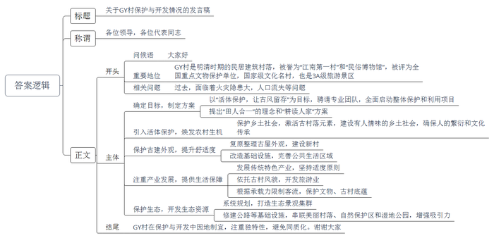
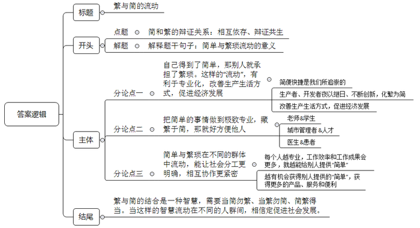

# 2018年公务员多省联考《申论》题（海南卷）

> 候选采集稿。参考答案及解析来自粉笔页面，不代表官方答案或真实高分答卷；来源使用许可与原卷对应关系仍需人工核实。

## 给定材料

### 材料 material-7f0a56c29db29091

在2017年T市的“全市十佳科技特派员”评选活动中，小童以压倒性的票数获得第一名。一个年仅25岁的年轻人，为何能从平均年龄在50岁以上的本市特派员中脱颖而出呢？

领导说，他所服务的S村地处偏僻，有一段路车根本开不进去，下雨天时他坐摩托车进村，常弄得一身泥，特别狼狈。可是他每个月去S村的次数和时间都远远超过了考核要求。同事们说，他要是有什么没弄懂的问题，肯定会睡不好觉，会缠着老特派员们搞清楚的。大学书本告诉了他“是什么”“为什么”，但他觉得还不够。从来到这儿，他就开始研究这儿的土壤、天气、乡情民俗，他一个北方人竟然在短短几个月时间里学会了这儿的方言。

老乡们说，他态度好，说话和气。大家都喜欢和他说话。他说的话大家听得懂，句子不长，用的也是田坎语言，好懂实用。而且他手把手地传技术，把课堂设在田间地头，教给大家的东西都记得住。“他讲的东西很接地气，富有土味儿。而且，他还会收集村民的需求，定期地开展‘订单化’培训。这样的特派员难找。”村支书也对小童赞不绝口。

而小童自己却说，自己能赢得大家的喜欢，在于自己会玩些“小花样”。“老乡们要的是技术，晦涩的理论讲得再高深，起到的作用也是有限的；老乡们学技术，最终还是要落脚到做上面去。科教本身有些乏味，必须要加点料才会有滋有味。我在做技术特派工作时，就坚持添加‘三味’：一是原味，坚持用原汁原味的田坎语言讲授，尽量讲短话，讲土话；二是鲜味，给乡亲们的一定是最新的农技知识，过时的、可能已经不适用的，坚决不讲；三是甜味，对乡亲们积极鼓励，尽量用积极的语言，谁都希望话好听啊，多给他们看看成功的案例，正面激励。如果你用的是本地语言，说的是农家事，讲的是致富经，他们不欢迎你都难啊。”

### 材料 material-58508bbf6c77a0ea

位于湘西的GY古村，因三面环山、一面临水的地势而得名。这个明清时期的古代民居建筑村落，被誉为“江南第一村”和“民俗博物馆”。在晨雾中，绿荫环抱的小山村，一片青瓦白墙，一条流过门前的清流小河，如此简单的画面让人心生向往。

GY古村在2006年被国务院公布为第六批全国重点文物保护单位；2007年被公布为国家级历史文化名村；现为国家3A级旅游景区。

这儿的建筑有一个特别之处：在侗式木屋的外面，还筑有徽式高墙。因为村子人口多，房屋十分密集，火灾是这儿的纯木质房屋极大的安全隐患。

几年前，村里的杨老犯了愁：村子里和他一起唱傩戏的人，已经没有几个了。作为省里的非遗，难道就真的逃脱不了失传的命运吗？当时，GY村和中国所有乡村面临的状况十分相似：年轻人大都外出打工，留守和空巢现象较为严重。杨老说，年轻人也不是不想回来，但是村里房屋太挤了；在家种地挣不了几个钱，养不活自己和家人；因为古村保护不能乱建新房，年轻人在外面打工挣钱了当然想住一个新房，但没地方让他们建，老屋洗澡、上厕所都不方便。在这生计生活问题都解决不了，更别说什么非遗传承问题了。

“我们村里啊，有很多土生土长的好东西，比如野生茶、黑米茶、有机生态米、手工艺品等等。”村支书老高说道，“但以前这里建筑规划不行，交通也没跟上，我们不会包装，好东西也卖不出去，可惜哟。”

“活体保护，让古风留存。”这是县委书记为GY村拟好的目标。为了更好地保护这一弥足珍贵的传统村落，县政府于2015年全面启动了GY村整体保护与利用项目，并特邀了专业的乡村建筑设计团队来打造。面对GY村的山水和生态，团队提出了“田人合一”的理念和“耕读人家”的设计方案，从房、水、旅、种、村、治等几个方面分别着手修复和调整：只有乡愁乡建，才能留住乡愁；只有古村古建，才能留存古风。

“乡建的重点，是在‘乡’上下功夫，而不是在‘建’上做文章；乡愁不是在‘愁’上做文章，而要在‘乡’中找情感。乡就是农田、民居、菜园、养猪，就是充满人情味的乡土社会。让年轻人回村，只要他们回家了，人就可以养房，村中就有生机。”团队这样的理念重新激活了古村落的元素，把农村建设得更像农村。

过去对传统村落的保护，可能更侧重于单纯的物质上的保护，而忽略了人的繁衍、文化的传承，没有太多考虑年轻人为什么不愿意回来。县委书记介绍道：GY村历史纵跨600多年，至今保存完好的一个很重要的因素，就是它有人活动，有侗汉苗民族老百姓在这里繁衍生息，所以我们必须引入活体保护的概念。

古村古建在外观上对GY村进行了保护和传承，同时也注意提高农民生活的舒适度，改造了古村的基础设施和公共生活区域，让老人和年轻人都住得舒服；对外观上已经过度改造的房子，进行了复原整理；此外，还在古村旁边建了一个新村。

“有了新村，年轻人可以回家盖房。古村也因为年轻人的回归而注入了新要素，传统特色产业的发展也有了更坚实的依托和更广阔的空间。”县委书记说道。他认为，他们必须要保持有老百姓在这里生产、生活、繁衍生息这么一种风貌，也必须把群众赖以生存的各种产业做好。在传统特色产业活了以后，GY村开始在旅游业方面大展拳脚。在这几年，GY村连续被评为“中国十大最美丽乡村”。古村的自然素净吸引了来自全国各地的人们前来一睹芳姿。但即使是面对这样的旅游热，GY村也保持了冷静的头脑：在发展旅游的同时，必须把古村的文物保护好，把文脉保护住，留住古村底蕴。产业发展也要适度，才可以避免失去特色；旅游限量接待游客，防止超过古村承载能力。只有这样，古村才有长久的魅力和旺盛的生命力。

但古村的保护发展工作还不止于此。“古村本身只是一个亮点，真正能将人留住的，是这里的青山绿水。这里非常宁静美好，就像一个世外桃源。虽然这里偏僻了一点，但现在已经改善了基础设施，比如修建沿河公路等等。现在县城到这儿，只要20分钟车程。”县委书记说，“附近还有一个国家级自然保护区和一个国家湿地公园，生态都非常好。这些都是我们当初就看到并且纳入规划的。”现在，公路已经把沿河的那些小小的美丽村落、自然保护区、湿地公园等都纳进来了。GY古村，就像是一串项链上最璀璨的明珠。

“如果当初大家照着别的古村例子来做，也有一定效果。但为了我们祖祖辈辈生活的家园，我们多想点办法，多动点脑筋，多流些汗也值。”GY村村支书说道。

## 题目

### 第 1 题

**根据材料**1**，归纳概括出小童能获得“全市十佳科技特派员”荣誉的原因。（20分）**

关联材料：material-7f0a56c29db29091

作答要求：

要求：全面、准确、简明，有条理，字数不超过200字。

### 第 2 题

**假设GY村所在的省份将开展一次关于古村的保护与开发的经验交流会，请你根据材料**2**，写一份介绍GY村保护和开发情况的发言稿。（30分）**

关联材料：material-58508bbf6c77a0ea

作答要求：

要求：紧扣材料，内容全面；逻辑清晰，语言准确；字数不超过500字。

### 第 3 题

**根据材料**3**中划线部分“我们的‘简单’和‘繁琐’的总量并没有变，它们只是在不同的人群间流动，但就是这不停的流动，推动了社会的改变”，写一篇文章。（50分）**

关联材料：material-7f0a56c29db29091

作答要求：

要求：

（1）自选角度，立意明确；

（2）联系实际，不拘泥于“给定资料”；

（3）思路清晰，语言流畅；

（4）总字数1000~1200字。

## 答案与解析

第 1 题

**参考答案（粉笔题库参考内容）**

一、工作态度端正。1.吃苦耐劳，爱岗敬业；2.刻苦钻研，勤学好问；3.为人和气，平易近人。

二、业务能力强。1.有真才实学，知识技能水平高，学习能力强；2.注重实用，研究当地情况，理论与实践相结合。

三、工作方法有创新。1.课堂设在田间地头，手把手传技术；2.收集村民需求，定期开展有针对性的订单化培训；3.科教坚持“三味”：原味，讲土话；鲜味，讲最新农技知识；甜味，善于正面激励。

**解析**

**参考答案说明：**本参考答案从“工作态度端正”“业务能力强”“工作方法有创新”这三方面展开，各条答案要点之间在内容上相互并列，没有交叉。

**考点**：考点原因类

**来源**：来源2018年公务员多省联考《申论》题（海南卷）

粉笔申论页面对本题只提供「解析视频」入口，该入口是会员推广位，页面无视频地址与文字解析。

第 2 题

**参考答案（粉笔题库参考内容）**

关于GY村保护与开发情况的发言稿

各位领导，各位代表同志：

大家好！GY村是明清时期的民居建筑村落，被誉为“江南第一村”和“民俗博物馆”，被评为全国重点文物保护单位，国家级文化名村，也是3A级旅游景区。过去，面临着火灾隐患大，人口流失等问题。为此，采取以下措施：

一、确定目标，制定方案。以“活体保护，让古风留存”为目标，聘请专业团队，全面启动整体保护和利用项目，提出“田人合一”的理念和“耕读人家”方案。二、引入活体保护，焕发农村生机。保护乡土社会，激活古村落元素，建设有人情味的乡土社会，确保人的繁衍和文化传承。三、保护古建外观，提升舒适度。复原整理古屋外观，建设新村；改造基础设施，完善公共生活区域。四、注重产业发展，提供生活保障。发展传统特色产业，坚持适度原则；依托古村风貌，开发旅游业；根据承载力限制客流，保护文物、古村底蕴。五、保护生态，开发生态资源。系统规划，打造生态景观集群；修建公路等基础设施，串联美丽村落、自然保护区和湿地公园，增强吸引力。

总之，GY村在保护与开发中因地制宜，注重独特性，避免同质化。谢谢大家！

**解析**

**参考答案说明：**（1）格式方面，本参考答案写到了“标题”“称谓”“正文”三个部分。（2）正文部分，一方面从内容来看，围绕着“古村落的保护与开发”这一主题，本参考答案的开头写到了“GY村的重要地位和问题”；主体部分从“确定目标，制定方案”“活体保护，焕发生机”“保护古建外观，提升舒适度”“注重产业发展，提供生活保障”“保护生态，开发生态资源”等五个方面给出了具体的经验阐述；结尾做出总结，并表示感谢。另一方面，形式上，本参考答案做到了分段、分条撰写，整体上条理较为清晰。（3）本参考答案能够结合题目要求“逻辑清晰，语言准确”，在语言表达上做到了简洁、流畅、有条理。

**考点**：考点总结类

**来源**：来源2018年公务员多省联考《申论》题（海南卷）

粉笔申论页面对本题只提供「解析视频」入口，该入口是会员推广位，页面无视频地址与文字解析。

第 3 题

**参考答案（粉笔题库参考内容）**

**繁与简的流动**

简单与繁琐相互依存、辩证共生。简单代表便利，是我们在生活、工作、思维上追求的目标。但获得简单离不开曲折繁琐的探索过程，没有繁琐便成就不了简单。就如守恒定律一般，简单与繁琐的总量不变，只是在不同人群中相互流动。这种流动推动了社会专业化分工，提高了社会运行效率，推动了社会进步。

“简单”和“繁琐”的流动规律启示我们：自己得到了简单，那别人就承担了繁琐；自己把简单的事情做到极致，也就是给别人提供便利；只有共同努力，才能出效率、出成果。

**我们得到简单、便利，别人就会负责其背后的“繁琐”。这样的“流动”，有利于专门人做专门事；有利于改善生产生活方式，促进经济发展**。人们更喜欢微小说、微电影、智能化榨汁机、便携式音箱、一键启动式汽车……很多时候，简便快捷是我们所追崇的。为了满足这种需求，生产者、开发者夜以继日、不断创新，化繁为简。于是，消费者有了更加便利的生活，更多的时间参与娱乐文化活动，生产者也会变得愈发专业，极大提升生产效率。简和繁在不同的人群间流动，无疑会变成社会发展的助推器。

但简单的事情里也蕴含了繁杂，看似简单的事情，要长期坚持做好也是不易的。

**若我们把简单的事情做到极致专业，藏繁于简，那就好方便他人。**老师尽职尽责，细致备课、寓教于乐，每一个看似简单的引导背后都有自己的精心设计，学生就能够更快吸收书本知识，增强对知识点的理解。城市管理者明确人才的需求，不断完善政策，采取全面、综合的措施，各个行业的人才就能有一个简单、便捷的生活环境。由此可见，每一个好的人才引进政策的背后都凝聚着管理者的无数思考与努力。每一个患者都期望大夫能够快速、准确诊断出自己的病情，那么医生就不能辜负患者的期待，需要不断给自己“充电”，不断学习，增强业务能力。每一张准确无误病例的背后其实都凝聚着医生的智慧与汗水。繁藏于简，本就是一种智慧。这种智慧流动在不同的人群中时，就会变成社会进步的引擎。

**总体上看，简单与繁琐在不同的群体中流动，能让社会分工更明确，相互协作更紧密**。由此，社会效率得到提升、生活生产方式得到改变，进而丰富了世界，活跃了经济，带来了颠覆性的发展。我们每个人越专业，工作效率和工作成果会更多，就越能给别人提供“简单”，与此同时，我们越有机会获得别人提供的“简单”，获得更多的产品、服务和便利。从这个意义而言，我们的“简单”和“繁琐”的总量并没有变，它们只是在不同的人群间流动，但就是这不停的流动，推动了社会的改变。

繁与简的结合是一种艺术，更是一种智慧。要想欣赏这种艺术，掌握这种智慧，就需要当简勿繁，从本质着眼去思考问题，分清主次；就要当繁勿简，肯下真功夫，不玩“花拳绣腿”；就要简繁得当，在二者间找到平衡点。当这样的智慧流动在不同的人群间，相信定促进社会发展，会生生不息、久久为功……

**解析**

**文章分析**

**繁与简的流动**

【**标题的优点：**首先，范文的标题“繁与简的流动”突出了“简与繁”这一主题。其次，形式上，文字简洁明快。】

（1）简单与繁琐相互依存、辩证共生。简单代表便利，是我们在生活、工作、思维上追求的目标。但获得简单离不开曲折繁琐的探索过程，没有繁琐便成就不了简单。（2）就如守恒定律一般，简单与繁琐的总量不变，只是在不同人群中相互流动。这种流动推动了社会专业化分工，提高了社会运行效率，推动了社会进步。

【**开头的优点：**★内容方面：范文的开头是紧扣题目给定的“我们的‘简单’和‘繁琐’的总量并没有变，它们只是在不同的人群间流动，但就是这不停的流动，推动了社会的改变”这句话展开的。首先，**开头第一句话点出主题，做到了主题明确**。其次，**对“简与繁”这一主题进行了分析阐述，（****1****）指出了“简与繁”的关系。（****2****）对题目给定的句子进行解释说明**。★文字表达方面：长短句配合使用，使语言表达有节奏感。】

“简单”和“繁琐“的流动规律启示我们：自己得到了简单，那别人就承担了繁琐；自己把简单的事情做到极致，也就是给别人提供便利；只有共同努力，才能出效率、出成果。

【**过渡段的优点：**范文过渡段分析了“简与繁”相互流动给予我们的启示，过渡段末尾的“只有共同努力，才能出效率、出成果”是用来引起下文的过渡句。】

**我们得到简单、便利，别人就会负责其背后的“繁琐”。这样的“流动”，有利于专门人做专门事；有利于改善生产生活方式，促进经济发展**。（1）人们更喜欢微小说、微电影、智能化榨汁机、便携式音箱、一键启动式汽车……很多时候，简便快捷是我们所追崇的。（2）为了满足这种需求，生产者、开发者夜以继日、不断创新，化繁为简。于是，（3）消费者有了更加便利的生活，更多的时间参与娱乐文化活动，生产者也会变得愈发专业，极大提升生产效率。简和繁在不同的人群间流动，无疑会变成社会发展的助推器。

【**论述段****1****的优点：**★观点句：范文的观点句是紧扣“简与繁”这一文章主题提出的。形式上，它在段首处直接写出，位置突出，容易发现。内容上，关键词突出，内容要点明确，可以明显看出它是从“有利于专人专事、改变生活方式、促进经济发展”入手，指出了“简与繁”相互流动的重要性。★论述内容：（1）先介绍了“简便快捷是人们所追崇的”；（2）接着介绍了“生产者、开发者追求极简理念”；（3）最后介绍了“追求简便的积极影响”。注意：以上三个方面的内容都是紧扣“我们得到简单、便利，别人就会负责其背后的‘繁琐’。这样的‘流动’，有利于专门人做专门事；有利于改善生产生活方式，促进经济发展”这个观点句进行分析论述的，论述的针对性强，内容层次丰富。最后，在论述方法和论据的选取上做到了讲道理、举例子相结合，做到了丰富多样。】

但简单的事情里也蕴含了繁杂，看似简单的事情，要长期坚持做好也是不易的。

**若我们把简单的事情做到极致专业，藏繁于简，那就好方便他人。**（1）老师尽职尽责，细致备课、寓教于乐，每一个看似简单的引导背后都有自己的精心设计，学生就能够更快吸收书本知识，增强对知识点的理解。（2）城市管理者明确人才的需求，不断完善政策，采取全面、综合的措施，各个行业的人才就能有一个简单、便捷的生活环境。由此可见，每一个好的人才引进政策的背后都凝聚着管理者的无数思考与努力。（3）每一个患者都期望大夫能够快速、准确诊断出自己的病情，那么医生就不能辜负患者的期待，需要不断给自己“充电”，不断学习，增强业务能力。每一张准确无误病例的背后其实都凝聚着医生的智慧与汗水。繁藏于简，本就是一种智慧。这种智慧流动在不同的人群中时，就会变成社会进步的引擎。

【**论述段****2****的优点：**★观点句：范文的观点句是紧扣“简与繁”这一文章主题提出的。形式上，它在段首处直接写出，位置突出，容易发现。内容上，关键词突出，内容要点明确，可以明显看出它是从“藏繁于简”入手，指出了“简与繁”的关系。★论述内容：（1）先从“老师”这一主体出发，介绍了如何以简洁有趣的授课方式吸引学生；（2）接着从“城市管理者”这一主体出发，介绍了如何吸引人才；（3）最后从“医生”这一角度出发，介绍了如何给予病患精准诊断。注意：以上三个方面的内容都是紧扣“若我们把简单的事情做到极致专业，藏繁于简，那就好方便他人”这个观点句进行分析论述的，论述的针对性强，内容层次丰富。最后，在论述方法和论据的选取上做到了讲道理、举例子相结合，做到了丰富多样。】

**总体上看，简单与繁琐在不同的群体中流动，能让社会分工更明确，相互协作更紧密**。由此，社会效率得到提升、生活生产方式得到改变，进而丰富了世界，活跃了经济，带来了颠覆性的发展。（1）我们每个人越专业，工作效率和工作成果会更多，就越能给别人提供“简单”，与此同时，（2）我们越有机会获得别人提供的“简单”，获得更多的产品、服务和便利。从这个意义而言，我们的“简单”和“繁琐”的总量并没有变，它们只是在不同的人群间流动，但就是这不停的流动，推动了社会的改变。

【**论述段****3****的优点：**★观点句：范文的观点句是紧扣“简与繁”这一文章主题提出的。形式上，它在段首处直接写出，位置突出，容易发现。内容上，关键词突出，内容要点明确，可以明显看出它是从“社会分工明确，相互协作更紧密”入手，指出了“简与繁”相互流动的重要性。★论述内容：（1）先介绍了“每个人都很专业有利于提高工作效率”；（2）接着介绍了“每个人都很专业有利于获得更多的产品和服务”。注意：以上两个方面的内容都是紧扣“简单与繁琐在不同的群体中流动，能让社会分工更明确，相互协作更紧密”这个观点句进行分析论述的，论述的针对性强，内容层次丰富。最后，在论述方法和论据的选取上做到了讲道理、举例子相结合，做到了丰富多样。】

繁与简的结合是一种艺术，更是一种智慧。要想欣赏这种艺术，掌握这种智慧，就需要当简勿繁，从本质着眼去思考问题，分清主次；就要当繁勿简，肯下真功夫，不玩“花拳绣腿”；就要简繁得当，在二者间找到平衡点。当这样的智慧流动在不同的人群间，相信定促进社会发展，会生生不息、久久为功……

【**结尾的优点：**范文的结尾回扣了“简与繁”这一主题，并发出了号召希望，阐述了“简与繁”相互流动的深远意义。】

参考范文2

**繁简之道**

简于表者，繁于意也。简者，简化步骤，简便快捷，直达目的，直奔目标；繁者，投入时间，付之心血，聚集智慧与创意，实现所求之目标。化繁为简是一种艺术，呈现简单之表象，于简见繁是一种智慧，暗藏繁琐之内涵。**二者看似矛盾，但****万事万物都是从简到繁，由繁至简的过程，二者此消彼长，互相渗透，****不断地流动****转化****，推动社会的发展。**

“简单”和“繁琐“的流动规律启示我们：自己得到了简单，那别人就承担了繁琐；自己把看似简单的事情做到极致，把真正繁芜的事情简单化，才能深刻剖析出世间的本质；只有让“繁”“简”自由的转化，才能出效率、出成果。

**生活中，****兢兢业业、恪尽职守、专业细致的生产者、劳动者化繁为简，创造出****各种产品与服务，****是他们的付出、努力，让世人享受方便、快捷、高效，让经济活跃、腾飞，****让世界变得更加缤纷、多彩与绚丽。**现代化、信息化、科技化的当今世界，让我们拥有足不出户就可以尝遍人间美味的外卖软件，无需计划就可以出门游玩的导航软件，亦有动动手指就可以消费的支付软件。不禁的感慨，生活如此简单，而这背后却是整个团队千思万绪、加班熬夜的心血与付出。同理，人们喜欢智能化榨汁机、便携式音箱、一键启动式汽车……很多时候，简便快捷是我们所追崇的。为了满足这种需求，开发者夜以继日、微调打磨、绞尽脑汁、不断创新。

**学习中，个人在认知世界、研究知识、掌握技能时，必须投入时间和精力，顺应规律，不断地去分析、去挖掘、去思考，方能微言大义，举重若轻。**一个简单凝练的道理，只有深入探寻其背景，才能懂得暗藏着的最深奥复杂的思想；一首短小精悍的千古绝句，只有深知作者曲折丰富的生平，才能领略诗词的真谛；一张准确无误的病例背后，是医生自身无数个日夜，起早贪黑、辛勤汗水的结晶。作为社会个体中的我们只有花费心思，去观察、去思考；去品咂其中的况味；去学习万事万物由此及彼、由内而外的复杂过程，才能化繁为简，繁简互转，透彻了解事物发展的规律，领略万千古诗的风情，掌握便捷高效的技能。

**当然，****“繁”“简”之间的流动、转变，也要保持适度、平衡，做到当繁勿简，当简勿繁。我们追求极简与朴素，但不能否认、拒绝繁复；我们保持适当的繁琐与复杂，但不能故弄玄虚，而应是深思熟虑后的素心，是去芜存菁后的执着。简繁得当，方能出效率，出成果。**简有简的好，繁有繁的妙，二者辩证统一，相互作用，相互影响。任何事物都是繁简平衡、相辅相成的结果。看似独立简单的个体，却是亿万复杂细胞的组合；看似平静单纯的湖面，却有深不见底的深邃；看似简便轻巧的图书，却是大千知识的集成；看似简单的产品也离不开科学家匠人般的执着；看似简单的味道需得益于厨师无数次的尝试。因此，当简则简，当繁则繁，万事万物才能相得益彰。

简单与繁复相互流动又辩证统一。当繁则繁，繁复推敲，方能大道至简，领悟真谛。当简则简，删繁去粗，方可专心致志，满载而归。繁简得当，世界大放异彩。

**考点**：考点文章写作题

**来源**：来源2018年公务员多省联考《申论》题（海南卷）

粉笔申论页面对本题只提供「解析视频」入口，该入口是会员推广位，页面无视频地址与文字解析。

