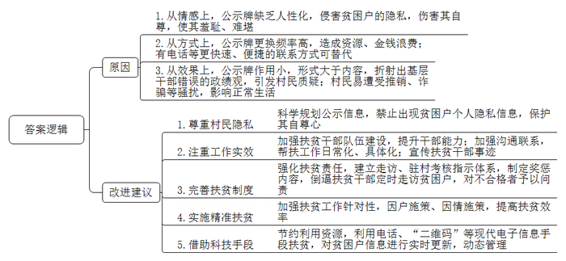

# 2019年公务员多省联考《申论》题（海南乡镇卷）

<!-- gwy:overview:start -->
> **海南 · 2019 · 申论 · 乡镇卷** ｜ 4 题 · 图片 4 处 · 答案随题折叠

导航：[题目](#题目) · [材料 1](#材料-1)
<!-- gwy:overview:end -->

> 候选采集稿。参考答案及解析来自粉笔页面，不代表官方答案或真实高分答卷；来源使用许可与原卷对应关系仍需人工核实。

## 给定材料

### 材料 1

“野猪成群结队，一晚上能毁几十亩玉米、马铃薯。”时下正值马铃薯、玉米成熟收获的季节，但星月村的村民怎么也高兴不起来。“野猪太多了，防不胜防，村里有几百亩庄稼被毁了。”村民对记者小侯表示，野猪已成为他们最头疼的事。星月村位于LP山生态圈边缘，与小沟林场相邻，村里的庄稼地与林区相接。“上了年纪的村民都知道，那个林场可是野猪的‘老窝’‘大本营’啊。”村民说道。

小侯看到，大部分农田里的玉米已经收割，还有小部分玉米正在收割。“种了5亩玉米，有3亩被野猪毁了。”正在掰玉米的村民大贵说，幸亏他发现及时，否则毁坏的更多。

野猪经常光顾玉米地。“这些田里的玉米棒都被吃了，剩下玉米杆。”村民老李指着玉米田说，“去年也有人告诉我们尽量不要种玉米、马铃薯这些野猪特别爱吃的作物了。可是你看看我们这儿的土地，就适合种玉米，种马铃薯这些啊。而且它们是杂食动物，啥都吃。”同时，小侯还看到，在成片的玉米田中间，有几块绿油油的燕麦田，村民马大姐正忙着收割燕麦。“燕麦没有成熟，怎么就收割了?”小侯提出疑问。“野猪毁了玉米，下山没有吃的，就毁坏燕麦、冬小麦。”她说，她要抢在野猪没有毁坏之前，赶紧收割，有了麦穗起码还能当作饲料用。

“十年前，野猪开始在村里出没，当时出现的次数和数量比较少，一个月能见到一两次。”老李介绍，但从此以后，野猪逐年增加。最近几年，野猪成群结队出现，一般三五只，最多十几只，一只野猪一晚上就能毁坏十几亩庄稼，十几只野猪在庄稼地里肆意毁坏的程度就更严重了。

小侯行走在小沟林场附近，时不时可以看到野鸡从庄稼地、林间草地惊飞而起。“野鸡、野兔、野猪在这里太常见了。”林场书记老张说，他们巡林时，经常看到成群的野猪。老张是一名老护林员。过去，林场主要是依靠砍伐木材和种植经济林维持发展，生态破坏较为严重，很多野生动物迁徙到其他地方。而如今，经过十几年退耕还林、封山禁牧，林区生态逐渐恢复，空气清新、景色怡人，吸引了不少人来游玩。但生态系统仍然很脆弱，没有达到“自愈”的能力。“野猪等野生动物逐渐迁回，生物链没有完全形成，它们现在没天敌，只能让它们这么‘嚣张’。”老张表示。

小侯了解到，林场职工现在主要任务是巡林，防止发生火灾和不法人员盗伐木材、盗杀野生动物，还有一部分人开办“林场文化特色旅游”“林场旅馆”等增加集体收入。近年来，游客人数不断增加。去年，林场职工人均增收1万余元。附近的村民在农闲时，到林场里来务工，收入也增加不少。林场职工和村民都感受到了生态恢复带来的好处。

“经常有外地人来到村里，希望村民配合捕杀野猪，但均被村民拒绝。”老张说，虽然村民对野猪毁坏庄稼既无奈又“痛恨”，但这些年的普法宣传工作做得扎实，村民们都知道野猪不能随意捕杀，只是采取温和的方法驱逐。

### 材料 2

马道村是一个典型的传统农耕村落。千百年来，这里的村民以种地务农为生，主要的经济作物有槟榔、荔枝、菠萝蜜和水稻等。于飞7岁那年，父亲复员，带着他和母亲回到马道村。如诗画般美丽的田园风光，亲近自然、充满乐趣的乡村生活，以及热情淳朴的乡邻们，都给童年的于飞留下不可磨灭的记忆。“老家的一切，滋养了我，成就了我。”多年后，于飞这样说道。而那时，乡村贫穷落后的面貌，让小于飞更加向往城市生活的斑斓多彩。为此，于飞从小就用功读书，成了村里第一个大学生。

大学毕业后，于飞被分配到大城市当教师，之后转行进入旅游管理和酒店经营等领域。由于机缘巧合，他开始创业。创业成功后，于飞的眼界愈发开阔，思路也更活跃。但此时，马道村仍是一个贫穷的小村落，全村没有一条像样的马路，细窄的村道让出行的人们“晴天一身土，雨天两脚泥”。于是，有老乡找到于飞，想让他为村子谋划谋划出点力。

随着中央“乡村振兴计划”的提出，马道村所在的县适时提出“美丽乡村、幸福城市”的战略思路，大力推进全域旅游景区建设，村道硬化工程将村村相连，人居环境和交通条件大幅改善。回乡创业的机会来了。

“小时候拼命地读书，就是想要逃离农村，不想回家种田。可是现在，整天在喧嚣的城市里忙碌，又向往乡村的宁静。”于飞说，纵然脑海中仍然留有农村落后面貌的记忆，但乡愁的滋味在心里越酿越醇。“要寻找人们对乡村生活美好的记忆，打造富裕、文明、有序、亲近自然的村落，让村民共享美好的时代。”这是他创办“田园梦想农庄”的初衷。

经过精心打造，马道村“田园梦想农庄”开始对外试营业。碎石子铺成的乡间小路，老水车在池边吱吱作响，坐在槟榔树下，可以一边品尝椰汁的甘甜，一边观赏十里风光怡然的田园……

村子美了，游客来了，曾经外出务工的村民也愿意回来了，他们有的在于飞的农庄帮忙干活，有的在自家门口摆出种养的农产品，向观光旅游的客人售卖。村庄环境越来越优美，村民的钱袋子也渐渐鼓了起来。马道村村民小组长告诉记者，如今，马道村也是省里重点打造的美丽乡村之一，全村200多户农户，在务农和外出打工的基础上，越来越多人吃上了旅游饭，人均年收入达到4万元。

于飞介绍，目前，农庄投入资金约500万元，设有农家园林餐厅、无公害菜园、槟榔鸡园、田园风光农耕体验、田塘垂钓、民间手工艺等服务体验项目，一年接待游客约10万人。家乡更美了，村民变富了，自己的事业和梦想也实现了。

“家乡，不只是乡愁，还有诗和远方。”于飞说，下一步，他将抓住“乡村振兴计划”的机会，打造以田园梦想共享农庄为主体的乡村田园综合体，希望能以点带面带动整个马道村的发展，看到建成富裕、和谐、美丽新农村的可喜景象。

### 材料 3

记者小刘采访贫困村驻村第一书记小张，小张给他讲起一件事：刚驻村时，他挨家挨户走访贫困户。走访到一户赵姓人家后，这家的男主人握住他的手不愿松开。“我当时以为是要留我吃饭，就婉拒了。这位贫困户估计看我实在不懂，就明确告诉我，希望‘先把门口的贫困户牌牌取了’。”

贫困户说的“贫困户牌牌”，正式名称为“扶贫公示牌”。小刘在这几年的工作中发现，尽管名称大同小异，但部分贫困地区都有这种扶贫公示牌，牌上大多写有贫困户姓名、致贫原因、收入水平、帮扶责任人和联系电话等信息，多被挂在贫困户家门口的醒目位置。这些贫困户通常会因为自家门口挂着一块公示牌，觉得没面子，臊的慌。

其实，除了对贫困群众的收入状况、脱贫年限等公示外，“扶贫公示牌”一个更重要的作用是，让群众知道自己的帮扶责任人是谁，方便贫困户与帮扶者精准联系，还能够接受群众监督，防止贫困户对象认定不准确。

然而，这块公示牌也给村里的贫困户添了不少烦恼。“那个牌牌上有我们的电话、收入情况啊，这下好了，时不时就有推销、诈骗之类的电话打过来，问我要不要贷款，要不要加入他们这样、那样的赚钱项目。”村里牛大爷也跟小刘说道：“我当然知道都是骗人的，不会理，但是每天接好几个这样的电话，闹心！”

小刘走访发现，一般来说，关于贫困户、帮扶责任人的相关信息，在贫困户家中的扶贫手册、收入明细表里有比挂在他们门口上那块公示牌更详细的记录。

贫困户老王还悄悄告诉小刘，有不少村在村务公开栏定期集中公示扶贫信息，既起到监督作用，又不会让贫困户感到难堪。他觉得这种做法挺好的。“而且，制作这么一块牌牌，怎么也得花上十来块钱吧？我们村有这么多贫困户，牌牌还时不时换，就为这个，公家一年下来就得花上不少钱啊。”老王给小刘算起账来，眼里满是心疼。

小刘搜索发现，这块信息量不大的公示牌，在网络上的曝光率、出镜率可不低。比如，某某县扶贫公示牌制度助力精准扶贫；某某镇开展为贫困户悬挂精准扶贫公示牌活动……类似信息随便一搜就有不少。比如，一些地方和部门称：创新性实施了精准扶贫公示牌制度，将第一书记、帮扶人员和被帮扶人员的姓名、照片、电话、致贫原因和帮扶措施逐一印制在公示牌上，并悬挂于每户贫困户家中，方便了贫困户与结对帮扶党员干部的精准联系，更进一步夯实了扶贫责任，助力精准扶贫取得实效。不过，具体精准在哪儿、实效是什么却表述含糊不清。“我不觉得牌牌起到了多大作用。我们的扶贫干部们……像我的帮扶干部小李，那么辛苦、那么认真地帮助我们，怎么不多报道报道他们呢？每一次扶贫报道都说那块牌牌如何如何，没意思。”该村的贫困户也对小刘抱怨着。

小刘还了解到，帮扶干部和驻村“第一书记”都有相应的走访、驻村考核指示体系，如果帮扶干部真按要求定时走访、帮助出主意找路子，双方互相存下对方电话号码就解决了“精准联系”问题。而且帮扶责任人和贫困户经过一段时间的互动后，对方的联系电话等个人信息早已烂熟于心，用他们自己的话说“哪里需要挂在门口给别人看嘛”。

现今，精准扶贫到了攻坚克难的最后阶段，扶贫干部全身心扑在扶贫一线，涌现了大批先进的典型，确实值得尊重与点赞。小张说，每家每户的贫困情况都不尽相同，因户施策、因情施策，让贫困群众如期脱贫，考验的是扶贫干部的“真本事”，这来不得半点花架子。与其把挂在墙上的“扶贫公示牌”当成“创新”“探索”，不如由村委会利用“二维码”等现代电子信息手段，对贫困户信息进行实时更新，动态管理。唯有如此，才能摸实情、出实招、谋实策，做到真正精准。

## 题目

### 第 1 题

**根据给定资料1，概括出该村近年来遇到的问题及其原因。（15分）**

关联材料：材料 1

作答要求：

要求：全面、准确、简明，有条理，字数不超过200字。

第 1 题 · 答案与解析

**参考答案（粉笔题库参考内容）**

问题：野猪成群毁坏庄稼，影响农业生产，农民损失严重。

原因：

1.生态环境：村落位于生态圈边缘，庄稼地与野猪聚集的林区相接；生态系统脆弱，生物链没有完全形成，野猪缺乏天敌制约。

2.生物习性：土地只适合种植马铃薯、玉米等农作物，恰好是野猪喜爱的食物，且其破坏力强。

3.村民观念：生态意识增强，发展旅游业，恢复林区生态，为野生动物回迁创造条件；法律意识增强，野猪是国家保护动物，不能随意捕杀，只能用温和方法驱逐。

**解析**

**参考答案说明**：本参考答案宏观上围绕“问题”和“原因”两方面展开。本答案先指出了该村遇到的具体“问题”；其次又从“生态环境”“生物习性”“村民观念”这三个方面指出了产生该问题的“原因”，并进行了分条撰写。各条要点之间在内容上相互并列，没有交叉。

**考点**：多要素组合类

**来源**：2019年公务员多省联考《申论》题（海南乡镇卷）

粉笔申论页面对本题只提供「解析视频」入口，该入口是会员推广位，页面无视频地址与文字解析。

### 第 2 题

**根据给定材料2，谈谈你对于飞所说的“家乡，不只是乡愁，还有诗和远方”这句话的理解。（20分）**

关联材料：材料 2

作答要求：

要求：全面、准确、简明，有条理，字数不超过300字。

第 2 题 · 答案与解析

**参考答案（粉笔题库参考内容）**

这句话反映了归乡创业者对家乡的情感和期待。

一、“乡愁”是指离乡者对家乡的情感，包括对家乡田园风光、乡村生活、乡邻的美好思念，在城市里忙碌时对宁静乡村的向往，以及对乡村发展滞后的焦虑。

二、“诗”是乡村环境变化：全域旅游景区建设推进，乡村人居环境和道路设施改善，风光怡然。

三、“远方”是指：1.青年人外出，学习先进知识和管理经营理念，最终返乡创业，实现其事业和梦想；2.乡村旅游产业发展，大量游客前来观光；3.村民收入增加，带动外出村民返乡就业。

未来，应抓住“乡村振兴计划”的发展机遇，打造乡村田园综合体，以点带面，将乡村建设成为富裕、和谐、文明、有序、亲近自然的新农村，让村民共享美好时代。

**解析**

**参考答案说明**：（1）思路方面，本参考答案按照词句解释题“总体释义+展开解释+总结”的一般答题思路展开。（2）内容方面，本参考答案先解释了“家乡，不只是乡愁，还有诗和远方”这句话的整体含义；再从“乡愁”“诗”“远方”三个方面展开解释；最后以对乡村发展的建成目标作为总结。（3）词句表达方面，本参考答案加上了“未来”等连接词来承接上下文，使上下衔接更顺畅。

**考点**：词句解释类

**来源**：2019年公务员多省联考《申论》题（海南乡镇卷）

粉笔申论页面对本题只提供「解析视频」入口，该入口是会员推广位，页面无视频地址与文字解析。

### 第 3 题

**给定资料3中，扶贫对象对该村的“扶贫公示牌”认可度不高，根据给定资料3，概括其原因并提出改进建议。（30分）**

关联材料：材料 3

作答要求：

要求：

（1）全面、简明、准确，条理清晰；

（2）建议恰当、符合要求；

（3）不超过400字。

第 3 题 · 答案与解析

**参考答案（粉笔题库参考内容）**

一、原因：

1.从情感上，公示牌缺乏人性化，侵害贫困户的隐私，伤害其自尊，使其羞耻、难堪。

2.从方式上，公示牌更换频率高，造成资源、金钱浪费；有电话等更快速、便捷的联系方式可替代。

3.从效果上，公示牌作用小，形式大于内容，折射出基层干部错误的政绩观，引发村民质疑；村民易遭受推销、诈骗等骚扰，影响正常生活。

二、改进建议：

1.尊重村民隐私。科学规划公示信息，禁止出现贫困户个人隐私信息，保护其自尊心。

2.注重工作实效。加强扶贫干部队伍建设，提升干部能力；加强沟通联系，帮扶工作日常化、具体化；宣传扶贫干部事迹。

3.完善扶贫制度。强化扶贫责任，建立走访、驻村考核指示体系，制定奖惩内容，倒逼扶贫干部定时走访贫困户，对不合格者予以问责。

4.实施精准扶贫。加强扶贫工作针对性，因户施策、因情施策，提高扶贫效率。

5.借助科技手段。节约利用资源，利用电话、“二维码”等现代电子信息手段扶贫，对贫困户信息进行实时更新，动态管理。

**解析**

**参考答案说明**：本参考答案宏观上分成了“原因”和“建议”两大部分。其中“原因”部分，从“情感”“方式”“效果”三方面进行展开。“建议”部分，又从“尊重村民隐私”“注重工作实效”“完善扶贫制度”“实施精准扶贫”“借助科技手段”五个方面展开，进行了分条撰写。各条要点之间在内容上相互并列，没有交叉。

**考点**：提出对策类

**来源**：2019年公务员多省联考《申论》题（海南乡镇卷）

粉笔申论页面对本题只提供「解析视频」入口，该入口是会员推广位，页面无视频地址与文字解析。

### 第 4 题

**王家村拟参照兴隆村的模式改进农家书屋，但有些村民认为“改不改，没多大关系”。假如你是王家村农家书屋的管理员，请你写一份宣传稿，向本村村民介绍兴隆村农家书屋发挥的作用。（35分）**

关联材料：材料 1

作答要求：

要求：

（1）紧扣材料，内容全面；

（2）逻辑清晰，语言流畅；

（3）字数不超过600字。

第 4 题 · 答案与解析

**参考答案（粉笔题库参考内容）**

改进农家书屋，便利农村生活

各位村民朋友：

日前，我村的村支两委到“农家书屋示范村”兴隆村进行了考察学习。该村农家书屋占地300多平方米，有9000多册图书、8台电脑，设有开放阅读区、老年人沙龙活动区、儿童阅读区等，这给村民的生活带来了诸多好处：

一、丰富业余生活。人们可以在此下棋、看书、上网、了解世界，周末还有故事会、放电影、科普宣传、讲座等趣味文化活动。

二、共享共建，免费开放。图书覆盖面广，查找方便；儿童图书定期轮换更新，满足孩子需求。

三、实现增产增收。可通过书籍和网络学习病虫害防治、生产技术改良等知识，还能了解市场需求变化，拓展视野，指导行动。

四、帮助孩子成长。孩子可以在这里看书、写作业、画画，提供免费课后托管和辅导，减轻了家长的负担，还能确保孩子的安全。

五、打开产品销路。建立“农村书屋+电商”模式，提供电商培训和服务，帮助村民开网店做电商。

六、方便日常生活。农家书屋还能帮助村民代收快递、代缴水电费用等。

我们希望大家能多多理解和支持我村改进农家书屋的工作，以发挥农家书屋作用，让我们的生活变得更加美好！

王家村农家书屋

XXXX年XX月XX日

**解析**

**参考答案说明：**（1）本参考答案写到了“标题+称谓+正文+落款”四个部分。（2）正文部分：从内容来看，围绕着“兴隆镇农村书屋”这一主题，开头部分介绍了村支两委到兴隆村考察学习及农村书屋的基本概况，主体部分分别从“丰富业余生活”“共享共建，免费开放”“实现增产增收”“帮助孩子成长”“打开产品销路”“方便日常生活”这六个方面对农家书屋所带来的好处进行了分条撰写，结尾部分进行了呼吁号召。从形式来看，本参考答案做到了分段撰写，为了体现公文题的逻辑性，还加上了连接词来承接上下文。

**考点**：宣传类

**来源**：2019年公务员多省联考《申论》题（海南乡镇卷）

粉笔申论页面对本题只提供「解析视频」入口，该入口是会员推广位，页面无视频地址与文字解析。

