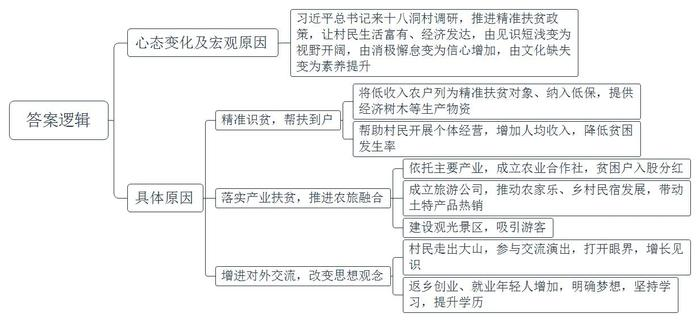
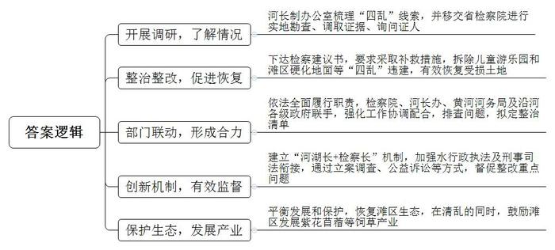
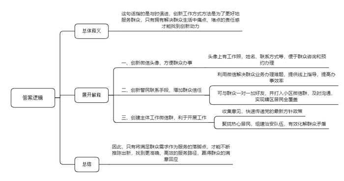
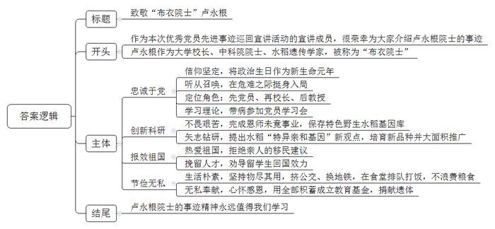

# 2020年0822公务员多省联考《申论》题（海南乡镇卷）

<!-- gwy:overview:start -->
> **海南 · 2020 · 申论 · 乡镇卷** ｜ 4 题 · 图片 4 处 · 答案随题折叠

导航：[题目](#题目) · [材料 1](#材料-1)
<!-- gwy:overview:end -->

> 候选采集稿。参考答案及解析来自粉笔页面，不代表官方答案或真实高分答卷；来源使用许可与原卷对应关系仍需人工核实。

## 给定材料

### 材料 1

云雾缭绕、山高路远，十八洞村就在大山深处。作为偏远山区的一个苗族村落，十八洞村原本少人知晓，2013年11月3日，习近平总书记来到这里考察调研、访贫问苦，首次提出精准扶贫战略思想，十八洞村由此声名远播。

“再过多少年我也忘不了那一天！”石大娘回忆说，“那天下午，村里来了好多人，不一会儿，一群人走到我家门前，走在前面的那位身材魁梧，面带微笑，问我这是不是你屋？我讲是的。他问可不可以到屋里坐下子？我说可以可以，稀客稀客！”那时，石大娘真不知道来她家的是习近平总书记。

石大娘没有读过一天书，不认识一个字，嫁到十八洞村后，尽管一天到晚勤劳辛苦，但由于自然条件差，穷乡僻壤，薄田寡地，一家人生活贫困。“我和老伴本来以为这辈子就这样过下去了，也认命了。”石大娘说。习近平总书记的到来和精准扶贫政策的推进，彻底改变了老人一家的命运。县扶贫工作队将她家列为精准扶贫对象，纳入了低保，送来了榉木苗、梨树苗，帮着各种了3亩。来参观的游客越来越多，工作队帮她在家开了个小商店，卖些饮料、方便面、书籍和纪念品等。“现在的日子，过去做梦都不敢想！”石大娘顺手向火塘里续了几块柴，火烧得更旺了。

2016年，十八洞村人均纯收入由2013年的1686元增加到8313元，贫困发生率由2013年的56.75%下降到1.28%。2017年，该村的当家产业猕猴桃挂果，全村人均收入首次突破万元。石大娘家作为建档立卡贫困户，成了村里猕猴桃合作社的原始股东，2017年分红2000元，2018年分红2400元。“我现在一年四季餐餐有肉吃，神仙过的日子也就是这样了！”石大娘说。2019年，十八洞旅游公司正式营运，截至年底，游客超60万人次，带动全村农家乐、乡村民宿大发展，猕猴桃、黄桃、腊肉、蜂蜜、苗绣、山泉水等村里土特产品热销。2020年，十八洞村溶洞景区将建设完成并对外开放，预计年游客量可达100万人次。

2019年国庆节前几天，石大娘和村里农民艺术团的40多个姐妹到了北京，参加中央民族歌舞团的一场大型文艺晚会，献上了苗族情景表演唱《十八洞的今天变了样》。在十八洞村，像石大娘这样走出大山，到外面开眼界、见世面的村民越来越多。从城市回到家乡寻求发展的年轻人也越来越多，他们在十八洞村开起了农家乐、当起了导游。这天，石大娘22岁的外孙女小龙正好在家，她已取得学前教育专业的大专文凭，正自考本科。“以后我要在十八洞村开一家幼儿园，梦想总是要有的。”她自信而爽朗。

“以前十八洞村是袋子空、家里空、寨子空、精神空。”县扶贫工作队的伍副队长说，“现在，村民收入多了，年轻人多了，全村人致富奔小康的心气足足的！”“对十八洞村来说，最大的变化是人的变化。”县委宣传部周副部长说。

### 材料 2

曾经，黄河大堤向内500多米处，占地370多亩的儿童游乐园一片喧闹景象，蘑菇城堡、魔法屋五光十色，园里游客熙熙攘攘，停车场内停满密密麻麻的私家车。这幅景象，与黄河风光实在格格不入。

“开发商相中的就是黄河。”Z市水利局河长制办公室岳主任介绍，“黄河风景区风光优美，‘玩在黄河边’成为吸引游客的噱头。就这样，本应是防洪要地、生态重地的滩区。因为利益驱动，却成了用来‘生金’的工具。”

除了儿童游乐园，其他在黄河滩区“乱占、乱采、乱堆、乱建”的现象，危害也十分严重，岳主任说。滩区其实是黄河河道的组成部分，黄河进入下游后，河流流速放缓，裹挟泥沙大量沉积，河床抬升，河流向低洼处摆动，来回往复。为了给河流摆动预留足够空间，宽河固堤成为主要措施。面积广阔的滩区在行洪、蓄洪和沉沙等方面发挥重要作用。此外，滩区是动物栖息、植物生长的家园。滩区四乱现象，不仅影响了黄河自然景观，更破坏了脆弱的生态系统。

黄河滩区既是重要的生态保护区，又是百万群众生活的家园，L省黄河滩区宽5-20公里，涉及120多万人，滩区既有农田又有湿地保护区，人水争地矛盾突出。同时，有关滩区保护的法律法规比较分散，难以形成拳头效应。加之有些法规条款制定比较宽松，缺乏震慑力。岳主任说。“有条件的地区应有序引导滩区居民退出，不仅能缓解黄河防洪压力，还能还地于河。”他建议，列出黄河管理范围内产业发展负面清单，根据黄河生态保护要求，坚持绿色发展方向，明晰黄河滩地产业发展路子。河湖监管的背后，还有一道民生考题：位于滩区的村子有1000多个，如何平衡好发展和保护的关系？

“L省黄河滩区存在不少占地面积广、体量规模大、存留时间久的‘四乱’问题，利益主体多元，多头管理，职能分散，这是河湖乱象问题产生的原因之一。”L省检察院罗处长分析，多个部门都有黄河监管职能——黄河水利委员会的监督管理职能在堤坝以内，地方政府管理范围内又涉及多个部门，自然资源部门负责土地使用、河务部门负责河道行洪安全、生态环境部门负责环境保护、农业部门负责农用地保护……“条块分割造成执法力量分散，难以有效监管。”罗处长说。

2018年12月，一场清理黄河滩区“四乱”的战役在L省打响。河长制办公室把各种线索移交省检察院，由省检察院指定检察分院组织实地勘查，调取证据，询问证人……检察分院的王副检察长说：“我们随后向有关部门下达了检察建议书，要求全面履责，采取补救措施，拆除违建，有效恢复受损土地。”各地各部门依法全面履行职责，强化工作协调配合。检察院、河长办、黄河河务局及沿河各级政府联手，排查问题，拟定整治清单，建立“河湖长+检察长”机制，加强水行政执法及刑事司法衔接，通过立案调查、公益诉讼等方式，督促整改重点问题。

2019年3月，随着机械臂挥动，“四乱”典型的儿童游乐园轰然倒地；到6月底，滩区硬化地面全部拆除，此后，曾被乱建的滩区草木新发，滩区生态基本恢复。在清乱的同时，鼓励滩区村庄发展紫花苜蓿等饲草产业，目前优质牧草种植基地初具规模，预计到2025年可达100万亩。站在大堤上远眺，滩区草木葱葱，黄河掩映其间，静静流淌而过。

### 材料 3

民警小童的微信头像，很是特别。除了一张工作照，还留有姓名、联系电话、地址，并配着一行双色标注的文字：“如果你需要办理户口、居住证，及调解家庭、邻里纠纷，请添加此微信号进行咨询和预约办理。”

小童是云沟派出所的一名社区民警，他的工作内容都浓缩到这张小小的头像里了。“再以传统的思维方式工作，可就跟不上时代啦。现在大人小孩都会玩微信，辖区里越来越多的大爷大妈玩得比我还好！我的工作方式和方法必须有所改变。”小童手机里存着近8千个居民的手机号码，微信好友中有近5千名居民，几乎覆盖了整个辖区。

前不久，一位已经办理过居住证的居民，在微信上紧急呼叫小童。原来，他去车管所办理轿车年审业务，但由于忘了居住证年审而无法正常完成业务办理，按照过去的做法，要来回奔波50多公里。小童让他立即将居住证的正面通过微信拍照传回处理，只花了一分钟就解决了问题。还有一次，一位现住国外的本社区居民，临时想开具无违法犯罪记录证明，但是不知具体该怎么办，最终，在小童的微信指点下，这位居民顺利办理了事项。

社区工作面广、事杂。一方面，群众临时有事或者出门在外，往往不知道如何联系上民警；另一方面，由于人口流动性大，民警在进行人口、房屋、场所、行业等信息登记时，也常联系不到人。怎样才能加强和居民的联系呢？“和群众一对一联系是最好的，虽然花的时间多，但是更到位。”小童利用上门签订治安管理责任书的机会，与居民见面时互加微信、留手机号，又“打入”小区所有微信群，凭借特点突出、颇具诚意的微信头像，一个个加为好友。慢慢地，群众有事就直接通过微信联系他，小小的微信头像也成了一张群众信任的名片。

通过微信，小童还建立了多个跟工作有关的微信群。打开他的微信群，有社区治安群、社区意见箱群，还有“党声群”等。小童说，“在‘党声群’中，我还可以将最新的党的方针政策，以最快的方式传给社区群众。”小童还聚拢了治安群内的热心居民，发起组建“红袖标”志愿者队伍，现在，这支队伍已经从最初的46人发展到了270人。当谈到看微信群会不会增加工作量时他认为：“从表面上看花费的时间是多了，实际上工作起来反而更快更简捷。有些问题，发生了再去处理，不如将问题直接杜绝在苗头状态。”

“<u>创新，为了更贴心；贴心，才能够创新</u>”说到自己的工作秘笈，小童笑言都在微信头像里。基层警务人少事多，只有不断创新工作方式才能更好地为群众服务，而创新的动力恰恰来自于解决群众生活中痛点、堵点的责任感。将满足群众需求作为服务的落脚点，才能不断推陈出新，找到更准确、高效的服务路径，也才能赢得群众更多的满意回应。“我们都是小童的粉丝，社区好了大家都好！”居民张大姐说。

### 材料 4

刚刚过完入党70周年的“生日”，89岁的他安详离世，走得坦坦荡荡。积蓄，全都捐了；最后一笔党费，老伴代交了，有1万元之多……这一生，他是那样简朴，又是那样富足，一生家国情，桃李满天下，留下了闪光的无字丰碑。他曾说，生活过得好，不是追求舒服，而是“无愧我心”。他，就是华南农业大学原校长、中国科学院院士、著名水稻遗传学家卢永根，人们亲切地称他为“布衣院士”。

生命最后的时光，卢永根躺在病床上，有些疲倦。可一说起当年入党时的情形，他眼中立刻发出明亮的光。“一个很小的房子，墙上挂着党旗。”老人的声音有些颤抖，“举右手，面向北方，延安就在北方，延安就是我们心中的太阳。”1930年，卢永根出生于香港的一个中产家庭，家里有电话、出门有汽车。11岁那年，日寇占领了香港，他被父亲送回广东老家避难，谁料想，这里也被铁蹄践踏。亲历了国土的沦丧，目睹了国民党政府的腐败，他苦苦寻求着希望和方向。1949年8月9日，卢永根加入了中国共产党。老伴说，“他把入党那一天看成生日，新生命的开始。所以，每年这一天，我都为他过生日。”

新中国成立前夕，卢永根受党组织派遣，离开香港到广州领导地下学联，迎接广州解放。“我为什么要抛弃安逸的生活回内地呢？是中国共产党指给我有意义的人生之路，只有社会主义祖国才是我安身立命的地方。”卢永根说。作为华南农业大学的校长，卢永根这样定位自己的三重角色：先党员，再校长，后教授。“虽然我现在疾病缠身，无法行走，但是，我的意识是清醒的，我的牵挂是不变的，我的信仰是坚定的！”岁月时光无法磨灭卢永根的初心。住院不久，卢永根和老伴向党组织郑重申请：“我俩大半辈子都没有离开过党。这个时候，也不能没有组织生活。”对此，校党委决定，由农学院党委书记等几名党员参加，每月在病房开一次党员学习会。“我全程收看了党的十九大开幕直播，听完总书记的报告，热血沸腾，备受鼓舞。”

卢永根大学毕业后留校任教，成为“中国稻作科学之父”丁颖教授的助手。“抗战时,丁老师带着水稻种、番薯种，一直逃难到云南，把种质资源保护下来。”卢永根十分敬佩。丁教授去世后，卢永根在极其艰苦的条件下，带领团队完成了恩师未竟的事业，保存了具有特色的野生水稻基因库，首次提出水稻“特异亲和基因”的新观点。近些年，卢永根研究团队共选育出作物新品种33个，在华南地区累计推广面积1000多万亩，新增产值15亿多元。

曾几何时，在美国的姐姐苦劝卢永根一家移民，可怎么也说不动他。卢永根说：“我是炎黄子孙，要为自己的祖国效力。”他在给留学生的信中写道：“外国的实验室再先进，也不过是替人家干活。”在他的劝导下，多名学生学成归国。“生命诚可贵，爱情价更高；若为祖国故，两者皆可抛！”在一次对学生的演讲中，卢永根化用著名诗句深情表白。晚年，又有人问他为什么非要留在国内，他说：“你向党、向人民作过许诺和宣誓，那自己要遵守了！”

走进老人的家，仿佛回到上世纪中叶。铁架子床锈迹斑斑，挂蚊帐用的是竹竿，一头绑着绳子，一头用钉子固定在墙上；台灯是几十年前的款式，收音机坏了一修再修……“这些东西没有用光用烂，还能用，物还没有尽其用。”卢永根说。“床已经很好了，我们刚结婚时，4个条凳架上板子，就是床。”出门，80多岁的老两口背着双肩包、头戴遮阳帽，挤公交、换地铁；吃饭，叮叮当当拎着饭盒，和学生一起在食堂排队打饭，吃得一粒米都不剩。看到有学生剩饭，卢永根总忍不住提醒：“多少株水稻才能出一碗米饭？”

880多万元储蓄，老两口没有留给唯一的女儿，一分不剩，全部捐给华南农业大学成立的“卢永根教育基金”。这些壮举，卢永根说是“还”：“党培养了我，这是做最后的贡献。”老伴也说：“国家给了我们许多，我们用不完了，当然还回去。”不仅“还”钱，他们觉得连生命都是党和国家的，也要“还”回去，双双办理了遗体捐献手续。

“布衣院士”卢永根走了，走得干干净净、清清爽爽。他不留财产、不留遗体、不留墓碑，但是，他却留下了很多很多……

## 题目

### 第 1 题

**从****“过去做梦都不敢想”到现在“梦想总是要有的”，请你根据给定资料**1**，谈谈十八洞村村民的心态为什么会发生这样的变化。（25分****）**

关联材料：材料 1

作答要求：

要求：准确、全面，有条理，不超过300字。

第 1 题 · 答案与解析

**参考答案（粉笔题库参考内容）**

习近平总书记来十八洞村调研，推进精准扶贫政策，让村民生活富有、经济发达，由见识短浅变为视野开阔，由消极懈怠变为信心增加，由文化缺失变为素养提升。究其原因：

一、精准识贫，帮扶到户。将低收入农户列为精准扶贫对象、纳入低保，提供经济树木等生产物资；帮助村民开展个体经营，增加人均收入，降低贫困发生率。

二、落实产业扶贫，推进农旅融合。依托主要产业，成立农业合作社，贫困户入股分红；成立旅游公司，推动农家乐、乡村民宿发展，带动土特产品热销；建设观光景区，吸引游客。

三、增进对外交流，改变思想观念。村民走出大山，参与交流演出，打开眼界，增长见识；返乡创业、就业年轻人增加，明确梦想，坚持学习，提升学历。

**解析**

**参考答案说明：**本参考答案先对村民的心态变化进行了阐释，并从宏观层面指出了原因，又从“精准识贫，帮扶到户”“落实产业扶贫，推进农旅融合”“增进对外交流，改变思想观念”这三个方面对十八洞村村民心态变化的具体原因进行了分条介绍。各条要点之间在内容上相互并列，没有交叉。

**考点**：原因类

**来源**：2020年0822公务员多省联考《申论》题（海南乡镇卷）

### 第 2 题

**根据给定资料**2**，谈谈L省是如何整治黄河滩区“四乱”现象的。（20分）**

关联材料：材料 2

作答要求：

要求：

（1）全面准确，分条陈述；

（2）不超过300字。

第 2 题 · 答案与解析

**参考答案（粉笔题库参考内容）**

1.开展调研，了解情况。河长制办公室梳理“四乱”线索，并移交省检察院进行实地勘查、调取证据、询问证人。

2.整治整改，促进恢复。下达检察建议书，要求采取补救措施，拆除儿童游乐园和滩区硬化地面等“四乱”违建，有效恢复受损土地。

3.部门联动，形成合力。依法全面履行职责，检察院、河长办、黄河河务局及沿河各级政府联手，强化工作协调配合，排查问题，拟定整治清单。

4.创新机制，有效监督。建立“河湖长+检察长”机制，加强水行政执法及刑事司法衔接，通过立案调查、公益诉讼等方式，督促整改重点问题。

5.保护生态，发展产业。平衡发展和保护，恢复滩区生态，在清乱的同时，鼓励滩区发展紫花苜蓿等饲草产业。

**解析**

**参考答案说明：**本参考答案从“开展调研，了解情况”“整治整改，促进恢复”“部门联动，形成合力”“创新机制，有效监督”“保护生态，发展产业”五个方面展开。各条要点之间在内容上相互并列，没有交叉。并且撰写每条要点时，都提炼出了概括性强的总括词并前置，满足了题目中规定的“分条陈述”这一要求，并让答案更清晰、准确。

**考点**：概括措施类

**来源**：2020年0822公务员多省联考《申论》题（海南乡镇卷）

### 第 3 题

**给定****资****料**3**中提到，“创新，为了更贴心；贴心，才能够创新。”请你谈谈你对这句话的理解。（20分）**

关联材料：材料 3

作答要求：

要求：准确，全面，有逻辑性，不超过300字。

第 3 题 · 答案与解析

**参考答案（粉笔题库参考内容）**

这句话指的是与时俱进，创新工作方式方法是为了更好地服务群众，只有拥有解决群众生活中痛点、堵点的责任感才能找到创新动力。

一、创新微信头像，方便群众办事。头像上有工作照，姓名、联系方式等，便于群众咨询和预约办理。二、创新警民联系手段，增加群众信任。利用微信解决群众业务办理难题，提供线上指导，提高办事效率；可与群众一对一加好友，并打入小区微信群，及时沟通，实现辖区居民全覆盖。三、创建主体工作微信群，利于开展工作。收集意见，快速传递党的最新方针政策；聚拢热心居民，组建治安队伍，有效化解群众矛盾。

因此，只有将满足群众需求作为服务的落脚点，才能不断推陈出新，找到更准确、高效的服务路径，赢得群众的满意回应。

**解析**

**参考答案说明：**思路方面，本参考答案按照词句解释题的一般答题思路展开，即：总体释义+展开解释+总结。内容方面，本参考答案先对“创新，为了更贴心；贴心，才能够创新”进行了解释；“展开解释”部分从“创新”与“贴心”关系的具体表现进行了分析，最后指出了协调“创新”与“贴心”应采取的做法。

**考点**：词句解释类

**来源**：2020年0822公务员多省联考《申论》题（海南乡镇卷）

### 第 4 题

**某省正开展优秀共产党员先进事迹巡回宣讲活动，假设你是宣讲团的成员，请根据给定资料**4**，撰写一份“布衣院士”卢永根先进事迹的宣讲提纲。（35分）**

关联材料：材料 1、材料 2、材料 3、材料 4

作答要求：

要求：

（1）紧扣材料，内容全面；

（2）语言准确，有逻辑性；

（3）字数不超过400字。

第 4 题 · 答案与解析

**参考答案（粉笔题库参考内容）**

致敬“布衣院士”卢永根

作为本次优秀党员先进事迹巡回宣讲活动的宣讲成员，很荣幸为大家介绍卢永根院士的事迹。卢永根作为大学校长、中科院院士、水稻遗传学家，被称为“布衣院士”。

一、忠诚于党。他信仰坚定，将政治生日作为新生命元年；听从召唤，在危难之际挺身入局；定位角色：先党员、再校长、后教授；学习理论，带病参加党员学习会。

二、创新科研。他不畏艰苦，完成恩师未竟事业，保存特色野生水稻基因库；矢志钻研，提出水稻“特异亲和基因”新观点，培育新品种并大面积推广。

三、报效祖国。他热爱祖国，拒绝亲人的移民建议；挽留人才，劝导留学生回国效力。

四、节俭无私。他生活朴素，坚持物尽其用，挤公交、换地铁，在食堂排队打饭，不浪费粮食；无私奉献，心怀感恩，用全部积蓄成立教育基金，捐献遗体。

卢永根院士的事迹精神永远值得我们学习！

**解析**

**参考答案说明：**（1）本题虽然不要求写格式，但为了保险起见，建议加上标题。（2）正文部分，一方面从内容来看，围绕着“宣讲活动”，本参考答案的开头先写到了“宣讲背景”“宣讲人身份”；围绕着“卢永根先进事迹”这一主题，主体部分从“忠诚于党”“创新科研”“报效祖国”“节俭无私”这四个层次展开介绍；结尾进行了呼吁号召。另一方面，形式上，本参考答案做到了条理清晰、思路明确。

**考点**：宣传类

**来源**：2020年0822公务员多省联考《申论》题（海南乡镇卷）

