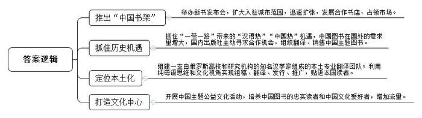
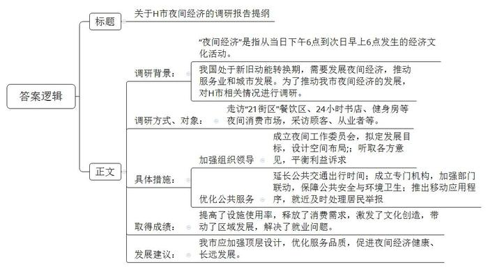

# 2020年0822公务员多省联考《申论》题（海南县级卷）

> 候选采集稿。参考答案及解析来自粉笔页面，不代表官方答案或真实高分答卷；来源使用许可与原卷对应关系仍需人工核实。

## 给定材料

### 材料 material-9c9af0c9e6847495

这个寒冬，对于L集团俄罗斯分公司的行政总裁陈总来说，却是“热浪迭起”。2018年12月14日，由分公司出版的《中国民营企业四十年的风云激荡》俄文版新书发布会在其位于莫斯科的中国书店举行，原定只有三五十人参加，最后竟然来了100多人，受欢迎程度大大超出预期。与此同时，分公司推出的“中国书架”在俄罗斯两座城市挂牌，至此，“中国书架”已在俄罗斯12个城市的22家书店入驻。“照这个速度，用不了多久，‘中国书架’很有希望在俄罗斯发展出百家合作书店……”陈总在微信朋友圈中写道。

陈总所领导的俄罗斯分公司是中国著名民企L集团的下属公司。2009年7月，L集团开始走出国门进军国际市场。“集团一路摸爬滚打，是中国图书出海的一个缩影。”分公司成立之初，推出的第一本书是《快速学汉语》，首印1万本，卖得不好；组织翻译了一些在中国国内颇红的文化类、小说类图书，也只销售了个位数。几年过去了，库存积压，把原来挣的钱全赔了进去。2013年，“一带一路”倡议的提出使得“汉语热”“中国热”迅速升温。中国图书在国外的需求量开始增大，国内的出版社主动上门寻求合作。分公司抓住了这一机遇，组织翻译、销售了大量中国主题书，包括《历史的轨迹——中国共产党为什么能》《中国民营企业500强》等。经过短短数年发展，该分公司已成为俄罗斯第三大中国主题图书出版社。

L集团俄罗斯分公司共有员工268人，陈总是其中唯一的中国人。如此极致的本土化，源于分公司的定位——经过纯母语思维和文化视角，实现对中国主题图书海外出版的组稿、翻译、发行和推广。几年前一家国内出版社组织翻译专家团队，将一本中文图书译成了俄文，另一家俄罗斯出版社得到授权后，也组织了当地的翻译人才进行翻译。两个俄文版本相比，后者页数远超前者。原来，俄罗斯本土化编辑翻译团队，为该书增加了大量的背景介绍与注释，语言风格也更贴近本国读者，受到了更多俄罗斯读者的欢迎。这件事让陈总认识到，要想让世界了解中国，需要依托当地易于接受的思维和话语体系。分公司组建起一支由俄罗斯高校和研究机构的知名汉学家组成的专业翻译团队，为中国主题图书的俄文翻译工作带来了新气象。为了让中国文化更接地气，分公司还将一些书店打造为文化中心，开展围棋讲座、中国书法班、中国主题沙龙、趣谈中国文化等公益文化活动吸引读者，培养了中国图书的忠实读者和一批新的中国文化爱好者。“粉丝”的增多，也带来了“流量经济”。陈总说：“我对中国主题图书走出去，有了更多信心！”

### 材料 material-d96667867f67a39c

八月的H市，已进入高温炙烤模式。夜，却未因此而平静。晚上十点，市区最大商场的主体部分已经打烊，人们陆续从商场大门走出。与此同时，另一批“意犹未尽”的顾客走进了地下一层和地下二层东侧的“21街区”。这片主营餐饮的区域，营业时间一直会延长到凌晨两点，是名副其实的“深夜食堂”。人们在炸糕店前排队买着炸糕、在奶茶店外挑选着饮料、手捧着冰淇淋和炸鸡……街区内无论面条米饭、饺子煎包，各式中餐、西餐种类都很丰富。

H市商务局的陈科长介绍说，所谓“夜间经济”，是指从当日下午6点到次日早上6点发生的经济文化活动。在不少人看来，夜间经济无非就是“啤酒烤串加唱歌”。事实上，夜间经济的内涵远比“吃吃喝喝”丰富得多。它已经由早期的灯光夜市转变为包括“食、游、购、娱、体、展、演”等在内的多元夜间消费市场。

H市一家著名的24小时书店，就给人们的夜生活增加了一种新的方式。位于临窗位置的阅读区，摆放着一张长桌和七把圆形座椅，其中六把已被读者占用。年轻姑娘小赵戴着耳机，全神贯注地看着手机播放的“中国会计网校”课程。休息间隙，小赵告诉记者，自己参加工作不到一年，打算自学考“注会”。合租环境比较吵闹，下班晚餐后就来书店学到10点多再回去。“这里环境好，手机用来听课，也没有电脑玩儿，效率还是很高的。”

“再来，加把劲儿！”听着一旁教练的口令，扎着马尾辫的女孩咬了下嘴唇，抹了下额头的汗珠，继续奋力向前推着沉重的哑铃。已是夜里九点半，位于H市南二环附近的一家健身工作室灯火通明。“每天人最多的时候是八点左右，现在好多人已经练完走了。”健身教练表示，“我们工作室成立近三年，明显感觉到健身的人在增多。来这里的大部分是附近的住户，下班之后过来健身。正常，我们是晚上十点关门，但有的人下班晚，跟教练约了，过来练到十一点、十二点也没问题，我们都等。”

为了做好夜间经济这篇大文章，H市于2019年年初成立了由政府相关部门和行业协会组成的夜间工作委员会，拟定夜间经济发展目标。设计夜间经济空间布局，并通过与场地经营者、工作人员、夜间消费者以及周边居民对话的方式听取各方意见，平衡相关群体的利益诉求。同时，交通部门延长了地铁、公交夜间行车时间，为夜间经济的消费者和从业人员提供安全、便捷、舒适的交通工具。夜间经济的安全、噪音、垃圾等问题最为人们所诟病。H市成立专门机构，加强公安、消防、城市管理等多部门联动，确保了夜市附近的公共安全、环境卫生。此外还推出了移动应用程序，供居民举报夜间滋扰情况，居民可通过网络联系所在社区的负责人，直接对问题进行处理。

“夜间经济提高了设施使用率、释放了消费需求、激发了文化创造、带动了区域发展。此外，由于夜间具有与常规工作时间错位的优势，更多的潜在劳动力也能够通过在夜间上岗解决就业问题，缓解社会就业压力。如何让夜间经济健康有序地发展，政府的顶层设计尤为关键。政策质量高了，服务品质好了，投资者信心才更强，夜间经济才会走得更好，走得更远。”陈科长感慨地说。

某财经大学的张教授认为，当前，我国正处于新旧动能转换的关键时期，服务业具有吸引社会资本与居民消费的双重属性。以商务活动为主的夜间消费正好是服务业发展的最佳着力点。随着人民生活水平不断提高，对于消费的需求也更加多元化，在未来，夜间经济必将成为城市发展的重要源动力。

## 题目

### 第 1 题

**根据****“给定资料**1**”，总结概括L集团俄罗斯分公司是如何打开国际市场的。（20分）**

关联材料：材料 material-9c9af0c9e6847495

作答要求：

要求：准确、简明、全面，不超过300字。

### 第 2 题

**假如你随C市商务局考察团到H市调研“夜间经济”发展情况，请结合“给定资料**2**”，写一份调研报告提纲。（30分）**

关联材料：材料 material-d96667867f67a39c

作答要求：

要求：

（1）紧扣资料，内容全面；

（2）层次分明，有逻辑性；

（3）不超过400字。

### 第 3 题

**“给定资料**5**”提到，“一个经济体的底气，既要看眼前静态的‘形’，更要看长远发展的‘势’”，请你根据对这句话的理解，联系实际，自拟题目，写一篇文章。（50分）**

关联材料：材料 material-9c9af0c9e6847495

作答要求：

要求：

（1）自选角度，立意明确；

（2）思路清晰，语言流畅；

（3）参考“给定资料”，但不能拘泥于“给定资料”；

（4）总字数1000—1200字。

## 答案与解析

第 1 题

**参考答案（粉笔题库参考内容）**

一、推出“中国书架”。举办新书发布会，扩大入驻城市范围，迅速扩张，发展合作书店，占领市场。

二、抓住历史机遇。抓住“一带一路”带来的“汉语热”“中国热”机遇，中国图书在国外的需求量增大，国内出版社主动寻求合作机会，组织翻译、销售中国主题图书。

三、定位本土化。组建一支由俄罗斯高校和研究机构的知名汉学家组成的本土专业翻译团队；利用纯母语思维和文化视角实现组稿、翻译、发行、推广，贴近本国读者。

四、打造文化中心。开展中国主题公益文化活动，培养中国图书的忠实读者和中国文化爱好者，增加流量。

**解析**

**参考答案说明：**本参考答案从“推出‘中国书架’”“抓住历史机遇”“定位本土化”“打造文化中心”四个方面展开，各条答案要点之间在内容上相互并列，没有交叉。

**考点**：考点概括措施类

**来源**：来源2020年0822公务员多省联考《申论》题（海南县级卷）

粉笔申论页面对本题只提供「解析视频」入口，该入口是会员推广位，页面无视频地址与文字解析。

第 2 题

**参考答案（粉笔题库参考内容）**

关于H市夜间经济的调研报告提纲

调研背景：“夜间经济”是指从当日下午6点到次日早上6点发生的经济文化活动。我国处于新旧动能转换期，需要发展夜间经济，推动服务业和城市发展。为了推动我市夜间经济的发展，对H市相关情况进行调研。

调研方式、对象：走访“21街区”餐饮区、24小时书店、健身房等夜间消费市场，采访顾客、从业者等。

具体措施：1.加强组织领导。成立夜间工作委员会，拟定发展目标，设计空间布局；听取各方意见，平衡利益诉求。2.优化公共服务。延长公共交通出行时间；成立专门机构，加强部门联动，保障公共安全与环境卫生；推出移动应用程序，就近及时处理居民举报。

取得成绩：提高了设施使用率，释放了消费需求，激发了文化创造，带动了区域发展，解决了就业问题。

发展建议：我市应加强顶层设计，优化服务品质，促进夜间经济健康、长远发展。

**解析**

**参考答案说明：**（1）一方面，内容上，正文部分从调研背景，调研方式、对象，具体措施，取得成绩，发展建议五个方面介绍了H市发展夜间经济的具体情况。（2）另一方面，形式上，本参考答案做到了分段、分条撰写，整体上条理较为清晰。

**考点**：考点总结类

**来源**：来源2020年0822公务员多省联考《申论》题（海南县级卷）

粉笔申论页面对本题只提供「解析视频」入口，该入口是会员推广位，页面无视频地址与文字解析。

第 3 题

**参考答案（粉笔题库参考内容）**

**“经济”自信，用创新兼顾眼前与长远**

在这片充满希望的田野上，大有可为的热土上，发展始终是每个时代的关键词，而经济则是衡量发展水平的重要指标，是一切发展的基础与保障。大数据、物联网、云计算，人脸识别、在线支付……我们曾经期待的，渴望的，都照进了现实。经济结构的优化转型，综合国力的增强提升……这些都在向全世界昭示着我国经济“乘长风，破万里浪”的汹涌气势。但国际发展时局瞬息万变，我国经济发展也面临新的挑战与困境。想突破重重阻碍，赢得经济发展的主动权，树立经济自信，要善于着眼当下的时局，看到眼前静态的“形”，更要心系长远的未来，勇于开拓创新，蓄势谋势、求变应变，抓住长远发展的“势”。

40多年的风云变幻，一代又一代人的使命背后，依靠的是我们“拔地而起”的优势，不仅包含雄厚的经济、科研、人才等多方面的积累，亦包括走在前端的、发达的移动互联网，特别是党和政府提供的宽松的、优良的政治环境。但是，一代人的安于现状、固步自封，就会让我们在时代变迁中，固化思维、困住手脚，难以实现持续发展。

因此，**经济发展要心系长远未来，充分利用中国人民创新的文化基因，达成文化共识，树立文化自信，这是让经济体有底气、有信心的基础**。一直以来，我国都有着创新的历史和文化基因：在古代，四大发明对世界文明发展进程产生了重要影响；在今天，高速铁路、扫码支付、共享单车和网络购物改变了人们的生活方式，提高人们的生活质量，被外国友人评选为中国的“新四大发明”……这些都是中国人民积极创新的生动体现。中华优秀文化积淀着中华民族最深沉的精神追求，也为中华儿女不断创新提供丰厚滋养。新时期，更应发扬创新传统，将中华优秀文化创造性转化，以文化创新增强经济自信。

**经济发展在长远未来中还要注重技术进步和产业变革，不断更新创新内容，在变革中催生新产业、新业态、新模式，这是让经济体有底气、有信心的保障**。“风物长宜放眼量”，创新是百年大计。近年来，在全球范围内出现了一系列有重大影响、颠覆性的新兴技术，这些技术互相交叉、融合、渗透，以人工智能为代表的新技术革命正在孕育中，这也是经济发展的引擎。在促进经济发展的同时，改变人们的思维，拓宽人们的视野，不断催生新的发展模式，让发展生生不息，让经济持续突破。

**经济发展在长远未来中亦需要树立结果导向，紧跟用户、市场需求，催生企业对生产、商业的创新，实现产品智能化升级，这是让经济体有底气、有信心的方向**。“顾客就是上帝”，满足用户需求是市场得以永续发展的关键要素；关注用户需求，重视用户体验，掌握用户在使用产品时的心理感受，是产品更新换代、推陈出新的必经阶段。用户需求关乎市场需求，或爱不释手，或厌恶至极，或欣喜若狂，或怒不可遏；用户需求就是商机，或稍纵即逝，或旷日持久，或昙花一现，或绵延不绝。因此，有目的、目标地去发展经济，是赢得胜利的保障，是拓展用户、扩大市场的指向标。

“正入万山圈子里，一山放过一山拦。”回望过去，无论中国经济经历多少坎坷风雨，都能一路披荆斩棘、自信满满。只要我们善于积势蓄势谋势，把握眼前的“形”，更勇于识变求变应变，积极开拓创新，看到长远发展的“势”，就会在危机中孕育新机，于变局中广开新局。

**解析**

**文章分析**

**“经济”自信，用创新兼顾眼前与长远**

【**标题的优点**：范文的标题突出了“经济底气（自信）”这一主题，并点明了“创新”这一角度，标题准确、简练。】

在这片充满希望的田野上，大有可为的热土上，（1）发展始终是每个时代的关键词，而经济则是衡量发展水平的重要指标，是一切发展的基础与保障。（2）大数据、物联网、云计算，人脸识别、在线支付……我们曾经期待的，渴望的，都照进了现实。经济结构的优化转型，综合国力的增强提升……这些都在向全世界昭示着我国经济“乘长风，破万里浪”的汹涌气势。（3）但国际发展时局瞬息万变，我国经济发展也面临新的挑战与困境。想突破重重阻碍，赢得经济发展的主动权，树立经济自信，要善于着眼当下的时局，看到眼前静态的“形”，更要心系长远的未来，勇于开拓创新，蓄势谋势、求变应变，抓住长远发展的“势”。

【**开头的优点**：★内容方面。范文的开头是紧扣题目给定的“经济底气（自信）”这一主题展开的。首先，开头第一句话点出了“经济发展”这一话题，做到了主题明确。其次，对“经济底气（自信）”这一主题进行了分析阐述，指出了：（1）时代背景，（2）经济发展取得的成绩，（3）经济发展面临的问题。注意，以上三个方面的论述是有内在逻辑顺序的：先写“背景”，再写“成绩”，最后写“问题”。★文字表达方面。使用了“但”“要……更要……”等关联词，使语言表达有逻辑性。】

40多年的风云变幻，一代又一代人的使命背后，依靠的是我们“拔地而起”的优势，不仅包含雄厚的经济、科研、人才等多方面的积累，亦包括走在前端的、发达的移动互联网，特别是党和政府提供的宽松的、优良的政治环境。但是，一代人的安于现状、固步自封，就会让我们在时代变迁中，固化思维、困住手脚，难以实现持续发展。

【**过渡段的优点：**范文的过渡段分析了“经济发展取得的成绩”，这也是经济发展眼前静态的“形”。此外，还要注意过渡段末尾的“一代人的安于现状、固步自封，就会让我们在时代变迁中，固化思维、困住手脚，难以实现持续发展”是用来引起下文的过渡句。】

因此，**经济发展要心系长远未来，充分利用中国人民创新的文化基因，达成文化共识，树立文化自信，这是让经济体有底气、有信心的基础**。一直以来，（1）我国都有着创新的历史和文化基因：在古代，四大发明对世界文明发展进程产生了重要影响；在今天，高速铁路、扫码支付、共享单车和网络购物改变了人们的生活方式，提高人们的生活质量，被外国友人评选为中国的“新四大发明”……这些都是中国人民积极创新的生动体现。（2）中华优秀文化积淀着中华民族最深沉的精神追求，也为中华儿女不断创新提供丰厚滋养。新时期，（3）更应发扬创新传统，将中华优秀文化创造性转化，以文化创新增强经济自信。

【**论述段****1的优点**：★观点句：范文的观点句是紧扣“经济底气（自信）”这一文章主题提出的。形式上，它在段首处直接写出，位置突出，容易被发现；内容上，关键词突出，内容要点明确，可以明显看出它是从“利用中国人民创新的文化基因”的角度入手，指出了如何从长远角度保持经济自信。★论述内容：本段主要围绕“经济底气（自信）”这一主题进行分析阐述，指出了：（1）创新的文化基因的体现，（2）中华优秀文化的重要性，（3）发挥创新传统。注意：以上三个方面的内容都是紧扣观点句“经济发展要心系长远未来，充分利用中国人民创新的文化基因，达成文化共识，树立文化自信，这是让经济体有底气、有信心的基础”进行分析论述的，针对性强、内容层次丰富。最后，在论证方法和论据选取方面，讲道理和举例子相结合，做到了丰富多样。】

**经济发展在长远未来中还要注重技术进步和产业变革，不断更新创新内容，在变革中催生新产业、新业态、新模式，这是让经济体有底气、有信心的保障**。“风物长宜放眼量”，创新是百年大计。近年来，（1）在全球范围内出现了一系列有重大影响、颠覆性的新兴技术，这些技术互相交叉、融合、渗透，以人工智能为代表的新技术革命正在孕育中，这也是经济发展的引擎。（2）在促进经济发展的同时，改变人们的思维，拓宽人们的视野，不断催生新的发展模式，让发展生生不息，让经济持续突破。

【**论述段****2****的优点**：★观点句：范文的观点句是紧扣“经济底气（自信）”这一文章主题提出的。形式上，它在段首处直接写出，位置突出，容易被发现；内容上，关键词突出，内容要点明确，可以明显看出它是从“注重技术进步和产业变革”的角度入手，指出了如何从长远角度保持经济自信。★论述内容：本段主要围绕“经济底气（自信）”这一主题进行分析阐述，指出了：（1）全球技术创新的现状，（2）技术创新的重要性。注意：以上两个方面的内容都是紧扣观点句“经济发展在长远未来中还要注重技术进步和产业变革，不断更新创新内容，在变革中催生新产业、新业态、新模式，这是让经济体有底气、有信心的保障”进行分析论述的，针对性强、内容层次丰富。最后，在论证方法和论据选取方面，以讲道理为主，论述准确、贴切。】

**经济发展在长远未来中亦需要树立结果导向，紧跟用户、市场需求，催生企业对生产、商业的创新，实现产品智能化升级，这是让经济体有底气、有信心的方向**。“顾客就是上帝”，（1）满足用户需求是市场得以永续发展的关键要素；关注用户需求，重视用户体验，掌握用户在使用产品时的心理感受，是产品更新换代、推陈出新的必经阶段。用户需求关乎市场需求，或爱不释手，或厌恶至极，或欣喜若狂，或怒不可遏；用户需求就是商机，或稍纵即逝，或旷日持久，或昙花一现，或绵延不绝。因此，（2）有目的、目标地去发展经济，是赢得胜利的保障，是拓展用户、扩大市场的指向标。

【**论述段****3****的优点**：★观点句：范文的观点句是紧扣“经济底气（自信）”这一文章主题提出的。形式上，它在段首处直接写出，位置突出，容易被发现；内容上，关键词突出，内容要点明确，可以明显看出它是从“紧跟用户、市场需求，实现产品智能化升级”的角度入手，指出了如何从长远角度保持经济自信。★论述内容：本段主要围绕“经济底气（自信）”这一主题进行分析阐述，指出了：（1）满足用户需求的重要性，（2）如何满足用户需求。注意：以上两个方面的内容都是紧扣观点句“经济发展在长远未来中亦需要树立结果导向，紧跟用户、市场需求，催生企业对生产、商业的创新，实现产品智能化升级，这是让经济体有底气、有信心的方向”进行分析论述的，针对性强、内容层次丰富。最后，在论证方法和论据选取方面，以讲道理为主，论述准确、贴切。】

“正入万山圈子里，一山放过一山拦。”回望过去，无论中国经济经历多少坎坷风雨，都能一路披荆斩棘、自信满满。只要我们善于积势蓄势谋势，把握眼前的“形”，更勇于识变求变应变，积极开拓创新，看到长远发展的“势”，就会在危机中孕育新机，于变局中广开新局。

【**结尾的优点**：（1）再次提到了“经济底气（自信）”；（2）展望未来。】

**考点**：考点文章写作题

**来源**：来源2020年0822公务员多省联考《申论》题（海南县级卷）

粉笔申论页面对本题只提供「解析视频」入口，该入口是会员推广位，页面无视频地址与文字解析。

