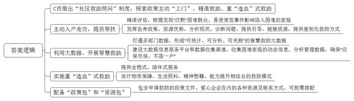
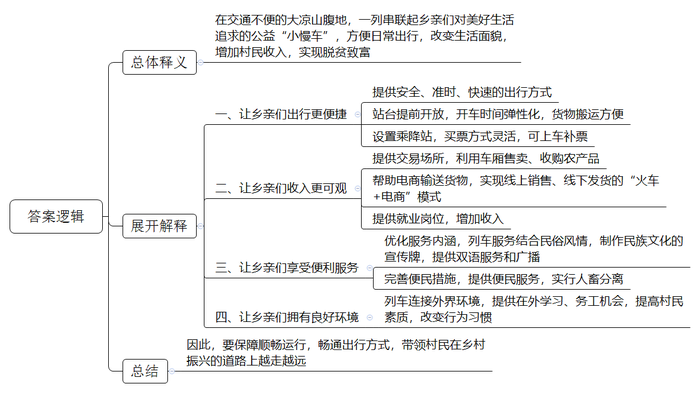

# 2021年公务员多省联考《申论》题（海南县级卷）

<!-- gwy:overview:start -->
> **海南 · 2021 · 申论 · 县级卷** ｜ 3 题 · 图片 3 处 · 答案随题折叠

导航：[题目](#题目) · [材料 1](#材料-1)
<!-- gwy:overview:end -->

> 候选采集稿。参考答案及解析来自粉笔页面，不代表官方答案或真实高分答卷；来源使用许可与原卷对应关系仍需人工核实。

## 给定材料

### 材料 1

“把她的家粉刷一新，给独自生活的她更多支持。”

某公益平台上，为女孩小珊修缮房屋的公益计划得到不少爱心网友的参与。1元、10元、100元……不到一个月，爱心捐款就超过了修缮所需。

小珊家住C市N区。唯一的亲人去世，自己又身患多种疾病，让她一度有轻生念头，是N区“社区救助顾问”团队把她从疾病与孤独中拉了出来。

“我们希望为她‘粉刷’的不仅是墙面，也是内心。”为小珊修缮房屋正是为其定制的救助“组合拳”中的一步：修缮后的房屋腾出一间出租，能有效缓解其家庭债务。同时，提供专业心理咨询、继续教育、就业指导等服务，帮助她重拾生活信心。

小珊的故事是C市N区近年在全国率先推出“社区救助顾问”制度及社会救助综合改革的一个缩影。在党的十九届四中全会提出“建立解决相对贫困的长效机制”的背景下，N区探索政策主动“上门”、精准救助、重“造血”的救助方式取得了较好效果。

尽管C市已建立较完备的现代社会救助体系，但因救助工作涉及部门较多、政策内容较复杂，总有少数困难群众不熟悉政策而未得到应有救助。唯有变“人找政策”为“政策找人”，才能彻底解决救助工作“最后一公里”难题。2020年9月，C市宣布在全市全面实施“社区救助顾问”制度。N区作为全国社会救助综合改革试点区，在C市最先探索此项制度。2019年，该区试点组建一支由社区事务受理中心人员、居民区救助人员和专业社工组成的300余人“社区救助顾问”团队。团队在主动发现极少数“沉默”困难群众的同时，充分发挥熟悉各项救助政策、能够调配各项救助资源的优势，就近帮助困难群众分析现状、诊断问题、提供指引、链接资源，最终找到符合他们实际需要的差别化救助方式。“社区救助顾问”制度推出至今，N区已对7000多户居民进行了精准评估，梳理出高度困境家庭重点服务对象1300多户，其中不少为原本“沉默”的困难人群。

新冠肺炎疫情下，那些本就脆弱的家庭会否面临更大的风险？N区红桥路街道救助顾问主动到居民区开展走访。他们发现，从外地来N区的苏先生的公司因疫情无法开工，妻子无业在家，还有三胞胎女儿需要照顾，家庭基本生活难以维持。救助顾问以最快速度制定救助方案，除发放临时帮扶金外、还链接外部资源，帮助苏先生妻子找到了线上工作岗位。

在N区华新路街道，近年来通过打通民政、人社、卫健、医保、残联等部门数据，形成了“可统计、可分析、可关联”的智慧救助大数据。街道服务办何主任举例说，救助顾问在比对居民医保与工会数据时，发现陈女士家庭医药费突然增大，上门走访后得知陈女士最近做了一场大手术，丈夫又生病在家，儿子也找不到工作。救助顾问随即为陈女士一家对接救助政策，不仅解决了大部分自费医药费，还帮助其儿子找到临时工作，使这个家庭走出了困境。

“我们还将进一步建设好大数据信息服务平台和数据收集渠道，做好低保家庭、低收入家庭、支出型贫困家庭和特殊困难家庭的动态信息收集、数据管理分析工作，确保‘应保尽保，不落一户’。”N区民政局申局长说。

“贫困有时候不是光靠钱就能解决，社区救助顾问就是要分析每个个体或家庭的致贫原因，以‘一户一方案’原则设计救助计划，并提供全程式、陪伴式服务，把过去‘供血式’的物质救助转变为物质保障、生活照料、精神慰藉、能力提升等相结合的‘造血’式救助。”N区民政局社会救助科科长说。

N区每名救助顾问都有一个“政策包”和一个“资源包”，“政策包”里装着为困难群众申请救助的政策文件，“资源包”里则有包括爱心企业、群团组织、基金会等在内的各种资源和联系方式。救助顾问可根据救助对象实际所需及时匹配相应救助资源。

“社区救助顾问”制度在N区试点两年来，越来越多的困难人群被救助顾问发现，并得到相关救助。数据显示，N区救助目标对象占全区户籍人口的比例已从1%升至约6%。

### 材料 2

77岁的彝族老阿妈克迟莫，乘坐5619次列车从下普雄前往上普雄走访亲戚。阿妈很爱笑，也很健谈，因为牙齿几乎掉光，她笑着的时候总是害羞地抿着双唇。她说：“1968年，25岁从上普雄嫁到了下普雄，走了一天多的山路，才到夫家。两年后的1970年，‘小慢车’开了，40多分钟就可以回娘家。”尽管近几年山里的大多数村子都修了公路，但是大凉山区经常出现落石、滑坡和泥石流等地质灾害，阻断公路畅通，冬季也经常封路。对于大凉山深处的彝族老乡们来说，5633次列车还是最安全、时间最有保障的出行方式，很多时候也是唯一的出行方式。“即使某些区段因为各种原因无法通行，我们也会保障其他区段的运行。”乘务员阿呷说。

在过去的几十年间，这趟被称为“小慢车”的列车早已彻底融入当地人的日常生活。作为孩子们的校车，当地人的赶集车、公交车、婚车……这趟列车也在用“润物无声”的方式支持着大凉山区的脱贫攻坚。即使是普通话不流利的彝族老乡，也会在听到“小慢车”三个字时，第一时间吐出一个“好”字。

2020年是成昆铁路通车50周年，作为服务民族地区、助推地方经济、巩固国防建设的钢铁大动脉，成昆铁路串起了沿线群众的幸福生活。5619/20次和5633/34次两辆公益性“小慢车”与成昆线同龄，在悠长岁月里传承“铸道精神”，穿行于大凉山腹地，最长运行里程353公里，停靠26个车站，自1995年以来票价从未变过，最高25.5元，最低2元。5619次、5633次“小慢车”串联起彝族老乡们对美好生活的追求。一张张朴实无华的笑脸，让“小慢车”充满了阳光和温度。

3月开始，正是大凉山采收蕨菜、青岗藤、蒲公英、党参等土特产的季节。5633次尼波站开车后各车厢大件行李处都堆满了农产品。有的时候，这些土特产在“小慢车”上就完成了交易，老乡们在车厢里拿出秤杆子，当场称重交易，省时又省力，在到达终点前就已经把手上的土特产出售一空。阿莫的随身物品很简单，一个皮质挎包、一杆秤。他此次乘车的目的是收购蕨菜。他穿梭在车厢里，不断寻找心仪之物，终于在8号车厢的大件行李处找到了几大包新鲜水嫩的蕨菜，在与货主沟通后，阿莫拿出秤杆子，一袋一袋地称了起来，这一趟阿莫收购了300多斤蕨菜。现在，阿莫已经不再依靠坐火车运输货物赚钱了。他选择了“火车+电商”的新路，开办猪场，制作凉山猪腊肉，在电商平台销售，然后用大车把腊肉运到县城去发快递。今年春节，他的几千斤腊肉几乎销售一空，挣了几万块钱。

为了供阿树上学，父母通过“小慢车”销售家里种植的烤烟、土豆、玉米。他们最大的心愿就是阿树能找到一份稳定的工作。2017年，铁路部门履行扶贫承诺来到学校招工，阿树与另外5名彝族同学脱颖而出，成为“小慢车”的乘务员。得知儿子能够在“铁路部门”上班的消息，一家人都高兴坏了。妈妈说，“这下阿树既找到了稳定的工作，又缓解了家里的经济压力。”从乘客变为铁路人，“小慢车”一直温暖着这位青年的心。

近年来，“小慢车”列车党支部围绕精神文明建设和精准扶贫，积极促进民族团结进步，不断优化“彝乡情”服务内涵，完善便民利民措施。将民俗风情与列车服务举措结合，设计制作了带有彝族文化元素的揭示揭挂，列车方向牌和车内引导标识都标注了彝汉双语。同时，班组服务小分队坚持到车厢、到座位进行安全服务和文明乘车宣传，一并提供针线包、胶带、捆扎绳等便民服务，列车广播还增加了彝汉双语播报服务，车内乘务员“彝语”“汉语”双语上岗。为了方便日常彝族老乡运输家禽、牲口，“小慢车”贴心地在行李车厢增设了牲畜拴挂处，每趟车进行消毒，实现了牲畜与旅客分开，让车厢环境更卫生、整洁。

为了让彝族老乡能把所有东西搬上车，有的车站还会提前开放站台，让老乡先把货物堆在车门前，有时这趟列车的开车时间会推迟几分钟。“我们这种车时间弹性大，不像高铁，都是按秒计算的。”列车员称，“和多数人熟悉的先买票再上火车的流程略有不同，5633次列车一路停靠的大多数车站都只能被称为乘降站，也就是可以上下车但不具有售票资格的车站，乘客从乘降站上车后再在车上补票。”

在阿呷看来，教育是阻断贫困的最重要的途径。现在更多彝族年轻人通过“小慢车”能够走出大山到外面学习、务工，这些都是让当地更快发展的希望。教育进步带来的最直接的变化就是在列车上抽烟、乱扔果皮的人少了，即使有，列车员的劝告也会被听进去。“以前打扫车厢卫生都是用铁铲的，甘蔗上市的时候，地上全是甘蔗渣，黏脚。”阿呷说，“我已在5633次列车上工作了20多年，这些年来家乡的变化实在是太大了。我很自豪我的家乡正走在乡村振兴的大路上。我喜欢在车上的工作和生活，<u>这是一辆开往春天的列车，为乡亲们带来了温暖和希望。</u>”

### 材料 3

这次参加L省两会，雷溪村党支部书记、村委会主任叶传福带来的两个建议都和农村工作紧密相关。一个是农村水污染防治，另一个是实现脱贫攻坚与乡村振兴有效衔接。叶传福说：“无论是环境治理还是乡村振兴，都是为了让老百姓腰包鼓起来，生活更舒心！”推动实现更加充分更高质量的就业，促进教育公平协调发展，持续提升社会保障水平，强化医疗卫生服务……2021年的L省政府工作报告，对社会关注、民众关切的民生问题提出了诸多新举措。送出了一件件分量十足的民生“大礼包”。2020年，L省民生工程推进跑出“加速度”，一系列保障和改善民生的惠民之举纷纷落地——稳定就业岗位880.8万个，开工改造老旧小区50.8万户、棚户区14.75万套，开工建设公租房4312套，改善群众居住条件：改造敬老院155个、护理型养老床位1.8万张。今年的省政府工作报告中，L省又明确提出要聚力在保障和改善民生上求突破见实效，注重普惠性、基础性、兜底性，尽力而为、量力而行，努力把群众关心的事情切实办好。如何让老年群体“老有所养”，也是代表委员们普遍关心的问题。T市市委书记谭洪在参加分组讨论时，着重提出要进一步办好民生实事，其中最迫切的一条就是把老年食堂办好，“实现老年人困难的不交钱，条件好的少交钱，不用去赶集买菜动火动电，就能吃上热汤热饭。”

省人大代表李智水在接受采访时表示：“2021年是‘十四五’开局之年，在继续统筹抓好疫情防控和社会经济发展的大背景下，L省将从交通、教育、医疗、就业、健康等多个方面办好更多民生实事，在改善民生品质上干出一番新气象。报告有温度，为民情怀浓，就是要以政府的紧日子换取群众的好日子，努力让民生服务更有‘温度’，让民生福祉更有‘质感’，让人民群众的获得感更足。”

### 材料 4

青茂古镇有王陶然剪不断的情愫，她的童年就是在那里度过的。那时，她外公是镇里有名的陶匠，外婆则是造纸高手。外公外婆还经常教她做陶、造纸。长大后，王陶然一直在外打拼，虽然事业发展得不错，但在青茂度过的童年，却成了她挥之不去的记忆。于是，她产生了回青茂发展的念头，“那么，回青茂，我应该做点什么呢？”王陶然反复问自己，好在王陶然有基础，加上她寻访到熟悉古法造纸传统技艺的老艺人，这项传统技艺很快就在青茂古镇复活了。2016年8月，王陶然的“青茂人家”作坊在青茂古镇正式开张，她以古法造纸创新体验和相关产品生产销售为主，致力传承青茂独具特色却濒临失传的构树皮造纸手工技艺。

可是，复活容易，活好难。如何添加新元素，让这项古老的传统技艺焕发出生机活力？于是，她去拜访一位有名的书画家，请他当“青茂人家”的顾问。依照他的指点，王陶然按创作山水画的布局，将南瓜叶剪成荷叶，玉米叶剪成月亮，压到纸上去，再淋上一层纸浆，一幅“小荷残月”便做成了。刚做出时，还是挺好看的，能看出南瓜叶和玉米叶。王陶然欣喜不已。可纸上的水干了后，就变成了只是有纹理的纸。正当王陶然心情沮丧的时候，她突然发现，纸上的“小荷残月”在灯光的照射下，散发出植物特有的光泽，整张纸也多了艺术的质感。

受此启发，王陶然又请了当地几位书画家进行创作。她还去省外参观学习，并买下比较好的作品，回来不断地进行技术改良，经过努力，“青茂人家”创作出来的作品更加精致、更有艺术感。王陶然还不满足，又带着作品四处参展，既展示自己的东西，又学习外面的经验。在学习中，王陶然更加深刻地认识到，要做到出类拔萃，创作上一定要有新意。有一次，她发现一位刚从国画专业毕业的大学生的作品很有创意，就找到他，让他把世界名画搬到纸上，小伙子爽快地答应了，不久就创作出一幅，效果出奇的好。在一次展览中，顾客争相购买，甚至出价到上万元。但王陶然没有卖，她觉得这样的作品应该留下去感染更多的人，让他们体会古法造纸创新的无穷魅力。

接下来，小伙子又把梵高的《星空》等世界名画搬到了王陶然的纸上。可“青茂人家”的其他顾问觉得，不能只是机械地临摹，要把梵高的星空，变成青茂的星空，星空的下面必须是青茂的大地，是青茂的山川河流、稻田民居……修改之后，大家再次品味，初一看，是梵高的画，但仔细一瞧，是青茂的风景，大家都拍案叫好。此时的纸，还是一张纸。此时的纸，不再是一张纸。此时的纸上，是青茂。此时的纸上，又不光是青茂。

近几年，来青茂古镇的游客越来越多，王陶然又想着把古法造纸技艺转化成青茂古镇的旅游商品。一方面，游客喜欢这种真花真叶的古纸艺术，另一方面，也能更好地宣传和推广古法造纸。她说：“古法造纸是非物质文化遗产，我们通过创新让它与现代人更加紧密地联系起来，让这个1000多年以前的传统技艺焕发新的生命力。”

经过3年多的努力，王陶然的“青茂人家”已从当年的个人作坊发展成拥有10多名员工的文创公司。公司也已经从2020年开始盈利，同时还带动了一批青茂本地居民参与文创产业。目前，古镇相关部门正在帮助“青茂人家”规划建设原料基地、生产区和体验区。王陶然正在把青茂的传统特色文化，通过多种方式传递出去。一张纸，为青茂带来了很多很多……

## 题目

### 第 1 题

**根据****“给定资料**1**”，请你谈谈****C****市是如何解决救助工作“最后一公里”难题的。****（****20****分****）**

关联材料：材料 1

作答要求：

要求：全面，准确，有条理。不超过400字。

第 1 题 · 答案与解析

**参考答案（粉笔题库参考内容）**

C市推出“社区救助顾问”制度，探索政策主动“上门”、精准救助、重“造血”式救助。

一、主动入户走访，提供帮扶。精准评估，梳理发现“沉默”困难群众、易受突发事件影响陷入困难的家庭；发挥自身政策、资源优势，分析现状、诊断问题、提供引导、链接资源，提供差别化救助方式。

二、利用大数据，开展智慧救助。打通多部门数据，形成“可统计、可分析、可关联”的智慧救助大数据；建设大数据信息服务平台和数据收集渠道，收集困难家庭的动态信息，分析管理数据，确保“应保尽保，不落一户”。

三、实施重“造血”式救助。提供全程式、陪伴式服务；实行物质保障、生活照料、精神慰藉、能力提升相结合的救助模式。

四、配备“政策包”和“资源包”。包含申请救助的政策文件、爱心企业在内的各种资源及联系方式，可按需搭配。

**解析**

**参考答案说明：**本参考答案在整体上为“总—分”结构，先整体上指出C市推出“社区救助顾问”制度，探索政策主动“上门”、精准救助、重“造血”式救助，再指出具体做法。具体做法部分分别从“主动入户走访”“利用大数据”“重‘造血’式救助”“配备‘资源包’和‘政策包’”这四个层面展开，并进行了分条撰写，且每条要点都将总结性的信息前置。

**考点**：概括措施类

**来源**：2021年公务员多省联考《申论》题（海南县级卷）

### 第 2 题

**根据“给定资料**2**”，请你谈谈对文中划线句子“这是一辆开往春天的列车，为乡亲们带来了温暖和希望”的理解。（30分）**

关联材料：材料 2

作答要求：

要求：全面，准确，有条理。不超过400字。

第 2 题 · 答案与解析

**参考答案（粉笔题库参考内容）**

这句话的意思是在交通不便的大凉山腹地，一列串联起乡亲们对美好生活追求的公益“小慢车”，方便日常出行，改变生活面貌，增加村民收入，实现脱贫致富。表现为：

一、让乡亲们出行更便捷。提供安全、准时、快速的出行方式；站台提前开放，开车时间弹性化，货物搬运方便；设置乘降站，买票方式灵活，可上车补票。

二、让乡亲们收入更可观。提供交易场所，利用车厢售卖、收购农产品；帮助电商输送货物，实现线上销售、线下发货的“火车+电商”模式；提供就业岗位，增加收入。

三、让乡亲们享受便利服务。优化服务内涵，列车服务结合民俗风情，制作民族文化的宣传牌，提供双语服务和广播；完善便民措施，提供便民服务，实行人畜分离。

四、让乡亲们拥有良好环境。列车连接外界环境，提供在外学习、务工机会，提高村民素质，改变行为习惯。

因此，要保障顺畅运行，畅通出行方式，带领村民在乡村振兴的道路上越走越远。

**解析**

**参考答案说明：**思路方面，本参考答案按照词句解释题“总体释义+展开解释+总结”的一般答题思路展开。内容方面，本参考答案首先解释了“‘小慢车’是一辆开往春天的列车，为乡亲们带来了温暖和希望”这句话；接着给出了“温暖和希望”的具体体现；最后，给出了对策作为总结。词句表达方面，本参考答案加上了“表现为”“因此”等连接词来承接上下文。

**考点**：词句解释类

**来源**：2021年公务员多省联考《申论》题（海南县级卷）

### 第 3 题

**“给定资料**4**”中提到“复活容易，活好难”，请你联系实际展开联想，自选角度，自拟题目，写一篇文章。****（****50****分****）**

关联材料：材料 1、材料 2、材料 3、材料 4

作答要求：

要求：

（1）观点明确，见解深刻；

（2）参考“给定资料”，但不拘泥于“给定资料”；

（3）思路清晰，语言流畅；

（4）字数1000-1200字。

第 3 题 · 答案与解析

**参考答案（粉笔题库参考内容）**

**让传统技艺焕发生机活力**

习近平总书记指出，“要推动中华优秀传统文化创造性转化、创新性发展，以时代精神激活中华优秀传统文化的生命力。”传统技艺作为优秀文化的重要组成部分，也亟待振兴。但正所谓“复活容易，活好难”，我们不能沉湎于简单的传承，更要与时代接轨，让传统技艺焕发新的生命力。让传统技艺真正“活好”，我们要不断释放创造活力，创新技艺、丰富内涵，也要坚持对外推广，走出国门、走向世界，还要依靠商业化支持，走上市场化发展之路。

**让传统技艺****“活好”，要传承，更要对技艺、内涵丰富创新。技术上要持续改良，提升美感质感；内容题材上要融入新意，充分挖掘本土文化符号，彰显地域特色**。既传承历史，又善于创新，才能不断巩固竞争力。要在技术上不断学习探索，结合新形势下行业的发展成果，借鉴新鲜技术、成熟经验，有机融合扬长避短，对现有技术有效改良，大力提升美感质感。要在内容题材上融入更多新意，既体现新格局时代要求、新潮流审美观念，也要体现当地自然风光、人文观念、规律习俗等独有特色，唤发强大的生命力、发展力。

**让传统技艺****“活好”，要主动“走出去”，积极对外推广。要积极参加各类交流展示活动，提升知名度和影响力，让更多人体会传统技艺的魅力**。培育好生存土壤与空间，传统技艺才有存在的价值。要深度挖掘传统技艺的重要意义、丰富内涵，想方设法“走出去”，让其走得远、走得稳。要积极组织参加更大范围、更高层次的展示活动，通过电视、报刊、网络等方式开展宣传，利用各级商会、协会、研究会等提供的平台进行实物交流、技艺演示、推广宣传，吸引更多爱好者认可和关注，引起权威机构与专业人士重视，扩大知晓度、覆盖面、影响力，让更多的人体会传统技艺的魅力。

**传统技艺要历久弥新，需要商业化支持。不仅要持续开发商品，实现其经济价值，也需要专业化、公司化运营，实现良性循环，带动就业，实现社会效益**。商业化推广是让传统技艺历久弥新、永葆生机的重要途径。要加大投入，开发造纸、绘画纪念品等文化商品并扩大生产，加强专业化研究，把古老技艺变为现实需求，大力发展文化旅游，促进当地经济发展，释放经济价值。要实行专业化、公司化运营，通过市场化管理增强发展竞争力，持续营造浓厚文化氛围，提升传统文化价值，展现历史文化魅力，带动当地及周边劳动力就近就业，实现最大社会效益，实现良性循环，强化可持续发展。

时代呼唤创新，更呼唤像王陶然一样的创新型人才。坚持守正创新，保持开拓进取，必将不断激活优秀传统技艺的生命力，助推传统技艺绽放无比璀璨的光芒。

**文章分析**

**让传统技艺焕发生机活力**

【**标题的优点：**标题中含有“传统技艺”这一主题，使文章主题更突出、清晰。】

习近平总书记指出，“要推动中华优秀传统文化创造性转化、创新性发展，以时代精神激活中华优秀传统文化的生命力。”（1）传统技艺作为优秀文化的重要组成部分，也亟待振兴。但正所谓“复活容易，活好难”，（2）我们不能沉湎于简单的传承，更<u>要与时代接轨</u>，<u>让传统技艺焕发新的生命力</u>。让传统技艺真正“活好”，我们要不断释放创造活力，创新技艺、丰富内涵，也要坚持对外推广，走出国门、走向世界，还要依靠商业化支持，走上市场化发展之路。

【**开头的优点：**★内容方面。范文的开头是紧扣题目中“传统技艺”这一主题展开的。首先，指出了传统技艺的重要性；其次通过分析当今时代的发展引出总观点。即指明让传统技艺“活好”要不断创新，要走出国门，要市场化发展等，为后文具体观点的论述做铺垫。★文字表达方面。使用了“然而”“更”等连接词，使语言表达有逻辑性。】

**让传统技艺****“活好”，要传承，更要对技艺、内涵丰富创新。技术上要持续改良，提升美感质感；内容题材上要融入新意，充分挖掘本土文化符号，彰显地域特色**。既传承历史，又善于创新，才能不断巩固竞争力。（1）要在<u>技术上不断学习探索</u>，<u>结合新形势下行业的发展成果</u>，借鉴新鲜技术、成熟经验，有机融合扬长避短，对现有技术有效改良，<u>大力提升美感质感</u>。（2）要在<u>内容题材上融入更多新意</u>，<u>既体现新格局时代要求、新潮流审美观念</u>，也要<u>体现当地自然风光、人文观念、规律习俗等独有特色</u>，唤发强大的生命力、发展力。

【**论述段****1的优点：**★观点句：范文的观点句是紧扣“传统技艺”这一文章主题提出的。形式上，它在段首处直接写出，位置突出，容易发现。内容上，关键词突出，内容要点明确，可以明显看出它从“丰富创新技艺、内涵”入手，让传统技艺“活好”。★论述内容：（1）介绍了技术上要持续改良；（2）介绍了要在内容题材上融入新意。注意：以上两个方面层次清晰，论述的针对性强。在论述方法上主要采用了讲道理的方式。】

**让传统技艺****“活好”，要主动“走出去”，积极对外推广。要积极参加各类交流展示活动，提升知名度和影响力，让更多人体会传统技艺的魅力。**培育好生存土壤与空间，传统技艺才有存在的价值。（1）要深度<u>挖掘传统技艺的重要意义、丰富内涵</u>，想方设法“走出去”，让其走得远、走得稳。（2）要积极组织参加<u>更大范围、更高层次的展示活动</u>，通过电视、报刊、网络等方式<u>开展宣传</u>，利用各级商会、协会、研究会等提供的平台进行实物交流、技艺演示、推广宣传，吸引更多爱好者认可和关注，<u>引起权威机构与专业人士重视</u>，扩大知晓度、覆盖面、影响力，让更多的人体会传统技艺的魅力。

【**论述段****2的优点：**★观点句：范文的观点句是紧扣“传统技艺”这一文章主题提出的。形式上，它在段首处直接写出，位置突出，容易发现。内容上，关键词突出，内容要点明确，可以明显看出它是从“主动‘走出去’”出发，让传统技艺“活好”。★论述内容：（1）从挖掘传统技艺的意义、内涵入手让传统技艺走出去；（2）通过参加各类活动，提升传统技艺魅力，让其走出去。注意：以上几个方面的内容都是紧扣观点句进行分析论述的，论述的针对性强，内容层次丰富。】

**传统技艺要历久弥新，需要商业化支持。不仅要持续开发商品，实现其经济价值，也需要专业化、公司化运营，实现良性循环，带动就业，实现社会效益。**（1）<u>商业化推广</u>是让<u>传统技艺历久弥新、永葆生机</u>的重要途径。（2）要<u>加大投入</u>，开发造纸、绘画纪念品等文化商品并扩大生产，加强<u>专业化研究</u>，把古老技艺变为现实需求，大力<u>发展文化旅游</u>，促进当地经济发展，释放经济价值。（3）要<u>实行专业化、公司化运营</u>，通过市场化管理增强发展竞争力，持续营造浓厚文化氛围，提升传统文化价值，展现历史文化魅力，带动当地及周边劳动力就近就业，实现最大社会效益，<u>实现良性循环</u>，强化可持续发展。

【**论述段****3的优点：**★观点句：范文的观点句是紧扣“传统技艺”这一文章主题提出的。形式上，它在段首处直接写出，位置突出，容易发现。内容上，关键词突出，内容要点明确，可以明显看出它是从“商业化支持”入手，让传统技艺历久弥新。★论述内容：（1）商业化推广对传统技艺历久弥新的重要性。（2）加大投入，促进传统技艺商业化。（3）专业化、公司化运行，实现传统技艺持续发展。注意：以上几个方面的内容都是紧扣观点句进行分析论述的，论述的针对性强，内容层次丰富。在论述方法上采用了讲道理、举例子相结合，做到了丰富多样。】

【**论述段之间的关系：**★内容的内在逻辑：论述段1从技术、内容上创新的层面让传统技艺“活好”，论述段2从主动“走出去”层面让传统技艺“活好”，论述段3从商业化支持层面让传统技艺“活好”。三个论述段相互并列，逻辑清晰。】

时代呼唤创新，更呼唤像王陶然一样的创新型人才。坚持守正创新，保持开拓进取，必将不断激活优秀传统技艺的生命力，助推传统技艺绽放无比璀璨的光芒。

【**结尾的优点**：范文的结尾回扣了“传统技艺”这一主题，语言精悍，不拖沓。】

**解析状态：unknown（来源未提供）**

**考点**：文章写作题

**来源**：2021年公务员多省联考《申论》题（海南县级卷）

