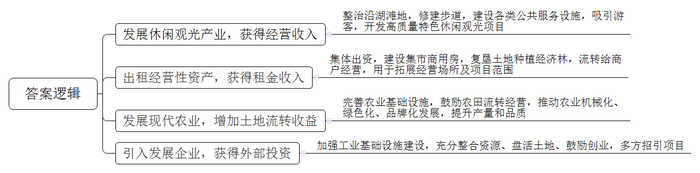
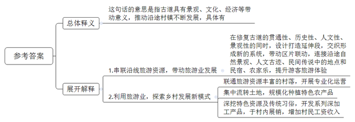
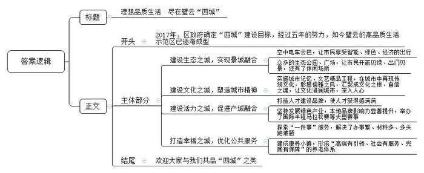

# 2022年公务员多省联考《申论》题（海南B卷）

> 候选采集稿。参考答案及解析来自粉笔页面，不代表官方答案或真实高分答卷；来源使用许可与原卷对应关系仍需人工核实。

## 给定材料

### 材料 material-b05ffe85c399a562

发展壮大村级集体经济是强农业、美农村、富农民的重要举措，是实现乡村振兴的必由之路。如何不断增加村集体经济收入，山茶村可算是找到了破解“密码”。

曾经的山茶村是个空壳村。十几年前，村集体背负了近80万元债务，当时村里连一个像样的办公地点都没有，更别提为村民办实事了。

村“两委”新的班子组建后，开始了探索创新之路。在新班子组织召开的第一届村民大会上，大家展开了热烈讨论。交通落后、没有产业基础等是山茶村的劣势，而优势也十分突出，紧邻南山湖。南山湖不仅水资源充足，而且生物物种丰富，湖边芦苇丛生，还经常有珍稀鸟类在此栖息，一到节假日，就有大量人流聚集在此休闲娱乐。但由于缺少相应的管理整治，鸟类栖息地时常变成烧烤点，不少区域甚至乱石堆砌、脏污不堪。

明确了自己的比较优势后，村“两委”最后做出决定：整治沿湖滩地，发展休闲观光产业。

山茶村邻湖沿线的浅滩和斜坡曾经杂草丛生、湿滑不平，村里决定在湖边修建沿湖步道，将原来的土石斜坡修整为阶梯式的过渡带，并设置了小码头、垂钓区和停车场等公共设施。这些改造和新建的服务设施吸引了越来越多的游人，带来了不错的收益。

山茶村因地制宜，变洼地为聚宝盆，将比较优势转化为发展优势。经过几年的努力，沿湖滩地不仅常年碧波荡漾、芦苇密布、水鸟成群，而且沿湖带的休闲观光产业逐渐发展起来，渔家乐、农家乐、码头汇、映月岛等一批高质量、有特色的休闲观光项目如雨后春笋般涌现，不仅为村民创造了更多就业、创业机会，还大大增加了村集体经济收入。有了这笔钱，山茶村“两委”有了发展的底气，除了一部分用于还债外，其余的钱用于扩建沿湖步道、停车场，增设环湖公园、儿童游乐场等休闲场所，以及用来发展其他集体产业。

村子的主干道上是一个马路集市，有几十年的历史，辐射周边10余个村。在集市的中段有个老电影院，年久失修，已经坍塌。为进一步拓展集体经济收入来源，经村民大会商议，村“两委”决定在老电影院原址建商用房，由集体出资建设，产权集体所有，房屋租给商户，租金为每年5万元，这笔收益不仅可观，而且十分稳定。

另外，山茶村抓住县里对附近河道进行拓宽的机会，利用挖出的土方复垦土地30亩，全部种植了经济林，而后又将这些经济林流转给农家乐的老板，用于拓展其经营场所和项目范围。如此一来，既扩大了绿化，保护了环境，又改善了生产条件，延伸了产业链条，拓展了增收空间。

经过几年的努力，山茶村不仅还清了债务，还能保持集体每年有一笔不菲的收入。“带领一个村发展就好比过日子，得想方设法多渠道去寻找致富门路，将鸡蛋放到多个篮子，不仅降低了风险，还提高了收益。”山茶村党支部韦书记说。

有了集体收入后，山茶村开始完善农业基础设施，修建水利，搭桥铺路，为农业现代化提供保障。村里先后投入20多万元修建了生产渠6000米、生产路12000米，大大方便了农户。同时，鼓励农田流转经营，推动农业的产业化和机械化；引导种植大户发展绿色农业，叫响南山湖品牌，农产品品质和产量不断提升。经过不懈努力，农田的水稻产量翻了两番，土地流转费也由一开始的50元提高到300元，再到现在的700元每亩。

栽下梧桐树，引得凤凰来。村“两委”深知，只有引入和发展企业，才能为村集体带来更多的收益。在完善农业基础设施的同时，村里还开始加强工业基础设施建设，多方招引项目。去年，鸿宇生物科技有限公司看中了山茶村的基础设施和自然资源，决定在村里投资建设秸秆收储加工项目。通过充分整合资源、盘活土地、鼓励创业，村里还招引农产品加工厂3家、电子材料厂1家，近百名村民实现就地就业。

“蛋生鸡、鸡生蛋，无穷尽，只有让钱生钱，村集体经济收入才能源源不断，才能为群众办更多的实事好事。”韦书记说。

### 材料 material-ebdd99c33772ddae

古道是前人探索出的交通路网，千百年来，沿途的风光、典故更让它魅力无限。随着时代的变迁，许多古道逐渐消失在人们的生活中。但在S县，古道的修复、再现和发展，让人感受到这些珍贵的历史遗迹历经长久的沉寂，正伸展出新的枝桠，将它途经的城镇乡村，一齐融入发展的脉络之中。

古道上斑驳的树影，把S县自然资源和规划局资源站张站长的思绪拉回到六年前。“S县的所有古道，我都走过。”他说，“随着人们走进大山、拥抱自然的兴趣日益浓厚，古道成为开展森林休闲养生体验活动的重要载体，这也是推动古道修复的重要原因之一。2016年县里把‘加快古道修复’列为十大民生实事之一，我和规划设计团队花了三四个月时间梳理、勘测全县的古道资源，发现许多古道的贯通性、历史性、人文性和景观性存在不同程度的损坏。”

古道修复讲求“修旧如旧”，还必须站在更宏观的视野上系统考虑，比如，怎样以古道为纽带，串联、贯通起周边的乡镇。因此，S县在规划古道修复工作之初，就将建设具有带动意义的古道系统作为目标。

沿着S县上古乡茶岭古道一路攀爬，游客们可抵达的最顶端是“一峰九崖”中最负盛名的奇石山峰——神女峰。其间，通向山顶的最后2公里山路，是在原先两条小路的基础上修整而成的，也是古道修复时特意设计打造的延伸段。

“在已修复的古道中，类似的延伸段设计可以让上山的游客选择另一条古道下山，体验沿途多个古迹景点，不走回头路。”古道修复规划设计专家吴教授说，“将古道与新设计的延伸段交织形成新的系统，带动区片联动，这是S县古道修复的最大特色。”

古道贯穿了S县的过去、现在和未来。据初步统计，古道沿线有自然景观资源800多个，民宿、农家乐300余家，人文古迹400多处，涉及民间传说100多个。当下，古道的文化、美景、风情，正成为“两山”转化、乡村振兴的重要载体。

为更好地将古道资源融入到名山、古镇、古村开发之中，2019年，S县开始谋划将古道修复工程纳入花园城镇建设中。2020年，又将古道修复工程与文化名山、古镇、古村的建设等一起纳入诗路文化带建设，让古道修复与乡镇建设相得益彰。

S县汝溪乡筋竹岭是传说中徐霞客游天台山的首餐地、首宿地，这是汝溪乡最引以为傲的文化资源。汝溪乡党委陈书记说：“古时，筋竹岭古道是进入天台山的官道，一大批文人墨客经此前往天台山，留下众多诗词歌赋。现在，游客们通常会在这里读一读碑文，体验往返1小时左右的古道行，再驱车前往汝溪山水穿越拓展基地。”围绕古道，汝溪乡打开了发展思路，徒步、漂流、越野、露营……古道成了汝溪乡最重要的发展资源。

修复古道，更像是在历史记忆中寻找新生。地处天台山深处的洞鹿乡花茂村一度处于区域发展的中下游，而在天茂旅游发展公司刘经理看来，也正是因为地处深山，花茂村很好地保留了古民居、古廊桥、古道、古树、古民俗特色，这“五古”正是花茂村后发起跑的优势所在。2021年2月，花茂村和隔壁的青茂村分别入股，与S县文旅集团签署整村运营协议，成立了天茂旅游发展公司。

公司成立之初便瞄准当地特色资源，利用村里的古民居，在古道口开了一家“乌养”村味馆，打造“乌养”系列产品展销厅。游客们走完古道，通常会在这里歇歇脚，也带一些当地的特色农产品回去。

“我们从两个村流转了270亩梯田，种植乌米。”刘经理说，吃乌米饭、舞龙灯、提线木偶等传统习俗都在这里保留传承。以此为灵感，公司开发了乌米茶、乌米酒、乌米粽子等系列产品。去年，乌米系列创造了150多万元的销售额，还为当地村民发放了40余万元的劳务工资。不久前，S县天台山片区的乡村入选省首批100个未来乡村试点。从交通的角度来看，古道不再是第一要道，但从发展的角度看，古道已成为沿途城镇乡村迈向未来的新动力。

### 材料 material-4001dbf71ea6855e

H市P县和Y县过去经济发展较为落后。近些年来，P县虽然取得了一定发展，但镇与镇之间的发展不平衡问题却越来越突出，而Y县则打出了一套乡镇集群化建设的“组合拳”，有效推动了县城、乡镇协同高质量发展。

●P县核心区由四个邻近乡镇组成：水门、仁和、三汇、永兴。水门镇规模最大，常住居民约12万，永兴约有5万居民，三汇和仁和不到2万。水门镇以宠物用品制造闻名，不仅有完善的宠物养殖、宠物食品生产、宠物美容、宠物乐园等产业链条，生活服务业也发展迅速，如修建了星级酒店、配套建成了完善的交通设施和大型污水处理厂。

仁和镇地势起伏，盛产老树岩茶。前些年，镇上刮起一波开荒种茶、兴办茶厂之风，现如今，大量茶厂倒闭，店铺人去楼空。曾在镇上开店的李先生回忆：“最景气的时候，镇上一大半门店都在销售茶叶，借着茶叶的热度，镇上修建了多家豪华酒店，还办起了茶文化博物馆，很是热闹。”“说实话，我当时就不太看好，那里交通不便，高速在那边没有出口，到县城还要绕几十里盘山路。如果不去进货，谁大老远跑去喝茶、逛博物馆？”曾前去考察货源的吴老板觉得，基础设施不完善、产业单一是仁和镇发展的硬伤。

三汇镇三面环水，风景秀美，当地的柑橘曾小有名气，但因为柑橘采摘后往外运输成本高、储藏技术欠缺，大多只能内销。杨女士家有几十亩橘园，行情不好的时候，即便免费相送，别人都嫌麻烦。“都说水门是县域副中心，其实我们跟水门离得很近，他们的道路交通、产业链条、信息服务不晓得为什么就是辐射不到我们这边。”

锑矿开采是永兴镇的支柱产业。“采矿会导致污染，这是显而易见的，但这是我们的主要收入来源，做好废水处理是我们的重点工作。”永兴镇党委余书记表示。为此，镇上修建了一座污水处理厂，用于处理厂矿污水和民用废水，同时，锑矿厂也投入大量资金完善和改建了排污设施设备，该厂与水门的污水处理厂相距不到2公里。

●Y县华福蛋厂已经尝到了协同发展的甜头。每天一大早，蛋厂的货车都会从华昌街道出发，经毗邻的中山镇到市里送货。以前走的是弯弯绕绕的乡间小道，路窄道远，还时不时堵车。自从华昌路北延工程建成，单程用时减少了20分钟。

华昌路北延工程于2020年4月通车，这条800多米的双向四车道柏油路，连接起了华昌街道与中山镇。华昌街道张主任介绍：“项目涉及两地的道路改造、设施提升、农户拆迁等，我们和中山镇进行了充分沟通和全方位谋划，最终共同出资、携手打通了这条‘断头路’。交通等基础设施的互联互通，促进了两街镇的充分融合。”除了华昌路北延工程，去年，双方还打通了另一处瓶颈路。

在Y县南港片区，变“一地独有”为“全体共享”的集成招数也开始发挥作用。“我们希望从乡镇集群发展的角度，以集约、互补为前提，打造一个‘美镇圈’。”Y县乡镇集群化建设办负责人说。南港片区构建了以沙河镇为核心，辐射周边乡镇的“1+N”发展模式，打破原有行政区划，实现全域一体化规划、组团式发展、协同性建设，打造“15分钟公共服务生活圈体系”。

以沙河镇为核心，南港片区高标准建设公共服务中心、生产服务中心、旅游集散中心、智慧治理中心等设施16处，打造辐射南港片区的“全域型村镇服务圈”，同时减配重复设施。“周边乡镇不再单独建设污水厂，而是将污水接到沙河镇污水处理厂。”沙河镇党委刘书记说，“邻近的风林镇以红色旅游为特色，原本规划了高档酒店，但考虑到沙河镇已有五星级酒店，风林镇就不再重复建设了。”

2021年5月，Y县广桥镇、文峰街道和北路街道共建的广文北经济园区正式开园。“我们园区重点打造中高端制造业产品生产集群，产权为三镇街共有，租金等收益由三地共享。每个镇街各派一名领导参与园区管理，并通过每半月一次的碰头会共商建设大计、共享招商引资资源。”园区管委会文主任说。与此同时，广桥镇聚焦现代化高端农业产业；文峰街道重点打造工业特色型美丽乡镇；北路街道全力升级“工业+居住”型未来社区。如此，3个镇街在集群化建设中既通力合作，又各有侧重，既打破行政壁垒、共享建设资源，又发挥独特优势、形成自己的特色“名片”。

入驻园区的北环科技公司陈经理说：“最初我们公司选址并不在这里，但园区的产城融合式集群平台吸引了我们。这里不仅有完整的上下游产业链，也有将生产区与生活区完美融合的各种网络。我们预计2022年能在这里实现3亿元的产值。”“原来我们担心集群化建设也很难打破不同乡镇之间的条块阻隔，但县里积极推广应用集行政管理、民生服务、社会治理等为一体的‘云政通’智慧服务平台，全面打造数字化在线政府，实现跨区域跨部门协同联动、一事联办，有效解决了企业和居民的各方面难题。”文主任说。

### 材料 material-41479c96446bfa97

“走，去璧云摘樱桃！”四月里，璧云区头塘镇的樱桃园内，绯红欲滴的樱桃和翠绿的树叶相映成趣，沉甸甸地挂满枝头。一到周末，这里便游人如织。自区委区政府2017年确定“四城”建设目标以来，璧云区生态之城、文化之城、活力之城、幸福之城的图景渐渐浮现，一个承载着璧云市民理想生活的高品质生活示范区逐渐成型。

从地铁1号线璧云东路站下车，远处驶来的是圆滚滚、萌嘟嘟的空中有轨电车“云巴”。2021年通车的“云巴”不仅方便了璧云市民的出行，更以其智能、绿色、经济的特点为市民的高品质生活穿针引线。搭乘“云巴”一路飞驰，城市的美景还未看够，林湖公园站便到了。“不管来多少次，我们都觉得林湖公园美不胜收。”每天晚饭后搭“云巴”去林湖公园散步，已成为市民罗先生一家的习惯。林湖公园占地1500亩，既紧邻璧云区新商业中心，又是天然“氧吧”，园内绿树成荫、鲜花常开。为了让市民“推窗见绿、出门见景”，璧云区打造了35座生态公园、68个生态广场。“生态公园建设以‘山水林田湖草’一体化为总思路，构建城区三大水系绿廊，实现景城融合，避免同质化重复性建设。”璧云区城市管理局林局长说。

“春雨惊春清谷天，夏满芒夏暑相连……”在春华体育公园，市民雷女士正在给孩子念刻在景观石上的《二十四节气歌》。像这样传播民俗文化、介绍历史故事、解读诗词歌赋的石刻，在璧云区大大小小的公园随处可见。“我们要坚定文化自信，深度挖掘璧云千年文脉，塑造城市精神，以文明之风彰显儒雅风范，持续打造新时代文明典范城市。”璧云区委宣传部黄部长表示，“让文化浸润城市、深入人心，是璧云区城市建设之魂。”

为此，璧云区不断涵养城市文化深度，实施“城市记忆工程”，大力保护文庙等文物古迹，多形式再现古道文化、抗战文化等历史文脉；实施文艺精品工程，努力推出“璧云原创”“璧云出品”等匠心之作。如今，在三道湾公园里，古村落、茶铺等主题场景重现了明清时期古驿道上的浩然意境；在枫凌塘湿地公园内典雅大气的状元桥两侧展示着当地本土名家字画；在林湖汽车露营公园里，老照片与仿古城墙巧妙搭配。一个个传统文化元素让千年儒雅之风在城市中吹拂，汇聚成当代璧云人的文化之根、自信之魂。

2022年3月，集招才引智、招商引资、城市宣传、项目孵化等功能为一体的“璧云人才”APP上线，璧云区着力打造人才建设品牌，从建立高端人才“管家”机制，到评选表彰“璧云英才”“璧云工匠”“璧云创客”，使各路人才在璧云区的获得感满满。在智力资源支撑下，璧云区秉持“绿色发展”理念，一方面，以智能制造为主攻方向，加快发展新能源、人工智能、集成电路等先进制造业和战略性新兴产业；另一方面，提档升级菜园、果园、花园，打造集观光游览、休闲度假、品尝采摘为一体的新业态。采摘节、艺术节等活动活力四射，“引爆”乡村旅游。从“璧云樱桃”“璧云肉兔”等品牌影响力提升，到举办国际半程马拉松赛、西部动漫节，从规划建设国家级数字文创产业园，到继续申办量子信息安全托管全国运营基地，璧云区坚持产城融合的发展逻辑，不断为城市发展注入新活力。

“亲爱的小朋友：欢迎你来到我们身边，你像一轮旭日，晨曦中积攒着力量和希望……”6月1日，璧云区行政服务中心内，“新手”母亲朱女士从“出生一件事”礼包中抽出一封信，柔声读起来。除了写给新生儿的信，礼包里还有孩子的社会保障卡、出生医学证明和居民户口簿。“我是昨天在线上申请的，没想到今天就可以领取了。”朱女士高兴不已。“出生一件事”是璧云区行政服务中心的一项特色服务，该服务将曾经分散在不同部门的多个事项集中在线下1个窗口，解决了新生儿出生相关事项办事繁、材料多、多头跑的难题。自2021年5月试点运行以来，该服务广受群众好评。区行政服务中心王科长介绍，在“出生一件事”基础上，“入学一件事”“退休一件事”等都已形成初步方案，预计今年秋季将试点运行。“这些事看起来不起眼，却能让市民收获的幸福从‘小’一直到‘老’。”王科长说。

坐落于秀湖街道的三泉康养小镇，以专业的养老服务闻名于区内外。智慧健康养老云平台带来安心，“快乐管家、生活管家、健康管家”三大管家服务带来舒心，多种多样的娱乐项目带来开心，老年群众的各种需求在康养小镇基本都能得到满足。2021年以来，璧云区逐渐形成“高端有引领、社会有服务、兜底有保障”的养老服务体系，已建设15个镇街养老服务中心、45个社区养老服务站和54个村级互助养老点。

## 题目

### 第 1 题

**请你根据****“给定资料**1**”，谈谈山茶村是如何通过“蛋生鸡，鸡生蛋”的方式破解村集体经济发展密码的。（20分）**

关联材料：material-b05ffe85c399a562、material-ebdd99c33772ddae、material-4001dbf71ea6855e、material-41479c96446bfa97

作答要求：

要求：全面、准确、有条理。不超过300字。

### 第 2 题

**请你根据****“给定资料**2**”，谈谈对“古道已成为沿途城镇乡村迈向未来的新动力”的理解。****（****20分****）**

关联材料：material-b05ffe85c399a562、material-ebdd99c33772ddae、material-4001dbf71ea6855e、material-41479c96446bfa97

作答要求：

要求：全面、准确、有条理。不超过300字。

### 第 3 题

**假如你是****P县政府办的一名工作人员，请结合“给定资料**3**”，梳理P县在乡镇建设中存在的问题，并提出解决问题的建议。（30分）**

关联材料：material-b05ffe85c399a562、material-ebdd99c33772ddae、material-4001dbf71ea6855e、material-41479c96446bfa97

作答要求：

要求：

（1）问题梳理全面，准确；

（2）所提建议与问题对应，具体明确、切实可行；

（3）不超过400字。

### 第 4 题

**假如你是璧云区委宣传部工作人员，请根据****“给定资料**4**”，拟写一篇反映璧云区“四城”建设成就的宣传稿。（30分）**

关联材料：material-b05ffe85c399a562、material-ebdd99c33772ddae、material-4001dbf71ea6855e、material-41479c96446bfa97

作答要求：

要求：

（1）紧扣资料，内容全面；

（2）条理清晰，语言生动；

（3）不超过400字。

## 答案与解析

第 1 题

**参考答案（粉笔题库参考内容）**

1.发展休闲观光产业，获得经营收入。整治沿湖滩地，修建步道，建设各类公共服务设施，吸引游客，开发高质量特色休闲观光项目。

2.出租经营性资产，获得租金收入。集体出资，建设集市商用房，复垦土地种植经济林，流转给商户经营，用于拓展经营场所及项目范围。

3.发展现代农业，增加土地流转收益。完善农业基础设施，鼓励农田流转经营，推动农业机械化、绿色化、品牌化发展，提升产量和品质。

4.引入发展企业，获得外部投资。加强工业基础设施建设，充分整合资源、盘活土地、鼓励创业，多方招引项目。

**解析**

**参考答案说明：**本参考答案从“发展休闲观光产业，获得经营收入”“出租经营性资产，获得租金收入”“发展现代农业，增加土地流转收益”“引入发展企业，获得外部投资”等不同的方面进行了分条撰写。各条要点之间在内容上相互并列，没有交叉。

**考点**：考点概括措施类

**来源**：来源2022年公务员多省联考《申论》题（海南B卷）

粉笔申论页面对本题只提供「解析视频」入口，该入口是会员推广位，页面无视频地址与文字解析。

第 2 题

**参考答案（粉笔题库参考内容）**

这句话的意思是指古道具有景观、文化、经济等带动意义，推动沿途村镇不断发展，具体有：

1.串联沿线旅游资源，带动旅游业发展。在修复古道的贯通性、历史性、人文性、景观性的同时，设计打造延伸段，交织形成新的系统，带动区片联动，连接沿途自然景观、人文古迹、民间传说中的地点和民宿、农家乐，提升游客旅游体验。

2.利用旅游业，探索乡村发展新模式。联通旅游资源丰富的村落，开展专业化运营；集中流转土地，规模化种植特色农产品；深挖特色资源及传统习俗，开发系列深加工产品，于村内展销，增加村民工资收入。

**解析**

**参考答案说明：**（1）思路方面，本参考答案按照词句解释题“总体释义+展开解释+总结”的一般答题思路展开（其中省略了总结部分）。（2）内容方面，本参考答案首先对句子的含义进行了总体解释；接着“展开解释”部分，从“串联沿线旅游资源，带动旅游业发展”与“利用旅游业，探索乡村发展新模式”两个方面，分析了古道对沿途村镇发展的意义。（3）词句表达方面，本参考答案加上了“具体有”等连接词来承接上下文，使上下衔接更顺畅。

**考点**：考点词句解释类

**来源**：来源2022年公务员多省联考《申论》题（海南B卷）

粉笔申论页面对本题只提供「解析视频」入口，该入口是会员推广位，页面无视频地址与文字解析。

第 3 题

**参考答案（粉笔题库参考内容）**

一、问题：乡镇间道路不连通，交通运输不便。建议：进行道路延伸、改造，乡镇间充分沟通，全方位谋划，共同出资，打通断头路，增设高速路出口，促进交通等基础设施的互联互通。

二、问题：基础设施不共享，存在重复建设。建议：打破原有行政区划，实现全域一体化规划，组团式发展、协同性建设，共享基础设施，减配重复设施，域内已有设施不再重复建设。

三、问题：产业缺乏统筹整合，发展模式单一。建议：共建经济园区，向高端延伸产业链条，共同管理，共享收益、资源；产业规格“一盘棋”，在保留特色、发挥优势的基础上差异互补。

四、问题：信息服务不互通，存在条块阻隔。建议：建设线上智慧服务平台，打造数字化在线政府，共享各类服务信息，实现跨区域跨部门协同联动、一事联办，及时为企业、居民排忧解难。

**解析**

**参考答案说明：**本参考答案从“交通运输”“基础设施”“产业发展”“信息服务”这四个方面写出了P县在乡镇建设中存在的问题和解决问题的建议。各条要点之间在内容上相互并列，没有交叉。

**考点**：考点提出对策类

**来源**：来源2022年公务员多省联考《申论》题（海南B卷）

粉笔申论页面对本题只提供「解析视频」入口，该入口是会员推广位，页面无视频地址与文字解析。

第 4 题

**参考答案（粉笔题库参考内容）**

理想品质生活 尽在璧云“四城”

2017年，区政府确定“四城”建设目标，经过五年的努力，如今璧云的高品质生活示范区已逐渐成型：

一、建设生态之城，实现景城融合。空中电车云巴，让市民享受智能、绿色、经济的出行；众多的生态公园、广场，让市民开窗见绿、出门见景，还有了休闲场所。二、建设文化之城，塑造城市精神。实施城市记忆、文艺精品工程，在城市中再现传统文化，彰显儒雅之风，汇聚成文化之根、自信之魂，让文化浸润城市，深入人心。三、建设活力之城，促进产城融合。打造人才建设品牌，使人才获得感满满；坚持发展绿色产业，本地品牌影响力显著提升，举办了国际半程马拉松赛等大型赛事。四、打造幸福之城，优化公共服务。探索“一件事”服务，解决了办事繁、材料多、多头跑难题；建成康养小镇，形成“高端有引领、社会有服务、兜底有保障”的养老体系。

欢迎大家与我们共品“四城”之美。

**解析**

**参考答案说明：**（1）格式方面，本参考答案写到了“标题”“正文”两个部分。（2）正文部分，一方面从内容来看，围绕着“璧云区‘四城’建设成就”这一主题，本参考答案的开头先写到了“璧云区‘四城’建设的背景”；接着主体部分从“建设生态之城，实现景城融合”“建设文化之城，塑造城市精神”“建设活力之城，促进产城融合”“打造幸福之城，优化公共服务”这四个方面介绍了璧云区“四城”建设的成就；结尾部分进行了呼吁号召。另一方面，形式上，本参考答案做到了分段、分条撰写，整体上条理较为清晰。

**考点**：考点宣传类

**来源**：来源2022年公务员多省联考《申论》题（海南B卷）

粉笔申论页面对本题只提供「解析视频」入口，该入口是会员推广位，页面无视频地址与文字解析。

