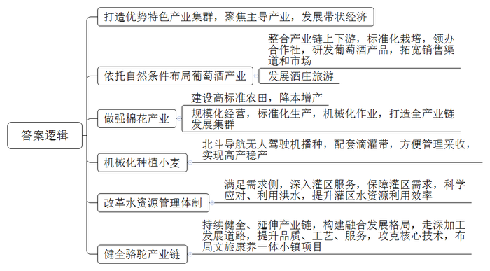
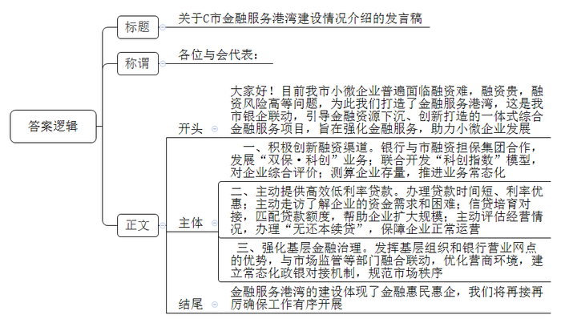

# 2023年公务员多省联考《申论》题（海南A卷）

> 候选采集稿。参考答案及解析来自粉笔页面，不代表官方答案或真实高分答卷；来源使用许可与原卷对应关系仍需人工核实。

## 给定材料

### 材料 material-2b3df0115058bc0b

2022年6月，第29届国际葡萄酒大奖赛全球榜单公布，夜光杯葡萄酒业公司旗下产品荣获3项金奖。“依托T县的气候环境优势，积极布局葡萄酒产业，公司目前已研发生产干红、桃红两大系列七个葡萄酒产品，并通过线上线下渠道销往世界各地。”夜光杯葡萄酒业公司谭董事长说，“我们整合产业链上下游，在生产端采用标准化栽培技术，提升酿酒葡萄的品质，通过领办合作社带动周边千余户农民增收。同时，还依托酒庄开发酒庄旅游业，年均接待游客3万人次。”

近年来，X省先后成功申报并创建葡萄、棉花等6个优势特色产业集群，聚焦全省范围内基础好、规模大、有特色、比较优势显著的主导产业，推动主导产业由县域的“块状经济”向全省“带状经济”转变。

在棉花主产区L县的依力村高标准农田建设现场，装载机、推土机、挖掘机等大型机械相互配合，一块块小地块变成了平整的大条田。棉农小艾种了248亩地，看着眼前平整好的大条田，他说：“以前棉花地都是小地块，高低不平，平整后就可以使用大型机械了，不仅减少了投入，还能提高棉花产量。”“截至2022年底，全县高标准农田面积已达100万亩，比十年前增加了5倍，棉花产效增长40%；农民也从土地上解放出来，收入渠道更加多元了。”L县耿副县长说，高标准农田建设为全县棉花产业持续补链强链打下了坚实基础。

“我们先后成立了制种公司、轧花厂、纺机厂，不断提高棉花产业发展效益。”守信集团郭董事长说，集团将继续开发家纺、服装等产品，完成从一粒棉种到一件衣服的全产业链发展。目前，L县近50%的棉花已就地转化为纺织产品，规模化经营、标准化生产、机械化作业，棉花全产业链发展集群已初步形成。

在W县塔格村，村民阿力正在播种冬小麦，“北斗导航无人驾驶播种机下种均匀、播得直，同步铺设滴灌带，方便了我们后期的管理和采收。”“这几年，我们村用北斗导航无人驾驶播种机播种的小麦高产稳产，村民种植冬小麦的积极性很高。”塔格村党支部刘书记说。

“现在种地跟原来相比，说轻松又不轻松。”Q县河子村种植大户老马2022年种植了1500亩冬小麦，“种地都机械化了，不再像原来那样拼体力，而是要多动脑子，努力学习和掌握新知识。”

截至2022年，X省农作物综合机械化水平达到87.5%，农林牧渔综合机械化水平达到72.6%。

塔河流域的人们，至今依然对去年夏天的一场洪水记忆犹新。塔河进入夏季汛期不久，就形成了60年不遇的大洪水。汛期的主河道大水翻涌，向下游行进。“当叶尔羌河山区段来水剧增时，阿尔塔什水利枢纽一面拦截洪峰，一面加大下泄水量。我们积极利用这一股洪水，通过叶尔羌河沿线6个分水枢纽，把水高效引入农区和胡杨林区。”塔河流域K县管理局夏局长说，“洪水来了，流域管理机构怎么分，我们怎么接，接后怎么分配使用，都有具体的实施方案。”

“2022年以来，塔河流域水资源管理体制进行了一系列改革，实现了从注重供给侧向满足需求侧转变，从关注大河来水向深入灌区服务转变，从管住灌区用水向千方百计保障灌区需求转变，塔河流域各大灌区水资源利用率明显提高。”塔河流域管理局王副局长说，得益于塔河流域各地的科学应对，洪水静悄悄流过农田、村庄和胡杨林，80%都得到了有效利用。

“作为X省特种乳产业的知名企业，我们持续健全产业链、构建融合发展格局，企业不仅生产鲜驼奶、驼奶粉、奶片，还研发了驼绒制品、驼乳化妆品、保健品，今后还将继续延伸骆驼产业链，走出一条以科技为基础的骆驼产品深加工发展之路。”源旺生物科技集团潘董事长说，集团还在品质、工艺、服务三个方面同步发力，攻克驼奶保鲜等相关核心技术，还在F县积极布局集旅游、康养、文化等于一体的骆驼小镇项目，带动当地农牧民增收致富。

“正在深刻改变农业内涵的高质量发展，将成为不可阻挡的时代趋势。”X省农业农村厅王副厅长深有感触地说。

### 材料 material-babcab15c854e6ad

作为一家从事大数据服务的科技型小微企业，轻资产、信用评价难度大一直是困扰C市韩钛科技有限公司融资的突出问题。在一次政策宣传中，韩钛科技有限公司齐总了解到他们公司可享受金融服务港湾一站式金融服务，便当即拿出手机输入了企业信息和融资需求，没想到一天后就有多家银行主动联系他。最终，秦民村镇银行利用针对科技型小微企业的专属信贷产品，为其提供了80万元信用贷款。如此高效便捷的金融服务和无抵押无担保的信贷产品，让齐总喜出望外：“我们这些小微企业能享受到金融服务港湾如此高质量的金融服务，发展壮大的底气更足了！”

金融服务港湾是C市通过政银企联动，引导金融资源有序下沉、创新打造的一体式综合金融服务项目，旨在积极推进金融服务小微企业“敢贷、愿贷、能贷、会贷”长效机制建设。如今在C市，众多中小微企业和个体工商户在星罗棋布的金融服务港湾里“靠岸”，实现了“小生意”福泽“大民生”。

“我没有抵押物，找人担保贷款额度小、成本高，‘双保·科创’真是帮我解决了一大难题！”某阀门科技有限公司刘总的一句话，道出了大部分小微企业的心声。该公司是一家专业从事阀门及配件、管件的研发、设计、生产、销售的高新科创企业，拥有7份资质证书、11项专利，发展前景较好。他们通过农行C市分行与市融资担保集团合作的“双保·科创”业务，获得了农行200万元贷款。新的融资渠道，着实让成长中的科技型企业有了底气。

由C市银保监分局、科技局等部门联合开发的“科创指数”模型，通过“五大能力维度”“八项评价科目”对科创型企业进行评价得分。在“科创指数”基础上，农行C市分行将存量科技型企业进行测算，同时引入“双保·科创”助力融资担保业务，推进常态化的“双保”助力融资机制，拓宽服务覆盖面，帮助企业稳定经营和创新发展，进一步解决小微科技型企业融资难、融资贵问题。

“没想到金融服务港湾主动上门帮我们办理贷款，时间短、利率优惠，这笔资金对我们来说真是‘及时雨’！”C市聚狮新材料科技公司杜总高兴地说道。该公司是一家民营中小企业，主要生产特种工程塑料PPS。2021年11月，该公司因受原材料涨价、销售回款慢及疫情的叠加影响，流动资金紧张。C市银行的“民营小微和个体工商户金融服务港湾”，在日常走访中了解到企业的资金需求和困难，一周时间便通过“支小再贷款帮扶贷”为其发放了1年期500万元的贷款，仅3天就到账了第一笔贷款，有效缓解了原材料采购资金紧张的问题。

老刘是某糖果品牌的一级经销商，产品聚焦C市，辐射周边多地。然而，疫情一度让经营受到冲击。“受到疫情影响，企业去年有4个月没有营收，仓库内滞销的糖果价值超1000万元。”老刘回忆，望着堆积如山的货物和日渐短缺的流动资金，他焦急万分。通过金融服务港湾的信贷培育对接，农行C市石马河支行为其匹配了额度850万元的“抵押+助业快e贷”产品，年利率仅3.5%。“这么低利率的贷款着实让我松了口气。”老刘说，今年他计划新招员工，继续扩大自己的生意规模。

“‘无还本续贷’救了我的洗衣店。”小徐感慨道。小徐的社区洗衣店生意和许多受疫情冲击的商户一样也一度遇到困难。今年上半年，C市农村商业银行在社区工商户走访对接中得知小徐存在还贷困难，在迅速对往年经营情况评估后，为其办理了“无还本续贷”，保障了洗衣店正常运营。如果没有“无还本续贷”，他需要一次性支付本金47万元用于还款，这样不仅生意受影响，正常生活也会受到波及。

“以前我们想融资，常有中介找上门，融资成本高不说，还有被套路的风险。”长期经营箱包生意的邓女士表示，因为不了解政策，自己曾盲目依赖贷款中介，面对高额利息和手续费，心中有苦难言。过去，类似邓女士这样因迫切需要融资而通过“找关系”“靠中介”寻求贷款渠道的商户不在少数。让“套路贷”“高利贷”、金融诈骗、非法集资等有机可趁，不仅阻碍小微市场主体健康发展，更是基层金融治理中的不稳定因素。为此，C市在推进金融服务港湾建设的过程中，将“基层金融治理功能”作为核心重点，积极发挥基层组织贴近市场主体的天然优势和银行营业网点金融服务的专业优势，并与市场监管、税务等部门融合联动，强化基层金融治理，优化提升营商环境。“我们区外来企业、务工人员较多，环境复杂，以前各种金融中介乱蹿，金融风险防范管理一度成为棘手难题。”C市某区金融办相关负责人表示，通过金融服务港湾，银政之间建立了常态化对接机制，有效规范了市场秩序，预防和化解了不少矛盾纠纷。

## 题目

### 第 1 题

**请根据****“给定资料**1**”，谈谈X省推进农业高质量发展的举措。（****20分****）**

关联材料：材料 material-2b3df0115058bc0b

作答要求：

要求：全面、准确、有条理，不超过300字。

### 第 2 题

**省金融办近期准备召开助力小微企业发展经验交流会，假如你是****C市金融办工作人员小王，将代表C市在会上发言，请根据“给定资料**2**”，拟写一篇发言稿，介绍C市金融服务港湾建设情况。（****30分****）**

关联材料：材料 material-babcab15c854e6ad

作答要求：

要求：

（1）紧扣资料，重点突出；

（2）有逻辑性，语言流畅；

（3）不超过500字。

### 第 3 题

**“给定资料**4**”提到，“在大变局的喧嚣中始终坚守住‘本分’，切实增强好‘本领’，不断突破创新，推动高质量发展的步伐就能坚实稳健，我们就能走向广阔的未来”。请结合对这句话的理解，参考给定资料，联系实际，自选角度，自拟题目，写一篇文章。（****50分****）**

关联材料：材料 material-2b3df0115058bc0b

作答要求：

要求：

（1）观点明确，见解深刻；

（2）参考给定资料，但不拘泥于给定资料；

（3）思路清晰，语言流畅；

（4）字数1000～1200字。

## 答案与解析

第 1 题

**参考答案（粉笔题库参考内容）**

打造优势特色产业集群，聚焦主导产业，发展带状经济。

1.依托自然条件布局葡萄酒产业：整合产业链上下游，标准化栽培，领办合作社，研发葡萄酒产品，拓宽销售渠道和市场；发展酒庄旅游。

2.做强棉花产业：建设高标准农田，降本增产；规模化经营，标准化生产，机械化作业，打造全产业链发展集群。

3.机械化种植小麦：北斗导航无人驾驶机播种，配套滴灌带，方便管理采收，实现高产稳产。

4.改革水资源管理体制：满足需求侧，深入灌区服务，保障灌区需求，科学应对、利用洪水，提升灌区水资源利用效率。

5.健全骆驼产业链：持续健全、延伸产业链，构建融合发展格局，走深加工发展道路，提升品质、工艺、服务，攻克核心技术，布局文旅康养一体小镇项目。

**解析**

**参考答案说明：**本参考答案先介绍了X省推进农业高质量发展的总体对策，随后具体对策从“依托自然条件布局葡萄酒产业”“做强棉花产业”“机械化种植小麦”“改革水资源管理体制”“健全骆驼产业链”这五个方面展开进行了分条撰写。各条要点之间在内容上相互并列，没有交叉。

**考点**：考点概括措施类

**来源**：来源2023年公务员多省联考《申论》题（海南A卷）

粉笔申论页面对本题只提供「解析视频」入口，该入口是会员推广位，页面无视频地址与文字解析。

第 2 题

**参考答案（粉笔题库参考内容）**

关于C市金融服务港湾建设情况介绍的发言稿

各位与会代表：

大家好！目前我市小微企业普遍面临融资难，融资贵，融资风险高等问题，为此我们打造了金融服务港湾，这是我市银企联动，引导金融资源下沉、创新打造的一体式综合金融服务项目，旨在强化金融服务，助力小微企业发展。

一、积极创新融资渠道。银行与市融资担保集团合作，发展“双保·科创”业务；联合开发“科创指数”模型，对企业综合评价；测算企业存量，推进业务常态化。

二、主动提供高效低利率贷款。办理贷款时间短、利率优惠；主动走访了解企业的资金需求和困难；信贷培育对接，匹配贷款额度，帮助企业扩大规模；主动评估经营情况，办理“无还本续贷”，保障企业正常运营。

三、强化基层金融治理。发挥基层组织和银行营业网点的优势，与市场监管等部门融合联动，优化营商环境，建立常态化政银对接机制，规范市场秩序。

金融服务港湾的建设体现了金融惠民惠企，我们将再接再厉确保工作有序开展。

**解析**

**参考答案说明****：**（1）格式方面，本参考答案写到了“标题”“称谓”“正文”三个部分｡（2）正文部分，一方面从内容上来看，答案的开头先提出了小微企业面临的问题；主体从“积极创新融资渠道”“主动提供高效低利率贷款”“强化基层金融治理”三个方面具体介绍了如何帮助小微企业发展，结尾进行了总结、展望。另一方面，在形式上，本参考答案做到了分段、分层撰写，整体上条理较为清晰。

**考点**：考点总结类

**来源**：来源2023年公务员多省联考《申论》题（海南A卷）

粉笔申论页面对本题只提供「解析视频」入口，该入口是会员推广位，页面无视频地址与文字解析。

第 3 题

**参考答案（粉笔题库参考内容）**

**参考答案一：**

**论推动高质量发展的路径**

**——坚守本分 增强本领 突破创新**

当今世界正处于百年未有之大变局，新一轮科技革命风起云涌，产业变革深入发展。如何于变局中开新局，中国智慧彰显出力量，我们国家顺应时势提出了高质量发展道路。前进的方向已经明确、前行的道路已经开拓，我们必须以坚守本分为原则，以增强本领为手段，以突破创新为核心动力，大力推动经济高质量发展，为全面建设社会主义现代化强国开好局起好步。

**推动高质量发展，我们要始终坚守住****“本分”，保持定力，坚守实业目标不动摇，严把质量关，为高质量发展筑牢坚实基础。**实体经济是国民经济的基础和命脉，是国家强盛和民族复兴的重要支柱。而在实体经济的主战场上，质量是企业的立身之本。变局之下，大环境的不确定性、不稳定性增加，做实业考验着企业的定力。如何应对变局？格力给出了自己的答案。“好空调格力造”，这句脍炙人口的广告是格力三十年如一日坚持做实业、“锱铢必较”严把质量关的生动写照。因此，迎战变局，企业一方面需要拿出“咬定青山不放松”的定力，迎难而上、攻坚克难，聚焦目标、聚焦实业。另一方面要严把材料关、生产关、检验关，确保产品质量过硬，用高品质立身。

**推动高质量发展，我们要增强好****“本领”，专注专业技术领域，勤于实践，秉持工匠精神，坚持高标准和进取精神，打磨过硬技术。**众所周知，高质量发展离不开大量专业技术人才，他们是支撑中国制造、中国创造的重要基础。因此，一方面，“三百六十行，行行出状元。”作为一名技术工人要积极投身工作洪流，不断学习新知识，立足岗位精耕细作，练就一身真本领，掌握一手好技术，为加快建设制造强国发光发热。另一方面，政府要通过创新“导师帮带制”、完善技术工人的评价、激励制度等，持续培养优秀的工人队伍，提高其待遇水平，畅通其职业发展渠道，为中国高质量发展提供有力的人才保障。

**推动高质量发展，我们还要不断突破创新，积极自主研发，努力打造创新产品，推动中国品牌走向世界。**曾几何时，中国山寨品牌遍布大江南北，代工企业多如牛毛。我们被冠以“制造大国”等称号，却迟迟尚未跨入“制造强国”的行列，这无疑与高质量发展目标背道而驰。因此，面对“大而不强”的痛点，我们一方面要在科技创新上下足功夫，鼓励企业建立研发中心，加强研发投入等，推出更具市场竞争力的产品。例如华为不断加强对智能手机、5G网络等领域的研发，近年来市场占有率越来越高。另一方面，我们也要顺应消费升级趋势，通过增强品牌识别，打造品牌形象等，促使本土品牌走向国际舞台。例如李宁通过打造“中国李宁”的品牌认知，让中国原创享誉全球。

潮平岸阔催人进，风正扬帆正当时。高质量发展是全面建设社会主义现代化国家的首要目标，我们要在坚守实业本分、增强技术本领、突破研发创新中实现高质量发展！

**解析**

**文章分析**

**论推动高质量发展的路径**  
**——坚守本分 增强本领 突破创新**

【**标题的优点：**标题中含有主题词，使文章主题更突出、清晰。其次，采用主副标题的形式，明确文章观点。】  
（1）当今世界正处于百年未有之大变局，新一轮科技革命风起云涌，产业变革深入发展。如何于变局中开新局，中国智慧彰显出力量，我们国家顺应时势提出了高质量发展道路。前进的方向已经明确、前行的道路已经开拓，（2）我们必须以坚守本分为原则，以增强本领为手段，以突破创新为核心动力，大力推动经济高质量发展，为全面建设社会主义现代化强国开好局起好步。

【**开头的优点：**★内容方面。范文的开头是紧扣题目给定的“高质量发展”这一主题展开的。首先，介绍当前发展的国际背景；其次，指出了如何促进高质量发展的对策。★文字表达方面。运用了排比的修辞手法，使语言表达有逻辑性、并增强文章气势。】

**推动高质量发展，我们要始终坚守住****“本分”，保持定力，坚守实业目标不动摇，严把质量关，为高质量发展筑牢坚实基础。**（1）实体经济是国民经济的基础和命脉，是国家强盛和民族复兴的重要支柱。而在实体经济的主战场上，质量是企业的立身之本。变局之下，大环境的不确定性、不稳定性增加，做实业考验着企业的定力。（2）如何应对变局？格力给出了自己的答案。“好空调格力造”，这句脍炙人口的广告是格力三十年如一日坚持做实业、“锱铢必较”严把质量关的生动写照。因此，迎战变局，企业一方面需要拿出“咬定青山不放松”的定力，迎难而上、攻坚克难，聚焦目标、聚焦实业。另一方面要严把材料关、生产关、检验关，确保产品质量过硬，用高品质立身。

【**论述段****1的优点：**★观点句：范文的观点句是紧扣“高质量发展”这一文章主题提出的。形式上，它在段首处直接写出，位置突出，容易发现。内容上，关键词突出，内容要点明确，可以明显看出主要论述从“坚守住‘本分’”方面入手。★论述内容：（1）先指出了实体经济的重要性；（2）再从企业角度阐释了如何应对变局。注意：以上几个方面的内容都是紧扣“推动高质量发展，我们要始终坚守住‘本分’，保持定力，坚守实业目标不动摇，严把质量关，为高质量发展筑牢坚实基础”这个观点句进行分析论述的，论述的针对性强，内容层次丰富。在论述方法上主要采用了讲道理与举例子结合，论述清晰透彻。】

**推动高质量发展，我们要增强好****“本领”，专注专业技术领域，勤于实践，秉持工匠精神，坚持高标准和进取精神，打磨过硬技术。**众所周知，（1）高质量发展离不开大量专业技术人才，他们是支撑中国制造、中国创造的重要基础。因此，一方面，“三百六十行，行行出状元。”（2）作为一名技术工人要积极投身工作洪流，不断学习新知识，立足岗位精耕细作，练就一身真本领，掌握一手好技术，为加快建设制造强国发光发热。（3）另一方面，政府要通过创新“导师帮带制”、完善技术工人的评价、激励制度等，持续培养优秀的工人队伍，提高其待遇水平，畅通其职业发展渠道，为中国高质量发展提供有力的人才保障。

【**论述段****2的优点：**★观点句：范文的观点句是紧扣“高质量发展”这一文章主题提出的。形式上，它在段首处直接写出，位置突出，容易发现。内容上，关键词突出，内容要点明确，可以明显看出主要论述从“增强好‘本领’”方面入手。★论述内容：（1）指出了高质量发展离不了人才；（2）阐释了技术工人应积极学习；（3）政府应提供有力人才保障。注意：以上几个方面的内容都是紧扣“推动高质量发展，我们要增强好‘本领’，专注专业技术领域，勤于实践，秉持工匠精神，坚持高标准和进取精神，打磨过硬技术”这个观点句进行分析论述的，论述的针对性强，内容层次丰富。在论述方法上主要采用了讲道理的方式，论述内容贴切合理。】  
**推动高质量发展，我们还要不断突破创新，积极自主研发，努力打造创新产品，推动中国品牌走向世界。**（1）曾几何时，中国山寨品牌遍布大江南北，代工企业多如牛毛。我们被冠以“制造大国”等称号，却迟迟尚未跨入“制造强国”的行列，这无疑与高质量发展目标背道而驰。因此，面对“大而不强”的痛点，（2）我们一方面要在科技创新上下足功夫，鼓励企业建立研发中心，加强研发投入等，推出更具市场竞争力的产品。例如华为不断加强对智能手机、5G网络等领域的研发，近年来市场占有率越来越高。（3）另一方面，我们也要顺应消费升级趋势，通过增强品牌识别，打造品牌形象等，促使本土品牌走向国际舞台。例如李宁通过打造“中国李宁”的品牌认知，让中国原创享誉全球。

【**论述段****3的优点：**★观点句：范文的观点句是紧扣“高质量发展”这一文章主题提出的。形式上，它在段首处直接写出，位置突出，容易发现。内容上，关键词突出，内容要点明确，可以明显看出主要论述从“不断突破创新”方面入手。★论述内容：（1）指出了我国制造业产业的问题；（2）强调要在科技创新上下功夫；（3）增强品牌意识。注意：以上几个方面的内容都是紧扣“推动高质量发展，我们还要不断突破创新，积极自主研发，努力打造创新产品，推动中国品牌走向世界”这个观点句进行分析论述的，论述的针对性强，内容层次丰富。在论述方法上主要采用了讲道理与举例子结合，论述清晰透彻。】

潮平岸阔催人进，风正扬帆正当时。高质量发展是全面建设社会主义现代化国家的首要目标，我们要在坚守实业本分、增强技术本领、突破研发创新中实现高质量发展！

【**结尾的优点：**范文的结尾回扣了“高质量发展”这个主题，并且进行了总结提升。】

**参考答案二：**

坚守本分强基础 增强本领谋发展

当今世界正处于百年未有之大变局，新一轮科技革命风起云涌，产业变革深入发展。如何于变局中开新局，中国智慧彰显出力量，我们国家顺应时势提出了高质量发展道路。前进的方向已经明确，前行的道路已经开拓，我们必须以坚守本分为原则，以增强本领为手段，以突破创新为核心动力，大力推动经济高质量发展，为全面建设社会主义现代化强国开好局起好步。

推动高质量发展，我们要始终坚守住“本分”，保持定力，坚守实业目标不动摇，严把质量关，为高质量发展筑牢坚实基础。实体经济是国民经济的基础和命脉，是国家强盛和民族复兴的重要支柱。而在实体经济的主战场上，质量是企业的立身之本。变局之下，大环境的不确定性、不稳定性增加，做实业考验着企业的定力。如何应对变局？格力给出了自己的答案。“好空调格力造”，这句脍炙人口的广告是格力三十年如一日坚持做实业、“锱铢必较”严把质量关的生动写照。因此，迎战变局，企业一方面需要拿出“咬定青山不放松”的定力，迎难而上、攻坚克难，聚焦目标、聚焦实业。另一方面要严把材料关、生产关、检验关，确保产品质量过硬，用高品质立身。

高质量发展的实现需要增强好“本领”，打好科技革命战。要秉持高标准和进取精神，打磨过硬技术，还要突破创新，积极自主研发，推动中国品牌走向世界。技术创新是推动企业发展的核心驱动力。通过不断提升技术水平，企业能够生产出更具竞争力的产品和提供更优质的服务，从而满足消费者需求。无论是对企业自身的提升，还是对整体经济的发展，打磨过硬技术都是不可或缺的。另一方面，在全球化竞争日益激烈的背景下，依靠模仿和跟随的发展模式已经无法适应市场需求。只有通过自主研发和创新，才能在国际竞争中脱颖而出。通过不断推陈出新，中国品牌能够树立起自身的技术和品牌优势，并逐步赢得全球市场的认可。

而增强“本领”还体现在要实现产业变革，一方面要努力推动主业高位发展，另一方面也要健全产业链条，打造新业态、新模式。主业是企业发展的核心竞争力，只有不断提升主业水平，才能在市场竞争中立于不败之地。通过加大科研投入、培养专业人才、提高技术创新能力，企业可以不断突破自身的局限，实现产业变革的目标。与此同时，一个完整的产业链条能够形成合理的分工和协同发展，提高资源利用效率和降低生产成本。通过与上下游企业的合作，可以实现资源共享、互利共赢，进而推动整个产业的升级变革。只有具备这些“本领”，企业才能在激烈的市场竞争中脱颖而出，向上发展。

君子务本，本立而道生。坚守物质技术基础，增强创新能力，我们就一定能于变局之中开新局，在危机之中育先机。不断推进高质量发展，把我国建设成为社会主义现代化强国。

**考点**：考点文章写作题

**来源**：来源2023年公务员多省联考《申论》题（海南A卷）

粉笔申论页面对本题只提供「解析视频」入口，该入口是会员推广位，页面无视频地址与文字解析。

