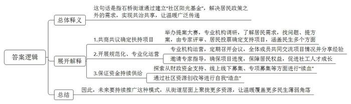
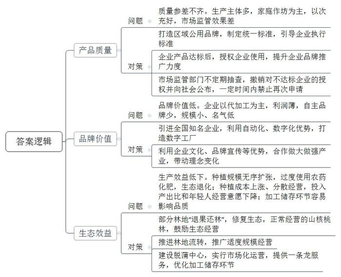
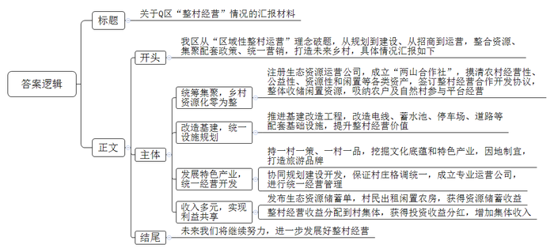

# 2023年公务员多省联考《申论》题（海南B卷）

<!-- gwy:overview:start -->
> **海南 · 2023 · 申论 · B类** ｜ 4 题 · 图片 4 处 · 答案随题折叠

导航：[题目](#题目) · [材料 1](#材料-1)
<!-- gwy:overview:end -->

> 候选采集稿。参考答案及解析来自粉笔页面，不代表官方答案或真实高分答卷；来源使用许可与原卷对应关系仍需人工核实。

## 给定材料

### 材料 1

椰林社区是典型的“村改社区”。为做好“村改居”后半篇文章，近年来，椰林社区以“近邻”为基、“聚邻”为要、“惠邻”为本，通过做优做实“党建+”邻里中心建设，提升社区综合治理水平。

走进椰林社区“党建+”邻里中心的党群服务中心，这里窗明几净、视野开阔。升级改造后，一改此前窗口办公的风格，开放式的办公区更加亲民，营造出面对面服务的温馨氛围。

在“党建+”邻里中心建设过程中，椰林社区按照“去形式化、去机关化、去办公化”的原则，打造“一心多点”便民服务圈。改造后，社区党群服务中心办公空间占比减少80%。党支部袁书记说：“虽然办公空间减少了，但便民服务却增加了，我们引进了政务服务自助一体机，编排印制社区便民服务联络卡，开设便民事项预约热线，为群众办事提供更多便利。”

居家养老服务照料中心是椰林社区“党建+”邻里中心建设的重要一环。今年74岁的谢阿姨一有空就会到照料中心同邻居们一起休闲娱乐、话家常。除了新建照料中心，还配备了社区食堂、儿童之家、亲子阅读室及早教托育中心等8个功能区域，并引进第三方专业机构运营。

椰林社区进一步延伸拓展服务功能，立足本土文化，设计提炼社区独具特色的文化标识，建成社区乡村记忆馆，推动社区大学生“反哺”基地、椰林茶产学研基地落地，增设人才驿站等阵地，推动青年人才走进椰林。

目前，椰林社区正全面推进“红色网格化”管理，推动党小组建立在网格上、党员沉到网格中、处置融入网格里，成立社区邻里先锋队，选聘32户党员中心户、8名党员楼栋长，按照每人挂钩联系10-20户群众，组织党员认领责任片区，建立“社区党组织—网格党小组—党员楼栋长—党员中心户”一贯到底的穿透式组织体系，将党组织的服务延伸至院落楼栋、居民家庭，实现邻里良性互动。党员中心户家门口都挂有用于亮身份的责任牌。“看到这个红色的牌子，立刻就感受到自己作为一名党员的责任。”椰林社区党员梁女士说。

与此同时，椰林社区建成3个二级网格党群服务站，实现二级网格驻点办公，提供前移帮办代办便民服务，并建立网格日巡查制度，通过就近设、入户帮、上门办，将儿童之家、医疗护理等服务项目送到家。

为优化治理队伍，椰林社区坚持以职业化为基础、以专业化为方向，选聘一批网格长，通过“老带新”一对一帮带，加速提升网格员综合素养，同时建立社区人才储备库，引入致和社工、亿家社工等社会公益组织，着力提升社区治理能力。

在推深做实党建引领网格化管理的基础上，椰林“党建+”邻里中心拓宽社群参与渠道，完善诉求表达平台。在线下，设置居民意见箱，设立部门轮值室，主动对接“两代表一委员”、纪工委等部门，定期开放接访群众；还设置邻里会事厅，为民众议事解难题提供多元共商平台。在线上，依托社区公众号开通邻里会事留言板，利用“微监督”小程序及时公开居务情况，实时收集群众诉求和意见。

“不用到医院，在家门口的卫生健康服务站就能完成心电图、血常规、尿酸等一系列体检检查。”椰林社区“党建+”邻里中心卫生健康服务站李站长说。该卫生健康服务站由街道和社区共建，通过完善“病有所医”配套，推动优质卫生健康资源和服务人员“双下沉”，让社区居民在家门口就能享受到就诊、体检、取药、医保结算一体化的医疗卫生服务。

为进一步提升社区生活品质，增强群众幸福感与获得感，椰林“党建+”邻里中心坚持服务活动常态化，今年来累计开展了“粽叶飘香”“爱在重阳”等主题活动20余场，其他日常活动60余场，参与人数超4000人次。此外，社区以文化认同为切入点，绘制景观墙，既展示了“爱乡邻·爱椰林”的“聚邻”文化，又扮靓了村居颜值。

### 材料 2

1.2米宽的木床、一个衣柜和一张单人书桌，4平方米的卧室被塞得满满当当，但15岁的小王很满足。“这是我第一张书桌，床也终于不塌了。”他用力在床上坐了坐，展示着新床的扎实。“小王家4口人，他和妹妹以及患病的姑姑，全靠低保和父亲做零工维持生活。”冶金社区杜书记至今记得小王卧室以前的样子，“衣服、书全部堆在床上、地上，床板中间还有两个大洞。”

石桥街道办易主任介绍说，过去，街道也曾收到社会捐赠，但资金有限，援助面小，且大多是送钱送米油等传统方式。在街道，和小王家类似的困难家庭还有不少。他们能享受政府兜底政策，但生活仍被重病、收入低、老人无人赡养等问题缠绕。对这些情理之中、政策之外的难事，我们看在眼里，急在心里。为此，我们成立了一个街道级社区服务中心，期望在街道层面聚拢更多资源。

2020年市慈善总会对石桥街道社区服务中心进行实地考察，并决定在石桥街道正式成立全市首个街道级“社区阳光基金”，市、区两级慈善总会共提供资金80万元，多家爱心企业联合捐赠了36万元，再加上街道原有的慈善资金和居民捐款，一共筹集了137万元资金和价值15万元的物资。

有了资金，该用在哪儿？怎么用？经过街道、社会组织和居民的共同商议，石桥街道“幸福家园社区阳光基金”社区公益提案大赛应运而生。“让专业的社工机构和社会组织到社区走访调研，了解居民需求，找准社区问题，拿出解决方案，再通过专家评审、居民投票决定支持哪个项目。这样既能有效回应居民需求，也能让居民参与到社区治理中。”易主任说。

第一届提案大赛共征集到80个公益项目，并最终确定支持23个项目，涵盖特殊困难人群帮扶、助学助困、关爱妇女儿童、养老服务、青少年心理健康服务等多个方面。

“征集到项目只是第一步，真正的工作还在后面。”美和社会工作服务中心负责人小李说。与以往直接到社区开展服务工作不同，石桥街道将基金支持项目运营工作交给美和社会工作服务中心。小李每个月都会召开阳光基金项目推进会，召集参与项目的社会组织成员、街道社区代表和居民代表，共同交流项目进展、困难、资金使用情况，并将自己的经验分享给大家。同时，她还邀请相关领域专家前来指导，确保项目进度。

易主任说：“规范化、专业化的运营和指导，不但保障了居民权益，还促进了社工人才成长。如今，街道社区服务中心已汇聚10余家社会组织，培育孵化126支社区自治组织，培育社工人才近300人，还成为本市多所高校社工专业学生的就业见习基地。”

专业的平台、新颖的项目，吸引了更多专业人才的加入。2021年，社工专业的小婷研究生毕业后入职老伙伴养老服务顾问中心。她在这里完成了由大赛催生的“养老顾问”等多个项目，有的项目还获得了民政部的专项支持。

基金设立之初，易主任就担心这个“小钱袋”“瘪”了怎么办？结果居民王大妈自费为“养老顾问”项目印发宣传卡片；一位在石桥街道生活了30多年的居民，将数万元退休金全部捐给了基金，“这些捐款，就用在我居住的地方，怎么用都看得见摸得着，非常有意义。”居民的言行让易主任对基金的能量有了新的认识，也促使他思考如何让每一个参与者、受益者都成为基金的“代言人”。

2021年9月，石桥街道开展了“社区阳光基金”募捐活动。数十名志愿者和23家爱心企业参与到线下义卖、义诊、口腔检查、金融咨询等服务活动中，仅3天时间，便有1.1万人次捐款捐物总计超过50万元。此外，石桥街道还在探索从财政资金支持、线上线下募集、专项募集、社区资源创收等方面进行自我“造血”和“续血”，“小钱袋”不“瘪”的目标已基本实现。

更让人欣慰的是，在第二届社区公益提案大赛中，有不少项目都是居民自己的点子。辖区内民营医院负责人希望能为困难老人提供上门医疗服务，热爱舞蹈的蔡阿姨想组建社区舞蹈队让更多独居老人“动起来”……一个个普通居民正借助基金的力量，回报自己生活成长的地方。一个个项目让人真切感受到“社区阳光基金”背后的意义——让温暖传递到更多角落。

### 材料 3

2022年本应是L县山核桃丰产的大年，但由于高温干旱，产量只是略有增加。虽然产量受影响，但效益却创下了新高，这背后是该县山核桃的转型升级之路。

多年来，L县山核桃产业生产主体众多，很多是家庭作坊，质量参差不齐，以次充好并不鲜见。相关部门不断加强对山核桃销售市场的监管，但收效甚微。“为此，我们决定制定统一的标准，鼓励、引导、带动企业执行这个标准。”L县农业农村局古局长介绍。

2021年，L县发布“天目”农产品区域公用品牌，覆盖包括山核桃在内的众多农产品。县政府委托省山核桃产业协会牵头制定“天目”山核桃系列标准。9月，“天目”山核桃系列标准体系对外发布，包括炒制山核桃、手剥类山核桃和山核桃仁3个标准。标准起草人之一、省山核桃产业协会蔡秘书长说：“在山核桃领域20多个标准中，我们这次制定的标准是最高的。”

“要获得‘天目’品牌使用授权，企业需要申请，产品要符合我们的标准。”古局长说。目前已有8家山核桃企业获得授权，L县太康炒货食品厂就是其中之一。“现在，我们有两款产品用了‘天目’品牌。”程厂长说，“这两款山核桃的品质是我们产品中最好的。”获得“天目”品牌使用授权后，程厂长感受最深的是品牌推广的力度大大提升。“‘天目’需要好的产品来支撑，我们也需要‘天目’这个公共品牌提升消费者的认可度。”

“市场监管部门会不定期抽查，如果授权企业的‘天目’产品不符合相关标准，将撤销授权并向社会公布，同时在一定时间内禁止该企业再次审请。”古局长表示。

L县山核桃加工企业有280多家，年加工能力3万吨，光是龙水镇就聚集了170余家炒货食品加工产业链企业。但这些企业大多是给品牌企业代加工，尽管做自己品牌的也有，然而规模、名气都不大，没有一个家喻户晓的品牌。蔡秘书长说：“为品牌企业做代加工利润薄，只有更多品牌企业成长起来，L县山核桃的品牌价值才会更大，才能分享到山核桃产业带来的更多效益。”

2022年，天生记总部落户龙水镇，L县终于有了第一个具有全国知名度的坚果类品牌。天生记杨总经理深耕坚果领域20多年，他说，将总部从省城迁到L县，不仅有公司发展的考量，也有助力L县山核桃产业发展的情怀。

透过玻璃，能看到天生记山核桃加工生产的每一个环节，自动化、数字化程度很高。“没有什么不能看的，每一个环节都经得起检验。”杨总经理说，数字工厂已于去年9月初投用，如果L县其他山核桃加工企业有打造数字工厂的需求，他们愿意提供帮助。

“看着都是山核桃，但其实有很多不同的地方，在企业文化、品牌宣传等方面，天生记更有优势。”在程厂长看来，大家可以合作，一起将山核桃产业做强做大，“如果整个市场能做得更大，效益进一步提升，大家都可以从中受益。”而在古局长眼里，天生记的到来，更为重要的是“带来理念的变化”，包括规范经营、现代化生产、市场营销、科技研发等。

几年前，因山核桃种植规模无序扩张，加之过度使用农药、化肥，导致山坡植被大面积破坏、水土流失严重，山核桃品质逐年下降。L县痛定思痛，于2019年9月起开展了一场生态修复行动，“退果还林”2万亩，由村集体看管，禁止经营活动。正常经营的山核桃林，则鼓励生态经营，推广自然落果，不滥用农药化肥，减少人为干预。L县农林技术推广中心李主任说：“生态经营逐步推广使山核桃林的产出更稳定，品质也更好。”

为了提升山核桃林的生产效益，L县近年还在推进山核桃林流转，推广适度规模经营。“近年来，由于种植成本上涨、分散经营等原因，山核桃林的投入产出比持续下降，年轻一辈经营山核桃林的意愿也持续下降。”李主任说，“规模经营更有利于农业机械和数字技术应用，能更好地实施科学种植与培育，降低生产成本、优化投入产出比。”

中间的加工储存环节，L县也在求变。山核桃脱蒲的汁液碱性很强，乱排放对环境有影响。晒干、存储环节没做好，山核桃品质就会受影响。“脱蒲中心可以实现山核桃脱蒲、晒干、存储、销售‘一条龙’服务。”古局长介绍，“这个中心由政府建设，实行市场化运营。农户将采收的山核桃送到中心脱蒲后，可以直接将山核桃存储在这里的仓库。仓库是数字化管理，精准地对温度、湿度等进行控制，山核桃存储在这里比存放在家里更妥当。”

### 材料 4

国庆假期，Q区莲花未来乡村铺里自然村路溪社房车露营基地天天客满，住宿、露营、烧烤、看星星等“房车+”新玩法吸引了大批游客前往体验。

眼下，铺里自然村是Q区“炙手可热”的村庄之一，连同周边的涧峰、五坦等大大小小的自然村，共同组成莲花未来乡村。去年底，在“国际花园社区”的角逐中，莲花未来乡村战胜32个国家的22座城市和34个项目拔得头筹。

铺里村的脱颖而出，离不开多年来的美丽乡村建设，但乡村面貌发生根本改变，仅靠此并不够。面对生态资源难变现、转化方式少等难题，整村经营应运而生。“农村生态资源丰富，但存在资源碎片化、变现难的问题，又缺乏后续经营。”Q区发改局局长Z道破玄机，正是从“区域性整村运营”理念破题，从规划到建设、从招商到运营，将碎片化的资源整体打包、碎片化的政策集聚配套、碎片化的经营统一营销，打造未来乡村。

大部分农村，缺少开发主体。为此，Q区成立康养生态资源运营有限公司和农业生态资源运营有限公司，作为“两山合作社”的平台公司，注册资金3亿元，通过它们摸清经营性资产、公益性资产、资源性资产，以及村民长期闲置不用的资产，整体收储农村闲置资源。

目前，“两山合作社”和8个村签订整村经营合作开发协议，收储闲置农用地13300多亩、闲置农房135幢、林地700余亩、山塘水库6座，吸引1429户农户、20个村集体参与生态资源平台经营。

有500多年历史的Q区黄坛口乡茶坪村，完成了有史以来规模最大的基建改造工程。茶坪村党支部书记L说：“去年以来村里工程不断，电线上改下、蓄水池扩容、停车场新建、道路拓宽，基础设施配套再上一个台阶。”Q区重点项目建设服务中心副主任Y指出，“在掌握一个村绝大多数资源后，再进行统一规划和统一基础配套，提升村庄的经营价值。”

2021上半年，东溪镇天坑村通过整村经营挖掘少数民族村的特色底蕴，凭借“畲族风情”特色品牌成功入选国家AAA级旅游景区名单。正如每家公司都有适合自己的领域，每个村的经营方向也不一样。以“孟姜记忆，邂逅西周”为主题的Q区云溪乡孟姜村，是因地制宜打造乡村品牌的一个生动案例，在这里，古渡、古塔、古墓带给当地宝贵的风景和文化资源。在配套建设方面，Q区投入4000万元，打造沿江公路的样板，并种植百亩粉黛草形成花海景观。国庆假期，仅孟姜村黄家山花园驿站就吸引游客2.2万余人次。西周古墓的考古发掘入围2021年度全国十大考古新发现终评，得天独厚的自然和文化资源，为打造品牌提供了沃土。

在Q区，越来越多的乡村以“整村经营”的理念，从本区域的个性、特色出发，实现山水与人文相容、古老与现代交织，提高自己的价值。在挖掘当地村庄文化底蕴和特色产业的基础上，整村经营结合未来乡村建设，按照一村一策、一村一品的原则，制定村庄经营发展的建设方案，在规划、建设、开发上协同，保证村庄建设格调统一，推进村庄特色产业发展。记者发现，整村经营的各试点村中，有“田园·家”“沉浸式康养体验”“初唐风情”等十几个主题。

一些小村整村经营的效果立竿见影。地处Q区最偏远磨子乡党委书记Z说，论生态资源，地处乌溪江库区的磨子乡优势明显。“但论乡村发展，大山深处的小山村，因为交通不便很吃亏，更需要做好经营。”

在磨子乡金台村角坵自然村这个只有15户人家的小村里，包下高端民宿“欢庭·行云居”的一幢别墅需要2999元，但依然有游客愿意“一掷千金”。2021年，康养生态资源运营有限公司和Z省联众文旅集团合资成立Q区众康文旅发展有限公司，专门负责“欢庭·行云居”的后续经营。“欢庭·行云居”民宿保留了乡土风格，又不失设计的匠心。每一幢楼都以古诗词命名。村口的停车场停满了车，民宿里摆着茶席，游客举着手机，拧着各种造型自拍，大山深处冉冉升起一个新网红村。

“网红村不少是小村。”Z表示，在整村经营试点中，小村更能体现“整村”优势。尤其是一些小而精的自然村，可以用更少的成本收储整村资源，后期改造、提升以及经营也更易见效。“但整村经营的核心，首先在于村庄是否整体整合了碎片化的资源，并有着整体和长远的经营思路。”

在资源收储过程中，一批农户尝到了甜头。去年，Q区发出了全省首份生态资源储蓄单，莲花镇西山下村村民刘金祥将自己140平方米闲置农房的10年使用收益权存到“两山合作社”统一经营，获得每年5600元的固定利息和区农商银行给予的28万元综合授信额度。黄坛口乡茶坪村村民吴文山197平方米的老房子被收储，租期20年，获得14万多元收益，他说：“老房子已经空了很久，还能租出去，太不可思议了。”在7个试点村中，“两山合作社”每年支付给农户的收储租金近3000万元。农房收储的价格，也从每平方米25元提升到40元。

除了资源储蓄收益，投资收益分红更为可观。整村经营的开发运营收益按约定的全村储蓄资产总额占股比例，分配到村集体。东溪镇天坑村的洋西峦民宿有3类股东，村集体、农户、运营公司分别占股60%、20%、20%。截至今年9月底，经营性收入55万元，除去各类成本，村集体获得分红18.5万元。

## 题目

### 第 1 题

**请根据****“给定资料**1**”，谈谈椰林社区是如何做好“村改居”后半篇文章的。（20分）**

关联材料：材料 1、材料 2、材料 3、材料 4

作答要求：

要求：全面、准确、有条理。不超过300字。

第 1 题 · 答案与解析

**参考答案（粉笔题库参考内容）**

1.优化建设布局，实现近邻。升级改造党群服务中心，开放式办公，面对面服务；打造“一心多点”便民服务圈，增设便民办公服务，建设居家养老、食堂、育幼等功能区，引进专业机构运营；延伸拓展服务功能，提炼文化标识，吸引青年人才。

2.构建多元化社区治理体系，凝聚力量。推进网格化管理，建立党员穿透式组织体系，将服务延伸至院落楼栋、居民家庭；建立二级党群服务站，帮办代办；建立网格日巡查制度，上门服务；网格长职业化、专业化，建立人才储备库，引入社会公益组织，优化治理队伍；拓宽线上线下社群参与渠道、完善诉求表达平台。

3.提供优质服务项目，惠及群众。建立卫生健康服务站，提供一体化医疗服务；坚持服务活动常态化，绘制景观墙。

**解析**

**参考答案说明：**本参考答案从“优化建设布局，实现近邻”“构建多元化社区治理体系，凝聚力量”“提供优质服务项目，惠及群众”三个方面进行了分条撰写。各条答案要点之间在内容上相互并列，没有交叉。

**考点**：概括措施类

**来源**：2023年公务员多省联考《申论》题（海南B卷）

粉笔申论页面对本题只提供「解析视频」入口，该入口是会员推广位，页面无视频地址与文字解析。

### 第 2 题

**请根据****“给定资料**2**”，谈谈对画线句子“让温暖传递到更多角落”的理解。（20分）**

关联材料：材料 1、材料 2、材料 3、材料 4

作答要求：

要求：全面、准确、有条理。不超过300字。

第 2 题 · 答案与解析

**参考答案（粉笔题库参考内容）**

这句话是指石桥街道通过建立“社区阳光基金”，解决居民政策之外的需求，实现共治共享，让温暖广泛传递。具体来说：

1.共商共议确定扶持项目。举办提案大赛，专业机构调研，了解居民需求，找问题、提方案，由专家评审、居民投票确定支持项目，涵盖民生多个方面。2.开展规范化、专业化运营。专业机构运营，定期召开会议，全体成员共同交流项目情况并分享经验；邀请专家指导，确保项目进度，保障居民权益，促进社工人才成长。3.保证资金持续供给。探索从财政资金支持、线上线下募集、专项募集等方面进行“续血”；通过社区资源创收等进行自我“造血”。

因此，未来要持续推广这种模式，从街道层面上聚拢更多资源，让温暖覆盖更多民生薄弱角落。

**解析**

**参考答案说明：**（1）思路方面，本参考答案按照词句解释题“总体释义+展开解释+总结”的一般答题思路展开。（2）内容方面，本参考答案先对“让温暖传递到更多角落”进行总体释义，再分别从“共商共议确定扶持项目”“开展规范化、专业化运营”“保证资金持续供给”这三个方面展开解释，总结部分给出了整体对策。

**考点**：词句解释类

**来源**：2023年公务员多省联考《申论》题（海南B卷）

粉笔申论页面对本题只提供「解析视频」入口，该入口是会员推广位，页面无视频地址与文字解析。

### 第 3 题

**请根据****“给定资料**3**”，概括L县山核桃产业发展过程中存在的问题及解决措施。（2****5****分）**

关联材料：材料 1、材料 2、材料 3、材料 4

作答要求：

要求：全面、准确、有条理。不超过400字。

第 3 题 · 答案与解析

**参考答案（粉笔题库参考内容）**

1.问题：质量参差不齐。生产主体多，家庭作坊为主，以次充好，市场监管效果差。对策：打造区域公用品牌，制定统一标准，引导企业执行标准；企业产品达标后，授权企业使用，提升企业品牌推广力度；市场监管部门不定期抽查，撤销对不达标企业的授权并向社会公布，一定时间内禁止再次申请。

2.问题：品牌价值低。企业以代加工为主，利润薄，自主品牌少，规模小、名气低。对策：引进全国知名企业，利用自动化、数字化优势，打造数字工厂；利用企业文化、品牌宣传等优势，合作做大做强产业，带动理念变化。

3.问题：生产效益低下。种植规模无序扩张，过度使用农药化肥，生态退化；种植成本上涨、分散经营，投入产出比和年轻人经营意愿下降；加工储存环节容易影响品质。对策：部分林地“退果还林”，修复生态，正常经营的山核桃林，鼓励生态经营；推进林地流转，推广适度规模经营；建设脱蒲中心，实行市场化运营，提供一条龙服务，优化加工储存环节。

**解析**

**参考答案说明：**答案从“质量参差不齐”“品牌价值低”“生产效益低下”3个方面指出了L县山核桃产业发展过程中存在的问题，并针对每一方面的问题给出了相应的对策。此外，形式方面，本答案做到了分类分条撰写，各条要点之间在内容上是并列关系，没有交叉。

**考点**：多要素组合类

**来源**：2023年公务员多省联考《申论》题（海南B卷）

粉笔申论页面对本题只提供「解析视频」入口，该入口是会员推广位，页面无视频地址与文字解析。

### 第 4 题

**省发改委调研组准备来****Q区调研“整村经营”情况。假如你是区发展改革局工作人员，请根据“给定资料**4**”，拟写一份书面汇报材料。（****35****分）**

关联材料：材料 1、材料 2、材料 3、材料 4

作答要求：

要求：

（1）紧扣资料，内容全面。

（2）准确简明，条理清晰。

（3）不超过500字。

第 4 题 · 答案与解析

**参考答案（粉笔题库参考内容）**

关于Q区“整村经营”情况的汇报材料

我区从“区域性整村运营”理念破题，从规划到建设、从招商到运营，整合资源、集聚配套政策、统一营销，打造未来乡村，具体情况汇报如下：

一、统筹集聚，乡村资源化零为整。注册生态资源运营公司，成立“两山合作社”，摸清农村经营性、公益性、资源性和闲置等各类资产，签订整村经营合作开发协议，整体收储闲置资源，吸纳农户及自然村参与平台经营。二、改造基建，统一设施规划。推进基建改造工程，改造电线、蓄水池、停车场、道路等配套基础设施，提升整村经营价值。三、发展特色产业，统一经营开发。坚持一村一策、一村一品，挖掘文化底蕴和特色产业，因地制宜，打造旅游品牌；协同规划建设开发，保证村庄格调统一，成立专业运营公司，进行统一经营管理。四、收入多元，实现利益共享。发布生态资源储蓄单，村民出租闲置农房，获得资源储蓄收益；整村经营收益分配到村集体，获得投资收益分红，增加集体收入。

未来我们将继续努力，进一步发展好整村经营。

**解析**

**参考答案说明：**（1）格式方面，本参考答案写到了“标题”“正文”两个部分。（2）正文部分，一方面从内容来看，开头部分简单叙述了汇报的背景；主体部分从“统筹集聚，乡村资源化零为整”“改造基建，统一设施规划”“发展特色产业，统一经营开发”“收入多元，实现利益共享”四个方面介绍了Q区“整村经营”的措施；结尾部分指出了未来工作方向。另一方面，形式上，本参考答案做到了分段、分条撰写，整体上条理较为清晰。

**考点**：总结类

**来源**：2023年公务员多省联考《申论》题（海南B卷）

粉笔申论页面对本题只提供「解析视频」入口，该入口是会员推广位，页面无视频地址与文字解析。

